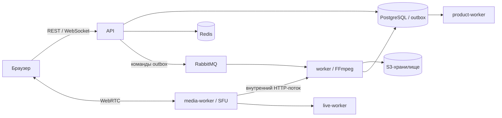

# MeetSpace

**Чаты, видеозвонки и совместная работа в одном пространстве.**

MeetSpace — веб-приложение на Go и React с видеоконференциями через собственный
WebRTC SFU, личными и групповыми чатами, звонками один на один и серверной записью
встреч. Основное развёртывание — Docker Compose на одном хосте.

## Возможности

- Встречи: создание, планирование, приглашения, гостевой доступ, управление участниками,
  микрофоном, камерой и демонстрацией экрана.
- Общение: личные и групповые чаты, вложения, ответы, редактирование, поиск,
  закреплённые сообщения и онлайн-статусы.
- Личные звонки: аудио, видео, демонстрация экрана и история звонков в переписке.
- Рабочее пространство: календарь, папки, настройки аккаунта, переключение аккаунтов
  и уведомления.
- Запись конференций: несколько режимов, обработка, просмотр, скачивание и удаление.
- Дополнительные интеграции: почта, push, календари, транскрипция, субтитры и ИИ-сводки.
  Внешние провайдеры требуют отдельной настройки; в стандартной конфигурации
  используются отключённые функции или режим `noop`.

## С чего начать

| Задача | Документация |
| --- | --- |
| Найти нужное руководство | [Индекс документации](docs/README.md) |
| Установить на новый сервер | [Пошаговый установщик](docs/INSTALLATION.md) |
| Запустить локально | [Локальный запуск](#локальный-запуск) |
| Пользоваться приложением | [Руководство пользователя](docs/USER_GUIDE.md) |
| Разобраться в устройстве проекта | [Архитектура](docs/ARCHITECTURE.md), [потоки данных](docs/DATA_FLOWS.md) |
| Работать с API | [Индекс API](docs/API.md), [коллекция Postman](docs/postman/meetspace/MeetSpace.postman_collection.json) |
| Обновить работающую установку | [Процесс выпуска](docs/RELEASE_PROCESS.md), [откат](docs/ROLLBACK.md) |
| Настроить резервное копирование | [Backup и restore](docs/operations/backup-restore.md) |

## Архитектура

Backend использует Go, Gin, PostgreSQL, Redis, RabbitMQ и S3-совместимое хранилище.
Frontend — React, TypeScript и Vite; контейнер `frontend` раздаёт собранное приложение
через Nginx и проксирует API и WebSocket.

| Сервис Compose | Назначение |
| --- | --- |
| `api` | REST API, авторизация, WebSocket, бизнес-операции, доставка команд через outbox |
| `frontend` | Веб-интерфейс и same-origin proxy |
| `https` | TLS-прокси для локального HTTPS |
| `media-worker` | SFU: комнаты, участники, RTP/RTCP, ICE и передача медиапотоков воркерам |
| `worker` | Recorder: команды записи из RabbitMQ, получение медиа от SFU, FFmpeg, загрузка артефактов |
| `product-worker` | Фоновые задания интеграций, обработка контента, транскрипция и ИИ |
| `live-worker` | Обработка аудио для субтитров во время встречи при включённой функции |
| `postgres` | PostgreSQL 16: пользователи, конференции, чаты, записи, задания и outbox |
| `redis` | События реального времени, присутствие, реестр SFU, блокировки и rate limit |
| `rabbitmq` | Доставка команд `record.start` и `record.stop` |
| `minio` | S3-совместимое хранилище файлов и записей |

В локальном Compose сервис `minio` использует MinIO. Новая установка через
`install.sh` использует SeaweedFS с S3 API под тем же именем сервиса и с теми же
переменными `MINIO_*`. Установщик также настраивает HTTPS и Coturn.



Медиа конференции передаётся между браузером и SFU. Через API проходят управление
и сигнализация. RabbitMQ передаёт команды записи; события интерфейса доставляются
через Redis и WebSocket. Подробнее: [SFU](docs/media-sfu.md),
[realtime](docs/realtime.md), [личные звонки](docs/direct-calls.md).

## Локальный запуск

Нужны Git, Docker Engine или Docker Desktop с Compose v2 и OpenSSL.
Для контейнерного запуска Go, Node.js и FFmpeg на хосте не требуются.
Базовый `docker-compose.yml` предназначен для разработки: он публикует порты
инфраструктуры. Для публичного сервера используйте [установщик](docs/INSTALLATION.md).

### 1. Подготовьте конфигурацию

Для новой копии проекта:

```bash
git clone https://github.com/janickiy/meet-space.git meet-space
cd meet-space
cp .env.example .env
openssl rand -hex 32
```

Сохраните результат генерации в `JWT_SECRET` в `.env` — требуется минимум 32 байта.
Также задайте собственные `POSTGRES_PASSWORD`, `RABBIT_MQ_PASSWORD` и
`MINIO_ROOT_PASSWORD`; для каждого можно отдельно выполнить `openssl rand -hex 32`.
Не добавляйте `.env` в Git. Для существующей установки сохраняйте её настройки и
пароли: изменение `.env` само по себе не меняет учётные данные в созданных томах.

Для запуска с браузером на том же компьютере измените следующие значения:

```dotenv
APP_ENV=local
PUBLIC_FRONTEND_URL=http://localhost:5173
MINIO_PUBLIC_ENDPOINT=http://localhost:9000
WORKER_INTERNAL_URL=http://worker:8090
```

В `MEDIA_NAT_IPS` укажите доступный браузеру IP компьютера с Docker. Для Docker
Desktop и Firefox используйте LAN IP, а не адрес контейнера. Для текущих
конференций используются `MEDIA_*` и порт `50010/udp,tcp`; параметры `WEBRTC_*`
и порт `50000` относятся к прежнему прямому приёму записи воркером.

В local/dev пустые `MEDIA_TICKET_SECRET` и `MEDIA_INTERNAL_SECRET` заменяются
разными производными `JWT_SECRET`. В production нужны отдельные независимые
секреты; установщик создаёт их автоматически.

### 2. Запустите сервисы

Compose требует внешнюю сеть `gateway_default`, даже если отдельный gateway не
используется. Если задан `GATEWAY_NETWORK`, создайте сеть с указанным именем.

```bash
docker network inspect gateway_default >/dev/null 2>&1 ||
  docker network create gateway_default

docker compose config --quiet
docker compose up -d --build \
  api media-worker worker product-worker live-worker frontend

docker compose ps
docker compose exec -T api wget -qO- http://127.0.0.1:8085/health/ready
docker compose exec -T worker wget -qO- http://127.0.0.1:8090/health/ready
```

PostgreSQL, Redis, RabbitMQ и MinIO запустятся как зависимости. При первом запуске
приложение применяет SQL-миграции. Откройте **http://localhost:5173** и создайте
аккаунт. Этот вариант запуска не включает сервис `https`.

Адрес в браузере должен совпадать с `PUBLIC_FRONTEND_URL`, включая протокол,
имя хоста и порт: иначе операции входа и обновления сессии отклоняются с `403`.
HTTP на `localhost` подходит для локальной разработки; для доступа с другого
устройства используйте HTTPS.

### 3. Локальный HTTPS при необходимости

До первого запуска сервиса `https` создайте сертификаты:

```bash
HTTPS_CERT_IP=127.0.0.1 sh scripts/generate-https-certs.sh
```

Для доступа по LAN замените IP на адрес компьютера. Скрипт создаёт локальный CA
и серверный сертификат в `dockers/https/certs/`; повторный запуск заменяет их.
Добавьте `dockers/https/certs/go-recorder-local-ca.pem` в доверенные сертификаты
используемой системы или браузера.
Приватные ключи передавать клиентским устройствам не нужно.

Затем задайте в `.env` одинаковый публичный HTTPS origin:

```dotenv
PUBLIC_FRONTEND_URL=https://localhost:18482
MINIO_PUBLIC_ENDPOINT=https://localhost:18482
```

Для другого устройства вместо `localhost` нужен IP или DNS-адрес, включённый
в сертификат. Пересоберите и запустите весь локальный стек:

```bash
docker compose up -d --build
```

После этого открывайте **https://localhost:18482**. Через этот же origin Nginx
обслуживает подписанные ссылки на записи. `make up` также запускает весь стек
и требует заранее подготовленных сертификатов.

### Локальные адреса по умолчанию

| Компонент | Адрес |
| --- | --- |
| Интерфейс HTTP / HTTPS | `http://localhost:5173` / `https://localhost:18482` — в зависимости от выбранного режима |
| API | `http://localhost:8085` |
| Recorder HTTP | `http://localhost:8090` |
| PostgreSQL | `localhost:5433`, БД и пользователь `go_recorder` |
| Redis | `localhost:6380` |
| RabbitMQ AMQP / management | `localhost:5672` / `http://localhost:15672` |
| MinIO S3 / console | `http://localhost:9000` / `http://localhost:9001` |
| SFU | `50010/udp`, `50010/tcp` |

Внутренние HTTP-порты `media-worker:8091`, `product-worker:8092` и
`live-worker:8093` не публикуются. Пользователи и пароли инфраструктуры берутся
из `.env`. Локальные данные сохраняются в подкаталогах `dockers/`.

## Установка на новый сервер

На новом Linux-сервере из копии репозитория:

```bash
sudo bash install.sh --ref "$(git rev-parse HEAD)"
```

Коммит должен быть опубликован в GitHub: мастер получает отдельную чистую копию
исходников. Без `--ref` репозиторный установщик использует `main`.

Автоматическая подготовка рассчитана на Ubuntu/Debian с `apt` и `systemd`,
архитектуру `amd64` или `arm64`, права root/sudo и интерактивный терминал.
Рекомендуются 4 CPU, 8 ГиБ RAM и диск от 60 ГиБ; перед сборкой нужны как минимум
35 ГиБ свободного места. Требуются домен с одной A-записью и публичный IPv4
на интерфейсе сервера. Условия для DNS, Docker, сертификатов и открытых портов
перечислены в [инструкции установки](docs/INSTALLATION.md).

Мастер собирает и проверяет образы, создаёт секреты, настраивает HTTPS/TURN,
применяет миграции и запускает приложение. Это инструмент первой установки.
Для обновлений используйте [процесс выпуска](docs/RELEASE_PROCESS.md),
[проверки перед выпуском](docs/PRODUCTION_LAUNCH_CHECKLIST.md) и
[инструкцию отката](docs/ROLLBACK.md).

## Запись конференций

Текущий путь записи: **браузер → SFU → внутренний HTTP-поток → recorder-worker
→ FFmpeg → S3**. Воркер получает поток событий и RTP от SFU в формате NDJSON.
Прежний прямой WebRTC ingest сохранён в коде для совместимости и не является
основным путём записи конференций.

| Режим | Результат |
| --- | --- |
| `composite` | Общее видео MP4 с H.264/AAC и JPEG-превью |
| `screen_focus` | MP4 с акцентом на демонстрации экрана и JPEG-превью |
| `audio_only` | Аудио AAC в контейнере `final.mp4`, без видеопревью |
| `individual_tracks` | Смешанное аудио MP4 и ZIP исходных дорожек IVF/OGG с манифестом |

Основные маршруты, требующие авторизации:

| Метод | Путь | Действие |
| --- | --- | --- |
| `POST` | `/api/v1/conferences/{id}/recordings` | Начать запись |
| `GET` | `/api/v1/conferences/{id}/recordings` | Список записей |
| `GET` | `/api/v1/conferences/{id}/recordings/{recordingId}` | Состояние и готовые файлы |
| `POST` | `/api/v1/conferences/{id}/recordings/{recordingId}/stop` | Остановить запись |
| `DELETE` | `/api/v1/conferences/{id}/recordings/{recordingId}` | Удалить запись |

Права проверяются для каждой операции. Остановка записи асинхронна: после неё
идут финализация и загрузка. До готовности API может отвечать `202`; ссылки
скачивания берутся из `files[].url` готовой записи.

Артефакты сохраняются по ключам
`recordings/{conferenceId}/{recordId}/artifacts/{token}/…`. Локальные рабочие
файлы находятся в `STORAGE_PATH` (`/storage` в контейнере, `dockers/storage/data`
в локальном Compose). При `RECORDING_KEEP_LOCAL=false` они удаляются после
успешной загрузки и подтверждённого сохранения состояния готовности в БД.

Параметры разрешения, FPS, длительности и параллельности — `RECORDING_*` в
[`.env.example`](.env.example). Режимы, обработка временных меток и ограничения
описаны в [руководстве по записи](docs/conference-recording.md).

## Разработка и обслуживание

### Сборка и проверки

Версия Go — **1.26.9** ([go.mod](go.mod)). Для frontend поддерживаются Node.js
`^22.22.2 || ^24.15.0 || >=26.0.0` ([package.json](frontend/package.json)).

Из корня проекта:

```bash
go build ./...
go vet ./...
npm --prefix frontend ci
npm --prefix frontend run check
```

`npm run check` проверяет форматирование, типы TypeScript и production-сборку.
Дополнительные проверки зависимостей и выпуска описаны в
[GitLab CI](.gitlab-ci.yml) и [настройках CI](docs/gitlab-ci-variables.md).

### Frontend с горячим обновлением

После подготовки `.env` для HTTP и внешней Docker-сети:

```bash
docker compose stop frontend
docker compose up -d --build api media-worker worker product-worker live-worker
npm --prefix frontend ci
npm --prefix frontend run dev
```

Vite занимает порт `5173` и проксирует `/api`, включая WebSocket, в
`http://127.0.0.1:8085`. Открывайте `http://localhost:5173`, соответствующий
`PUBLIC_FRONTEND_URL`. Контейнерный frontend на этом порту должен быть остановлен.

### Миграции

SQL-файлы находятся в `database/migrations/`. Мигратор применяет `*.up.sql`
по порядку, сохраняет контрольные суммы в `release_schema_migrations` и
использует блокировку PostgreSQL. Уже применённые файлы изменять нельзя —
создавайте новую миграцию.

Локально `AUTO_MIGRATE` по умолчанию включён. В production миграции выполняются
отдельным шагом; при `AUTO_MIGRATE=false` приложение проверяет их наличие и
контрольные суммы. Чтобы явно запустить миграции локально после старта PostgreSQL:

```bash
make migrate-up APP_NETWORK=meet-space_app-network
```

Имя выше соответствует каталогу `meet-space` без переопределения Compose project.
Если имя проекта другое, укажите его фактическую сеть. Значение Makefile
по умолчанию — `go-recorder_app-network`. При запуске Go непосредственно на хосте
также нужно заменить Docker-адрес PostgreSQL на `localhost:5433`.

### Диагностика локального стека

```bash
docker compose ps
docker compose logs --tail=100 api worker media-worker product-worker live-worker
make doctor
```

`make doctor` проверяет локальные контейнеры, RabbitMQ и HTTP API/recorder.
Для установки через мастер используйте созданный `manage.sh`; команды описаны
в [руководстве установки](docs/INSTALLATION.md).

Для Delve доступны `make debug-api`, `make debug-worker`, `make debug-both`.
После `make debug-stop` обычные API и worker нужно запустить заново:

```bash
docker compose up -d api worker
```

Общие инструкции сопровождения: [операционный runbook](docs/operations/README.md),
[резервное копирование](docs/operations/backup-restore.md).

## Структура репозитория

```text
cmd/                       Точки входа API, воркеров и CLI
internal/app/              Сборка зависимостей и обработчики приложения
internal/config/           Конфигурация из переменных окружения
internal/domain/           Модели, контракты и доменные ошибки
internal/usecase/          Бизнес-операции
internal/infrastructure/   БД, Redis, RabbitMQ, S3, SFU, FFmpeg, провайдеры
internal/transport/        HTTP, WebSocket и внутренние протоколы
database/migrations/       SQL-миграции
frontend/                  React + TypeScript + Vite
dockers/                   Dockerfile, конфигурация и локальные данные
scripts/install/           Установка из исходников
scripts/release/           Сборка, выпуск и откат
docs/                      Документация и коллекция Postman
install.sh                 Вход в мастер установки
docker-compose.yml         Локальный стек
.env.example               Шаблон конфигурации
Makefile                   Команды разработки и выпуска
```

### Документация по функциям

- [Авторизация и сессии](docs/PERSISTENT_AUTH.md), [управление аккаунтами](docs/account-management.md).
- [Личные сообщения](docs/PERSONAL_MESSAGES.md), [группы](docs/GROUP_CHATS.md),
  [поиск в переписке](docs/personal-chat-search.md), [папки](docs/PERSONAL_FOLDERS.md).
- [Настройки аудио и видео](docs/AUDIO_VIDEO_SETTINGS.md), [интеграции и обработка контента](docs/content-integrations.md).
- [Frontend](docs/FRONTEND_GUIDE.md), [развёртывание](docs/DEPLOYMENT.md).

## Лицензия

MeetSpace распространяется под [Apache License 2.0](LICENSE).
Copyright 2026 Яницкий Александр — [janickiy.com](https://janickiy.com/).
Сведения об авторстве приведены в [NOTICE](NOTICE).
Сторонние компоненты сохраняют собственные лицензии и уведомления об авторстве.
