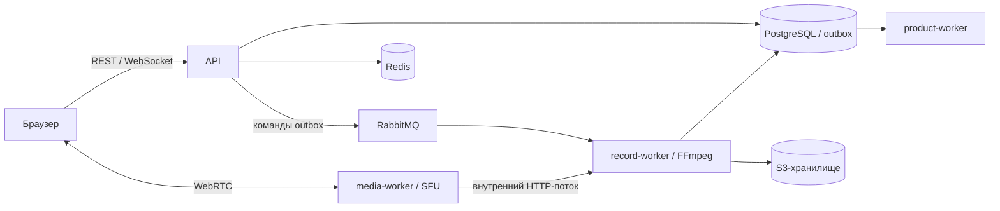

# MeetSpace

> При обновлении старой установки сначала выполните [переход на record-worker и миграцию 000037](docs/operations/speech-removal-upgrade.md). Миграция необратимо удаляет данные функций речи; требуются проверенная резервная копия и остановка старых процессов. Простой откат образов после неё не поддерживается.

**Чаты, видеозвонки и совместная работа в одном пространстве.**

MeetSpace — платформа для корпоративного общения и совместной работы на Go и
React: видеовстречи через собственный WebRTC SFU, личные и групповые чаты,
звонки один на один, календарь, файлы и уведомления. Серверная запись и обработка
встреч дополняют общение, но не ограничивают назначение сервиса.
Основное развёртывание — Docker Compose на одном хосте.

## Возможности

- Встречи: создание, планирование, приглашения, гостевой доступ, управление участниками,
  микрофоном, камерой и демонстрацией экрана.
- Общение: личные и групповые чаты, вложения, ответы, редактирование, поиск,
  закреплённые сообщения и онлайн-статусы.
- Личные звонки: аудио, видео, демонстрация экрана и история звонков в переписке.
- Рабочее пространство: календарь, папки, настройки аккаунта, переключение аккаунтов
  и уведомления.
- Email-приглашения: письмо приглашённому участнику сразу и напоминание за 3 часа
  до запланированной встречи. SMTP настраивается в мастере установки.
- Запись конференций: несколько режимов, обработка, просмотр, скачивание и удаление.
- Дополнительные интеграции: почта, push и календари.
  Внешние провайдеры требуют отдельной настройки; в стандартной конфигурации
  используются отключённые функции или режим `noop`.

## С чего начать

| Задача | Документация |
| --- | --- |
| Найти нужное руководство | [Индекс документации](docs/README.md) |
| Установить на новый сервер | [Пошаговый установщик](docs/INSTALLATION.md) |
| Запустить локально | [Локальный запуск](#локальный-запуск) |
| Пользоваться приложением | [Руководство пользователя](docs/USER_GUIDE.md) |
| Разобраться в устройстве проекта | [Архитектура](docs/ARCHITECTURE.md), [потоки данных](docs/DATA_FLOWS.md) |
| Работать с API | [Каталог в README](#api-meetspace), [примеры](docs/API.md#быстрый-старт-rest), [полный справочник](docs/API_REFERENCE.md), [Postman](docs/postman/meetspace/MeetSpace.postman_collection.json) |
| Обновить работающую установку | [Процесс выпуска](docs/RELEASE_PROCESS.md), [откат](docs/ROLLBACK.md) |
| Настроить резервное копирование | [Backup и restore](docs/operations/backup-restore.md) |

## Архитектура

Backend использует Go, Gin, PostgreSQL, Redis, RabbitMQ и S3-совместимое хранилище.
Frontend — React, TypeScript и Vite; контейнер `frontend` раздаёт собранное приложение
через Nginx и проксирует API и WebSocket.

| Сервис Compose | Назначение |
| --- | --- |
| `api` | REST API, авторизация, WebSocket, бизнес-операции, доставка команд через outbox |
| `frontend` | Веб-интерфейс и same-origin proxy |
| `https` | TLS-прокси для локального HTTPS |
| `media-worker` | SFU: комнаты, участники, RTP/RTCP, ICE и передача медиапотоков воркерам |
| `record-worker` | Recorder: команды записи из RabbitMQ, получение медиа от SFU, FFmpeg, загрузка артефактов |
| `product-worker` | Напоминания, email/push и синхронизация календарей |
| `postgres` | PostgreSQL 16: пользователи, конференции, чаты, записи, задания и outbox |
| `redis` | События реального времени, присутствие, реестр SFU, блокировки и rate limit |
| `rabbitmq` | Доставка команд `record.start` и `record.stop` |
| `minio` | S3-совместимое хранилище файлов и записей |

В локальном Compose сервис `minio` использует MinIO. Новая установка через
`install.sh` использует SeaweedFS с S3 API под тем же именем сервиса и с теми же
переменными `MINIO_*`. Установщик также настраивает HTTPS и Coturn.



Медиа конференции передаётся между браузером и SFU. Через API проходят управление
и сигнализация. RabbitMQ передаёт команды записи; события интерфейса доставляются
через Redis и WebSocket. Подробнее: [SFU](docs/media-sfu.md),
[realtime](docs/realtime.md), [личные звонки](docs/direct-calls.md).

## API MeetSpace

API охватывает весь продукт: аккаунты и сессии, встречи, личные и групповые
переписки, звонки, файлы, календарь, уведомления, папки и обработку контента.
Запись конференций — только один из разделов.

| Где искать | Содержание |
| --- | --- |
| [Обзор и примеры](docs/API.md#быстрый-старт-rest) | Авторизация, создание встречи, диалога, отправка и закрепление сообщения |
| Каталог ниже | Все **маршруты `/api/v1`**, включая HTTP-входы WebSocket |
| [Полный справочник](docs/API_REFERENCE.md) | Поля запросов, ответы, доступ, ошибки и исходники всех 177 серверных контрактов |
| [Postman-коллекция](docs/postman/meetspace/MeetSpace.postman_collection.json) | Готовые описания запросов и иллюстративные ответы |
| [Realtime](docs/realtime.md), [SFU](docs/media-sfu.md), [личные звонки](docs/direct-calls.md) | События, сигнализация и передача аудио/видео |

### Адреса, доступ и формат

Локальный base URL через frontend: `http://localhost:5173/api/v1`; при прямом
доступе к локальному API — `http://localhost:8085/api/v1`. На публичном сервере
используйте `https://<ваш-домен>/api/v1` того же origin, что и веб-интерфейс.

JSON использует camelCase и `Content-Type: application/json`. В путях ниже
`:id`, `:messageId`, `:recordingId` и другие параметры заменяются реальными
идентификаторами. Ограничения полей, курсоры и query-параметры перечислены в
[полном справочнике](docs/API_REFERENCE.md).

Большинство операций требуют `Authorization: Bearer <accessToken>`.
Регистрация, вход, просмотр публичного приглашения и гостевой вход имеют
отдельные правила. Cookie-операции `refresh`, `accounts/list`, `accounts/switch`
и постоянный `logout` работают с серверной сессией; cookie не заменяет Bearer
для остальных REST-запросов. Браузерные auth-запросы проверяют точный Origin,
включая схему и порт. Подробнее: [авторизация](docs/auth-conferences-api.md),
[постоянные сессии](docs/PERSISTENT_AUTH.md).

Гостевой токен ограничен одной встречей: он не открывает личные и групповые
диалоги, папки или личные звонки. Членство, допуск и роли проверяются для каждой
операции; знание UUID не даёт доступа к чужому ресурсу.

### Первый запрос

Пример для локального стенда с уже созданным аккаунтом. Замените email и пароль;
не сохраняйте реальные пароли и токены в репозитории.

```bash
API=http://localhost:5173/api/v1

curl --fail-with-body -X POST "$API/auth/login" \
  -H 'Content-Type: application/json' \
  -d '{"email":"you@example.com","password":"<your-password>"}'

# Скопируйте accessToken из ответа входа, не из ответа регистрации.
ACCESS_TOKEN='<accessToken>'
curl --fail-with-body "$API/auth/me" \
  -H "Authorization: Bearer $ACCESS_TOKEN"
```

Вход возвращает `accessToken`, `tokenType`, `expiresIn` и `user`.
Форма успешного ответа зависит от endpoint: часто используются `status`,
`item` или `items`, но, например, списки диалогов и уведомлений возвращают
собственную структуру без `status`. Типичная ошибка:
`{"status":"failed","message":"…"}`. Основные коды: `400` — JSON,
`401` — аутентификация, `403` — права/Origin, `404` — ресурс недоступен,
`409` — конфликт состояния, `413/415` — размер/формат тела,
`422` — параметры, `429` — лимит запросов. Учитывайте `Retry-After`.
Ошибки зависимостей могут давать `500/503/504`; повторять изменяющие запросы
безопасно только с предусмотренной контрактом идемпотентностью.

### Каталог маршрутов

<details>
<summary>Развернуть маршруты API по разделам</summary>

#### Аккаунты, сессии и управление встречами

| Метод | Путь | Назначение |
| --- | --- | --- |
| `POST` | `/api/v1/auth/register` | Регистрация учетной записи. |
| `POST` | `/api/v1/auth/login` | Вход и сохранение браузерного сеанса. |
| `POST` | `/api/v1/auth/refresh` | Новый access token из постоянной сессии. |
| `POST` | `/api/v1/auth/accounts/list` | Список сохраненных аккаунтов браузера. |
| `POST` | `/api/v1/auth/accounts/switch` | Выбрать активный аккаунт. |
| `POST` | `/api/v1/auth/logout` | Отозвать выбранный постоянный сеанс. |
| `GET` | `/api/v1/auth/me` | Профиль текущего пользователя. |
| `PATCH` | `/api/v1/auth/me` | Изменить отображаемое имя. |
| `PUT` | `/api/v1/auth/me/avatar` | Заменить собственное фото: бинарный PNG/JPEG до 2 МиБ. |
| `DELETE` | `/api/v1/auth/me/avatar` | Удалить собственное фото профиля. |
| `GET` | `/api/v1/users/:id/avatar/content` | Фото профиля, доступное только зарегистрированным авторизованным пользователям. |
| `DELETE` | `/api/v1/auth/me` | Удалить аккаунт с проверкой пароля. |
| `POST` | `/api/v1/auth/session` | Перенести существующий доступ в постоянную сессию. |
| `POST` | `/api/v1/conferences` | Создать конференцию. |
| `GET` | `/api/v1/conferences` | Доступные конференции. |
| `GET` | `/api/v1/conferences/:id` | Карточка конференции. |
| `POST` | `/api/v1/conferences/:id/start` | Начать created/scheduled конференцию. |
| `POST` | `/api/v1/conferences/:id/finish` | Завершить active конференцию. |
| `POST` | `/api/v1/conferences/:id/cancel` | Отменить created/scheduled конференцию. |
| `POST` | `/api/v1/conferences/:id/join` | Создать/возобновить членство. |
| `POST` | `/api/v1/conferences/:id/leave` | Выйти из конференции. |
| `GET` | `/api/v1/conferences/:id/participants` | Список участников; waiting/rejected видны owner/co_host. |
| `GET` | `/api/v1/conferences/:id/participants/me` | Состояние допуска текущего участника. |
| `POST` | `/api/v1/conferences/:id/participants/:participantId/admission` | Принять/отклонить ожидающего участника. |
| `PUT` | `/api/v1/conferences/:id/schedule` | Изменить расписание scheduled конференции. |
| `GET` | `/api/v1/conferences/:id/history` | История finished/cancelled конференции. |
| `GET` | `/api/v1/me/conferences` | Лента конференций пользователя. |
| `GET` | `/api/v1/conference-invites/:code` | Ограниченная карточка по приглашению. |
| `POST` | `/api/v1/conference-invites/:code/join` | Войти по коду приглашения. |
| `PUT` | `/api/v1/conferences/:id/participants/me/media` | Обновить заявленное состояние устройств. |
| `POST` | `/api/v1/conferences/:id/participants/:participantId/moderation` | Управлять участником. |

#### Гостевой доступ

| Метод | Путь | Назначение |
| --- | --- | --- |
| `POST` | `/api/v1/conference-invites/:code/guest` | Войти гостем по приглашению. |

#### Приглашения

| Метод | Путь | Назначение |
| --- | --- | --- |
| `GET` | `/api/v1/conferences/:id/invitation-users` | Найти адресатов приглашения. |
| `POST` | `/api/v1/conferences/:id/invitations` | Поставить доставку приглашений. |

#### Личные и групповые диалоги

| Метод | Путь | Назначение |
| --- | --- | --- |
| `GET` | `/api/v1/users` | Найти пользователей для диалога. |
| `GET` | `/api/v1/conversations` | Список личных/групповых диалогов. |
| `POST` | `/api/v1/conversations/direct` | Открыть или создать личный диалог. |
| `POST` | `/api/v1/conversations/group` | Создать группу с идемпотентностью. |
| `GET` | `/api/v1/conversations/:id` | Карточка диалога. |
| `GET` | `/api/v1/conversations/:id/peer-presence` | Онлайн-статус собеседника. |
| `PATCH` | `/api/v1/conversations/:id/preferences` | Личная настройка уведомлений. |
| `POST` | `/api/v1/conversations/:id/clear-history` | Скрыть прежнюю историю только для себя. |
| `POST` | `/api/v1/conversations/:id/hide` | Скрыть диалог для себя. |
| `GET` | `/api/v1/conversations/:id/pins` | Общие закрепленные сообщения диалога. |
| `PUT` | `/api/v1/conversations/:id/pins/:messageId` | Закрепить доступное текстовое сообщение для диалога. |
| `DELETE` | `/api/v1/conversations/:id/pins/:messageId` | Открепить сообщение диалога. |
| `PATCH` | `/api/v1/conversations/:id` | Изменить имя и описание группы. |
| `DELETE` | `/api/v1/conversations/:id` | Удалить группу. |
| `GET` | `/api/v1/conversations/:id/members` | Список участников группы. |
| `POST` | `/api/v1/conversations/:id/members` | Добавить зарегистрированных участников. |
| `DELETE` | `/api/v1/conversations/:id/members/:userId` | Удалить участника; admin может удалить только member. |
| `PATCH` | `/api/v1/conversations/:id/members/:userId` | Назначить admin/member. |
| `POST` | `/api/v1/conversations/:id/leave` | Выйти из группы. |
| `POST` | `/api/v1/conversations/:id/ownership` | Передать владение другому участнику; прежний owner становится admin. |
| `POST` | `/api/v1/conversations/:id/read` | Алиас отметки прочитанного. |

#### Сообщения и вложения

| Метод | Путь | Назначение |
| --- | --- | --- |
| `GET` | `/api/v1/conferences/:id/messages` | История сообщений. |
| `GET` | `/api/v1/conversations/:id/messages` | История сообщений. |
| `POST` | `/api/v1/conferences/:id/messages` | Отправить сообщение с идемпотентностью. |
| `POST` | `/api/v1/conversations/:id/messages` | Отправить сообщение с идемпотентностью. |
| `PATCH` | `/api/v1/conferences/:id/messages/:messageId` | Изменить текст сообщения. |
| `PATCH` | `/api/v1/conversations/:id/messages/:messageId` | Изменить текст сообщения. |
| `DELETE` | `/api/v1/conferences/:id/messages/:messageId` | Мягко удалить сообщение. |
| `DELETE` | `/api/v1/conversations/:id/messages/:messageId` | Мягко удалить сообщение. |
| `GET` | `/api/v1/conferences/:id/chat/read` | Текущая граница прочтения. |
| `GET` | `/api/v1/conversations/:id/chat/read` | Текущая граница прочтения. |
| `PUT` | `/api/v1/conferences/:id/chat/read` | Монотонно отметить прочитанное. |
| `PUT` | `/api/v1/conversations/:id/chat/read` | Монотонно отметить прочитанное. |
| `POST` | `/api/v1/conferences/:id/attachments/init` | Создать резервирование вложения. |
| `POST` | `/api/v1/conversations/:id/attachments/init` | Создать резервирование вложения. |
| `PUT` | `/api/v1/conferences/:id/attachments/:attachmentId/content` | Передать байты в зарезервированное вложение. |
| `PUT` | `/api/v1/conversations/:id/attachments/:attachmentId/content` | Передать байты в зарезервированное вложение. |
| `POST` | `/api/v1/conferences/:id/attachments/:attachmentId/finalize` | Проверить и завершить загрузку. |
| `POST` | `/api/v1/conversations/:id/attachments/:attachmentId/finalize` | Проверить и завершить загрузку. |
| `GET` | `/api/v1/conferences/:id/attachments/:attachmentId/download` | Получить способ скачивания вложения. |
| `GET` | `/api/v1/conversations/:id/attachments/:attachmentId/download` | Получить способ скачивания вложения. |

#### Аватары групп и приватное скачивание

| Метод | Путь | Назначение |
| --- | --- | --- |
| `PUT` | `/api/v1/conversations/:id/avatar` | Загрузить аватар группы. |
| `DELETE` | `/api/v1/conversations/:id/avatar` | Удалить аватар группы. |
| `GET` | `/api/v1/conversations/:id/avatar/content` | Прочитать аватар через авторизованный поток. |
| `GET` | `/api/v1/conversations/:id/attachments/:attachmentId/content` | Скачать вложение через авторизованный поток. |

Интерфейс позволяет выбрать PNG, JPEG или WebP до 10 МиБ: перед отправкой
фото уменьшается до 512×512 и обрезается по центру. API независимо проверяет
тип, размер и размеры изображения, перекодирует его в JPEG без исходных
метаданных и сохраняет миниатюру до 256 КиБ. Менять аватар группы могут только
владелец и администраторы; аватар профиля — только его владелец. Приватные фото
не публикуются как общедоступные URL. Для профиля используется отдельная таблица
`user_avatars` (миграция `000036`); при удалении аккаунта фото удаляется.

#### Поиск в диалогах

| Метод | Путь | Назначение |
| --- | --- | --- |
| `GET` | `/api/v1/conversations/:id/messages/search` | Поиск сообщений личного/группового диалога. |
| `GET` | `/api/v1/conversations/:id/messages/:messageId/context` | Контекст сообщения диалога. |

#### Чаты конференций

| Метод | Путь | Назначение |
| --- | --- | --- |
| `GET` | `/api/v1/conferences/:id/chat/info` | Название, описание и права конференционного чата. |
| `GET` | `/api/v1/conferences/:id/chat/members` | Участники чата и presence. |
| `PATCH` | `/api/v1/conferences/:id/chat/info` | Изменить метаданные чата/конференции. |
| `GET` | `/api/v1/conferences/:id/chat/preferences` | Личная настройка уведомлений. |
| `PUT` | `/api/v1/conferences/:id/chat/preferences` | Изменить личную настройку уведомлений. |
| `DELETE` | `/api/v1/conferences/:id/chat/membership` | Выйти из чата конференции. |
| `GET` | `/api/v1/conferences/:id/chat/messages/search` | Поиск сообщений конференции. |
| `GET` | `/api/v1/conferences/:id/chat/messages/:messageId/context` | Окружение найденного сообщения. |
| `GET` | `/api/v1/conferences/:id/chat/materials` | Изображения, файлы или ссылки из сообщений. |
| `GET` | `/api/v1/conferences/:id/chat/pins` | Личные важные сообщения конференции. |
| `PUT` | `/api/v1/conferences/:id/chat/pins/:messageId` | Добавить сообщение в личные важные. |
| `DELETE` | `/api/v1/conferences/:id/chat/pins/:messageId` | Удалить сообщение из личных важных. |

#### Личные звонки

| Метод | Путь | Назначение |
| --- | --- | --- |
| `POST` | `/api/v1/calls` | Позвонить зарегистрированному пользователю. |
| `GET` | `/api/v1/calls/active` | Текущий звонок пользователя. |
| `GET` | `/api/v1/calls/:id` | Состояние звонка. |
| `POST` | `/api/v1/calls/:id/accept` | Принять входящий звонок. |
| `POST` | `/api/v1/calls/:id/decline` | Отклонить входящий звонок. |
| `POST` | `/api/v1/calls/:id/cancel` | Отменить исходящий звонок. |
| `POST` | `/api/v1/calls/:id/end` | Завершить принятый звонок. |
| `POST` | `/api/v1/calls/:id/heartbeat` | Продлить lease звонка. |

#### Личные папки

| Метод | Путь | Назначение |
| --- | --- | --- |
| `GET` | `/api/v1/folders` | Список папок и, опционально, принадлежность элемента. |
| `POST` | `/api/v1/folders` | Создать папку. |
| `PUT` | `/api/v1/folders/order` | Переставить папки. |
| `GET` | `/api/v1/folders/:id` | Карточка папки. |
| `PATCH` | `/api/v1/folders/:id` | Переименовать папку. |
| `DELETE` | `/api/v1/folders/:id` | Удалить папку. |
| `GET` | `/api/v1/folders/:id/items` | Содержимое папки. |
| `GET` | `/api/v1/folder-items` | Доступные элементы для добавления в папку. |
| `PUT` | `/api/v1/folders/:id/items/:kind/:itemId` | Добавить элемент в папку. |
| `DELETE` | `/api/v1/folders/:id/items/:kind/:itemId` | Убрать элемент из папки. |

#### Уведомления

| Метод | Путь | Назначение |
| --- | --- | --- |
| `GET` | `/api/v1/notifications` | Лента уведомлений. |
| `GET` | `/api/v1/notifications/events` | Поток SSE уведомлений. |
| `POST` | `/api/v1/notifications/:notificationId/read` | Отметить уведомление прочитанным. |

#### Интеграции

| Метод | Путь | Назначение |
| --- | --- | --- |
| `GET` | `/api/v1/notifications/preferences` | Настройки каналов и видов уведомлений. |
| `PUT` | `/api/v1/notifications/preferences` | Сохранить полный набор настроек уведомлений. |
| `GET` | `/api/v1/notifications/devices` | Зарегистрированные push-устройства. |
| `POST` | `/api/v1/notifications/devices` | Зарегистрировать push-устройство. |
| `DELETE` | `/api/v1/notifications/devices/:deviceId` | Отозвать push-устройство. |
| `GET` | `/api/v1/integrations/capabilities` | Настроенные провайдеры интеграций. |
| `GET` | `/api/v1/integrations/calendars` | Список календарных подключений. |
| `POST` | `/api/v1/integrations/calendars/mock` | Создать mock-подключение календаря. |
| `GET` | `/api/v1/integrations/calendars/:provider/connect` | Начать OAuth календаря. |
| `POST` | `/api/v1/integrations/calendars/:provider/callback` | Завершить OAuth календаря. |
| `DELETE` | `/api/v1/integrations/calendars/:provider` | Отключить календарь. |
| `GET` | `/api/v1/conferences/:id/calendar` | Календарные события конференции. |

#### Записи конференций

| Метод | Путь | Назначение |
| --- | --- | --- |
| `POST` | `/api/v1/conferences/:id/recordings` | Запросить запись активной конференции. |
| `GET` | `/api/v1/conferences/:id/recordings` | Список записей конференции. |
| `GET` | `/api/v1/conferences/:id/recordings/:recordingId` | Карточка записи и доступные файлы. |
| `DELETE` | `/api/v1/conferences/:id/recordings/:recordingId` | Удалить завершенную запись и ее артефакты. |
| `POST` | `/api/v1/conferences/:id/recordings/:recordingId/stop` | Запросить остановку записи. |

#### Поиск встреч

| Метод | Путь | Назначение |
| --- | --- | --- |
| `GET` | `/api/v1/search` | Поиск по названиям доступных конференций. |

#### Реакции встречи

| Метод | Путь | Назначение |
| --- | --- | --- |
| `POST` | `/api/v1/conferences/:id/reactions` | Разослать временную реакцию. |

#### WebSocket и настройки WebRTC

| Метод | Путь | Назначение |
| --- | --- | --- |
| `POST` | `/api/v1/conferences/:id/ws-ticket` | Получить билет подключения к конференции. |
| `GET` | `/api/v1/conferences/:id/ws` | Открыть канал конференции, сигнализации и media-команд. |
| `GET` | `/api/v1/webrtc/config` | Получить ICE/TURN конфигурацию клиента. |
| `POST` | `/api/v1/ws-ticket` | Получить одноразовый билет глобального канала пользователя. |
| `GET` | `/api/v1/ws` | Открыть глобальный канал диалогов, звонков, уведомлений и присутствия. |

#### Возможности платформы

| Метод | Путь | Назначение |
| --- | --- | --- |
| `GET` | `/api/v1/capabilities` | Функции платформы при текущей конфигурации. |
| `GET` | `/api/v1/admin/summary` | Операционная сводка администратора. |

#### Телеметрия

| Метод | Путь | Назначение |
| --- | --- | --- |
| `POST` | `/api/v1/client-errors` | Принять ограниченный отчет об ошибке браузера. |

</details>

### Реальное время, файлы и фоновые операции

- Для конференции получите билет через `POST /api/v1/conferences/:id/ws-ticket`
  и откройте `/api/v1/conferences/:id/ws?ticket=…`. Для личных/групповых чатов,
  звонков и присутствия используйте `POST /api/v1/ws-ticket` и `/api/v1/ws`.
  Билеты одноразовые; постоянный JWT в URL не передаётся.
- Уведомления приходят через авторизованный fetch-SSE
  `GET /api/v1/notifications/events`. Нужен Bearer-заголовок; передача токена
  в query не поддерживается.
- REST управляет встречами и звонками; аудио, видео и демонстрация экрана
  передаются через WebRTC/SFU, а не загрузкой видео в HTTP endpoint.
  ICE/TURN-конфигурация запрашивается через `GET /api/v1/webrtc/config`.
- Вложения проходят `attachments/init → PUT content → finalize`, после чего
  их ID можно включить в сообщение. Формат загрузки, допустимые типы и
  ограничения описаны в [контракте чата](docs/collaboration.md).
- Начало/остановка записи, транскрипция и генерация итогов асинхронны.
  Готовность и доступные файлы нужно читать из ответов соответствующих API.
- Дополнительные провайдеры календарей и email/push могут быть отключены.
  Сначала проверяйте `GET /api/v1/capabilities` и
  `GET /api/v1/integrations/capabilities`; наличие маршрута не означает,
  что внешний провайдер настроен.

### Версии и служебный API

Публичные `GET /version` и `GET /version.json` возвращают метки API и frontend.
`GET /health` — простой health API без проверки зависимостей. Подробные
`/health/live`, `/health/ready`, `/metrics`, `/operations/*`, внутренние
маршруты SFU/recorder и profiling описаны отдельно в
[справочнике](docs/API_REFERENCE.md#api-group-21) и
[операционном руководстве](docs/operations/README.md). Они не предназначены
для публичного proxy; настройки установки блокируют служебные пути.

Старые `/api/v1/records*`, `/api/records*` и WebRTC smoke/debug API не
зарегистрированы. Актуальные записи доступны только через
`/api/v1/conferences/:id/recordings*`.

## Локальный запуск

Нужны Git, Docker Engine или Docker Desktop с Compose v2 и OpenSSL.
Для контейнерного запуска Go, Node.js и FFmpeg на хосте не требуются.
Базовый `docker-compose.yml` предназначен для разработки: он публикует порты
инфраструктуры. Для публичного сервера используйте [установщик](docs/INSTALLATION.md).

### 1. Подготовьте конфигурацию

Для новой копии проекта:

```bash
git clone https://github.com/janickiy/meet-space.git meet-space
cd meet-space
cp .env.example .env
openssl rand -hex 32
```

Сохраните результат генерации в `JWT_SECRET` в `.env` — требуется минимум 32 байта.
Также задайте собственные `POSTGRES_PASSWORD`, `RABBIT_MQ_PASSWORD` и
`MINIO_ROOT_PASSWORD`; для каждого можно отдельно выполнить `openssl rand -hex 32`.
Не добавляйте `.env` в Git. Для существующей установки сохраняйте её настройки и
пароли: изменение `.env` само по себе не меняет учётные данные в созданных томах.

Для запуска с браузером на том же компьютере измените следующие значения:

```dotenv
APP_ENV=local
PUBLIC_FRONTEND_URL=http://localhost:5173
MINIO_PUBLIC_ENDPOINT=http://localhost:9000
WORKER_INTERNAL_URL=http://record-worker:8090
```

В `MEDIA_NAT_IPS` укажите доступный браузеру IP компьютера с Docker. Для Docker
Desktop и Firefox используйте LAN IP, а не адрес контейнера. Для текущих
конференций используются `MEDIA_*` и порт `50010/udp,tcp`; параметры `WEBRTC_*`
и порт `50000` относятся к прежнему прямому приёму записи воркером.

В local/dev пустые `MEDIA_TICKET_SECRET` и `MEDIA_INTERNAL_SECRET` заменяются
разными производными `JWT_SECRET`. В production нужны отдельные независимые
секреты; установщик создаёт их автоматически.

### 2. Запустите сервисы

Compose требует внешнюю сеть `gateway_default`, даже если отдельный gateway не
используется. Если задан `GATEWAY_NETWORK`, создайте сеть с указанным именем.

```bash
docker network inspect gateway_default >/dev/null 2>&1 ||
  docker network create gateway_default

docker compose config --quiet
docker compose up -d --build \
  api media-worker record-worker product-worker frontend

docker compose ps
docker compose exec -T api wget -qO- http://127.0.0.1:8085/health/ready
docker compose exec -T record-worker wget -qO- http://127.0.0.1:8090/health/ready
```

PostgreSQL, Redis, RabbitMQ и MinIO запустятся как зависимости. При первом запуске
приложение применяет SQL-миграции. Откройте **http://localhost:5173** и создайте
аккаунт. Этот вариант запуска не включает сервис `https`.


Адрес в браузере должен совпадать с `PUBLIC_FRONTEND_URL`, включая протокол,
имя хоста и порт: иначе операции входа и обновления сессии отклоняются с `403`.
HTTP на `localhost` подходит для локальной разработки; для доступа с другого
устройства используйте HTTPS.

### 3. Локальный HTTPS при необходимости

До первого запуска сервиса `https` создайте сертификаты:

```bash
HTTPS_CERT_IP=127.0.0.1 sh scripts/generate-https-certs.sh
```

Для доступа по LAN замените IP на адрес компьютера. Скрипт создаёт локальный CA
и серверный сертификат в `dockers/https/certs/`; повторный запуск заменяет их.
Добавьте `dockers/https/certs/go-recorder-local-ca.pem` в доверенные сертификаты
используемой системы или браузера.
Приватные ключи передавать клиентским устройствам не нужно.

Затем задайте в `.env` одинаковый публичный HTTPS origin:

```dotenv
PUBLIC_FRONTEND_URL=https://localhost:18482
MINIO_PUBLIC_ENDPOINT=https://localhost:18482
```

Для другого устройства вместо `localhost` нужен IP или DNS-адрес, включённый
в сертификат. Пересоберите и запустите весь локальный стек:

```bash
docker compose up -d --build
```

После этого открывайте **https://localhost:18482**. Через этот же origin Nginx
обслуживает подписанные ссылки на записи. `make up` также запускает весь стек
и требует заранее подготовленных сертификатов.

### Локальные адреса по умолчанию

| Компонент | Адрес |
| --- | --- |
| Интерфейс HTTP / HTTPS | `http://localhost:5173` / `https://localhost:18482` — в зависимости от выбранного режима |
| API | `http://localhost:8085` |
| Recorder HTTP | `http://localhost:8090` |
| PostgreSQL | `localhost:5433`, БД и пользователь `go_recorder` |
| Redis | `localhost:6380` |
| RabbitMQ AMQP / management | `localhost:5672` / `http://localhost:15672` |
| MinIO S3 / console | `http://localhost:9000` / `http://localhost:9001` |
| SFU | `50010/udp`, `50010/tcp` |

Внутренние HTTP-порты `media-worker:8091`, `product-worker:8092` не публикуются. Пользователи и пароли инфраструктуры берутся
из `.env`. Локальные данные сохраняются в подкаталогах `dockers/`.

## Установка на новый сервер

На новом Linux-сервере из копии репозитория:

```bash
sudo bash install.sh
```

По умолчанию мастер выбирает последний опубликованный совместимый релиз
в GitHub Releases и скачивает готовые Docker-образы для x64 или ARM64,
собранные из GitHub и проверенные в GitHub Actions. Компиляция и сканирование
на целевом сервере не выполняются; проверяются контрольные суммы и происхождение.
Учитываются также предварительные релизы с готовым пакетом; релизы только
с исходниками и черновики пропускаются. Если пакета нет, сборка не запускается
автоматически. Точную версию можно выбрать через `--release VERSION`.
Для явной сборки на сервере: `sudo bash install.sh --mode source --ref main`.

Автоматическая подготовка рассчитана на Ubuntu/Debian с `apt` и `systemd`,
архитектуру `amd64` или `arm64`, права root/sudo и интерактивный терминал.
Рекомендуются 4 CPU, 8 ГиБ RAM и диск от 60 ГиБ; перед сборкой рекомендуется
35 ГиБ свободного места. Нехватка места вызывает предупреждение, а не запрет
продолжения; при заполнении диска сборка всё равно может завершиться ошибкой.
На небольших серверах мастер предлагает экономный режим. Его можно включить
явно: `sudo bash install.sh --mode source --build-mode low-memory` — последовательная сборка
в отдельном контейнере с одним CPU и лимитом до 2 ГиБ RAM. Проверки безопасности
сохраняются; сборка занимает больше времени.
Go-сервисы используют общий кеш компиляции, поэтому следующие образы повторно
используют уже собранные зависимости. После ошибки запускайте напечатанную
команду `--resume`: готовые образы проверяются и пропускаются, версия сборки
сохраняется. Время каждого образа выводится в терминал и сохраняется в отчёте.
Требуются домен с одной A-записью и публичный IPv4
на интерфейсе сервера. Мастер определяет IP автоматически по домену и сетевым
интерфейсам — вводить его вручную не нужно. Условия для DNS, Docker, сертификатов и открытых портов
перечислены в [инструкции установки](docs/INSTALLATION.md).

Мастер загружает проверенные образы, создаёт секреты, настраивает HTTPS/TURN,
применяет миграции и запускает приложение. Это инструмент первой установки.
Для обновлений используйте [процесс выпуска](docs/RELEASE_PROCESS.md),
[проверки перед выпуском](docs/PRODUCTION_LAUNCH_CHECKLIST.md) и
[инструкцию отката](docs/ROLLBACK.md).

## Запись конференций

Текущий путь записи: **браузер → SFU → внутренний HTTP-поток → record-worker
→ FFmpeg → S3**. Воркер получает поток событий и RTP от SFU в формате NDJSON.
Прежний прямой WebRTC ingest сохранён в коде для совместимости и не является
основным путём записи конференций.

| Режим | Результат |
| --- | --- |
| `composite` | Общее видео MP4 с H.264/AAC и JPEG-превью |
| `screen_focus` | MP4 с акцентом на демонстрации экрана и JPEG-превью |
| `audio_only` | Аудио AAC в контейнере `final.mp4`, без видеопревью |
| `individual_tracks` | Смешанное аудио MP4 и ZIP исходных дорожек IVF/OGG с манифестом |

Маршруты записи включены в [общий каталог API](#каталог-маршрутов).
Поля и ответы описаны в [контракте записи](docs/API_REFERENCE.md#api-group-5).

Права проверяются для каждой операции. Остановка записи асинхронна: после неё
идут финализация и загрузка. До готовности API может отвечать `202`; ссылки
скачивания берутся из `files[].url` готовой записи.

Артефакты сохраняются по ключам
`recordings/{conferenceId}/{recordId}/artifacts/{token}/…`. Локальные рабочие
файлы находятся в `STORAGE_PATH` (`/storage` в контейнере, `dockers/storage/data`
в локальном Compose). При `RECORDING_KEEP_LOCAL=false` они удаляются после
успешной загрузки и подтверждённого сохранения состояния готовности в БД.

Параметры разрешения, FPS, длительности и параллельности — `RECORDING_*` в
[`.env.example`](.env.example). Режимы, обработка временных меток и ограничения
описаны в [руководстве по записи](docs/conference-recording.md).

## Разработка и обслуживание

### Сборка и проверки

Версия Go — **1.26.9** ([go.mod](go.mod)). Для frontend поддерживаются Node.js
`^22.22.2 || ^24.15.0 || >=26.0.0` ([package.json](frontend/package.json)).

Из корня проекта:

```bash
go build ./...
go vet ./...
npm --prefix frontend ci
npm --prefix frontend run check
```

`npm run check` проверяет форматирование, типы TypeScript и production-сборку.
Дополнительные проверки зависимостей и выпуска описаны в
[GitLab CI](.gitlab-ci.yml) и [настройках CI](docs/gitlab-ci-variables.md).

### Frontend с горячим обновлением

После подготовки `.env` для HTTP и внешней Docker-сети:

```bash
docker compose stop frontend
docker compose up -d --build api media-worker record-worker product-worker
npm --prefix frontend ci
npm --prefix frontend run dev
```

Vite занимает порт `5173` и проксирует `/api`, включая WebSocket, в
`http://127.0.0.1:8085`. Открывайте `http://localhost:5173`, соответствующий
`PUBLIC_FRONTEND_URL`. Контейнерный frontend на этом порту должен быть остановлен.

### Миграции

SQL-файлы находятся в `database/migrations/`. Мигратор применяет `*.up.sql`
по порядку, сохраняет контрольные суммы в `release_schema_migrations` и
использует блокировку PostgreSQL. Уже применённые файлы изменять нельзя —
создавайте новую миграцию.

Локально `AUTO_MIGRATE` по умолчанию включён. В production миграции выполняются
отдельным шагом; при `AUTO_MIGRATE=false` приложение проверяет их наличие и
контрольные суммы. Чтобы явно запустить миграции локально после старта PostgreSQL:

```bash
make migrate-up APP_NETWORK=meet-space_app-network
```

Имя выше соответствует каталогу `meet-space` без переопределения Compose project.
Если имя проекта другое, укажите его фактическую сеть. Значение Makefile
по умолчанию — `go-recorder_app-network`. При запуске Go непосредственно на хосте
также нужно заменить Docker-адрес PostgreSQL на `localhost:5433`.

### Диагностика локального стека

```bash
docker compose ps
docker compose logs --tail=100 api record-worker media-worker product-worker
make doctor
```

`make doctor` проверяет локальные контейнеры, RabbitMQ и HTTP API/recorder.
Для установки через мастер используйте созданный `manage.sh`; команды описаны
в [руководстве установки](docs/INSTALLATION.md).

Для Delve доступны `make debug-api`, `make debug-record-worker`, `make debug-both`.
После `make debug-stop` обычные API и record-worker нужно запустить заново:

```bash
docker compose up -d api record-worker
```

Общие инструкции сопровождения: [операционный runbook](docs/operations/README.md),
[резервное копирование](docs/operations/backup-restore.md).

## Структура репозитория

```text
cmd/                       Точки входа API, воркеров и CLI
internal/app/              Сборка зависимостей и обработчики приложения
internal/config/           Конфигурация из переменных окружения
internal/domain/           Модели, контракты и доменные ошибки
internal/usecase/          Бизнес-операции
internal/infrastructure/   БД, Redis, RabbitMQ, S3, SFU, FFmpeg, провайдеры
internal/transport/        HTTP, WebSocket и внутренние протоколы
database/migrations/       SQL-миграции
frontend/                  React + TypeScript + Vite
dockers/                   Dockerfile, конфигурация и локальные данные
scripts/install/           Установка готовых образов и сборка из исходников
scripts/release/           Сборка, выпуск и откат
docs/                      Документация и коллекция Postman
install.sh                 Вход в мастер установки
docker-compose.yml         Локальный стек
.env.example               Шаблон конфигурации
Makefile                   Команды разработки и выпуска
```

### Документация по функциям

- [Авторизация и сессии](docs/PERSISTENT_AUTH.md), [управление аккаунтами](docs/account-management.md).
- [Личные сообщения](docs/PERSONAL_MESSAGES.md), [группы](docs/GROUP_CHATS.md),
  [поиск в переписке](docs/personal-chat-search.md), [папки](docs/PERSONAL_FOLDERS.md).
- [Настройки аудио и видео](docs/AUDIO_VIDEO_SETTINGS.md), [уведомления и интеграции](docs/content-integrations.md).
- [Frontend](docs/FRONTEND_GUIDE.md), [развёртывание](docs/DEPLOYMENT.md).

## Лицензия

MeetSpace распространяется под [Apache License 2.0](LICENSE).
Copyright 2026 Яницкий Александр — [janickiy.com](https://janickiy.com/).
Сведения об авторстве приведены в [NOTICE](NOTICE).
Сторонние компоненты сохраняют собственные лицензии и уведомления об авторстве.
