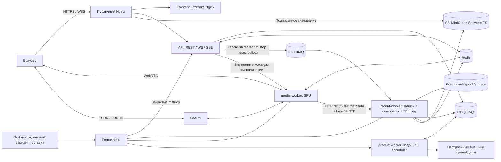

# Архитектура MeetSpace

Актуализировано 29 октября 2026 года: запись, встречи, сообщения и интеграции.

Документ описывает развёртывание MeetSpace с помощью Docker Compose на одном сервере. Базовая конфигурация выпуска —
[`docker-compose.production.yml`](../docker-compose.production.yml);
локальный [`docker-compose.yml`](../docker-compose.yml) имеет дополнительные
публикации портов и не предназначен для промежуточного серверного окружения (staging). Процедуры выпуска и восстановления:
[развёртывание](DEPLOYMENT.md), [релизы](RELEASE_PROCESS.md), [откат](ROLLBACK.md).

## Процессы приложения

Порты в таблицах — внутри контейнеров, кроме явно указанных публикаций хоста.
Проверка готовности (readiness) учитывает доступность зависимостей, а не только работу HTTP-процесса.

| Сервис | Ответственность | Порты / зависимости | Постоянные данные | Проверки состояния | Масштабирование |
| --- | --- | --- | --- | --- | --- |
| `frontend` | React/TypeScript/Vite, статические файлы и проксирование API с того же origin | 8080/TCP; API | В образе, записываемых бизнес-данных нет | `/healthz`, `/version.json` | Несколько экземпляров возможны за балансировщиком с согласованной версией; текущий Compose содержит один |
| `api` | Авторизация, встречи, REST, WS/SSE, права, постановка команд и заданий | 8085/TCP; PostgreSQL, Redis, RabbitMQ, S3, media-worker | Устойчивые данные в PostgreSQL/S3; активные сокеты в памяти | `/health/live`, `/health/ready`, `/version` | Общие хранилища позволяют несколько процессов; текущий proxy и Compose не обеспечивают поочерёдное обновление пула без перерыва в работе |
| `media-worker` | SFU: маршрутизация RTP, политики устройств, egress для записи | 8091/TCP только внутри сети; публичные 50010/UDP и TCP по Compose; Redis | Активные комнаты и PeerConnection в памяти; аренды в Redis | `/health/live`, `/health/ready`, `/version` | Уникальные worker ID, адреса и сетевые порты для каждого экземпляра; живая миграция комнат отсутствует |
| `record-worker` (Go record-worker) | Захват медиапотоков, компоновка изображения, обработка FFmpeg, проверка и публикация результатов | 8090/TCP внутри; PostgreSQL, Redis, RabbitMQ, S3, media-worker | Spool `/storage` на выделенном томе; результаты в S3, метаданные в PostgreSQL | `/health/live`, `/health/ready`, `/version`, проверка диска и обработчика очереди | Ограниченные параллельные задачи, аренды с поколениями; каждому экземпляру нужны собственная идентичность и корректное владение spool |
| `product-worker` | Постоянная очередь заданий, напоминания, email/push и календари | 8092/TCP внутри; PostgreSQL и настроенные провайдеры | `background_jobs` и результаты доставки в PostgreSQL | `/health/live`, `/health/ready`, `/version` | Ограниченные пулы, аренды, `SKIP LOCKED` и идемпотентность внешних запросов |

Компоновщик изображения (compositor) встроен в `record-worker`. Планировщик
(scheduler) работает внутри существующих обработчиков. Отдельных сервисов
compositor и scheduler, сетевой инфраструктуры service mesh или Kubernetes в текущем выпуске нет. `migrate` — одноразовая служебная задача
из API-образа, а не постоянно работающий сервис.

## Инфраструктура и хранение

| Сервис | Назначение / зависимости | Порты и публикация | Данные | Проверки состояния и ограничения |
| --- | --- | --- | --- | --- |
| `proxy` | TLS, HTTPS/WSS, маршруты frontend/API/скачивания | Публичный 443/TCP | Конфигурация и сертификаты доступны только для чтения | Проверка публичного HTTPS и версии выпуска кратким проверочным сценарием (smoke); отдельный healthcheck в Compose не задан |
| `coturn` | Ретрансляция WebRTC при невозможности прямого соединения | 3478/UDP+TCP, 5349/TCP; relay 49160–49259/UDP по умолчанию | Конфигурация, внешний секрет и TLS-сертификат; активные выделения ресурсов (allocation) в памяти | Проверки состояния по HTTP нет; нужен проверочный звонок с принудительным использованием ретранслятора (forced relay). Открытый порт не подтверждает работу звонка |
| `postgres` | Пользователи, права, встречи, переписка, уведомления и фоновые задания | 5432/TCP, только во внутренней сети | Том `postgres` | `pg_isready` плюс прикладные запросы; одиночный экземпляр, автоматического переключения на резервный экземпляр нет |
| `redis` | Статусы присутствия, Pub/Sub, временные права на задачи (leases), билеты, ограничение частоты запросов, временная доставка реакций | 6379/TCP, только private network | В production Compose сохранение данных на диск отключено | `PING`; потеря Redis требует восстановления сессий и аренды, но не приводит к потере истории в PostgreSQL |
| `rabbitmq` | Доставка команд записи с подтверждениями | 5672/TCP; management 15672 не опубликован | Том `rabbitmq` | `rabbitmq-diagnostics ping` и проверка готовности обработчика очереди; одиночный брокер |
| `minio` | S3-совместимое приватное хранилище записей, превью, архивов и вложений | 9000/TCP; у классического MinIO console 9001 закрыта | Классический том `minio`; hardened — `objects:/data` | Проверка состояния зависит от дополнительной конфигурации Compose (overlay); S3-проверки нужны в обоих вариантах |
| `prometheus` | Метрики служб и правила оповещения | 9090/TCP, хост `127.0.0.1:19090` | Том `prometheus`, в примере срок хранения — 7 дней | `/-/ready`, состояние опрашиваемых служб (targets); профиль `observability`, без настройки доставки оповещений не уведомляет дежурного |
| `grafana` | Готовые панели мониторинга | 3000/TCP, хост `127.0.0.1:13001` | Том `grafana`, настройки автоматического создания панелей (provisioning), внешний пароль | `/api/health`; профиль `observability`, доступ через контролируемый канал; не включена в текущий hardened-комплект |

Однохостовая схема имеет общие точки отказа: сам хост/диск, proxy, БД, Redis,
брокер, объектное хранилище и единственный media-worker. Имена томов не означают
резервирование или репликацию. Горизонтальное увеличение API само по себе не
устраняет эти зависимости и не увеличивает сетевую ёмкость SFU.

## Варианты поставки и локальные файлы

`install.sh` по умолчанию запускает [`from-images.py`](../scripts/install/from-images.py):
скачивает совместимый проверенный комплект готовых образов из GitHub Releases.
Отдельный режим `--mode source --ref main` запускает [`from-source.py`](../scripts/install/from-source.py)
и собирает комплект `hardened-shared-host` на сервере. Его S3-сервис по-прежнему называется
`minio`, но образ [`dockers/object-storage/Dockerfile`](../dockers/object-storage/Dockerfile)
содержит **SeaweedFS**. Имена `MINIO_*` и S3 SDK сохранены ради совместимости.
Установщик объединяет production Compose, `docker-compose.hardened.yml` и
сгенерированные `config/compose.json`, `config/turn.yml`; последний включает
сетевой режим хоста (host network) для Coturn. Название варианта поставки (layout) не означает автоматического подключения
`docker-compose.shared-host.yml`. Классический Compose с MinIO также остаётся в
репозитории; содержимое его тома не переносится автоматически в `objects`.
В текущем hardened-комплекте есть Prometheus; Grafana исключена из этого комплекта.

В production `record-worker` работает с UID/GID 1000. Каталог хоста подключается в контейнер через bind mount
`${RECORDER_STORAGE_DIR}:/storage`. `/storage/records/{recordId}` — локальный spool
исходных IVF/Ogg, файлов описания (manifests), сегментов и формируемых результатов. Это отдельное
хранилище от S3. После успеха оно очищается при `RECORDING_KEEP_LOCAL=false`;
после ошибки сохраняется для диагностики и повторного завершения записи. Автоматическое
удаление объектов S3 через семь дней не очищает рабочие каталоги неудавшихся записей. RTP-порты прежней реализации record-worker в
production отключены (`WEBRTC_UDP_PORT=0`, `WEBRTC_TCP_PORT=0`); браузер работает с SFU.

## Границы ответственности и завершение

API управляет правами и сигнализацией; RTP между участниками передаёт SFU.
FFmpeg не работает в обработчике API и не декодирует медиа внутри SFU.
Отдельные ограниченные очереди отделяют запись от живого звонка.
Go record-worker получает `application/x-ndjson` от SFU: `hello`, `track`,
`rtp` (байты RTP как base64 в JSON), `track.end`, `ping`, `error`. RabbitMQ доставляет
только команды записи. API сохраняет запись и `recording_outbox` в одной транзакции; диспетчер
публикует команды с подтверждением доставки. События состояния передаются через Redis и WebSocket конференции.
`product-worker` использует другую постоянную очередь — `background_jobs` в PostgreSQL.
Подробнее:
[запись](conference-recording.md), [SFU](media-sfu.md), [интеграции](content-integrations.md).

Секреты имеют разные назначения: `MEDIA_TICKET_SECRET` подписывает внутренние
билеты, `MEDIA_INTERNAL_SECRET` защищает управление медиасервером и выдачу медиапотоков (egress), `WORKER_INTERNAL_SECRET`
защищает API прежней реализации record-worker, `METRICS_SECRET` — доступ к метрикам и режиму завершения работ (drain). В production они
задаются отдельно; `TURN_SHARED_SECRET` остаётся серверным секретом, браузер получает
только временные учётные данные TURN. JWT, билеты, SDP и полное содержимое сообщений внешних провайдеров не должны
попадать в журналы.

Внутренний `POST /operations/drain` с `METRICS_SECRET` снимает признак готовности (readiness) и
останавливает приём новых работ там, где подключён обработчик сервиса.
`GET /operations/drain` показывает `draining`, `active`, `ready` без идентификаторов
задач. После включения drain этот процесс нельзя вернуть в состояние ready. `active` учитывает
незавершённые прикладные HTTP-запросы и подключённый счётчик работ сервиса;
у API к нему относятся локальные WebSocket-подключения. Это проверка наличия
работы в конкретном процессе, а не общая метрика пользователей всего кластера.

Перед заменой процесса оператор ждёт завершения активной работы. SIGTERM запускает
ограниченное по времени завершение; стандартный `SHUTDOWN_TIMEOUT` — 20 секунд,
Допустимое время завершения контейнера в Compose (grace period) — 45 секунд. Длинная встреча или запись может не успеть
закончиться. Принудительная замена SFU потребует переподключения клиентов, а
запись с прерванным захватом нельзя считать непрерывной и успешно завершённой.
Готовые закрытые сегменты и аренды позволяют восстанавливать предусмотренные
этапы финализации, но не обещают бесшовное продолжение захвата.

Публичный proxy закрывает `/health`, `/metrics`, `/internal`, `/operations` и
`/debug`. `/version` и `/version.json` раскрывают только проверенные метки артефакта.
Разрешения пользователя и администратора (admin) проверяются сервером; интерфейс не является
границей безопасности. Состав передаваемых данных — [DATA_FLOWS.md](DATA_FLOWS.md).

## Контракты и пределы

Точки входа и текущие ограничения собраны в [API.md](API.md). Фактические значения
задают [`internal/config/`](../internal/config), проверенный env-файл выпуска
и ограничения маршрутов и прикладной логики (router/usecase); увеличение лимита не подтверждает ёмкость оборудования.

Сводные лимиты и правила подбора ресурсов — [CAPACITY_BASELINE.md](CAPACITY_BASELINE.md).
Число участников, параллельных записей и размер очередей ограничивают работу
процессов, но сами по себе не определяют пропускную способность хоста.

## Личные сообщения

Чат конференции и личные беседы используют общий прикладной адаптер,
но отдельные таблицы и проверки доступа. Общими остаются `domain/chat`,
`usecase/chat`, SQL-операции ChatRepository, HTTP-обработчик и React-компонент MessageThread.
Различаются таблицы, проверка участия и средства публикации и передачи событий (publisher/transport).
Личная беседа создаётся для уникальной пары пользователей; отложенная проверка
подтверждает наличие ровно двух участников. WebSocket аккаунта передаёт изменения
после фиксации транзакции через персональные каналы Redis. Для аккаунта отдельно
учитывается присутствие в сети. Pion и обработчик записи в этом обмене не участвуют.
История хранится в PostgreSQL; Pub/Sub не гарантирует доставку. Модель данных,
жизненный цикл, API и ограничения описаны
в [PERSONAL_MESSAGES.md](PERSONAL_MESSAGES.md).

## Точки входа и пакеты

`cmd/api`, `cmd/media-worker`, `cmd/record-worker`, `cmd/product-worker`
запускают соответствующие функции в `internal/app`. Сигнализация находится в
`internal/usecase/media` и `internal/transport/mediaworker`; SFU —
`internal/infrastructure/sfu`; запись — `internal/usecase/recordings`,
`internal/usecase/recorder`, `internal/infrastructure/composite` и
`internal/infrastructure/ffmpeg`.
Продуктовые очереди и интеграции подключает `internal/app/product.go`.
