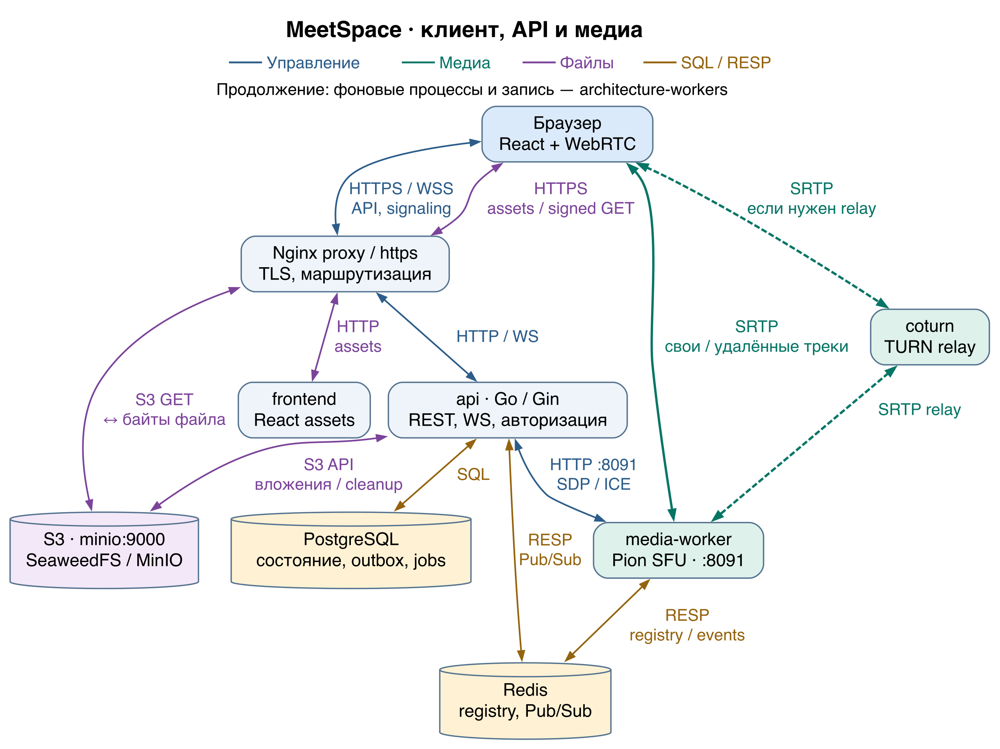
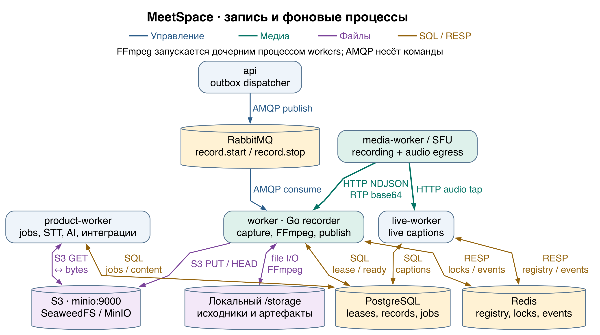
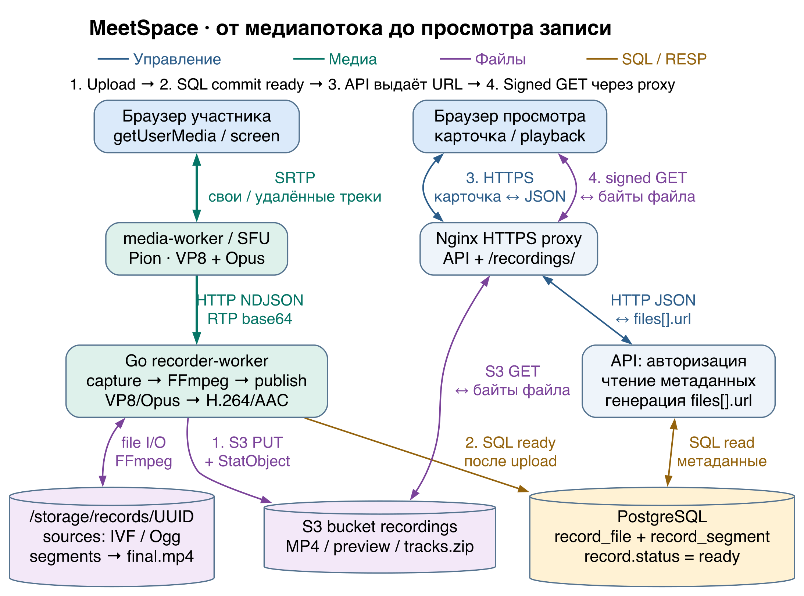
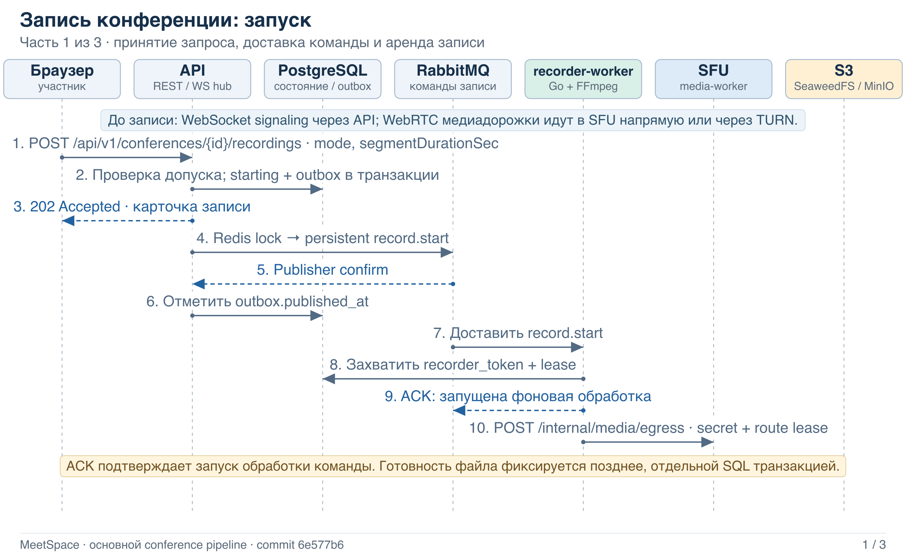
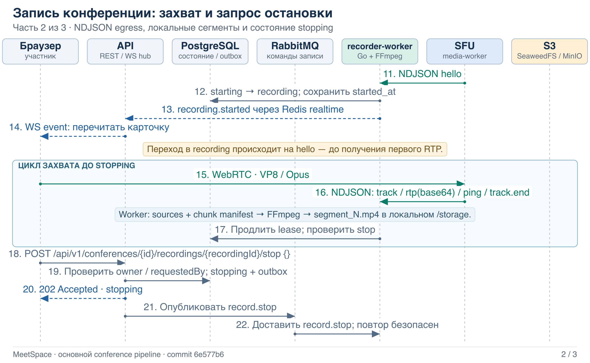
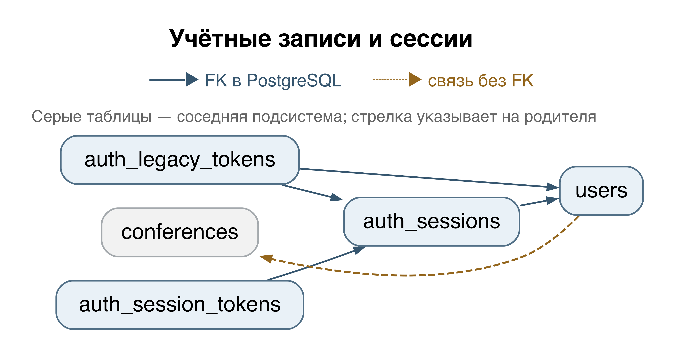
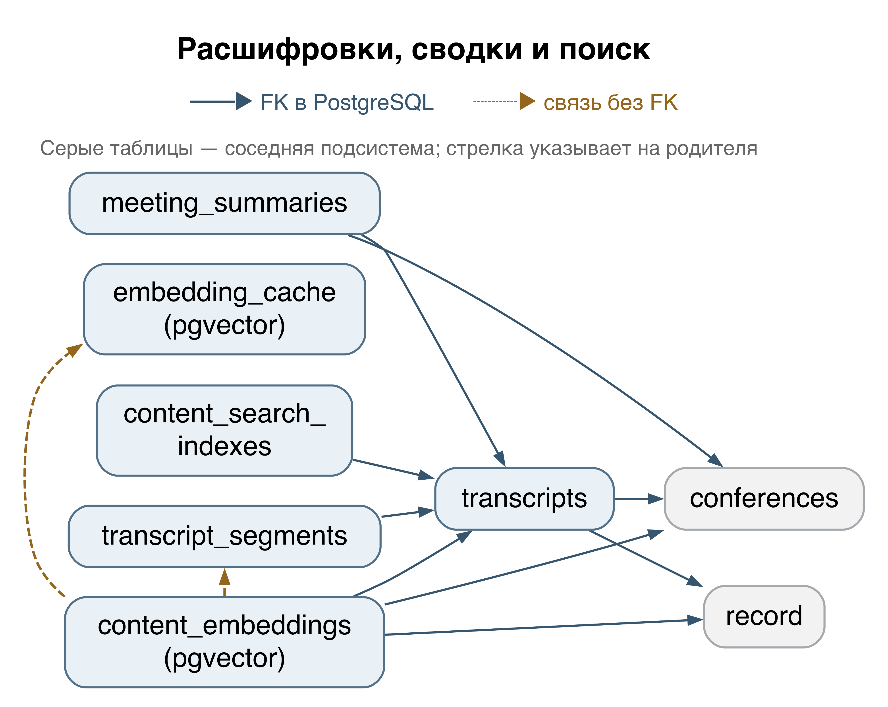

# MeetSpace — техническая документация

Репозиторий: [github.com/janickiy/meet-space](https://github.com/janickiy/meet-space)  
Ветка: `main`  
Версия исходного кода: `189631b5a50665c8c6b8725cfa21f3d46e895e52`<br>
Дата обновления текста: **28 октября 2026 г.**

> Архивная редакция для указанного коммита. Она описывает в том числе функции, удалённые из более поздних версий. Актуальное описание приложения и порядок установки приведены в [техническом руководстве](MEETSPACE_TECHNICAL_GUIDE_RU.md).

## Содержание

  - [Об этом документе](#section-001)
- [1. Назначение и структура проекта](#section-002)
  - [1.1. Что представляет собой MeetSpace](#section-003)
  - [1.2. Структура исходного кода](#section-004)
- [2. Архитектура системы и назначение компонентов](#section-005)
  - [2.1. Процессы и границы ответственности](#section-006)
  - [2.2. Три независимых канала](#section-007)
  - [2.3. Локальный запуск и варианты серверной установки](#section-008)
  - [2.4. Spool и S3 — разные уровни хранения](#section-009)
- [3. Запись видеопотока из браузера](#section-010)
  - [3.1. Подключение и получение медиапотоков](#section-011)
  - [3.2. Запуск записи и управление доступом](#section-012)
  - [3.3. Передача команды и получение потока](#section-013)
  - [3.4. Формирование локальных сегментов и режимы](#section-014)
  - [3.5. Остановка, сборка файла и загрузка в хранилище](#section-015)
  - [3.6. Состояния записи и переходы между ними](#section-016)
  - [3.7. Ошибки, повторные попытки и ограничения восстановления](#section-017)
  - [3.8. HTTP-примеры для проверки](#section-018)
  - [3.9. Сохранённые элементы прежнего механизма записи](#section-019)
  - [3.10. Как отличать текущую запись от прежней реализации](#section-020)
- [4. API и протоколы реального времени](#section-021)
  - [4.1. Общие правила работы с API](#section-022)
  - [4.2. Аутентификация и аккаунты](#section-023)
  - [4.3. Конференции, участники и приглашения](#section-024)
  - [4.4. Записи конференций](#section-025)
  - [4.5. Сообщения и вложения конференций](#section-026)
  - [4.6. Управление чатом конференции](#section-027)
  - [4.7. Личные сообщения и групповые чаты](#section-028)
  - [4.8. Сообщения и вложения личных и групповых диалогов](#section-029)
  - [4.9. Поиск в диалогах и защищённые файлы групп](#section-030)
  - [4.10. Папки пользователя](#section-031)
  - [4.11. Личные звонки](#section-032)
  - [4.12. Транскрипции, итоги встречи и поиск](#section-033)
  - [4.13. Субтитры в реальном времени, аналитика и реакции](#section-034)
  - [4.14. Уведомления и поток SSE](#section-035)
  - [4.15. Календари и каналы доставки уведомлений](#section-036)
  - [4.16. Возможности платформы, администрирование и телеметрия](#section-037)
  - [4.17. Подключение WebSocket по HTTP и настройки ICE](#section-038)
  - [4.18. Внутренний API медиасервера (SFU)](#section-039)
  - [4.19. Проверки состояния, метрики и управляемая остановка](#section-040)
  - [4.20. Внутренний API сервиса записи (Record Worker)](#section-041)
  - [4.21. Профилирование через отдельный локальный адрес](#section-042)
  - [4.22. Основные структуры ответов](#section-043)
  - [4.23. Формат и жизненный цикл SSE-уведомлений](#section-044)
  - [4.24. Общие правила внутренних медиа-API](#section-045)
  - [4.25. Протокол WebSocket конференции](#section-046)
  - [4.26. Глобальный WebSocket пользователя](#section-047)
  - [4.27. Ограничения прежнего API записи](#section-048)
  - [4.28. Проверка полноты каталога и особенности регистрации](#section-049)
- [5. База данных](#section-050)
  - [5.1. Проверка полноты и миграционный механизм](#section-051)
  - [5.2. Как читать словарь и ER-схемы](#section-052)
  - [5.3. users](#section-053)
  - [5.4. auth_sessions](#section-054)
  - [5.5. auth_session_tokens](#section-055)
  - [5.6. auth_legacy_tokens](#section-056)
  - [5.7. conferences](#section-057)
  - [5.8. conference_participants](#section-058)
  - [5.9. participant_sessions](#section-059)
  - [5.10. conference_moderation_audit](#section-060)
  - [5.11. conference_invitations](#section-061)
  - [5.12. record](#section-062)
  - [5.13. record_segment](#section-063)
  - [5.14. record_file](#section-064)
  - [5.15. record_event](#section-065)
  - [5.16. recording_outbox](#section-066)
  - [5.17. chat_messages](#section-067)
  - [5.18. chat_read_states](#section-068)
  - [5.19. chat_attachments](#section-069)
  - [5.20. conference_chat_preferences](#section-070)
  - [5.21. conference_chat_pins](#section-071)
  - [5.22. chat_notification_jobs](#section-072)
  - [5.23. conversations](#section-073)
  - [5.24. conversation_members](#section-074)
  - [5.25. conversation_messages](#section-075)
  - [5.26. conversation_attachments](#section-076)
  - [5.27. conversation_avatar_objects](#section-077)
  - [5.28. conversation_message_pins](#section-078)
  - [5.29. direct_calls](#section-079)
  - [5.30. direct_call_slots](#section-080)
  - [5.31. folders](#section-081)
  - [5.32. folder_conversations](#section-082)
  - [5.33. folder_conferences](#section-083)
  - [5.34. transcripts](#section-084)
  - [5.35. transcript_segments](#section-085)
  - [5.36. meeting_summaries](#section-086)
  - [5.37. content_search_indexes](#section-087)
  - [5.38. content_embeddings](#section-088)
  - [5.39. embedding_cache](#section-089)
  - [5.40. live_transcription_sessions](#section-090)
  - [5.41. live_caption_segments](#section-091)
  - [5.42. participant_analytics](#section-092)
  - [5.43. conference_analytics](#section-093)
  - [5.44. notifications](#section-094)
  - [5.45. notification_jobs](#section-095)
  - [5.46. notification_preferences](#section-096)
  - [5.47. background_jobs](#section-097)
  - [5.48. release_schema_migrations](#section-098)
  - [5.49. push_devices](#section-099)
  - [5.50. calendar_connections](#section-100)
  - [5.51. calendar_oauth_states](#section-101)
  - [5.52. calendar_event_mappings](#section-102)
  - [5.53. integration_deliveries](#section-103)
  - [5.54. JSONB-контракты](#section-104)
  - [5.55. Функции, триггеры и последовательности](#section-105)
  - [5.56. Изменения схемы, которые нельзя потерять при чтении миграций](#section-106)
  - [5.57. user_avatars — фотографии пользователей](#section-127)
- [6. Ручная установка через Docker Compose](#section-107)
  - [6.1. Вариант установки и системные требования](#section-108)
  - [6.2. Скачивание установщика и выбор режима](#section-109)
  - [6.3. Конфигурация и каталоги](#section-110)
  - [6.4. Подготовка и запуск сервисов](#section-111)
  - [6.5. Домен, HTTPS и TURN](#section-112)
  - [6.6. Сетевые порты](#section-113)
  - [6.7. Проверка после установки](#section-114)
- [7. Эксплуатация и диагностика](#section-115)
  - [7.1. Наблюдение и конфигурация](#section-116)
  - [7.2. Безопасная остановка и перезапуск](#section-117)
  - [7.3. Диск, файлы и резервные копии](#section-118)
  - [7.4. Диагностика по симптому](#section-119)
- [8. Источники и границы проверки](#section-120)
  - [8.1. Основные источники](#section-121)
  - [8.2. Выполненная сверка и проверки на целевом сервере](#section-122)
- [9. Поддержка и индивидуальная разработка](#section-123)
  - [Техническая поддержка](#section-124)
  - [Индивидуальная доработка MeetSpace](#section-125)
  - [Контакты](#section-126)

<a id="section-001"></a>

## Об этом документе

MeetSpace объединяет видеоконференции, личные диалоги и групповое общение. Платформа позволяет организовывать встречи, приглашать участников, общаться по аудио- и видеосвязи, показывать экран, обмениваться сообщениями и файлами и сохранять записи конференций.

Документ описывает серверную часть, которая хранит переписку и материалы встреч, управляет доступом, обрабатывает уведомления и обеспечивает взаимодействие пользователей.

<a id="section-002"></a>

# 1. Назначение и структура проекта

<a id="section-003"></a>

## 1.1. Что представляет собой MeetSpace

MeetSpace предназначен для встреч и повседневного общения в одном приложении. Пользователи создают конференции и приглашают участников, подключаются к аудио- и видеосвязи, демонстрируют экран, ведут личную и групповую переписку, передают файлы и сохраняют записи встреч.

Серверная часть хранит переписку и материалы конференций, проверяет права доступа и обрабатывает уведомления. Она также координирует действия пользователей и связывает веб-интерфейс с медиасервером и фоновыми сервисами.

<a id="section-004"></a>

## 1.2. Структура исходного кода

| Путь | Назначение | Ключевые файлы |
|---|---|---|
| `cmd/api/main.go` | Запускает сервер приложений (API) вызовом `app.RunAPI()` | `main.go` → `internal/app/api.go` |
| `cmd/worker/main.go` | Запускает сервис записи (Record Worker) вызовом `app.RunWorker()` | `main.go` → `internal/app/worker.go` |
| `cmd/media-worker/main.go` | Запускает медиасервер (SFU) в отдельном процессе: `app.RunMediaWorker()` | `main.go` → `internal/app/media_worker.go` |
| `cmd/product-worker/main.go` | Запускает сервис фоновой обработки (Product Worker): `app.RunProductWorker()` | `main.go` → `internal/app/product.go` |
| `cmd/live-worker/main.go` | Точка запуска обработки живых субтитров: `app.RunLiveWorker()` | `main.go` → `internal/app/live.go` |
| `cmd/main/main.go` | Сохраняет совместимость с общим интерфейсом командной строки: `serve`, `api`, `worker`, `migrate`, `version` | `main.go` |
| `internal/app/` | Связывает зависимости процессов и содержит HTTP-обработчики отдельных функций продукта | `api.go`, `worker.go`, `operations.go` |
| `internal/domain/` | Описывает предметные типы, состояния, DTO и ошибки для `records`, `media`, `conferences`, `captions` и других областей | `records/models.go`, `records/conference.go` |
| `internal/usecase/recordings/` | Реализует пользовательские операции с записью конференции, обращения к репозиторию с необходимыми проверками и диспетчер механизма Outbox | `service.go`, `dispatcher.go` |
| `internal/usecase/recorder/` | Выполняет команды сервиса записи: получает потоки, формирует общую запись, завершает обработку, публикует файлы и удаляет их по сроку хранения | `composite.go`, `composite_artifacts.go`, `retention.go` |
| `internal/usecase/media/` | Проверяет доступ к управлению SFU, выбирает владельца комнаты и отправляет внутренние HTTP-запросы | `controller.go`, `client.go` |
| `internal/infrastructure/sfu/` | Реализует медиасервер на Pion WebRTC: комнаты, соединения, дорожки, RTP/RTCP, политики передачи и исходящий поток egress | `manager.go` |
| `internal/infrastructure/composite/` | Читает egress, сохраняет исходные дорожки и манифесты фрагментов, рассчитывает раскладку, собирает общую запись и ZIP-архив | `capture.go`, `composer.go`, `layout.go`, `archive.go` |
| `internal/infrastructure/ffmpeg/` | Запускает FFmpeg/ffprobe для объединения и проверки файлов; поддерживает сегментацию прежней реализации и подготовку аудио для распознавания речи | `composite.go`, `postprocessor.go`, `segment_recorder.go` |
| `internal/infrastructure/webrtc/` | Содержит прежний механизм прямого приёма WebRTC в сервисе записи | `manager.go`, `shutdown.go` |
| `internal/infrastructure/postgres/` | Реализует репозитории и транзакции для записей, файлов, сегментов, механизма Outbox, временных прав обработки и удаления | `migrations.go` |
| `internal/infrastructure/redis/` | Ведёт реестр SFU и присутствия пользователей, передаёт события через Pub/Sub, обслуживает блокировки и ограничения частоты запросов | `media.go`, `realtime.go`, `user_presence.go` |
| `internal/infrastructure/rabbitmq/` | Доставляет две команды записи, обрабатывает подтверждения и повторы, изолирует ошибочные сообщения | `commands.go` |
| `internal/infrastructure/storage/` | Предоставляет клиент S3 и безопасную очистку локальных каталогов | `local/cleanup.go` |
| `internal/transport/http/`, `websocket/`, `mediaworker/` | Регистрирует REST- и WebSocket-маршруты, а также внутренние маршруты управления медиа | `router.go`, `conference_recording_routes.go` |
| `database/migrations/` | Содержит последовательность изменений схемы PostgreSQL | `000001_create_record_table.up.sql` … `000036_user_avatars.up.sql` |
| `frontend/` | Реализует веб-интерфейс и браузерный WebRTC-клиент на React, TypeScript и Vite | `src/media.ts`, `src/api.ts`, `src/components/RecordingPanel.tsx` |
| `dockers/`, `docker-compose*.yml` | Описывает сборку образов, сети и тома, обратный прокси, TURN и средства наблюдения | `docker-compose.yml`, `docker-compose.production.yml` (корень репозитория) |
| `install.sh`, `scripts/install/`, `scripts/release/` | Устанавливает готовые образы, обеспечивает дополнительный режим сборки и сопровождение выпуска | `from-images.py`, `from-source.py`, `wizard.py`, `scripts/release/build.sh` |
| `docs/` | Содержит документацию и инструкции; при использовании их следует сверять с реализацией | `INSTALLATION.md`, `API.md`, `media-sfu.md`, `direct-calls.md` |

Файлы проекта закрепляют версии зависимостей. Описываемый коммит использует Go `1.26.10`, Pion WebRTC v4, Gin, GORM/pgx, клиенты Redis и AMQP, а также MinIO Go SDK. Веб-интерфейс построен на React `19.3.0`, TypeScript `7.0.2` и Vite `8.3.5`; допустимые версии Node перечислены в `engines` файла `frontend/package.json`. При сборке другого коммита ориентируйтесь на его `go.mod` и `package.json`: приведённые здесь номера относятся только к зафиксированной версии исходников.

<a id="section-005"></a>

# 2. Архитектура системы и назначение компонентов

<a id="section-006"></a>

## 2.1. Процессы и границы ответственности

При стандартной установке компоненты MeetSpace размещаются в нескольких Docker-контейнерах на одном сервере. Сервер приложений (API), медиасервер (SFU) и фоновые сервисы работают в отдельных процессах; ограничения процессора и памяти можно задавать для каждого из них независимо.

Временные блокировки не позволяют нескольким обработчикам одновременно выполнять одну задачу. Это средство координации, а не полноценная кластеризация: система не обеспечивает автоматическое распределение нагрузки и перенос работы между серверами. В частности, промежуточные файлы записи находятся на диске того сервера, где выполняется обработка.

**Основные термины и определения**

Далее в документе используются следующие обозначения:

- **SFU (Selective Forwarding Unit)** — медиасервер, который принимает аудио- и видеопотоки участников и пересылает их другим участникам конференции.
- **Worker** — сервис фоновой обработки. В зависимости от назначения он записывает встречи, отправляет уведомления или взаимодействует с внешними системами.
- **Egress** — исходящий поток медиаданных от SFU к сервису записи, распознаванию речи или другим обработчикам.
- **Spool** — каталог временных файлов: здесь во время записи размещаются исходные медиаданные и промежуточные результаты обработки.
- **Lease** — временное право на обработку задачи, выданное конкретному обработчику. Пока работа продолжается, обработчик должен регулярно продлевать это право.
- **Outbox** — механизм передачи событий и команд через промежуточную таблицу БД. Совместное сохранение данных и команды снижает риск потери сообщения между транзакцией базы данных и отправкой в очередь.
- **S3 (Simple Storage Service)** — API объектного хранения. MeetSpace использует S3-совместимое объектное хранилище для готовых записей, файлов и других материалов.

| Компонент | Реальное имя сервиса или модуля | Ответственность | Взаимодействие |
|---|---|---|---|
| Веб-интерфейс | `frontend` | Nginx отдаёт собранное приложение React | Браузер; обращения к API через прокси на том же домене |
| Обратный прокси | `proxy` в production; `https` в local | Nginx принимает TLS-соединения и направляет запросы к веб-интерфейсу, REST/WS и объектам по подписанным ссылкам | Входящий HTTPS; `api`, `frontend`, `minio:9000` |
| Сервер приложений (API) | `api` | Приложение на Go и Gin: авторизация, REST, WebSocket-соединения, прикладные операции, диспетчер Outbox и очистка по сроку хранения | PostgreSQL, Redis, публикация команд в RabbitMQ, S3 и внутренний HTTP SFU |
| Медиасервер (SFU) | `media-worker` | Принимает и пересылает дорожки участников через Pion WebRTC; отдаёт egress для записи и субтитров | WebRTC браузеров; реестр и события Redis; внутренний HTTP `8091` |
| Сервис записи (Record Worker) | `worker` | Go-процесс `/app/go-recorder-worker`: получает команды и временное право обработки записи, читает egress SFU, запускает FFmpeg и публикует готовые файлы | Получение команд из RabbitMQ, PostgreSQL, Redis, HTTP egress SFU, `/storage`, S3; служебный HTTP `8090` |
| Сервис фоновой обработки (Product Worker) | `product-worker` | Выполняет хранящиеся в PostgreSQL фоновые задания: интеграции, уведомления, распознавание речи, AI-функции, поиск, индексацию и аналитику | PostgreSQL, S3 и внешние провайдеры; извлечение аудио через FFmpeg; служебный HTTP `8092` |
| База данных | `postgres` | Хранит долговременное состояние продукта, записи и их метаданные, команды Outbox и фоновые задания | SQL-запросы сервера приложений и соответствующих фоновых сервисов |
| Координация и события реального времени | `redis` | Хранит владельцев медиакомнат и реестр обработчиков, передаёт события, учитывает присутствие, ограничивает частоту запросов и блокирует конфликтующие операции записи | Сервер приложений, медиасервер, сервис записи и обработка живых субтитров |
| Брокер сообщений RabbitMQ | `rabbitmq` | Обеспечивает устойчивую очередь управляющих команд записи | Публикация сервером приложений → получение сервисом записи |
| S3-совместимое объектное хранилище | `minio` | Сохраняет совместимое имя точки доступа S3; за ним работает **SeaweedFS в защищённой установке** либо MinIO в классическом и локальном вариантах | API S3 для готовых материалов; объекты не открыты для произвольного чтения |
| TURN / STUN | `coturn` | Ретранслирует медиатрафик, когда прямое соединение недоступно | Браузеры ↔ SFU через TURN по UDP/TCP/TLS |
| Миграции | `migrate` | Однократно применяет изменения схемы; в серверной конфигурации используется профиль `migration` | PostgreSQL |
| Средства наблюдения | `prometheus`, `grafana` | Подключаются при выборе соответствующих дополнительных конфигураций и профилей | Сбор метрик и панели наблюдения |
| Кодирование и композиция | `internal/infrastructure/composite/`, `ffmpeg/`; дочерние процессы FFmpeg/ffprobe внутри `worker` | Формируют H.264/AAC, проверяют итоговый файл и создают изображение предпросмотра | Локальные IVF/OGG → MP4/JPEG; чтение и запись `/storage` |
| Каталог временных файлов (Spool) | `worker:/storage`, `STORAGE_PATH` | Содержит исходные дорожки, промежуточные результаты и итоговые файлы до загрузки в объектное хранилище | Подключённый каталог хоста; файлы приёма потока и обработки FFmpeg |

Ответственность компонентов разделена и на уровне медиаданных. Медиасервер (SFU) передаёт пакеты, управляет дорожками и формирует egress; он не запускает FFmpeg и не сохраняет файлы в S3. Сервер приложений (API) не проксирует RTP браузерных соединений. FFmpeg запускается дочерним процессом сервиса записи (Record Worker), а не отдельным сетевым сервисом Compose.

Источники: `internal/app/api.go`, `internal/app/worker.go`, `internal/app/media_worker.go`, `internal/app/product.go`, `internal/app/live.go`, `docker-compose.yml`, `docker-compose.production.yml`, `dockers/*/Dockerfile`.

**Схема 1. Архитектура.** Исходники: `architecture.dot`, `architecture.mmd`.





<a id="section-007"></a>

## 2.2. Три независимых канала

| Канал | Что передаётся | Транспорт и участники |
|---|---|---|
| Пользовательские действия и сигнальный обмен | Запуск, остановка и чтение записи; SDP, ICE, описание дорожек и состояния комнаты | Браузер ↔ сервер приложений по HTTPS REST и WSS; сервер приложений → SFU по внутреннему HTTP с проверкой доступа |
| Передача команд записи | Небольшие JSON-сообщения `record.start` либо `record.stop` с UUID записи | Механизм Outbox в PostgreSQL → брокер сообщений RabbitMQ → сервис записи |
| Медиаданные | Закодированные изображение камеры и экрана, звук, а затем фрагменты записи и готовые объекты | Браузер ↔ SFU по WebRTC; SFU → сервис записи по длительному HTTP-соединению с NDJSON egress; сервис записи → локальные файлы/FFmpeg → S3 |

Веб-интерфейс получает события `recording.starting`, `recording.started`, `recording.stopping`, `recording.processing`, `recording.ready`, `recording.failed` через слой событий реального времени, Redis и WebSocket сервера приложений. Брокер сообщений RabbitMQ не передаёт ни эти события интерфейса, ни медиапакеты. Подтверждение управляющей команды AMQP означает её обработку на соответствующем этапе, но не готовность итогового MP4.

<a id="section-008"></a>

## 2.3. Локальный запуск и варианты серверной установки

Базовый файл `docker-compose.yml` описывает локальный запуск: образы собираются из рабочей копии, отладочные порты доступны на хосте, а контейнеры используют `app-network` и внешнюю сеть шлюза. Здесь сервис `minio` запускает именно MinIO, собранный по `dockers/minio/Dockerfile`, с каталогом `./dockers/minio/data:/data`. Сервис записи подключает `./dockers/storage/data:/storage`.

Серверный файл `docker-compose.production.yml` использует переданные неизменяемые ссылки на образы, закрытую сеть `private`, отдельный запуск миграций, ограничения ресурсов и рабочее окружение production. Без дополнительных конфигураций этот файл по-прежнему описывает классический MinIO с томом `minio:/data`.

По умолчанию `install.sh` загружает готовые Docker-образы из последнего совместимого выпуска GitHub Releases. Сборку на самом сервере включает отдельный режим `--mode source`. Мастер `scripts/install/wizard.py` берёт за основу `docker-compose.production.yml`; для защищённого варианта `hardened-shared-host` он добавляет `docker-compose.hardened.yml`, а затем собственные файлы `config/compose.json` и `config/turn.yml`. При сборке из исходников выбирается защищённый вариант. Файл `docker-compose.shared-host.yml`, несмотря на сходство названия, в этот набор не входит: сеть и порты мастер настраивает самостоятельно.

В защищённой установке имя сервиса `minio` сохранено, но внутри него работает SeaweedFS. Образ определяется в `dockers/object-storage/Dockerfile`, а данные размещаются в томе `objects:/data`. Адрес `minio:9000`, клиентская библиотека MinIO и переменные `MINIO_*` остаются совместимыми обозначениями для API S3. Они не означают совместимость дисковых форматов: подключить прежний том MinIO к SeaweedFS без переноса данных нельзя. Доступ по подписанным ссылкам проходит через Nginx на домене приложения.

Установщик создаёт `<installation-root>/config/meetspace.env`, `<installation-root>/storage`, каталог сертификатов и служебные файлы. Путь `RECORDER_STORAGE_DIR=<installation-root>/storage` подключается к сервису записи как `/storage`; владельцем каталога заранее назначается UID/GID `1000:1000`. Дополнительная конфигурация TURN задаёт `network_mode: host`, удаляет Compose-параметры `networks`/`ports` и включает `TURN_BIND_PUBLIC=true`. Поэтому порты и тома локального примера из README нельзя переносить на установленный сервер без сверки с фактической схемой развёртывания.

Источники: `scripts/install/from-source.py`, `scripts/install/wizard.py:make_configuration`, `scripts/install/wizard.py:compose_args`, `docker-compose.hardened.yml`, `docker-compose.production.yml`, `dockers/object-storage/Dockerfile`.

<a id="section-009"></a>

## 2.4. Spool и S3 — разные уровни хранения

| Уровень | Где расположен | Содержимое и жизненный цикл |
|---|---|---|
| Каталог временных файлов (Spool) | `STORAGE_PATH`, обычно `/storage`; каталог хоста, подключённый в контейнер | Исходные фрагменты VP8/Opus, манифесты, собранные MP4-сегменты, `concat.txt` и итоговые файлы до загрузки. Требуется во время записи и при восстановлении заключительной обработки |
| Временный каталог прежнего механизма | `/storage/tmp/{recordId}/` | `input.sdp` для передачи RTP через loopback в FFmpeg; не является основным каталогом современной составной записи |
| S3-совместимое объектное хранилище | Обычно бакет `recordings` в сервисе `minio` | Итоговый MP4 или аудиофайл, изображение предпросмотра и ZIP дорожек; данные SeaweedFS/MinIO хранятся в отдельном томе |
| PostgreSQL | `record`, `record_file`, `record_segment`, `record_event`, `recording_outbox` | Состояния, права доступа, связи, метаданные файлов, размеры, контрольные суммы, события и команды; само видео в БД не хранится |

В серверной конфигурации Compose каталог `/storage` не подключён ни к серверу приложений, ни к медиасерверу. Копия PostgreSQL не включает видео, а копия S3 не сохраняет права доступа и связи записей. Каталог временных файлов (Spool) нужен для незавершённой обработки; готовые записи пользователь скачивает из S3-совместимого объектного хранилища.

<a id="section-010"></a>

# 3. Запись видеопотока из браузера

<a id="section-011"></a>

## 3.1. Подключение и получение медиапотоков

При подключении к конференции MeetSpace разделяет сигнальный обмен и передачу медиа: служебные сообщения идут по WebSocket, а аудио и видео — по WebRTC.

Соединение устанавливается в следующем порядке.

### 1. Подключение к конференции

Авторизованный пользователь присоединяется к конференции, после чего веб-интерфейс получает одноразовый токен подключения — WS Ticket — и открывает WebSocket-соединение:

`/api/v1/conferences/{id}/ws?ticket=…`

По этому каналу стороны согласуют параметры WebRTC-соединения и управляют медиасессией.

Для этого используются следующие события:

- `media.join` — присоединяет участника к медиасессии.
- `media.offer` / `media.answer` — передаёт предложения и ответы при согласовании WebRTC.
- `media.ready` — сообщает о готовности медиасессии.
- `media.ice` — передаёт ICE-кандидатов для выбора доступного соединения.
- `media.leave` — завершает участие в медиасессии.
- `media.unpublish` — останавливает публикацию медиапотока.

### 2. Получение доступа к устройствам

Для получения звука микрофона и изображения камеры браузер вызывает `getUserMedia()`. Демонстрация экрана запускается через `getDisplayMedia()`.

Если браузер поддерживает такую возможность, вместе с изображением передаётся системный звук или звук выбранной вкладки.

Разрешение на доступ к устройствам и экрану выдаёт пользователь в стандартных диалогах браузера.

### 3. Создание WebRTC-соединения

Веб-интерфейс создаёт `RTCPeerConnection` с настройкой `bundlePolicy: "max-bundle"`, чтобы передавать медиаданные по одному общему транспортному соединению.

Публикуемые дорожки разделяются по источнику:

- `microphone` — аудиодорожка микрофона;
- `camera` — видеодорожка камеры;
- `video/screen` — изображение демонстрируемого экрана;
- `audio/screen` — звук, сопровождающий демонстрацию экрана.

Одновременно клиент подготавливает слоты, в которые будут поступать дорожки остальных участников.

При согласовании кодеков предпочтение отдаётся VP8 для видео и Opus для аудио.

### 4. Проверка доступа и подключение к SFU

Сервер приложений (API) проверяет действительность сессии, права пользователя и его участие в конференции.

Обслуживающий конференцию медиасервер (SFU) определяется по реестру Redis. Управляющие команды выбранному серверу направляются по внутренним HTTP-маршрутам:

`/internal/media/{action}`

Внутренний запрос должен пройти проверку секрета `MEDIA_INTERNAL_SECRET`. Кроме того, система проверяет токены подключения и временное право на обработку задачи, которое разрешает медиасерверу обслуживать эту конференцию.

### 5. Передача медиапотоков

Когда соединение установлено, браузер обменивается аудио- и видеоданными непосредственно с медиасервером (SFU) по WebRTC.

Если прямой путь недоступен, трафик ретранслирует TURN-сервер.

Сервер приложений (API) и брокер сообщений RabbitMQ медиапакеты не передают.

Медиасервер на Pion WebRTC принимает дорожки участников и пересылает их другим пользователям в пределах разрешённого доступа. При включении записи он также отдаёт медиаданные сервису записи (Record Worker).

### Исходный код

Основные части реализации распределены по следующим файлам:

- `frontend/src/media.ts` — создаёт WebRTC-соединения и управляет дорожками.
- `frontend/src/realtime.ts` — обеспечивает сигнальный обмен по WebSocket.
- `internal/transport/websocket/handler.go` — принимает и обслуживает WebSocket-соединения.
- `internal/usecase/media/controller.go` — выполняет операции управления медиасессиями.
- `internal/usecase/media/client.go` — отправляет запросы медиасерверу.
- `internal/infrastructure/sfu/manager.go` — управляет SFU и передачей медиапотоков.

<a id="section-012"></a>

## 3.2. Запуск записи и управление доступом

Пользователь запускает запись в соответствующей панели веб-интерфейса. Набор доступных режимов определяется конфигурацией сервера; клиент получает его через API возможностей — Capabilities.

Перед отправкой команды веб-интерфейс загружает список записей и проверяет, доступен ли выбранный режим. Пока запрос обрабатывается, кнопка запуска заблокирована, чтобы пользователь не отправил его повторно.

### Запуск записи

Создание записи начинается с HTTP-запроса:

`POST /api/v1/conferences/{id}/recordings`

Тело запроса задаёт два параметра:

- **`mode`** — режим обработки; стандартное значение `composite` означает общую запись конференции.
- **`segmentDurationSec`** — длительность отдельного сегмента в секундах.

Стандартная длительность сегмента — 5 секунд; допустимый диапазон составляет от 2 до 30 секунд.

При отсутствии `mode` сервер выбирает `composite`. Неуказанный `segmentDurationSec` или значение `0` также заменяется стандартной длительностью — 5 секунд.

Сервер проверяет параметры до запуска обработки записи.

| Действие | Требования серверной реализации |
|---|---|
| Начать запись | Действующий Bearer-токен обычного зарегистрированного аккаунта; пользователь допущен в эту конференцию и имеет статус `joined`; конференция находится в состоянии `active`; отсутствует запись со статусом `starting`, `recording`, `degraded`, `stopping`, `finalizing`, `uploading` |
| Остановить | Обычный зарегистрированный аккаунт; допущенный участник со статусом `joined` **или `left`**; пользователь указан как инициатор `requestedBy` либо является владельцем конференции с ролью `owner` |
| Прочитать карточку или список и получить ссылки | Пользователь допущен в конференцию и имеет статус `joined` или `left`; запись принадлежит этой конференции, не удалена и не просрочена. Гостевой токен допускается только в пределах своей конференции |
| Удалить | Права владельца или инициатора, требуемые для остановки; запись находится в конечном состоянии, действующее временное право сервиса записи на её обработку отсутствует |

Запуск записи не ограничен организатором: его может выполнить и обычный зарегистрированный участник, если выполнены перечисленные условия доступа.

### Права доступа

Для каждой операции учитываются роль, состояние участия и пользователь, начавший запись.

- **Организатор (owner)** управляет записями в пределах прав владельца конференции.
- **Соорганизатор (co_host)** не получает права остановить чужую запись только на основании этой роли.
- **Участник (participant)** вправе запустить запись и затем остановить запись, созданную им самим.
- **Участник, покинувший конференцию (left)** может через API остановить свою ранее запущенную запись. Веб-интерфейс показывает кнопку остановки только участникам со статусом `joined`.
- **Гость (guest)** не может создавать, останавливать и удалять записи. Чтение существующих записей допускается при наличии доступа к соответствующей конференции.

Статусы `waiting`, `rejected` и `kicked` исключают доступ к управлению записями.

### Создание записи

На сервере запрос создания обрабатывается по маршруту:

`POST /api/v1/conferences/{id}/recordings`

Обработчик сначала проверяет полномочия пользователя и убеждается, что в конференции нет другой активной записи.

Затем одна транзакция PostgreSQL сохраняет два связанных объекта:

- **`record`** — данные новой записи в состоянии `starting`;
- **`recording_outbox`** — команду, которую предстоит доставить сервису записи.

В данных записи также фиксируются:

- `mode` — выбранный пользователем режим;
- `source_type = conference` — конференция как источник записи;
- `transport_type = sfu` — получение медиаданных от SFU;
- `platform_conference_id` — ссылка на конференцию;
- `requested_by` — идентификатор инициатора.

Общая транзакция сохраняет сведения о записи и команду согласованно: они фиксируются как одна операция.

### Обработка повторных запросов

Для одной конференции допускается только одна активная запись.

Попытка создать ещё одну запись, пока предыдущая активна, получает ответ HTTP 409 Conflict.

Успешное создание задачи возвращает HTTP 202 Accepted. Это подтверждение принятого запроса, а не завершения записи: готового видеофайла на этом этапе ещё нет.

Дальнейшую обработку выполняют фоновые сервисы MeetSpace.

<a id="section-013"></a>

## 3.3. Передача команды и получение потока

Команды от сервера приложений (API) к сервису записи (Record Worker) проходят через механизм Outbox и брокер сообщений RabbitMQ.

Диспетчер проверяет наличие команд каждые 250 мс и обрабатывает до 16 команд за цикл, сохраняя их порядок в пределах одной записи. Одна попытка доставки ограничена 5 секундами. Независимо от этого, команда резервируется в PostgreSQL на 15 секунд: это срок временного права на её обработку, а не тайм-аут попытки отправки.

Перед отправкой команды запуска диспетчер получает блокировку Redis `record:conference:{conferenceId}:lock`, чтобы исключить одновременные конфликтующие операции.

В RabbitMQ команды отправляются как JSON. По умолчанию используются точка обмена (exchange) `go-recorder.commands` и очередь `go-recorder.recording.commands`; их имена можно переопределить переменными окружения RABBIT_MQ_EXCHANGE и RABBIT_MQ_QUEUE. После подтверждения брокера команда отмечается отправленной. При ошибке она остаётся в Outbox. Если время следующей попытки успешно сохранено, команда становится доступной для повтора через 1 секунду; это не гарантирует доставку ровно через секунду. Если сохранить перенос не удалось, повторная обработка зависит от истечения ранее установленного срока резервирования.

Брокер сообщений RabbitMQ передаёт только команды управления. Аудио и видео сервис записи получает непосредственно от медиасервера (SFU) через egress, после чего сохраняет и обрабатывает их.

Примеры управляющих AMQP-сообщений, не содержащих звук или видео браузера:

```json
{"type":"record.start","recordId":"22222222-2222-4222-8222-222222222222","segmentDurationSec":5}
```

```json
{"type":"record.stop","recordId":"22222222-2222-4222-8222-222222222222","reason":"participant_requested"}
```

`WorkerService` загружает запись из БД и передаёт конференционные режимы в `CompositeService`. Сервис записи получает уникальный `recorder_token` и временное право на обработку задачи в PostgreSQL. Чтобы изменить состояние или зафиксировать готовность, он должен предъявить актуальный токен при неистёкшем сроке этого права. По умолчанию право выдаётся на 20 секунд и продлевается через четверть срока. Отдельный цикл сверки раз в секунду подбирает активные записи; стандартное ограничение — две одновременно обрабатываемые записи на экземпляр сервиса. Команда составной записи подтверждается ACK после успешного запуска фоновой обработки, а не после получения готового файла.

Сервис записи находит через Redis медиасервер, обслуживающий конференцию, и обращается к его адресу egress. Например, в стандартной конфигурации Compose запрос имеет вид `POST http://media-worker:8091/internal/media/egress`; фактический базовый адрес берётся из поля Endpoint найденного маршрута и может использовать HTTP или HTTPS. Запрос содержит UUID запроса, записи и конференции, маршрут с временным правом на обработку задачи и длительность сегмента. SFU проверяет внутреннюю авторизацию, соответствие маршрута обслуживающему медиасерверу, допустимость идентификатора запроса и срок действия права. В ответ приходит **`application/x-ndjson`** — последовательность JSON-сообщений `hello`, `track`, `rtp`, `track.end`, `ping`, `error`. Значение поля `rtp` представляет сериализованный `[]byte`, то есть данные в base64 внутри JSON. Передача продолжается по внутреннему HTTP-соединению; она не использует RabbitMQ и не создаёт дополнительное WebRTC-соединение сервиса записи.

Каждое сообщение содержит порядковый номер `sequence` и временную метку `capturedAt` в наносекундах. Медиасервер отправляет сигнал поддержания соединения каждую секунду, а ключевые кадры запрашивает с периодом сегмента. Сервис записи проверяет последовательность, временные метки, длину строки, число дорожек и общий объём данных. Составная запись принимает VP8/90 kHz и Opus/48 kHz, причём аудио может содержать до двух каналов. Переполнение очереди egress завершает подписку ошибкой: незаметно отбрасывать пакеты записи система не должна.

Источники: `internal/usecase/recordings/dispatcher.go`, `internal/infrastructure/rabbitmq/commands.go`, `internal/usecase/recorder/composite.go`, `internal/infrastructure/postgres/composite_record_repository.go`, `internal/transport/mediaworker/control_egress.go`, `internal/domain/media/egress.go`.

**Схема 2. Передача и преобразование медиаданных.** Исходники: `media-flow.dot`, `media-flow.mmd`.



<a id="section-014"></a>

## 3.4. Формирование локальных сегментов и режимы

Получив служебное сообщение `hello`, обработчик вызывает `OnStarted`: состояние меняется с `starting` на `recording`, в БД сохраняется `started_at`, а пользователям отправляется событие `recording.started`. Переход не требует первого RTP-пакета. Если медиакомната уже существует, но участники пока не публикуют дорожки, в записи могут быть только фон и тишина. Если же у комнаты ещё нет назначенного медиасервера, открыть поток невозможно. Подсказка веб-интерфейса о необходимом медиапотоке описывает этот порядок в упрощённом виде.

При сборке аудио- и видеодорожек из RTP учитываются порядок пакетов, задержки и ключевые кадры. Поток делится на короткие фрагменты; для каждого сохраняются исходные дорожки и описывающий их JSON-файл. Переименование JSON-файла фиксирует завершение записи фрагмента. Затем FFmpeg формирует сегмент, и временное расширение `.partial.mp4` заменяется окончательным именем. Очередь сборки вмещает до четырёх фрагментов. Если обработка отстаёт и очередь переполняется, запись завершается ошибкой, но сохранённые фрагменты не удаляются.

```text
/storage/records/{recordId}/
  sources/000000_{trackId}.ivf      # видео VP8
  sources/000000_{trackId}.ogg      # аудио Opus
  chunk_000000.json                # временная шкала, источники, offset/end, layout
  segment_000000.mp4               # готовый сегмент H.264/AAC либо audio-only AAC
  segment_000001.mp4
  concat.txt
  final.mp4
  preview.jpg                     # только режимы с итоговым видео
```

| Режим | Результат и правила |
|---|---|
| `composite` | MP4 с видео H.264 и смешанным аудио AAC, а также JPEG для предпросмотра. Камеры размещаются сеткой. При демонстрации основной экран занимает весь кадр либо 3/4 его ширины; во втором случае камеры находятся сбоку |
| `screen_focus` | Тот же формат видео; во время демонстрации выбранный экран заполняет кадр целиком. Если демонстрации нет, применяется обычная раскладка камер |
| `audio_only` | Смешанное аудио AAC в контейнере MP4: тип файла `final_audio`, MIME `audio/mp4`. Итоговое имя остаётся `final.mp4`; изображение JPEG не создаётся |
| `individual_tracks` | Основной файл — такой же аудио MP4. Дополнительно создаётся `tracks.zip` с исходными фрагментами `.ivf`/`.ogg` и `manifest.json`, содержащим участника, источник, экземпляр дорожки и временные интервалы. Отдельные готовые MP4 для каждого участника не формируются |
| `legacy` | Прежний механизм прямого приёма WebRTC; публичный запрос запуска записи конференции этот режим не принимает |

Стандартные параметры видео: 1280×720, 30 fps, кодировщик `libx264`, предустановка `veryfast`, CRF 23 и формат `yuv420p`. Аудио кодируется в AAC с битрейтом 128 kbit/s, частотой 48 kHz и двумя стереоканалами. Фильтры FFmpeg scale/pad/overlay размещают изображение, а `amix` и limiter смешивают звук и ограничивают его уровень. Источник тишины сохраняет аудиопоток даже при отсутствии микрофонов. Раскладка однозначно определяется идентификаторами участников и дорожек; она не копирует DOM браузерной сетки и не следует за активным докладчиком.

Параметры определены в `internal/config/composite.go`: `RECORDING_WIDTH`, `RECORDING_HEIGHT`, `RECORDING_FPS`, `RECORDING_FFMPEG_CONCURRENCY` (по умолчанию 1), `RECORDING_MAX_ACTIVE` (2), `RECORDING_MAX_MIB` (10240), `RECORDING_MAX_DURATION` (4h), сроки временного права обработки и интервалы опроса, `RECORDING_KEEP_LOCAL` (false). Ограничение объёма при приёме учитывает только полученные байты RTP. Это не квота на весь каталог временных файлов (Spool), где также находятся перекодированные копии. На обработку одного сегмента FFmpeg отводится не более двух минут.

Источники: `internal/infrastructure/composite/capture.go`, `internal/infrastructure/composite/composer.go`, `internal/infrastructure/composite/layout.go`, `internal/infrastructure/composite/audio.go`, `internal/infrastructure/composite/archive.go`, `internal/config/composite.go`.

<a id="section-015"></a>

## 3.5. Остановка, сборка файла и загрузка в хранилище

При остановке браузеру не нужно повторно передавать видео. Сервер приложений в одной транзакции сохраняет состояние `stopping`, время `stopped_at`, причину (`owner_requested` или `participant_requested`) и команду `record.stop` в механизме Outbox. Завершение встречи задаёт причину `conference_finished`, а достижение предельной длительности — `duration_limit`. Сервис записи отслеживает состояние в PostgreSQL и закрывает входящий поток, поэтому может начать остановку ещё до получения команды RabbitMQ.

Сервис записи завершает последний фрагмент, переводит запись в `finalizing` и публикует событие `recording.processing`. Метод `Composer.Recover` восстанавливает недостающие сегменты по описаниям `chunk_*.json`. После этого файлы `segment_*.*` сортируются; временные, пустые и повреждённые результаты исключаются из списка `concat.txt`. Сегменты с одинаковыми параметрами объединяются без перекодирования с аргументами `-c copy -movflags +faststart`; в аудиорежимах объединяется только звук. Затем ffprobe проверяет контейнер MP4, положительную длительность, размер не менее 1024 байт и ожидаемые кодеки. У видеозаписи расхождение длительности изображения и звука не должно превышать 0,35 секунды.

Для видеорежимов создаётся JPEG примерно с первой секунды; если извлечь этот кадр не удалось, используется начало записи. После расчёта размера и SHA-256 каждого файла состояние меняется на `uploading`. На загрузку одного файла в S3 отводится десять минут, клиентская библиотека допускает до трёх повторов. Вызов `StatObject` после загрузки сравнивает размер сохранённого объекта с ожидаемым. SHA-256 записывается в БД, но при этой проверке объекта хеш не сравнивается.

Бакет и ключи объектов современной записи конференции:

```text
bucket: recordings
key: recordings/{conferenceId}/{recordId}/artifacts/{recorderToken}/final.mp4
key: recordings/{conferenceId}/{recordId}/artifacts/{recorderToken}/preview.jpg
key: recordings/{conferenceId}/{recordId}/artifacts/{recorderToken}/tracks.zip
```

Файлы `preview.jpg` и `tracks.zip` создаются лишь в предусмотренных для них режимах. Первое `recordings` обозначает бакет, второе — начало ключа объекта; поэтому подписанная ссылка с бакетом в пути обычно начинается с `/recordings/recordings/{conferenceId}/…`. Используйте URL, возвращённый API: самостоятельно собирать ссылку по этой схеме не следует.

Когда все необходимые файлы загружены, `SaveCompositeArtifacts` одной SQL-транзакцией создаёт строки `record_file`, сохраняет метаданные завершённых `record_segment`, записывает ссылки, размер и длительность в `record` и устанавливает `ready`. Временные поля отражают разные этапы: `ended_at` — завершение обработки, `stopped_at` — запрос остановки, `started_at` — переход после служебного приветствия egress. Для выравнивания содержимого дополнительно сохраняется `media_started_at`, полученное из начала временной шкалы манифеста; в JSON DTO `Record` это поле не включено. Объект `record_file.metadataJson` содержит `timelineOriginNs` и режим записи.

Затем сервис публикует `recording.ready` и освобождает блокировку. Каталог `/storage/records/{recordId}` по умолчанию удаляется только после фиксации готовности; настройка `RECORDING_KEEP_LOCAL=true` сохраняет его для дальнейшего использования. Метаданные сегментов остаются в БД, однако сами сегменты составной записи в S3 не публикуются. Поэтому карточка не предоставляет ссылку на каждый из них.

Источники: `internal/usecase/recorder/composite.go`, `internal/usecase/recorder/composite_artifacts.go`, `internal/infrastructure/ffmpeg/postprocessor.go`, `internal/infrastructure/ffmpeg/composite.go`, `internal/infrastructure/ffmpeg/audio_finalize.go`, `internal/infrastructure/storage/s3/client.go`, `internal/infrastructure/postgres/composite_record_repository.go`.

<a id="section-016"></a>

## 3.6. Состояния записи и переходы между ними

| Значение в БД | Значение в публичном API и веб-интерфейсе | Применение в текущей реализации |
|---|---|---|
| `starting` | `starting` | Запись и команда Outbox созданы; сервис записи открывает egress. Сообщение `hello` переводит запись в `recording`, ранний запрос остановки — в `stopping`, ошибка — в `failed` |
| `recording` | `recording` | Медиаданные принимаются и сохраняются. Остановка, завершение конференции или предел длительности переводят запись в `stopping`; ошибка — в `failed` |
| `degraded` | `degraded` | Состояние предусмотрено моделью; API считает запись активной и допускает остановку. Штатная составная запись сама его не устанавливает, а её циклы сверки и получения права обработки не выбирают такие записи |
| `stopping` | `stopping` | Запрос остановки принят, приём потока закрывается. Следующее состояние — `finalizing` или `failed` |
| `finalizing` | `processing` | Восстанавливаются и объединяются сегменты, ffprobe проверяет файл, создаётся предпросмотр. Затем устанавливается `uploading` либо `failed` |
| `uploading` | `processing` | Файлы публикуются, их метаданные сохраняются транзакцией. Результат — `ready` либо `failed`; при повторной обработке возможен возврат в `finalizing` |
| `ready` | `ready` | Конечное состояние: метаданные сохранены, ссылки на файлы доступны |
| `partial_ready` | `partial_ready` | Конечное состояние общей модели, учитываемое очисткой по сроку хранения. Рассмотренная реализация составной записи его не устанавливает и не предоставляет через интерфейс гарантированного частичного восстановления |
| `failed` | `failed` | Конечное состояние после ошибки приёма, композиции, проверки или загрузки. Сохранившиеся локальные фрагменты остаются на диске; пользователю показывается безопасное описание ошибки |
| `cancelled` | `cancelled` | Конечное состояние общей модели, учитываемое очисткой. Публичного маршрута отмены записи и штатного перехода составной записи в это состояние нет |

Веб-интерфейс объединяет внутренние этапы `finalizing` и `uploading` под общим обозначением `processing`. В БД отдельного состояния `processing` не существует. После WebSocket-события клиент повторно загружает список записей; во время активной встречи панель также обновляет его каждые 3 секунды. Значения `partial_ready` и `cancelled` присутствуют в общей модели, но само по себе это не означает наличия отдельного пользовательского сценария для каждого из них.

Источники: `internal/domain/records/models.go`, `internal/domain/records/conference.go`, `internal/infrastructure/postgres/composite_record_repository.go`, `internal/infrastructure/postgres/conference_recording_repository.go`, `frontend/src/components/RecordingPanel.tsx`.

<a id="section-017"></a>

## 3.7. Ошибки, повторные попытки и ограничения восстановления

| Сбой | Реакция |
|---|---|
| Нет подтверждения публикации AMQP | Отправитель переподключается и повторяет публикацию; команда остаётся в Outbox для повторной доставки. Возможны дубликаты |
| Обработчик команды вернул ошибку | При первой доставке выдаётся NACK с возвратом в очередь. Повторно доставленная ошибочная команда переносится в `{queue}.failed` после подтверждения её публикации туда |
| Некорректные JSON, UUID или тип команды; тело AMQP превышает 64 KiB | Сообщение сразу изолируется в очереди ошибок. Её ограничения: 7 суток хранения, 10000 сообщений и 64 MiB |
| Получена повторная команда | Состояние записи и временное право сервиса записи защищают от параллельной обработки; команда для записи в конечном состоянии не запускает её заново |
| Асинхронный приём составной записи завершился ошибкой после ACK | Обработчик самостоятельно устанавливает `failed`. Повтор AMQP-команды не означает автоматического повторения всей записи |
| Потерян egress; чтение отсутствует 15 секунд; переполнена очередь; нарушена последовательность или кодек; превышены лимиты дорожек или байтов | Приём прекращается, завершённые фрагменты сохраняются; обычно устанавливается `failed`. Штатное окончание потока допустимо, если в БД уже указано `stopping` |
| Истёк срок права обработки | Прежний сервис записи больше не может менять запись или фиксировать готовность; его контекст отменяется. Другой экземпляр может получить право на активную запись |
| Сервис записи перезапущен в `recording` либо `starting` с прежним токеном | Непрерывный приём не возобновляется: фиксируется ошибка прерывания interrupted, а завершённые фрагменты остаются на диске |
| Сервис записи перезапущен в `stopping`/`finalizing`/`uploading` | Цикл сверки может восстановить недостающие сегменты и повторить заключительную обработку, если доступен соответствующий локальный каталог |
| Файлы загружены частично либо SQL-транзакция материалов не зафиксирована | Для каждой попытки используется отдельный префикс токена. Отложенная очистка пытается удалить объекты этого префикса, не затрагивая другие попытки |
| Не удалось удалить каталог временных файлов после готовности | Готовность сохраняется, ошибка очистки записывается в журнал. Опубликованные в S3 файлы остаются действительными |

Для восстановления нужны сохранившиеся рабочие файлы. В Compose локальный каталог подключён к одному экземпляру сервиса записи. Получение права обработки в PostgreSQL не даёт другому серверу доступа к этим файлам, поэтому без их переноса он не восстановит запись. Автоматический перенос незавершённой обработки между серверами и публичный повторный запуск записи в состоянии `failed` не реализованы.

Очистка по сроку хранения выполняется при запуске сервера приложений и затем каждую минуту. Записи в конечном состоянии старше 7 дней становятся недоступными при чтении и исключаются из списка. Если сервис записи больше их не обрабатывает, очистка удаляет объекты S3, метаданные файлов и сегментов и заполняет `deleted_at`. Неудачное удаление повторяется в следующем цикле. Этот механизм охватывает S3 и БД, но не гарантирует удаления всех временных файлов после ошибок: оставшиеся рабочие каталоги нужно проверять отдельно.

Источники: `internal/infrastructure/rabbitmq/commands.go`, `internal/usecase/recorder/composite.go`, `internal/usecase/recorder/composite_artifacts.go`, `internal/usecase/recorder/retention.go`, `internal/infrastructure/postgres/record_retention.go`.

**Схема 3. Последовательность start → capture → stop → download.** Исходник: `recording-sequence.mmd`.






<a id="section-018"></a>

## 3.8. HTTP-примеры для проверки

Примеры используют условные домен и UUID и предназначены для вашего тестового окружения. В `TOKEN` нужно подставить действующий токен доступа пользователя с правами из таблицы раздела 3.2. Префикс API обязателен. При подготовке документа эти запросы к рабочему серверу не выполнялись.

```bash
BASE='https://meet.example.test'
TOKEN='<access-token>'
CONF='11111111-1111-4111-8111-111111111111'

# Start: HTTP 202; полное тело сохраняется, наружу выводятся выбранные поля.
curl --fail-with-body --silent --show-error \
  -X POST "$BASE/api/v1/conferences/$CONF/recordings" \
  -H "Authorization: Bearer $TOKEN" \
  -H 'Content-Type: application/json' \
  --data '{"mode":"composite","segmentDurationSec":5}' \
  > recording-start.json
jq '{status,item:(.item|{uuid,conferenceId,mode,status,requestedBy})}' recording-start.json
REC=$(jq -er '.item.uuid' recording-start.json)
```

Ниже показана только JSON-проекция успешного ответа, выбранная командой jq. Полный ответ обработчика содержит и остальные поля `RecordCard`:

```json
{
  "status": "success",
  "item": {
    "uuid": "22222222-2222-4222-8222-222222222222",
    "conferenceId": "11111111-1111-4111-8111-111111111111",
    "mode": "composite",
    "status": "starting",
    "requestedBy": "33333333-3333-4333-8333-333333333333"
  }
}
```

```bash
# Stop: HTTP 202; тело пустого JSON-объекта допустимо.
curl --fail-with-body --silent --show-error \
  -X POST "$BASE/api/v1/conferences/$CONF/recordings/$REC/stop" \
  -H "Authorization: Bearer $TOKEN" \
  -H 'Content-Type: application/json' --data '{}' \
  | jq '{status,item:(.item|{uuid,status,endedReason})}'
```

Пример выбранных полей после остановки участником, запустившим запись. Если остановку запросил владелец конференции, причиной будет `owner_requested`:

```json
{"status":"success","item":{"uuid":"22222222-2222-4222-8222-222222222222","status":"stopping","endedReason":"participant_requested"}}
```

Чтобы узнать состояние, выполните обычный GET карточки записи. Отдельный маршрут `/status` не предусмотрен:

```bash
curl --fail-with-body --silent --show-error \
  "$BASE/api/v1/conferences/$CONF/recordings/$REC" \
  -H "Authorization: Bearer $TOKEN" > recording-status.json
jq '{status,item:(.item|{uuid,status,mode,durationSec,sizeBytes})}' recording-status.json
```

Пример выбранных полей готовой записи с условными длительностью и размером:

```json
{"status":"success","item":{"uuid":"22222222-2222-4222-8222-222222222222","status":"ready","mode":"composite","durationSec":42,"sizeBytes":1520000}}
```

Следующий сокращённый JSON показывает основной файл готовой записи согласно `RecordCard.Files[]` / `RecordFileView` (`internal/domain/records/dto.go`, `internal/domain/records/models.go`). Значение `url` здесь — обозначение места для ссылки, а не рабочий адрес; настоящую подписанную ссылку возвращает API. Остальные поля файла и изображение JPEG для предпросмотра в этот пример не включены:

```json
{
  "status": "success",
  "item": {
    "uuid": "22222222-2222-4222-8222-222222222222",
    "status": "ready",
    "files": [
      {
        "fileType": "final_mp4",
        "mimeType": "video/mp4",
        "fileName": "final.mp4",
        "url": "<подписанный HTTPS URL из ответа API>"
      }
    ]
  }
}
```

Список записей находится в `items`. Параметр `limit` по умолчанию равен 20 и допускает значения 1–100; `offset` не может быть отрицательным. Новые записи идут первыми:

```bash
curl --fail-with-body --silent --show-error \
  "$BASE/api/v1/conferences/$CONF/recordings?limit=20&offset=0" \
  -H "Authorization: Bearer $TOKEN" \
  | jq '{status,items:[.items[]|{uuid,mode,status}]}'
```

```json
{"status":"success","items":[{"uuid":"22222222-2222-4222-8222-222222222222","mode":"composite","status":"ready"}]}
```

Для скачивания используйте `files[].url` из авторизованного GET-запроса: отдельного конференционного маршрута `/download` нет. Ссылка действует 24 часа. Сам объект читается по подписи в URL, без заголовка Bearer, поэтому любой обладатель ссылки может прочитать файл до истечения её срока.

```bash
# Сначала обновляем карточку, чтобы получить актуальную подписанную ссылку.
curl --fail-with-body --silent --show-error \
  "$BASE/api/v1/conferences/$CONF/recordings/$REC" \
  -H "Authorization: Bearer $TOKEN" > recording-status.json
URL=$(jq -er 'select(.item.status == "ready") | .item.files[] | select(.fileType == "final_mp4" or .fileType == "final_audio") | .url' recording-status.json)
curl --fail --location --show-error "$URL" --output final.mp4
```

Для архива ZIP выбирайте `fileType == "tracks_archive"`, для изображения предпросмотра — `preview_jpg`. Пока запись не достигла `ready`, команда извлечения основной ссылки завершится ошибкой и не позволит скачать ещё не созданный результат.

Обычный ответ об ошибке имеет вид `{"status":"failed","message":"…"}`. Код `400` означает неверное тело или неизвестные поля; `401` — недействительный токен; `403` — недостаточные права; `404` — недоступную запись или маршрут; `409` — наличие активной записи; `422` — неверный UUID, режим или длительность; `429` — превышение частоты запросов. Например, повторный запуск возвращает:

```json
{"status":"failed","message":"recording is already active"}
```

Источники: `internal/app/recordings/handler.go`, `internal/transport/http/conference_recording_routes.go`, `internal/app/httpresponse/response.go`, `internal/usecase/recorder/service.go:recordCard`, `internal/infrastructure/storage/s3/client.go`, `dockers/production/routes.conf`.

<a id="section-019"></a>

## 3.9. Сохранённые элементы прежнего механизма записи

В прежней реализации `internal/infrastructure/webrtc/manager.go` принимает SDP-предложение непосредственно в сервисе записи, создаёт соединение Pion и направляет RTP в FFmpeg по loopback UDP. При подготовке создаются `/storage/records/{id}` и `/storage/tmp/{id}/input.sdp`. `SegmentRecorder` сохраняет исходные кодеки в Matroska-фрагменты `segment_%06d.mkv`; прежний постобработчик затем перекодирует их в MP4 с H.264/AAC. Построитель SDP этой реализации принимает более широкий набор входных кодеков, чем составная запись: VP8/VP9/H.264 и Opus/PCMU/PCMA.

Внутренний HTTP-интерфейс сервиса записи по-прежнему содержит `POST /records/{id}/start`, `/stop`, `/webrtc/offer`. Эти маршруты требуют `WORKER_INTERNAL_SECRET` и сначала проверяют принадлежность записи прежнему механизму; конференционную запись через них обработать нельзя. В README упоминается также псевдоним шлюза `/api/v1/record-worker/...`, однако сам сервис принимает пути `/records/...`, а пользовательский серверный прокси не открывает служебные маршруты. Публичное создание прежних записей удалено, и современный веб-интерфейс этот механизм не использует.

Готовые файлы прежнего механизма имеют ключи `records/{recordId}/final.mp4` и `records/{recordId}/preview.jpg`. После успешной публикации его каталоги `records/{id}` и `tmp/{id}` удаляются; при ошибке очищаются только пустые деревья каталогов, чтобы сохранить исходные материалы. Серверная конфигурация Compose отключает отдельные WebRTC-порты прежнего механизма значениями `WEBRTC_UDP_PORT=0`, `WEBRTC_TCP_PORT=0` и не публикует их наружу. Современная запись конференции использует порты SFU семейства `MEDIA_*`.

Источники: `internal/app/worker.go:handleWorkerRecords`, `internal/usecase/recorder/service.go`, `internal/infrastructure/webrtc/manager.go`, `internal/infrastructure/ffmpeg/segment_recorder.go`, `docker-compose.production.yml`.

<a id="section-020"></a>

## 3.10. Как отличать текущую запись от прежней реализации

Некоторые имена и служебные обработчики относятся к ранней версии сервиса записи. Перед применением их настроек к современной конференции проверьте, какой именно механизм описан. Основные различия сведены в таблицу.

| Предмет сравнения | Современная реализация |
|---|---|
| Назначение продукта | MeetSpace объединяет встречи, переписку, файлы и уведомления; запись видео — одна из функций платформы |
| Источник видеоданных для записи | Команда из веб-интерфейса запускает получение потока от SFU. Прямой приём WebRTC сервисом записи сохранён для прежнего механизма |
| Версии зависимостей | Актуальные значения определяются `go.mod`, `go.sum` и файлами пакетов веб-интерфейса, а не ранними описаниями окружения |
| `live-worker` | Исполняемый сервис сохранён в исходниках и выделен в дополнительный профиль. По умолчанию он не запускается; мастер включает его при активации живых субтитров или аналитики речи. Явный ручной запуск остаётся возможным |
| Сервис `minio` | Локальная и классическая конфигурации используют MinIO; защищённая установка запускает SeaweedFS с совместимым API S3 |
| Redis | Обслуживает реестр медиасерверов, присутствие пользователей, блокировки, события реального времени и ограничения частоты запросов |
| Ключ итогового файла | Конференционная запись использует `recordings/{conferenceId}/{recordId}/artifacts/{token}/…`; ключ `records/{recordId}/final.mp4` принадлежит прежней реализации |
| Итоговые материалы | Видеорежимы создают MP4 и JPEG, аудиорежимы — MP4 без предпросмотра. Режим `individual_tracks` также формирует ZIP-архив |
| Локальные каталоги | Каталоги `dockers/...` предназначены для локального запуска. Установщик использует `<installation-root>/storage`, а БД и объектное хранилище размещает в отдельных томах |

Имя в журнале может обозначать библиотеку, а не работающий сервер: например, `MinIO` иногда относится к клиенту S3. Поэтому сообщения следует сопоставлять с конфигурацией Compose, состоянием записи и файлами, действительно созданными в ходе обработки.

<a id="section-021"></a>

# 4. API и протоколы реального времени

Каталог описывает срез исходного кода, зафиксированный в Git как `189631b5a50665c8c6b8725cfa21f3d46e895e52`; состав и число маршрутов перенесены из предыдущей редакции. Всего указано **180 HTTP-контрактов**: **152** маршрута сервера приложений (API), включая 146 из `*_routes.go`, 5 для WebSocket/ICE и `GET /health`; **11** маршрутов медиасервера (SFU); **4** маршрута сервиса записи (Record Worker); **6** общих служебных маршрутов и **7** регистраций профилирования. При редактуре 28 октября 2026 года проверены спорные формулировки, но повторная проверка запросами всех 180 контрактов не проводилась.

Общие служебные маршруты используются несколькими процессами, но в каталоге посчитаны один раз. Поток уведомлений SSE включён в число 146 прикладных маршрутов, а переключение с HTTP на WebSocket — в пять маршрутов WebSocket/ICE. Локальные изменения, не сохранённые в указанной версии Git, в этот срез не входят.

<a id="section-022"></a>

## 4.1. Общие правила работы с API

Основной префикс REST API — `/api/v1`. Обозначения `:id`, `:participantId`, `:recordingId`, `:messageId`, `:attachmentId`, `:userId`, `:deviceId`, `:itemId` обозначают параметры пути. Если отдельно не сказано иное, каждый из них должен быть ненулевым UUID. Параметр `:code` содержит код приглашения, а `:kind` — вид элемента папки.

В таблицах используются следующие обозначения: `query` — параметры URL после знака `?`; `body` — тело запроса; `raw body` — байты файла без JSON-обёртки. Звёздочка `*` отмечает обязательное поле, а значение в скобках — значение по умолчанию. Остальные поля необязательны. Для перехода к следующей странице передавайте курсор из предыдущего ответа без изменений.

Для доступа с пометкой `Bearer` нужен заголовок `Authorization: Bearer <accessToken>`. Обработчик авторизации проверяет JWT; при использовании постоянной сессии он также проверяет, действительна ли она на сервере. На защищённых прикладных маршрутах cookie не заменяют Bearer-токен. Пометка «Аккаунт» означает, что маршрут доступен зарегистрированному пользователю, но не гостю.

Гостевой JWT ограничен одной конференцией. За её пределами гостю разрешены только `GET /auth/me`, `GET /capabilities`, `GET /webrtc/config` и `POST /auth/logout` с префиксом `/api/v1`. Для чтения истории необходимы `admissionState=admitted` и `status=joined/left`; для участия нужен статус `joined`. Ожидающий, отклонённый или исключённый участник не может читать историю. Само наличие токена не даёт этих прав: их дополнительно проверяют прикладной код и запросы к базе данных.

Выход из чата конференции прекращает доступ к его содержимому. Отправлять сообщения и вложения может только участник, вошедший в активную конференцию (`active`). В личном или групповом диалоге (`conversation`) требуется действующее членство; скрытый диалог недоступен. Менять текст сообщения может только его автор. Право удалять чужие сообщения есть у владельца и соорганизатора (`owner/co_host`), причём только в чате конференции.

Роли группы и конференции различаются. В группе предусмотрены владелец, администратор и участник (`owner/admin/member`); в конференции — владелец, соорганизатор, участник и гость (`owner/co_host/participant/guest`). Глобальный администратор платформы имеет отдельный признак `users.is_admin`.

Маршруты управления сессией проверяют, что браузерный запрос пришёл с допустимого источника (`same-origin`). Запросы с заголовком `Sec-Fetch-Site: cross-site` отклоняются; значение `Origin` должно совпадать с настроенным публичным адресом приложения. Клиент командной строки может обращаться без `Origin` и Fetch Metadata. Если тело запроса непустое, требуется `Content-Type: application/json`; иначе сервер возвращает 415.

Cookie `meetrix_session` и `meetrix_account_<UUID>` имеют атрибуты HttpOnly и SameSite=Lax, а также путь `/api/v1/auth`. Во всех режимах, кроме `local`, включён и атрибут Secure. Срок действия cookie составляет 400 дней; один браузер может хранить до пяти аккаунтов. Секрет обновления сессии в JSON не передаётся. В `internal/app/api.go` постоянные сессии включены: поэтому `logout` не требует обязательного Bearer-токена, но использует cookie и проверку источника. В альтернативной сборке без постоянных сессий этот же путь требует Bearer.

Большинство JSON-ответов включают `status:"success"` и объект `item` либо массив `items`. Исключения указаны в таблицах: это интеграции, отдельные списки, ICE, билеты подключения, SSE и внутренние API. Общий разборщик принимает один JSON-документ размером до 32 КиБ. Неизвестные поля и второй документ в том же теле отклоняются. Некорректный или слишком большой JSON в этом случае приводит к ответу **400**, а не 413. Для файлов, билетов WebSocket, отчётов об ошибках браузера и медиасервера (SFU) действуют отдельные ограничения.

Идемпотентная операция при повторе не создаёт дополнительный результат. Если запрос содержит `clientRequestId`, повтор с тем же ключом и тем же содержимым возвращает прежний результат; другое содержимое с этим ключом вызывает конфликт. Ответ на асинхронную операцию подтверждает только приём команды: её завершение нужно проверять отдельно. Режим `read-only` допускает чтение, но запрещает изменение данных.

| Статус | Общий смысл и тело |
|---|---|
| 400 | JSON некорректен или содержит неизвестные поля: `{status:"failed",message:"invalid json body or unknown fields"}`. |
| 401 | Токен отсутствует, недействителен или отозван: `{status:"failed",message:...}`. |
| 403 | Недостаточно прав, нарушена область доступа гостя, нет допуска к конференции либо не пройдена проверка same-origin. |
| 404 | Ресурс не найден или недоступен по правилам соответствующего репозитория данных. |
| 409 | Действие невозможно в текущем состоянии ресурса либо возник конфликт ключа идемпотентности, версии или установленного лимита. |
| 422 | Поля, UUID, параметры страницы или предметные параметры запроса не прошли проверку. |
| 429 | Превышена допустимая частота запросов. Обычно ответ содержит `Retry-After`; отдельные обработчики WebSocket, SSE и реакций возвращают `{error:...}` или пустое тело. |
| 500 / 503 / 504 | Соответственно: непредвиденная ошибка; временная недоступность зависимости или отключённая функция; истечение времени ожидания. Ответ 500 не раскрывает внутренних подробностей и содержит `internal server error`. |

Эти ошибки относятся ко всем последующим таблицам. В последней колонке каждой таблицы указаны дополнительные причины отказа, важные для конкретной операции. Сервер приложений (API) присваивает запросам идентификаторы, собирает метрики и поддерживает управляемую остановку (`drain`); во время остановки прикладные запросы получают 503. Для большинства ответов с закрытыми данными кеширование запрещено заголовком `Cache-Control: private, no-store` либо `no-store`. Временная ссылка может сама предоставлять право скачать файл, поэтому её следует хранить как секрет.

Источники общих правил: `internal/app/httpresponse/response.go`, `internal/transport/http/middleware/auth.go`, `admin.go`, `rate_limit.go`, `internal/app/auth/{handler,sessions,accounts}.go`, `internal/domain/conferences/product.go`.

<a id="section-023"></a>

## 4.2. Аутентификация и аккаунты

Регистрация маршрутов и обработчики: `internal/transport/http/platform_routes.go`, `internal/transport/http/profile_avatar_routes.go`, `internal/app/profile/avatar_handler.go`.

| Метод и путь | Доступ и назначение | Запрос | Ответ и ошибки |
|---|---|---|---|
| `POST /api/v1/auth/register` | Публичный маршрут; проверка same-origin<br>Создать учётную запись | JSON: email*; password* — 8–128 символов; необязательный displayName — до 100 символов | 201: status, user<br>Ошибки: 409 — email уже занят; 422 — неверные поля; 403 — недопустимый origin; 415 — неверный Content-Type |
| `POST /api/v1/auth/login` | Публичный маршрут; проверка same-origin<br>Войти в аккаунт и сохранить сессию в браузере | JSON: email*, password* | 200: status, accessToken, tokenType, expiresIn, user; заголовок Set-Cookie<br>Ошибки: 401 — неверные учётные данные; 409 — достигнут лимит 5 аккаунтов в браузере; 403 — недопустимый origin; 415 — неверный Content-Type |
| `POST /api/v1/auth/refresh` | Cookie; проверка same-origin<br>Получить новый токен доступа из постоянной сессии | Пустое тело или JSON {userId}; cookie meetrix_session либо meetrix_account_&lt;userId&gt; | 200: LoginResponse; обновлённые cookie<br>Ошибки: 401 — сессия отсутствует или отозвана; 403 — выбран другой аккаунт или недопустимый origin; 503 — постоянные сессии отключены |
| `POST /api/v1/auth/accounts/list` | Cookie; проверка same-origin<br>Получить аккаунты, сохранённые в браузере | Пустое тело или {}; cookie meetrix_account_&lt;id&gt; | 200: status, items: User[]; недействительные cookie удаляются<br>Ошибки: 409 — превышен лимит аккаунтов; 503 — постоянные сессии отключены; 403 — недопустимый origin |
| `POST /api/v1/auth/accounts/switch` | Cookie; проверка same-origin<br>Сделать сохранённый аккаунт активным | JSON: userId* — канонический UUID; cookie этого аккаунта meetrix_account_&lt;id&gt; | 200: LoginResponse; Set-Cookie для meetrix_session<br>Ошибки: 401 — недействительная cookie; 403 — владелец не совпадает; 422 — неверный UUID; 503 — функция отключена |
| `POST /api/v1/auth/logout` | Cookie; проверка same-origin; Bearer необязателен<br>Отозвать выбранную постоянную сессию | Пустое тело или JSON {userId}; cookie сессии; необязательный Bearer для привязки доступа | 200: status=success; соответствующие cookie удаляются<br>Ошибки: 403 — недопустимый origin; 400 — неверный JSON; 503 — сервис сессий недоступен |
| `GET /api/v1/auth/me` | Bearer; гостю разрешён доступ в пределах своей области<br>Получить профиль текущего пользователя | Без тела и параметров query | 200: status, user; у гостя поле email пустое и присутствует guestConferenceId<br>Ошибки: 401 — аккаунт или сессия отсутствуют |
| `PATCH /api/v1/auth/me` | Bearer зарегистрированного аккаунта<br>Изменить отображаемое имя | JSON: displayName* — 1–100 символов, без управляющих символов | 200: status, user<br>Ошибки: 422 — неверное имя; 403 — запрос от гостя |
| `PUT /api/v1/auth/me/avatar` | Bearer аккаунта; только собственный профиль<br>Загрузить или заменить аватар | Байты JPEG/PNG; Content-Type — image/jpeg или image/png; до 2 МиБ, каждая сторона — до 2048 пикселей | 200: status,user с avatarVersion; сервер обрезает изображение по центру до квадрата и сохраняет в JPEG размером до 512×512<br>Ошибки: 422 — недопустимый тип, размер или изображение; 403 — запрос от гостя; 429 — превышен лимит запросов или обработки |
| `DELETE /api/v1/auth/me/avatar` | Bearer аккаунта; только собственный профиль<br>Удалить аватар | Без тела | 200: status,user без avatarVersion<br>Ошибки: 403 — запрос от гостя; 429 — превышен лимит запросов |
| `GET /api/v1/users/:id/avatar/content` | Bearer зарегистрированного аккаунта<br>Получить аватар зарегистрированного пользователя | id — UUID; без тела | 200: байты image/jpeg; Cache-Control: private, no-store<br>Ошибки: 422 — неверный UUID; 403 — запрос от гостя; 404 — пользователь или аватар отсутствует; 429 — превышен лимит запросов |
| `DELETE /api/v1/auth/me` | Bearer аккаунта; проверка same-origin<br>Удалить аккаунт после проверки пароля | JSON: password* | 200: status=success; cookie аккаунта удаляются<br>Ошибки: 422 — пароль неверен или пуст; 403 — недопустимый origin или запрос от гостя; 503 — сервис аккаунтов недоступен |
| `POST /api/v1/auth/session` | Bearer аккаунта; проверка same-origin<br>Создать постоянную сессию на основе действующего доступа | Пустое тело или {userId}; используются аккаунт Bearer-токена и его cookie либо meetrix_session | 200: LoginResponse; cookie<br>Ошибки: 401 — недействительный доступ; 403 — запрос от гостя или недопустимый origin; 503 — постоянные сессии отключены |

Аватар профиля — закрытый файл: получить его может только авторизованный зарегистрированный пользователь. Операции загрузки и удаления всегда относятся к текущему аккаунту, а не к `userId` из тела запроса или URL. Если ограничение частоты включено, на одного пользователя разрешены 10 загрузок, 30 удалений и 120 чтений в минуту. При преобразовании изображения сервер удаляет его исходные метаданные. Источники: `internal/usecase/profile/avatar.go`, `internal/domain/avatar/avatar.go`.

<a id="section-024"></a>

## 4.3. Конференции, участники и приглашения

Регистрация маршрутов и обработчики: `internal/transport/http/guest_routes.go`, `internal/transport/http/invitation_routes.go`, `internal/transport/http/platform_routes.go`.

| Метод и путь | Доступ и назначение | Запрос | Ответ и ошибки |
|---|---|---|---|
| `POST /api/v1/conference-invites/:code/guest` | Публичный маршрут; для возобновления участия — гостевой Bearer<br>Присоединиться к конференции как гость по приглашению | code; JSON displayName*; заголовок Authorization необязателен, но при наличии должен содержать гостевой токен | 200: status,accessToken,tokenType=Bearer,expiresIn=10800 (3 часа),user,item: Participant<br>Ошибки: 401 — неверный токен; 403 — токен обычного аккаунта, гость другой конференции или отказ в допуске; 404 — неверный code; 409 — конференция завершена; 422 — неверное имя; 429 |
| `GET /api/v1/conferences/:id/invitation-users` | Аккаунт; владелец owner либо вошедший соорганизатор co_host активной конференции (active)<br>Найти пользователей для приглашения | id; query* — 2–100 символов | 200: status,items: id,email,displayName<br>Ошибки: 422 — неверный query; 403 — недостаточная роль; 409 — конференция завершена; 404 |
| `POST /api/v1/conferences/:id/invitations` | Аккаунт; владелец owner либо вошедший соорганизатор co_host активной конференции (active)<br>Поставить приглашения в очередь на доставку | id; JSON emails[] и/или userIds[] UUID; суммарно 1–20 адресатов | 202: status,items: InvitationResult[] (id,email,userId,status)<br>Ошибки: 422 — неверный список или email; 403 — недостаточная роль; 409 — конференция закрыта; 404 |
| `POST /api/v1/conferences` | Bearer зарегистрированного аккаунта<br>Создать конференцию | JSON: title* — 1–200 символов; waitingRoomEnabled; scheduledAt — время в будущем в формате RFC3339; plannedDurationMin — 1–1440, только вместе с scheduledAt | 201: status, item: Conference<br>Ошибки: 422 — неверное название или расписание; 403 — запрос от гостя |
| `GET /api/v1/conferences` | Bearer зарегистрированного аккаунта<br>Получить список доступных конференций | Query: limit — 1–100 (20), offset ≥0 (0) | 200: status, items: Conference[]<br>Ошибки: 422 — неверные параметры страницы; 403 — запрос от гостя |
| `GET /api/v1/conferences/:id` | Bearer; требуется доступ к истории конференции<br>Получить карточку конференции | id — UUID | 200: status, item: Conference<br>Ошибки: 403 — нет допуска; 404 — конференция не найдена |
| `POST /api/v1/conferences/:id/start` | Bearer; владелец конференции (owner)<br>Начать конференцию из состояния created/scheduled | id; пустое тело или {} | 200: status, item со status=active<br>Ошибки: 403 — пользователь не владелец; 409 — переход из текущего состояния запрещён; 404 |
| `POST /api/v1/conferences/:id/finish` | Bearer; владелец конференции (owner)<br>Завершить активную конференцию (active) | id; пустое тело или {} | 200: status, item со status=finished<br>Ошибки: 403; 409 — текущее состояние не active; 404 |
| `POST /api/v1/conferences/:id/cancel` | Bearer; владелец конференции (owner)<br>Отменить конференцию в состоянии created/scheduled | id; пустое тело или {} | 200: status, item со status=cancelled<br>Ошибки: 403; 409 — переход из текущего состояния запрещён; 404 |
| `POST /api/v1/conferences/:id/join` | Bearer в разрешённой области доступа<br>Создать или возобновить участие | id; пустое тело либо JSON {inviteCode}; для нового участника обязателен действующий inviteCode | 200: status, item: Participant, включая admissionState<br>Ошибки: 403 — неверное приглашение или состояние rejected/kicked; 409 — недопустимое состояние конференции; 422 — неверный code |
| `POST /api/v1/conferences/:id/leave` | Bearer; только участие текущего пользователя<br>Выйти из конференции | id; пустое тело или {} | 200: status, item: Participant<br>Ошибки: 403 — пользователь не является участником; 404 |
| `GET /api/v1/conferences/:id/participants` | Bearer; требуется доступ к истории<br>Получить список участников; состояния waiting/rejected видны владельцу и соорганизатору (owner/co_host) | id; limit — 1–100 (20), offset ≥0 | 200: status, items: Participant[]<br>Ошибки: 403 — нет допуска; 404; 422 — неверные параметры страницы |
| `GET /api/v1/conferences/:id/participants/me` | Bearer; только участие текущего пользователя<br>Узнать состояние допуска текущего участника | id | 200: status, item: Participant<br>Ошибки: 403/404 — доступное участие не найдено |
| `POST /api/v1/conferences/:id/participants/:participantId/admission` | Bearer; вошедший владелец или соорганизатор (owner/co_host)<br>Допустить или отклонить ожидающего участника | id, participantId — UUID; JSON decision*=admit/reject | 200: status, item: Participant<br>Ошибки: 403 — недостаточная роль; 409 — недопустимое состояние допуска или конференции; 422 — неверный decision; 404 |
| `PUT /api/v1/conferences/:id/schedule` | Bearer; владелец (owner)<br>Изменить расписание конференции в состоянии scheduled | id; JSON scheduledAt* — время в будущем в формате RFC3339; plannedDurationMin — 1–1440 | 200: status, item: Conference<br>Ошибки: 403 — пользователь не owner; 409 — конференция не в состоянии scheduled; 422 — неверное время или длительность; 404 |
| `GET /api/v1/conferences/:id/history` | Bearer; требуется доступ к истории<br>Получить историю завершённой или отменённой конференции (finished/cancelled) | id | 200: status, item: conference, owner, durationSec, participantCount, participants, participantsTruncated, recordings, chatAvailable, chatReadOnly<br>Ошибки: 403; 409 — конференция ещё не завершена; 404 |
| `GET /api/v1/me/conferences` | Bearer зарегистрированного аккаунта<br>Получить ленту конференций пользователя | Query: view=upcoming/active/past (upcoming), scope=all/owned/participating (all), sort=newest/oldest (newest), status, from/to — RFC3339, cursor, limit — 1–100 (20) | 200: status, items: Conference[], nextCursor<br>Ошибки: 422 — неверные фильтры или курсор, в том числе курсор для другого направления сортировки; 403 — запрос от гостя |
| `GET /api/v1/conference-invites/:code` | Публичный маршрут<br>Получить сокращённую карточку конференции по приглашению | code — код приглашения | 200: status, item: id,title,status,waitingRoomEnabled,scheduledAt<br>Ошибки: 404 — code неизвестен или недоступен |
| `POST /api/v1/conference-invites/:code/join` | Bearer зарегистрированного аккаунта<br>Присоединиться по коду приглашения | code; пустое тело или {} | 200: status, item: Participant<br>Ошибки: 403 — повторный вход запрещён; 404 — code не найден; 409 — недопустимое состояние |
| `PUT /api/v1/conferences/:id/participants/me/media` | Bearer; собственное участие в состоянии joined<br>Обновить заявленное клиентом состояние устройств | id; JSON connectionId* — UUID подключённой сессии, sequence* — целое число 1–9007199254740991; microphoneEnabled,cameraEnabled,screenSharing — bool | 200: status,item: Participant; устаревший или повторный sequence игнорируется<br>Ошибки: 403 — нет допуска или подключения либо источник заблокирован; 409 — комната не в состоянии active/created; 422 — неверные поля |
| `POST /api/v1/conferences/:id/participants/:participantId/moderation` | Bearer; владелец owner, соорганизатор co_host — с ограничениями<br>Изменить ограничения или роль участника либо исключить его | id,participantId; JSON action*=mute/camera/screen/kick/role; blocked* для действий с медиа; role*=co_host/participant для действия role | 200: status, item: Participant<br>Ошибки: 403 — действие запрещено для выбранного участника или роли; 422 — несовместимые поля; 404 |

В ленте `/me/conferences` сортировка `newest` выводит новые записи первыми, а `oldest` — старые. Для сравнения берётся дата завершения; если её нет — запланированная дата, а затем дата создания. При совпадении дат устойчивый порядок задаёт UUID. Курсор зависит от направления сортировки: изменив `sort`, начните с первой страницы и не передавайте прежний курсор. Источники: `internal/domain/conferences/product.go`, `internal/app/conferences/product_handler.go`, `internal/infrastructure/postgres/conference_product_repository.go`.

<a id="section-025"></a>

## 4.4. Записи конференций

Регистрация маршрутов и обработчики: `internal/transport/http/conference_recording_routes.go`.

| Метод и путь | Доступ и назначение | Запрос | Ответ и ошибки |
|---|---|---|---|
| `POST /api/v1/conferences/:id/recordings` | Bearer; зарегистрированный участник, вошедший в конференцию<br>Запросить начало записи активной конференции | id; пустое тело либо JSON mode=composite/audio_only/individual_tracks/screen_focus (composite), segmentDurationSec=2–30 (5) | 202: status, item: RecordCard; запись запускается асинхронно<br>Ошибки: 403 — запрос от гостя или нет допуска; 409 — конференция не в состоянии active либо запись уже идёт; 422 — неверный mode/segment; 404 |
| `GET /api/v1/conferences/:id/recordings` | Bearer; требуется доступ к истории<br>Получить список записей конференции | id; limit — 1–100 (20), offset ≥0 | 200: status, items: RecordCard[]<br>Ошибки: 403; 404; 422 |
| `GET /api/v1/conferences/:id/recordings/:recordingId` | Bearer; требуется доступ к истории<br>Получить карточку записи и список доступных файлов | id,recordingId — UUID | 200: status, item: RecordCard с files, segments и URL<br>Ошибки: 403; 404 — запись принадлежит другой конференции или удалена |
| `DELETE /api/v1/conferences/:id/recordings/:recordingId` | Bearer; зарегистрированный владелец конференции (owner) или инициатор записи (requestedBy); требуется доступ к истории<br>Удалить завершённую запись и связанные файлы | id,recordingId; без тела | 200: status=success<br>Ошибки: 403; 409 — обработка записи ещё идёт; 404; 500/503 — ошибка хранилища |
| `POST /api/v1/conferences/:id/recordings/:recordingId/stop` | Bearer; зарегистрированный владелец конференции (owner) или инициатор записи (requestedBy); требуется доступ к истории<br>Запросить остановку записи | id,recordingId; пустое тело или {} | 202: status, item: RecordCard; остановка выполняется в фоне. Повторный запрос не меняет запись, если она уже завершена или обрабатывается<br>Ошибки: 403; 404 |

<a id="section-026"></a>

## 4.5. Сообщения и вложения конференций

Регистрация маршрутов и обработчики: `internal/transport/http/chat_routes.go`.

В чате конференции, личном диалоге и группе действуют одинаковые пределы: **не более 10 МиБ на файл и пяти вложений на сообщение**. Файл загружается в три этапа. Запрос `init` резервирует вложение, `content` передаёт байты файла, а `finalize` завершает проверку. Прикрепить вложение к сообщению можно только после успешного прохождения всех этапов.

Разрешённые форматы не ограничиваются изображениями, PDF, TXT и CSV. Поддерживаются следующие категории:

- Изображения: JPG/JPEG, PNG, WebP.
- Текстовые и структурированные документы: PDF, TXT, CSV/TSV, Markdown, RTF, RST, AsciiDoc, TeX, XML, JSON, YAML.
- Офисные документы: Word, Excel, PowerPoint, OpenDocument/LibreOffice, Visio, OneNote. Разрешены также шаблоны и варианты с макросами, перечисленные в `docs/ATTACHMENTS.md`.
- Документы для печати и электронные книги: XPS/OXPS, PS/EPS, DjVu, Pages/Numbers/Key, EPUB, FB2, MOBI, PRC, AZW/AZW3. Файлы PRC/AZW/AZW3 должны использовать контейнер Mobipocket.
- Архивы: ZIP/ZIPX, RAR, 7Z, TAR и сжатые варианты GZIP, BZIP/BZIP2/BZIP3, XZ, Zstandard, LZ4, LZIP, LZMA, LZO/LZOP, compress; CAB, CPIO, AR, ARJ, LHA/LZH, ACE, ARC, ZPAQ. Допустимы составные расширения, в том числе `.tar.gz` и `.tar.zst`.

Сервер проверяет имя файла, расширение, размер, MIME-тип и содержимое. Если браузер не передал MIME-тип или указал общий тип, сервер уточняет его по расширению; проверка содержимого при этом остаётся обязательной. Для офисных файлов и архивов проверяется сигнатура контейнера. Сервер не распаковывает архивы и не исполняет документы или макросы. JSON проходит синтаксическую проверку, а XML/FB2 — разбор ограниченным парсером, не допускающим DTD и внешние сущности. YAML и TeX сохраняются как текст без выполнения. Исполняемые файлы, HTML, JavaScript и SVG запрещены.

Такая проверка **не заменяет антивирус** и не гарантирует, что файл безопасно открывать во внешней программе. Документы и архивы передаются для скачивания с заголовком `Content-Disposition: attachment` и типом `application/octet-stream`. Полный перечень расширений и ограничений приведён в `docs/ATTACHMENTS.md`, `internal/domain/chat/attachment_types.go` и сохранённой версии `internal/usecase/chat/attachment_content.go`.

| Метод и путь | Доступ и назначение | Запрос | Ответ и ошибки |
|---|---|---|---|
| `GET /api/v1/conferences/:id/messages` | Bearer; допущенный участник со статусом joined/left, не покинувший чат<br>Получить историю сообщений | id; query: курсор before, limit — 1–100 (50) | 200: status, items: Message[], nextCursor, unreadCount, lastReadMessageId<br>Ошибки: 403 — нет участия или пользователь вышел из чата; 422 — неверный cursor/limit; 404 |
| `POST /api/v1/conferences/:id/messages` | Bearer; допущенный участник со статусом joined в активной конференции (active), не покинувший чат<br>Отправить сообщение с защитой от повторного создания | id; JSON clientRequestId* — UUID, text — до 4000 символов, replyTo — UUID, attachmentIds — до 5; обязателен текст или вложение | 201 при создании, 200 при повторе: status,item: Message<br>Ошибки: 409 — ключ уже использован с другим содержимым, чат в режиме read-only или вложение не готово; 422 — неверные поля; 403 |
| `PATCH /api/v1/conferences/:id/messages/:messageId` | Bearer; допущенный участник со статусом joined в активной конференции (active), не покинувший чат; только автор сообщения<br>Изменить текст сообщения | id,messageId; JSON text — до 4000 символов; пустой текст допустим только при наличии вложений | 200: status,item: Message с обновлённой version<br>Ошибки: 403 — чужое или служебное сообщение; 409 — сообщение удалено либо чат в режиме read-only; 422 — недопустимый пустой текст; 404 |
| `DELETE /api/v1/conferences/:id/messages/:messageId` | Bearer; допущенный участник со статусом joined в активной конференции (active), не покинувший чат; автор либо владелец или соорганизатор конференции (owner/co_host)<br>Пометить сообщение удалённым | id,messageId; без тела | 200: status,item: Message с deletedAt и пустым text<br>Ошибки: 403 — нельзя удалить чужое сообщение или запись истории звонка; 409 — чат в режиме read-only; 404 |
| `GET /api/v1/conferences/:id/chat/read` | Bearer; допущенный участник со статусом joined/left, не покинувший чат<br>Получить текущую отметку прочтения | id | 200: status,item: lastReadMessageId,unreadCount<br>Ошибки: 403; 404 |
| `PUT /api/v1/conferences/:id/chat/read` | Bearer; допущенный участник со статусом joined/left, не покинувший чат<br>Перенести отметку прочтения вперёд; перемещение назад запрещено | id; JSON messageId* — UUID | 200: status,item: lastReadMessageId,unreadCount<br>Ошибки: 422 — неверный UUID; 403; 404 — сообщение за пределами доступной истории |
| `POST /api/v1/conferences/:id/attachments/init` | Bearer; допущенный участник со статусом joined в активной конференции (active), не покинувший чат; владелец загрузки<br>Зарезервировать вложение для последующей передачи файла | id; JSON clientRequestId* — UUID, filename* — 1–180 символов без компонентов пути, size* — 1–10485760; mimeType необязателен; допустимые форматы перечислены выше | 201 при создании, 200 при повторе: status,item: Attachment,uploadUrl<br>Ошибки: 422 — неверные метаданные, MIME-тип или размер; 409 — конфликт ключа либо режим только для чтения (read-only); 403 |
| `PUT /api/v1/conferences/:id/attachments/:attachmentId/content` | Bearer; допущенный участник со статусом joined в активной конференции (active), не покинувший чат; владелец вложения<br>Загрузить байты файла в зарезервированное вложение | id,attachmentId; raw body — до 10 МиБ; размер должен совпадать с указанным в init | 200: status,item: Attachment<br>Ошибки: 422 — неверный размер или содержимое; 409 — срок загрузки истёк, вложение занято либо включён режим только для чтения (read-only); 403; 404 |
| `POST /api/v1/conferences/:id/attachments/:attachmentId/finalize` | Bearer; допущенный участник со статусом joined в активной конференции (active), не покинувший чат; владелец вложения<br>Проверить файл и завершить загрузку | id,attachmentId; пустое тело или {} | 200: status,item: Attachment<br>Ошибки: 409 — файл не загружен или вложение в неподходящем состоянии; 422 — недопустимое содержимое; 403; 404 |
| `GET /api/v1/conferences/:id/attachments/:attachmentId/download` | Bearer; допущенный участник со статусом joined/left, не покинувший чат<br>Получить временную ссылку для скачивания вложения | id,attachmentId | 200: status,url,expiresAt (+5 минут)<br>Ошибки: 403; 404 — вложение недоступно или удалено |

<a id="section-027"></a>

## 4.6. Управление чатом конференции

Регистрация маршрутов и обработчики: `internal/transport/http/chat_actions_routes.go`.

| Метод и путь | Доступ и назначение | Запрос | Ответ и ошибки |
|---|---|---|---|
| `GET /api/v1/conferences/:id/chat/info` | Bearer; допущенный участник со статусом joined/left, не покинувший чат<br>Получить название, описание и права доступа к чату конференции | id | 200: status,item: conferenceId,title,description,inviteUrl,participantCount,notificationsEnabled,canEdit,canInvite<br>Ошибки: 403; 404 |
| `GET /api/v1/conferences/:id/chat/members` | Bearer; допущенный участник со статусом joined/left, не покинувший чат<br>Получить участников чата и сведения об их присутствии | id; курсор after, limit — 1–100 (50) | 200: status,items: MemberView[],nextCursor<br>Ошибки: 403; 422 — неверный cursor/limit; 404 |
| `PATCH /api/v1/conferences/:id/chat/info` | Bearer; владелец owner с доступом к чату<br>Изменить название или описание чата и конференции | id; JSON title — 1–200 символов и/или description — до 1000 символов; требуется хотя бы одно поле | 200: status,item: ChatInfo<br>Ошибки: 403 — нет права canEdit; 422 — неверные поля; 404 |
| `GET /api/v1/conferences/:id/chat/preferences` | Bearer; допущенный участник со статусом joined/left, не покинувший чат<br>Получить собственную настройку уведомлений | id | 200: status,item: notificationsEnabled<br>Ошибки: 403; 404 |
| `PUT /api/v1/conferences/:id/chat/preferences` | Bearer; допущенный участник со статусом joined/left, не покинувший чат<br>Изменить собственную настройку уведомлений | id; JSON notificationsEnabled* — bool | 200: status,item: notificationsEnabled<br>Ошибки: 422 — обязательное поле отсутствует; 403; 404 |
| `DELETE /api/v1/conferences/:id/chat/membership` | Bearer; собственное допущенное участие<br>Покинуть чат конференции | id; без тела | 200: status=success<br>Ошибки: 403; 404 |
| `GET /api/v1/conferences/:id/chat/messages/search` | Bearer; допущенный участник со статусом joined/left, не покинувший чат<br>Найти сообщения в чате конференции | id; q* — 2–200 символов; before; limit — 1–50 (20) | 200: status,items: Message[],nextCursor<br>Ошибки: 422 — неверный q/cursor/limit; 403; 404 |
| `GET /api/v1/conferences/:id/chat/messages/:messageId/context` | Bearer; допущенный участник со статусом joined/left, не покинувший чат<br>Получить сообщения рядом с найденным | id,messageId | 200: status,items,nextCursor,unreadCount,lastReadMessageId<br>Ошибки: 403; 404 |
| `GET /api/v1/conferences/:id/chat/materials` | Bearer; допущенный участник со статусом joined/left, не покинувший чат<br>Получить изображения, файлы или ссылки из сообщений | id; kind*=image/file/link; before; limit — 1–50 (20) | 200: status,items: Material[],nextCursor<br>Ошибки: 422 — неверный kind/cursor/limit; 403; 404 |
| `GET /api/v1/conferences/:id/chat/pins` | Bearer; допущенный участник со статусом joined/left, не покинувший чат<br>Получить сообщения конференции, отмеченные пользователем как важные | id; before; limit — 1–50 (20) | 200: status,items: Message[],nextCursor<br>Ошибки: 403; 422 — неверный cursor/limit; 404 |
| `PUT /api/v1/conferences/:id/chat/pins/:messageId` | Bearer; допущенный участник со статусом joined/left, не покинувший чат<br>Добавить сообщение в собственный список важных | id,messageId; без тела | 200: status=success<br>Ошибки: 403; 404 — сообщение удалено или не найдено |
| `DELETE /api/v1/conferences/:id/chat/pins/:messageId` | Bearer; допущенный участник со статусом joined/left, не покинувший чат<br>Убрать сообщение из собственного списка важных | id,messageId; без тела | 200: status=success; повторный запрос идемпотентен<br>Ошибки: 403; 422 — неверный UUID |

<a id="section-028"></a>

## 4.7. Личные сообщения и групповые чаты

Регистрация маршрутов и обработчики: `internal/transport/http/personal_routes.go`.

Тип `direct` обозначает личный диалог двух пользователей, а `group` — группу. Очистка истории и скрытие личного диалога действуют только для текущего пользователя. Закреплённые сообщения, наоборот, видны всем участникам диалога. Их не следует путать с личным списком важных сообщений в чате конференции.

| Метод и путь | Доступ и назначение | Запрос | Ответ и ошибки |
|---|---|---|---|
| `GET /api/v1/users` | Аккаунт<br>Найти пользователей для начала диалога | Query search* — 2–100 символов; поиск по displayName; результат — до 20 других зарегистрированных пользователей | 200: status,items: Peer[] (id,displayName)<br>Ошибки: 422 — неверный search; 403 — запрос от гостя |
| `GET /api/v1/conversations` | Аккаунт<br>Получить личные и групповые диалоги | Query: before,limit — 1–100 (50),type=all/direct/group,search — до 100 символов,unreadOnly — bool | 200: items: Conversation[],nextCursor,unreadCount; поле status отсутствует<br>Ошибки: 422 — неверные фильтры или cursor; 403 |
| `POST /api/v1/conversations/direct` | Аккаунт<br>Открыть существующий личный диалог или создать новый | JSON userId* — UUID другого зарегистрированного пользователя | 201 при создании, 200 для существующего диалога: status,item: Conversation<br>Ошибки: 422 — неверный UUID или попытка диалога с собой; 403/404 — адресат недоступен |
| `POST /api/v1/conversations/group` | Аккаунт<br>Создать группу с защитой от повторного создания | JSON clientRequestId* — UUID,name* — 1–50 символов,description — до 200 символов,memberIds — UUID[]; всего не более 100 участников | 201 при создании, 200 при повторе: status,item: Conversation<br>Ошибки: 422 — неверные поля; 409 — ключ использован для другого запроса или превышен лимит; 404 — участник не найден |
| `GET /api/v1/conversations/:id` | Аккаунт; участник диалога conversation<br>Получить карточку диалога | id | 200: status,item: Conversation<br>Ошибки: 403 — нет членства или диалог скрыт; 404 |
| `GET /api/v1/conversations/:id/peer-presence` | Аккаунт; участник личного диалога direct conversation<br>Узнать, находится ли собеседник в сети | id | 200: status,item: conversationId,peerId,online<br>Ошибки: 400 — неверный id; 403 — нет доступа или диалог не direct |
| `PATCH /api/v1/conversations/:id/preferences` | Аккаунт; участник диалога conversation<br>Изменить собственную настройку уведомлений | id; JSON notificationsEnabled* — bool | 200: status,item: Conversation<br>Ошибки: 422 — обязательное поле отсутствует; 403 |
| `POST /api/v1/conversations/:id/clear-history` | Аккаунт; участник личного диалога direct conversation<br>Скрыть прежнюю историю только для себя | id; без тела | 200: status,item: Conversation с historyClearedThrough<br>Ошибки: 403 — нет доступа или диалог не direct |
| `POST /api/v1/conversations/:id/hide` | Аккаунт; участник личного диалога direct conversation<br>Скрыть диалог только для себя | id; без тела | 200: status,hidden=true,historyClearedThrough<br>Ошибки: 403 — нет доступа или диалог не direct |
| `GET /api/v1/conversations/:id/pins` | Аккаунт; участник диалога conversation<br>Получить общий список закреплённых сообщений | id; before; limit — 1–100 (50) | 200: items: Message[],nextCursor; поле status отсутствует<br>Ошибки: 403; 422 — неверный cursor; 404 |
| `PUT /api/v1/conversations/:id/pins/:messageId` | Аккаунт; участник диалога conversation<br>Закрепить доступное текстовое сообщение для всех участников | id,messageId; без тела | 200: status=success<br>Ошибки: 409 — уже закреплено 20 сообщений; 404 — сообщение удалено, служебное или находится за пределами доступной истории; 403 |
| `DELETE /api/v1/conversations/:id/pins/:messageId` | Аккаунт; участник диалога conversation<br>Убрать сообщение из общего списка закреплённых | id,messageId; без тела | 200: status=success<br>Ошибки: 403; 404 — сообщение недоступно |
| `PATCH /api/v1/conversations/:id` | Аккаунт; владелец или администратор группы (owner/admin)<br>Изменить название и описание группы | id; JSON name — 1–50 символов и/или description — до 200 символов | 200: status,item: Conversation<br>Ошибки: 403 — недостаточная роль; 422 — неверные поля; 404 |
| `DELETE /api/v1/conversations/:id` | Аккаунт; владелец группы (owner)<br>Удалить группу | id; без тела | 200: status=success<br>Ошибки: 403 — недостаточная роль или выбран не групповой диалог; 404 |
| `GET /api/v1/conversations/:id/members` | Аккаунт; участник группы<br>Получить список участников группы | id | 200: status,items: Member[] (id,displayName,role,online)<br>Ошибки: 403; 404 |
| `POST /api/v1/conversations/:id/members` | Аккаунт; владелец или администратор группы (owner/admin)<br>Добавить зарегистрированных пользователей в группу | id; JSON userIds* — UUID[]; после добавления должно быть не более 100 участников | 200: status,item: Conversation<br>Ошибки: 403 — недостаточная роль; 409 — превышен лимит; 422 — неверный список; 404 — пользователь не найден |
| `DELETE /api/v1/conversations/:id/members/:userId` | Аккаунт; владелец или администратор группы (owner/admin)<br>Исключить участника; администратор admin может исключить только участника с ролью member | id,userId; без тела | 200: status,item: Conversation<br>Ошибки: 403 — попытка исключить владельца или недостаточная роль; 409 — попытка исключить себя, для выхода нужен leave; 404 |
| `PATCH /api/v1/conversations/:id/members/:userId` | Аккаунт; владелец группы (owner)<br>Назначить участнику роль admin/member | id,userId; JSON role*=admin/member | 200: status,item: Conversation<br>Ошибки: 403 — попытка изменить собственную роль или роль owner либо запрос не от владельца; 422 — неверный role; 404 |
| `POST /api/v1/conversations/:id/leave` | Аккаунт; участник группы<br>Выйти из группы | id; пустое тело или {} | 200: status=success<br>Ошибки: 409 — владелец owner должен сначала передать группу, если в ней остаются участники; 403 |
| `POST /api/v1/conversations/:id/ownership` | Аккаунт; владелец группы (owner)<br>Передать группу другому участнику; прежний owner получает роль admin | id; JSON userId* — UUID участника | 200: status,item: Conversation<br>Ошибки: 403 — попытка передать группу себе или запрос не от owner; 404 — участник не найден; 422 — неверный UUID |
| `POST /api/v1/conversations/:id/read` | Аккаунт; участник диалога conversation<br>Обновить отметку прочтения через альтернативный маршрут | id; JSON messageId* — UUID | 200: status,item: lastReadMessageId,unreadCount<br>Ошибки: 403; 404 — сообщение не найдено; 422 — неверный UUID |

<a id="section-029"></a>

## 4.8. Сообщения и вложения личных и групповых диалогов

Регистрация маршрутов и обработчики: `internal/transport/http/chat_routes.go`.

Для файлов действуют форматы, ограничения размера и три этапа загрузки из раздела 4.5. Отличается основание доступа: здесь сервер проверяет членство в диалоге, а не участие в конференции.

| Метод и путь | Доступ и назначение | Запрос | Ответ и ошибки |
|---|---|---|---|
| `GET /api/v1/conversations/:id/messages` | Bearer аккаунта; действующий участник нескрытого диалога conversation<br>Получить историю сообщений | id; query: курсор before, limit — 1–100 (50) | 200: status, items: Message[], nextCursor, unreadCount, lastReadMessageId<br>Ошибки: 403 — нет членства или пользователь вышел из чата; 422 — неверный cursor/limit; 404 |
| `POST /api/v1/conversations/:id/messages` | Bearer аккаунта; действующий участник нескрытого диалога conversation<br>Отправить сообщение с защитой от повторного создания | id; JSON clientRequestId* — UUID, text — до 4000 символов, replyTo — UUID, attachmentIds — до 5; обязателен текст или вложение | 201 при создании, 200 при повторе: status,item: Message<br>Ошибки: 409 — ключ уже использован с другим содержимым, чат в режиме read-only или вложение не готово; 422 — неверные поля; 403 |
| `PATCH /api/v1/conversations/:id/messages/:messageId` | Bearer аккаунта; действующий участник нескрытого диалога conversation; только автор сообщения<br>Изменить текст сообщения | id,messageId; JSON text — до 4000 символов; пустой текст допустим только при наличии вложений | 200: status,item: Message с обновлённой version<br>Ошибки: 403 — чужое или служебное сообщение; 409 — сообщение удалено либо чат в режиме read-only; 422 — недопустимый пустой текст; 404 |
| `DELETE /api/v1/conversations/:id/messages/:messageId` | Bearer аккаунта; действующий участник диалога conversation; только автор сообщения<br>Пометить сообщение удалённым | id,messageId; без тела | 200: status,item: Message с deletedAt и пустым text<br>Ошибки: 403 — чужое сообщение или запись истории звонка; 409 — чат в режиме read-only; 404 |
| `GET /api/v1/conversations/:id/chat/read` | Bearer аккаунта; действующий участник нескрытого диалога conversation<br>Получить текущую отметку прочтения | id | 200: status,item: lastReadMessageId,unreadCount<br>Ошибки: 403; 404 |
| `PUT /api/v1/conversations/:id/chat/read` | Bearer аккаунта; действующий участник нескрытого диалога conversation<br>Перенести отметку прочтения вперёд; перемещение назад запрещено | id; JSON messageId* — UUID | 200: status,item: lastReadMessageId,unreadCount<br>Ошибки: 422 — неверный UUID; 403; 404 — сообщение за пределами доступной истории |
| `POST /api/v1/conversations/:id/attachments/init` | Bearer аккаунта; действующий участник нескрытого диалога conversation; владелец загрузки<br>Зарезервировать вложение для последующей передачи файла | id; JSON clientRequestId* — UUID, filename* — 1–180 символов без компонентов пути, size* — 1–10485760; mimeType необязателен; допустимые форматы перечислены в разделе 4.5 | 201 при создании, 200 при повторе: status,item: Attachment,uploadUrl<br>Ошибки: 422 — неверные метаданные, MIME-тип или размер; 409 — конфликт ключа либо режим только для чтения (read-only); 403 |
| `PUT /api/v1/conversations/:id/attachments/:attachmentId/content` | Bearer аккаунта; действующий участник нескрытого диалога conversation; владелец вложения<br>Загрузить байты файла в зарезервированное вложение | id,attachmentId; raw body — до 10 МиБ; размер должен совпадать с указанным в init | 200: status,item: Attachment<br>Ошибки: 422 — неверный размер или содержимое; 409 — срок загрузки истёк, вложение занято либо включён режим только для чтения (read-only); 403; 404 |
| `POST /api/v1/conversations/:id/attachments/:attachmentId/finalize` | Bearer аккаунта; действующий участник нескрытого диалога conversation; владелец вложения<br>Проверить файл и завершить загрузку | id,attachmentId; пустое тело или {} | 200: status,item: Attachment<br>Ошибки: 409 — файл не загружен или вложение в неподходящем состоянии; 422 — недопустимое содержимое; 403; 404 |
| `GET /api/v1/conversations/:id/attachments/:attachmentId/download` | Bearer аккаунта; действующий участник нескрытого диалога conversation<br>Получить ссылку для скачивания вложения | id,attachmentId | 200: status,url,expiresAt (+5 минут). Для группы group также возвращается authenticated=true, а url ведёт на защищённый маршрут content<br>Ошибки: 403; 404 — вложение недоступно или удалено |

<a id="section-030"></a>

## 4.9. Поиск в диалогах и защищённые файлы групп

Регистрация маршрутов и обработчики: `internal/transport/http/personal_asset_routes.go`, `internal/transport/http/personal_search_routes.go`.

| Метод и путь | Доступ и назначение | Запрос | Ответ и ошибки |
|---|---|---|---|
| `PUT /api/v1/conversations/:id/avatar` | Аккаунт; владелец или администратор группы (owner/admin)<br>Загрузить аватар группы | id; байты JPEG/PNG без обёртки; Content-Type — image/jpeg или image/png; размер ≤2 МиБ, каждая сторона ≤2048 пикселей, общее число пикселей ≤4 Ми | 200: status,item: Conversation с avatarVersion<br>Ошибки: 422 — недопустимый формат, размер или изображение; 403 — недостаточная роль; 404 |
| `DELETE /api/v1/conversations/:id/avatar` | Аккаунт; владелец или администратор группы (owner/admin)<br>Удалить аватар группы | id | 200: status,item: Conversation<br>Ошибки: 403; 404 |
| `GET /api/v1/conversations/:id/avatar/content` | Аккаунт; действующий участник группы<br>Получить аватар через поток с проверкой доступа | id | 200: байты image/jpeg или image/png, Content-Length, private/no-store<br>Ошибки: 403; 404 — аватар отсутствует; при отзыве доступа поток может прерваться |
| `GET /api/v1/conversations/:id/attachments/:attachmentId/content` | Аккаунт; действующий участник группы<br>Скачать вложение через поток с проверкой доступа | id,attachmentId | 200: application/octet-stream, Content-Disposition attachment, Content-Length<br>Ошибки: 403; 404 — вложение недоступно; ошибка после начала передачи прерывает поток |
| `GET /api/v1/conversations/:id/messages/search` | Аккаунт; участник диалога conversation<br>Найти сообщения в личном или групповом диалоге | id; q* — 2–200 символов; before; limit — 1–50 (20) | 200: status,items,nextCursor,unreadCount,lastReadMessageId<br>Ошибки: 403; 422 — неверный q/cursor/limit; 404 |
| `GET /api/v1/conversations/:id/messages/:messageId/context` | Аккаунт; участник диалога conversation<br>Получить сообщения рядом с выбранным | id,messageId | 200: status,items,nextCursor,unreadCount,lastReadMessageId<br>Ошибки: 403; 404 |

<a id="section-031"></a>

## 4.10. Папки пользователя

Регистрация маршрутов и обработчики: `internal/transport/http/folder_routes.go`.

| Метод и путь | Доступ и назначение | Запрос | Ответ и ошибки |
|---|---|---|---|
| `GET /api/v1/folders` | Аккаунт; только собственные папки<br>Получить список папок и при необходимости проверить, в какие из них входит элемент | Query: itemKind=conversation/conference и itemId — UUID; эти параметры передаются вместе | 200: status,items: Folder[]; при фильтрации добавляется contains<br>Ошибки: 422 — неверный фильтр; 403 |
| `POST /api/v1/folders` | Аккаунт<br>Создать папку | JSON name* — 1–50 символов | 201: status,item: Folder<br>Ошибки: 422 — неверный name; 409 — достигнут лимит 100 папок или имя уже занято |
| `PUT /api/v1/folders/order` | Аккаунт; только собственные папки<br>Изменить порядок папок | JSON ids* — полный список UUID[] без повторов | 200: status,items: Folder[]<br>Ошибки: 422 — неверный список; 409 — набор папок уже изменился; 403 |
| `GET /api/v1/folders/:id` | Аккаунт; владелец папки<br>Получить карточку папки | id | 200: status,item: Folder<br>Ошибки: 404 — папка не найдена или принадлежит другому пользователю |
| `PATCH /api/v1/folders/:id` | Аккаунт; владелец папки<br>Переименовать папку | id; JSON name* — 1–50 символов | 200: status,item: Folder<br>Ошибки: 422 — неверное имя; 409 — имя уже занято; 404 |
| `DELETE /api/v1/folders/:id` | Аккаунт; владелец папки<br>Удалить папку | id | 200: status=success<br>Ошибки: 404 |
| `GET /api/v1/folders/:id/items` | Аккаунт; владелец папки<br>Получить содержимое папки | id; before; limit — 1–100 (50),type=all/conversation/conference,search | 200: items: {type,item,inFolder?}[],nextCursor<br>Ошибки: 422 — неверный фильтр или cursor; 404 |
| `GET /api/v1/folder-items` | Аккаунт<br>Получить доступные элементы для добавления в папку | Query: folderId — UUID, before,limit — 1–100 (50),type=all/conversation/conference,search | 200: items: {type,item,inFolder}[],nextCursor<br>Ошибки: 422 — неверный фильтр или cursor; 404 — папка не найдена |
| `PUT /api/v1/folders/:id/items/:kind/:itemId` | Аккаунт; владелец папки с доступом к элементу<br>Добавить элемент в папку | id,itemId — UUID; kind=conversation/conference; без тела | 200: status,item: Folder<br>Ошибки: 422 — неверный kind; 403 — элемент недоступен; 404 |
| `DELETE /api/v1/folders/:id/items/:kind/:itemId` | Аккаунт; владелец папки<br>Убрать элемент из папки | id,itemId — UUID; kind=conversation/conference | 200: status,item: Folder<br>Ошибки: 422 — неверный kind; 403/404 — ресурс недоступен |

<a id="section-032"></a>

## 4.11. Личные звонки

Регистрация маршрутов и обработчики: `internal/transport/http/call_routes.go`.

| Метод и путь | Доступ и назначение | Запрос | Ответ и ошибки |
|---|---|---|---|
| `POST /api/v1/calls` | Аккаунт<br>Позвонить другому зарегистрированному пользователю | JSON targetUserId*,clientRequestId*,clientId* — канонические UUID; адресатом target не может быть сам вызывающий пользователь | 201 при создании, 200 при повторе: status,item: Call в состоянии ringing<br>Ошибки: 422 — неверные поля; 409 — пользователь занят или ключ использован с другим содержимым; 404 — адресат не найден |
| `GET /api/v1/calls/active` | Аккаунт<br>Получить текущий звонок пользователя | Без тела и параметров query | 200: status,item: Call либо null<br>Ошибки: 401/403 |
| `GET /api/v1/calls/:id` | Аккаунт; вызывающий пользователь caller или адресат callee<br>Получить состояние звонка | id — канонический UUID | 200: status,item: Call<br>Ошибки: 404 — доступный звонок не найден; 422 — неверный UUID |
| `POST /api/v1/calls/:id/accept` | Аккаунт; адресат звонка (callee)<br>Принять входящий звонок | id; JSON clientId* — UUID выбранного клиента | 200: status,item: Call в состоянии accepted, conferenceId для медиасоединения<br>Ошибки: 403 — пользователь не callee; 409 — звонок уже не в состоянии ringing или занят другим клиентом; 422 |
| `POST /api/v1/calls/:id/decline` | Аккаунт; адресат звонка (callee)<br>Отклонить входящий звонок | id; JSON {} либо {clientId}; JSON-тело обязательно, поле clientId необязательно | 200: status,item: Call в состоянии declined<br>Ошибки: 403 — пользователь не callee; 409 — действие невозможно в текущем состоянии; 422 — неверный id |
| `POST /api/v1/calls/:id/cancel` | Аккаунт; вызывающий пользователь caller с соответствующим clientId<br>Отменить исходящий звонок | id; JSON clientId* — UUID | 200: status,item: Call в состоянии cancelled<br>Ошибки: 403 — пользователь не владеет клиентом; 409 — действие невозможно в текущем состоянии; 422 |
| `POST /api/v1/calls/:id/end` | Аккаунт; инициатор или получатель звонка (caller/callee), владеющий медиаклиентом<br>Завершить принятый звонок | id; JSON clientId* — UUID | 200: status,item: Call в состоянии ended<br>Ошибки: 403 — пользователь не владеет клиентом; 409 — действие невозможно в текущем состоянии; 422 |
| `POST /api/v1/calls/:id/heartbeat` | Аккаунт; владелец медиаклиента принятого звонка<br>Подтвердить активность и продлить удержание звонка | id; JSON clientId* — UUID | 200: status,item: Call<br>Ошибки: 409 — звонок не в состоянии accepted или передан чужой clientId; 422 |

<a id="section-033"></a>

## 4.12. Транскрипции, итоги встречи и поиск

Регистрация маршрутов и обработчики: `internal/transport/http/content_routes.go`.

Транскрипция представляет собой текстовую расшифровку записи с временными метками. Объект `summary` содержит итоги, подготовленные ИИ: краткое содержание, основные тезисы и поручения. По полям `enabled` и `providerMode` клиент определяет доступность функции в текущей конфигурации. Код 202 подтверждает, что задание поставлено в очередь, но не означает, что результат уже готов.

| Метод и путь | Доступ и назначение | Запрос | Ответ и ошибки |
|---|---|---|---|
| `GET /api/v1/conferences/:id/recordings/:recordingId/transcript` | Bearer; требуется доступ к истории<br>Получить сведения о транскрипции записи | id,recordingId | 200: status,item: Transcript либо null,enabled,canRetry,providerMode<br>Ошибки: 403; 404 — запись не найдена |
| `GET /api/v1/conferences/:id/recordings/:recordingId/transcript/segments` | Bearer; требуется доступ к истории<br>Получить страницу расшифровки с временными метками | id,recordingId; limit — 1–200 (100),offset — 0–100000 (0) | 200: status,items: Segment[],total,limit,offset<br>Ошибки: 409 — транскрипция ещё не в состоянии ready; 422 — неверные параметры страницы; 403; 404 |
| `POST /api/v1/conferences/:id/recordings/:recordingId/transcript/retry` | Bearer; владелец или соорганизатор (owner/co_host) с доступом к истории<br>Поставить задание на первую или повторную транскрипцию | id,recordingId; пустое тело или {} | 202: status,item: Transcript,enabled,canRetry=false,providerMode<br>Ошибки: 409 — запись не готова, состояние не failed, достигнут лимит или не истекла пауза между повторами; 503 — STT отключён; 403; 404 |
| `GET /api/v1/conferences/:id/recordings/:recordingId/summary` | Bearer; требуется доступ к истории<br>Получить итоги встречи, подготовленные ИИ | id,recordingId | 200: status,item: Summary либо null,enabled,canRegenerate,providerMode<br>Ошибки: 403; 404 |
| `POST /api/v1/conferences/:id/recordings/:recordingId/summary/regenerate` | Bearer; владелец или соорганизатор (owner/co_host) с доступом к истории<br>Запросить повторную подготовку итогов | id,recordingId; пустое тело или {} | 202: status,item: Summary,enabled,canRegenerate=false,providerMode<br>Ошибки: 409 — нет готовой транскрипции, достигнут лимит или не истекла пауза между повторами; 503 — AI отключён; 403; 404 |
| `GET /api/v1/search` | Bearer аккаунта; поиск только по доступным конференциям<br>Найти конференции, расшифровки и итоги | Query: q* — до 500 символов/2000 байт; source=all/conference/transcript/summary; mode=keyword/semantic/hybrid; conferenceId,participantId — UUID; membership=all/owned/participating; from/to — RFC3339; limit — 1–100 (20),offset — 0–10000 | 200: status,items: SearchResult[],total,limit,offset,effectiveMode,fallbackReason<br>Ошибки: 422 — неверные фильтры; 429; 503 — инфраструктура недоступна. Если semantic/hybrid недоступен, возможен переход в резервный режим |

<a id="section-034"></a>

## 4.13. Субтитры в реальном времени, аналитика и реакции

Регистрация маршрутов и обработчики: `internal/transport/http/captions_routes.go`, `internal/transport/http/engagement_routes.go`.

| Метод и путь | Доступ и назначение | Запрос | Ответ и ошибки |
|---|---|---|---|
| `GET /api/v1/conferences/:id/captions` | Bearer; требуется доступ к истории<br>Получить состояние субтитров в реальном времени | id | 200: status,item: available,enabled,canManage,status,language,generation,sessionId,canonicalRecordingId<br>Ошибки: 403; 404 |
| `PUT /api/v1/conferences/:id/captions` | Bearer; вошедший владелец или соорганизатор (owner/co_host)<br>Включить или отключить субтитры в реальном времени | id; JSON enabled* — bool; language=auto/ru/en (auto) | 200: status,item: CaptionState<br>Ошибки: 422 — неверный язык или поле; 403 — недостаточная роль; 409 — конференция не в состоянии active; 503 — функция отключена; 429 |
| `GET /api/v1/conferences/:id/captions/segments` | Bearer; требуется доступ к истории<br>Получить сохранённые окончательные фрагменты субтитров после курсора | id; afterCursor ≥0 (0),limit — 1–200 (100) | 200: status,items: Caption[],nextCursor,hasMore<br>Ошибки: 422 — неверный cursor/limit; 403; 404 |
| `GET /api/v1/conferences/:id/analytics` | Bearer; требуется доступ к истории<br>Получить аналитику конференции | id | 200: status,item: ConferenceAnalytics, включая participants,timeline,approximateSpeaking<br>Ошибки: 403; 404 |
| `POST /api/v1/conferences/:id/recordings/:recordingId/search/reindex` | Bearer; владелец или соорганизатор (owner/co_host) с доступом к истории<br>Поставить готовую транскрипцию на повторную индексацию | id,recordingId; тело запроса не читается | 202: status=success<br>Ошибки: 403; 409 — нет транскрипции в состоянии ready или прошло &lt;5 минут; 503 — embeddings/index недоступны; 404 |
| `POST /api/v1/conferences/:id/reactions` | Bearer; вошедший и допущенный участник активной конференции (active)<br>Разослать участникам временную реакцию | id; JSON emoji*=👍/👏/❤️/😂 | 200: status=success; событие WebSocket reaction.created<br>Ошибки: 422 — недопустимый emoji; 403 — нет допуска; 409 — конференция не в состоянии active; 429 — превышен лимит реакций |

<a id="section-035"></a>

## 4.14. Уведомления и поток SSE

Регистрация маршрутов и обработчики: `internal/transport/http/notification_routes.go`.

SSE (Server-Sent Events) — длительное HTTP-соединение для передачи событий от сервера клиенту. Оно сообщает о новых изменениях, но не заменяет ленту уведомлений. После переподключения клиент должен заново запросить ленту обычным GET-запросом.

В веб-интерфейсе окно уведомлений получает **10 последних записей**, а полная страница — **по 15 записей**. Эти значения задают размер выборки в интерфейсе и не ограничивают API. Сервер принимает `limit` от 1 до 100; значение по умолчанию — 30. Источники: `frontend/src/components/NotificationBell.tsx`, `frontend/src/pages/NotificationsPage.tsx`, `internal/app/notifications/handler.go`.

| Метод и путь | Доступ и назначение | Запрос | Ответ и ошибки |
|---|---|---|---|
| `GET /api/v1/notifications` | Bearer аккаунта; только собственные видимые уведомления<br>Получить ленту уведомлений | Query: cursor,limit — 1–100 (30) | 200: items: Notification[],nextCursor,unreadCount; поле status отсутствует<br>Ошибки: 422 — неверный cursor/limit; 403 — запрос от гостя |
| `GET /api/v1/notifications/events` | Bearer аккаунта в заголовке; параметры URL запрещены<br>Подключиться к потоку уведомлений SSE | Без параметров URL и тела запроса; Authorization: Bearer; Last-Event-ID не обеспечивает повторную передачу истории | 200: text/event-stream; data: Envelope для notification.created/read; служебный keepalive каждые 15 с<br>Ошибки: 401 — переданы query или неверный токен; 429 — &gt;4 потоков на пользователя либо &gt;12 подключений в минуту; 503 — &gt;256 потоков или недоступен Redis |
| `POST /api/v1/notifications/:notificationId/read` | Bearer аккаунта; собственное видимое уведомление<br>Отметить уведомление как прочитанное | notificationId — UUID; пустое тело или {} | 200: item: Notification без поля status; повторный запрос идемпотентен<br>Ошибки: 404 — уведомление недоступно; 422 — неверный UUID |

<a id="section-036"></a>

## 4.15. Календари и каналы доставки уведомлений

Регистрация маршрутов и обработчики: `internal/transport/http/integration_routes.go`.

| Метод и путь | Доступ и назначение | Запрос | Ответ и ошибки |
|---|---|---|---|
| `GET /api/v1/notifications/preferences` | Bearer аккаунта<br>Получить настройки видов уведомлений и каналов доставки | Без тела и параметров query | 200: объект invitation,reminder,recording,summary,email,push без поля status<br>Ошибки: 401/403 |
| `PUT /api/v1/notifications/preferences` | Bearer аккаунта<br>Заменить полный набор настроек уведомлений | Пустое тело либо JSON invitation,reminder,recording,summary,email,push — bool; все пропущенные логические поля получают false | 200: сохранённый объект Preferences без поля status<br>Ошибки: 400 — неверный JSON; 401/403 |
| `GET /api/v1/notifications/devices` | Bearer аккаунта<br>Получить зарегистрированные устройства для push-уведомлений | Без тела и параметров query | 200: items: Device[]; токены не передаются<br>Ошибки: 401/403 |
| `POST /api/v1/notifications/devices` | Bearer аккаунта<br>Зарегистрировать устройство для push-уведомлений | JSON platform*=web/ios/android,token* — 8–8192 байт | 201: item: Device без токена<br>Ошибки: 422 — неверные поля; 503 — push/cipher недоступны |
| `DELETE /api/v1/notifications/devices/:deviceId` | Bearer аккаунта; только собственное устройство<br>Отозвать регистрацию устройства для push-уведомлений | deviceId — UUID | 204, без тела<br>Ошибки: 422 — неверный UUID; 404 — устройство чужое или не найдено |
| `GET /api/v1/integrations/capabilities` | Bearer аккаунта<br>Узнать, какие провайдеры интеграций настроены | Без тела и параметров query | 200: email,push,calendar,calendarOAuthConfigured,mockConnectAllowed<br>Ошибки: 401/403 |
| `GET /api/v1/integrations/calendars` | Bearer аккаунта<br>Получить список подключённых календарей | Без тела и параметров query | 200: items: CalendarConnection[]; секреты не передаются<br>Ошибки: 401/403 |
| `POST /api/v1/integrations/calendars/mock` | Bearer аккаунта; должен быть разрешён режим mock<br>Создать тестовое подключение календаря в режиме mock | Пустое тело или {} | 201: item: CalendarConnection<br>Ошибки: 503 — тестовое подключение mock connect отключено |
| `GET /api/v1/integrations/calendars/:provider/connect` | Bearer аккаунта<br>Начать подключение календаря через OAuth | provider=generic | 200: authUrl,state; одноразовый state действует 10 минут<br>Ошибки: 503 — указан другой provider либо недоступны OAuth/cipher |
| `POST /api/v1/integrations/calendars/:provider/callback` | Bearer аккаунта<br>Завершить подключение календаря через OAuth | provider=generic; JSON code* — 1–4096 байт,state* — 43 символа | 200: item: CalendarConnection<br>Ошибки: 422 — неверные поля, истёкший или уже использованный state; 503 — недоступны provider/cipher либо не выполнен обмен OAuth |
| `DELETE /api/v1/integrations/calendars/:provider` | Bearer аккаунта; только собственное подключение<br>Отключить календарь | Несмотря на имя provider, параметр должен содержать UUID подключения из calendars.items[].id | 204, без тела<br>Ошибки: 422 — вместо UUID передан generic; 404 — подключение не найдено |
| `GET /api/v1/conferences/:id/calendar` | Bearer; владелец или соорганизатор (owner/co_host) с доступом к истории<br>Получить связанные с конференцией события календаря | id — UUID | 200: items: CalendarMapping[], не более 10 элементов<br>Ошибки: 403 — нет нужной роли или допуска; 422 — неверный UUID |

<a id="section-037"></a>

## 4.16. Возможности платформы, администрирование и телеметрия

Регистрация маршрутов и обработчики: `internal/transport/http/platform_status_routes.go`, `internal/transport/http/telemetry_routes.go`.

| Метод и путь | Доступ и назначение | Запрос | Ответ и ошибки |
|---|---|---|---|
| `GET /api/v1/capabilities` | Bearer; доступ разрешён и гостям<br>Узнать, какие функции доступны в текущей конфигурации платформы | Без тела и параметров query | 200: status,capabilities: liveCaptions,transcription,aiSummary,semanticSearch,meetingAnalytics,recordingModes; buildVersion<br>Ошибки: 401 |
| `GET /api/v1/admin/summary` | Bearer аккаунта; users.is_admin=true; признак проверяется в БД при каждом запросе<br>Получить административную сводку о работе платформы | Без тела и параметров query | 200: status,item: asOf,activeConferences,joinedParticipants,activeRecordings,queuedJobs,failed*24h,apiReady,mediaWorkerReady,dependencies,recentFailures<br>Ошибки: 401; 403 — пользователь не является глобальным администратором; 503 — зависимости недоступны |
| `POST /api/v1/client-errors` | Публичный маршрут; CLIENT_TELEMETRY_ENABLED=true<br>Передать ограниченный набор сведений об ошибке браузера | Content-Type — application/json; размер ≤8192 байт; JSON version*,route* из разрешённого списка,code*=uncaught_error/unhandled_rejection/react_render_error,browser*=chromium/firefox/safari/edge/other,stack — до 5 элементов {file,line,column}; file — имя JS-файла сборки | 202, без тела<br>Ошибки: 404 — функция отключена; 415 — неверный MIME-тип; 413 — превышен размер; 400 — неверный JSON или значение вне разрешённого списка; 429 — превышены 30 запросов на IP либо 300 запросов глобально в минуту |

<a id="section-038"></a>

## 4.17. Подключение WebSocket по HTTP и настройки ICE

Регистрация маршрутов и обработчики: `internal/transport/websocket/handler.go`, `internal/transport/websocket/user_handler.go`.

WebSocket устанавливает длительное двустороннее соединение после HTTP-запроса на смену протокола (`Upgrade`). В браузере сначала нужно получить одноразовый билет (`ticket`), а затем передать его при подключении. ICE выбирает сетевой маршрут для WebRTC. Если прямое соединение недоступно, TURN позволяет передавать данные через промежуточный сервер.

| Метод и путь | Доступ и назначение | Запрос | Ответ и ошибки |
|---|---|---|---|
| `POST /api/v1/conferences/:id/ws-ticket` | Bearer-токен доступа; гость — только в своей конференции; AuthorizeClient проверяет участие<br>Получить билет подключения к конференции | id — ненулевой UUID. Необязательный JSON {clientId?: UUID}, до 1024 байт; пустое тело допустимо | 201: {ticket:string,expiresAt:RFC3339}; Cache-Control:no-store. Билет одноразовый и привязан к конференции; TTL=min(WS_TICKET_TTL,остаток срока access token)<br>Ошибки: общие ошибки HTTP. Лимит — 30 билетов в минуту на пользователя; при превышении — 429 {error:"too many connection tickets"} и Retry-After:60 |
| `GET /api/v1/conferences/:id/ws` | Одноразовый ticket ИЛИ Bearer-токен доступа; действующее участие и сессия; проверка Origin<br>Открыть канал конференции для сигнализации и медиакоманд | id — UUID; в query допустим только один параметр ticket, raw query &lt;=512 байт. Альтернатива — Authorization без ticket. Требуется WebSocket Upgrade; поддерживается подпротокол go-recorder.v1 | 101 Switching Protocols; первым приходит conference.state, затем — события и ответы JSON Envelope v1<br>Ошибки: общие ошибки HTTP; 503 без тела при достижении MaxConnections; ошибки Upgrade 400/403/405 определяет Gorilla. После Upgrade ошибки и закрытие передаются средствами WebSocket |
| `GET /api/v1/webrtc/config` | Bearer-токен доступа; гостям разрешено<br>Получить настройки ICE/TURN для клиента | Без тела; обязательных параметров query нет | 200: {iceServers:[{urls:string[],username?:string,credential?:string}],iceTransportPolicy?:string,expiresAt?:UnixSeconds}; Cache-Control:no-store<br>Ошибки: общие ошибки HTTP |
| `POST /api/v1/ws-ticket` | Bearer зарегистрированного аккаунта; проверка Account и действующей серверной сессии; гостям запрещено<br>Получить одноразовый билет глобального канала пользователя | Тело запроса не читается | 201: {ticket:string,expiresAt:RFC3339}; Cache-Control:no-store. TTL=WS_TICKET_TTL; область действия — global<br>Ошибки: общие ошибки HTTP; при превышении 30 билетов в минуту — 429 без тела и Retry-After:60; при ошибке ограничителя — 503 |
| `GET /api/v1/ws` | Только одноразовый билет global ticket; заголовок Authorization запрещён; проверка Account, действующей сессии и Origin<br>Открыть глобальный канал диалогов, звонков, уведомлений и присутствия | В query должен быть ровно один ticket длиной 43 символа; raw query &lt;=512 байт; требуется WebSocket Upgrade | 101; сервер отправляет JSON Envelope v1 с conferenceId:"". Для контроля соединения используются серверные Ping и клиентские Pong<br>Ошибки: общие ошибки HTTP; 503 без тела при drain или достижении MaxConnections; 401 — неверный query. Прикладное сообщение клиента завершает соединение |

<a id="section-039"></a>

## 4.18. Внутренний API медиасервера (SFU)

Регистрация маршрутов и обработчики: `internal/transport/mediaworker/control_egress.go`, `internal/transport/mediaworker/handler.go`.

Пометка «Media secret» означает, что нужен заголовок `Authorization: Bearer <MEDIA_INTERNAL_SECRET>` с точным совпадением секрета. Такой доступ предназначен для взаимодействия сервисов и не использует пользовательский токен. Пометка «ошибка M» обозначает JSON `{code}` с одним из следующих кодов: 400 `invalid_media_signal`, 401 `media_unauthorized`, 403 `media_policy_blocked`, 404 `media_peer_not_found`, 409 `media_ownership_lost`/`media_negotiation_conflict`/`screen_sharing_conflict`, 429 `media_limit_exceeded`, 503 `media_unavailable`. Конкретный набор зависит от операции и реализации медиадвижка. Неизвестная ошибка также может быть преобразована в HTTP 400 с кодом `media_unavailable`.

«Command C» — JSON-команда размером до 1 МиБ, поля которой проходят проверку. Поле `requestId` должно содержать UUID, совпадающий с заголовком `X-Request-ID`. Объект `binding={conferenceId,participantId,sessionId,connectionId,userId,authorizationExpiresAt}` привязывает команду к участнику и сессии. Идентификаторы передаются как канонические UUID, а срок действия — в формате RFC3339. Объект `route={workerId,endpoint,leaseId}` определяет целевой процесс и подтверждает его право владения комнатой; `leaseId` также должен быть каноническим UUID. Поля, специфичные для каждой команды, перечислены в таблице.

В этом разделе `peer` — серверная сторона медиасоединения, а `track` — отдельная аудио- или видеодорожка. Пара SDP offer/answer описывает параметры согласования WebRTC; ICE candidate задаёт возможный сетевой адрес соединения. Если поле помечено `omitempty` и имеет пустое значение, оно не включается в JSON.

| Метод и путь | Доступ и назначение | Запрос | Ответ и ошибки |
|---|---|---|---|
| `GET /healthz` | Без авторизации<br>Проверить готовность медиасервера (SFU) | Без тела | 204 без тела, если сервис Ready<br>Ошибки: 503 без тела, если сервис не готов |
| `GET /internal/media/metrics` | Media secret; no-store<br>Получить текущие счётчики SFU | Без тела | 200: JSON Stats: roomsActive,mediaPeersActive,tracksPublished,subscriptions,peerConnectionTotal,peerConnectionFailures,relayConnections,directConnections,packetsForwarded,bytesForwarded,packetsDropped,recordingOutputs,recordingDrops,audioTaps,audioTapDrops<br>Ошибки: 401 {code:"media_unauthorized"} |
| `POST /internal/media/join` | Media secret; no-store<br>Создать или получить peer и настройки SFU | Command C; ticket — подписанный билет медиадоступа для binding/route; policy?={version,microphoneBlocked,cameraBlocked,screenBlocked,kicked} | 200: Result: mediaPeerId,workerId,maxPeers,iceServers?,iceTransportPolicy?,iceExpiresAt?,tracks?,videoCapture,policy?<br>Ошибки: набор M, описанный выше |
| `POST /internal/media/offer` | Media secret; no-store<br>Применить предложение SDP offer. Повтор с тем же negotiationId и теми же SDP/publications возвращает сохранённый answer; другое содержимое вызывает конфликт | Command C; mediaPeerId — UUID; negotiationId — UUID; sdp — непустой, &lt;=128 КиБ; publications:[{mid,source,trackId?}] либо null; необязательная policy | 200: JSON Result. Поля mediaPeerId и videoCapture:{maxWidth,maxHeight,maxFrameRate} передаются всегда, остальные используют omitempty. Дополнительно возвращаются negotiationId и sdp ответа<br>Ошибки: набор M, описанный выше |
| `POST /internal/media/ready` | Media secret; no-store<br>Подтвердить, что клиент применил ответ answer | Command C; mediaPeerId,negotiationId — UUID; sdp,candidate,trackId должны отсутствовать или быть пустыми | 200: JSON Result. Поля mediaPeerId и videoCapture:{maxWidth,maxHeight,maxFrameRate} передаются всегда, остальные используют omitempty<br>Ошибки: набор M, описанный выше |
| `POST /internal/media/ice` | Media secret; no-store<br>Добавить кандидата ICE либо сообщить о завершении сбора кандидатов | Command C; mediaPeerId — UUID; candidate — объект ICECandidateInit либо null, &lt;=4096 байт | 200: JSON Result. Поля mediaPeerId и videoCapture:{maxWidth,maxHeight,maxFrameRate} передаются всегда, остальные используют omitempty<br>Ошибки: набор M, описанный выше |
| `POST /internal/media/leave` | Media secret; no-store<br>Удалить peer. Очистка разрешена даже при потере готовности readiness, права владения lease или истечении сессии; чужая привязка binding запрещена | Command C; mediaPeerId — UUID | 200: JSON Result. Поля mediaPeerId и videoCapture:{maxWidth,maxHeight,maxFrameRate} передаются всегда, остальные используют omitempty<br>Ошибки: набор M, описанный выше |
| `POST /internal/media/unpublish` | Media secret; no-store<br>Снять с публикации серверную дорожку track | Command C; mediaPeerId — UUID; trackId — канонический UUID | 200: JSON Result. Поля mediaPeerId и videoCapture:{maxWidth,maxHeight,maxFrameRate} передаются всегда, остальные используют omitempty<br>Ошибки: набор M, описанный выше |
| `POST /internal/media/policy` | Media secret; no-store<br>Обновить ограничения медиаисточников участника | Строго проверяемый Command &lt;=1 МиБ; requestId — UUID, совпадающий с X-Request-ID; conferenceId — UUID; route={workerId,endpoint,leaseId UUID}; mediaPeerId,sdp,candidate,ticket запрещены. participantId — UUID; policy содержит version&gt;=0 и логические признаки блокировок | 200: Result с mediaPeerId:"" и нулевыми значениями videoCapture<br>Ошибки: набор M, описанный выше |
| `POST /internal/media/close` | Media secret; no-store<br>Закрыть медиакомнату | Строго проверяемый Command &lt;=1 МиБ; requestId — UUID, совпадающий с X-Request-ID; conferenceId — UUID; route={workerId,endpoint,leaseId UUID}; mediaPeerId,sdp,candidate,ticket запрещены. Другие поля не требуются | 200: Result с mediaPeerId:"" и нулевыми значениями videoCapture<br>Ошибки: набор M, описанный выше |
| `POST /internal/media/egress` | Media secret; no-store<br>Пассивно получать RTP для записи или только аудио для субтитров captions; WebSocket не используется | Строго проверяемый JSON &lt;=4096 байт: {requestId:UUID,conferenceId:UUID,recordingId:UUID,route:{workerId,endpoint,leaseId:UUID},segmentDurationSec:1..30,purpose?:"recording"&#124;"captions"}; requestId=X-Request-ID. Пустой purpose означает запись | 200: поток application/x-ndjson; заголовок X-Request-ID. Frame={type,sequence,capturedAt:UnixNano,track?:EgressTrack,trackId?:UUID,rtp?:base64,code?:string}; значения type: hello,track,rtp,track.end,ping,error. EgressTrack=Track+mimeType,clockRate,channels,payloadType,ssrc<br>Ошибки: набор M, описанный выше |

<a id="section-040"></a>

## 4.19. Проверки состояния, метрики и управляемая остановка

Регистрация маршрутов и обработчики: `internal/operations/drain.go`, `internal/operations/runtime.go`, `internal/transport/http/router.go`.

Проверка работоспособности (`health/live`) показывает, что процесс отвечает. Проверка готовности (`health/ready`) дополнительно учитывает состояние зависимостей и возможность принимать запросы. Метрики (`metrics`) позволяют наблюдать за работой сервисов. При управляемой остановке (`drain`) сервис прекращает принимать новую работу и даёт завершиться уже начатой.

В проверяемой версии кода также предусмотрен необязательный профиль обработки субтитров: `live-worker` запускается через профиль Compose `live`. Для него используется тот же набор служебных маршрутов; отдельного пользовательского HTTP API нет. Этот профиль не относится к обязательному составу развёртывания. Источники: `internal/app/live.go`, `docker-compose.yml`, `docker-compose.production.yml`.

| Метод и путь | Доступ и назначение | Запрос | Ответ и ошибки |
|---|---|---|---|
| `GET /health` | Публичный маршрут<br>Проверить, отвечает ли сервер приложений (API), без проверки зависимостей | Без тела и параметров query | 200: {status:"ok"}<br>Ошибки: 503 — идёт управляемая остановка |
| `GET /version` | Без авторизации<br>Получить сведения о сборке; общий маршрут сервисов | Без тела | 200: {version,commit,buildTime}; при отсутствии метаданных сборки — dev/unknown; Cache-Control:no-store; X-Content-Type-Options:nosniff<br>Ошибки: специальных ошибок обработчика нет |
| `GET /health/live` | Без авторизации<br>Проверить работоспособность процесса | Без тела | 200: {status:"alive"}; Cache-Control:no-store<br>Ошибки: специальных ошибок обработчика нет |
| `GET /health/ready` | Без авторизации<br>Проверить готовность процесса и его зависимостей | Без тела | 200: {status:"ready"}; Cache-Control:no-store<br>Ошибки: 503 {status:"not_ready"}, в том числе во время drain |
| `GET /operations/drain` | Authorization: Bearer &lt;METRICS_SECRET&gt;; секрет не короче 32 байт<br>Получить состояние управляемой остановки | Без тела | 200: {draining:boolean,active:number,ready:boolean}; Cache-Control:no-store<br>Ошибки: 404 text/plain — секрет отсутствует или неверен |
| `POST /operations/drain` | Authorization: Bearer &lt;METRICS_SECRET&gt;; секрет не короче 32 байт<br>Начать управляемую остановку, снять признак готовности и вызвать обработчик завершения сервиса | Без тела | 200: {draining:boolean,active:number,ready:boolean}; Cache-Control:no-store<br>Ошибки: 404 text/plain — секрет отсутствует или неверен |
| `GET /metrics` | Authorization: Bearer &lt;METRICS_SECRET&gt;; секрет не короче 32 байт<br>Получить метрики процесса и приложения в формате, отличном от JSON | Без тела; формат Prometheus выбирается согласованием через HTTP | 200: метрики Prometheus text/openmetrics<br>Ошибки: 404 text/plain — секрет не передан. promhttp допускает не более 2 параллельных запросов и ограничивает выполнение 5 с; возможны 503 при перегрузке или тайм-ауте и 500 при ошибке сбора |

<a id="section-041"></a>

## 4.20. Внутренний API сервиса записи (Record Worker)

Регистрация маршрутов и обработчики: `internal/app/worker.go`.

Обозначение `legacy` относится к прежнему механизму записи через отдельный WebRTC-вход. Перечисленные внутренние команды не обслуживают кнопку «Начать запись» в текущем веб-интерфейсе. Для записи конференций в текущем режиме используются маршруты раздела 4.4.

| Метод и путь | Доступ и назначение | Запрос | Ответ и ошибки |
|---|---|---|---|
| `* /health` | Без авторизации<br>Проверить, отвечает ли прежний обработчик сервиса записи | HTTP-метод не ограничен; тело не читается | 200: {status:"ok"}<br>Ошибки: специальных ошибок нет; готовность readiness не проверяется |
| `POST /records/:id/start` | Authorization: Bearer &lt;WORKER_INTERNAL_SECRET&gt;; секрет не короче 32 байт; сервис должен быть Ready<br>Передать команду record.start прежнего механизма записи; устаревшие переходы идемпотентны | id — существующая запись legacy, не composite. JSON Command: reason?:string,segmentDurationSec?:int; type и recordId из тела игнорируются, их значения задаёт маршрут. Пустое тело запрещено; действует лимит HTTP_MAX_BODY_BYTES | 200: {status:"success"}<br>Ошибки: 404 text/plain — отказ авторизации, неверный метод или путь, запись отсутствует либо имеет тип composite; 503 "worker unavailable"; 400 text/plain — ошибка Decode или HandleCommand |
| `POST /records/:id/stop` | Authorization: Bearer &lt;WORKER_INTERNAL_SECRET&gt;; секрет не короче 32 байт; сервис должен быть Ready<br>Передать команду record.stop прежнего механизма записи; устаревшие переходы идемпотентны | id — существующая запись legacy, не composite. JSON Command: reason?:string,segmentDurationSec?:int; type и recordId из тела игнорируются, их значения задаёт маршрут. Пустое тело запрещено; действует лимит HTTP_MAX_BODY_BYTES | 200: {status:"success"}<br>Ошибки: 404 text/plain — отказ авторизации, неверный метод или путь, запись отсутствует либо имеет тип composite; 503 "worker unavailable"; 400 text/plain — ошибка Decode или HandleCommand |
| `POST /records/:id/webrtc/offer` | Authorization: Bearer &lt;WORKER_INTERNAL_SECRET&gt;; секрет не короче 32 байт; сервис должен быть Ready<br>Передать SDP на WebRTC-вход прежнего механизма записи. Обработчик /records/ не поддерживает GET и скачивание | id — существующая запись legacy; JSON {type:"offer",sdp:string}; действует лимит HTTP_MAX_BODY_BYTES | 200: {type:"answer",sdp:string}<br>Ошибки: 404 text/plain — отказ авторизации, проблема с записью, тип composite или неверный метод; 503 "worker unavailable"; 400 text/plain — ошибка JSON или приёма медиапотока |

<a id="section-042"></a>

## 4.21. Профилирование через отдельный локальный адрес

Регистрация маршрутов и обработчики: `internal/operations/runtime.go`.

Звёздочка `*` означает, что HTTP-метод при регистрации маршрута не ограничен. Все семь маршрутов ниже доступны только при включённом профилировании и обслуживаются на отдельном локальном адресе `127.0.0.1` (`loopback`). Через тот же префикс индекс pprof предоставляет именованные профили среды выполнения. В стандартном маршрутизаторе Go регистрация `GET` также допускает `HEAD`. В Gin маршрут `HEAD` автоматически не создаётся.

Для всех строк таблицы действуют общие условия: токен не нужен, адрес подключения — `127.0.0.1:PPROF_PORT`. Значение порта 0 отключает профилирование. Обычно запросы выполняются методом GET. Если указан параметр `seconds`, он должен быть числом в пределах `0 < seconds ≤ 60`; иначе сервер возвращает 400 `text/plain`. Остальные параметры и ошибки определяются стандартным пакетом `net/http/pprof`.

| Метод и путь | Доступ и назначение | Запрос | Ответ и ошибки |
|---|---|---|---|
| `* /debug/pprof/` | Только локальный доступ<br>Получить список профилей или выбранный именованный профиль | Общие параметры, указанные выше | 200: HTML-индекс либо выбранный профиль<br>Ошибки: 400 — неверные параметры; 404 — неизвестный профиль |
| `* /debug/pprof/profile` | Только локальный доступ<br>Собрать профиль использования процессора | Общие параметры, указанные выше | 200: профиль CPU<br>Ошибки: 400 — неверные параметры; стандартные ошибки pprof |
| `* /debug/pprof/trace` | Только локальный доступ<br>Получить трассировку выполнения программы | Общие параметры, указанные выше | 200: данные трассировки<br>Ошибки: 400 — неверные параметры; стандартные ошибки pprof |
| `* /debug/pprof/heap` | Только локальный доступ<br>Получить профиль использования памяти | Общие параметры, указанные выше | 200: текстовый или двоичный профиль<br>Ошибки: 400 — неверные параметры; стандартные ошибки pprof |
| `* /debug/pprof/goroutine` | Только локальный доступ<br>Получить профиль горутин — лёгких потоков Go | Общие параметры, указанные выше | 200: текстовый или двоичный профиль<br>Ошибки: 400 — неверные параметры; стандартные ошибки pprof |
| `* /debug/pprof/mutex` | Только локальный доступ<br>Получить профиль ожидания освобождения мьютексов | Общие параметры, указанные выше | 200: текстовый или двоичный профиль<br>Ошибки: 400 — неверные параметры; стандартные ошибки pprof |
| `* /debug/pprof/block` | Только локальный доступ<br>Получить профиль блокирующих операций | Общие параметры, указанные выше | 200: текстовый или двоичный профиль<br>Ошибки: 400 — неверные параметры; стандартные ошибки pprof |

<a id="section-043"></a>

## 4.22. Основные структуры ответов

DTO — структура, в которой API передаёт данные клиенту. В таблице перечислены основные поля ответов; она не заменяет правила проверки входных данных.

| DTO | Основные поля JSON |
|---|---|
| User | `id,email,displayName,isAdmin,createdAt,updatedAt`; если есть аватар — `avatarVersion`, для гостя — `guestConferenceId`. Пароль и секрет обновления сессии никогда не передаются. |
| Conference | `id,ownerId,title,inviteCode,inviteUrl,status,waitingRoomEnabled,scheduledAt,plannedDurationMin,createdAt,updatedAt,startedAt,finishedAt`. Поле `inviteUrl` содержит относительный путь API для поиска конференции по приглашению. |
| Participant | `id,conferenceId,userId,displayName,role,status,admissionState,admissionVersion,admissionDecidedAt`; время входа и выхода; `microphoneEnabled,cameraEnabled,screenSharing`; ограничения медиаисточников и `mediaPolicyVersion`. |
| RecordCard | Данные записи `uuid,conferenceId,mode,status,requestedBy,segmentDurationSec`, сведения о времени и размере; `files[]`, `segments[]` и в отдельных случаях `events[]`. У файлов и сегментов поле `url` присутствует, когда ссылка доступна. Состояния `finalizing/uploading` могут быть представлены как `processing`. |
| Message | `id,sequence`, причём sequence передаётся строкой; `conferenceId` либо `conversationId`; `senderId,senderName,clientRequestId,text,replyTo,replyPreview,version,createdAt,updatedAt,deletedAt,attachments`. Необязательные поля — `important,pinned,call`. |
| Attachment | `id,conferenceId/conversationId,ownerId,clientRequestId,filename,mimeType,size,checksum,status,messageId,createdAt,updatedAt,expiresAt`. Внутренний ключ объекта в хранилище и право удержания загрузки (`upload lease`) в ответ не включаются. |
| Conversation | Общие поля `id,type`; для direct — `peer`, для group — `name,description,createdBy,memberCount,myRole,avatarVersion`. Также передаются `lastSender,lastMessageAt,lastMessageId,preview,unreadCount,notificationsEnabled,historyClearedThrough` и временные метки. |
| Folder | `id,name,position,itemCount,conversationCount,conferenceCount,createdAt,updatedAt`; при необходимости — `contains`. |
| Call | Идентификатор звонка, вызывающий пользователь (`caller`), адресат (`callee`), `conversationId,conferenceId,status,version`, время вызова, принятия и завершения, а также привязка выбранных клиентов. После изменения звонка клиенту следует использовать состояние, возвращённое сервером. |
| Transcript / Segment | Для транскрипции Transcript: `id,conferenceId,recordingId,status,language,provider,generation,errorCode,errorMessage`. Для её фрагмента Segment: `id,transcriptId,startMs,endMs,speakerId,speakerLabel,text,confidence`. |
| Summary | `id,conferenceId,transcriptId,transcriptGeneration,status,generation,summary,keyPoints,actionItems,topics,provider,model,promptVersion,schemaVersion`. Поручения `actionItems` содержат поля `text,assignee,dueDate,sourceSegmentIds`. |
| Notification | `id,userId,type,version,payload,createdAt,readAt`. Payload передаёт ссылки на объекты и их состояния (`conferenceId,conversationId,recordingId,messageId,...`), но не текст сообщения. |

Источники структур DTO: `internal/domain/{users,conferences,records,chat,personal,folders,calls,content,notifications,integrations,platform,captions,analytics}`. Отсутствие отметки `omitempty` в Go-структуре само по себе не делает входное поле обязательным: это определяется проверками, описанными в соответствующих разделах.

<a id="section-044"></a>

## 4.23. Формат и жизненный цикл SSE-уведомлений

Для подключения к `GET /api/v1/notifications/events` требуется Bearer-токен в заголовке; параметры URL не допускаются. Сервер возвращает поток `text/event-stream` с заголовками `Cache-Control: no-store` и `X-Accel-Buffering: no`. Соединение начинается комментарием `: connected`. Затем каждые 15 секунд приходит служебный комментарий `: keepalive`, подтверждающий активность потока.

Каждое событие передаётся в строке `data: <Envelope JSON>`; поля SSE `event` и `id` не используются. Поддерживаются два события: `notification.created` с данными `data.notification` и `notification.read` с данными `data.id`. Заголовок `Last-Event-ID` не обеспечивает воспроизведение пропущенных событий. После переподключения клиент должен повторно получить список уведомлений по HTTP.

Поток завершается, если истёк токен доступа, отозвана постоянная сессия, началась управляемая остановка, разорвана подписка Redis или произошла ошибка передачи клиенту. Действительность сессии проверяется при каждом `keepalive` и перед доставкой события. Для `notification.created` сервер дополнительно убеждается, что уведомление существует и по-прежнему видно пользователю. Допустимы четыре потока на пользователя, 256 потоков на процесс и 12 попыток подключения в минуту на пользователя. Размер проверяемых данных события ограничен 8192 байтами. Источники: `internal/app/notifications/{events,streams,handler}.go`.

<a id="section-045"></a>

## 4.24. Общие правила внутренних медиа-API

Сервер приложений (API) формирует `Command.binding` из данных WebSocket-сессии. Внешний клиент не может заменить эту привязку через команды `media.*`. Все UUID должны быть каноническими. Для команд медиасоединения, кроме `leave`, проверяются готовность сервиса, текущий владелец комнаты, совпадение `binding` и действительность сессии. Команда `join` дополнительно требует подписанный билет медиадоступа. Команды `policy` и `close` передаются между сервисами и адресуются по `conferenceId`. JSON с неизвестными полями или вторым документом отклоняется.

Структура `Track` содержит поля `{id,streamId,mediaPeerId,participantId,kind,source}`. Допустимые значения `kind` — `audio` и `video`; значения `source` — `microphone`, `camera`, `video/screen` и `audio/screen`. Структура `ParticipantPolicy` содержит `{version,microphoneBlocked,cameraBlocked,screenBlocked,kicked}`. Поле `Result.videoCapture` передаётся даже в ответах на команды, не настраивающие видео: в этом случае оно содержит нулевые значения. Причина в том, что поле не помечено `omitempty`.

Источники: `internal/domain/media/media.go`, `internal/domain/media/egress.go`, `internal/domain/media/errors.go`, `internal/transport/mediaworker/handler.go`, `internal/transport/mediaworker/control_egress.go`, `internal/infrastructure/sfu/*`.

<a id="section-046"></a>

## 4.25. Протокол WebSocket конференции

Прикладные сообщения передаются как текстовый JSON в кодировке UTF-8 и используют общую структуру `Envelope`:

```json
{"version":1,"id":"<UUID>","type":"media.join","conferenceId":"<UUID>","timestamp":"2026-10-20T12:00:00Z","data":{}}
```

Клиент должен передать `version=1`, ненулевой UUID в поле `id`, идентификатор `conferenceId`, совпадающий с URL, и непустой `timestamp`. Клиенту запрещены поле `replyTo`, неизвестные поля и несколько JSON-значений в одном сообщении. В ответе сервер задаёт собственные `id` и `timestamp`, а через `replyTo` связывает ответ с запросом. Для `timestamp` проверяется только наличие значения; допустимое отклонение от серверного времени не задано.

Реализованы **9 входящих типов JSON-сообщений**:

| Тип | data | Результат |
|---|---|---|
| `webrtc.offer` | `{targetConnectionId:UUID,sdp:string}` | Адресат получает `webrtc.offer`, отправитель — `ack` |
| `webrtc.answer` | `{targetConnectionId:UUID,sdp:string}` | Адресат получает `webrtc.answer`, отправитель — `ack` |
| `webrtc.ice` | `{targetConnectionId:UUID,candidate:object}` | Адресат получает `webrtc.ice`, отправитель — `ack` |
| `media.join` | `{}` | Ответ `media.joined` |
| `media.offer` | `{mediaPeerId:UUID,negotiationId:UUID,sdp:string,publications?:[{mid,source,trackId?}]}` | Ответ `media.answer` |
| `media.ready` | `{mediaPeerId:UUID,negotiationId:UUID}` | Подтверждение `ack` |
| `media.ice` | `{mediaPeerId:UUID,candidate:ICECandidateInit или null}` | Подтверждение `ack` |
| `media.leave` | `{mediaPeerId?:UUID}`; допустим также `{}` | Ответ `media.left`, в том числе при повторном выходе |
| `media.unpublish` | `{mediaPeerId:UUID,trackId:string}` | Подтверждение `ack`; принимающий медиасервер требует UUID в trackId |

Сообщения `webrtc.*` пересылаются между физическими соединениями внутри одной конференции. Значение `targetConnectionId` не должно совпадать с собственным `connectionId` отправителя. Поля `senderConnectionId` и `senderParticipantId` заполняет сервер, а не клиент. Сообщение SDP не может содержать поле `candidate`; сообщение ICE не может содержать SDP.

В команде `media.offer` можно указать до четырёх публикуемых источников (`publications`). Значения `mid` и `source` должны быть уникальными. Максимальная длина `mid` — 64 символа, идентификатора захвата `trackId` — 128. Команда `media.ice` поддерживает поля `candidate`, `sdpMid`, `sdpMLineIndex` и `usernameFragment`. Входящие сообщения `media.answer`, типы `signal.*`, JSON-сообщения `ping`/`pong` и любые другие типы не реализованы.

Канал конференции поддерживает **40 исходящих типов сообщений**:

| Типы | data и назначение | Источник |
|---|---|---|
| `conference.state`, `participant.connected`, `participant.disconnected` | Снимок State содержит connectionId,participantId,status,participants; данные присутствия presence дополняют ParticipantView полями online,connections,connectionIds | `internal/usecase/realtime/hub.go` |
| `webrtc.offer`, `webrtc.answer`, `webrtc.ice` | Объект Signal содержит targetConnectionId, добавленные сервером senderConnectionId,senderParticipantId и sdp либо candidate; replyTo указывает исходный запрос | `internal/transport/websocket/messages.go` |
| `ack` | Подтверждение `{type:&lt;подтверждённый тип&gt;}` с привязкой replyTo | `messages.go`, `internal/usecase/media/controller.go` |
| `error` | Ошибка `{code:string}`; replyTo передаётся, если id запроса допустим | `internal/transport/websocket/handler.go` |
| `media.joined` | Результат подключения: mediaPeerId,workerId,maxPeers,iceServers,tracks,videoCapture,policy; replyTo. Поля iceTransportPolicy/iceExpiresAt внутреннего Result в это сообщение не переносятся | `internal/usecase/media/controller.go` |
| `media.answer` | Ответ на согласование: mediaPeerId,negotiationId,sdp; replyTo | `internal/usecase/media/controller.go` |
| `media.left` | Результат выхода: mediaPeerId; replyTo | `internal/usecase/media/controller.go` |
| `media.ice` | Кандидат ICE: mediaPeerId,candidate; candidate — объект либо null | `internal/infrastructure/sfu/peer.go` |
| `media.state` | Состояние медиасоединения: mediaPeerId,state; state отражает состояние PeerConnection | `internal/infrastructure/sfu/peer.go` |
| `media.tracks` | Текущий набор дорожек и его версия: mediaPeerId,revision,tracks | `internal/infrastructure/sfu/peer.go` |
| `media.renegotiate` | Запрос нового согласования: mediaPeerId,revision; клиент должен создать новый offer | `internal/infrastructure/sfu/peer.go` |
| `media.published` | Опубликованная дорожка: mediaPeerId,track | `internal/infrastructure/sfu/tracks.go` |
| `media.unpublished` | Снятая с публикации дорожка: mediaPeerId,trackId | `internal/infrastructure/sfu/tracks.go` |
| `media.error` | Ошибка медиапотока: mediaPeerId,code; реализованный код — unsupported_codec_or_simulcast | `internal/infrastructure/sfu/tracks.go` |
| `media.policy` | Обновлённые ограничения медиасоединения: mediaPeerId,policy | `internal/infrastructure/sfu/policy.go` |
| `participant.waiting`, `participant.admitted`, `participant.rejected`, `participant.media.updated`, `participant.role.updated`, `participant.kicked` | Обновлённые сведения об участнике: `{participant:ParticipantView}` | `internal/usecase/conferences/service.go`, `product.go`, `control.go` |
| `reaction.created` | Временная реакция участника: participantId,emoji | `internal/usecase/realtime/engagement.go` |
| `chat.message.created`, `chat.message.updated`, `chat.message.deleted` | Созданное, изменённое или удалённое сообщение в структуре Message DTO | `internal/usecase/chat/service.go` |
| `chat.read.updated` | Отметка прочтения в структуре ReadState DTO; событие адресовано конкретному участнику | `internal/usecase/chat/service.go` |
| `recording.starting`, `recording.started`, `recording.stopping`, `recording.processing`, `recording.ready`, `recording.failed`, `recording.deleted` | Состояние записи: recordingId,conferenceId,status,mode,requestedBy; события сервиса записи (Record Worker) дополнительно содержат error | `internal/usecase/recordings/*`, `internal/usecase/recorder/composite.go`, `internal/app/worker.go` |
| `caption.partial`, `caption.final` | Предварительный или окончательный фрагмент Caption: cursor,generation,id,conferenceId,sessionId,participantId,speaker,trackInstanceId,utteranceId,sequence,revision,startMs,endMs,text,language,final,createdAt | `internal/usecase/captions/worker.go`, `internal/domain/captions/captions.go` |
| `caption.status` | Состояние субтитров: sessionId,generation,status,enabled | `internal/usecase/captions/worker.go` |

Перед отправкой `caption.*`, `chat.*`, `recording.*`, `reaction.*` и `participant.*` сервер снова проверяет доступ по актуальному составу участников. События `participant.waiting` и `participant.rejected` доступны только участникам с правом `CanAdmit`. Если участие прекращено, конференция завершена или отменена, обновление состояния приводит к закрытию WebSocket-соединения.

Ошибки JSON-протокола: invalid_message,invalid_envelope,unsupported_event,invalid_signal,invalid_target,invalid_ice,invalid_sdp,target_unavailable. Для медиакоманд используются media_unavailable,invalid_media_signal,media_unauthorized,media_ownership_lost,media_limit_exceeded,media_peer_not_found,media_negotiation_conflict,screen_sharing_conflict,media_policy_blocked. Обычно ошибка запроса передаётся сообщением `error` без закрытия канала.

Для контроля соединения сервер отправляет служебный кадр WebSocket Ping с `connectionId`. Клиент должен ответить Pong с теми же данными. JSON-сообщения `ping`/`pong` не заменяют служебные кадры. На Ping клиента сервер также отвечает Pong. Сессия проверяется перед каждой командой и при получении корректного Pong. Если используется постоянная сессия, истечение JWT доступа само по себе не закрывает соединение, но отзыв сессии закрывает его.

По умолчанию Ping отправляется раз в 1 секунду, а Pong ожидается 4 секунды. Максимальные размеры: входящее сообщение — 270336 байт, исходящее — 1 МиБ, SDP — 128 КиБ, ICE — 4096 байт. Ограничитель пропускает 20 сообщений в секунду и допускает кратковременный всплеск до 40. Срок действия билета подключения составляет 45 секунд. Настройки заданы в `internal/config/realtime.go`.

Код закрытия 1000 соответствует причине `client_closed`; код 1001 — `server_shutdown` или `presence_timeout`. Другие прикладные причины передаются с кодом 1008. Среди них `authentication_expired`, `authentication_revoked`, `authentication_unavailable`, `rate_limited`, `text_messages_only`, `slow_client`, `broker_unavailable`, `membership_closed`, `state_unavailable` и `outbound_too_large`.

Если переполнена очередь приоритетных событий, соединение закрывается. При переполнении низкоприоритетной очереди отдельные события субтитров, реакций и чата могут быть пропущены. Сохранённые данные в таком случае нужно повторно получить через HTTP-историю. Временные реакции в историю сообщений не входят.

<a id="section-047"></a>

## 4.26. Глобальный WebSocket пользователя

Маршрут `GET /api/v1/ws?ticket=...` использует Envelope v1 с пустым полем `conferenceId`. На прикладном уровне данные идут только от сервера к клиенту: клиентских JSON-команд нет, а любое сообщение клиента с прикладными данными прекращает чтение соединения. При этом клиент по-прежнему обязан отвечать Pong на служебный Ping. Аккаунт и сессия проверяются каждые 5 секунд. Начальное событие с полным снимком состояния не отправляется.

Реализован **21 исходящий тип сообщений**:

| Типы | data | Источник |
|---|---|---|
| `user.presence` | Присутствие текущего пользователя: userId,online,connections | `internal/transport/websocket/user_handler.go` |
| `message.created`, `message.updated`, `message.deleted` | Сообщение диалога: conversationId,type (direct/group),message. При доставке добавляются notificationsEnabled,historyClearedThrough; предварительный просмотр ответа reply-preview скрывается, если он относится к ранее очищенной истории | `internal/usecase/personal/events.go`, `internal/transport/websocket/user_delivery.go` |
| `conversation.updated`, `conversation.pins.updated` | Изменение диалога или его закреплённых сообщений: conversationId,type | `internal/app/personal/*`, `internal/usecase/personal/assets.go` |
| `conversation.member.added`, `conversation.member.updated`, `conversation.member.removed` | Изменение участия в диалоге: conversationId,type,userId,role | `internal/app/personal/group_handler.go` |
| `conversation.read.updated` | Обновлённая отметка прочтения: conversationId,type,state | `internal/usecase/personal/events.go` |
| `conversation.preferences.updated`, `conversation.history.cleared` | Изменение настроек или очистка истории: conversationId,type,userId,item,historyClearedThrough. Состояние актуализируется при доставке | `internal/app/personal/direct_actions_handler.go`, `internal/transport/websocket/user_delivery.go` |
| `conversation.hidden` | Скрытие диалога: conversationId,type,userId,hidden:true,historyClearedThrough | Те же источники, что для изменения настроек и очистки истории |
| `call.updated` | Обновлённый звонок: `{call:Call}` | `internal/usecase/calls/service.go` |
| `notification.created` | Новое уведомление: `{notification:Notification}` | `internal/usecase/notifications/service.go` |
| `notification.read` | Прочитанное уведомление: `{id:UUID}` | `internal/usecase/notifications/service.go` |
| `folder.created`, `folder.updated`, `folder.deleted`, `folder.items.updated` | Изменение папки или её содержимого: `{folderId:UUID}`; получает только владелец папки | `internal/usecase/folders/events.go`, `internal/app/folders/handler.go` |
| `folder.reordered` | `{}`; получает только владелец, после чего клиент заново запрашивает порядок папок | `internal/usecase/folders/events.go` |

Перед доставкой событий `message.*` и `conversation.*` сервер проверяет членство пользователя в диалоге. Исключённому участнику можно доставить только минимальное событие `conversation.member.removed`. Личные изменения настроек, очистка истории и скрытие направляются только тому пользователю, которого они касаются. Очистка и скрытие доступны для `direct`, а настройка уведомлений — также для `group`. Источником событий служит внутренняя шина пользователя. В таблице перечислены типы с найденными в проверяемом коде отправителями; сама шина технически допускает и другие доверенные типы.

<a id="section-048"></a>

## 4.27. Ограничения прежнего API записи

Префикс `/records/` в `internal/app/worker.go` не предоставляет скачивание файлов. Он обслуживает только три POST-маршрута из раздела 4.20. Для GET-запросов и неизвестных подпутей возвращается 404. Вложения и файлы скачиваются через другие HTTP-обработчики, перечисленные в соответствующих разделах каталога.

<a id="section-049"></a>

## 4.28. Проверка полноты каталога и особенности регистрации

При подготовке исходного каталога полнота маршрутов проверялась по коду, без запросов к рабочему серверу. В 19 файлах `internal/transport/http/*_routes.go` найдено **133 вызова** регистрации методов `.GET/.POST/.PUT/.PATCH/.DELETE`. Один цикл регистрирует пять действий звонка и добавляет к числу вызовов ещё 4 маршрута. Десять общих маршрутов сообщений и вложений повторно регистрируются под другим префиксом, что добавляет ещё 10. Две ветки регистрации `logout` взаимоисключающие, поэтому из суммы вычитается 1. Итог — **146 уникальных пар «метод + путь»**, представленных в таблицах этой главы.

Дополнительно `router.go` регистрирует проверку `/health` сервера приложений (API). Отдельно учтены пять маршрутов WebSocket/ICE, 11 маршрутов медиасервера (SFU), шесть общих служебных маршрутов, четыре маршрута сервиса записи (Record Worker) и семь регистраций профилирования. Таким образом, каталог содержит **180 строк**. В это число не входят неявный `HEAD` стандартного маршрутизатора Go, перенаправления для завершающего слеша и дополнительные именованные профили pprof. По сравнению с предыдущим срезом добавлены три маршрута аватара профиля.

| Семейство регистраций | Число |
|---|---:|
| `call_routes` | 8 |
| `captions_routes` | 5 |
| `chat_actions_routes` | 12 |
| `chat_routes` | 20 |
| `conference_recording_routes` | 5 |
| `content_routes` | 6 |
| `engagement_routes` | 1 |
| `folder_routes` | 10 |
| `guest_routes` | 1 |
| `integration_routes` | 12 |
| `invitation_routes` | 2 |
| `notification_routes` | 3 |
| `personal_asset_routes` | 4 |
| `personal_routes` | 21 |
| `personal_search_routes` | 2 |
| `platform_routes` | 28 |
| `platform_status_routes` | 2 |
| `profile_avatar_routes` | 3 |
| `telemetry_routes` | 1 |
| `API health` | 1 |
| `WebSocket HTTP` | 5 |
| `Media worker` | 11 |
| `Operations` | 6 |
| `Recorder worker` | 4 |
| `Profiling (отдельный listener)` | 7 |

В исходной редакции тела запросов и ответов были сверены с обработчиками `internal/app/auth/accounts.go`, `internal/app/auth/handler.go`, `internal/app/auth/sessions.go`, `internal/app/calls/handler.go`, `internal/app/captions/handler.go`, `internal/app/chat/actions_handler.go`, `internal/app/chat/handler.go`, `internal/app/chat/search_handler.go`, `internal/app/conferences/control_handler.go`, `internal/app/conferences/guest_handler.go`, `internal/app/conferences/handler.go`, `internal/app/conferences/invitation_handler.go`, `internal/app/conferences/product_handler.go`, `internal/app/content/handler.go`, `internal/app/engagement/handler.go`, `internal/app/folders/handler.go`, `internal/app/integrations/handler.go`, `internal/app/notifications/handler.go`, `internal/app/personal/assets_handler.go`, `internal/app/personal/direct_actions_handler.go`, `internal/app/personal/group_handler.go`, `internal/app/personal/handler.go`, `internal/app/personal/peer_presence_handler.go`, `internal/app/personal/pins_handler.go`, `internal/app/platform/handler.go`, `internal/app/recordings/handler.go` и `internal/app/telemetry/handler.go`. Права доступа и проверки параметров дополнительно сопоставлены с `internal/usecase/*`, `internal/domain/*` и соответствующими `internal/infrastructure/postgres/*_repository.go`.

При использовании каталога нужно учитывать следующие особенности:

- `POST /api/v1/conversations/:id/read` вызывает тот же метод `chat.MarkRead`, что и `PUT /api/v1/conversations/:id/chat/read`. Это два зарегистрированных маршрута, поэтому в подсчёт включены оба.
- Десять маршрутов сообщений и файлов существуют с префиксами `/conferences/:id` и `/conversations/:id`. Обработчики у них общие, но ресурсы и правила доступа различаются.
- `POST /api/v1/auth/logout` регистрируется только в одном варианте: с cookie постоянной сессии либо с Bearer-токеном. В проверяемой сборке сервера приложений (API) используется вариант с cookie.
- В маршруте `DELETE /api/v1/integrations/calendars/:provider` имя параметра не отражает его содержимое: обработчик ожидает UUID подключения. Маршруты `connect` и `callback`, напротив, используют значение `generic`.
- Закрепления в чате конференции образуют личный список важных сообщений. В диалоге закреплённые сообщения общие для участников; в списке может быть до 20 текстовых сообщений. Это разные возможности.
- `GET /health` сервера приложений (API), `* /health` сервиса записи (Record Worker), `GET /healthz` медиасервера (SFU) и служебные `/health/live`/`/health/ready` выполняют разные проверки и работают на разных адресах и портах. Ответ простого `/health` API не подтверждает готовность его зависимостей.
- Общие служебные маршруты регистрируются в нескольких процессах через `Runtime.RegisterGin` и `Runtime.RegisterMux`. Профилирование включается независимо и доступно только по локальному адресу.
- Наличие старого DTO или сервисного метода ещё не означает, что для него есть публичный маршрут. В основном маршрутизаторе отсутствуют прежние публичные `/records/...`; три команды старого механизма зарегистрированы только в сервисе записи (Record Worker).

Проверка относится к указанной версии исходного кода, а не к конфигурации рабочего сервера. Доступность внешних провайдеров, ограничения из переменных окружения, профили pprof и файлы конкретной записи определяются условиями запуска. Маршруты отключённых функций могут оставаться зарегистрированными и отвечать соответствующим отказом. Перечни ошибок в таблицах дополняются общими правилами раздела 4.1; конкретный текст ошибки может уточняться через `apperrors.Error`.

<a id="section-050"></a>

# 5. База данных

Раздел описывает схему базы данных по зафиксированному коммиту проекта: таблицы, поля, ограничения и связи. Учтены **36** файлов `database/migrations/*.up.sql` (000001–000036) и служебный реестр миграций, который создаёт код `internal/infrastructure/postgres/migrations.go`. Словарь охватывает 52 таблицы: 50 не зависят от pgvector, а две создаются только при его наличии. Описание учитывает как исходные определения таблиц, так и последующие изменения. Оно относится к схеме, а не к содержимому работающей базы.

За основу словаря и схем взята предыдущая редакция документа для коммита `6e577b6cced4e34d1c031353fbb9055909055185`. В текущую редакцию по исходному коду включена миграция 000036: поле `users.avatar_version` и таблица `user_avatars` для фотографий пользователей. Изображения схем сохранены без изменений; новая связь описана в разделе 5.57.


**Полный перечень таблиц.** Ниже перечислены прикладные и служебные таблицы. Две таблицы, для создания которых требуется pgvector, отмечены отдельно.

| Таблица | Назначение |
|---|---|
| `auth_legacy_tokens` | Обмен прежних токенов на постоянные сеансы и отзыв доступа; согласование одновременных запросов на обновление. |
| `auth_session_tokens` | Хеши токенов постоянных сеансов входа; исходные секретные токены не сохраняются. |
| `auth_sessions` | Постоянные сеансы входа, которые можно явно отозвать; отдельного срока действия в таблице нет. |
| `background_jobs` | Очередь фоновых заданий с временным правом на обработку, повторными попытками, защитой от дубликатов и сроком хранения. |
| `calendar_connections` | OAuth-подключения календарей пользователя и зашифрованные токены. |
| `calendar_event_mappings` | Связи конференций с событиями внешних календарей и версии синхронизации. |
| `calendar_oauth_states` | Одноразовые состояния OAuth/PKCE с ограниченным сроком действия. |
| `chat_attachments` | Вложения чата конференции: загрузка, привязка к сообщению и очистка. |
| `chat_messages` | История сообщений конференции, связи ответов, защита от повторных запросов и отметки удаления. |
| `chat_notification_jobs` | Сохранённая позиция пакетной рассылки уведомлений о сообщениях конференции. |
| `chat_read_states` | Последние прочитанные сообщения чата конференции для каждого пользователя. |
| `conference_analytics` | Сводные объективные показатели конференции и временная шкала присутствия. |
| `conference_chat_pins` | Сообщения конференции, закреплённые пользователем для себя. |
| `conference_chat_preferences` | Личные настройки уведомлений и отметки выхода из чата конференции. |
| `conference_invitations` | Приглашения по электронной почте, их получатели и состояние отправки. |
| `conference_moderation_audit` | Журнал действий модераторов в конференциях. |
| `conference_participants` | Участие в конференции, решения о допуске, состояния устройств и ограничения модератора. |
| `conferences` | Состояние, расписание и поиск встреч, а также служебные конференции личных звонков. |
| `content_embeddings` | Поисковые фрагменты: текст, векторное представление и ссылки на запись и расшифровку. **Условно: pgvector.** |
| `content_search_indexes` | Состояние поискового индекса расшифровки для каждой конфигурации модели; не требует pgvector. |
| `conversation_attachments` | Вложения диалогов; составные внешние ключи проверяют принадлежность сообщения и автора загрузки нужному диалогу. |
| `conversation_avatar_objects` | Приватные файлы аватаров групп: загрузка, использование, замена и очистка. |
| `conversation_members` | Участники диалогов, их роли, отметки прочтения и персональные настройки. |
| `conversation_message_pins` | Общие закрепления сообщений личного или группового диалога. |
| `conversation_messages` | История сообщений и событий звонков в личных (direct) и групповых (group) диалогах. |
| `conversations` | Общие сведения о личных и групповых диалогах; правила полей и состава участников проверяют CHECK и отложенные триггеры. |
| `direct_call_slots` | Занятость пользователей личными звонками; не более одного активного звонка на пользователя. |
| `direct_calls` | Состояние личного звонка, защита от повторных запросов, принявший клиент и сроки подтверждённого присутствия. |
| `embedding_cache` | Кэш эмбеддингов по конфигурации модели и хешу текста. **Условно: pgvector.** |
| `folder_conferences` | Связь пользовательских папок с конференциями. |
| `folder_conversations` | Связи личных папок с личными и групповыми диалогами. |
| `folders` | Личные папки и порядок их отображения; позиции нескольких папок можно менять в одной транзакции. |
| `integration_deliveries` | Зафиксированный результат внешней доставки конкретного фонового задания. |
| `live_caption_segments` | Фрагменты субтитров во время конференции, их версии и положение на временной шкале. |
| `live_transcription_sessions` | Состояние потокового распознавания, временное право на обработку и разрешение сбора аналитики. |
| `meeting_summaries` | Текущие сводки по расшифровкам, проверенные ответы ИИ в JSON и версии моделей и инструкций. |
| `notification_jobs` | Снимки событий о допуске и готовности записи для надёжной пакетной рассылки. |
| `notification_preferences` | Пользовательские настройки категорий и каналов уведомлений. |
| `notifications` | Уведомления пользователей, защита от дубликатов, отметки прочтения и публикации в реальном времени. |
| `participant_analytics` | Показатели присутствия, речи, демонстрации экрана и сообщений участника; поля поднятия руки удалены. |
| `participant_sessions` | История отдельных подключений участника и состояния его микрофона, камеры и экрана. |
| `push_devices` | Устройства для push-уведомлений; токены шифруются, повторная регистрация определяется по отпечатку. |
| `record` | Настройки и состояние записи, временное право сервиса записи (RecordWorker) на обработку. Внутренний числовой id отличается от публичного UUID. |
| `record_event` | Диагностические события записи с необязательной ссылкой на отдельный сегмент. |
| `record_file` | Сведения об итоговых и вспомогательных файлах записи в объектном хранилище. |
| `record_segment` | Последовательные временные сегменты записи и их файлы. |
| `recording_outbox` | Механизм Outbox для команд record.start/record.stop брокеру сообщений RabbitMQ; команда сохраняется в одной транзакции с изменением записи. |
| `release_schema_migrations` | Реестр применённых миграций и их контрольных сумм; создаётся кодом migrations.go. |
| `transcript_segments` | Текстовые фрагменты расшифровки с временными границами и полнотекстовым индексом. |
| `transcripts` | Текущая расшифровка каждой записи, её состояние и поколение обработки. |
| `user_avatars` | Обработанные фотографии пользователей в формате JPEG; не более одной фотографии на учётную запись. |
| `users` | Учётные записи пользователей и гостей; гостевой доступ ограничен одной конференцией. |

<a id="section-051"></a>

## 5.1. Проверка полноты и миграционный механизм

В предыдущей редакции миграции 000001–000035 отдельно проверялись на временной базе PostgreSQL 14.13. Результаты этой проверки описывают прежнее состояние схемы. При подготовке текущей редакции проверены SQL-файл 000036 и код работы с аватарами, но все миграции заново не запускались и каталог PostgreSQL повторно не извлекался. Поэтому количественные итоги прежнего прогона нельзя считать результатами новой проверки всей базы.

В конфигурации развёртывания используется PostgreSQL **16**: `docker-compose.yml` и `dockers/postgres/Dockerfile.release`. Для векторного поиска предусмотрен отдельный вариант `docker-compose.vector.yml`. Проверка старых миграций на PostgreSQL 14 не заменяет проверку выбранного выпуска на PostgreSQL 16.

Расширения `pgcrypto` и `pg_trgm` обязательны. Расширение `vector` подключается условно в миграции 000020: таблицы `content_embeddings` и `embedding_cache` создаются только при его наличии. Прежняя проверка этой ветки была структурной, с временной заменой типа `vector`, а не проверкой настоящего pgvector или качества поиска. Если расширение установлено уже после применения 000020, отмеченная в реестре миграция автоматически не повторится.

| Часть схемы | Что учтено в этой редакции |
|---|---|
| Миграции 000001–000035 | Сохранён подробный словарь предыдущей редакции; исходные SQL-файлы не изменились относительно её коммита |
| Миграция 000036 | По SQL добавлены `users.avatar_version` и таблица `user_avatars`; подробности в разделе 5.57 |
| Необязательный pgvector | Отмечены две условные таблицы; работа расширения в этой редакции не проверялась |
| Изображения ER-схем | Сохранены без изменений; новую таблицу аватаров они ещё не показывают |

`migrationFiles` отбирает файлы `*.up.sql` и сортирует их по имени. Пустые файлы не допускаются; для каждого файла вычисляется SHA-256 по его точному содержимому. `RunMigrations` отводит на весь запуск пять минут, а на ожидание блокировки — `lock_timeout=15s`. Блокировка PostgreSQL с ключом `748239105` не позволяет двум процессам одновременно применять миграции. После её получения код создаёт реестр, сверяет контрольные суммы и выполняет только ещё не применённые миграции. Весь набор выполняется в одной транзакции и при ошибке откатывается целиком. При `AUTO_MIGRATE=false` приложение не меняет схему, а лишь проверяет реестр в течение отведённых 15 секунд; этот режим используется в рабочем развёртывании. В коде значение по умолчанию — `true`. Проверка охватывает все файлы текущего выпуска; наличие в реестре записей более новых выпусков само по себе ошибкой не считается.

**Реестр называется `release_schema_migrations`; таблица `schema_migrations` в этом коде и миграциях не создаётся.** При запуске приложения файлы отката `*.down.sql` не выполняются. В поле `duration_ms` сохраняется измеренное время выполнения миграции. Нулевые значения, записанные при прежнем прогоне для подготовки документации, не отражают производительность.

В итоговой схеме не используются типы PostgreSQL `ENUM` (`CREATE TYPE ... AS ENUM`). Вместо них применяются строковые поля с ограничениями `CHECK`; все допустимые значения указаны в описаниях соответствующих таблиц. Если у строкового поля такого ограничения нет, база данных не задаёт для него закрытый список значений.

<a id="section-052"></a>

## 5.2. Как читать словарь и ER-схемы

В описаниях полей отметка `NULL: да` означает, что поле допускает значение NULL. Знак `—` в колонке значения по умолчанию означает, что SQL `DEFAULT` не задан. Для автоматически нумеруемых полей приведён вызов `nextval`, а для вычисляемых столбцов, результат которых сохраняется в таблице, — `GENERATED STORED`. Тип `timestamptz` представляет момент времени с учётом часового пояса; `varchar(n)` — строку длиной до n символов, `char(n)` — строку фиксированной длины. Колонка «Назначение» поясняет, как приложение использует поле. Обязательные требования к данным задаются SQL-определениями.

`PK` — первичный ключ, однозначно определяющий строку. `UNIQUE` запрещает дубликаты значений, кроме обычного для PostgreSQL случая с `NULL`. `CHECK` проверяет допустимые значения и согласованность полей. `FK` — внешний ключ: он требует, чтобы связанная строка существовала. Для каждого FK указано поведение при удалении родительской строки (`ON DELETE`): `RESTRICT` запрещает удаление используемой строки, `NO ACTION` проверяет сохранение ссылочной целостности, `CASCADE` удаляет зависимые строки, `SET NULL` очищает ссылку. У всех перечисленных FK действует `ON UPDATE NO ACTION`; их проверка не откладывается до конца транзакции. Отложенная проверка предусмотрена отдельно для уникальности позиции папки и двух триггеров целостности.

Индексы перечислены отдельно, включая автоматически созданные для `PK` и `UNIQUE`. Они ускоряют поиск и, для уникальных индексов, запрещают дубликаты. Файл `database-schema.json` относится к прежней редакции схемы; добавление 000036 описано здесь и в исходном SQL, но не означает автоматического обновления этого машинного каталога.

«Временное право на обработку задачи» (lease; в прежних описаниях — «аренда») разрешает одному процессу выполнять задание в течение установленного срока. Токен позволяет отличить текущего обработчика от предыдущего, а срок действия права — обнаружить зависший процесс. «Поколение» (generation) обозначает версию обработки и не даёт результатам прежнего запуска заменить новые. «Дедупликация» защищает от повторного создания одного и того же события или задания. «Курсор» хранит позицию, с которой нужно продолжить чтение списка или пакетную обработку. Ни один из этих механизмов не определяет права пользователя на чтение данных.

ER-схемы показывают связи между таблицами и разделены по подсистемам. Сплошная стрелка означает **внешний ключ FK** от дочерней таблицы к родительской. Пунктир означает **логическую связь, которую база не проверяет через FK**. Серые блоки — таблицы соседних подсистем. Составные ключи показаны вместе, необязательные таблицы pgvector подписаны отдельно. Подробные правила приведены в словаре ниже. Схемы сохранены в исходном виде: связь `user_avatars → users` из миграции 000036 описана текстом в разделе 5.57 и на изображениях отсутствует.

| Подсистема | Таблиц на сохранённой схеме | Исходники ER |
|---|---:|---|
| Учётные записи и сессии | 4 | `er-01-identity.dot`, `er-01-identity.mmd` |
| Конференции и участники | 5 | `er-02-conferences.dot`, `er-02-conferences.mmd` |
| Запись и артефакты | 5 | `er-03-recording.dot`, `er-03-recording.mmd` |
| Чат конференции | 6 | `er-04-conference-chat.dot`, `er-04-conference-chat.mmd` |
| Личные и групповые диалоги | 6 | `er-05-conversations.dot`, `er-05-conversations.mmd` |
| Личные звонки и пользовательские папки | 5 | `er-06-calls-folders.dot`, `er-06-calls-folders.mmd` |
| Расшифровки, сводки и поиск | 6 | `er-07-content.dot`, `er-07-content.mmd` |
| Потоковые субтитры и аналитика | 4 | `er-08-analytics.dot`, `er-08-analytics.mmd` |
| Уведомления и служебные очереди | 5 | `er-09-notifications-jobs.dot`, `er-09-notifications-jobs.mmd` |
| Внешние интеграции | 5 | `er-10-integrations.dot`, `er-10-integrations.mmd` |

Связи `record.conference_id`, `record.requested_by`, `users.guest_conference_id`, `background_jobs.conference_id/user_id`, курсоры рассылки, `content_embeddings.segment_id`, пары ключей кэша векторных представлений текста и `conversations.avatar_version` не имеют SQL FK. Отсутствие прямого FK на `background_jobs.conference_id` и `notification_jobs.conference_id` связано с принятым порядком блокировки записи и конференции. UUID внутри JSON и поле `entity_id`, которое может обозначать разные виды объектов, также не проверяются PostgreSQL как внешние ключи.

Внешние ключи проверяют связи с разной полнотой. Ответы на сообщения и отметки прочтения чата конференции ссылаются только на `chat_messages.id`; принадлежность сообщения нужной конференции проверяет приложение. В личных диалогах составной FK включает также `conversation_id`. Для `participant_sessions` проверяется всё сочетание `(participant_id, conference_id, user_id)`. Внешние ключи таблиц `folder_conversations` и `folder_conferences` подтверждают существование добавленного в папку ресурса, но не право владельца папки на доступ к нему. Проверка доступа остаётся задачей приложения.



<a id="section-053"></a>

## 5.3. users

Таблица содержит учётные записи зарегистрированных пользователей и гостей. Гостевая учётная запись действует в пределах одной конференции. Поле `avatar_version` хранит версию текущей фотографии пользователя.

Источники: `database/migrations/000006_create_users_table.up.sql`, `database/migrations/000021_admin_capability.up.sql`, `database/migrations/000023_guest_sessions.up.sql`, `database/migrations/000036_user_avatars.up.sql`.

**Поля (9).**

| Поле | Тип | NULL | По умолчанию / вычисление | Назначение |
|---|---|:---:|---|---|
| `id` | `uuid` | нет | `gen_random_uuid()` | Первичный идентификатор строки |
| `email` | `varchar(254)` | нет | — | Нормализованный адрес электронной почты |
| `password_hash` | `text` | нет | — | Хеш пароля учётной записи |
| `display_name` | `varchar(100)` | да | — | Имя пользователя, показываемое в интерфейсе |
| `created_at` | `timestamptz` | нет | `now()` | Время создания записи |
| `updated_at` | `timestamptz` | нет | `now()` | Время последнего изменения записи |
| `is_admin` | `boolean` | нет | `false` | Административные права учётной записи |
| `guest_conference_id` | `uuid` | да | — | UUID конференции, которой ограничен гостевой доступ; внешний ключ не задан |
| `avatar_version` | `uuid` | да | — | Версия текущей фотографии; NULL, если фотографии нет. Прямого FK к `user_avatars.version` нет |

**Ограничения (4).**

| Вид | Определение / назначение |
|---|---|
| UNIQUE | `users_email_key`<br>`UNIQUE (email)` |
| CHECK | `users_guest_not_admin`<br>`CHECK (guest_conference_id IS NULL OR is_admin = false)` |
| CHECK | `users_normalized_email`<br>`CHECK (email = lower(btrim(email)))` |
| PK | `users_pkey`<br>`PRIMARY KEY (id)` |

**Индексы (2).**

| Индекс / определение | Назначение |
|---|---|
| `users_email_key`<br>`UNIQUE users USING btree (email)` | Запрещает создавать несколько учётных записей с одним адресом электронной почты; обеспечивает `users_email_key`. |
| `users_pkey`<br>`UNIQUE users USING btree (id)` | Не допускает повторения первичного ключа и ускоряет поиск по нему. |

<a id="section-054"></a>

## 5.4. auth_sessions

Таблица хранит постоянные сеансы входа в учётную запись. Сеанс можно явно отозвать; отдельного поля со сроком его действия здесь нет.

Источники: `database/migrations/000026_persistent_auth_sessions.up.sql`.

**Поля (4).**

| Поле | Тип | NULL | По умолчанию / вычисление | Назначение |
|---|---|:---:|---|---|
| `id` | `uuid` | нет | — | Первичный идентификатор строки |
| `user_id` | `uuid` | нет | — | Пользователь, которому принадлежит сеанс |
| `created_at` | `timestamptz` | нет | `now()` | Время создания записи |
| `revoked_at` | `timestamptz` | да | — | Время явного отзыва сеанса |

**Ограничения (2).**

| Вид | Определение / назначение |
|---|---|
| PK | `auth_sessions_pkey`<br>`PRIMARY KEY (id)` |
| FK | `auth_sessions_user_id_fkey`<br>`FOREIGN KEY (user_id) REFERENCES users(id) ON DELETE CASCADE` |

**Индексы (2).**

| Индекс / определение | Назначение |
|---|---|
| `auth_sessions_pkey`<br>`UNIQUE auth_sessions USING btree (id)` | Не допускает повторения первичного ключа и ускоряет поиск по нему. |
| `idx_auth_sessions_user`<br>`auth_sessions USING btree (user_id)` | Поиск всех сеансов входа конкретного пользователя. |

<a id="section-055"></a>

## 5.5. auth_session_tokens

Таблица связывает хеши действующих токенов с постоянными сеансами входа. Исходные секретные токены в базе не сохраняются.

Источники: `database/migrations/000026_persistent_auth_sessions.up.sql`.

**Поля (2).**

| Поле | Тип | NULL | По умолчанию / вычисление | Назначение |
|---|---|:---:|---|---|
| `token_hash` | `char(64)` | нет | — | SHA-256 аутентификационного токена; исходный токен не хранится |
| `session_id` | `uuid` | нет | — | Постоянный сеанс входа, которому принадлежит токен |

**Ограничения (3).**

| Вид | Определение / назначение |
|---|---|
| PK | `auth_session_tokens_pkey`<br>`PRIMARY KEY (token_hash)` |
| FK | `auth_session_tokens_session_id_fkey`<br>`FOREIGN KEY (session_id) REFERENCES auth_sessions(id) ON DELETE CASCADE` |
| CHECK | `auth_session_tokens_token_hash_check`<br>`CHECK (token_hash ~ '^[a-f0-9]{64}$')` |

**Индексы (2).**

| Индекс / определение | Назначение |
|---|---|
| `auth_session_tokens_pkey`<br>`UNIQUE auth_session_tokens USING btree (token_hash)` | Не допускает повторения первичного ключа и ускоряет поиск по нему. |
| `idx_auth_session_tokens_session`<br>`auth_session_tokens USING btree (session_id)` | Поиск токенов, относящихся к одному сеансу входа. |

<a id="section-056"></a>

## 5.6. auth_legacy_tokens

Таблица учитывает обмен прежних токенов на постоянные сеансы и отзыв доступа при выходе из учётной записи. Это позволяет согласовать одновременные запросы на обновление доступа.

Источники: `database/migrations/000026_persistent_auth_sessions.up.sql`.

**Поля (4).**

| Поле | Тип | NULL | По умолчанию / вычисление | Назначение |
|---|---|:---:|---|---|
| `token_hash` | `char(64)` | нет | — | SHA-256 аутентификационного токена; исходный токен не хранится |
| `user_id` | `uuid` | нет | — | Пользователь, которому выдан прежний токен |
| `session_id` | `uuid` | да | — | Постоянный сеанс, созданный при обмене прежнего (legacy) токена, если обмен состоялся |
| `revoked_at` | `timestamptz` | да | — | Время явного отзыва прежнего токена |

**Ограничения (4).**

| Вид | Определение / назначение |
|---|---|
| PK | `auth_legacy_tokens_pkey`<br>`PRIMARY KEY (token_hash)` |
| FK | `auth_legacy_tokens_session_id_fkey`<br>`FOREIGN KEY (session_id) REFERENCES auth_sessions(id) ON DELETE CASCADE` |
| CHECK | `auth_legacy_tokens_token_hash_check`<br>`CHECK (token_hash ~ '^[a-f0-9]{64}$')` |
| FK | `auth_legacy_tokens_user_id_fkey`<br>`FOREIGN KEY (user_id) REFERENCES users(id) ON DELETE CASCADE` |

**Индексы (1).**

| Индекс / определение | Назначение |
|---|---|
| `auth_legacy_tokens_pkey`<br>`UNIQUE auth_legacy_tokens USING btree (token_hash)` | Не допускает повторения первичного ключа и ускоряет поиск по нему. |


<a id="section-057"></a>

## 5.7. conferences

Таблица хранит состояние, расписание и данные для поиска конференций. Здесь же создаются служебные конференции, обеспечивающие работу личных звонков.

Источники: `database/migrations/000007_create_conferences_table.up.sql`, `database/migrations/000012_conference_admission_history.up.sql`, `database/migrations/000016_external_integrations.up.sql`, `database/migrations/000017_recording_content.up.sql`, `database/migrations/000029_conference_chat_actions.up.sql`, `database/migrations/000034_direct_calls.up.sql`.

**Поля (17).**

| Поле | Тип | NULL | По умолчанию / вычисление | Назначение |
|---|---|:---:|---|---|
| `id` | `uuid` | нет | `gen_random_uuid()` | Первичный идентификатор строки |
| `owner_id` | `uuid` | нет | — | Владелец конференции |
| `title` | `varchar(200)` | нет | — | Название конференции |
| `invite_code` | `varchar(32)` | нет | — | Уникальный код ссылки-приглашения |
| `status` | `varchar(16)` | нет | `'created'` | Текущее состояние конференции |
| `started_at` | `timestamptz` | да | — | Время фактического начала конференции |
| `finished_at` | `timestamptz` | да | — | Время завершения или отмены конференции |
| `created_at` | `timestamptz` | нет | `now()` | Время создания записи |
| `updated_at` | `timestamptz` | нет | `now()` | Время последнего изменения записи |
| `waiting_room_enabled` | `boolean` | нет | `false` | Включена комната ожидания |
| `scheduled_at` | `timestamptz` | да | — | Запланированное время начала конференции |
| `planned_duration_min` | `integer` | да | — | Планируемая длительность конференции, минуты |
| `integration_version` | `bigint` | нет | `1` | Версия данных конференции для синхронизации |
| `integration_version_at` | `timestamptz` | нет | `now()` | Время последнего изменения версии интеграции |
| `search_vector` | `tsvector` | да | `GENERATED STORED: to_tsvector('simple'::regconfig, (title))` | Автоматически вычисляемое и сохраняемое представление названия для полнотекстового поиска |
| `chat_description` | `varchar(1000)` | нет | `''` | Описание чата конференции |
| `kind` | `text` | нет | `'meeting'` | Вид конференции: встреча meeting или личный звонок direct_call |

**Ограничения (9).**

| Вид | Определение / назначение |
|---|---|
| CHECK | `conferences_invite_code_format`<br>`CHECK (invite_code ~ '^[A-Za-z0-9_-]{32}$')` |
| UNIQUE | `conferences_invite_code_key`<br>`UNIQUE (invite_code)` |
| CHECK | `conferences_kind_check`<br>`CHECK (kind IN ('meeting', 'direct_call'))` |
| CHECK | `conferences_lifecycle_check`<br>`CHECK (status = 'created' AND started_at IS NULL AND finished_at IS NULL OR status = 'scheduled' AND scheduled_at IS NOT NULL AND started_at IS NULL AND finished_at IS NULL OR status = 'active' AND started_at IS NOT NULL AND finished_at IS NULL OR status = 'finished' AND started_at IS NOT NULL AND finished_at IS NOT NULL OR status = 'cancelled' AND started_at IS NULL AND finished_at IS NOT NULL)` |
| FK | `conferences_owner_id_fkey`<br>`FOREIGN KEY (owner_id) REFERENCES users(id) ON DELETE RESTRICT` |
| PK | `conferences_pkey`<br>`PRIMARY KEY (id)` |
| CHECK | `conferences_planned_duration_check`<br>`CHECK (planned_duration_min IS NULL OR scheduled_at IS NOT NULL AND planned_duration_min >= 1 AND planned_duration_min <= 1440)` |
| CHECK | `conferences_status_check`<br>`CHECK (status IN ('created', 'scheduled', 'active', 'finished', 'cancelled'))` |
| CHECK | `conferences_title_not_empty`<br>`CHECK (length(btrim(title)) > 0)` |

**Индексы (6).**

| Индекс / определение | Назначение |
|---|---|
| `conferences_invite_code_key`<br>`UNIQUE conferences USING btree (invite_code)` | Гарантирует уникальность кода приглашения; обеспечивает `conferences_invite_code_key`. |
| `conferences_pkey`<br>`UNIQUE conferences USING btree (id)` | Не допускает повторения первичного ключа и ускоряет поиск по нему. |
| `idx_conferences_owner_created`<br>`conferences USING btree (owner_id, created_at DESC)` | Список конференций владельца, начиная с созданных последними. |
| `idx_conferences_scheduled`<br>`conferences USING btree (scheduled_at, id) WHERE ((status) = 'scheduled')` | Выборка запланированных конференций по времени начала и идентификатору. |
| `idx_conferences_search`<br>`conferences USING gin (search_vector)` | Полнотекстовый поиск по названиям конференций. |
| `idx_conferences_timeline`<br>`conferences USING btree (COALESCE(finished_at, scheduled_at, created_at) DESC, id DESC)` | Постраничная история конференций: COALESCE(finished_at, scheduled_at, created_at) задаёт дату, а идентификатор уточняет порядок при совпадении дат. |

<a id="section-058"></a>

## 5.8. conference_participants

Таблица описывает участие в конференции: роль и состояние участника, решение о допуске, состояние микрофона, камеры и демонстрации экрана, а также ограничения модератора.

Источники: `database/migrations/000008_create_conference_participants_table.up.sql`, `database/migrations/000009_create_participant_sessions_table.up.sql`, `database/migrations/000010_conference_recording_control.up.sql`, `database/migrations/000012_conference_admission_history.up.sql`, `database/migrations/000014_notifications.up.sql`.

**Поля (20).**

| Поле | Тип | NULL | По умолчанию / вычисление | Назначение |
|---|---|:---:|---|---|
| `id` | `uuid` | нет | `gen_random_uuid()` | Первичный идентификатор строки |
| `conference_id` | `uuid` | нет | — | Идентификатор конференции |
| `user_id` | `uuid` | да | — | Учётная запись участника, если она указана |
| `display_name` | `varchar(100)` | нет | — | Имя участника, сохранённое в истории конференции |
| `role` | `varchar(16)` | нет | — | Роль участника |
| `status` | `varchar(16)` | нет | `'left'` | Текущее состояние участия в конференции |
| `joined_at` | `timestamptz` | да | — | Время входа участника в конференцию |
| `left_at` | `timestamptz` | да | — | Время выхода участника из конференции |
| `created_at` | `timestamptz` | нет | `now()` | Время создания записи |
| `updated_at` | `timestamptz` | нет | `now()` | Время последнего изменения записи |
| `microphone_enabled` | `boolean` | нет | `false` | Микрофон участника сейчас включён |
| `camera_enabled` | `boolean` | нет | `false` | Камера участника сейчас включена |
| `screen_sharing` | `boolean` | нет | `false` | Текущее состояние демонстрации экрана |
| `microphone_blocked` | `boolean` | нет | `false` | Микрофон заблокирован модератором |
| `camera_blocked` | `boolean` | нет | `false` | Камера заблокирована модератором |
| `screen_blocked` | `boolean` | нет | `false` | Демонстрация экрана заблокирована модератором |
| `media_policy_version` | `bigint` | нет | `1` | Версия правил модерации медиа |
| `admission_state` | `varchar(16)` | нет | `'admitted'` | Состояние допуска участника |
| `admission_decided_at` | `timestamptz` | да | — | Момент решения о допуске |
| `admission_version` | `bigint` | нет | `1` | Возрастающий номер версии решения о допуске |

**Ограничения (10).**

| Вид | Определение / назначение |
|---|---|
| CHECK | `conference_participants_admission_check`<br>`CHECK ((admission_state IN ('waiting', 'admitted', 'rejected', 'kicked')) AND admission_version > 0 AND (status <> 'joined' OR admission_state = 'admitted') AND (status <> 'waiting' OR admission_state = 'waiting') AND (status <> 'rejected' OR admission_state = 'rejected') AND (status <> 'kicked' OR admission_state = 'kicked'))` |
| FK | `conference_participants_conference_id_fkey`<br>`FOREIGN KEY (conference_id) REFERENCES conferences(id) ON DELETE RESTRICT` |
| CHECK | `conference_participants_identity_check`<br>`CHECK (user_id IS NULL AND role = 'guest' OR user_id IS NOT NULL AND (role IN ('owner', 'co_host', 'participant')))` |
| CHECK | `conference_participants_joined_check`<br>`CHECK (status <> 'joined' OR joined_at IS NOT NULL AND left_at IS NULL)` |
| CHECK | `conference_participants_left_check`<br>`CHECK (left_at IS NULL OR joined_at IS NOT NULL AND left_at >= joined_at)` |
| UNIQUE | `conference_participants_membership_unique`<br>`UNIQUE (conference_id, user_id)` |
| PK | `conference_participants_pkey`<br>`PRIMARY KEY (id)` |
| CHECK | `conference_participants_role_check`<br>`CHECK (role IN ('owner', 'co_host', 'participant', 'guest'))` |
| CHECK | `conference_participants_status_check`<br>`CHECK (status IN ('joined', 'left', 'waiting', 'rejected', 'kicked'))` |
| FK | `conference_participants_user_id_fkey`<br>`FOREIGN KEY (user_id) REFERENCES users(id) ON DELETE RESTRICT` |

**Индексы (11).**

| Индекс / определение | Назначение |
|---|---|
| `conference_participants_membership_unique`<br>`UNIQUE conference_participants USING btree (conference_id, user_id)` | Не допускает повторной записи одного пользователя в одной конференции; обеспечивает `conference_participants_membership_unique`. |
| `conference_participants_pkey`<br>`UNIQUE conference_participants USING btree (id)` | Не допускает повторения первичного ключа и ускоряет поиск по нему. |
| `idx_conference_participants_conference`<br>`conference_participants USING btree (conference_id)` | Выборка участников конференции. |
| `idx_conference_participants_single_owner`<br>`UNIQUE conference_participants USING btree (conference_id) WHERE ((role) = 'owner')` | Не более одного владельца среди участников конференции. |
| `idx_conference_participants_user`<br>`conference_participants USING btree (user_id)` | Поиск конференций, в которых числится пользователь. |
| `idx_participant_session_identity`<br>`UNIQUE conference_participants USING btree (id, conference_id, user_id)` | Задаёт уникальное сочетание участника, конференции и пользователя, на которое ссылается составной FK сеанса подключения. |
| `idx_participants_admission_decisions`<br>`conference_participants USING btree (admission_decided_at, id) WHERE (admission_decided_at IS NOT NULL)` | Выборка принятых решений о допуске по времени решения и идентификатору участника. |
| `idx_participants_history`<br>`conference_participants USING btree (conference_id, created_at, id)` | История участников конференции в порядке создания записей. |
| `idx_participants_notification_fanout`<br>`conference_participants USING btree (conference_id, id) WHERE ((user_id IS NOT NULL) AND ((admission_state) = 'admitted') AND ((status) = ANY ((ARRAY['joined', 'left']))))` | Пакетный обход получателей уведомлений: пользователей, допущенных к конференции и находящихся в состоянии joined или left. |
| `idx_participants_user_admission`<br>`conference_participants USING btree (user_id, admission_state, conference_id)` | Поиск конференций пользователя с учётом состояния допуска. |
| `idx_participants_waiting`<br>`conference_participants USING btree (conference_id, created_at, id) WHERE (((admission_state) = 'waiting') AND ((status) = 'waiting'))` | Очередь участников, ожидающих допуска в конференцию, в порядке создания записей. |

<a id="section-059"></a>

## 5.9. participant_sessions

Каждая строка описывает отдельное подключение участника к конференции. Таблица сохраняет историю подключений и состояние микрофона, камеры и демонстрации экрана для каждого из них.

Источники: `database/migrations/000009_create_participant_sessions_table.up.sql`, `database/migrations/000011_participant_session_media.up.sql`.

**Поля (13).**

| Поле | Тип | NULL | По умолчанию / вычисление | Назначение |
|---|---|:---:|---|---|
| `id` | `uuid` | нет | — | Первичный идентификатор строки |
| `conference_id` | `uuid` | нет | — | Идентификатор конференции |
| `participant_id` | `uuid` | нет | — | Идентификатор участника конференции |
| `user_id` | `uuid` | нет | — | Пользователь, открывший подключение |
| `connection_id` | `uuid` | нет | — | Уникальный UUID подключения клиента |
| `status` | `varchar(16)` | нет | — | Состояние подключения |
| `connected_at` | `timestamptz` | нет | — | Время начала подключения |
| `disconnected_at` | `timestamptz` | да | — | Время завершения подключения |
| `last_seen_at` | `timestamptz` | нет | — | Время последнего подтверждения активности подключения |
| `media_sequence` | `bigint` | нет | `0` | Возрастающий номер обновления состояния микрофона, камеры и экрана на клиенте |
| `microphone_enabled` | `boolean` | нет | `false` | Микрофон в этом подключении включён |
| `camera_enabled` | `boolean` | нет | `false` | Камера в этом подключении включена |
| `screen_sharing` | `boolean` | нет | `false` | Текущее состояние демонстрации экрана |

**Ограничения (6).**

| Вид | Определение / назначение |
|---|---|
| UNIQUE | `participant_sessions_connection_id_key`<br>`UNIQUE (connection_id)` |
| CHECK | `participant_sessions_dates`<br>`CHECK (last_seen_at >= connected_at AND (status = 'connected' AND disconnected_at IS NULL OR status = 'disconnected' AND disconnected_at IS NOT NULL AND disconnected_at >= last_seen_at))` |
| FK | `participant_sessions_identity_fk`<br>`FOREIGN KEY (participant_id, conference_id, user_id) REFERENCES conference_participants(id, conference_id, user_id) ON DELETE CASCADE` |
| CHECK | `participant_sessions_media_sequence_check`<br>`CHECK (media_sequence >= 0 AND media_sequence <= '9007199254740991'::bigint)` |
| PK | `participant_sessions_pkey`<br>`PRIMARY KEY (id)` |
| CHECK | `participant_sessions_status`<br>`CHECK (status IN ('connected', 'disconnected'))` |

**Индексы (4).**

| Индекс / определение | Назначение |
|---|---|
| `idx_participant_sessions_connected`<br>`participant_sessions USING btree (connected_at) WHERE ((status) = 'connected')` | Выборка действующих подключений по времени их открытия. |
| `idx_participant_sessions_member`<br>`participant_sessions USING btree (participant_id, connected_at DESC)` | История подключений участника, начиная с самых новых. |
| `participant_sessions_connection_id_key`<br>`UNIQUE participant_sessions USING btree (connection_id)` | Не допускает повторной регистрации одного подключения; обеспечивает `participant_sessions_connection_id_key`. |
| `participant_sessions_pkey`<br>`UNIQUE participant_sessions USING btree (id)` | Не допускает повторения первичного ключа и ускоряет поиск по нему. |

<a id="section-060"></a>

## 5.10. conference_moderation_audit

Журнал сохраняет действия модераторов: кто выполнил действие, к какому участнику оно относилось и какие параметры были изменены.

Источники: `database/migrations/000010_conference_recording_control.up.sql`.

**Поля (8).**

| Поле | Тип | NULL | По умолчанию / вычисление | Назначение |
|---|---|:---:|---|---|
| `id` | `bigint` | нет | `nextval('conference_moderation_audit_id_seq'::regclass)` | Первичный идентификатор строки |
| `conference_id` | `uuid` | нет | — | Идентификатор конференции |
| `actor_id` | `uuid` | нет | — | Участник, выполнивший модерацию |
| `participant_id` | `uuid` | нет | — | Участник, к которому применено действие модератора |
| `action` | `varchar(16)` | нет | — | Действие модератора |
| `blocked` | `boolean` | да | — | Состояние блокировки микрофона, камеры или экрана после действия |
| `role` | `varchar(16)` | да | — | Роль участника, указанная в действии модератора |
| `created_at` | `timestamptz` | нет | `now()` | Время создания записи |

**Ограничения (4).**

| Вид | Определение / назначение |
|---|---|
| FK | `conference_moderation_audit_actor_id_fkey`<br>`FOREIGN KEY (actor_id) REFERENCES conference_participants(id) ON DELETE NO ACTION` |
| FK | `conference_moderation_audit_conference_id_fkey`<br>`FOREIGN KEY (conference_id) REFERENCES conferences(id) ON DELETE CASCADE` |
| FK | `conference_moderation_audit_participant_id_fkey`<br>`FOREIGN KEY (participant_id) REFERENCES conference_participants(id) ON DELETE NO ACTION` |
| PK | `conference_moderation_audit_pkey`<br>`PRIMARY KEY (id)` |

**Индексы (1).**

| Индекс / определение | Назначение |
|---|---|
| `conference_moderation_audit_pkey`<br>`UNIQUE conference_moderation_audit USING btree (id)` | Не допускает повторения первичного ключа и ускоряет поиск по нему. |

<a id="section-061"></a>

## 5.11. conference_invitations

Таблица хранит приглашения, отправляемые по электронной почте: адрес получателя, связанную учётную запись и состояние отправки.

Источники: `database/migrations/000025_meeting_invitations.up.sql`.

**Поля (9).**

| Поле | Тип | NULL | По умолчанию / вычисление | Назначение |
|---|---|:---:|---|---|
| `id` | `uuid` | нет | `gen_random_uuid()` | Первичный идентификатор строки |
| `conference_id` | `uuid` | нет | — | Идентификатор конференции |
| `requested_by` | `uuid` | нет | — | Пользователь, запросивший отправку приглашения |
| `email` | `varchar(254)` | нет | — | Нормализованный адрес электронной почты получателя |
| `user_id` | `uuid` | да | — | Учётная запись получателя, если она определена |
| `status` | `varchar(16)` | нет | `'queued'` | Состояние отправки приглашения |
| `error_code` | `varchar(64)` | нет | `''` | Безопасный машинный код ошибки |
| `created_at` | `timestamptz` | нет | `now()` | Время создания записи |
| `sent_at` | `timestamptz` | да | — | Момент отправки приглашения |

**Ограничения (7).**

| Вид | Определение / назначение |
|---|---|
| UNIQUE | `conference_invitations_conference_id_email_key`<br>`UNIQUE (conference_id, email)` |
| FK | `conference_invitations_conference_id_fkey`<br>`FOREIGN KEY (conference_id) REFERENCES conferences(id) ON DELETE RESTRICT` |
| CHECK | `conference_invitations_email_check`<br>`CHECK (email = lower(btrim(email)))` |
| PK | `conference_invitations_pkey`<br>`PRIMARY KEY (id)` |
| FK | `conference_invitations_requested_by_fkey`<br>`FOREIGN KEY (requested_by) REFERENCES users(id) ON DELETE RESTRICT` |
| CHECK | `conference_invitations_status_check`<br>`CHECK (status IN ('queued', 'sent', 'failed', 'skipped'))` |
| FK | `conference_invitations_user_id_fkey`<br>`FOREIGN KEY (user_id) REFERENCES users(id) ON DELETE RESTRICT` |

**Индексы (3).**

| Индекс / определение | Назначение |
|---|---|
| `conference_invitations_conference_id_email_key`<br>`UNIQUE conference_invitations USING btree (conference_id, email)` | Не допускает повторного приглашения одного адреса в ту же конференцию; обеспечивает `conference_invitations_conference_id_email_key`. |
| `conference_invitations_pkey`<br>`UNIQUE conference_invitations USING btree (id)` | Не допускает повторения первичного ключа и ускоряет поиск по нему. |
| `idx_conference_invitations_user`<br>`conference_invitations USING btree (conference_id, user_id)` | Поиск приглашения пользователя в конкретную конференцию. |


<a id="section-062"></a>

## 5.12. record

Таблица хранит настройки и состояние записи, а также временное право сервиса записи (RecordWorker) на её обработку. Внутренний числовой id и публичный UUID — разные ключи.

Источники: `database/migrations/000001_create_record_table.up.sql`, `database/migrations/000005_add_worker_id_to_record_table.up.sql`, `database/migrations/000010_conference_recording_control.up.sql`, `database/migrations/000014_notifications.up.sql`, `database/migrations/000018_recording_modes.up.sql`, `database/migrations/000021_admin_capability.up.sql`, `database/migrations/000027_recording_page_index.up.sql`.

**Поля (40).**

| Поле | Тип | NULL | По умолчанию / вычисление | Назначение |
|---|---|:---:|---|---|
| `id` | `bigint` | нет | `nextval('record_id_seq'::regclass)` | Внутренний последовательный PK записи; отличается от публичного uuid |
| `uuid` | `uuid` | нет | `gen_random_uuid()` | Публичный UUID сущности |
| `conference_id` | `uuid` | нет | — | UUID конференции источника; прямого FK нет, platform_conference_id обеспечивает платформенную связь |
| `requested_by` | `uuid` | да | — | UUID инициатора записи, без FK |
| `source_type` | `varchar(32)` | нет | — | Тип источника записи |
| `source_session_id` | `varchar(128)` | да | — | Внешний идентификатор сессии источника записи |
| `transport_type` | `varchar(32)` | нет | — | Транспорт входящего медиапотока |
| `status` | `varchar(32)` | нет | — | Текущее состояние записи |
| `requested_quality` | `varchar(16)` | да | — | Запрошенный профиль разрешения |
| `effective_quality` | `varchar(16)` | да | — | Фактически использованный профиль разрешения |
| `quality_mode` | `varchar(16)` | нет | — | Ручной или автоматический выбор качества |
| `min_quality` | `varchar(16)` | да | — | Минимально допустимый профиль разрешения |
| `layout` | `varchar(32)` | да | — | Композиция видео |
| `audio_mode` | `varchar(32)` | да | — | Режим сведения аудио |
| `width` | `smallint` | да | — | Ширина видео, пиксели |
| `height` | `smallint` | да | — | Высота видео, пиксели |
| `fps` | `smallint` | да | — | Частота кадров в секунду |
| `segment_duration_sec` | `smallint` | да | — | Длительность сегмента записи, секунды |
| `reconnect_grace_sec` | `smallint` | нет | `10` | Ожидание переподключения источника, секунды |
| `need_preview` | `boolean` | нет | `true` | Нужно создать изображение предпросмотра |
| `storage_bucket` | `varchar(128)` | да | — | Бакет объектного хранилища для итогового файла записи |
| `storage_object_key` | `text` | да | — | Ключ итогового файла записи |
| `preview_object_key` | `text` | да | — | Ключ изображения предпросмотра в объектном хранилище |
| `duration_sec` | `integer` | да | — | Длительность в секундах |
| `size_bytes` | `bigint` | да | — | Размер файла в байтах |
| `started_at` | `timestamptz` | да | — | Время начала записи |
| `stopped_at` | `timestamptz` | да | — | Время запроса остановки записи; обработка и сохранение файла могут закончиться позже |
| `ended_at` | `timestamptz` | да | — | Время окончательного завершения записи |
| `ended_reason` | `varchar(64)` | да | — | Код причины завершения записи |
| `error_message` | `text` | да | — | Текст ошибки |
| `metadata_json` | `jsonb` | да | — | Дополнительные JSON-метаданные; контракт приведён отдельно |
| `created_at` | `timestamptz` | нет | `now()` | Время создания записи |
| `updated_at` | `timestamptz` | нет | `now()` | Время последнего изменения записи |
| `deleted_at` | `timestamptz` | да | — | Время пометки записи как удалённой, без физического удаления строки |
| `worker_id` | `varchar(128)` | да | — | Идентификатор экземпляра сервиса записи (RecordWorker) |
| `mode` | `varchar(24)` | нет | `'legacy'` | Стратегия записи |
| `platform_conference_id` | `uuid` | да | — | Подтверждённая FK-связь записи с конференцией MeetSpace |
| `recorder_token` | `uuid` | да | — | Токен, подтверждающий право текущего обработчика работать с записью |
| `recorder_lease_until` | `timestamptz` | да | — | Момент истечения исключительного права сервиса записи (RecordWorker) на обработку |
| `media_started_at` | `timestamptz` | да | — | Начало общей временной шкалы фактических медиаданных |

**Ограничения (11).**

| Вид | Определение / назначение |
|---|---|
| CHECK | `record_audio_mode_check`<br>`CHECK (audio_mode IS NULL OR (audio_mode IN ('mixed', 'separate')))` |
| CHECK | `record_composite_conference_check`<br>`CHECK (mode = 'legacy' AND platform_conference_id IS NULL OR (mode IN ('composite', 'audio_only', 'individual_tracks', 'screen_focus')) AND platform_conference_id IS NOT NULL AND platform_conference_id = conference_id)` |
| CHECK | `record_effective_quality_check`<br>`CHECK (effective_quality IS NULL OR (effective_quality IN ('1080p', '720p', '480p', '360p')))` |
| CHECK | `record_layout_check`<br>`CHECK (layout IS NULL OR (layout IN ('speaker', 'grid', 'screen_share')))` |
| CHECK | `record_min_quality_check`<br>`CHECK (min_quality IS NULL OR (min_quality IN ('1080p', '720p', '480p', '360p')))` |
| PK | `record_pkey`<br>`PRIMARY KEY (id)` |
| FK | `record_platform_conference_id_fkey`<br>`FOREIGN KEY (platform_conference_id) REFERENCES conferences(id) ON DELETE RESTRICT` |
| CHECK | `record_quality_mode_check`<br>`CHECK (quality_mode IN ('manual', 'auto'))` |
| CHECK | `record_requested_quality_check`<br>`CHECK (requested_quality IS NULL OR (requested_quality IN ('1080p', '720p', '480p', '360p')))` |
| CHECK | `record_status_check`<br>`CHECK (status IN ('starting', 'recording', 'degraded', 'stopping', 'finalizing', 'uploading', 'ready', 'partial_ready', 'failed', 'cancelled'))` |
| UNIQUE | `record_uuid_key`<br>`UNIQUE (uuid)` |

**Индексы (13).**

| Индекс / определение | Назначение |
|---|---|
| `idx_record_conference_id`<br>`record USING btree (conference_id)` | Поиск записей, относящихся к конференции. |
| `idx_record_conference_status`<br>`record USING btree (conference_id, status)` | Выборка записей конференции в заданном состоянии. |
| `idx_record_created_at`<br>`record USING btree (created_at)` | Выборка записей по времени создания. |
| `idx_record_ended_at`<br>`record USING btree (ended_at)` | Выборка записей по времени окончательного завершения. |
| `idx_record_failed_recent`<br>`record USING btree (updated_at DESC) WHERE (((status) = 'failed') AND (platform_conference_id IS NOT NULL) AND (deleted_at IS NULL))` | Недавно изменённые неудачные платформенные записи, не помеченные как удалённые. |
| `idx_record_notifications`<br>`record USING btree (platform_conference_id, uuid) WHERE (((mode) = 'composite') AND ((status) = ANY ((ARRAY['ready', 'partial_ready']))))` | Выборка записей composite в состояниях ready и partial_ready по конференции и публичному UUID для уведомлений. |
| `idx_record_one_active_composite`<br>`UNIQUE record USING btree (platform_conference_id) WHERE (((mode) = 'composite') AND ((status) = ANY ((ARRAY['starting', 'recording', 'degraded', 'stopping', 'finalizing', 'uploading']))))` | Не допускает более одной активной записи composite на конференцию; индекс сохранён после 000018. |
| `idx_record_one_active_conference`<br>`UNIQUE record USING btree (platform_conference_id) WHERE (((mode) = ANY ((ARRAY['composite', 'audio_only', 'individual_tracks', 'screen_focus']))) AND ((status) = ANY ((ARRAY['starting', 'recording', 'degraded', 'stopping', 'finalizing', 'uploading']))))` | Не более одной активной платформенной записи любого из четырёх режимов на конференцию. |
| `idx_record_platform_page`<br>`record USING btree (platform_conference_id, created_at DESC, id DESC) WHERE ((deleted_at IS NULL) AND ((mode) = ANY ((ARRAY['composite', 'audio_only', 'individual_tracks', 'screen_focus']))))` | Постраничная выдача записей одной платформенной конференции: только неудалённые записи четырёх указанных режимов, начиная с самых новых. |
| `idx_record_status`<br>`record USING btree (status)` | Выборка записей по текущему состоянию. |
| `idx_record_worker_id`<br>`record USING btree (worker_id)` | Поиск записей, назначенных конкретному экземпляру сервиса записи. |
| `record_pkey`<br>`UNIQUE record USING btree (id)` | Не допускает повторения первичного ключа и ускоряет поиск по нему. |
| `record_uuid_key`<br>`UNIQUE record USING btree (uuid)` | Гарантирует уникальность публичного UUID записи; обеспечивает `record_uuid_key`. |

Оба уникальных индекса активных записей — `idx_record_one_active_composite` и `idx_record_one_active_conference` — остаются в схеме: миграция 000018 добавляет общий индекс, но не удаляет прежний. Поля качества и геометрии видео, source_session_id и deleted_at определены в SQL, даже если текущая Go-модель их не перечисляет.

<a id="section-063"></a>

## 5.13. record_segment

Таблица хранит последовательные временные сегменты записи: их порядок, состояние обработки и сведения о локальных и загруженных файлах.

Источники: `database/migrations/000002_create_record_segment_table.up.sql`.

**Поля (21).**

| Поле | Тип | NULL | По умолчанию / вычисление | Назначение |
|---|---|:---:|---|---|
| `id` | `bigint` | нет | `nextval('record_segment_id_seq'::regclass)` | Первичный идентификатор строки |
| `record_id` | `bigint` | нет | — | Идентификатор родительской записи |
| `uuid` | `uuid` | нет | `gen_random_uuid()` | Публичный UUID сущности |
| `seq_no` | `integer` | нет | — | Порядковый номер сегмента записи |
| `status` | `varchar(32)` | нет | — | Текущее состояние сегмента записи |
| `local_path` | `text` | да | — | Путь к временному файлу сегмента на локальном диске |
| `object_key` | `text` | да | — | Ключ приватного объекта в хранилище |
| `file_name` | `varchar(255)` | да | — | Имя файла |
| `mime_type` | `varchar(100)` | да | — | MIME-тип файла |
| `started_at` | `timestamptz` | да | — | Время начала сегмента |
| `ended_at` | `timestamptz` | да | — | Время окончания сегмента |
| `duration_ms` | `integer` | да | — | Длительность в миллисекундах |
| `size_bytes` | `bigint` | да | — | Размер файла в байтах |
| `checksum_sha256` | `varchar(64)` | да | — | SHA-256 файла |
| `effective_quality` | `varchar(16)` | да | — | Фактически использованный профиль разрешения |
| `width` | `smallint` | да | — | Ширина видео, пиксели |
| `height` | `smallint` | да | — | Высота видео, пиксели |
| `fps` | `smallint` | да | — | Частота кадров в секунду |
| `error_message` | `text` | да | — | Текст ошибки |
| `created_at` | `timestamptz` | нет | `now()` | Время создания записи |
| `updated_at` | `timestamptz` | нет | `now()` | Время последнего изменения записи |

**Ограничения (6).**

| Вид | Определение / назначение |
|---|---|
| CHECK | `record_segment_effective_quality_check`<br>`CHECK (effective_quality IS NULL OR (effective_quality IN ('1080p', '720p', '480p', '360p')))` |
| PK | `record_segment_pkey`<br>`PRIMARY KEY (id)` |
| FK | `record_segment_record_id_fkey`<br>`FOREIGN KEY (record_id) REFERENCES record(id) ON DELETE CASCADE` |
| UNIQUE | `record_segment_record_seq_unique`<br>`UNIQUE (record_id, seq_no)` |
| CHECK | `record_segment_status_check`<br>`CHECK (status IN ('writing', 'closed', 'uploaded', 'failed', 'skipped'))` |
| UNIQUE | `record_segment_uuid_key`<br>`UNIQUE (uuid)` |

**Индексы (8).**

| Индекс / определение | Назначение |
|---|---|
| `idx_record_segment_created_at`<br>`record_segment USING btree (created_at)` | Выборка сегментов по времени создания. |
| `idx_record_segment_record_id`<br>`record_segment USING btree (record_id)` | Поиск всех сегментов одной записи. |
| `idx_record_segment_record_status`<br>`record_segment USING btree (record_id, status)` | Выборка сегментов записи в заданном состоянии. |
| `idx_record_segment_status`<br>`record_segment USING btree (status)` | Поиск сегментов по состоянию обработки. |
| `idx_record_segment_updated_at`<br>`record_segment USING btree (updated_at)` | Выборка сегментов по времени последнего изменения. |
| `record_segment_pkey`<br>`UNIQUE record_segment USING btree (id)` | Не допускает повторения первичного ключа и ускоряет поиск по нему. |
| `record_segment_record_seq_unique`<br>`UNIQUE record_segment USING btree (record_id, seq_no)` | Не допускает одинаковых порядковых номеров сегментов внутри записи; обеспечивает `record_segment_record_seq_unique`. |
| `record_segment_uuid_key`<br>`UNIQUE record_segment USING btree (uuid)` | Гарантирует уникальность публичного UUID сегмента; обеспечивает `record_segment_uuid_key`. |

<a id="section-064"></a>

## 5.14. record_file

Таблица описывает итоговые и вспомогательные файлы записи, размещённые в объектном хранилище. Здесь сохраняются их адреса, типы, размеры и другие свойства.

Источники: `database/migrations/000003_create_record_file_table.up.sql`, `database/migrations/000018_recording_modes.up.sql`.

**Поля (16).**

| Поле | Тип | NULL | По умолчанию / вычисление | Назначение |
|---|---|:---:|---|---|
| `id` | `bigint` | нет | `nextval('record_file_id_seq'::regclass)` | Первичный идентификатор строки |
| `record_id` | `bigint` | нет | — | Идентификатор родительской записи |
| `uuid` | `uuid` | нет | `gen_random_uuid()` | Публичный UUID сущности |
| `file_type` | `varchar(32)` | нет | — | Вид итогового или вспомогательного файла записи |
| `bucket` | `varchar(128)` | нет | — | Имя бакета объектного хранилища |
| `object_key` | `text` | нет | — | Ключ приватного объекта в хранилище |
| `file_name` | `varchar(255)` | да | — | Имя файла |
| `mime_type` | `varchar(100)` | нет | — | MIME-тип файла |
| `size_bytes` | `bigint` | да | — | Размер файла в байтах |
| `duration_sec` | `integer` | да | — | Длительность в секундах |
| `checksum_sha256` | `varchar(64)` | да | — | SHA-256 файла |
| `is_primary` | `boolean` | нет | `false` | Файл выбран основным результатом записи |
| `is_public` | `boolean` | нет | `false` | Сохранённый признак публичности; доступ к приватным файлам приложение выдаёт после проверки прав |
| `metadata_json` | `jsonb` | да | — | Дополнительные JSON-метаданные; контракт приведён отдельно |
| `created_at` | `timestamptz` | нет | `now()` | Время создания записи |
| `updated_at` | `timestamptz` | нет | `now()` | Время последнего изменения записи |

**Ограничения (5).**

| Вид | Определение / назначение |
|---|---|
| UNIQUE | `record_file_bucket_object_unique`<br>`UNIQUE (bucket, object_key)` |
| PK | `record_file_pkey`<br>`PRIMARY KEY (id)` |
| FK | `record_file_record_id_fkey`<br>`FOREIGN KEY (record_id) REFERENCES record(id) ON DELETE CASCADE` |
| CHECK | `record_file_type_check`<br>`CHECK (file_type IN ('final_mp4', 'preview_jpg', 'debug_log', 'final_audio', 'tracks_archive'))` |
| UNIQUE | `record_file_uuid_key`<br>`UNIQUE (uuid)` |

**Индексы (7).**

| Индекс / определение | Назначение |
|---|---|
| `idx_record_file_is_primary`<br>`record_file USING btree (is_primary)` | Выборка файлов по признаку основного результата. |
| `idx_record_file_primary_unique`<br>`UNIQUE record_file USING btree (record_id) WHERE (is_primary = true)` | Не более одного основного итогового файла на запись. |
| `idx_record_file_record_id`<br>`record_file USING btree (record_id)` | Поиск всех файлов одной записи. |
| `idx_record_file_record_type`<br>`record_file USING btree (record_id, file_type)` | Поиск файлов нужного типа для одной записи. |
| `record_file_bucket_object_unique`<br>`UNIQUE record_file USING btree (bucket, object_key)` | Не допускает повторного описания одного объекта в том же бакете; обеспечивает `record_file_bucket_object_unique`. |
| `record_file_pkey`<br>`UNIQUE record_file USING btree (id)` | Не допускает повторения первичного ключа и ускоряет поиск по нему. |
| `record_file_uuid_key`<br>`UNIQUE record_file USING btree (uuid)` | Гарантирует уникальность публичного UUID файла; обеспечивает `record_file_uuid_key`. |

<a id="section-065"></a>

## 5.15. record_event

Журнал диагностических событий записи. Каждое событие связано с записью и при необходимости — с отдельным сегментом.

Источники: `database/migrations/000004_create_record_event_table.up.sql`.

**Поля (11).**

| Поле | Тип | NULL | По умолчанию / вычисление | Назначение |
|---|---|:---:|---|---|
| `id` | `bigint` | нет | `nextval('record_event_id_seq'::regclass)` | Первичный идентификатор строки |
| `record_id` | `bigint` | нет | — | Идентификатор родительской записи |
| `segment_id` | `bigint` | да | — | Необязательная связь с record_segment.id |
| `event_type` | `varchar(64)` | нет | — | Тип события |
| `event_source` | `varchar(32)` | нет | — | Источник события |
| `severity` | `varchar(16)` | нет | `'info'` | Уровень важности диагностического события |
| `message` | `text` | да | — | Диагностическое сообщение |
| `payload_json` | `jsonb` | да | — | Дополнительная диагностика события в JSON |
| `correlation_id` | `varchar(128)` | да | — | Общий идентификатор для сопоставления связанных диагностических событий |
| `worker_id` | `varchar(128)` | да | — | Идентификатор экземпляра сервиса записи (RecordWorker) |
| `created_at` | `timestamptz` | нет | `now()` | Время создания записи |

**Ограничения (4).**

| Вид | Определение / назначение |
|---|---|
| PK | `record_event_pkey`<br>`PRIMARY KEY (id)` |
| FK | `record_event_record_id_fkey`<br>`FOREIGN KEY (record_id) REFERENCES record(id) ON DELETE CASCADE` |
| FK | `record_event_segment_id_fkey`<br>`FOREIGN KEY (segment_id) REFERENCES record_segment(id) ON DELETE SET NULL` |
| CHECK | `record_event_severity_check`<br>`CHECK (severity IN ('info', 'warning', 'error'))` |

**Индексы (6).**

| Индекс / определение | Назначение |
|---|---|
| `idx_record_event_correlation_id`<br>`record_event USING btree (correlation_id)` | Поиск связанных событий по идентификатору корреляции. |
| `idx_record_event_event_type`<br>`record_event USING btree (event_type)` | Выборка диагностических событий нужного типа. |
| `idx_record_event_payload_json`<br>`record_event USING gin (payload_json)` | Поиск по содержимому диагностических данных JSON. |
| `idx_record_event_record_created_at`<br>`record_event USING btree (record_id, created_at)` | Хронологический журнал событий одной записи. |
| `idx_record_event_severity`<br>`record_event USING btree (severity)` | Выборка событий по уровню важности. |
| `record_event_pkey`<br>`UNIQUE record_event USING btree (id)` | Не допускает повторения первичного ключа и ускоряет поиск по нему. |

<a id="section-066"></a>

## 5.16. recording_outbox

Таблица реализует механизм Outbox для команд record.start/record.stop, отправляемых брокеру сообщений RabbitMQ. Команда сохраняется в той же транзакции, что и изменение записи, а затем публикуется в брокере.

Источники: `database/migrations/000010_conference_recording_control.up.sql`.

**Поля (8).**

| Поле | Тип | NULL | По умолчанию / вычисление | Назначение |
|---|---|:---:|---|---|
| `id` | `bigint` | нет | `nextval('recording_outbox_id_seq'::regclass)` | Первичный идентификатор строки |
| `record_id` | `uuid` | нет | — | Публичный UUID record.uuid; в таблицах файлов и сегментов поле record_id имеет тип bigint и ссылается на внутренний ключ |
| `command_type` | `varchar(16)` | нет | — | Команда запуска или остановки записи |
| `reason` | `varchar(64)` | нет | `''` | Причина команды остановки записи |
| `claimed_until` | `timestamptz` | да | — | Момент истечения временного права на публикацию команды |
| `claim_token` | `uuid` | да | — | Токен текущего обработчика, публикующего команду |
| `published_at` | `timestamptz` | да | — | Время подтверждённой публикации команды |
| `created_at` | `timestamptz` | нет | `now()` | Время создания записи |

**Ограничения (4).**

| Вид | Определение / назначение |
|---|---|
| CHECK | `recording_outbox_command_type_check`<br>`CHECK (command_type IN ('record.start', 'record.stop'))` |
| PK | `recording_outbox_pkey`<br>`PRIMARY KEY (id)` |
| UNIQUE | `recording_outbox_record_id_command_type_key`<br>`UNIQUE (record_id, command_type)` |
| FK | `recording_outbox_record_id_fkey`<br>`FOREIGN KEY (record_id) REFERENCES record(uuid) ON DELETE CASCADE` |

**Индексы (3).**

| Индекс / определение | Назначение |
|---|---|
| `idx_recording_outbox_pending`<br>`recording_outbox USING btree (id) WHERE (published_at IS NULL)` | Выборка ещё не опубликованных команд по порядку идентификаторов. |
| `recording_outbox_pkey`<br>`UNIQUE recording_outbox USING btree (id)` | Не допускает повторения первичного ключа и ускоряет поиск по нему. |
| `recording_outbox_record_id_command_type_key`<br>`UNIQUE recording_outbox USING btree (record_id, command_type)` | Не допускает повторного создания команды того же типа для одной записи; обеспечивает `recording_outbox_record_id_command_type_key`. |


<a id="section-067"></a>

## 5.17. chat_messages

Таблица хранит сообщения чата конференции и связи ответов с исходными сообщениями. Повторная отправка одного запроса не создаёт новое сообщение; удаление отмечается в строке без её физического удаления.

Источники: `database/migrations/000013_chat_attachments_read.up.sql`, `database/migrations/000029_conference_chat_actions.up.sql`.

**Поля (12).**

| Поле | Тип | NULL | По умолчанию / вычисление | Назначение |
|---|---|:---:|---|---|
| `id` | `uuid` | нет | — | Первичный идентификатор строки |
| `sequence` | `bigint` | нет | `nextval('chat_messages_sequence_seq'::regclass)` | Возрастающий порядковый номер сообщения |
| `conference_id` | `uuid` | нет | — | Идентификатор конференции |
| `sender_user_id` | `uuid` | нет | — | Пользователь — автор сообщения |
| `client_request_id` | `uuid` | нет | — | UUID запроса клиента, защищающий от повторного создания сообщения |
| `request_fingerprint` | `char(64)` | нет | — | SHA-256 нормализованного запроса для проверки совпадения повторных запросов |
| `text` | `text` | нет | `''` | Текст сообщения |
| `reply_to_id` | `uuid` | да | — | Ответ на сообщение; FK по id, принадлежность конференции проверяет код |
| `version` | `bigint` | нет | `1` | Версия сообщения для обнаружения конфликтующих изменений |
| `created_at` | `timestamptz` | нет | `clock_timestamp()` | Время создания записи |
| `updated_at` | `timestamptz` | нет | `clock_timestamp()` | Время последнего изменения записи |
| `deleted_at` | `timestamptz` | да | — | Время пометки сообщения как удалённого |

**Ограничения (7).**

| Вид | Определение / назначение |
|---|---|
| FK | `chat_messages_conference_id_fkey`<br>`FOREIGN KEY (conference_id) REFERENCES conferences(id) ON DELETE RESTRICT` |
| UNIQUE | `chat_messages_conference_id_sender_user_id_client_request_i_key`<br>`UNIQUE (conference_id, sender_user_id, client_request_id)` |
| PK | `chat_messages_pkey`<br>`PRIMARY KEY (id)` |
| FK | `chat_messages_reply_to_id_fkey`<br>`FOREIGN KEY (reply_to_id) REFERENCES chat_messages(id) ON DELETE RESTRICT` |
| FK | `chat_messages_sender_user_id_fkey`<br>`FOREIGN KEY (sender_user_id) REFERENCES users(id) ON DELETE RESTRICT` |
| CHECK | `chat_messages_text_check`<br>`CHECK (char_length(text) <= 4000)` |
| CHECK | `chat_messages_version_check`<br>`CHECK (version > 0)` |

**Индексы (6).**

| Индекс / определение | Назначение |
|---|---|
| `chat_messages_conference_id_id`<br>`UNIQUE chat_messages USING btree (conference_id, id)` | Составной уникальный ключ для FK закреплений сообщений конференции. |
| `chat_messages_conference_id_sender_user_id_client_request_i_key`<br>`UNIQUE chat_messages USING btree (conference_id, sender_user_id, client_request_id)` | Не допускает нескольких сообщений по одному запросу того же автора в той же конференции; обеспечивает `chat_messages_conference_id_sender_user_id_client_request_i_key`. |
| `chat_messages_conference_sequence`<br>`UNIQUE chat_messages USING btree (conference_id, sequence DESC)` | Не допускает повторения sequence в одной конференции и поддерживает выдачу сообщений от новых к старым. |
| `chat_messages_pkey`<br>`UNIQUE chat_messages USING btree (id)` | Не допускает повторения первичного ключа и ускоряет поиск по нему. |
| `chat_messages_text_search`<br>`chat_messages USING gin (text gin_trgm_ops) WHERE (deleted_at IS NULL)` | Регистронезависимый поиск по тексту неудалённых сообщений с помощью pg_trgm. |
| `chat_messages_unread`<br>`chat_messages USING btree (conference_id, sequence) INCLUDE (sender_user_id) WHERE (deleted_at IS NULL)` | Подсчёт непрочитанных сообщений, не помеченных как удалённые; значение sender_user_id хранится в индексе вместе с ключами поиска. |

<a id="section-068"></a>

## 5.18. chat_read_states

Таблица хранит позицию, до которой каждый пользователь прочитал чат конференции: последнее прочитанное сообщение и его порядковый номер.

Источники: `database/migrations/000013_chat_attachments_read.up.sql`.

**Поля (5).**

| Поле | Тип | NULL | По умолчанию / вычисление | Назначение |
|---|---|:---:|---|---|
| `conference_id` | `uuid` | нет | — | Идентификатор конференции |
| `user_id` | `uuid` | нет | — | Пользователь, для которого сохранена отметка прочтения |
| `last_read_message_id` | `uuid` | нет | — | UUID последнего прочитанного сообщения; FK проверяет только id |
| `last_read_sequence` | `bigint` | нет | — | Порядковый номер последнего прочитанного сообщения |
| `updated_at` | `timestamptz` | нет | `clock_timestamp()` | Время последнего изменения записи |

**Ограничения (4).**

| Вид | Определение / назначение |
|---|---|
| FK | `chat_read_states_conference_id_fkey`<br>`FOREIGN KEY (conference_id) REFERENCES conferences(id) ON DELETE RESTRICT` |
| FK | `chat_read_states_last_read_message_id_fkey`<br>`FOREIGN KEY (last_read_message_id) REFERENCES chat_messages(id) ON DELETE RESTRICT` |
| PK | `chat_read_states_pkey`<br>`PRIMARY KEY (conference_id, user_id)` |
| FK | `chat_read_states_user_id_fkey`<br>`FOREIGN KEY (user_id) REFERENCES users(id) ON DELETE RESTRICT` |

**Индексы (1).**

| Индекс / определение | Назначение |
|---|---|
| `chat_read_states_pkey`<br>`UNIQUE chat_read_states USING btree (conference_id, user_id)` | Не допускает повторения первичного ключа и ускоряет поиск по нему. |

<a id="section-069"></a>

## 5.19. chat_attachments

Таблица описывает вложения чата конференции на всех этапах: подготовка загрузки, временное право на её выполнение, привязка к сообщению и удаление из хранилища.

Источники: `database/migrations/000013_chat_attachments_read.up.sql`.

**Поля (18).**

| Поле | Тип | NULL | По умолчанию / вычисление | Назначение |
|---|---|:---:|---|---|
| `id` | `uuid` | нет | — | Первичный идентификатор строки |
| `conference_id` | `uuid` | нет | — | Идентификатор конференции |
| `owner_user_id` | `uuid` | нет | — | Пользователь, загрузивший вложение |
| `client_request_id` | `uuid` | нет | — | UUID запроса клиента, защищающий от повторного создания вложения |
| `filename` | `varchar(720)` | нет | — | Исходное имя вложения |
| `mime_type` | `varchar(80)` | нет | — | MIME-тип файла |
| `size` | `bigint` | нет | — | Размер объекта в байтах |
| `checksum` | `char(64)` | нет | `''::bpchar` | SHA-256 вложения; пустая строка до подтверждения загрузки |
| `status` | `varchar(16)` | нет | `'pending'` | Состояние загрузки и использования вложения |
| `message_id` | `uuid` | да | — | Сообщение, к которому прикреплено вложение |
| `object_key` | `text` | нет | `''` | Ключ приватного объекта в хранилище |
| `upload_token` | `uuid` | да | — | Токен текущего обработчика загрузки |
| `upload_lease_until` | `timestamptz` | да | — | Момент истечения временного права на загрузку |
| `uploaded_at` | `timestamptz` | да | — | Момент успешной загрузки объекта |
| `cleaned_at` | `timestamptz` | да | — | Момент удаления объекта из хранилища |
| `created_at` | `timestamptz` | нет | `clock_timestamp()` | Время создания записи |
| `updated_at` | `timestamptz` | нет | `clock_timestamp()` | Время последнего изменения записи |
| `expires_at` | `timestamptz` | нет | — | Момент истечения срока хранения вложения |

**Ограничения (8).**

| Вид | Определение / назначение |
|---|---|
| CHECK | `chat_attachments_check`<br>`CHECK ((status = 'attached') = (message_id IS NOT NULL))` |
| FK | `chat_attachments_conference_id_fkey`<br>`FOREIGN KEY (conference_id) REFERENCES conferences(id) ON DELETE RESTRICT` |
| UNIQUE | `chat_attachments_conference_id_owner_user_id_client_request_key`<br>`UNIQUE (conference_id, owner_user_id, client_request_id)` |
| FK | `chat_attachments_message_id_fkey`<br>`FOREIGN KEY (message_id) REFERENCES chat_messages(id) ON DELETE RESTRICT` |
| FK | `chat_attachments_owner_user_id_fkey`<br>`FOREIGN KEY (owner_user_id) REFERENCES users(id) ON DELETE RESTRICT` |
| PK | `chat_attachments_pkey`<br>`PRIMARY KEY (id)` |
| CHECK | `chat_attachments_size_check`<br>`CHECK (size >= 1 AND size <= 10485760)` |
| CHECK | `chat_attachments_status_check`<br>`CHECK (status IN ('pending', 'ready', 'attached', 'expired'))` |

**Индексы (5).**

| Индекс / определение | Назначение |
|---|---|
| `chat_attachments_cleanup`<br>`chat_attachments USING btree (expires_at, id) WHERE (cleaned_at IS NULL)` | Выборка ещё не очищенных вложений по сроку хранения и идентификатору. |
| `chat_attachments_conference_id_owner_user_id_client_request_key`<br>`UNIQUE chat_attachments USING btree (conference_id, owner_user_id, client_request_id)` | Защищает от повторного создания вложения по тому же запросу пользователя в той же конференции; обеспечивает `chat_attachments_conference_id_owner_user_id_client_request_key`. |
| `chat_attachments_message`<br>`chat_attachments USING btree (message_id) WHERE (message_id IS NOT NULL)` | Поиск вложений, уже связанных с сообщением. |
| `chat_attachments_owner_pending`<br>`chat_attachments USING btree (conference_id, owner_user_id) WHERE ((status) = ANY ((ARRAY['pending', 'ready'])))` | Поиск вложений пользователя в конференции, которые ожидают загрузки или уже готовы, но ещё не прикреплены. |
| `chat_attachments_pkey`<br>`UNIQUE chat_attachments USING btree (id)` | Не допускает повторения первичного ключа и ускоряет поиск по нему. |

<a id="section-070"></a>

## 5.20. conference_chat_preferences

Персональные настройки чата конференции: включены ли у пользователя уведомления и когда он вышел из чата.

Источники: `database/migrations/000029_conference_chat_actions.up.sql`.

**Поля (5).**

| Поле | Тип | NULL | По умолчанию / вычисление | Назначение |
|---|---|:---:|---|---|
| `conference_id` | `uuid` | нет | — | Идентификатор конференции |
| `user_id` | `uuid` | нет | — | Пользователь, которому принадлежат настройки |
| `notifications_enabled` | `boolean` | нет | `true` | Для пользователя включены уведомления этого чата |
| `left_at` | `timestamptz` | да | — | Время выхода пользователя из чата конференции |
| `updated_at` | `timestamptz` | нет | `clock_timestamp()` | Время последнего изменения записи |

**Ограничения (3).**

| Вид | Определение / назначение |
|---|---|
| FK | `conference_chat_preferences_conference_id_fkey`<br>`FOREIGN KEY (conference_id) REFERENCES conferences(id) ON DELETE CASCADE` |
| PK | `conference_chat_preferences_pkey`<br>`PRIMARY KEY (conference_id, user_id)` |
| FK | `conference_chat_preferences_user_id_fkey`<br>`FOREIGN KEY (user_id) REFERENCES users(id) ON DELETE RESTRICT` |

**Индексы (2).**

| Индекс / определение | Назначение |
|---|---|
| `conference_chat_preferences_pkey`<br>`UNIQUE conference_chat_preferences USING btree (conference_id, user_id)` | Не допускает повторения первичного ключа и ускоряет поиск по нему. |
| `conference_chat_preferences_user_left`<br>`conference_chat_preferences USING btree (user_id, conference_id) WHERE (left_at IS NOT NULL)` | Поиск чатов конференций, из которых пользователь вышел. |

<a id="section-071"></a>

## 5.21. conference_chat_pins

Сообщения конференции, которые пользователь закрепил для себя. Каждое закрепление относится к конкретным конференции, пользователю и сообщению.

Источники: `database/migrations/000029_conference_chat_actions.up.sql`.

**Поля (4).**

| Поле | Тип | NULL | По умолчанию / вычисление | Назначение |
|---|---|:---:|---|---|
| `conference_id` | `uuid` | нет | — | Идентификатор конференции |
| `user_id` | `uuid` | нет | — | Пользователь, закрепивший сообщение для себя |
| `message_id` | `uuid` | нет | — | Закреплённое сообщение |
| `created_at` | `timestamptz` | нет | `clock_timestamp()` | Время создания записи |

**Ограничения (3).**

| Вид | Определение / назначение |
|---|---|
| FK | `conference_chat_pins_conference_id_message_id_fkey`<br>`FOREIGN KEY (conference_id, message_id) REFERENCES chat_messages(conference_id, id) ON DELETE RESTRICT` |
| PK | `conference_chat_pins_pkey`<br>`PRIMARY KEY (conference_id, user_id, message_id)` |
| FK | `conference_chat_pins_user_id_fkey`<br>`FOREIGN KEY (user_id) REFERENCES users(id) ON DELETE RESTRICT` |

**Индексы (2).**

| Индекс / определение | Назначение |
|---|---|
| `conference_chat_pins_pkey`<br>`UNIQUE conference_chat_pins USING btree (conference_id, user_id, message_id)` | Не допускает повторения первичного ключа и ускоряет поиск по нему. |
| `conference_chat_pins_recent`<br>`conference_chat_pins USING btree (conference_id, user_id, created_at DESC, message_id DESC)` | Список личных закреплений пользователя в конференции, начиная с самых новых. |

<a id="section-072"></a>

## 5.22. chat_notification_jobs

Таблица хранит ход рассылки уведомлений о сообщениях конференции. Сохранённая позиция позволяет продолжить пакетную обработку после остановки.

Источники: `database/migrations/000029_conference_chat_actions.up.sql`.

**Поля (5).**

| Поле | Тип | NULL | По умолчанию / вычисление | Назначение |
|---|---|:---:|---|---|
| `message_id` | `uuid` | нет | — | Сообщение, о котором рассылаются уведомления |
| `conference_id` | `uuid` | нет | — | Идентификатор конференции |
| `cursor_participant_id` | `uuid` | да | — | Идентификатор последнего обработанного участника; служит позицией для продолжения рассылки и не имеет FK |
| `completed_at` | `timestamptz` | да | — | Момент завершения рассылки |
| `created_at` | `timestamptz` | нет | `clock_timestamp()` | Время создания записи |

**Ограничения (3).**

| Вид | Определение / назначение |
|---|---|
| FK | `chat_notification_jobs_conference_id_fkey`<br>`FOREIGN KEY (conference_id) REFERENCES conferences(id) ON DELETE RESTRICT` |
| FK | `chat_notification_jobs_message_id_fkey`<br>`FOREIGN KEY (message_id) REFERENCES chat_messages(id) ON DELETE RESTRICT` |
| PK | `chat_notification_jobs_pkey`<br>`PRIMARY KEY (message_id)` |

**Индексы (2).**

| Индекс / определение | Назначение |
|---|---|
| `chat_notification_jobs_pending`<br>`chat_notification_jobs USING btree (created_at, message_id) WHERE (completed_at IS NULL)` | Выборка незавершённых рассылок в порядке их создания. |
| `chat_notification_jobs_pkey`<br>`UNIQUE chat_notification_jobs USING btree (message_id)` | Не допускает повторения первичного ключа и ускоряет поиск по нему. |


<a id="section-073"></a>

## 5.23. conversations

Таблица хранит общие сведения о личных и групповых диалогах. Ограничения CHECK проверяют набор и согласованность полей, а отложенные триггеры — обязательные правила состава участников.

Источники: `database/migrations/000028_personal_conversations.up.sql`, `database/migrations/000030_group_conversations.up.sql`, `database/migrations/000031_conversation_avatar_objects.up.sql`.

**Поля (17).**

| Поле | Тип | NULL | По умолчанию / вычисление | Назначение |
|---|---|:---:|---|---|
| `id` | `uuid` | нет | — | Первичный идентификатор строки |
| `type` | `text` | нет | `'direct'` | direct — личный диалог, group — группа |
| `user_low_id` | `uuid` | да | — | Меньший из двух UUID пользователей личного диалога direct |
| `user_high_id` | `uuid` | да | — | Больший из двух UUID пользователей личного диалога direct |
| `created_at` | `timestamptz` | нет | `clock_timestamp()` | Время создания записи |
| `updated_at` | `timestamptz` | нет | `clock_timestamp()` | Время последнего изменения записи |
| `last_message_at` | `timestamptz` | да | — | Время последнего сообщения для сортировки диалогов |
| `last_message_id` | `uuid` | да | — | Последнее сообщение диалога |
| `name` | `text` | да | — | Название группы; для личного диалога direct — NULL |
| `description` | `text` | нет | `''` | Описание группы |
| `created_by` | `uuid` | да | — | Создатель группы |
| `deleted_at` | `timestamptz` | да | — | Время пометки группы как удалённой |
| `metadata_version` | `bigint` | нет | `1` | Версия общих настроек группы |
| `avatar_key` | `text` | да | — | Ключ объекта текущего аватара группы |
| `avatar_version` | `uuid` | да | — | UUID объекта и версии текущего аватара группы; внешний ключ не задан |
| `group_create_request_id` | `uuid` | да | — | UUID запроса создания группы, защищающий от повторного создания |
| `group_request_fingerprint` | `char(64)` | да | — | SHA-256 нормализованного запроса создания группы |

**Ограничения (12).**

| Вид | Определение / назначение |
|---|---|
| FK | `conversation_last_message_fkey`<br>`FOREIGN KEY (id, last_message_id) REFERENCES conversation_messages(conversation_id, id) ON DELETE RESTRICT` |
| CHECK | `conversations_check`<br>`CHECK (user_low_id < user_high_id)` |
| FK | `conversations_created_by_fkey`<br>`FOREIGN KEY (created_by) REFERENCES users(id) ON DELETE RESTRICT` |
| UNIQUE | `conversations_group_request_unique`<br>`UNIQUE (created_by, group_create_request_id)` |
| CHECK | `conversations_group_shape_check`<br>`CHECK (type = 'direct' AND user_low_id IS NOT NULL AND user_high_id IS NOT NULL AND user_low_id < user_high_id AND name IS NULL AND created_by IS NULL AND deleted_at IS NULL AND avatar_key IS NULL AND avatar_version IS NULL AND group_create_request_id IS NULL AND group_request_fingerprint IS NULL OR type = 'group' AND user_low_id IS NULL AND user_high_id IS NULL AND created_by IS NOT NULL AND name IS NOT NULL AND char_length(name) >= 1 AND char_length(name) <= 50 AND name = btrim(name) AND char_length(description) <= 200 AND group_create_request_id IS NOT NULL AND group_request_fingerprint IS NOT NULL AND group_request_fingerprint ~ '^[a-f0-9]{64}$' AND (avatar_key IS NULL) = (avatar_version IS NULL))` |
| CHECK | `conversations_kind_check`<br>`CHECK (type IN ('direct', 'group'))` |
| CHECK | `conversations_metadata_version_check`<br>`CHECK (metadata_version > 0)` |
| PK | `conversations_pkey`<br>`PRIMARY KEY (id)` |
| FK | `conversations_user_high_id_fkey`<br>`FOREIGN KEY (user_high_id) REFERENCES users(id) ON DELETE RESTRICT` |
| FK | `conversations_user_low_id_fkey`<br>`FOREIGN KEY (user_low_id) REFERENCES users(id) ON DELETE RESTRICT` |
| UNIQUE | `conversations_user_low_id_user_high_id_key`<br>`UNIQUE (user_low_id, user_high_id)` |
| CONSTRAINT TRIGGER | `direct_pair_conversation`<br>`TRIGGER DEFERRABLE INITIALLY DEFERRED; инварианты состава диалога, см. описание check_direct_pair` |

**Индексы (5).**

| Индекс / определение | Назначение |
|---|---|
| `conversations_activity`<br>`conversations USING btree (COALESCE(last_message_at, created_at) DESC, id DESC)` | Список диалогов по времени последней активности; id задаёт однозначный порядок при совпадении времени. |
| `conversations_avatar_reference`<br>`conversations USING btree (avatar_version) WHERE (avatar_version IS NOT NULL)` | Проверка использования объекта аватара перед очисткой. |
| `conversations_group_request_unique`<br>`UNIQUE conversations USING btree (created_by, group_create_request_id)` | Не допускает повторного создания группы по тому же запросу того же пользователя; обеспечивает `conversations_group_request_unique`. |
| `conversations_pkey`<br>`UNIQUE conversations USING btree (id)` | Не допускает повторения первичного ключа и ускоряет поиск по нему. |
| `conversations_user_low_id_user_high_id_key`<br>`UNIQUE conversations USING btree (user_low_id, user_high_id)` | Не допускает нескольких личных диалогов для одной пары пользователей; обеспечивает `conversations_user_low_id_user_high_id_key`. |

Миграция 000030 сохраняет прежнее ограничение `CHECK (user_low_id < user_high_id)`. У группы оба поля равны NULL, поэтому результат проверки — UNKNOWN, который не нарушает CHECK. Полный набор требований к полям личного и группового диалога задаёт новое ограничение `conversations_group_shape_check`. Общую строку личного диалога нельзя пометить как удалённую: пользователь скрывает его только для себя через `conversation_members.hidden_at`.

<a id="section-074"></a>

## 5.24. conversation_members

Таблица связывает пользователей с диалогами и хранит их роли, отметки прочтения и персональные настройки: уведомления, скрытие диалога и границу очищенной истории.

Источники: `database/migrations/000028_personal_conversations.up.sql`, `database/migrations/000030_group_conversations.up.sql`, `database/migrations/000033_direct_conversation_preferences.up.sql`.

**Поля (11).**

| Поле | Тип | NULL | По умолчанию / вычисление | Назначение |
|---|---|:---:|---|---|
| `conversation_id` | `uuid` | нет | — | Идентификатор личного или группового диалога |
| `user_id` | `uuid` | нет | — | Пользователь — участник диалога |
| `last_read_message_id` | `uuid` | да | — | Последнее прочитанное сообщение; составной FK проверяет диалог, id сообщения и его sequence |
| `last_read_sequence` | `bigint` | нет | `0` | Порядковый номер последнего прочитанного сообщения |
| `joined_at` | `timestamptz` | нет | `clock_timestamp()` | Время вступления пользователя в диалог |
| `updated_at` | `timestamptz` | нет | `clock_timestamp()` | Время последнего изменения записи |
| `role` | `text` | нет | `'member'` | Роль пользователя в диалоге |
| `left_at` | `timestamptz` | да | — | Время выхода или удаления из группы; для личного диалога direct всегда NULL |
| `notifications_enabled` | `boolean` | нет | `true` | Для пользователя включены уведомления этого диалога |
| `history_cleared_through` | `bigint` | нет | `0` | Порядковый номер sequence, до которого история скрыта от пользователя |
| `hidden_at` | `timestamptz` | да | — | Момент скрытия диалога пользователем |

**Ограничения (9).**

| Вид | Определение / назначение |
|---|---|
| CHECK | `conversation_members_check`<br>`CHECK ((last_read_message_id IS NULL) = (last_read_sequence = 0))` |
| FK | `conversation_members_conversation_id_fkey`<br>`FOREIGN KEY (conversation_id) REFERENCES conversations(id) ON DELETE RESTRICT` |
| CHECK | `conversation_members_history_cleared_through_check`<br>`CHECK (history_cleared_through >= 0)` |
| CHECK | `conversation_members_last_read_sequence_check`<br>`CHECK (last_read_sequence >= 0)` |
| PK | `conversation_members_pkey`<br>`PRIMARY KEY (conversation_id, user_id)` |
| FK | `conversation_members_read_fkey`<br>`FOREIGN KEY (conversation_id, last_read_message_id, last_read_sequence) REFERENCES conversation_messages(conversation_id, id, sequence) ON DELETE RESTRICT` |
| CHECK | `conversation_members_role_check`<br>`CHECK (role IN ('owner', 'admin', 'member'))` |
| FK | `conversation_members_user_id_fkey`<br>`FOREIGN KEY (user_id) REFERENCES users(id) ON DELETE RESTRICT` |
| CONSTRAINT TRIGGER | `direct_pair_members`<br>`TRIGGER DEFERRABLE INITIALLY DEFERRED; инварианты состава диалога, см. описание check_direct_pair` |

**Индексы (6).**

| Индекс / определение | Назначение |
|---|---|
| `conversation_members_active_group`<br>`conversation_members USING btree (conversation_id, user_id) WHERE (left_at IS NULL)` | Выборка участников диалога, у которых не отмечен выход. |
| `conversation_members_active_user`<br>`conversation_members USING btree (user_id, conversation_id) WHERE (left_at IS NULL)` | Поиск диалогов, в которых пользователь продолжает состоять. |
| `conversation_members_one_owner`<br>`UNIQUE conversation_members USING btree (conversation_id) WHERE ((role = 'owner') AND (left_at IS NULL))` | Не допускает более одного действующего владельца с ролью owner в группе. |
| `conversation_members_pkey`<br>`UNIQUE conversation_members USING btree (conversation_id, user_id)` | Не допускает повторения первичного ключа и ускоряет поиск по нему. |
| `conversation_members_user`<br>`conversation_members USING btree (user_id, conversation_id)` | Поиск всех записей об участии пользователя в диалогах. |
| `conversation_members_visible_user`<br>`conversation_members USING btree (user_id, conversation_id) WHERE ((left_at IS NULL) AND (hidden_at IS NULL))` | Поиск диалогов, из которых пользователь не вышел и которые не скрыл. |

<a id="section-075"></a>

## 5.25. conversation_messages

Таблица хранит историю личных (direct) и групповых (group) диалогов: текстовые сообщения и записи о событиях звонков.

Источники: `database/migrations/000028_personal_conversations.up.sql`, `database/migrations/000034_direct_calls.up.sql`.

**Поля (14).**

| Поле | Тип | NULL | По умолчанию / вычисление | Назначение |
|---|---|:---:|---|---|
| `id` | `uuid` | нет | — | Первичный идентификатор строки |
| `sequence` | `bigint` | нет | `nextval('conversation_messages_sequence_seq'::regclass)` | Возрастающий порядковый номер сообщения |
| `conversation_id` | `uuid` | нет | — | Идентификатор личного или группового диалога |
| `sender_user_id` | `uuid` | нет | — | Пользователь — автор сообщения |
| `client_request_id` | `uuid` | нет | — | UUID запроса клиента, защищающий от повторного создания сообщения |
| `request_fingerprint` | `char(64)` | нет | — | SHA-256 нормализованного запроса для проверки совпадения повторных запросов |
| `text` | `text` | нет | `''` | Текст сообщения |
| `reply_to_id` | `uuid` | да | — | Сообщение, на которое дан ответ |
| `version` | `bigint` | нет | `1` | Версия сообщения для обнаружения конфликтующих изменений |
| `created_at` | `timestamptz` | нет | `clock_timestamp()` | Время создания записи |
| `updated_at` | `timestamptz` | нет | `clock_timestamp()` | Время последнего изменения записи |
| `deleted_at` | `timestamptz` | да | — | Время пометки сообщения как удалённого |
| `kind` | `text` | нет | `'text'` | text — сообщение, call — запись события звонка |
| `call_id` | `uuid` | да | — | Идентификатор личного звонка |

**Ограничения (13).**

| Вид | Определение / назначение |
|---|---|
| CHECK | `conversation_message_call_shape`<br>`CHECK ((kind = 'call') = (call_id IS NOT NULL))` |
| FK | `conversation_messages_call_id_fkey`<br>`FOREIGN KEY (call_id) REFERENCES direct_calls(id) ON DELETE RESTRICT` |
| UNIQUE | `conversation_messages_call_id_key`<br>`UNIQUE (call_id)` |
| FK | `conversation_messages_conversation_id_fkey`<br>`FOREIGN KEY (conversation_id) REFERENCES conversations(id) ON DELETE RESTRICT` |
| UNIQUE | `conversation_messages_conversation_id_id_key`<br>`UNIQUE (conversation_id, id)` |
| UNIQUE | `conversation_messages_conversation_id_id_sequence_key`<br>`UNIQUE (conversation_id, id, sequence)` |
| FK | `conversation_messages_conversation_id_reply_to_id_fkey`<br>`FOREIGN KEY (conversation_id, reply_to_id) REFERENCES conversation_messages(conversation_id, id) ON DELETE RESTRICT` |
| UNIQUE | `conversation_messages_conversation_id_sender_user_id_client_key`<br>`UNIQUE (conversation_id, sender_user_id, client_request_id)` |
| FK | `conversation_messages_conversation_id_sender_user_id_fkey`<br>`FOREIGN KEY (conversation_id, sender_user_id) REFERENCES conversation_members(conversation_id, user_id) ON DELETE RESTRICT` |
| CHECK | `conversation_messages_kind_check`<br>`CHECK (kind IN ('text', 'call'))` |
| PK | `conversation_messages_pkey`<br>`PRIMARY KEY (id)` |
| CHECK | `conversation_messages_text_check`<br>`CHECK (char_length(text) <= 4000)` |
| CHECK | `conversation_messages_version_check`<br>`CHECK (version > 0)` |

**Индексы (7).**

| Индекс / определение | Назначение |
|---|---|
| `conversation_messages_call_id_key`<br>`UNIQUE conversation_messages USING btree (call_id)` | Не допускает нескольких сообщений-событий для одного звонка; обеспечивает `conversation_messages_call_id_key`. |
| `conversation_messages_conversation_id_id_key`<br>`UNIQUE conversation_messages USING btree (conversation_id, id)` | Задаёт составной ключ диалога и сообщения для внешних ссылок; обеспечивает `conversation_messages_conversation_id_id_key`. |
| `conversation_messages_conversation_id_id_sequence_key`<br>`UNIQUE conversation_messages USING btree (conversation_id, id, sequence)` | Задаёт составной ключ диалога, сообщения и его порядкового номера для проверки отметок прочтения; обеспечивает `conversation_messages_conversation_id_id_sequence_key`. |
| `conversation_messages_conversation_id_sender_user_id_client_key`<br>`UNIQUE conversation_messages USING btree (conversation_id, sender_user_id, client_request_id)` | Не допускает нескольких сообщений по одному запросу того же автора в том же диалоге; обеспечивает `conversation_messages_conversation_id_sender_user_id_client_key`. |
| `conversation_messages_cursor`<br>`UNIQUE conversation_messages USING btree (conversation_id, sequence DESC)` | Не допускает повторения sequence внутри диалога и поддерживает выдачу сообщений от новых к старым. |
| `conversation_messages_pkey`<br>`UNIQUE conversation_messages USING btree (id)` | Не допускает повторения первичного ключа и ускоряет поиск по нему. |
| `conversation_messages_unread`<br>`conversation_messages USING btree (conversation_id, sequence) INCLUDE (sender_user_id) WHERE (deleted_at IS NULL)` | Подсчёт непрочитанных сообщений, не помеченных как удалённые; значение sender_user_id хранится в индексе вместе с ключами поиска. |

<a id="section-076"></a>

## 5.26. conversation_attachments

Таблица хранит вложения личных и групповых диалогов. Составные внешние ключи проверяют, что сообщение и загрузивший файл пользователь относятся к указанному диалогу.

Источники: `database/migrations/000028_personal_conversations.up.sql`.

**Поля (18).**

| Поле | Тип | NULL | По умолчанию / вычисление | Назначение |
|---|---|:---:|---|---|
| `id` | `uuid` | нет | — | Первичный идентификатор строки |
| `conversation_id` | `uuid` | нет | — | Идентификатор личного или группового диалога |
| `owner_user_id` | `uuid` | нет | — | Пользователь, загрузивший вложение |
| `client_request_id` | `uuid` | нет | — | UUID запроса клиента, защищающий от повторного создания вложения |
| `filename` | `varchar(720)` | нет | — | Исходное имя вложения |
| `mime_type` | `varchar(80)` | нет | — | MIME-тип файла |
| `size` | `bigint` | нет | — | Размер объекта в байтах |
| `checksum` | `char(64)` | нет | `''::bpchar` | SHA-256 вложения; пустая строка до подтверждения загрузки |
| `status` | `varchar(16)` | нет | `'pending'` | Состояние загрузки и использования вложения |
| `message_id` | `uuid` | да | — | Сообщение, к которому прикреплено вложение |
| `object_key` | `text` | нет | `''` | Ключ приватного объекта в хранилище |
| `upload_token` | `uuid` | да | — | Токен текущего обработчика загрузки |
| `upload_lease_until` | `timestamptz` | да | — | Момент истечения временного права на загрузку |
| `uploaded_at` | `timestamptz` | да | — | Момент успешной загрузки объекта |
| `cleaned_at` | `timestamptz` | да | — | Момент удаления объекта из хранилища |
| `created_at` | `timestamptz` | нет | `clock_timestamp()` | Время создания записи |
| `updated_at` | `timestamptz` | нет | `clock_timestamp()` | Время последнего изменения записи |
| `expires_at` | `timestamptz` | нет | — | Момент истечения срока хранения вложения |

**Ограничения (8).**

| Вид | Определение / назначение |
|---|---|
| CHECK | `conversation_attachments_check`<br>`CHECK ((status = 'attached') = (message_id IS NOT NULL))` |
| FK | `conversation_attachments_conversation_id_fkey`<br>`FOREIGN KEY (conversation_id) REFERENCES conversations(id) ON DELETE RESTRICT` |
| FK | `conversation_attachments_conversation_id_message_id_fkey`<br>`FOREIGN KEY (conversation_id, message_id) REFERENCES conversation_messages(conversation_id, id) ON DELETE RESTRICT` |
| UNIQUE | `conversation_attachments_conversation_id_owner_user_id_clie_key`<br>`UNIQUE (conversation_id, owner_user_id, client_request_id)` |
| FK | `conversation_attachments_conversation_id_owner_user_id_fkey`<br>`FOREIGN KEY (conversation_id, owner_user_id) REFERENCES conversation_members(conversation_id, user_id) ON DELETE RESTRICT` |
| PK | `conversation_attachments_pkey`<br>`PRIMARY KEY (id)` |
| CHECK | `conversation_attachments_size_check`<br>`CHECK (size >= 1 AND size <= 10485760)` |
| CHECK | `conversation_attachments_status_check`<br>`CHECK (status IN ('pending', 'ready', 'attached', 'expired'))` |

**Индексы (5).**

| Индекс / определение | Назначение |
|---|---|
| `conversation_attachments_cleanup`<br>`conversation_attachments USING btree (expires_at, id) WHERE (cleaned_at IS NULL)` | Выборка ещё не очищенных вложений по сроку хранения и идентификатору. |
| `conversation_attachments_conversation_id_owner_user_id_clie_key`<br>`UNIQUE conversation_attachments USING btree (conversation_id, owner_user_id, client_request_id)` | Защищает от повторного создания вложения по тому же запросу пользователя в том же диалоге; обеспечивает `conversation_attachments_conversation_id_owner_user_id_clie_key`. |
| `conversation_attachments_message`<br>`conversation_attachments USING btree (message_id) WHERE (message_id IS NOT NULL)` | Поиск вложений, уже связанных с сообщением. |
| `conversation_attachments_owner_pending`<br>`conversation_attachments USING btree (conversation_id, owner_user_id) WHERE ((status) = ANY ((ARRAY['pending', 'ready'])))` | Поиск вложений пользователя в диалоге, которые ожидают загрузки или уже готовы, но ещё не прикреплены. |
| `conversation_attachments_pkey`<br>`UNIQUE conversation_attachments USING btree (id)` | Не допускает повторения первичного ключа и ускоряет поиск по нему. |

<a id="section-077"></a>

## 5.27. conversation_avatar_objects

Таблица отслеживает жизненный цикл приватных файлов аватаров групп: незавершённые загрузки, действующие и заменённые изображения, а также их очистку.

Источники: `database/migrations/000031_conversation_avatar_objects.up.sql`.

**Поля (11).**

| Поле | Тип | NULL | По умолчанию / вычисление | Назначение |
|---|---|:---:|---|---|
| `id` | `uuid` | нет | — | Первичный идентификатор строки |
| `conversation_id` | `uuid` | нет | — | Диалог, для которого загружен аватар группы |
| `object_key` | `text` | нет | — | Ключ приватного объекта в хранилище |
| `content_type` | `text` | нет | — | MIME-тип объекта |
| `size` | `bigint` | нет | — | Размер объекта в байтах |
| `checksum` | `char(64)` | нет | — | SHA-256 содержимого аватара: 64 шестнадцатеричных символа в нижнем регистре |
| `state` | `text` | нет | `'pending'` | Состояние файла аватара на этапе загрузки, использования или очистки |
| `cleanup_after` | `timestamptz` | нет | `(clock_timestamp() + '00:10:00'::interval)` | Время, после которого разрешена очистка объекта |
| `cleanup_token` | `uuid` | да | — | Токен текущего обработчика очистки |
| `created_at` | `timestamptz` | нет | `clock_timestamp()` | Время создания записи |
| `updated_at` | `timestamptz` | нет | `clock_timestamp()` | Время последнего изменения записи |

**Ограничения (9).**

| Вид | Определение / назначение |
|---|---|
| CHECK | `conversation_avatar_objects_check`<br>`CHECK (object_key = ((('avatars/conversations/' &#124;&#124; conversation_id) &#124;&#124; '/') &#124;&#124; id))` |
| CHECK | `conversation_avatar_objects_check1`<br>`CHECK ((state = 'cleaning') = (cleanup_token IS NOT NULL))` |
| CHECK | `conversation_avatar_objects_checksum_check`<br>`CHECK (checksum ~ '^[a-f0-9]{64}$')` |
| CHECK | `conversation_avatar_objects_content_type_check`<br>`CHECK (content_type IN ('image/jpeg', 'image/png'))` |
| FK | `conversation_avatar_objects_conversation_id_fkey`<br>`FOREIGN KEY (conversation_id) REFERENCES conversations(id) ON DELETE RESTRICT` |
| UNIQUE | `conversation_avatar_objects_object_key_key`<br>`UNIQUE (object_key)` |
| PK | `conversation_avatar_objects_pkey`<br>`PRIMARY KEY (id)` |
| CHECK | `conversation_avatar_objects_size_check`<br>`CHECK (size >= 1 AND size <= 2097152)` |
| CHECK | `conversation_avatar_objects_state_check`<br>`CHECK (state IN ('pending', 'active', 'retired', 'cleaning', 'cleaned'))` |

**Индексы (5).**

| Индекс / определение | Назначение |
|---|---|
| `conversation_avatar_cleaned_retention`<br>`conversation_avatar_objects USING btree (updated_at, id) WHERE (state = 'cleaned')` | Выборка строк уже очищенных объектов по времени последнего изменения для контроля срока их хранения. |
| `conversation_avatar_cleanup`<br>`conversation_avatar_objects USING btree (cleanup_after, id) WHERE (state IN ('pending', 'retired', 'cleaning'))` | Выборка объектов pending, retired и cleaning по времени, после которого разрешена очистка. |
| `conversation_avatar_current`<br>`conversation_avatar_objects USING btree (conversation_id) WHERE (state = 'active')` | Поиск действующих аватаров группы; несколько объектов в состоянии active этим индексом не запрещены. |
| `conversation_avatar_objects_object_key_key`<br>`UNIQUE conversation_avatar_objects USING btree (object_key)` | Не допускает повторной регистрации одного ключа объекта; обеспечивает `conversation_avatar_objects_object_key_key`. |
| `conversation_avatar_objects_pkey`<br>`UNIQUE conversation_avatar_objects USING btree (id)` | Не допускает повторения первичного ключа и ускоряет поиск по нему. |

`conversation_avatar_current` — частичный индекс без требования уникальности. Поле текущей версии `conversations.avatar_version` связано с этой таблицей логически, без внешнего ключа. Приложение согласует смену состояния и очистку объектов в своих транзакциях.

<a id="section-078"></a>

## 5.28. conversation_message_pins

Общие для диалога закрепления сообщений. В отличие от личных закреплений в чате конференции, эта таблица связывает закреплённое сообщение с диалогом и сохраняет автора закрепления.

Источники: `database/migrations/000035_conversation_message_pins.up.sql`.

**Поля (4).**

| Поле | Тип | NULL | По умолчанию / вычисление | Назначение |
|---|---|:---:|---|---|
| `conversation_id` | `uuid` | нет | — | Идентификатор личного или группового диалога |
| `message_id` | `uuid` | нет | — | Сообщение, закреплённое в диалоге |
| `pinned_by_user_id` | `uuid` | нет | — | Пользователь, закрепивший сообщение |
| `created_at` | `timestamptz` | нет | `clock_timestamp()` | Время создания записи |

**Ограничения (3).**

| Вид | Определение / назначение |
|---|---|
| FK | `conversation_message_pins_conversation_id_message_id_fkey`<br>`FOREIGN KEY (conversation_id, message_id) REFERENCES conversation_messages(conversation_id, id) ON DELETE CASCADE` |
| FK | `conversation_message_pins_conversation_id_pinned_by_user_i_fkey`<br>`FOREIGN KEY (conversation_id, pinned_by_user_id) REFERENCES conversation_members(conversation_id, user_id) ON DELETE RESTRICT` |
| PK | `conversation_message_pins_pkey`<br>`PRIMARY KEY (conversation_id, message_id)` |

**Индексы (1).**

| Индекс / определение | Назначение |
|---|---|
| `conversation_message_pins_pkey`<br>`UNIQUE conversation_message_pins USING btree (conversation_id, message_id)` | Не допускает повторения первичного ключа и ускоряет поиск по нему. |


<a id="section-079"></a>

## 5.29. direct_calls

Таблица описывает личный звонок: его состояние, участников, клиент, принявший вызов, и сроки подтверждённого присутствия обеих сторон. Идентификатор запроса защищает от повторного создания звонка.

Источники: `database/migrations/000034_direct_calls.up.sql`.

**Поля (16).**

| Поле | Тип | NULL | По умолчанию / вычисление | Назначение |
|---|---|:---:|---|---|
| `id` | `uuid` | нет | — | Первичный идентификатор строки |
| `conversation_id` | `uuid` | нет | — | Диалог, в котором начат личный звонок |
| `conference_id` | `uuid` | да | — | Служебная конференция принятого звонка |
| `caller_user_id` | `uuid` | нет | — | Инициатор звонка |
| `callee_user_id` | `uuid` | нет | — | Вызываемый пользователь |
| `caller_client_id` | `uuid` | нет | — | Идентификатор устройства или клиента, с которого начат звонок |
| `accepted_by_client_id` | `uuid` | да | — | Идентификатор устройства или клиента, принявшего звонок |
| `client_request_id` | `uuid` | нет | — | UUID запроса клиента, защищающий от повторного создания звонка |
| `status` | `text` | нет | — | Текущее состояние звонка |
| `version` | `bigint` | нет | `1` | Версия звонка для обнаружения конфликтующих изменений |
| `created_at` | `timestamptz` | нет | `clock_timestamp()` | Время создания записи |
| `expires_at` | `timestamptz` | нет | — | Время, до которого звонок может ожидать ответа |
| `accepted_at` | `timestamptz` | да | — | Момент принятия звонка |
| `ended_at` | `timestamptz` | да | — | Время завершения звонка |
| `caller_lease_until` | `timestamptz` | да | — | Момент, до которого подтверждено присутствие инициатора |
| `callee_lease_until` | `timestamptz` | да | — | Момент, до которого подтверждено присутствие принимающей стороны |

**Ограничения (19).**

| Вид | Определение / назначение |
|---|---|
| FK | `direct_calls_callee_user_id_fkey`<br>`FOREIGN KEY (callee_user_id) REFERENCES users(id) ON DELETE RESTRICT` |
| UNIQUE | `direct_calls_caller_user_id_client_request_id_key`<br>`UNIQUE (caller_user_id, client_request_id)` |
| FK | `direct_calls_caller_user_id_fkey`<br>`FOREIGN KEY (caller_user_id) REFERENCES users(id) ON DELETE RESTRICT` |
| CHECK | `direct_calls_check`<br>`CHECK (caller_user_id <> callee_user_id)` |
| CHECK | `direct_calls_check1`<br>`CHECK ((conference_id IS NULL) = (accepted_at IS NULL))` |
| CHECK | `direct_calls_check2`<br>`CHECK ((accepted_at IS NULL) = (accepted_by_client_id IS NULL))` |
| CHECK | `direct_calls_check3`<br>`CHECK ((status IN ('ringing', 'accepted')) = (ended_at IS NULL))` |
| CHECK | `direct_calls_check4`<br>`CHECK ((status <> ALL (ARRAY['accepted', 'ended'])) OR accepted_at IS NOT NULL)` |
| CHECK | `direct_calls_check5`<br>`CHECK ((status <> ALL (ARRAY['ringing', 'declined', 'cancelled', 'missed'])) OR accepted_at IS NULL)` |
| CHECK | `direct_calls_check6`<br>`CHECK (expires_at > created_at)` |
| CHECK | `direct_calls_check7`<br>`CHECK (ended_at IS NULL OR ended_at >= created_at)` |
| FK | `direct_calls_conference_id_fkey`<br>`FOREIGN KEY (conference_id) REFERENCES conferences(id) ON DELETE RESTRICT` |
| UNIQUE | `direct_calls_conference_id_key`<br>`UNIQUE (conference_id)` |
| FK | `direct_calls_conversation_id_callee_user_id_fkey`<br>`FOREIGN KEY (conversation_id, callee_user_id) REFERENCES conversation_members(conversation_id, user_id) ON DELETE NO ACTION` |
| FK | `direct_calls_conversation_id_caller_user_id_fkey`<br>`FOREIGN KEY (conversation_id, caller_user_id) REFERENCES conversation_members(conversation_id, user_id) ON DELETE NO ACTION` |
| FK | `direct_calls_conversation_id_fkey`<br>`FOREIGN KEY (conversation_id) REFERENCES conversations(id) ON DELETE RESTRICT` |
| PK | `direct_calls_pkey`<br>`PRIMARY KEY (id)` |
| CHECK | `direct_calls_status_check`<br>`CHECK (status IN ('ringing', 'accepted', 'declined', 'cancelled', 'ended', 'missed'))` |
| CHECK | `direct_calls_version_check`<br>`CHECK (version > 0)` |

**Индексы (5).**

| Индекс / определение | Назначение |
|---|---|
| `direct_calls_caller_user_id_client_request_id_key`<br>`UNIQUE direct_calls USING btree (caller_user_id, client_request_id)` | Защищает от повторного создания звонка по тому же запросу инициатора; обеспечивает `direct_calls_caller_user_id_client_request_id_key`. |
| `direct_calls_conference_id_key`<br>`UNIQUE direct_calls USING btree (conference_id)` | Не допускает привязки одной служебной конференции к нескольким звонкам; обеспечивает `direct_calls_conference_id_key`. |
| `direct_calls_expiring`<br>`direct_calls USING btree (expires_at) WHERE (status = 'ringing')` | Поиск звонков в состоянии ringing, для которых истёк срок ожидания ответа. |
| `direct_calls_leases`<br>`direct_calls USING btree (caller_lease_until, callee_lease_until) WHERE (status = 'accepted')` | Контроль срока подтверждённого присутствия обеих сторон принятого звонка. |
| `direct_calls_pkey`<br>`UNIQUE direct_calls USING btree (id)` | Не допускает повторения первичного ключа и ускоряет поиск по нему. |

<a id="section-080"></a>

## 5.30. direct_call_slots

Таблица отмечает занятость пользователей личными звонками. Первичный ключ по пользователю не позволяет одновременно занять его более чем одним звонком.

Источники: `database/migrations/000034_direct_calls.up.sql`.

**Поля (2).**

| Поле | Тип | NULL | По умолчанию / вычисление | Назначение |
|---|---|:---:|---|---|
| `user_id` | `uuid` | нет | — | Пользователь, занятый звонком |
| `call_id` | `uuid` | нет | — | Звонок, которым занят пользователь |

**Ограничения (3).**

| Вид | Определение / назначение |
|---|---|
| FK | `direct_call_slots_call_id_fkey`<br>`FOREIGN KEY (call_id) REFERENCES direct_calls(id) ON DELETE RESTRICT` |
| PK | `direct_call_slots_pkey`<br>`PRIMARY KEY (user_id)` |
| FK | `direct_call_slots_user_id_fkey`<br>`FOREIGN KEY (user_id) REFERENCES users(id) ON DELETE RESTRICT` |

**Индексы (2).**

| Индекс / определение | Назначение |
|---|---|
| `direct_call_slots_call`<br>`direct_call_slots USING btree (call_id)` | Поиск занятых звонком пользователей, чтобы освободить их при его завершении. |
| `direct_call_slots_pkey`<br>`UNIQUE direct_call_slots USING btree (user_id)` | Не допускает повторения первичного ключа и ускоряет поиск по нему. |

<a id="section-081"></a>

## 5.31. folders

Таблица хранит личные папки пользователя и порядок их отображения. Проверка уникальности позиции отложена до конца транзакции, поэтому позиции нескольких папок можно переставить одной операцией.

Источники: `database/migrations/000032_personal_folders.up.sql`.

**Поля (7).**

| Поле | Тип | NULL | По умолчанию / вычисление | Назначение |
|---|---|:---:|---|---|
| `id` | `uuid` | нет | — | Первичный идентификатор строки |
| `user_id` | `uuid` | нет | — | Владелец папки |
| `name` | `text` | нет | — | Название личной папки, показываемое пользователю |
| `name_key` | `text` | нет | — | Нормализованное название, по которому проверяется уникальность папки |
| `position` | `integer` | нет | — | Позиция папки в списке пользователя |
| `created_at` | `timestamptz` | нет | `now()` | Время создания записи |
| `updated_at` | `timestamptz` | нет | `now()` | Время последнего изменения записи |

**Ограничения (7).**

| Вид | Определение / назначение |
|---|---|
| CHECK | `folders_name_check`<br>`CHECK (char_length(name) >= 1 AND char_length(name) <= 50)` |
| CHECK | `folders_name_key_check`<br>`CHECK (name_key <> '')` |
| UNIQUE | `folders_owner_name_key`<br>`UNIQUE (user_id, name_key)` |
| UNIQUE | `folders_owner_position`<br>`UNIQUE (user_id, "position") DEFERRABLE INITIALLY DEFERRED` |
| PK | `folders_pkey`<br>`PRIMARY KEY (id)` |
| CHECK | `folders_position_check`<br>`CHECK ("position" >= 0)` |
| FK | `folders_user_id_fkey`<br>`FOREIGN KEY (user_id) REFERENCES users(id) ON DELETE CASCADE` |

**Индексы (4).**

| Индекс / определение | Назначение |
|---|---|
| `folders_owner_name_key`<br>`UNIQUE folders USING btree (user_id, name_key)` | Не допускает папок с одинаковым нормализованным названием у одного пользователя; обеспечивает `folders_owner_name_key`. |
| `folders_owner_position`<br>`UNIQUE folders USING btree (user_id, "position")` | Обеспечивает `folders_owner_position`: после завершения транзакции у папок одного пользователя не может быть одинаковой позиции. |
| `folders_pkey`<br>`UNIQUE folders USING btree (id)` | Не допускает повторения первичного ключа и ускоряет поиск по нему. |
| `idx_folders_owner_order`<br>`folders USING btree (user_id, "position", id)` | Упорядоченная выдача папок пользователя. |

<a id="section-082"></a>

## 5.32. folder_conversations

Таблица связывает личные папки пользователя с добавленными в них личными и групповыми диалогами.

Источники: `database/migrations/000032_personal_folders.up.sql`.

**Поля (3).**

| Поле | Тип | NULL | По умолчанию / вычисление | Назначение |
|---|---|:---:|---|---|
| `folder_id` | `uuid` | нет | — | Идентификатор пользовательской папки |
| `conversation_id` | `uuid` | нет | — | Идентификатор личного или группового диалога |
| `created_at` | `timestamptz` | нет | `now()` | Время создания записи |

**Ограничения (3).**

| Вид | Определение / назначение |
|---|---|
| FK | `folder_conversations_conversation_id_fkey`<br>`FOREIGN KEY (conversation_id) REFERENCES conversations(id) ON DELETE CASCADE` |
| FK | `folder_conversations_folder_id_fkey`<br>`FOREIGN KEY (folder_id) REFERENCES folders(id) ON DELETE CASCADE` |
| PK | `folder_conversations_pkey`<br>`PRIMARY KEY (folder_id, conversation_id)` |

**Индексы (2).**

| Индекс / определение | Назначение |
|---|---|
| `folder_conversations_pkey`<br>`UNIQUE folder_conversations USING btree (folder_id, conversation_id)` | Не допускает повторения первичного ключа и ускоряет поиск по нему. |
| `idx_folder_conversations_target`<br>`folder_conversations USING btree (conversation_id, folder_id)` | Поиск папок, в которые добавлен конкретный диалог. |

<a id="section-083"></a>

## 5.33. folder_conferences

Таблица связывает личные папки пользователя с добавленными в них конференциями.

Источники: `database/migrations/000032_personal_folders.up.sql`.

**Поля (3).**

| Поле | Тип | NULL | По умолчанию / вычисление | Назначение |
|---|---|:---:|---|---|
| `folder_id` | `uuid` | нет | — | Идентификатор пользовательской папки |
| `conference_id` | `uuid` | нет | — | Идентификатор конференции |
| `created_at` | `timestamptz` | нет | `now()` | Время создания записи |

**Ограничения (3).**

| Вид | Определение / назначение |
|---|---|
| FK | `folder_conferences_conference_id_fkey`<br>`FOREIGN KEY (conference_id) REFERENCES conferences(id) ON DELETE CASCADE` |
| FK | `folder_conferences_folder_id_fkey`<br>`FOREIGN KEY (folder_id) REFERENCES folders(id) ON DELETE CASCADE` |
| PK | `folder_conferences_pkey`<br>`PRIMARY KEY (folder_id, conference_id)` |

**Индексы (2).**

| Индекс / определение | Назначение |
|---|---|
| `folder_conferences_pkey`<br>`UNIQUE folder_conferences USING btree (folder_id, conference_id)` | Не допускает повторения первичного ключа и ускоряет поиск по нему. |
| `idx_folder_conferences_target`<br>`folder_conferences USING btree (conference_id, folder_id)` | Поиск папок, в которые добавлена конкретная конференция. |



<a id="section-084"></a>

## 5.34. transcripts

Таблица хранит текущую расшифровку каждой записи, её состояние и поколение обработки. Уникальный ключ записи не позволяет создать для неё несколько строк расшифровки.

Источники: `database/migrations/000017_recording_content.up.sql`, `database/migrations/000021_admin_capability.up.sql`.

**Поля (12).**

| Поле | Тип | NULL | По умолчанию / вычисление | Назначение |
|---|---|:---:|---|---|
| `id` | `uuid` | нет | `gen_random_uuid()` | Первичный идентификатор строки |
| `conference_id` | `uuid` | нет | — | Идентификатор конференции |
| `recording_id` | `uuid` | нет | — | Публичный UUID записи |
| `status` | `varchar(16)` | нет | — | Состояние подготовки расшифровки |
| `language` | `varchar(32)` | нет | `'auto'` | Язык распознавания |
| `provider` | `varchar(64)` | нет | `''` | Поставщик сервиса распознавания речи |
| `generation` | `bigint` | нет | `1` | Номер поколения обработки, по которому отбрасываются устаревшие результаты |
| `error_code` | `varchar(64)` | да | — | Безопасный машинный код ошибки |
| `error_message` | `varchar(300)` | да | — | Текст ошибки |
| `created_at` | `timestamptz` | нет | `now()` | Время создания записи |
| `updated_at` | `timestamptz` | нет | `now()` | Время последнего изменения записи |
| `processed_at` | `timestamptz` | да | — | Время завершения обработки расшифровки |

**Ограничения (6).**

| Вид | Определение / назначение |
|---|---|
| FK | `transcripts_conference_id_fkey`<br>`FOREIGN KEY (conference_id) REFERENCES conferences(id) ON DELETE RESTRICT` |
| CHECK | `transcripts_generation_check`<br>`CHECK (generation > 0)` |
| PK | `transcripts_pkey`<br>`PRIMARY KEY (id)` |
| FK | `transcripts_recording_id_fkey`<br>`FOREIGN KEY (recording_id) REFERENCES record(uuid) ON DELETE RESTRICT` |
| UNIQUE | `transcripts_recording_id_key`<br>`UNIQUE (recording_id)` |
| CHECK | `transcripts_status_check`<br>`CHECK (status IN ('queued', 'processing', 'ready', 'failed'))` |

**Индексы (3).**

| Индекс / определение | Назначение |
|---|---|
| `idx_transcripts_failed_recent`<br>`transcripts USING btree (updated_at DESC) WHERE ((status) = 'failed')` | Расшифровки с ошибкой, начиная с изменённых последними. |
| `transcripts_pkey`<br>`UNIQUE transcripts USING btree (id)` | Не допускает повторения первичного ключа и ускоряет поиск по нему. |
| `transcripts_recording_id_key`<br>`UNIQUE transcripts USING btree (recording_id)` | Не допускает нескольких строк расшифровки для одной записи; обеспечивает `transcripts_recording_id_key`. |

<a id="section-085"></a>

## 5.35. transcript_segments

Таблица делит расшифровку на текстовые фрагменты с временными границами и поддерживает полнотекстовый поиск по их содержимому.

Источники: `database/migrations/000017_recording_content.up.sql`.

**Поля (10).**

| Поле | Тип | NULL | По умолчанию / вычисление | Назначение |
|---|---|:---:|---|---|
| `id` | `uuid` | нет | `gen_random_uuid()` | Первичный идентификатор строки |
| `transcript_id` | `uuid` | нет | — | Идентификатор расшифровки |
| `ordinal` | `integer` | нет | — | Позиция фрагмента в поколении расшифровки |
| `start_ms` | `bigint` | нет | — | Начало фрагмента относительно начала записи, мс |
| `end_ms` | `bigint` | нет | — | Конец фрагмента относительно начала записи, мс |
| `speaker_id` | `uuid` | да | — | Необязательный идентификатор говорящего; FK не объявлен |
| `speaker_label` | `varchar(100)` | да | — | Метка говорящего, полученная при разделении речи по голосам; не подтверждает личность |
| `text` | `text` | нет | — | Текст фрагмента расшифровки |
| `confidence` | `double precision` | да | — | Оценка уверенности распознавания в диапазоне 0–1 |
| `search_vector` | `tsvector` | да | `GENERATED STORED: to_tsvector('simple'::regconfig, text)` | Автоматически вычисляемое и сохраняемое представление текста для полнотекстового поиска |

**Ограничения (8).**

| Вид | Определение / назначение |
|---|---|
| CHECK | `transcript_segments_check`<br>`CHECK (end_ms >= start_ms)` |
| CHECK | `transcript_segments_confidence_check`<br>`CHECK (confidence >= 0::double precision AND confidence <= 1::double precision)` |
| CHECK | `transcript_segments_ordinal_check`<br>`CHECK (ordinal >= 0)` |
| PK | `transcript_segments_pkey`<br>`PRIMARY KEY (id)` |
| CHECK | `transcript_segments_start_ms_check`<br>`CHECK (start_ms >= 0)` |
| CHECK | `transcript_segments_text_check`<br>`CHECK (length(text) >= 1 AND length(text) <= 20000)` |
| FK | `transcript_segments_transcript_id_fkey`<br>`FOREIGN KEY (transcript_id) REFERENCES transcripts(id) ON DELETE RESTRICT` |
| UNIQUE | `transcript_segments_transcript_id_ordinal_key`<br>`UNIQUE (transcript_id, ordinal)` |

**Индексы (3).**

| Индекс / определение | Назначение |
|---|---|
| `idx_transcript_segments_search`<br>`transcript_segments USING gin (search_vector)` | Полнотекстовый поиск по содержимому фрагментов расшифровки. |
| `transcript_segments_pkey`<br>`UNIQUE transcript_segments USING btree (id)` | Не допускает повторения первичного ключа и ускоряет поиск по нему. |
| `transcript_segments_transcript_id_ordinal_key`<br>`UNIQUE transcript_segments USING btree (transcript_id, ordinal)` | Не допускает одинаковых порядковых номеров фрагментов в одной расшифровке; обеспечивает `transcript_segments_transcript_id_ordinal_key`. |

<a id="section-086"></a>

## 5.36. meeting_summaries

Таблица хранит текущую сводку по расшифровке: текст, проверенный структурированный ответ ИИ, а также сведения о модели, инструкции и поколении обработки.

Источники: `database/migrations/000017_recording_content.up.sql`.

**Поля (19).**

| Поле | Тип | NULL | По умолчанию / вычисление | Назначение |
|---|---|:---:|---|---|
| `id` | `uuid` | нет | `gen_random_uuid()` | Первичный идентификатор строки |
| `conference_id` | `uuid` | нет | — | Идентификатор конференции |
| `transcript_id` | `uuid` | нет | — | Идентификатор расшифровки |
| `transcript_generation` | `bigint` | нет | — | Поколение расшифровки, по которому построена сводка |
| `status` | `varchar(16)` | нет | — | Состояние подготовки сводки |
| `summary` | `text` | нет | `''` | Текстовое представление поля structured_output.summary |
| `structured_output` | `jsonb` | нет | `'{"topics": [], "summary": "", "keyPoints": [], "actionItems": []}'::jsonb` | Структурированный результат ИИ в JSON, проверенный приложением |
| `provider` | `varchar(64)` | нет | `''` | Поставщик сервиса генерации сводки |
| `model` | `varchar(100)` | нет | `''` | Название модели ИИ, подготовившей сводку |
| `prompt_version` | `varchar(40)` | нет | `''` | Версия инструкции для генерации сводки |
| `schema_version` | `varchar(40)` | нет | `''` | Версия схемы структурированного результата ИИ |
| `generation` | `bigint` | нет | `1` | Номер поколения обработки, по которому отбрасываются устаревшие результаты |
| `search_text` | `text` | нет | `''` | Текст для полнотекстового поиска по сводке |
| `search_vector` | `tsvector` | да | `GENERATED STORED: to_tsvector('simple'::regconfig, search_text)` | Автоматически вычисляемое и сохраняемое представление сводки для полнотекстового поиска |
| `error_code` | `varchar(64)` | да | — | Безопасный машинный код ошибки |
| `error_message` | `varchar(300)` | да | — | Текст ошибки |
| `created_at` | `timestamptz` | нет | `now()` | Время создания записи |
| `updated_at` | `timestamptz` | нет | `now()` | Время последнего изменения записи |
| `processed_at` | `timestamptz` | да | — | Время завершения обработки сводки |

**Ограничения (7).**

| Вид | Определение / назначение |
|---|---|
| FK | `meeting_summaries_conference_id_fkey`<br>`FOREIGN KEY (conference_id) REFERENCES conferences(id) ON DELETE RESTRICT` |
| CHECK | `meeting_summaries_generation_check`<br>`CHECK (generation > 0)` |
| PK | `meeting_summaries_pkey`<br>`PRIMARY KEY (id)` |
| CHECK | `meeting_summaries_status_check`<br>`CHECK (status IN ('queued', 'processing', 'ready', 'failed'))` |
| CHECK | `meeting_summaries_transcript_generation_check`<br>`CHECK (transcript_generation > 0)` |
| FK | `meeting_summaries_transcript_id_fkey`<br>`FOREIGN KEY (transcript_id) REFERENCES transcripts(id) ON DELETE RESTRICT` |
| UNIQUE | `meeting_summaries_transcript_id_key`<br>`UNIQUE (transcript_id)` |

**Индексы (3).**

| Индекс / определение | Назначение |
|---|---|
| `idx_meeting_summaries_search`<br>`meeting_summaries USING gin (search_vector)` | Полнотекстовый поиск по сводкам конференций. |
| `meeting_summaries_pkey`<br>`UNIQUE meeting_summaries USING btree (id)` | Не допускает повторения первичного ключа и ускоряет поиск по нему. |
| `meeting_summaries_transcript_id_key`<br>`UNIQUE meeting_summaries USING btree (transcript_id)` | Не допускает нескольких строк сводки для одной расшифровки; обеспечивает `meeting_summaries_transcript_id_key`. |

<a id="section-087"></a>

## 5.37. content_search_indexes

Таблица хранит состояние поискового индекса расшифровки для каждой конфигурации модели. Она создаётся независимо от наличия pgvector.

Источники: `database/migrations/000020_semantic_search.up.sql`.

**Поля (9).**

| Поле | Тип | NULL | По умолчанию / вычисление | Назначение |
|---|---|:---:|---|---|
| `transcript_id` | `uuid` | нет | — | Идентификатор расшифровки |
| `model_key` | `char(64)` | нет | — | SHA-256 JSON-массива [model, modelVersion, dimensions] |
| `generation` | `bigint` | нет | — | Поколение обработки расшифровки, к которому относится индекс |
| `state` | `varchar(16)` | нет | `'queued'` | Состояние индекса: по умолчанию queued; код также сохраняет ready и failed, но список не ограничен через CHECK |
| `model` | `varchar(100)` | нет | — | Название модели эмбеддингов |
| `model_version` | `varchar(100)` | нет | — | Версия модели эмбеддингов |
| `dimensions` | `integer` | нет | — | Количество компонентов в векторе эмбеддинга |
| `error_code` | `varchar(64)` | да | — | Безопасный машинный код ошибки |
| `updated_at` | `timestamptz` | нет | `now()` | Время последнего изменения записи |

**Ограничения (2).**

| Вид | Определение / назначение |
|---|---|
| PK | `content_search_indexes_pkey`<br>`PRIMARY KEY (transcript_id, model_key)` |
| FK | `content_search_indexes_transcript_id_fkey`<br>`FOREIGN KEY (transcript_id) REFERENCES transcripts(id) ON DELETE RESTRICT` |

**Индексы (1).**

| Индекс / определение | Назначение |
|---|---|
| `content_search_indexes_pkey`<br>`UNIQUE content_search_indexes USING btree (transcript_id, model_key)` | Не допускает повторения первичного ключа и ускоряет поиск по нему. |

<a id="section-088"></a>

## 5.38. content_embeddings

Таблица хранит фрагменты для поиска по смыслу: текст, его векторное представление и ссылки на исходные запись и расшифровку. **Создаётся только при доступном расширении pgvector.**

Источники: `database/migrations/000020_semantic_search.up.sql`.

**Поля (17).**

| Поле | Тип | NULL | По умолчанию / вычисление | Назначение |
|---|---|:---:|---|---|
| `id` | `uuid` | нет | — | Первичный идентификатор строки |
| `transcript_id` | `uuid` | нет | — | Идентификатор расшифровки |
| `conference_id` | `uuid` | нет | — | Идентификатор конференции |
| `recording_id` | `uuid` | нет | — | Публичный UUID записи |
| `generation` | `bigint` | нет | — | Поколение обработки расшифровки, к которому относится поисковый фрагмент |
| `ordinal` | `integer` | нет | — | Позиция фрагмента в поколении расшифровки |
| `segment_id` | `uuid` | нет | — | UUID исходного фрагмента transcript_segments.id; связь логическая, без FK |
| `start_ms` | `bigint` | нет | — | Начало поискового фрагмента относительно начала записи, мс |
| `end_ms` | `bigint` | нет | — | Конец поискового фрагмента относительно начала записи, мс |
| `speaker_id` | `uuid` | да | — | Необязательный идентификатор говорящего; FK не объявлен |
| `speaker` | `varchar(100)` | нет | `''` | Метка говорящего для поискового фрагмента |
| `source` | `varchar(16)` | нет | `'transcript'` | Тип источника поискового фрагмента |
| `text` | `text` | нет | — | Текст поискового фрагмента |
| `model_key` | `char(64)` | нет | — | SHA-256 JSON-массива [model, modelVersion, dimensions] |
| `content_hash` | `char(64)` | нет | — | SHA-256 нормализованного текстового фрагмента |
| `embedding` | `vector` | нет | — | Вектор семантического представления текста |
| `search_vector` | `tsvector` | да | `GENERATED STORED: to_tsvector('simple'::regconfig, text)` | Автоматически вычисляемое и сохраняемое представление текста для полнотекстового поиска |

**Ограничения (6).**

| Вид | Определение / назначение |
|---|---|
| FK | `content_embeddings_conference_id_fkey`<br>`FOREIGN KEY (conference_id) REFERENCES conferences(id) ON DELETE RESTRICT` |
| PK | `content_embeddings_pkey`<br>`PRIMARY KEY (id)` |
| FK | `content_embeddings_recording_id_fkey`<br>`FOREIGN KEY (recording_id) REFERENCES record(uuid) ON DELETE RESTRICT` |
| CHECK | `content_embeddings_text_check`<br>`CHECK (length(text) >= 1 AND length(text) <= 4000)` |
| FK | `content_embeddings_transcript_id_fkey`<br>`FOREIGN KEY (transcript_id) REFERENCES transcripts(id) ON DELETE RESTRICT` |
| UNIQUE | `content_embeddings_transcript_id_generation_model_key_ordin_key`<br>`UNIQUE (transcript_id, generation, model_key, ordinal)` |

**Индексы (4).**

| Индекс / определение | Назначение |
|---|---|
| `content_embeddings_pkey`<br>`UNIQUE content_embeddings USING btree (id)` | Не допускает повторения первичного ключа и ускоряет поиск по нему. |
| `content_embeddings_transcript_id_generation_model_key_ordin_key`<br>`UNIQUE content_embeddings USING btree (transcript_id, generation, model_key, ordinal)` | Не допускает повторения номера фрагмента для одной расшифровки, её поколения и конфигурации модели; обеспечивает `content_embeddings_transcript_id_generation_model_key_ordin_key`. |
| `idx_embeddings_keywords`<br>`content_embeddings USING gin (search_vector)` | Полнотекстовый поиск по тексту поисковых фрагментов. |
| `idx_embeddings_scope`<br>`content_embeddings USING btree (conference_id, model_key, transcript_id, generation)` | Ограничение поиска конференцией, моделью и поколением расшифровки. |

Вектор представляет текст набором чисел и используется для поиска по смыслу. В SQL объявлен тип `vector` без фиксированного числа компонентов: форма `vector(n)` не используется. Размерность проверяет приложение в соответствии с настройками модели. Миграции создают обычные индексы B-tree и GIN, но не специализированные индексы векторного поиска HNSW/IVFFlat.

<a id="section-089"></a>

## 5.39. embedding_cache

Кэш сохраняет рассчитанные эмбеддинги для повторного использования. Значение определяется конфигурацией модели и хешем нормализованного текста. **Создаётся только при доступном расширении pgvector.**

Источники: `database/migrations/000020_semantic_search.up.sql`.

**Поля (4).**

| Поле | Тип | NULL | По умолчанию / вычисление | Назначение |
|---|---|:---:|---|---|
| `model_key` | `char(64)` | нет | — | SHA-256 JSON-массива [model, modelVersion, dimensions] |
| `content_hash` | `char(64)` | нет | — | SHA-256 нормализованного текстового фрагмента |
| `embedding` | `vector` | нет | — | Вектор семантического представления текста |
| `created_at` | `timestamptz` | нет | `now()` | Время создания записи |

**Ограничения (1).**

| Вид | Определение / назначение |
|---|---|
| PK | `embedding_cache_pkey`<br>`PRIMARY KEY (model_key, content_hash)` |

**Индексы (1).**

| Индекс / определение | Назначение |
|---|---|
| `embedding_cache_pkey`<br>`UNIQUE embedding_cache USING btree (model_key, content_hash)` | Хранит не более одного вектора для сочетания конфигурации модели и хеша текста и ускоряет поиск по этой паре. |


<a id="section-090"></a>

## 5.40. live_transcription_sessions

Таблица хранит состояние распознавания речи во время конференции, временное право обработчика на работу и разрешение на сбор аналитики. Наличие таблицы не означает, что эти функции включены. При стандартном развёртывании установщик добавляет `live-worker` к запускаемым сервисам, если включена хотя бы одна из настроек `LIVE_STT_ENABLED` или `MEETING_ANALYTICS_ENABLED`. По умолчанию обе настройки выключены. В этом случае цикл обработки не выполняется, однако сам процесс можно запустить вручную или явным выбором сервиса Compose.

Источники: `database/migrations/000019_live_captions_analytics.up.sql`.

**Поля (15).**

| Поле | Тип | NULL | По умолчанию / вычисление | Назначение |
|---|---|:---:|---|---|
| `id` | `uuid` | нет | `gen_random_uuid()` | Первичный идентификатор строки |
| `conference_id` | `uuid` | нет | — | Идентификатор конференции |
| `enabled` | `boolean` | нет | `false` | Включено потоковое распознавание |
| `language` | `varchar(8)` | нет | `'auto'` | Язык распознавания |
| `generation` | `bigint` | нет | `1` | Поколение обработки, по которому отбрасываются результаты прежнего запуска |
| `status` | `varchar(16)` | нет | `'off'` | Текущее состояние потокового распознавания |
| `origin` | `timestamptz` | нет | — | Общая точка отсчёта времени для фрагментов потокового распознавания |
| `enabled_at` | `timestamptz` | да | — | Момент включения потокового распознавания |
| `lease_token` | `uuid` | да | — | Токен обработчика, которому сейчас принадлежит право обработки |
| `lease_until` | `timestamptz` | да | — | Момент истечения временного права на обработку |
| `attempts` | `integer` | нет | `0` | Число попыток обработки |
| `error_code` | `varchar(64)` | да | — | Безопасный машинный код ошибки |
| `updated_at` | `timestamptz` | нет | `now()` | Время последнего изменения записи |
| `canonical_recording_id` | `uuid` | да | — | Опорная запись конференции, с которой согласуется временная шкала |
| `analytics_enabled` | `boolean` | нет | `false` | Разрешён сбор аналитики конференции |

**Ограничения (6).**

| Вид | Определение / назначение |
|---|---|
| FK | `live_transcription_sessions_canonical_recording_id_fkey`<br>`FOREIGN KEY (canonical_recording_id) REFERENCES record(uuid) ON DELETE RESTRICT` |
| FK | `live_transcription_sessions_conference_id_fkey`<br>`FOREIGN KEY (conference_id) REFERENCES conferences(id) ON DELETE RESTRICT` |
| UNIQUE | `live_transcription_sessions_conference_id_key`<br>`UNIQUE (conference_id)` |
| CHECK | `live_transcription_sessions_language_check`<br>`CHECK (language IN ('auto', 'ru', 'en'))` |
| PK | `live_transcription_sessions_pkey`<br>`PRIMARY KEY (id)` |
| CHECK | `live_transcription_sessions_status_check`<br>`CHECK (status IN ('off', 'queued', 'active', 'degraded', 'failed', 'completed'))` |

**Индексы (3).**

| Индекс / определение | Назначение |
|---|---|
| `idx_live_sessions_pending`<br>`live_transcription_sessions USING btree (updated_at) WHERE ((status) = ANY ((ARRAY['queued', 'active', 'degraded'])))` | Выборка сеансов в состояниях queued, active и degraded по времени последнего изменения. |
| `live_transcription_sessions_conference_id_key`<br>`UNIQUE live_transcription_sessions USING btree (conference_id)` | Не допускает нескольких сеансов потокового распознавания для одной конференции; обеспечивает `live_transcription_sessions_conference_id_key`. |
| `live_transcription_sessions_pkey`<br>`UNIQUE live_transcription_sessions USING btree (id)` | Не допускает повторения первичного ключа и ускоряет поиск по нему. |

<a id="section-091"></a>

## 5.41. live_caption_segments

Таблица хранит фрагменты субтитров, полученные во время конференции. У каждого фрагмента есть версия, связь с участником и положение на общей временной шкале.

Источники: `database/migrations/000019_live_captions_analytics.up.sql`.

**Поля (15).**

| Поле | Тип | NULL | По умолчанию / вычисление | Назначение |
|---|---|:---:|---|---|
| `cursor` | `bigint` | нет | `nextval('live_caption_segments_cursor_seq'::regclass)` | Возрастающий номер позиции для последовательной выдачи субтитров |
| `id` | `uuid` | нет | — | Первичный идентификатор строки |
| `session_id` | `uuid` | нет | — | Сеанс потокового распознавания |
| `conference_id` | `uuid` | нет | — | Идентификатор конференции |
| `participant_id` | `uuid` | нет | — | Идентификатор участника конференции |
| `generation` | `bigint` | нет | — | Поколение обработки, в котором получен фрагмент |
| `track_instance_id` | `uuid` | нет | — | UUID экземпляра аудиотрека участника |
| `utterance_id` | `varchar(128)` | нет | — | Идентификатор высказывания у поставщика потокового распознавания |
| `sequence` | `bigint` | нет | — | Порядковый номер события у поставщика потокового распознавания |
| `revision` | `bigint` | нет | — | Номер версии фрагмента потокового распознавания |
| `start_ms` | `bigint` | нет | — | Начало фрагмента относительно общей точки отсчёта сеанса, мс |
| `end_ms` | `bigint` | нет | — | Конец фрагмента относительно общей точки отсчёта сеанса, мс |
| `text` | `text` | нет | — | Текст фрагмента субтитров |
| `language` | `varchar(8)` | нет | — | Язык распознавания |
| `created_at` | `timestamptz` | нет | `now()` | Время создания записи |

**Ограничения (10).**

| Вид | Определение / назначение |
|---|---|
| CHECK | `live_caption_segments_check`<br>`CHECK (end_ms >= start_ms)` |
| FK | `live_caption_segments_conference_id_fkey`<br>`FOREIGN KEY (conference_id) REFERENCES conferences(id) ON DELETE RESTRICT` |
| UNIQUE | `live_caption_segments_cursor_key`<br>`UNIQUE (cursor)` |
| FK | `live_caption_segments_participant_id_fkey`<br>`FOREIGN KEY (participant_id) REFERENCES conference_participants(id) ON DELETE RESTRICT` |
| PK | `live_caption_segments_pkey`<br>`PRIMARY KEY (id)` |
| CHECK | `live_caption_segments_revision_check`<br>`CHECK (revision >= 0)` |
| CHECK | `live_caption_segments_sequence_check`<br>`CHECK (sequence >= 0)` |
| FK | `live_caption_segments_session_id_fkey`<br>`FOREIGN KEY (session_id) REFERENCES live_transcription_sessions(id) ON DELETE RESTRICT` |
| CHECK | `live_caption_segments_start_ms_check`<br>`CHECK (start_ms >= 0)` |
| CHECK | `live_caption_segments_text_check`<br>`CHECK (length(text) >= 1 AND length(text) <= 4000)` |

**Индексы (4).**

| Индекс / определение | Назначение |
|---|---|
| `idx_live_captions_cursor`<br>`live_caption_segments USING btree (conference_id, cursor)` | Последовательная выдача новых фрагментов субтитров конференции от сохранённой позиции. |
| `idx_live_captions_page`<br>`live_caption_segments USING btree (conference_id, start_ms, id)` | Постраничная выдача субтитров конференции по времени начала фрагмента и его идентификатору. |
| `live_caption_segments_cursor_key`<br>`UNIQUE live_caption_segments USING btree (cursor)` | Гарантирует уникальность позиции выдачи фрагмента; обеспечивает `live_caption_segments_cursor_key`. |
| `live_caption_segments_pkey`<br>`UNIQUE live_caption_segments USING btree (id)` | Не допускает повторения первичного ключа и ускоряет поиск по нему. |

<a id="section-092"></a>

## 5.42. participant_analytics

Таблица хранит сводные показатели участника: присутствие, речевую активность, демонстрацию экрана и число сообщений. Поля, связанные с поднятием руки, удалены последующей миграцией.

Источники: `database/migrations/000019_live_captions_analytics.up.sql`, `database/migrations/000022_remove_raised_hands.up.sql`.

**Поля (9).**

| Поле | Тип | NULL | По умолчанию / вычисление | Назначение |
|---|---|:---:|---|---|
| `participant_id` | `uuid` | нет | — | Идентификатор участника конференции |
| `conference_id` | `uuid` | нет | — | Идентификатор конференции |
| `participation_ms` | `bigint` | нет | `0` | Суммарная длительность присутствия, мс |
| `speaking_ms` | `bigint` | нет | `0` | Приблизительная длительность речевой активности, мс |
| `observed_audio_ms` | `bigint` | нет | `0` | Длительность аудио, доступного для наблюдения речевой активности, мс |
| `screen_ms` | `bigint` | нет | `0` | Суммарная длительность демонстрации экрана, мс |
| `message_count` | `bigint` | нет | `0` | Количество сообщений участника |
| `screen_started_at` | `timestamptz` | да | — | Начало текущего интервала демонстрации экрана |
| `updated_at` | `timestamptz` | нет | `now()` | Время последнего изменения записи |

**Ограничения (3).**

| Вид | Определение / назначение |
|---|---|
| FK | `participant_analytics_conference_id_fkey`<br>`FOREIGN KEY (conference_id) REFERENCES conferences(id) ON DELETE RESTRICT` |
| FK | `participant_analytics_participant_id_fkey`<br>`FOREIGN KEY (participant_id) REFERENCES conference_participants(id) ON DELETE RESTRICT` |
| PK | `participant_analytics_pkey`<br>`PRIMARY KEY (participant_id)` |

**Индексы (2).**

| Индекс / определение | Назначение |
|---|---|
| `idx_participant_analytics_conference`<br>`participant_analytics USING btree (conference_id)` | Выборка показателей всех участников одной конференции. |
| `participant_analytics_pkey`<br>`UNIQUE participant_analytics USING btree (participant_id)` | Не допускает повторения первичного ключа и ускоряет поиск по нему. |

<a id="section-093"></a>

## 5.43. conference_analytics

Таблица хранит сводные объективные показатели конференции и временную шкалу изменения числа присутствующих.

Источники: `database/migrations/000019_live_captions_analytics.up.sql`.

**Поля (8).**

| Поле | Тип | NULL | По умолчанию / вычисление | Назначение |
|---|---|:---:|---|---|
| `conference_id` | `uuid` | нет | — | Идентификатор конференции |
| `duration_ms` | `bigint` | нет | `0` | Длительность конференции, мс |
| `participant_count` | `integer` | нет | `0` | Количество участников конференции |
| `participant_timeline` | `jsonb` | нет | `'[]'::jsonb` | JSON-массив точек, показывающих изменение числа присутствующих |
| `recording_available` | `boolean` | нет | `false` | Доступен итоговый материал записи |
| `transcript_available` | `boolean` | нет | `false` | Доступна расшифровка |
| `audio_observation_enabled` | `boolean` | нет | `false` | Включено наблюдение за речевой активностью по аудио |
| `updated_at` | `timestamptz` | нет | `now()` | Время последнего изменения записи |

**Ограничения (2).**

| Вид | Определение / назначение |
|---|---|
| FK | `conference_analytics_conference_id_fkey`<br>`FOREIGN KEY (conference_id) REFERENCES conferences(id) ON DELETE RESTRICT` |
| PK | `conference_analytics_pkey`<br>`PRIMARY KEY (conference_id)` |

**Индексы (1).**

| Индекс / определение | Назначение |
|---|---|
| `conference_analytics_pkey`<br>`UNIQUE conference_analytics USING btree (conference_id)` | Не допускает повторения первичного ключа и ускоряет поиск по нему. |


<a id="section-094"></a>

## 5.44. notifications

Таблица хранит уведомления пользователей, защищает их от дублирования и фиксирует прочтение и публикацию событий в реальном времени.

Источники: `database/migrations/000014_notifications.up.sql`, `database/migrations/000016_external_integrations.up.sql`, `database/migrations/000029_conference_chat_actions.up.sql`.

**Поля (9).**

| Поле | Тип | NULL | По умолчанию / вычисление | Назначение |
|---|---|:---:|---|---|
| `id` | `uuid` | нет | — | Первичный идентификатор строки |
| `user_id` | `uuid` | нет | — | Получатель уведомления |
| `type` | `varchar(40)` | нет | — | Тип уведомления; полный список допустимых значений приведён в CHECK |
| `version` | `integer` | нет | `1` | Версия формата уведомления |
| `payload` | `jsonb` | нет | — | Данные уведомления в JSON; формат описан отдельно |
| `dedup_key` | `text` | нет | — | Ключ защиты от повторного уведомления одного пользователя |
| `created_at` | `timestamptz` | нет | `now()` | Время создания записи |
| `read_at` | `timestamptz` | да | — | Время прочтения уведомления |
| `published_at` | `timestamptz` | да | — | Время подтверждённой публикации уведомления |

**Ограничения (5).**

| Вид | Определение / назначение |
|---|---|
| PK | `notifications_pkey`<br>`PRIMARY KEY (id)` |
| CHECK | `notifications_type_check`<br>`CHECK (type IN ('conference.soon', 'admission.decided', 'recording.ready', 'conference.invited', 'conference.rescheduled', 'conference.cancelled', 'transcript.ready', 'summary.ready', 'processing.failed', 'chat.message'))` |
| UNIQUE | `notifications_user_id_dedup_key_key`<br>`UNIQUE (user_id, dedup_key)` |
| FK | `notifications_user_id_fkey`<br>`FOREIGN KEY (user_id) REFERENCES users(id) ON DELETE RESTRICT` |
| CHECK | `notifications_version_check`<br>`CHECK (version = 1)` |

**Индексы (5).**

| Индекс / определение | Назначение |
|---|---|
| `idx_notifications_pending`<br>`notifications USING btree (created_at, id) WHERE (published_at IS NULL)` | Выборка ещё не опубликованных уведомлений в порядке создания. |
| `idx_notifications_unread`<br>`notifications USING btree (user_id) WHERE (read_at IS NULL)` | Поиск непрочитанных уведомлений пользователя. |
| `idx_notifications_user_cursor`<br>`notifications USING btree (user_id, created_at DESC, id DESC)` | Постраничный список уведомлений пользователя, начиная с самых новых. |
| `notifications_pkey`<br>`UNIQUE notifications USING btree (id)` | Не допускает повторения первичного ключа и ускоряет поиск по нему. |
| `notifications_user_id_dedup_key_key`<br>`UNIQUE notifications USING btree (user_id, dedup_key)` | Не допускает повторных уведомлений с одним ключом у одного пользователя; обеспечивает `notifications_user_id_dedup_key_key`. |

<a id="section-095"></a>

## 5.45. notification_jobs

Таблица сохраняет данные событий о решении по допуску и о готовности записи. Эти снимки используются для надёжной пакетной рассылки уведомлений.

Источники: `database/migrations/000014_notifications.up.sql`.

**Поля (13).**

| Поле | Тип | NULL | По умолчанию / вычисление | Назначение |
|---|---|:---:|---|---|
| `id` | `bigint` | нет | `nextval('notification_jobs_id_seq'::regclass)` | Первичный идентификатор строки |
| `kind` | `varchar(40)` | нет | — | Тип события: admission.decided или recording.ready |
| `entity_id` | `uuid` | нет | — | Идентификатор объекта события; его вид определяется полем kind |
| `entity_version` | `bigint` | нет | — | Версия сущности на момент формирования задания |
| `conference_id` | `uuid` | нет | — | UUID конференции снимка события, намеренно без прямого FK |
| `user_id` | `uuid` | да | — | Пользователь, которому адресовано решение о допуске |
| `participant_id` | `uuid` | да | — | Участник, для которого принято решение о допуске |
| `recording_id` | `uuid` | да | — | Публичный UUID записи |
| `admission_state` | `varchar(16)` | да | — | Решение о допуске, сохранённое в событии |
| `cursor_participant_id` | `uuid` | да | — | Идентификатор последнего обработанного участника; служит позицией для продолжения рассылки и не имеет FK |
| `created_at` | `timestamptz` | нет | `now()` | Время создания записи |
| `available_at` | `timestamptz` | нет | `now()` | Самое раннее время выполнения задания |
| `processed_at` | `timestamptz` | да | — | Время завершения обработки задания |

**Ограничения (9).**

| Вид | Определение / назначение |
|---|---|
| CHECK | `notification_jobs_admission_state_check`<br>`CHECK (admission_state IN ('admitted', 'rejected', 'kicked'))` |
| CHECK | `notification_jobs_check`<br>`CHECK (kind = 'admission.decided' AND user_id IS NOT NULL AND participant_id IS NOT NULL AND admission_state IS NOT NULL AND recording_id IS NULL OR kind = 'recording.ready' AND recording_id IS NOT NULL AND user_id IS NULL AND participant_id IS NULL AND admission_state IS NULL)` |
| CHECK | `notification_jobs_entity_version_check`<br>`CHECK (entity_version > 0)` |
| CHECK | `notification_jobs_kind_check`<br>`CHECK (kind IN ('admission.decided', 'recording.ready'))` |
| UNIQUE | `notification_jobs_kind_entity_id_entity_version_key`<br>`UNIQUE (kind, entity_id, entity_version)` |
| FK | `notification_jobs_participant_id_fkey`<br>`FOREIGN KEY (participant_id) REFERENCES conference_participants(id) ON DELETE RESTRICT` |
| PK | `notification_jobs_pkey`<br>`PRIMARY KEY (id)` |
| FK | `notification_jobs_recording_id_fkey`<br>`FOREIGN KEY (recording_id) REFERENCES record(uuid) ON DELETE RESTRICT` |
| FK | `notification_jobs_user_id_fkey`<br>`FOREIGN KEY (user_id) REFERENCES users(id) ON DELETE RESTRICT` |

**Индексы (3).**

| Индекс / определение | Назначение |
|---|---|
| `idx_notification_jobs_pending`<br>`notification_jobs USING btree (available_at, id) WHERE (processed_at IS NULL)` | Выборка необработанных заданий по времени, с которого разрешено их выполнение. |
| `notification_jobs_kind_entity_id_entity_version_key`<br>`UNIQUE notification_jobs USING btree (kind, entity_id, entity_version)` | Не допускает повторного задания для одного типа события, объекта и его версии; обеспечивает `notification_jobs_kind_entity_id_entity_version_key`. |
| `notification_jobs_pkey`<br>`UNIQUE notification_jobs USING btree (id)` | Не допускает повторения первичного ключа и ускоряет поиск по нему. |

<a id="section-096"></a>

## 5.46. notification_preferences

Таблица хранит предпочтения пользователя: какие категории уведомлений включены и разрешена ли их доставка по электронной почте и через push.

Источники: `database/migrations/000016_external_integrations.up.sql`.

**Поля (8).**

| Поле | Тип | NULL | По умолчанию / вычисление | Назначение |
|---|---|:---:|---|---|
| `user_id` | `uuid` | нет | — | Пользователь, которому принадлежат настройки |
| `invitation` | `boolean` | нет | `true` | Разрешены уведомления о приглашениях |
| `reminder` | `boolean` | нет | `true` | Разрешены напоминания о встрече |
| `recording` | `boolean` | нет | `true` | Разрешены уведомления о готовой записи |
| `summary` | `boolean` | нет | `true` | Разрешены уведомления о сводке |
| `email` | `boolean` | нет | `false` | Разрешена внешняя доставка по электронной почте |
| `push` | `boolean` | нет | `false` | Разрешена доставка push-уведомлений |
| `updated_at` | `timestamptz` | нет | `now()` | Время последнего изменения записи |

**Ограничения (2).**

| Вид | Определение / назначение |
|---|---|
| PK | `notification_preferences_pkey`<br>`PRIMARY KEY (user_id)` |
| FK | `notification_preferences_user_id_fkey`<br>`FOREIGN KEY (user_id) REFERENCES users(id) ON DELETE RESTRICT` |

**Индексы (1).**

| Индекс / определение | Назначение |
|---|---|
| `notification_preferences_pkey`<br>`UNIQUE notification_preferences USING btree (user_id)` | Не допускает повторения первичного ключа и ускоряет поиск по нему. |

<a id="section-097"></a>

## 5.47. background_jobs

Постоянная очередь фоновых заданий. Она поддерживает временное назначение обработчика, повторные попытки, защиту от дубликатов и ограничение срока хранения завершённых заданий.

Источники: `database/migrations/000015_background_jobs.up.sql`, `database/migrations/000021_admin_capability.up.sql`.

**Поля (18).**

| Поле | Тип | NULL | По умолчанию / вычисление | Назначение |
|---|---|:---:|---|---|
| `id` | `uuid` | нет | `gen_random_uuid()` | Первичный идентификатор строки |
| `kind` | `varchar(64)` | нет | — | Тип задания для выбора обработчика: content.* или integrations.*; закрытый список через CHECK не задан |
| `entity_id` | `uuid` | нет | — | Идентификатор объекта, к которому относится задание; его вид определяется полем kind |
| `conference_id` | `uuid` | нет | — | UUID конференции задания, намеренно без FK для порядка блокировок |
| `user_id` | `uuid` | да | — | Пользователь, с которым связано задание; внешний ключ не задан |
| `version` | `bigint` | нет | `1` | Версия данных, к которым относится задание |
| `payload` | `jsonb` | нет | `'{}'::jsonb` | Данные задания в JSON; формат описан отдельно |
| `dedup_key` | `varchar(255)` | нет | — | Ключ защиты от повторного создания задания |
| `state` | `varchar(16)` | нет | `'queued'` | Текущее состояние обработки задания |
| `attempts` | `integer` | нет | `0` | Число попыток обработки |
| `max_attempts` | `integer` | нет | `5` | Максимально допустимое число попыток обработки |
| `available_at` | `timestamptz` | нет | `now()` | Самое раннее время выполнения задания |
| `lease_token` | `uuid` | да | — | Токен обработчика, которому сейчас принадлежит право обработки |
| `lease_until` | `timestamptz` | да | — | Момент истечения временного права на обработку |
| `error_code` | `varchar(64)` | да | — | Безопасный машинный код ошибки |
| `created_at` | `timestamptz` | нет | `now()` | Время создания записи |
| `updated_at` | `timestamptz` | нет | `now()` | Время последнего изменения записи |
| `finished_at` | `timestamptz` | да | — | Время завершения задания |

**Ограничения (8).**

| Вид | Определение / назначение |
|---|---|
| CHECK | `background_jobs_attempts_check`<br>`CHECK (attempts >= 0)` |
| CHECK | `background_jobs_check`<br>`CHECK ((state = 'processing') = (lease_token IS NOT NULL AND lease_until IS NOT NULL))` |
| UNIQUE | `background_jobs_dedup_key_key`<br>`UNIQUE (dedup_key)` |
| CHECK | `background_jobs_max_attempts_check`<br>`CHECK (max_attempts >= 1 AND max_attempts <= 10)` |
| CHECK | `background_jobs_payload_check`<br>`CHECK (octet_length(payload::text) <= 32768)` |
| PK | `background_jobs_pkey`<br>`PRIMARY KEY (id)` |
| CHECK | `background_jobs_state_check`<br>`CHECK (state IN ('queued', 'processing', 'done', 'failed', 'skipped'))` |
| CHECK | `background_jobs_version_check`<br>`CHECK (version > 0)` |

**Индексы (6).**

| Индекс / определение | Назначение |
|---|---|
| `background_jobs_dedup_key_key`<br>`UNIQUE background_jobs USING btree (dedup_key)` | Не допускает повторного создания задания с тем же ключом; обеспечивает `background_jobs_dedup_key_key`. |
| `background_jobs_pkey`<br>`UNIQUE background_jobs USING btree (id)` | Не допускает повторения первичного ключа и ускоряет поиск по нему. |
| `idx_background_jobs_available`<br>`background_jobs USING btree (kind, available_at, id) WHERE ((state) = ANY ((ARRAY['queued', 'processing'])))` | Выборка заданий queued и processing по типу, времени доступности и идентификатору. |
| `idx_background_jobs_entity`<br>`background_jobs USING btree (entity_id, kind, version)` | Поиск заданий для конкретного объекта с учётом типа и версии. |
| `idx_background_jobs_failed_recent`<br>`background_jobs USING btree (updated_at DESC) WHERE ((state) = 'failed')` | Выборка неудачных заданий, начиная с изменённых последними. |
| `idx_background_jobs_retention`<br>`background_jobs USING btree (finished_at, id) WHERE (finished_at IS NOT NULL)` | Выборка завершённых заданий по времени окончания для контроля срока их хранения. |

<a id="section-098"></a>

## 5.48. release_schema_migrations

Реестр применённых миграций, который создаёт код migrations.go. Для каждого файла сохраняются имя и контрольная сумма: после применения содержимое миграции не должно меняться.

Источники: `internal/infrastructure/postgres/migrations.go`.

**Поля (4).**

| Поле | Тип | NULL | По умолчанию / вычисление | Назначение |
|---|---|:---:|---|---|
| `name` | `text` | нет | — | Полное имя применённого файла миграции *.up.sql |
| `checksum` | `char(64)` | нет | — | SHA-256 исходных байтов файла миграции |
| `applied_at` | `timestamptz` | нет | `now()` | Момент применения миграции |
| `duration_ms` | `bigint` | нет | — | Время выполнения SQL этой миграции, мс |

**Ограничения (1).**

| Вид | Определение / назначение |
|---|---|
| PK | `release_schema_migrations_pkey`<br>`PRIMARY KEY (name)` |

**Индексы (1).**

| Индекс / определение | Назначение |
|---|---|
| `release_schema_migrations_pkey`<br>`UNIQUE release_schema_migrations USING btree (name)` | Не допускает повторной регистрации одного имени файла миграции и ускоряет проверку его наличия. |


<a id="section-099"></a>

## 5.49. push_devices

Таблица хранит устройства, зарегистрированные для push-уведомлений. Токены сохраняются в зашифрованном виде, а их отпечатки позволяют выявлять повторную регистрацию.

Источники: `database/migrations/000016_external_integrations.up.sql`.

**Поля (10).**

| Поле | Тип | NULL | По умолчанию / вычисление | Назначение |
|---|---|:---:|---|---|
| `id` | `uuid` | нет | — | Первичный идентификатор строки |
| `user_id` | `uuid` | нет | — | Пользователь, которому принадлежит регистрация устройства |
| `platform` | `text` | нет | — | Платформа push-устройства |
| `provider` | `text` | нет | — | Поставщик сервиса push-уведомлений |
| `token_ciphertext` | `text` | нет | — | Зашифрованный токен push-устройства |
| `token_fingerprint` | `text` | нет | — | Отпечаток push-токена для выявления повторной регистрации |
| `created_at` | `timestamptz` | нет | `now()` | Время создания записи |
| `updated_at` | `timestamptz` | нет | `now()` | Время последнего изменения записи |
| `revoked_at` | `timestamptz` | да | — | Время явного отзыва регистрации устройства |
| `disabled_at` | `timestamptz` | да | — | Момент отключения устройства из-за недоступности доставки |

**Ограничения (4).**

| Вид | Определение / назначение |
|---|---|
| PK | `push_devices_pkey`<br>`PRIMARY KEY (id)` |
| CHECK | `push_devices_platform_check`<br>`CHECK (platform IN ('web', 'ios', 'android'))` |
| FK | `push_devices_user_id_fkey`<br>`FOREIGN KEY (user_id) REFERENCES users(id) ON DELETE RESTRICT` |
| UNIQUE | `push_devices_user_id_provider_token_fingerprint_key`<br>`UNIQUE (user_id, provider, token_fingerprint)` |

**Индексы (3).**

| Индекс / определение | Назначение |
|---|---|
| `idx_push_devices_active`<br>`push_devices USING btree (user_id, id) WHERE ((revoked_at IS NULL) AND (disabled_at IS NULL))` | Поиск устройств пользователя, регистрация которых не отозвана и доставка на которые не отключена. |
| `push_devices_pkey`<br>`UNIQUE push_devices USING btree (id)` | Не допускает повторения первичного ключа и ускоряет поиск по нему. |
| `push_devices_user_id_provider_token_fingerprint_key`<br>`UNIQUE push_devices USING btree (user_id, provider, token_fingerprint)` | Не допускает повторной регистрации одного push-токена у того же пользователя и провайдера; обеспечивает `push_devices_user_id_provider_token_fingerprint_key`. |

<a id="section-100"></a>

## 5.50. calendar_connections

Таблица описывает подключения календарей через OAuth и хранит зашифрованные токены доступа и обновления.

Источники: `database/migrations/000016_external_integrations.up.sql`.

**Поля (11).**

| Поле | Тип | NULL | По умолчанию / вычисление | Назначение |
|---|---|:---:|---|---|
| `id` | `uuid` | нет | — | Первичный идентификатор строки |
| `user_id` | `uuid` | нет | — | Пользователь, подключивший календарь |
| `provider` | `text` | нет | — | Поставщик сервиса календаря |
| `calendar_id` | `text` | нет | `'primary'` | Выбранный календарь провайдера |
| `status` | `text` | нет | — | Состояние подключения календаря |
| `access_ciphertext` | `text` | нет | `''` | Зашифрованный токен доступа OAuth (access token) |
| `refresh_ciphertext` | `text` | нет | `''` | Зашифрованный токен обновления OAuth (refresh token) |
| `scopes` | `text` | нет | `''` | Предоставленные OAuth-разрешения |
| `expires_at` | `timestamptz` | да | — | Время истечения срока действия токена доступа |
| `created_at` | `timestamptz` | нет | `now()` | Время создания записи |
| `updated_at` | `timestamptz` | нет | `now()` | Время последнего изменения записи |

**Ограничения (4).**

| Вид | Определение / назначение |
|---|---|
| PK | `calendar_connections_pkey`<br>`PRIMARY KEY (id)` |
| CHECK | `calendar_connections_status_check`<br>`CHECK (status IN ('connected', 'revoked'))` |
| FK | `calendar_connections_user_id_fkey`<br>`FOREIGN KEY (user_id) REFERENCES users(id) ON DELETE RESTRICT` |
| UNIQUE | `calendar_connections_user_id_provider_calendar_id_key`<br>`UNIQUE (user_id, provider, calendar_id)` |

**Индексы (2).**

| Индекс / определение | Назначение |
|---|---|
| `calendar_connections_pkey`<br>`UNIQUE calendar_connections USING btree (id)` | Не допускает повторения первичного ключа и ускоряет поиск по нему. |
| `calendar_connections_user_id_provider_calendar_id_key`<br>`UNIQUE calendar_connections USING btree (user_id, provider, calendar_id)` | Не допускает повторного подключения одного календаря того же провайдера одним пользователем; обеспечивает `calendar_connections_user_id_provider_calendar_id_key`. |

<a id="section-101"></a>

## 5.51. calendar_oauth_states

Таблица хранит одноразовые состояния подключения календаря через OAuth/PKCE. Каждое состояние имеет срок действия и отметку об использовании.

Источники: `database/migrations/000016_external_integrations.up.sql`.

**Поля (7).**

| Поле | Тип | NULL | По умолчанию / вычисление | Назначение |
|---|---|:---:|---|---|
| `id` | `uuid` | нет | — | Первичный идентификатор строки |
| `user_id` | `uuid` | нет | — | Пользователь, начавший подключение календаря |
| `provider` | `text` | нет | — | Поставщик сервиса календаря |
| `state_hash` | `text` | нет | — | Хеш одноразового параметра state в запросе OAuth |
| `verifier_ciphertext` | `text` | нет | — | Зашифрованное проверочное значение PKCE (verifier) |
| `expires_at` | `timestamptz` | нет | — | Время истечения срока действия состояния OAuth |
| `used_at` | `timestamptz` | да | — | Время однократного использования состояния OAuth |

**Ограничения (3).**

| Вид | Определение / назначение |
|---|---|
| PK | `calendar_oauth_states_pkey`<br>`PRIMARY KEY (id)` |
| UNIQUE | `calendar_oauth_states_state_hash_key`<br>`UNIQUE (state_hash)` |
| FK | `calendar_oauth_states_user_id_fkey`<br>`FOREIGN KEY (user_id) REFERENCES users(id) ON DELETE RESTRICT` |

**Индексы (3).**

| Индекс / определение | Назначение |
|---|---|
| `calendar_oauth_states_pkey`<br>`UNIQUE calendar_oauth_states USING btree (id)` | Не допускает повторения первичного ключа и ускоряет поиск по нему. |
| `calendar_oauth_states_state_hash_key`<br>`UNIQUE calendar_oauth_states USING btree (state_hash)` | Гарантирует уникальность хеша одноразового состояния; обеспечивает `calendar_oauth_states_state_hash_key`. |
| `idx_calendar_oauth_expiry`<br>`calendar_oauth_states USING btree (expires_at)` | Выборка состояний OAuth по сроку действия. |

<a id="section-102"></a>

## 5.52. calendar_event_mappings

Таблица связывает конференцию с событием во внешнем календаре и сохраняет состояние синхронизации и последнюю переданную версию данных.

Источники: `database/migrations/000016_external_integrations.up.sql`.

**Поля (9).**

| Поле | Тип | NULL | По умолчанию / вычисление | Назначение |
|---|---|:---:|---|---|
| `id` | `uuid` | нет | `gen_random_uuid()` | Первичный идентификатор строки |
| `conference_id` | `uuid` | нет | — | Идентификатор конференции |
| `connection_id` | `uuid` | нет | — | Идентификатор OAuth-подключения календаря |
| `provider` | `text` | нет | — | Поставщик сервиса внешнего календаря |
| `external_calendar_id` | `text` | нет | — | Идентификатор календаря во внешней системе |
| `external_event_id` | `text` | нет | `''` | Идентификатор внешнего события календаря |
| `sync_status` | `text` | нет | — | Состояние синхронизации события календаря |
| `source_version` | `bigint` | нет | `0` | Последняя версия конференции, синхронизированная с календарём |
| `last_synced_at` | `timestamptz` | да | — | Время последней синхронизации события |

**Ограничения (5).**

| Вид | Определение / назначение |
|---|---|
| UNIQUE | `calendar_event_mappings_conference_id_connection_id_key`<br>`UNIQUE (conference_id, connection_id)` |
| FK | `calendar_event_mappings_conference_id_fkey`<br>`FOREIGN KEY (conference_id) REFERENCES conferences(id) ON DELETE RESTRICT` |
| FK | `calendar_event_mappings_connection_id_fkey`<br>`FOREIGN KEY (connection_id) REFERENCES calendar_connections(id) ON DELETE RESTRICT` |
| PK | `calendar_event_mappings_pkey`<br>`PRIMARY KEY (id)` |
| CHECK | `calendar_event_mappings_sync_status_check`<br>`CHECK (sync_status IN ('pending', 'synced', 'cancelled', 'failed'))` |

**Индексы (2).**

| Индекс / определение | Назначение |
|---|---|
| `calendar_event_mappings_conference_id_connection_id_key`<br>`UNIQUE calendar_event_mappings USING btree (conference_id, connection_id)` | Не допускает нескольких связей одной конференции с одним подключением календаря; обеспечивает `calendar_event_mappings_conference_id_connection_id_key`. |
| `calendar_event_mappings_pkey`<br>`UNIQUE calendar_event_mappings USING btree (id)` | Не допускает повторения первичного ключа и ускоряет поиск по нему. |

<a id="section-103"></a>

## 5.53. integration_deliveries

Таблица фиксирует результат доставки уведомления по внешнему каналу для конкретного фонового задания.

Источники: `database/migrations/000016_external_integrations.up.sql`.

**Поля (6).**

| Поле | Тип | NULL | По умолчанию / вычисление | Назначение |
|---|---|:---:|---|---|
| `job_id` | `uuid` | нет | — | Идентификатор фонового задания доставки |
| `user_id` | `uuid` | нет | — | Получатель уведомления |
| `channel` | `text` | нет | — | Канал внешней доставки уведомления |
| `status` | `text` | нет | — | Результат попытки внешней доставки |
| `error_code` | `text` | нет | `''` | Безопасный машинный код ошибки |
| `created_at` | `timestamptz` | нет | `now()` | Время создания записи |

**Ограничения (5).**

| Вид | Определение / назначение |
|---|---|
| CHECK | `integration_deliveries_channel_check`<br>`CHECK (channel IN ('email', 'push'))` |
| FK | `integration_deliveries_job_id_fkey`<br>`FOREIGN KEY (job_id) REFERENCES background_jobs(id) ON DELETE RESTRICT` |
| PK | `integration_deliveries_pkey`<br>`PRIMARY KEY (job_id)` |
| CHECK | `integration_deliveries_status_check`<br>`CHECK (status IN ('delivered', 'skipped', 'failed'))` |
| FK | `integration_deliveries_user_id_fkey`<br>`FOREIGN KEY (user_id) REFERENCES users(id) ON DELETE RESTRICT` |

**Индексы (1).**

| Индекс / определение | Назначение |
|---|---|
| `integration_deliveries_pkey`<br>`UNIQUE integration_deliveries USING btree (job_id)` | Не допускает нескольких записей результата для одного фонового задания и ускоряет поиск по его идентификатору. |

<a id="section-104"></a>

## 5.54. JSONB-контракты

В этом подразделе описаны форматы семи полей JSONB. PostgreSQL проверяет корректность JSON, а допустимые ключи, значения и ссылки на другие объекты проверяет приложение. Формат некоторых полей зависит от типа события или задания. Ниже приведены варианты, которые используются в коде чтения и записи данных.

**meeting_summaries.structured_output**

```json
{
  "summary": "string",
  "keyPoints": [
    "string"
  ],
  "actionItems": [
    {
      "text": "string",
      "assignee": "string|null",
      "dueDate": "YYYY-MM-DD|null",
      "sourceSegmentIds": [
        "UUID string"
      ]
    }
  ],
  "topics": [
    "string"
  ]
}
```

На верхнем уровне объекта должны быть ровно четыре указанных ключа; неизвестные поля не допускаются. Размер всего объекта ограничен 256 КиБ. Поле `summary` вмещает до 20 000 символов, массивы `keyPoints` и `topics` — до 100 элементов каждый, а `actionItems` — до 200. Текст одного ключевого вывода или действия не должен превышать 2000 символов, текст темы — 500 символов. Для каждого действия в `sourceSegmentIds` указываются ссылки на 1–100 существующих фрагментов расшифровки. Если по исходному тексту нельзя установить исполнителя (`assignee`) или срок (`dueDate`), приложение сохраняет `null`. Все эти требования проверяются приложением, а не типом JSONB.

Источники: `internal/domain/content/content.go`, `internal/usecase/content/summary.go`.

**notifications.payload**

```json
{
  "conferenceId": "UUID string (для личных чатов может отсутствовать)",
  "conversationId?": "UUID string",
  "conversationType?": "direct|group",
  "isReply?": "boolean",
  "invitationId?": "UUID string",
  "recordingId?": "UUID string",
  "messageId?": "UUID string",
  "scheduledAt?": "RFC3339 timestamp",
  "admissionState?": "string",
  "transcriptId?": "UUID string",
  "summaryId?": "UUID string",
  "generation?": "integer"
}
```

В примере перечислены основные поля уведомления. При пакетной рассылке SQL-код может дополнительно перенести из фонового задания служебные поля `reason`, `offsetSec` и `cursorParticipantId`. Отдельное ограничение SQL `CHECK` для формата объекта не задано. Поле хранит ссылки на объекты и их состояния, но не копии текста сообщений.

Источники: `internal/domain/notifications/notification.go`, `internal/infrastructure/postgres/chat_notifications.go`, `internal/infrastructure/postgres/integration_repository.go`.

**conference_analytics.participant_timeline**

```json
[
  {
    "atMs": "integer",
    "count": "integer"
  }
]
```

Каждый элемент массива задаёт точку временной шкалы: `atMs` — число миллисекунд от начала конференции, `count` — количество присутствующих в этот момент. Структура массива не проверяется отдельным ограничением SQL `CHECK`.

Источники: `internal/domain/analytics/analytics.go`, `internal/infrastructure/postgres/analytics_repository.go`.

**background_jobs.payload**

```json
{
  "variants": [
    "{} для content.transcribe/content.summarize/content.embed/integrations.calendar/integrations.invitation",
    "{notificationId, channel: email|push} для integrations.delivery",
    "{event} для integrations.conference/enrollment events",
    "{event, recordingId, transcriptId, summaryId, reason?} для content-событий",
    "{event: conference.soon, scheduledAt, offsetSec} для напоминаний",
    "cursorParticipantId добавляется при продолжении пакетной рассылки"
  ]
}
```

Ограничение `CHECK` проверяет размер текстового представления `payload`: не более 32 768 байт. Набор полей определяется типом задания `kind`, для которого в SQL не задан закрытый список значений.

Источники: `database/migrations/000016_external_integrations.up.sql`, `internal/infrastructure/postgres/content_jobs.go`, `internal/infrastructure/postgres/content_jobs.go`, `internal/infrastructure/postgres/integration_repository.go`, `internal/infrastructure/postgres/integration_repository.go`.

**record_file.metadata_json**

```json
{
  "timelineOriginNs": "int64",
  "mode": "composite|audio_only|individual_tracks|screen_focus"
}
```

Объект такого вида записывает обработчик общей записи конференции. На уровне базы данных поле может содержать и другой корректный JSON либо `NULL`, поскольку отдельного ограничения на структуру объекта нет.

Источники: `internal/usecase/recorder/composite_artifacts.go`, `internal/infrastructure/postgres/composite_record_repository.go`.

**record.metadata_json**

```json
"arbitrary JSON|null"
```

В проверенном коде для этого поля не найдены ни фиксированный формат, ни действующий участок, который записывает в него данные. Поэтому обязательный набор ключей не установлен.

Источники: `internal/domain/records/models.go`.

**record_event.payload_json**

```json
"arbitrary JSON|null"
```

Поле содержит дополнительные диагностические данные. Единый формат для них не объявлен; для поиска по содержимому JSON предусмотрен индекс GIN.

Источники: `internal/domain/records/models.go`.

<a id="section-105"></a>

## 5.55. Функции, триггеры и последовательности

Определения функций нужно читать в порядке миграций: более поздний `CREATE OR REPLACE` заменяет прежнее определение. Ниже приведено итоговое поведение функций и триггеров. Миграция 000036 его не меняет и новых функций или триггеров не добавляет.

| Функция | Действие |
|---|---|
| `check_direct_pair` | Проверяет состав диалога в конце транзакции (DEFERRABLE INITIALLY DEFERRED). В личном диалоге direct должны быть ровно два действующих зарегистрированных пользователя из заданной упорядоченной пары, оба с role=member. Гостевые учётные записи не допускаются ни в личные диалоги, ни в группы. Действующая группа group должна содержать 1–100 активных участников и ровно одного владельца owner; у удалённой группы активных участников быть не должно. При переносе членства проверяются оба диалога. Триггеры установлены на conversations и conversation_members, поэтому создание диалога и передача прав владельца проверяются после завершения всей атомарной операции. |
| `enqueue_admission_notification` | После решения о допуске зарегистрированного участника сохраняет данные события в notification_jobs. Уникальность сочетания kind/entity/version защищает от повторного создания задания для того же события. |
| `enqueue_conference_integration` | Создаёт задание integrations.conference с событием и версией данных при создании запланированной конференции в состоянии scheduled, изменении её версии интеграции или отмене конференции. |
| `enqueue_enrollment_integration` | После добавления участника (INSERT) в запланированную встречу scheduled создаёт задание integrations.event с событием conference.invited. Не создаёт его для владельца owner, участников в состояниях kicked и rejected, а также при явном приглашении с meetrix.explicit_invitation=true. |
| `enqueue_external_notification` | После добавления уведомления (INSERT) создаёт задания integrations.delivery для каналов email/push. Уведомления chat.message не отправляются по внешним каналам. Для conference.invited с invitationId повторная отправка email не создаётся. |
| `enqueue_recording_notification` | Создаёт в notification_jobs событие recording.ready для платформенной записи в состоянии ready или partial_ready в любом из четырёх режимов. Записи с заполненным deleted_at исключаются. |
| `enqueue_stage_seven_recording` | При переходе платформенной записи любого из четырёх режимов в состояние ready создаёт в background_jobs задание content.transcribe. Состояние partial_ready не запускает подготовку расшифровки. |
| `enqueue_transcript_index` | Создаёт задание content.embed, когда расшифровка переходит в состояние ready или у готовой расшифровки меняется generation. Сочетание transcript/generation защищает от повторного задания. |
| `nullable_uuid_text` | Вспомогательная SQL-функция с признаком IMMUTABLE: преобразует UUID в text, сохраняя NULL. Осталась от прежней реализации и сама по себе не создаёт внешних ключей FK. |
| `set_updated_at` | Перед изменением строки (BEFORE UPDATE) устанавливает NEW.updated_at = now() в таблицах записи, пользователей, конференций и участников. |
| `track_screen_duration` | При изменении screen_sharing/status добавляет длительность демонстрации экрана участника к накопленному значению. Работает только при разрешённой аналитике и действующем временном праве на её обработку (lease). Отдельные строки для каждого RTP-пакета не создаются. |
| `version_conference_integration` | Перед изменением строки (BEFORE UPDATE) увеличивает integration_version и обновляет время версии, если меняются title, scheduled_at или planned_duration_min либо конференция переходит в cancelled. |

| Триггер / таблица | Событие и функция |
|---|---|
| `trg_conference_participants_updated_at`<br>`conference_participants` | `BEFORE UPDATE ON conference_participants FOR EACH ROW EXECUTE FUNCTION set_updated_at()` |
| `trg_enrollment_integrations`<br>`conference_participants` | `AFTER INSERT ON conference_participants FOR EACH ROW EXECUTE FUNCTION enqueue_enrollment_integration()` |
| `trg_participants_notification`<br>`conference_participants` | `AFTER INSERT OR UPDATE OF admission_state, admission_version, admission_decided_at ON conference_participants FOR EACH ROW EXECUTE FUNCTION enqueue_admission_notification()` |
| `trg_screen_analytics`<br>`conference_participants` | `AFTER UPDATE OF screen_sharing, status ON conference_participants FOR EACH ROW EXECUTE FUNCTION track_screen_duration()` |
| `trg_conference_integration_version`<br>`conferences` | `BEFORE UPDATE ON conferences FOR EACH ROW EXECUTE FUNCTION version_conference_integration()` |
| `trg_conference_integrations`<br>`conferences` | `AFTER INSERT OR UPDATE ON conferences FOR EACH ROW EXECUTE FUNCTION enqueue_conference_integration()` |
| `trg_conferences_updated_at`<br>`conferences` | `BEFORE UPDATE ON conferences FOR EACH ROW EXECUTE FUNCTION set_updated_at()` |
| `direct_pair_members`<br>`conversation_members` | `AFTER INSERT OR DELETE OR UPDATE ON conversation_members DEFERRABLE INITIALLY DEFERRED FOR EACH ROW EXECUTE FUNCTION check_direct_pair()` |
| `direct_pair_conversation`<br>`conversations` | `AFTER INSERT OR UPDATE ON conversations DEFERRABLE INITIALLY DEFERRED FOR EACH ROW EXECUTE FUNCTION check_direct_pair()` |
| `trg_notification_external`<br>`notifications` | `AFTER INSERT ON notifications FOR EACH ROW EXECUTE FUNCTION enqueue_external_notification()` |
| `trg_record_notification`<br>`record` | `AFTER INSERT OR UPDATE OF status ON record FOR EACH ROW EXECUTE FUNCTION enqueue_recording_notification()` |
| `trg_record_updated_at`<br>`record` | `BEFORE UPDATE ON record FOR EACH ROW EXECUTE FUNCTION set_updated_at()` |
| `trg_stage_seven_recording`<br>`record` | `AFTER INSERT OR UPDATE OF status ON record FOR EACH ROW EXECUTE FUNCTION enqueue_stage_seven_recording()` |
| `trg_record_file_updated_at`<br>`record_file` | `BEFORE UPDATE ON record_file FOR EACH ROW EXECUTE FUNCTION set_updated_at()` |
| `trg_record_segment_updated_at`<br>`record_segment` | `BEFORE UPDATE ON record_segment FOR EACH ROW EXECUTE FUNCTION set_updated_at()` |
| `trg_transcript_index`<br>`transcripts` | `AFTER UPDATE OF status, generation ON transcripts FOR EACH ROW EXECUTE FUNCTION enqueue_transcript_index()` |
| `trg_users_updated_at`<br>`users` | `BEFORE UPDATE ON users FOR EACH ROW EXECUTE FUNCTION set_updated_at()` |

В схеме используются десять последовательностей `bigserial`. Каждая начинает с 1, увеличивает значение на 1, не переходит к началу диапазона повторно (`NO CYCLE`) и имеет размер кэша 1. Допустимый диапазон — от 1 до 9223372036854775807. После отката транзакции в нумерации могут оставаться пропуски: непрерывность последовательность не гарантирует. Уникальность номеров сообщений проверяют соответствующие индексы.

| Последовательность | Поле |
|---|---|
| `chat_messages_sequence_seq` | `chat_messages.sequence` |
| `conference_moderation_audit_id_seq` | `conference_moderation_audit.id` |
| `conversation_messages_sequence_seq` | `conversation_messages.sequence` |
| `live_caption_segments_cursor_seq` | `live_caption_segments.cursor` |
| `notification_jobs_id_seq` | `notification_jobs.id` |
| `record_event_id_seq` | `record_event.id` |
| `record_file_id_seq` | `record_file.id` |
| `record_id_seq` | `record.id` |
| `record_segment_id_seq` | `record_segment.id` |
| `recording_outbox_id_seq` | `recording_outbox.id` |

<a id="section-106"></a>

## 5.56. Изменения схемы, которые нельзя потерять при чтении миграций

| Миграции | Итоговый эффект |
|---|---|
| 000001–000009 | Создаются основные таблицы записей, пользователей, конференций и участников. Подключения `participant_sessions` связываются с участниками по составному ключу. |
| 000010–000012 | Добавляются запись конференций, очередь исходящих команд, модерация, состояния устройств, допуск и история участия. Для FK `conference_participants → conferences` устанавливается правило удаления `RESTRICT`. |
| 000013 | Чат конференции: прежняя глобальная уникальность `sequence` и индекс `chat_messages_cursor` удаляются; действует уникальность пары `(conference_id, sequence)`. |
| 000014–000016 | Добавляются уведомления, снимки событий, фоновые задания приложения, внешние интеграции и их триггеры. У notification_jobs.conference_id нет прямого внешнего ключа FK. |
| 000017–000020 | Добавляются расшифровки и ИИ-сводки, дополнительные режимы записи, субтитры во время конференции, аналитика и условные таблицы pgvector. Миграция 000018 заменяет ограничения `CHECK` режима записи и типа файла, а также функции обработки готовой записи. |
| 000021–000023 | Добавляются is_admin и индексы для административных операций. Миграция 000022 удаляет participant_analytics.hand_raises и last_hand_at, а 000023 ограничивает гостевую учётную запись одной конференцией. |
| 000024 | Обновляются (UPDATE) данные приглашённых участников, ожидающих допуска в открытые конференции. Новые таблицы и поля не создаются. |
| 000025–000027 | Приглашения по электронной почте, постоянные сеансы входа и индекс для списка записей. |
| 000028–000030 | Личные диалоги и составные FK; действия с чатом конференции; к типу `direct` добавляется `group`, поля `user_low_id` и `user_high_id` допускают NULL, меняется функция проверки состава участников. |
| 000031–000033 | Объекты аватаров групп, личные папки, настройки уведомлений, очистка истории и скрытие личного диалога. |
| 000034–000035 | Личные звонки, ограничение одного активного звонка на пользователя, поля `kind` и `call_id` сообщений, общие закрепления сообщений диалогов. |
| 000036 | Фотографии пользователей: поле `users.avatar_version` и отдельная таблица `user_avatars`. |

Рассмотренные миграции не удаляют действующие таблицы и не переименовывают таблицы или поля. Поля поднятия руки, удалённые из схемы, в словаре отсутствуют. Если более поздняя миграция заменяет `CHECK` или функцию, прежнее определение больше не действует. Внешний ключ сам по себе не создаёт индекс на поле дочерней таблицы: здесь перечислены только явно объявленные индексы и индексы, созданные для первичных и уникальных ключей.

<a id="section-127"></a>

## 5.57. user_avatars — фотографии пользователей

Таблица хранит обработанную фотографию пользователя непосредственно в PostgreSQL, отдельно от часто читаемой строки `users`. Её не следует путать с таблицей аватаров групп `conversation_avatar_objects`: у них различаются поля, способ хранения изображений и правила удаления.

Источник: `database/migrations/000036_user_avatars.up.sql`. Обработка изображений: `internal/domain/avatar/avatar.go`, `internal/usecase/profile/avatar.go`, `internal/infrastructure/postgres/user_avatar_repository.go`.

**Поля (4).**

| Поле | Тип | NULL | Значение по умолчанию | Назначение |
|---|---|:---:|---|---|
| `user_id` | `uuid` | нет | — | Первичный ключ и ссылка на `users.id`: не более одной фотографии на пользователя |
| `version` | `uuid` | нет | — | Версия текущей фотографии; изменяется при замене изображения |
| `data` | `bytea` | нет | — | Содержимое обработанного изображения JPEG размером от 1 до 262 144 байт |
| `updated_at` | `timestamptz` | нет | `clock_timestamp()` | Время сохранения фотографии |

**Ограничения и индекс.**

| Вид | Определение / назначение |
|---|---|
| PK | `PRIMARY KEY (user_id)`; для него PostgreSQL создаёт уникальный индекс |
| FK | `FOREIGN KEY (user_id) REFERENCES users(id) ON DELETE CASCADE`; при физическом удалении пользователя удаляется и его фотография |
| CHECK | `CHECK (octet_length(data) BETWEEN 1 AND 262144)`; ограничивает размер сохранённого изображения |

В таблицу `users` также добавляется поле `avatar_version UUID NULL`. Оно указывает текущую версию фотографии, а если фотографии нет — содержит `NULL`. Между `users.avatar_version` и `user_avatars.version` нет прямого внешнего ключа: приложение согласованно меняет эти значения в транзакциях. Миграция не создаёт новых функций, триггеров или последовательностей.

Приложение принимает изображения JPEG и PNG размером до 2 МиБ; длина каждой стороны не должна превышать 2048 пикселей. Перед сохранением оно обрезает изображение до квадрата, уменьшает его до размера не более 512 × 512 пикселей и заново кодирует в JPEG, не сохраняя исходные метаданные. Результат должен занимать не более 256 КиБ. Размер дополнительно проверяется ограничением SQL, а формат JPEG обеспечивает обработчик приложения. На сохранённой ER-схеме учётных записей таблица ещё не показана; связь `user_avatars.user_id → users.id` описана здесь, само изображение не изменено.

<a id="section-107"></a>

# 6. Ручная установка через Docker Compose

<a id="section-108"></a>

## 6.1. Вариант установки и системные требования

В этом разделе описана первичная установка на Linux-сервер с помощью интерактивного `install.sh`. Команды выполняются в терминале SSH. По умолчанию мастер загружает готовые Docker-образы из GitHub, проверяет установочный пакет, формирует конфигурацию и запускает сервисы; компилировать приложение на целевом сервере не требуется. Уже работающую систему установщик не обновляет и не удаляет.

Автоматическая подготовка системных пакетов предназначена для Ubuntu/Debian с `apt` и `systemd`; поддерживаемые архитектуры — `amd64` и `arm64`. Для работы приложения с записью рекомендуются 4 CPU, 8 ГиБ оперативной памяти и диск не менее 60 ГиБ. Сборке из исходников желательно выделить не менее 35 ГиБ свободного места. При использовании готового пакета нужны место для его копии и ещё 15 ГиБ для Docker и данных. Если ресурсов меньше рекомендованного, мастер предупреждает, но не запрещает продолжение; ответ на вопрос о CPU/RAM по умолчанию — «да». Продолжение не гарантирует успеха: нехватка памяти или заполненный диск могут остановить установку. Объём под записи и резервные копии планируйте дополнительно.

Для установки необходимы права root через `sudo`, интерактивный терминал и исходящий HTTPS-доступ к GitHub Releases и репозиториям системных пакетов. Готовые образы не требуют установки Go, Node, npm или Trivy на сервер. Docker должен быть локальным, работать не в режиме rootless и использовать Compose версии 2.24.4 или новее. Для сборки исходников дополнительно нужны Buildx и доступ к реестрам образов, источникам Go/npm и базе Trivy; сами инструменты сборки работают в контейнерах. Установщик не меняет автоматически хранилище уже настроенного Docker и не удаляет конфликтующие пакеты.

Для домена требуется ровно одна A-запись, указывающая на публичный IPv4 сетевого интерфейса сервера. На интерфейсах могут быть и другие адреса, но с адресом домена должен совпасть ровно один из них. Несколько A-записей, наличие AAAA-записи или несовпадение адресов мастер отклоняет. Развёртывание за NAT, CDN-прокси либо балансировщиком требует отдельной конфигурации. Файл `docker-compose.shared-host.yml` к этой процедуре не добавляется: он предназначен для существующего внешнего веб-сервера и использует другие порты, ограничения и подсеть.

Если OCI-пакет содержит `imageConfigIDs`, Docker должен использовать хранилище образов containerd. Мастер проверяет его наличие, но не переключает автоматически способ хранения образов в уже работающем Docker.

<a id="section-109"></a>

## 6.2. Скачивание установщика и выбор режима

До запуска настройте DNS и разрешите входящие соединения из раздела 6.6. На новом сервере загрузите установщик вместе с файлом контрольной суммы:

```bash
mkdir -p meetspace-setup && cd meetspace-setup
curl -fSL --proto '=https' --proto-redir '=https' \
  https://meeting.janickiy.com/downloads/install.sh -o install.sh
curl -fSL --proto '=https' --proto-redir '=https' \
  https://meeting.janickiy.com/downloads/install.sh.sha256 -o install.sh.sha256
sha256sum --check install.sh.sha256 && sudo bash install.sh
```

Переходите к запуску только после результата `install.sh: OK`. Контрольная сумма помогает обнаружить повреждение при передаче, но доверие к издателю также требует HTTPS и правильного адреса загрузки.

Стандартный режим — `images` с параметром `--release latest`. Установщик выбирает самый поздний по дате публикации совместимый выпуск GitHub Releases, в котором есть `prebuilt.json` и пакет нужной архитектуры. Предварительные выпуски с готовыми образами участвуют в выборе; черновики и выпуски только с исходниками исключаются. Выбранный выпуск не обязательно совпадает с текущим `main`, а версия средств установки может отличаться от версии приложения. Номер выпуска и коммит сохраняются в данных установки. Если подходящий пакет не найден, мастер завершает этот этап ошибкой и не переключается на сборку без согласия пользователя.

Чтобы собрать ветку `main` на целевом сервере, явно выберите режим сборки:

```bash
sudo bash install.sh --mode source --ref main
```

При ограниченной памяти можно дополнительно включить экономный режим:

```bash
sudo bash install.sh --mode source --ref main --build-mode low-memory
```

Экономный режим уменьшает параллелизм и допустимое потребление памяти сборщиком, поэтому сборка может занять больше времени. Повторный запуск использует кеш. При продолжении через `--resume` мастер проверяет готовые образы и собирает только недостающие; до продолжения не удаляйте рабочий каталог и кеш. Для воспроизводимого результата замените `main` полным опубликованным SHA коммита. В целях совместимости со старыми командами параметр `--ref` включает сборку и без явного `--mode`.

В ходе сборки проверяются происхождение образов и перечень компонентов SBOM, а Trivy ищет уязвимости. Результаты уровня HIGH/CRITICAL блокируют выпуск пакета. При установке готовых образов сервер проверяет контрольные суммы, архитектуру, происхождение и приложенные отчёты, но не сканирует заново все образы. Проверка, успешно пройденная при выпуске, не исключает уязвимостей, которые будут обнаружены позже.

<a id="section-110"></a>

## 6.3. Конфигурация и каталоги

Введите домен приложения. Мастер сопоставит DNS с интерфейсами сервера и определит публичный IPv4 автоматически. Предлагаемые значения — каталог `/opt/meetspace`, Compose-проект `meetspace` и частная подсеть `172.30.240.0/24`. Нажатие Enter оставляет их без изменений; другой вариант можно задать в дополнительных настройках. Мастер проверяет, свободны ли каталог и имя проекта и не пересекаются ли сети. При обнаружении подтверждённой незавершённой установки он предлагает продолжить её с сохранёнными параметрами, не перезаписывая данные.

Для HTTPS можно получить сертификат Let's Encrypt либо указать каталог с готовыми `fullchain.pem` и `privkey.pem`. В случае Let's Encrypt введите email и подтвердите условия центра сертификации и автоматическое продление; стандартный ответ — «да». Готовый сертификат должен быть действующим, соответствовать домену и закрытому ключу и иметь доверенную цепочку. После проверки параметров установка начинается нажатием Enter; вводить слово `УСТАНОВИТЬ` не требуется.

SMTP настраивается по желанию. Если на вопрос о почте нажать Enter, настройка будет пропущена: внутренние уведомления останутся доступными, но письма отправляться не будут. Для почты укажите SMTP-сервер и порт, шифрование `tls` (обычно 465) либо `starttls` (обычно 587), логин, пароль приложения и разрешённый адрес отправителя. Пароль не отображается при вводе. Мастер проверяет соединение и авторизацию; тестовое письмо отправляет только по запросу. Почтовые настройки хранятся отдельно в `config/smtp.env` с правами `0600` и доступны лишь серверу приложений и `product-worker`. Добавить их позже можно без переустановки, следуя `docs/INSTALLATION.md`.

При включённой почте добавление участника сопровождается письмом-приглашением. Для запланированной встречи предусмотрено напоминание за 3 часа (`REMINDER_OFFSETS=3h`). Если участника пригласили позже этого срока, пропущенное напоминание не отправляется повторно. Для отменённых и уже начавшихся встреч напоминаний нет; при отправке также учитываются участие пользователя и его предпочтения уведомлений.

Мастер генерирует отдельные случайные секреты с помощью `secrets.token_hex(32)`, подставляет настройки в шаблон `.env.production.example` и сохраняет результат в `config/meetspace.env` с правами `0600`. Значения в таблицах ниже служат примерами, а не готовыми секретами. Домен `meet.company.ru` необходимо заменить своим.

| Путь в установленной системе | Содержимое и права |
| --- | --- |
| `/opt/meetspace/config/meetspace.env` | Общая конфигурация сервисов, пароли и идентификаторы образов; права `0600`, владелец root |
| `/opt/meetspace/config/smtp.env` | Необязательная конфигурация SMTP с паролем; права `0600`, владелец root. Передаётся только серверу приложений и обработчику уведомлений |
| `/opt/meetspace/config/installer.py` | Копия мастера для продолжения незавершённой установки и выполнения команд обслуживания |
| `/opt/meetspace/config/compose.json` | Метки установки, частная подсеть и расположение конфигурации прокси |
| `/opt/meetspace/config/turn.yml` | Настройки Coturn для сети хоста и привязки к публичному IPv4 |
| `/opt/meetspace/config/nginx.conf` | Конфигурация обратного HTTPS-прокси, адреса сервера приложений и веб-интерфейса, подключение `routes.conf` |
| `/opt/meetspace/certs/` | Сертификат и закрытый ключ; права каталога `0750`, владелец и группа root:1000 |
| `/opt/meetspace/storage/` | Каталог временных файлов (Spool) сервиса записи; права `0750`, UID:GID `1000:1000`, путь внутри контейнера `/storage` |
| `/opt/meetspace/secrets/` | Токен доступа к метрикам; его файл подключён в контейнер, родительский каталог закрыт |
| `/opt/meetspace/bundle/source/` | Исходный код зафиксированного коммита без каталога `.git` |
| `/opt/meetspace/bundle/deployment/` | Файлы Compose и прошедшие проверку средства установки |
| `/opt/meetspace/bundle/release/` | Архив Docker-образов, манифест выпуска и отчёты проверок |
| `/opt/meetspace/installation.json` | Сведения о домене, проекте, коммите и текущем состоянии установки |
| `/opt/meetspace/manage.sh` | Точка вызова команд обслуживания; права `0700` |

Данные PostgreSQL находятся в именованном томе `postgres`, RabbitMQ — в `rabbitmq`, SeaweedFS — в `objects`, Prometheus — в `prometheus`. Docker добавляет к имени тома имя Compose-проекта, например `meetspace_objects`; фактическое значение можно проверить командой `docker volume ls`. Классическая конфигурация MinIO использует свой том `minio`. Дисковые форматы этих хранилищ различаются, поэтому заменить сервер простым переподключением тома нельзя. В серверном Compose только прикладной сервис `worker` получает каталог `/storage`; итоговые материалы сохраняются также в S3 и не ограничиваются этим каталогом.

### Основные переменные

В таблице пометка «шаблон» означает значение из `.env.production.example`, а «мастер» — значение, формируемое `make_configuration()`. Дополнительные ограничения и правила проверки определены в `internal/config/*.go`.

| Переменная | Назначение | Обязательность | Пример |
| --- | --- | --- | --- |
| `APP_ENV`, `GIN_MODE`, `AUTO_MIGRATE` | Окружение процессов и порядок миграций | Для серверной установки обязательны указанные значения; автоматические миграции выключены | Рабочее окружение: `production`, `release`, `false`; миграции запускаются отдельно |
| `BUILD_VERSION` | Номер выпуска приложения | Мастер берёт значение из манифеста | Значение поля версии в манифесте выпуска |
| `JWT_SECRET` | Подпись токенов авторизации | В рабочем окружении обязателен отдельный секрет размером ≥32 байт | `<отдельный-случайный-секрет>`; мастер создаёт 64 шестнадцатеричных символа |
| `MEDIA_TICKET_SECRET` | Подпись токенов подключения к медиа | В рабочем окружении обязателен отдельный секрет размером ≥32 байт | `<отдельный-случайный-секрет>`; мастер создаёт 64 шестнадцатеричных символа |
| `MEDIA_INTERNAL_SECRET` | Доступ к внутреннему API медиасервера | В рабочем окружении обязателен отдельный секрет размером ≥32 байт | `<отдельный-случайный-секрет>`; мастер создаёт 64 шестнадцатеричных символа |
| `WORKER_INTERNAL_SECRET` | Доступ к внутреннему HTTP сервиса записи | В рабочем окружении обязателен отдельный секрет размером ≥32 байт | `<отдельный-случайный-секрет>`; мастер создаёт 64 шестнадцатеричных символа |
| `METRICS_SECRET` | Доступ к метрикам и режиму завершения работ | В рабочем окружении обязателен отдельный секрет размером ≥32 байт | `<отдельный-случайный-секрет>`; мастер создаёт 64 шестнадцатеричных символа |
| `TURN_SHARED_SECRET` | Формирование временных учётных данных TURN | В рабочем окружении обязателен отдельный секрет размером ≥32 байт | `<отдельный-случайный-секрет>`; мастер создаёт 64 шестнадцатеричных символа |
| `POSTGRES_HOST`, `POSTGRES_PORT`, `POSTGRES_DB`, `POSTGRES_USER`, `POSTGRES_PASSWORD` | Соединение с PostgreSQL | Имя БД, пользователь и пароль обязательны в рабочем окружении; адрес и порт имеют стандартные значения. Мастер заполняет всё | `postgres`, `5432`, `meetspace`, `meetspace`, отдельный пароль ≥16 символов |
| `POSTGRES_SSLMODE` | Использование TLS для PostgreSQL | Необязателен; стандартное значение рассчитано на частную сеть | `disable` внутри частной сети Compose |
| `REDIS_HOST`, `REDIS_PASSWORD` | Присутствие, блокировки и обмен событиями Pub/Sub | Пароль обязателен в рабочем окружении; адрес имеет значение по умолчанию | `redis`, отдельный пароль ≥16 символов |
| `RABBIT_MQ_HOST`, `RABBIT_MQ_USER`, `RABBIT_MQ_PASSWORD` | Подключение к брокеру сообщений RabbitMQ | Пользователь и пароль обязательны в рабочем окружении; адрес имеет стандартное значение | `rabbitmq`, `meetspace`, отдельный пароль; стандартный порт AMQP — 5672 |
| `MINIO_ENDPOINT`, `MINIO_ROOT_USER`, `MINIO_ROOT_PASSWORD` | Адрес S3 и учётные данные | Пользователь и пароль обязательны в рабочем окружении; адрес задан по умолчанию | `minio:9000`, `meetspace`, отдельный пароль; эти имена используются и для SeaweedFS |
| `MINIO_BUCKET`, `MINIO_USE_SSL` | Бакет S3 и TLS внутреннего соединения | Имя бакета не может быть пустым; стандартные значения согласованы с выбранным прокси | `recordings`, `false`; прокси этой конфигурации обслуживает `/recordings/` |
| `MINIO_PUBLIC_ENDPOINT` | Публичный базовый адрес подписанных ссылок | В рабочем окружении требуется HTTPS; значение задаёт мастер | `https://meet.company.ru` |
| `PUBLIC_FRONTEND_URL`, `WS_ALLOWED_ORIGINS` | Публичный адрес и разрешённые источники WebSocket-подключений | Разрешённые источники обязательны в рабочем окружении; публичный URL требуется внешним интеграциям. Мастер задаёт оба значения | `https://meet.company.ru`; подстановочные символы не используются |
| `HTTP_TRUSTED_PROXIES` | Сеть доверенного обратного прокси | Мастер указывает сеть выбранного прокси; при изменении схемы развёртывания значение нужно пересмотреть | Мастер: выбранная частная подсеть `/24` |
| `WORKER_INTERNAL_URL`, `MEDIA_WORKER_INTERNAL_URL` | Внутренние адреса сервисов | Стандартные значения подходят для Compose; при смене адресов их нужно переопределить | `http://worker:8090`, `http://media-worker:8091` |
| `WORKER_ID`, `MEDIA_WORKER_ID` | Идентификаторы экземпляров процессов | Стандартные значения предусмотрены; при нескольких экземплярах каждый должен иметь уникальный идентификатор | Разные значения для разных экземпляров; шаблон: `recorder-production-1`, `media-production-1` |
| `MEDIA_NAT_IPS` | Публичные адреса SFU для ICE | Обязателен в рабочем окружении; мастер подставляет публичный IPv4 | Публичный IPv4 сервера |
| `MEDIA_UDP_PORT`, `MEDIA_TCP_PORT` | Общие порты ICE | Значения шаблона должны совпадать с опубликованными портами и правилами межсетевого экрана | `50010`, `50010`; `MEDIA_UDP_MIN_PORT=0`, `MEDIA_UDP_MAX_PORT=0` |
| `WEBRTC_UDP_PORT`, `WEBRTC_TCP_PORT` | Сокеты прямого приёма прежнего механизма записи | Задаются серверным Compose; для современной записи через SFU включение не требуется | Серверный Compose принудительно задаёт `0`, `0`; конференции используют SFU |
| `TURN_URLS` | Адреса ретрансляции по UDP/TCP/TLS | Обязателен в рабочем окружении; мастер формирует адреса для введённого домена | `turn:meet.company.ru:3478?transport=udp`, TCP и `turns:...:5349?transport=tcp` |
| `TURN_PUBLIC_IP`, `TURN_REALM` | Публичный адрес и область аутентификации Coturn | Мастер задаёт значения для описанной установки на отдельном сервере | IPv4 сервера и домен приложения |
| `TURN_MIN_PORT`, `TURN_MAX_PORT`, `TURN_CREDENTIAL_TTL` | Диапазон ретрансляции и срок учётных данных | Имеют стандартные значения; диапазон должен быть разрешён межсетевым экраном | `49160`, `49259`, `10m` |
| `TURN_FORCE_RELAY`, `WEBRTC_ICE_SERVERS_JSON` | Принудительная ретрансляция и дополнительные ICE-серверы | Необязательны; для обычной работы достаточно шаблона | В шаблоне: `false`, `[]` |
| `MEDIA_MAX_ROOMS`, `MEDIA_MAX_PEERS` | Ограничения числа комнат и участников SFU | Необязательны; значения следует выбирать с учётом ресурсов сервера | Шаблон: `20`, `10`; качество при такой нагрузке не гарантируется |
| `MEDIA_MAX_PUBLISHED_TRACKS`, `MEDIA_MAX_AUDIO_TRACKS`, `MEDIA_MAX_VIDEO_TRACKS` | Число дорожек одного соединения | Необязательны; применяются ограничения шаблона | `4`, `2`, `2` |
| `MEDIA_EGRESS_QUEUE_SIZE` | Размер очереди пакетов egress | Необязателен; применяется значение шаблона | `512` |
| `STORAGE_PATH`, `RECORDER_STORAGE_DIR` | Рабочий каталог в сервисе записи и соответствующий путь на хосте | Путь должен совпадать с подключённым каталогом; мастер указывает расположение на хосте | `/storage`, `/opt/meetspace/storage` |
| `RECORDING_MAX_ACTIVE`, `RECORDING_FFMPEG_CONCURRENCY` | Число параллельных записей и обработок FFmpeg | Необязательны; используются ограничения шаблона | `2`, `1` |
| `RECORDING_MAX_DURATION`, `RECORDING_MAX_MIB` | Предельные длительность и объём записи | Необязательны; используются ограничения шаблона | `4h`, `10240` |
| `RECORDING_DISK_RESERVE_MIB`, `RECORDING_KEEP_LOCAL` | Резерв свободного места и сохранение временных файлов | Необязательны; сохранение локальных файлов включают только при необходимости | `1024`, `false`; сохранение каталога временных файлов обычно требуется для диагностики |
| `DB_MAX_OPEN`, `DB_MAX_IDLE`, `DB_CONNECTION_LIFETIME`, `DB_QUERY_TIMEOUT` | Пул соединений и ограничения запросов БД | Имеют стандартные значения; мастер уменьшает пул для выбранной установки | Мастер: `10`, `2`; шаблон: `20`, `10`; `30m`, `10s` |
| `HTTP_MAX_BODY_BYTES`, `HTTP_READ_TIMEOUT` | Размер тела JSON и время чтения HTTP | Необязательны; применяются ограничения шаблона, но отдельные обработчики могут задавать более строгий предел | `1048576`, `60s`; для файлов установлены отдельные пределы |
| `HEALTH_PROBE_INTERVAL`, `HEALTH_PROBE_TIMEOUT`, `SHUTDOWN_TIMEOUT` | Период проверок, их тайм-аут и время завершения | Необязательны; используются значения шаблона | `2s`, `1s`, `20s` |
| `WS_MAX_CONNECTIONS`, `WS_PING_INTERVAL`, `WS_PONG_TIMEOUT`, `WS_SESSION_TTL` | WebSocket-соединения и учёт присутствия | Необязательны; используются значения шаблона | `1000`, `1s`, `4s`, `5s` |
| `RATE_LIMIT_ENABLED`, `PPROF_PORT`, `CLIENT_TELEMETRY_ENABLED` | Ограничение запросов и средства диагностики | Ограничение частоты обязательно в рабочем окружении; профилирование и телеметрия включаются по необходимости | `true`, `0`, `false`; телеметрия также зависит от флага сборки веб-интерфейса |
| `TLS_CERT_DIR`, `TURN_TLS_CERT_DIR` | Каталоги сертификатов HTTPS и TURN | Обязательны для описанной схемы HTTPS/TURN; заполняются мастером | `/opt/meetspace/certs` |
| `EMAIL_PROVIDER_MODE`, `PUSH_PROVIDER_MODE`, `CALENDAR_PROVIDER_MODE` | Доставка уведомлений и интеграции | В режиме без действий дополнительная настройка не нужна; smtp/http требуют согласованной конфигурации | `noop`; для SMTP нужны отдельные `SMTP_*`, для HTTP-провайдера — адрес и токен |
| `PROVIDER_TOKEN_ENCRYPTION_KEY` | Защита OAuth-токенов внешних систем | Обязателен, если push-уведомления или календарь работают не в режиме noop; отдельный ключ AES-256 размером 32 байта в base64 | При выключенных push-уведомлениях и календаре пуст; для включения — `<base64-ключ-32-байта>` |
| `TRANSCRIPTION_ENABLED`, `AI_SUMMARY_ENABLED`, `LIVE_STT_ENABLED`, `MEETING_ANALYTICS_ENABLED`, `EMBEDDINGS_ENABLED` | Переключатели дополнительных возможностей | Необязательны; перед включением нужно настроить провайдеров и подготовить поддерживаемую схему БД | В шаблоне все имеют значение `false`; настройки провайдеров и схема должны быть согласованы |
| `RELEASE_ENV_FILE`, `RELEASE_APP_ENV`, `*_IMAGE`, `OBJECT_STORAGE_IMAGE` | Конфигурация Compose для выбранного выпуска | Формируется мастером; идентификаторы образов берутся из манифеста | Значения из проверенного манифеста; образы закреплены по SHA-256 |
| `S3_MAX_VOLUMES` | Максимальное число томов SeaweedFS mini | Необязателен; необходимую ёмкость S3 рассчитывают отдельно | По умолчанию `16`; точка запуска задаёт `volumeSizeLimitMB=128`. Это не объём файловой системы, поэтому вместимость требует отдельного планирования |

<a id="section-111"></a>

## 6.4. Подготовка и запуск сервисов

После подготовки TLS мастер проверяет собранную конфигурацию Compose и загружает проверенные образы. Затем он запускает зависимости, применяет миграции и запускает приложение. Ниже приведён порядок действий для уже подготовленной защищённой установки (`hardened-shared-host`) в `/opt/meetspace`, где дополнительные функции выключены. Классический пакет или нестандартный проект потребует другого набора файлов. Эти команды выполняет сам мастер: не запускайте их одновременно с установщиком и не используйте как универсальный способ обновления.

```bash
# В root-shell: sudo -i
cd /opt/meetspace
compose() {
  docker compose --project-name meetspace \
    --env-file /opt/meetspace/config/meetspace.env \
    -f /opt/meetspace/bundle/deployment/docker-compose.production.yml \
    -f /opt/meetspace/bundle/deployment/docker-compose.hardened.yml \
    -f /opt/meetspace/config/compose.json \
    -f /opt/meetspace/config/turn.yml "$@"
}
compose --profile observability --profile migration config --quiet
docker image load --quiet --input /opt/meetspace/bundle/release/images.tar
bash /opt/meetspace/bundle/deployment/scripts/install/verify-release.sh \
  /opt/meetspace/bundle loaded
compose up -d --no-build --wait --wait-timeout 240 postgres redis rabbitmq minio
compose --profile migration run --rm --no-deps migrate
compose --profile observability up -d --no-build --wait --wait-timeout 240
```

Сервис `migrate` выполняет `/app/recorder-migrate migrate` из образа сервера приложений. Зафиксированный коммит содержит 36 файлов `.up.sql`. Журнал `release_schema_migrations` учитывает их выполнение; механизм миграций проверяет контрольные суммы и блокирует параллельный запуск. Для готового пакета состав миграций определяется его версией, а не версией установщика. Прикладные процессы запускаются с `AUTO_MIGRATE=false`. Миграция 000020 создаёт дополнительные таблицы только при доступном pgvector. Если расширение установить позже, потребуется отдельная процедура: уже учтённая миграция автоматически не повторяется.

Стандартный набор включает `api`, `media-worker`, `worker`, `product-worker`, `frontend`, `proxy`, `coturn`, `postgres`, `redis`, `rabbitmq`, `minio`; профиль `observability` дополнительно запускает `prometheus`. Разовая задача `migrate` относится к профилю `migration`. Сервис `live-worker` вынесен в профиль `live`: по умолчанию живые субтитры и аналитика речи выключены, поэтому мастер его не запускает. Мастер включает профиль, если активирована хотя бы одна из этих функций; явный ручной запуск сервиса также возможен. Его образ остаётся в проверенном пакете даже при выключенных функциях. Защищённая сборка не содержит Grafana; сервис `minio` выполняет `weed mini` с S3 на порту 9000. Внутренние службы работают в закрытой сети, а Coturn — в сети хоста.

<a id="section-112"></a>

## 6.5. Домен, HTTPS и TURN

Встроенный обратный прокси принимает HTTPS на порту 443 и поддерживает TLS 1.2/1.3. Запросы API, WebSocket и SSE он передаёт на `api:8085`, страницы — на `frontend:8080`, а чтение объектов по подписанным ссылкам — на `minio:9000`. Внешние запросы к служебным путям `/metrics`, `/health`, `/internal`, `/operations`, `/debug` получают 404. Вложения загружаются через API с проверкой доступа. Nginx ограничивает их размер значением `11m`, аватары — `3m`, обычные запросы — `1m`; сами обработчики могут устанавливать меньшие пределы, например 2 МиБ для аватара. Маршрут `/recordings/` не предоставляет анонимную запись в объектное хранилище.

Для Let's Encrypt используются certbot и порт 80. Постоянное перенаправление HTTP на 443 эта конфигурация не создаёт. После обновления сертификата обработчик развёртывания копирует новые файлы, перечитывает конфигурацию Nginx и перезапускает Coturn; перезапуск может ненадолго прервать ретранслируемые соединения. Для собственного сертификата доступны следующие команды:

```bash
sudo /opt/meetspace/manage.sh certificates
# Если certs/ уже обновлён внешним инструментом:
sudo /opt/meetspace/manage.sh reload-tls
```

Coturn работает на публичном интерфейсе и использует временные учётные данные, которые сервер формирует на основе `TURN_SHARED_SECRET`. Значение `MEDIA_NAT_IPS` должно указывать на доступный извне адрес SFU. Успешный HTTPS-запрос подтверждает работу веб-канала, но не доступность медиасоединений по UDP/TCP.

<a id="section-113"></a>

## 6.6. Сетевые порты

| Область | Порт и протокол | Назначение |
| --- | --- | --- |
| Внешний | 443/TCP | Веб-интерфейс и API по HTTPS, WSS, SSE и чтение файлов по подписанным ссылкам |
| Внешний | 80/TCP | Проверка владения доменом ACME и продление Let's Encrypt; постоянный HTTP-сайт не обслуживается |
| Внешний | 3478/UDP и TCP | Обмен STUN/TURN через Coturn |
| Внешний | 5349/TCP | Защищённое соединение TURN по TLS |
| Внешний | 49160-49259/UDP | Стандартный диапазон портов ретрансляции Coturn |
| Внешний | 50010/UDP и TCP | Общие ICE-порты медиасервера; задаются параметрами MEDIA_* |
| Внутренний | 8080/TCP | Nginx, обслуживающий веб-интерфейс |
| Внутренний | 8085/TCP | Сервер приложений (API) |
| Внутренний | 8090/TCP | Управление сервисом записи и проверка его состояния |
| Внутренний | 8091/TCP | Управление медиасервером и получение egress SFU |
| Внутренний | 8092/TCP, 8093/TCP | Проверки состояния и служебные операции фоновой обработки и обработки живых субтитров |
| Внутренний | 5432/TCP, 6379/TCP | Соединения с PostgreSQL и Redis |
| Внутренний | 5672/TCP | Передача команд по AMQP через RabbitMQ |
| Внутренний | 9000/TCP | API S3; порт 9001 используется для консоли только классического MinIO |
| Loopback хоста | 19090/TCP | Prometheus из профиля наблюдения observability |
| Внутри сервиса записи | Динамические UDP-порты loopback | Передача RTP локальному FFmpeg; во внешнем межсетевом экране не открываются |

Мастер обнаруживает занятые порты, но не изменяет правила межсетевого экрана. Локальный `docker-compose.yml` публикует другой набор: 5173, 18482, 8085, 8090, 5433, 6380, 9000/9001 и прежний порт 50000. Этот список не является перечнем внешних портов описанной серверной установки.

<a id="section-114"></a>

## 6.7. Проверка после установки

```bash
sudo /opt/meetspace/manage.sh status
sudo /opt/meetspace/manage.sh logs api
sudo /opt/meetspace/manage.sh logs worker
curl -fsS https://meet.company.ru/version
curl -fsS https://meet.company.ru/version.json
sudo /opt/meetspace/manage.sh create-account
```

Команда `create-account` создаёт обычный пользовательский аккаунт, а не администратора платформы. Сверьте версии серверной части и веб-интерфейса с манифестом установленного выпуска. Проверку готовности выполняйте внутри сети или контейнера: внешний прокси намеренно закрывает `/health/*`.

```bash
# Использует функцию compose из раздела 6.4.
compose exec -T api wget -qO- http://127.0.0.1:8085/health/ready
compose exec -T worker wget -qO- http://127.0.0.1:8090/health/ready
compose exec -T media-worker wget -qO- http://127.0.0.1:8091/health/ready
compose exec -T postgres sh -c \
  'psql -U "$POSTGRES_USER" -d "$POSTGRES_DB" -c "SELECT count(*) FROM release_schema_migrations;"'
```

Ожидаемый ответ проверки готовности — `{"status":"ready"}`. Количество применённых миграций должно соответствовать именно установленному пакету: в описываемом коммите их 36, но более ранний готовый выпуск может содержать другое число. После этого выполните пользовательскую проверку с двух устройств: войдите в приложение, создайте встречу и подключите второго участника. Проверьте камеру, микрофон и демонстрацию экрана, включая подключение из другой сети. Запустите запись, остановите её, дождитесь готовности и проверьте открытие и скачивание файла. Сопоставьте длительность, звук и изображение с самой встречей. Проверка одного HTTPS-адреса эти действия не заменяет.

Если сборка прервалась, сохраните `/var/tmp/meetspace-source-build.*`: каталог нужен для диагностики и продолжения работы. Используйте точную команду, которую вывел мастер. Для установки с уже созданной конфигурацией предусмотрено продолжение:

```bash
sudo python3 -I /opt/meetspace/config/installer.py \
  --resume /opt/meetspace
```

Этот режим продолжает незавершённую установку, но не обновляет завершённую. Не удаляйте сохранённый каталог и тома для обхода проверки состояния.

<a id="section-115"></a>

# 7. Эксплуатация и диагностика

<a id="section-116"></a>

## 7.1. Наблюдение и конфигурация

Состояние установки проверяйте через `manage.sh status`, а журналы — через `logs <service>`. Команда просмотра журнала показывает последние 100 строк. Для более длительного периода используйте функцию `compose` из раздела 6.4, например `compose logs --since 30m worker media-worker api`. Проверка health/live подтверждает, что процесс работает; health/ready дополнительно оценивает зависимости и режим завершения работ. Метрики и `/operations/drain` доступны только с заголовком `Authorization: Bearer <METRICS_SECRET>` и закрыты внешним прокси. Значение `PPROF_PORT=0` выключает профилирование; при его включении служебный порт слушает только `127.0.0.1` в окружении процесса.

После изменения `meetspace.env` соответствующий контейнер нужно пересоздать, сохранив проверенные идентификаторы образов. Обычный `docker restart` не перечитывает файл окружения. Общий сценарий `release.sh` подключает собственные дополнительные конфигурации, в том числе shared-host, и не использует автоматически созданные мастером `config/compose.json`/`turn.yml`. До обновления согласуйте процедуру выпуска с фактической схемой установки: проверьте манифест, совместимость БД, резервную копию и сохранение подключённых каталогов. В `manage.sh` нет команды автоматического обновления.

<a id="section-117"></a>

## 7.2. Безопасная остановка и перезапуск

Начните с ограничения новых встреч и записей на внешней точке входа. Пока API принимает запросы остановки, штатно завершите текущие записи и дождитесь сборки и публикации файлов. Затем проверьте фоновые задания и очередь RabbitMQ: значение `active=0` у процесса не исключает ожидающих команд. Только после этого включайте режим завершения текущих работ — drain. На сервере приложений он блокирует обычные HTTP-запросы, поэтому включать его до остановки записей через API нельзя.

```bash
# Root-shell, функция compose из 6.4. Секрет читается внутри контейнера.
compose exec -T api sh -c 'wget -qO- --post-data="" \
  --header="Authorization: Bearer $METRICS_SECRET" \
  http://127.0.0.1:8085/operations/drain'
compose exec -T api sh -c 'wget -qO- \
  --header="Authorization: Bearer $METRICS_SECRET" \
  http://127.0.0.1:8085/operations/drain'
```

Повторите POST и GET для остальных работающих процессов по соответствующим адресам: `media-worker:8091`, `worker:8090`, `product-worker:8092`. Адрес `live-worker:8093` проверяйте только при включённом и запущенном сервисе. Каждый процесс должен сообщить `draining=true` и `active=0`. Если активная работа остаётся, установите причину и дождитесь её окончания, не заменяя ожидание принудительной остановкой. После завершения работ можно пересоздать выбранные приложения:

```bash
# Только после завершения работ и проверки drain всех перечисленных процессов.
compose stop api media-worker worker product-worker frontend
# Возврат тех же image IDs и конфигурации, без обновления инфраструктуры.
compose up -d --no-build --no-deps --force-recreate \
  --wait --wait-timeout 240 media-worker worker product-worker api frontend
```

Если установка использует `live-worker`, предусмотрите его остановку и повторный запуск с профилем `live` в той же процедуре обслуживания. Не указывайте сервис в команде без необходимости: явный выбор может запустить его даже при выключенном профиле. В установке, подготовленной мастером, после изменения переключателей конфигурации для включения и выключения предусмотрены `manage.sh start-live-worker` и `manage.sh stop-live-worker`.

Изменения `LIVE_STT_ENABLED` или `MEETING_ANALYTICS_ENABLED` требуют также пересоздания сервера приложений и затронутых фоновых сервисов: окружение читается при старте процесса. Команды `start-live-worker` и `stop-live-worker` не пересоздают автоматически ни сервер приложений, ни `product-worker`.

Состояние drain существует только в памяти процесса. Отдельного API для его отмены нет: обычная работа возобновляется после запуска нового процесса. Compose отводит Go-сервисам 45 секунд на остановку, а шаблон приложения задаёт `SHUTDOWN_TIMEOUT=20s`. Перезапуск медиасервера (SFU) разрывает медиасоединения, поэтому его выполняют после окончания звонков. Команда `down -v` для обычного обслуживания непригодна: она удаляет тома с данными.

<a id="section-118"></a>

## 7.3. Диск, файлы и резервные копии

```bash
df -h /opt/meetspace/storage
sudo du -sh /opt/meetspace/storage
docker system df
docker volume ls --filter label=com.docker.compose.project=meetspace
```

Резерв свободного места `RECORDING_DISK_RESERVE_MIB` проверяется при оценке готовности сервиса записи и перед началом записи. Ограничения длительности и объёма не отменяют наблюдение за диском. После успешной публикации локальные материалы очищаются по правилам выбранного режима; `RECORDING_KEEP_LOCAL` применяется к составной записи. После ошибок непустые файлы могут остаться для диагностики. Удалять каталог временных файлов (Spool) можно только для подтверждённого UUID завершённой записи, убедившись, что файл есть в S3 и FFmpeg больше не работает с ним. Это руководство не предусматривает автоматическое удаление произвольных каталогов или очистку всего бакета.

Сервер приложений удаляет истёкшие записи при старте и затем каждую минуту. За один проход обрабатывается до 100 записей, отдельная операция ограничена двумя минутами. Удалению подлежат только объекты с проверенными префиксами выбранной записи; допустимые срок и состояние определяются репозиторием. Эта очистка не является общей политикой хранения переписки и вложений.

Согласованное восстановление требует БД PostgreSQL, объектов S3, конфигурации и секретов, ключа шифрования OAuth, сертификатов TLS и сведений о выпуске. Копии одного `/storage` недостаточно. Сценарий `scripts/release/backup.sh` сохраняет архив `pg_dump` в формате custom, текущие объекты бакета с SHA-256, манифест и `backup.json`. В него не входят история версий S3, RabbitMQ, незавершённые временные файлы записи и секреты. Резервная копия не является атомарным снимком: перед её созданием необходимо остановить все операции записи и подтвердить это через `RELEASE_BACKUP_QUIESCED=1`. Сценарий `restore-check.sh` предназначен для проверки восстановления в отдельные БД и бакет локального или тестового окружения; рабочее окружение production он запрещает. Применять его поверх рабочей БД нельзя. Полный порядок и ограничения описаны в `docs/operations/backup-restore.md`. Перед использованием общих средств выпуска сверьте их файлы Compose с конфигурацией, созданной мастером для отдельного сервера.

<a id="section-119"></a>

## 7.4. Диагностика по симптому

| Симптом | Что проверить | Команда или источник |
| --- | --- | --- |
| Отсутствуют звук или видео | Разрешения браузера, выбранные устройства и локальная дорожка; состояние ICE, доступность SFU/TURN и правильный публичный IPv4 | Средства разработчика и статистика WebRTC; `compose logs --since 10m media-worker coturn`; параметры MEDIA_NAT_IPS/TURN_* |
| HTTPS работает, но из другой сети нет медиа | Доступность UDP 50010 и резервного TCP, портов 3478/5349 и диапазона ретрансляции UDP; отсутствие CDN/AAAA в DNS для выбранной установки | Правила межсетевого экрана сервера и провайдера; `ss -lntup` на хосте; подключение устройства из другой сети |
| Состояние «Запись запускается» не меняется | Поступление дорожек, состояние записи, очередь команд и временное право на обработку задачи; работоспособность сервиса записи, лимиты параллельных записей и диска | Карточка записи через API, `record_event`; журналы `worker`, `media-worker`, `api` |
| FFmpeg сообщил об ошибке | Сохранённый ограниченный вывод ошибок, код завершения, кодеки и SDP, наличие ключевых кадров и сегментов, свободное место | `compose logs --since 30m worker`; каталог временных файлов соответствующего UUID |
| Нет соединения с RabbitMQ | Пароль, разрешение имени rabbitmq в DNS, порт AMQP 5672, состояние брокера и очереди | `compose exec -T rabbitmq rabbitmq-diagnostics -q ping`; журналы брокера и сервиса записи |
| Нет соединения с PostgreSQL | Готовность сервера, пароль и имя БД, пул соединений и применённые миграции | `compose exec -T postgres sh -c 'pg_isready -U "$POSTGRES_USER" -d "$POSTGRES_DB"'`; журнал сервера приложений |
| Нет прав на каталог хранения | Владельца UID:GID 1000:1000, права 0750, правильность подключённого каталога и возможность записи | `stat /opt/meetspace/storage`; `compose exec -T worker sh -c 'id; ls -ld /storage'` |
| Заканчивается свободное место | Файловую систему хоста, расположение DockerRootDir, ёмкость тома S3, резерв и оставшиеся временные файлы | `df -h`; `du -sh`; `docker system df`; параметр S3_MAX_VOLUMES |
| Итоговый файл недоступен | Конечное состояние, метаданные record_file, ключ объекта и результат загрузки S3; правильность бакета и публичного адреса, срок подписанной ссылки | Повторно запросить карточку; `compose logs worker minio`; не открывать закрытый бакет для публичного доступа |
| Внешний /health возвращает 404 | Ответ предусмотрен защитой обратного прокси | Выполнить `/health/ready` внутри соответствующего контейнера |
| После обслуживания возвращается 503 | Сохранился режим завершения работ либо зависимость не готова | GET `/operations/drain` с секретом метрик; проверка готовности внутри контейнера |
| Установка прервалась на проверке уязвимостей | Находки HIGH/CRITICAL или ошибки загрузки базы проверки и реестра образов | Изучить сохранённые отчёты, исправить зависимости и продолжить точной командой возобновления |
| Не работают почта, субтитры или AI-функции | По умолчанию провайдеры используют режим noop, а дополнительные возможности выключены значениями false | `.env.production.example`, `internal/config/product.go`, `meeting_intelligence.go` |

<a id="section-120"></a>

# 8. Источники и границы проверки

<a id="section-121"></a>

## 8.1. Основные источники

| Область | Источники описания |
|---|---|
| Версии зависимостей и запуск процессов | `go.mod`, `frontend/package.json`, `cmd/*/main.go` |
| Связывание компонентов приложения | `internal/app/api.go`, `worker.go`, `media_worker.go`, `product.go`, `live.go`, `operations.go` |
| REST-маршруты, проверка доступа и обработка ошибок | `internal/transport/http/router.go`, `*_routes.go`, `middleware/`, `internal/app/httpresponse/` |
| WebSocket-соединения и передача событий | `internal/transport/websocket/`, `internal/transport/mediaworker/`, `internal/infrastructure/redis/` |
| Браузерный медиаклиент и управление записью | `frontend/src/media.ts`, `frontend/src/api.ts`, `frontend/src/components/RecordingPanel.tsx` |
| Создание, обработка и удаление записей | `internal/usecase/recordings/service.go`, `dispatcher.go`, `internal/usecase/recorder/composite.go`, `composite_artifacts.go`, `retention.go` |
| Работа SFU и обработка медиаданных | `internal/infrastructure/sfu/`, `composite/`, `ffmpeg/`, `webrtc/` |
| Передача команд AMQP и хранение данных | `internal/infrastructure/rabbitmq/commands.go`, `postgres/`, `storage/`, `internal/domain/records/` |
| Схема БД после миграций | 36 файлов `database/migrations/*.up.sql`, в том числе `000036_user_avatars.up.sql`; механизм применения — `internal/infrastructure/postgres/migrations.go` |
| Схемы развёртывания и окружение | `docker-compose.yml`, `docker-compose.production.yml`, `docker-compose.hardened.yml`, `.env.production.example`, `dockers/` |
| Подготовка установки и выпуск пакетов | `install.sh`, `scripts/install/from-images.py`, `from-source.py`, `wizard.py`, `verify-release.sh`, `scripts/release/build.sh`, `package.sh`, `release.sh` |
| Сопутствующая документация | `README.md`, `docs/INSTALLATION.md`, `docs/API.md`, `docs/media-sfu.md`, `docs/direct-calls.md`; предшествующая редакция использовала эти материалы после сверки с реализацией |

Все ссылки на исходный код относятся к [зафиксированному коммиту](https://github.com/janickiy/meet-space/tree/189631b5a50665c8c6b8725cfa21f3d46e895e52). Указанные относительные пути следует открывать внутри этой версии. Перечень источников сохранён из предшествующей редакции; при текущей редактуре выборочно проверялись спорные положения, а не выполнялся новый полный аудит всех перечисленных файлов. Незафиксированные изменения локальной рабочей копии в описание не включены.

<a id="section-122"></a>

## 8.2. Выполненная сверка и проверки на целевом сервере

| Область проверки | Результат и ограничения |
|---|---|
| Каталог маршрутов | Из предшествующей редакции перенесён перечень с тремя маршрутами аватара профиля: 180 регистраций и общих контрактов по принятому правилу подсчёта. Число включает внутренние и служебные API и не равно числу публичных запросов. Текущая редактура не повторяла полный аудит всех 180 позиций |
| Итоговая схема БД | Учтена миграция 000036, добавляющая `users.avatar_version` и таблицу `user_avatars`. Историческая проверка от 20 октября 2026 г. выполняла 35 миграций на временном PostgreSQL 14.13. При этой редактуре тот прогон не повторялся. Целевая серверная версия PostgreSQL 16 рассматривается отдельно: выполнение на ней всех миграций и работа с настоящим pgvector текущей редактурой не подтверждены |
| Установка приложения | Сохранено описание готовых образов по умолчанию, явной сборки, автоматического определения IP и необязательного SMTP. Выборочно уточнены условия запуска `live-worker`, выключенного в стандартной конфигурации. Полный повторный аудит команд и новая серверная установка в рамках этой редактуры не проводились |
| Медиасвязь и восстановление | Последовательности описаны по обработчикам и переходам состояний. Новые проверки реального звонка, NAT/TURN, длительной записи и восстановления после сбоя не выполнялись |
| Конфигурация окружения | Разграничены локальная, классическая серверная и подготовленная мастером установки. Сертификаты, DNS, межсетевые экраны, ресурсы и доступность внешних провайдеров конкретного сервера не проверялись |
| Допустимая нагрузка | Вместимость по одновременным встречам и записям не измерялась. Рекомендованные CPU, память и диск — ориентиры для планирования, а не результаты нагрузочных испытаний |

Схемы, рисунки и встроенные подписи перенесены из исходного документа без изменений. Пояснения в тексте уточняют случаи, когда на рисунке не отмечена необязательность запуска или не показано новое поле аватара. Раздел 3.10 разграничивает современную запись конференций и прежний механизм сервиса записи. Редакционная сверка документации не заменяет интеграционные и нагрузочные испытания и не подтверждает отсутствие уязвимостей.

<a id="section-123"></a>

# 9. Поддержка и индивидуальная разработка

<a id="section-124"></a>

## Техническая поддержка

За помощью с установкой, настройкой и использованием MeetSpace можно обратиться в техническую поддержку по контактам ниже.

Русскоязычная документация · Редакция текста от 28 октября 2026 г.

<a id="section-125"></a>

## Индивидуальная доработка MeetSpace

Индивидуальная доработка MeetSpace позволяет адаптировать платформу под задачи заказчика. Возможные работы включают разработку новых функций, интеграцию со сторонними сервисами, изменение веб-интерфейса, повышение производительности и настройку серверной инфраструктуры.

Состав работ обсуждается индивидуально с учётом требований, особенностей проекта и пожеланий заказчика.

<a id="section-126"></a>

## Контакты

Связаться по вопросам поддержки, установки, настройки и индивидуальной разработки можно по следующим адресам:

Email: [janickiy@mail.ru](mailto:janickiy@mail.ru)

Telegram: [@janickiy](https://t.me/janickiy)
