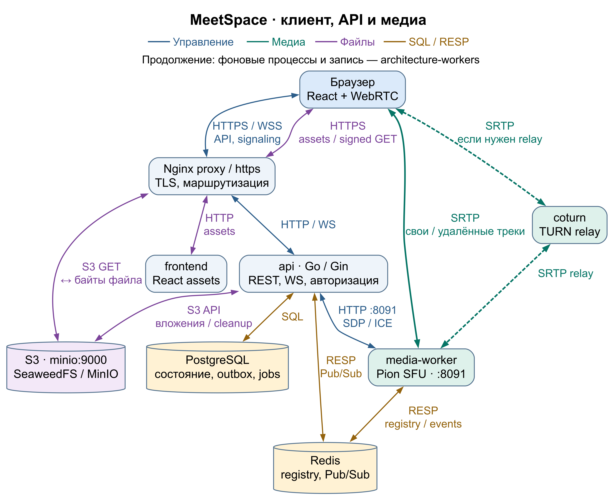
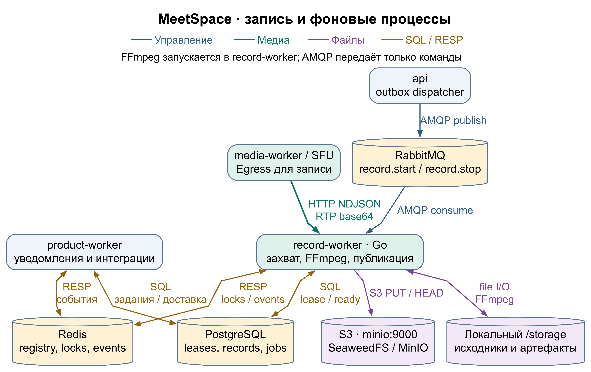
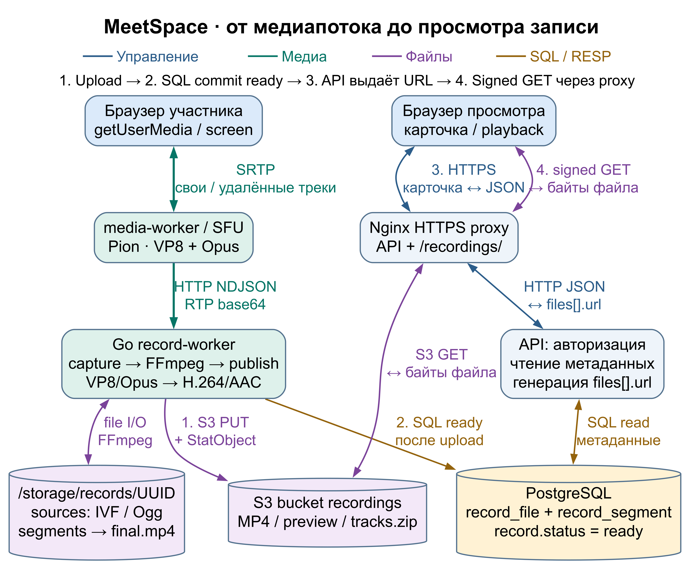
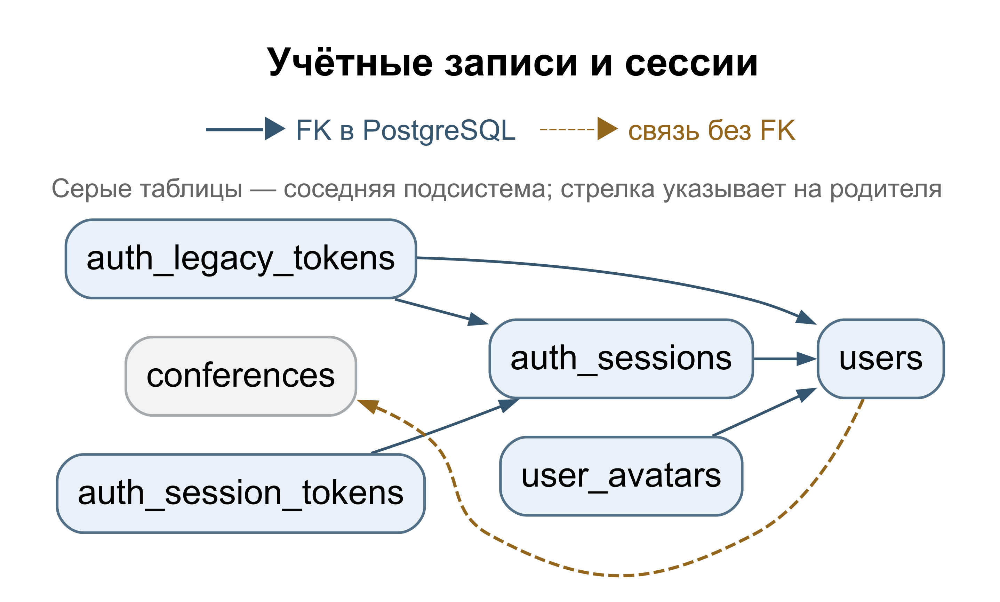
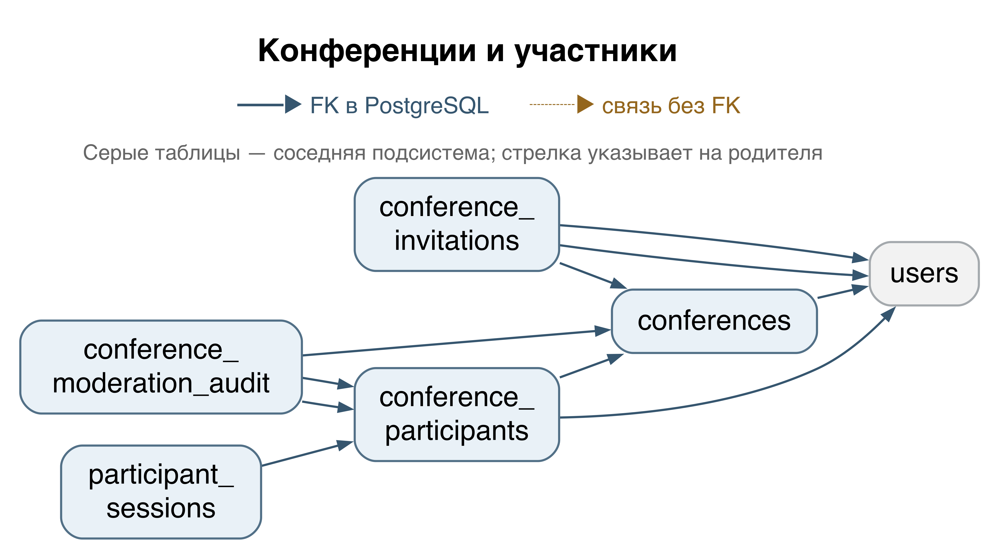
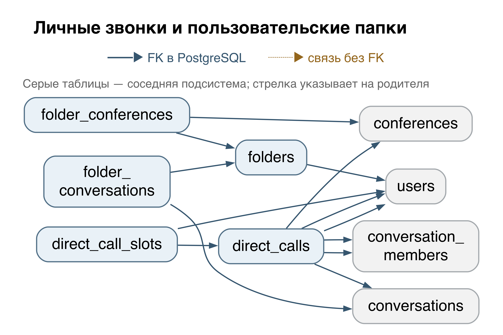
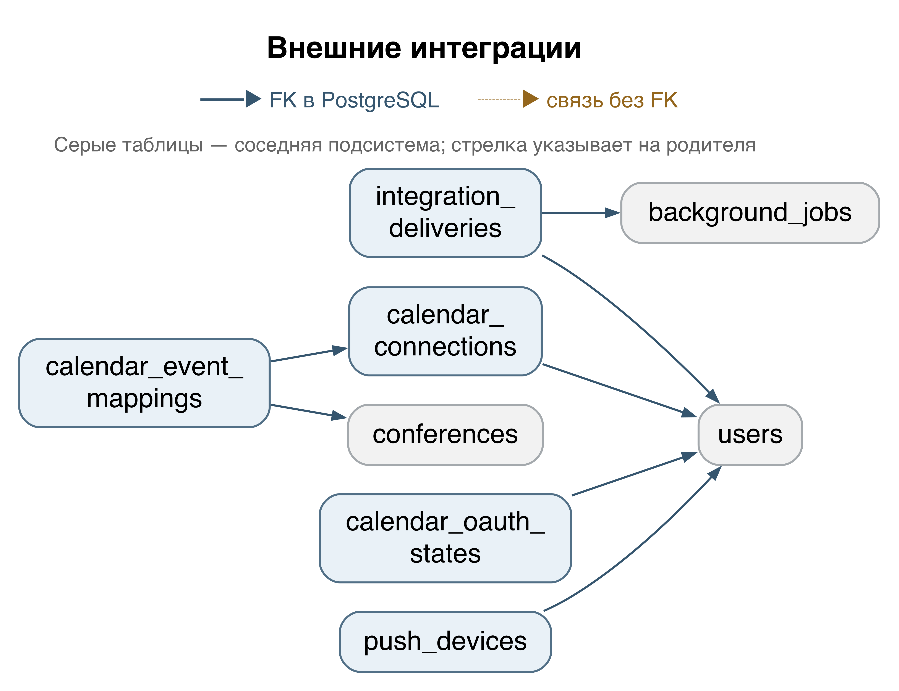

# MeetSpace

Техническое руководство для разработчиков и системных администраторов.

Редакция: 30 октября 2026 г. Исходники: `a5ea4e525bd653fcd0a19a3e5f4f2896e9d793e5` и локальные изменения, удаляющие прежний механизм записи.

## Содержание

  - [Об этом документе](#guide-about)
- [1. Общие сведения о проекте](#project-purpose)
  - [1.1. Основные возможности и технологии](#project-features)
  - [1.2. Структура исходного кода](#project-layout)
  - [1.3. Структура и организация кода](#project-navigation)
- [2. Архитектура системы и назначение компонентов](#architecture)
  - [2.1. Общая схема](#architecture-topology)
  - [2.2. Роли сервисов](#architecture-roles)
  - [2.3. Где хранятся данные](#architecture-storage)
  - [2.4. Основные термины](#architecture-terms)
- [3. Медиасвязь и запись конференций](#recording)
  - [3.1. Подключение и передача аудио и видеопотоков](#recording-connect)
  - [3.2. Запуск записи и права доступа](#recording-start)
  - [3.3. Доставка команды и приём потока](#recording-delivery)
  - [3.4. Работа Go Record Worker и FFmpeg](#recording-processing)
  - [3.5. Остановка и публикация](#recording-finish)
  - [3.6. Состояния, ошибки и восстановление](#recording-states)
  - [3.7. Разделение управления и медиапотоков](#recording-boundaries)
- [4. API и протоколы взаимодействия](#section-021)
  - [4.1. Общие правила работы с API](#section-022)
  - [4.2. Аутентификация и управление учётными записями](#section-023)
  - [4.3. Конференции, участники и приглашения](#section-024)
  - [4.4. Записи конференций](#section-025)
  - [4.5. Сообщения и вложения конференций](#section-026)
  - [4.6. Управление чатом конференции](#section-027)
  - [4.7. Личные сообщения и групповые чаты](#section-028)
  - [4.8. Сообщения и вложения личных и групповых диалогов](#section-029)
  - [4.9. Поиск в диалогах и защищённые файлы групп](#section-030)
  - [4.10. Папки пользователя](#section-031)
  - [4.11. Личные звонки](#section-032)
  - [4.12. Поиск встреч](#section-033)
  - [4.13. Реакции участников](#section-034)
  - [4.14. Уведомления и поток SSE](#section-035)
  - [4.15. Календари и каналы доставки уведомлений](#section-036)
  - [4.16. Возможности платформы, администрирование и телеметрия](#section-037)
  - [4.17. Подключение WebSocket по HTTP и настройки ICE](#section-038)
  - [4.18. Внутренний API медиасервера (SFU)](#section-039)
  - [4.19. Проверки состояния, метрики и управляемая остановка](#section-040)
  - [4.20. Внутренний API сервиса записи (Record Worker)](#section-041)
  - [4.21. Профилирование через отдельный локальный адрес](#section-042)
  - [4.22. Основные структуры ответов](#section-043)
  - [4.23. Формат и жизненный цикл SSE-уведомлений](#section-044)
  - [4.24. Общие правила внутренних медиа-API](#section-045)
  - [4.25. Протокол WebSocket конференции](#section-046)
  - [4.26. Глобальный WebSocket пользователя](#section-047)
  - [4.27. Управление записью и получение файлов](#section-048)
  - [4.28. Структура и регистрация API-маршрутов](#section-049)
- [5. Справочник базы данных](#section-050)
  - [5.1. Проверка схемы базы данных и применение миграций](#section-051)
  - [5.2. Обозначения и связи](#section-052)
  - [5.3. users](#section-053)
  - [5.4. auth_sessions](#section-054)
  - [5.5. auth_session_tokens](#section-055)
  - [5.6. auth_legacy_tokens](#section-056)
  - [5.7. conferences](#section-057)
  - [5.8. conference_participants](#section-058)
  - [5.9. participant_sessions](#section-059)
  - [5.10. conference_moderation_audit](#section-060)
  - [5.11. conference_invitations](#section-061)
  - [5.12. record](#section-062)
  - [5.13. record_segment](#section-063)
  - [5.14. record_file](#section-064)
  - [5.15. record_event](#section-065)
  - [5.16. recording_outbox](#section-066)
  - [5.17. chat_messages](#section-067)
  - [5.18. chat_read_states](#section-068)
  - [5.19. chat_attachments](#section-069)
  - [5.20. conference_chat_preferences](#section-070)
  - [5.21. conference_chat_pins](#section-071)
  - [5.22. chat_notification_jobs](#section-072)
  - [5.23. conversations](#section-073)
  - [5.24. conversation_members](#section-074)
  - [5.25. conversation_messages](#section-075)
  - [5.26. conversation_attachments](#section-076)
  - [5.27. conversation_avatar_objects](#section-077)
  - [5.28. conversation_message_pins](#section-078)
  - [5.29. direct_calls](#section-079)
  - [5.30. direct_call_slots](#section-080)
  - [5.31. folders](#section-081)
  - [5.32. folder_conversations](#section-082)
  - [5.33. folder_conferences](#section-083)
  - [5.34. notifications](#section-094)
  - [5.35. notification_jobs](#section-095)
  - [5.36. notification_preferences](#section-096)
  - [5.37. background_jobs](#section-097)
  - [5.38. release_schema_migrations](#section-098)
  - [5.39. push_devices](#section-099)
  - [5.40. calendar_connections](#section-100)
  - [5.41. calendar_oauth_states](#section-101)
  - [5.42. calendar_event_mappings](#section-102)
  - [5.43. integration_deliveries](#section-103)
  - [5.44. JSONB-контракты](#section-104)
  - [5.45. Функции, триггеры и последовательности](#section-105)
  - [5.46. Изменения схемы по миграциям](#section-106)
  - [5.47. user_avatars — фотографии пользователей](#section-127)
- [6. Установка и развёртывание](#install)
  - [6.1. Выбор способа установки](#install-options)
  - [6.2. Подготовка сервера для установки](#install-host)
  - [6.3. Домен, адрес сервера и входящие порты](#install-network)
  - [6.4. Получение и проверка установщика](#install-download)
  - [6.5. Установка готового выпуска](#install-images)
  - [6.6. Явная сборка исходников на сервере](#install-source)
  - [6.7. Ответы интерактивному мастеру](#install-wizard)
  - [6.8. Запуск, миграции и фактический Compose-контекст](#install-start)
  - [6.9. Первый аккаунт, приёмка и продолжение после ошибки](#install-acceptance)
  - [6.10. Локальный запуск для разработки](#install-local)
  - [6.11. Локальный HTTPS для проверки с другого устройства](#install-local-tls)
  - [6.12. Ручное серверное развёртывание: подготовка](#install-manual-prepare)
  - [6.13. Ручной серверный выпуск: проверка, миграция и запуск](#install-manual-run)
  - [6.14. Дополнительные функции после базовой установки](#install-optional)
- [7. Обслуживание и диагностика](#ops)
  - [7.1. Определение установленного окружения](#ops-context)
  - [7.2. Состояние процессов, журналы и метрики](#ops-health)
  - [7.3. Подключение SMTP после установки мастером](#ops-smtp)
  - [7.4. Изменение настроек и дополнительных функций](#ops-config)
  - [7.5. Подготовка к обслуживанию без потери текущей записи](#ops-drain)
  - [7.6. Возврат той же версии после обслуживания](#ops-restart)
  - [7.7. Согласованная резервная копия установки мастером](#ops-backup)
  - [7.8. Проверка восстановления на отдельном стенде](#ops-restore)
  - [7.9. Свободное место и временные файлы](#ops-storage)
  - [7.10. Сертификаты и секреты](#ops-certificates)
  - [7.11. Диагностика по наблюдаемому симптому](#ops-diagnosis)
  - [7.12. Обновление, откат и передача диагностики](#ops-upgrades)
- [8. Источники и границы проверки](#verification-scope)
  - [8.1. Источники технических сведений](#verification-sources)
  - [8.2. Что подтверждено и что проверяет администратор](#verification-limits)
- [9. Техническая поддержка и доработка проекта](#support)
  - [9.1. Контакты](#support-contacts)
  - [9.2. Что приложить к обращению](#support-request)
  - [9.3. Индивидуальная разработка](#support-custom)

<a id="guide-about"></a>

## Об этом документе

MeetSpace — единая платформа для видеоконференций, личного и группового общения. Пользователи могут проводить встречи, приглашать участников, общаться по аудио- и видеосвязи, демонстрировать экран, обмениваться сообщениями и файлами, а также сохранять записи конференций.

Серверная часть хранит переписку и материалы встреч, управляет доступом и доставляет уведомления. В руководстве описаны устройство приложения, правила работы с API, структура базы данных и порядок установки.

**Как пользоваться руководством**

- Разработчику: главы 1–3 дают общую картину; главы 4–5 содержат справочники API и базы данных.
- Администратору: глава 6 помогает выбрать и выполнить установку; глава 7 описывает проверку, обновление и восстановление.
- При обращении за помощью используйте контакты и перечень диагностических данных из главы 9.

Каждая команда относится к тому способу установки, который описан в её разделе. Перед использованием команды в другом окружении проверьте пути и конфигурацию: интерактивный мастер и ручное развёртывание используют разные файлы Compose.

Значения вроде `meet.example.com`, `<версия>` и `<токен>` нужно заменить своими. Примеры не содержат рабочих паролей. Команды, изменяющие данные, предназначены для вашего сервера и не выполнялись при подготовке этого документа.

Описание основано на коде указанного коммита. Конфигурация конкретного сервера может отличаться. При подготовке документа состояние публичных сайтов и доступность выпусков не проверялись.


<a id="project-purpose"></a>

# 1. Общие сведения о проекте

<a id="project-features"></a>

## 1.1. Основные возможности и технологии

MeetSpace объединяет видеоконференции, личные и групповые чаты, приглашения, уведомления, вложения и записи встреч. Браузер отвечает за интерфейс и доступ к устройствам. Сервер проверяет права, хранит данные, передаёт медиапотоки и обрабатывает запись.

| Уровень | Реализация | Назначение |
|---|---|---|
| Веб-клиент | React 19.3.0, TypeScript 7.0.2, Vite 8.3.5 | Интерфейс, REST-запросы, WebSocket, браузерный WebRTC |
| Сервер приложений (API) | Go 1.26.10, Gin, GORM/pgx | Авторизация, права, встречи, сообщения, записи, фоновые операции |
| Медиасвязь | Pion WebRTC v4, TURN | Приём и передача аудио, видео и демонстрации экрана |
| Обработка записи | Go Record Worker, FFmpeg, ffprobe | Сборка сегментов, итоговый MP4, проверка файлов |
| Постоянные данные | PostgreSQL, S3-совместимое хранилище | Переписка и метаданные в БД; файлы в объектном хранилище |
| Координация и команды | Redis, RabbitMQ | Присутствие, реестр SFU, блокировки и события; очередь команд записи |
| Развёртывание | Docker Compose, Nginx, coturn | Запуск сервисов, HTTPS, маршрутизация и ретрансляция медиатрафика |

В таблице указаны версии зависимостей для описываемого коммита. Для другого выпуска сверяйте их с `go.mod`, `frontend/package.json`, файлами фиксации зависимостей и манифестами образов. Поддерживаемые версии Node.js указаны в поле `engines` файла `frontend/package.json`.

<a id="project-layout"></a>

## 1.2. Структура исходного кода

```tree
meet-space/
├── cmd/
│   ├── api/                # Запуск API
│   ├── media-worker/       # Запуск медиасервера SFU
│   ├── record-worker/      # Запуск Record Worker
│   ├── product-worker/     # Запуск Product Worker
│   └── main/               # Общие команды: serve, api, record-worker, migrate, version
├── internal/
│   ├── app/                # Создание зависимостей, запуск процессов, обработчики функций продукта
│   ├── domain/             # Типы данных, состояния, ошибки и контракты предметных областей
│   ├── usecase/            # Авторизация, встречи, запись, сообщения и другие прикладные операции
│   ├── transport/          # REST, WebSocket и внутренние HTTP-интерфейсы сервисов
│   ├── infrastructure/     # PostgreSQL, Redis, RabbitMQ, S3, SFU, FFmpeg и файловая система
│   ├── config/             # Чтение и проверка переменных окружения
│   └── operations/         # Готовность, остановка обслуживания, метрики и ограничения процессов
├── database/
│   └── migrations/         # 37 последовательных миграций PostgreSQL: 000001-000037
├── frontend/
│   ├── src/                # Страницы, компоненты, API-клиент и медиаклиент
│   └── public/             # Статические ресурсы веб-приложения
├── dockers/                # Dockerfile, конфигурации прокси, TURN и средств наблюдения
├── docker-compose*.yml     # Локальная, серверная, защищённая и дополнительные конфигурации
├── install.sh              # Загрузчик установщика
├── scripts/
│   ├── install/            # Готовые образы, сборка из исходников и интерактивный мастер
│   └── release/            # Сборка, проверка, упаковка выпуска, переключение и резервные копии
└── docs/                   # Справочники и инструкции проекта
```

<a id="project-navigation"></a>

## 1.3. Структура и организация кода

| Задача | Основные файлы и каталоги |
|---|---|
| Найти REST-маршрут | `internal/transport/http/router.go`, файлы `*_routes.go` |
| Проверить права на запись | `internal/usecase/recordings/service.go` |
| Проследить передачу команды записи | `internal/usecase/recordings/dispatcher.go`, `internal/infrastructure/rabbitmq/commands.go` |
| Разобраться в WebRTC клиента | `frontend/src/media.ts`, `frontend/src/realtime.ts` |
| Проследить выбор SFU | `internal/usecase/media/controller.go`, `client.go`, `internal/infrastructure/redis/media.go` |
| Найти обработку медиапотоков | `internal/infrastructure/sfu/manager.go`, `internal/infrastructure/composite/` |
| Найти сборку и публикацию записи | `internal/usecase/recorder/composite.go`, `composite_artifacts.go`, `internal/infrastructure/ffmpeg/` |
| Уточнить схему БД | SQL-файлы `database/migrations/` и `internal/infrastructure/postgres/migrations.go` |
| Проверить поведение установщика | `install.sh`, `scripts/install/from-images.py`, `from-source.py`, `wizard.py` |

Код разделён по назначению. Каталог `usecase` содержит прикладную логику и проверки прав, `transport` — обработчики сетевых запросов, `infrastructure` — работу с внешними системами и хранилищами. Так правило доступа можно найти отдельно от формата HTTP-запроса и способа хранения данных.


<a id="architecture"></a>

# 2. Архитектура системы и назначение компонентов

<a id="architecture-topology"></a>

## 2.1. Общая схема

При стандартной установке несколько Docker-контейнеров MeetSpace работают на одном сервере. API, медиасервер и фоновые обработчики запускаются независимо. Для каждого компонента можно отдельно ограничить использование процессора и оперативной памяти.

Чтобы несколько обработчиков не выполняли одну задачу одновременно, используется временное право обработки — Lease. Этот механизм не создаёт полноценный кластер: временные файлы записи остаются на сервере, который их создал. Если обработку нужно продолжить на другом сервере, ему потребуются эти файлы.

**Три канала взаимодействия**

| Канал | Путь | Что передаётся |
|---|---|---|
| Пользовательское управление | Браузер → HTTPS/WSS → API | Запросы, права, сообщения чата, сигнальные сообщения WebRTC и события интерфейса |
| Медиаданные | Браузер ↔ WebRTC ↔ SFU; при необходимости через TURN | Аудио, видео и демонстрация экрана. Для записи SFU отдельно отдаёт поток Record Worker |
| Фоновая обработка | API → PostgreSQL Outbox → RabbitMQ → Record Worker | Только управляющие команды записи. Product Worker получает свои задания из PostgreSQL |

RabbitMQ не передаёт видеофайлы и RTP-пакеты. API не проксирует браузерный медиатрафик. Итоговый MP4 формируется на сервере; браузер не создаёт его через `MediaRecorder`.



<a id="architecture-roles"></a>

## 2.2. Роли сервисов

| Компонент | Назначение | Основные зависимости |
|---|---|---|
| `frontend` | Nginx раздаёт собранный веб-интерфейс. React выполняется в браузере | API и медиасервер через браузерные соединения |
| `proxy` | Завершает HTTPS и направляет запросы к интерфейсу, API и объектному хранилищу | Сертификат, маршруты Nginx, frontend, API, S3 |
| API, сервис `api` | Проверяет сессии и права; обслуживает REST и WebSocket; управляет встречами, чатами и записями; отправляет команды Outbox | PostgreSQL, Redis, RabbitMQ, SFU, S3 |
| SFU, сервис `media-worker` | Принимает WebRTC-потоки участников и пересылает их другим участникам; предоставляет поток для записи | Redis, браузеры, внутренний HTTP-интерфейс `8091` |
| Record Worker, сервис `record-worker` | Получает команды записи, читает поток SFU, сохраняет фрагменты, запускает FFmpeg и публикует результат | RabbitMQ, PostgreSQL, Redis, SFU, Spool, S3; служебный HTTP `8090` |
| Product Worker, сервис `product-worker` | Выполняет фоновые задания продукта: уведомления, письма и интеграции | PostgreSQL, Redis, SMTP и настроенные внешние системы; служебный HTTP `8092` |
| PostgreSQL | Хранит пользователей, права, встречи, переписку, задачи, команды Outbox и метаданные файлов | Постоянный том; миграции из выпуска |
| Redis | Хранит краткоживущие состояния, присутствие, реестр SFU и блокировки; доставляет события через Pub/Sub | Внутренняя сеть сервисов |
| RabbitMQ | Надёжно доставляет команды `record.start` и `record.stop` | API публикует, Record Worker потребляет |
| S3, сервис с именем `minio` | Хранит готовые записи и другие файлы. В классическом окружении используется MinIO, в защищённом пакете — SeaweedFS с совместимым API | Постоянное хранилище, API и обработчики файлов |
| `coturn` | Ретранслирует медиатрафик, когда браузер не может связаться с SFU напрямую | Публичные адреса и порты TURN, сертификат для TLS |
| FFmpeg и ffprobe | Составляют видео и звук, объединяют сегменты, извлекают предпросмотр и проверяют результат | Дочерние процессы внутри рабочих контейнеров, а не отдельная очередь или медиасервер |
| `migrate` | Однократно применяет SQL-миграции до запуска приложения | PostgreSQL; профиль `migration` |
| Prometheus и дополнительные средства наблюдения | Собирают метрики при включении соответствующей конфигурации | Закрытые служебные интерфейсы; профиль `observability` |

Распознавание речи, субтитры, речевая аналитика и ИИ-сводки удалены из приложения. Запись, чаты и обычный поиск работают без внешнего сервиса распознавания.

<a id="architecture-storage"></a>

## 2.3. Где хранятся данные

| Уровень | Содержимое | Что важно для эксплуатации |
|---|---|---|
| PostgreSQL | Текст сообщений, участники, настройки, состояния и метаданные файлов | Нужна резервная копия БД; она не содержит сами видеозаписи |
| S3 | Готовые записи, предпросмотры и другие опубликованные объекты | Копируется отдельно от БД. Подписанные ссылки предоставляют доступ на ограниченное время |
| Spool, обычно `/storage` у Record Worker | Исходные дорожки, описания фрагментов, сегменты и промежуточный результат | Нужен свободный диск. По умолчанию успешная запись очищает рабочий каталог; после ошибок он может остаться |
| Redis | Присутствие, блокировки, реестры и краткоживущие события | Не заменяет БД; нельзя считать его архивом переписки или записей |
| RabbitMQ | Ещё не обработанные команды записи | Не является хранилищем медиаданных |

Резервные копии БД и объектов S3 должны соответствовать одному согласованному состоянию системы. Нельзя удалять рабочий каталог активной записи или очищать все Docker-тома ради освобождения места.

<a id="architecture-terms"></a>

## 2.4. Основные термины

- **SFU** — медиасервер, который принимает потоки участников и передаёт их другим участникам без формирования единого изображения для каждого зрителя.
- **Worker** — отдельный процесс для фоновых задач.
- **Egress** — поток, который SFU отдаёт обработчику, например сервису записи.
- **Spool** — локальный рабочий каталог с временными медиаданными.
- **Lease** — ограниченное по времени право обрабатывать задачу. Для продолжения работы его нужно продлевать.
- **Outbox** — таблица команд, записываемая в одной транзакции с изменением состояния. Она позволяет повторить отправку команды, если брокер временно недоступен.
- **S3** — API объектного хранилища для готовых файлов и материалов.


<a id="recording"></a>

# 3. Медиасвязь и запись конференций

<a id="recording-connect"></a>

## 3.1. Подключение и передача аудио и видеопотоков

1. Авторизованный участник присоединяется к конференции. Клиент получает одноразовый WS Ticket и открывает `/api/v1/conferences/{id}/ws?ticket=…`.
2. Через WebSocket передаются сигнальные события `media.join`, `media.offer`, `media.answer`, `media.ready`, `media.ice`, `media.leave` и `media.unpublish`. Это управление соединением, а не аудио или видео.
3. Браузер запрашивает разрешение на камеру и микрофон через `getUserMedia()`. Демонстрация экрана использует `getDisplayMedia()`; передача звука экрана зависит от браузера и выбранного источника.
4. Клиент создаёт `RTCPeerConnection` с `bundlePolicy: "max-bundle"`. Источники: `microphone`, `camera`, `video/screen`, `audio/screen`. Предпочтительные кодеки — VP8 и Opus.
5. API проверяет сессию и участие, выбирает SFU через реестр Redis и отправляет внутренние команды `/internal/media/{action}`. Их защищает `MEDIA_INTERNAL_SECRET`; дополнительно проверяются привязка к участнику и право обслуживать комнату.
6. После согласования браузер передаёт медиаданные непосредственно SFU по WebRTC. Если прямой путь недоступен, используется TURN. API и RabbitMQ в этом пути не участвуют.

<a id="recording-start"></a>

## 3.2. Запуск записи и права доступа

Клиент получает список доступных режимов из описания возможностей сервера (Capabilities). Чтобы начать запись, он отправляет `POST /api/v1/conferences/{id}/recordings`. Пока запрос выполняется, кнопка запуска заблокирована, поэтому повторное нажатие не создаёт ещё один запрос.

| Параметр | Значение по умолчанию | Ограничения |
|---|---|---|
| `mode` | `composite` | Только поддерживаемый сервером режим |
| `segmentDurationSec` | `5` | От 2 до 30 секунд; отсутствие или `0` означает 5 секунд |

Начать запись может зарегистрированный участник активной конференции со статусом `joined`, а не только организатор. Сервер проверяет доступ независимо от состояния кнопок интерфейса.

| Операция | Кто может выполнить |
|---|---|
| Начать | Зарегистрированный допущенный участник со статусом `joined`; другая активная запись отсутствует |
| Остановить | Инициатор записи или владелец конференции; допустимы `joined` и `left`. Роль `co_host` сама по себе не даёт права остановить чужую запись |
| Читать | Участник с разрешённым доступом к конференции и записи, включая допущенного гостя; учитываются удаление и срок хранения |
| Удалить | Зарегистрированный инициатор или владелец; запись завершена и активное право обработки отсутствует |

Гость не может начать, остановить или удалить запись. Статусы `waiting`, `rejected` и `kicked` не дают доступа к управлению. В интерфейсе остановка доступна только при `joined`, хотя API позволяет инициатору остановить запись и после выхода.

В одной транзакции PostgreSQL создаются `record` со статусом `starting` и команда в `recording_outbox`. Сохраняются `mode`, `source_type=conference`, `transport_type=sfu`, `platform_conference_id` и `requested_by`.

Ответ `202 Accepted` означает начало обработки, а не готовность файла. Повторный запуск при активной записи возвращает `409 Conflict`.



<a id="recording-delivery"></a>

## 3.3. Доставка команды и приём потока

Обработчик Outbox в API проверяет наличие новых команд каждые 250 мс и выбирает до 16 команд за цикл. Команда закрепляется за обработчиком на 15 секунд; на одну попытку отправки отводится не более 5 секунд. Команды одной записи отправляются в исходном порядке.

Перед запуском записи устанавливается блокировка Redis `record:conference:{conferenceId}:lock`. Команда передаётся в RabbitMQ как JSON-сообщение с признаком сохранения: через обменник (exchange) `go-recorder.commands` в очередь `go-recorder.recording.commands`, с ключом маршрутизации (routing key) `record.commands`. Имена обменника и очереди можно изменить в конфигурации.

Команда помечается отправленной только после подтверждения брокера. При ошибке она остаётся в Outbox; следующая попытка становится доступной через секунду. Это не гарантирует доставку ровно за секунду.

Record Worker получает временное право обработки в PostgreSQL и подключается к исходящему потоку SFU — Egress. Поток передаётся по внутреннему HTTP/HTTPS-соединению в формате `application/x-ndjson`. Он содержит сообщения `hello`, `track`, `rtp`, `track.end`, `ping`, `error`. RTP-пакеты кодируются в Base64 и помещаются в JSON вместе с порядковым номером и временем.

После `hello` запись переходит в `recording`; это может произойти до первого RTP-пакета. Worker проверяет последовательность, кодеки, размеры сообщений и ограничения дорожек. Поддерживаемый вход для составной записи — VP8 с частотой 90 кГц и Opus 48 кГц, до двух аудиоканалов.

RabbitMQ передаёт только команды. Он не используется для Egress и не заменяет соединение SFU с Record Worker.



<a id="recording-processing"></a>

## 3.4. Работа Go Record Worker и FFmpeg

Record Worker сохраняет видеодорожки в формате IVF, аудиодорожки — в OGG. Описание каждого фрагмента записывается в `chunk_*.json`. Затем FFmpeg формирует сегменты MP4. Промежуточный файл заменяется готовым сегментом только после завершения обработки.

Для видеорежимов формируется сетка камер или раскладка с демонстрацией экрана. Она определяется сервером, а не расположением элементов в браузере. Звук объединяется, при необходимости добавляется тишина. Очередь компоновки содержит до четырёх фрагментов; переполнение приводит к ошибке, а не к незаметной потере части записи.

| Режим | Результат |
|---|---|
| `composite` | Общий MP4 с H.264/AAC; сетка камер или экран с камерами; JPEG-предпросмотр |
| `screen_focus` | Экран занимает изображение, когда демонстрация активна; иначе используется сетка камер |
| `audio_only` | MP4 только с AAC-аудио; тип файла `final_audio`, MIME `audio/mp4`, имя `final.mp4`; без JPEG |
| `individual_tracks` | Основной аудиофайл и `tracks.zip` с исходными IVF/OGG и манифестом. Это не набор отдельных MP4 для каждого участника |

**Основные параметры записи**

| Переменная | По умолчанию | Допустимое значение или смысл |
|---|---|---|
| `RECORDING_WIDTH` / `RECORDING_HEIGHT` | `1280` / `720` | Чётные размеры: ширина 320–1920, высота 240–1080 |
| `RECORDING_FPS` | `30` | 10–30 кадров/с |
| `RECORDING_FFMPEG_CONCURRENCY` | `1` | 1–4 одновременных процесса компоновки |
| `RECORDING_MAX_ACTIVE` | `2` | 1–8 активных записей на обработчик |
| `RECORDING_MAX_MIB` | `10240` | Лимит принятых медиаданных: от 1 МиБ до 100 ГиБ. Не является квотой размера Spool |
| `RECORDING_MAX_DURATION` | `4h` | От 1 минуты до 24 часов |
| `RECORDING_LEASE_TTL` | `20s` | 10–60 секунд |
| `RECORDING_POLL_INTERVAL` | `1s` | От 100 мс до четверти срока Lease |
| `RECORDING_KEEP_LOCAL` | `false` | При `true` рабочие файлы сохраняются и после успешной публикации |

Стандартные настройки кодирования: `libx264`, `veryfast`, CRF 23, `yuv420p`; звук AAC 128 кбит/с, 48 кГц, стерео. На обработку одного сегмента отводится до двух минут.

<a id="recording-finish"></a>

## 3.5. Остановка и публикация

1. API сохраняет `stopping`, время и причину остановки вместе с командой `record.stop` в Outbox. Worker также проверяет состояние в БД и может остановиться до получения команды из очереди.
2. Worker закрывает Egress и завершает последний фрагмент. В состоянии `finalizing` он восстанавливает недостающие сегменты из сохранённых описаний и объединяет проверенные сегменты.
3. FFmpeg соединяет совместимые сегменты с `-c copy -movflags +faststart`. ffprobe проверяет MP4, кодеки, положительную длительность и размер не менее 1024 байт. Для видео расхождение длительности изображения и звука не должно превышать 0,35 секунды.
4. Для видеорежимов создаётся JPEG-предпросмотр. Worker рассчитывает размер и SHA-256, переходит в `uploading` и загружает файлы в S3. На файл отводится до десяти минут; клиент допускает до трёх повторов. После загрузки проверяется размер объекта через `StatObject`, но не его SHA-256.
5. Одна транзакция создаёт метаданные `record_file` и `record_segment`, обновляет длительность и размер записи и устанавливает `ready`. После этого публикуется событие `recording.ready`.
6. По умолчанию рабочий каталог успешной записи удаляется. Метаданные сегментов остаются в БД, но сегменты составной записи отдельно в S3 не публикуются.

Объекты располагаются в бакете `MINIO_BUCKET` (по умолчанию `recordings`) с ключами вида:

```text
recordings/{conferenceId}/{recordId}/artifacts/{recorderToken}/final.mp4
recordings/{conferenceId}/{recordId}/artifacts/{recorderToken}/preview.jpg
recordings/{conferenceId}/{recordId}/artifacts/{recorderToken}/tracks.zip
```

Предпросмотр и архив создаются только для соответствующих режимов. Не собирайте URL вручную: используйте `files[].url` из авторизованного ответа API. Срок подписи — 24 часа; ссылкой может воспользоваться любой её получатель. Доступ прекратится раньше, если объект удалён.

<a id="recording-states"></a>

## 3.6. Состояния, ошибки и восстановление

Штатная последовательность: `starting` → `recording` → `stopping` → `finalizing` → `uploading` → `ready`. В публичном API этапы `finalizing` и `uploading` представлены как `processing`. Ошибка переводит запись в `failed`.

В модели данных также предусмотрены состояния `degraded`, `partial_ready` и `cancelled`. Однако само наличие этих состояний не означает, что для составной записи реализованы отдельные пользовательские операции частичного восстановления или отмены.

| Ситуация | Поведение |
|---|---|
| Нет подтверждения RabbitMQ | Команда остаётся в Outbox. Повторная доставка возможна, поэтому обработка учитывает состояние записи и Lease |
| Ошибка обработки AMQP-команды | Первая ошибка возвращает сообщение в очередь; повторная переносит его в `{queue}.failed` после подтверждения публикации |
| Некорректная команда или тело более 64 КиБ | Сообщение изолируется в очереди ошибок. Её пределы: 7 суток, 10 000 сообщений, 64 МиБ |
| Потерян Egress, нет чтения 15 секунд, нарушена последовательность или превышен лимит | Приём прекращается, сохраняются имеющиеся фрагменты; обычно устанавливается `failed` |
| Worker перезапущен во время приёма | Непрерывная запись не возобновляется автоматически. Отмечается прерывание; сохранённые фрагменты остаются на диске |
| Worker перезапущен при остановке или публикации | Можно продолжить заключительную обработку, если сохранён соответствующий Spool |
| Потеряно право обработки | Прежний Worker прекращает работу и больше не может зафиксировать результат |
| Ошибка после частичной загрузки в S3 | Используется отдельный префикс попытки; отложенная очистка не должна затронуть другие попытки |

Получение Lease другим сервером не переносит временные файлы. Автоматическое восстановление записи `failed` через публичный API не предусмотрено.

Очистка по сроку хранения запускается вместе с API и затем каждую минуту. Завершённые записи старше семи дней становятся недоступны; после проверки отсутствия активного обработчика удаляются объекты и метаданные материалов, заполняется `deleted_at`. Остатки Spool после ошибок нужно проверять отдельно.

<a id="recording-boundaries"></a>

## 3.7. Разделение управления и медиапотоков

API проверяет права участника и сохраняет команды записи в Outbox. RabbitMQ доставляет команды Record Worker. Медиаданные поступают в Record Worker только от SFU через Egress; отдельного WebRTC-входа для браузера у сервиса записи нет.

HTTP-порт Record Worker используется для проверки состояния, метрик и управляемой остановки. Он не принимает команды запуска и остановки записи и не публикуется через пользовательский прокси. Уже сохранённые файлы и метаданные остаются в хранилищах; удаление старого механизма приёма медиаданных их не затрагивает.

Параметры, форматы ответов и примеры запросов записи приведены в главе 4; порядок проверки установленной системы — в главе 7.


<a id="section-021"></a>

# 4. API и протоколы взаимодействия

Каталог содержит **167 HTTP-контрактов**: 142 маршрута сервера приложений (136 прикладных, 5 WebSocket/ICE и GET /health), 11 медиасервера, 1 сервиса записи, 6 общих служебных и 7 регистраций профилирования. Состав сверен с исходниками этой редакции, без запросов к работающему серверу.

<a id="section-022"></a>

## 4.1. Общие правила работы с API

Префикс REST API — `/api/v1`. Параметры пути `:id`, `:participantId`, `:recordingId`, `:messageId`, `:attachmentId`, `:userId`, `:deviceId` и `:itemId` — ненулевые UUID, если не указано иное. `:code` — код приглашения, `:kind` — вид элемента папки.

В таблицах используются следующие обозначения: `query` — параметры URL, `body` — тело запроса, `raw body` — байты файла без JSON-обёртки. Звёздочкой `*` отмечены обязательные поля; остальные поля необязательны. В скобках указано значение по умолчанию. Курсор следующей страницы нужно передавать без изменений.

Обозначения доступа:

- **Bearer** — `Authorization: Bearer <accessToken>`. Проверяются JWT и действительность постоянной сессии, если она используется. Cookie не заменяет Bearer на прикладных маршрутах.
- **Аккаунт** — Bearer зарегистрированного пользователя; гости исключены.
- **История** — Bearer допущенного участника: `admissionState=admitted`, `status=joined/left`. Гость имеет доступ только к своей конференции; `waiting`, `rejected` и `kicked` не допускаются.
- **Чат: чтение** — доступ «История» и отсутствие выхода из чата конференции.
- **Чат: запись** — Bearer допущенного участника со статусом `joined`, конференция `active`, участник не покинул чат.
- **Диалог** — аккаунт с действующим членством в нескрытом личном или групповом диалоге.

Гостевому JWT дополнительно разрешены `GET /auth/me`, `GET /capabilities`, `GET /webrtc/config` и `POST /auth/logout` с префиксом `/api/v1`. Права проверяются не только по токену, но и в прикладном коде и БД. Роли конференции — `owner/co_host/participant/guest`; группы — `owner/admin/member`; глобальный администратор определяется полем `users.is_admin`. Текст сообщения может менять только его автор; чужие сообщения в чате конференции могут удалять также владелец и соорганизатор (owner/co_host).

**Проверка источника запроса (same-origin).** Маршруты управления сессией отклоняют запросы с `Sec-Fetch-Site: cross-site`. Значение заголовка `Origin` должно совпадать с публичным адресом приложения. Запросы клиента без Origin и Fetch Metadata допускаются. Если тело запроса непустое, требуется `Content-Type: application/json`; иначе сервер возвращает 415.

Cookie `meetrix_session` и `meetrix_account_<UUID>` имеют атрибуты HttpOnly и SameSite=Lax, путь `/api/v1/auth` и срок хранения 400 дней. Атрибут Secure включён во всех режимах, кроме `local`. В браузере можно сохранить до пяти аккаунтов. Секрет обновления сессии не передаётся в JSON-ответе. В `internal/app/api.go` постоянные сессии включены: при выходе (logout) используются cookie и проверка same-origin, а Bearer-токен необязателен. Если постоянные сессии выключены, маршрут выхода требует Bearer-токен.

Обычный ответ содержит `status:"success"` и поле `item` или `items`. Исключения указаны в таблицах. Общий обработчик JSON принимает один документ размером до 32 КиБ. Неизвестные поля и второй JSON-документ в том же запросе запрещены. При некорректном или слишком большом JSON сервер возвращает 400, а не 413. Для файлов, билетов WebSocket, телеметрии и внутренних медиа-API действуют отдельные ограничения.

Повторный запрос с тем же `clientRequestId` и содержимым не создаёт повторную операцию — это свойство называется идемпотентностью. Если содержимое отличается, тот же ключ вызывает конфликт. Ответ на асинхронную операцию подтверждает приём задания, но не готовность результата. В режиме `read-only` данные доступны только для чтения.

| Статус | Общий смысл и тело |
|---|---|
| 400 | JSON некорректен или содержит неизвестные поля: `{status:"failed",message:"invalid json body or unknown fields"}`. |
| 401 | Токен отсутствует, недействителен или отозван: `{status:"failed",message:...}`. |
| 403 | Недостаточно прав, нарушена область доступа гостя, нет допуска к конференции либо не пройдена проверка same-origin. |
| 404 | Ресурс не найден или недоступен по правилам соответствующего репозитория данных. |
| 409 | Действие невозможно в этом состоянии ресурса либо возник конфликт ключа идемпотентности, версии или установленного лимита. |
| 422 | Поля, UUID, параметры страницы или предметные параметры запроса не прошли проверку. |
| 429 | Превышена допустимая частота запросов. Обычно ответ содержит `Retry-After`; отдельные обработчики WebSocket, SSE и реакций возвращают `{error:...}` или пустое тело. |
| 500 / 503 / 504 | Соответственно: непредвиденная ошибка; временная недоступность зависимости или отключённая функция; истечение времени ожидания. Ответ 500 не раскрывает внутренних подробностей и содержит `internal server error`. |

Общие ошибки применяются ко всем маршрутам. При управляемой остановке (`drain`) прикладные запросы получают 503. API назначает идентификаторы запросов и собирает метрики. Закрытые данные обычно возвращаются с `Cache-Control: private, no-store` или `no-store`. Подписанная ссылка может сама давать право скачивания; не раскрывайте её.

Источники: `internal/app/httpresponse/response.go`, `internal/transport/http/middleware/auth.go`, `admin.go`, `rate_limit.go`, `internal/app/auth/{handler,sessions,accounts}.go`, `internal/domain/conferences/product.go`.

<a id="section-023"></a>

## 4.2. Аутентификация и управление учётными записями

Исходники: `internal/transport/http/platform_routes.go`, `internal/transport/http/profile_avatar_routes.go`, `internal/app/profile/avatar_handler.go`.

| Метод и путь | Доступ и назначение | Запрос | Ответ и ошибки |
|---|---|---|---|
| `POST /api/v1/auth/register` | Публичный; same-origin<br>Создать учётную запись | JSON: email*; password* — 8–128 символов; необязательный displayName — до 100 символов | 201: status, user<br>Ошибки: 409 — email уже занят; 422 — поля запроса не прошли проверку; 403 — источник запроса (origin) не разрешён; 415 — неподдерживаемый Content-Type |
| `POST /api/v1/auth/login` | Публичный; same-origin<br>Войти в аккаунт и сохранить сессию в браузере | JSON: email*, password* | 200: status, accessToken, tokenType, expiresIn, user; заголовок Set-Cookie<br>Ошибки: 401 — неверные учётные данные; 409 — достигнут лимит 5 аккаунтов в браузере; 403 — источник запроса (origin) не разрешён; 415 — неподдерживаемый Content-Type |
| `POST /api/v1/auth/refresh` | Cookie; same-origin<br>Получить новый токен доступа из постоянной сессии | Пустое тело или JSON {userId}; cookie meetrix_session либо meetrix_account_&lt;userId&gt; | 200: LoginResponse; обновлённые cookie<br>Ошибки: 401 — сессия отсутствует или отозвана; 403 — выбран другой аккаунт или origin; 503 — постоянные сессии отключены |
| `POST /api/v1/auth/accounts/list` | Cookie; same-origin<br>Получить аккаунты, сохранённые в браузере | Пустое тело или JSON {}; cookie meetrix_account_&lt;id&gt; | 200: status, items: User[]; недействительные cookie удаляются<br>Ошибки: 409 — превышен лимит аккаунтов; 503 — постоянные сессии отключены; 403 — источник запроса (origin) не разрешён |
| `POST /api/v1/auth/accounts/switch` | Cookie; same-origin<br>Сделать сохранённый аккаунт активным | JSON: userId* — канонический UUID; cookie этого аккаунта meetrix_account_&lt;id&gt; | 200: LoginResponse; Set-Cookie для meetrix_session<br>Ошибки: 401 — недействительная cookie; 403 — владелец не совпадает; 422 — некорректный UUID; 503 — функция отключена |
| `POST /api/v1/auth/logout` | Cookie; same-origin; Bearer необязателен<br>Отозвать выбранную постоянную сессию | Пустое тело или JSON {userId}; cookie сессии; необязательный Bearer для привязки доступа | 200: status=success; соответствующие cookie удаляются<br>Ошибки: 403 — источник запроса (origin) не разрешён; 400 — некорректный JSON; 503 — сервис сессий недоступен |
| `GET /api/v1/auth/me` | Bearer; гостю разрешён доступ в пределах своей области<br>Профиль текущего пользователя | Без тела и параметров URL | 200: status, user; у гостя поле email пустое и присутствует guestConferenceId<br>Ошибки: 401 — аккаунт или сессия отсутствуют |
| `PATCH /api/v1/auth/me` | Аккаунт<br>Изменить отображаемое имя | JSON: displayName* — 1–100 символов, без управляющих символов | 200: status, user<br>Ошибки: 422 — неверное имя; 403 — действие недоступно гостю |
| `PUT /api/v1/auth/me/avatar` | Аккаунт; только собственный профиль<br>Загрузить или заменить аватар | Байты JPEG/PNG; Content-Type — image/jpeg или image/png; до 2 МиБ, каждая сторона — до 2048 пикселей | 200: status,user с avatarVersion; сервер обрезает изображение по центру до квадрата и сохраняет в JPEG размером до 512×512<br>Ошибки: 422 — недопустимый тип, размер или изображение; 403 — действие недоступно гостю; 429 — лимит запросов или обработки |
| `DELETE /api/v1/auth/me/avatar` | Аккаунт; только собственный профиль<br>Удалить аватар | Без тела | 200: status,user без avatarVersion<br>Ошибки: 403 — действие недоступно гостю; 429 — лимит запросов |
| `GET /api/v1/users/:id/avatar/content` | Аккаунт<br>Аватар зарегистрированного пользователя | id — UUID; без тела | 200: байты image/jpeg; Cache-Control: private, no-store<br>Ошибки: 422 — некорректный UUID; 403 — действие недоступно гостю; 404 — пользователь или аватар отсутствует; 429 — лимит запросов |
| `DELETE /api/v1/auth/me` | Аккаунт; same-origin<br>Удалить аккаунт после проверки пароля | JSON: password* | 200: status=success; cookie аккаунта удаляются<br>Ошибки: 422 — пароль неверен или пуст; 403 — источник запроса (origin) не разрешён или запрос отправлен гостем; 503 — сервис аккаунтов недоступен |
| `POST /api/v1/auth/session` | Аккаунт; same-origin<br>Создать постоянную сессию на основе действующего доступа | Пусто или {userId}; используются аккаунт Bearer-токена и его cookie либо meetrix_session | 200: LoginResponse; cookie<br>Ошибки: 401 — недействительный доступ; 403 — гость или origin; 503 — постоянные сессии отключены |

Аватар доступен авторизованным пользователям; загрузка и удаление относятся только к текущему профилю. Если ограничение частоты запросов включено, одному пользователю разрешено 10 загрузок, 30 удалений и 120 чтений в минуту. При преобразовании изображения его исходные метаданные удаляются. Источники: `internal/usecase/profile/avatar.go`, `internal/domain/avatar/avatar.go`.

<a id="section-024"></a>

## 4.3. Конференции, участники и приглашения

Исходники: `internal/transport/http/guest_routes.go`, `internal/transport/http/invitation_routes.go`, `internal/transport/http/platform_routes.go`.

| Метод и путь | Доступ и назначение | Запрос | Ответ и ошибки |
|---|---|---|---|
| `POST /api/v1/conference-invites/:code/guest` | Публичный маршрут; для возобновления участия — гостевой Bearer<br>Присоединиться к конференции как гость по приглашению | code; JSON displayName*; заголовок Authorization необязателен, но при наличии должен содержать гостевой токен | 200: status,accessToken,tokenType=Bearer,expiresIn=10800 (3 часа),user,item: Participant<br>Ошибки: 401 — неверный токен; 403 — токен обычного аккаунта, гость другой конференции или отказ в допуске; 404 — неверный code; 409 — конференция завершена; 422 — неверное имя; 429 |
| `GET /api/v1/conferences/:id/invitation-users` | Аккаунт; владелец (owner) либо вошедший соорганизатор (co_host); конференция в состоянии active<br>Найти пользователей для приглашения | id; query* — 2–100 символов | 200: status,items: id,email,displayName<br>Ошибки: 422 — неверный query; 403 — недостаточно прав для этой роли; 409 — конференция завершена; 404 |
| `POST /api/v1/conferences/:id/invitations` | Аккаунт; владелец (owner) либо вошедший соорганизатор (co_host); конференция в состоянии active<br>Поставить приглашения в очередь на доставку | id; JSON emails[] и/или userIds[] UUID; суммарно 1–20 адресатов | 202: status,items: InvitationResult[] (id,email,userId,status)<br>Ошибки: 422 — неверный список или email; 403 — недостаточно прав для этой роли; 409 — конференция закрыта; 404 |
| `POST /api/v1/conferences` | Аккаунт<br>Создать конференцию | JSON: title* — 1–200 символов; waitingRoomEnabled; scheduledAt — время в будущем в формате RFC3339; plannedDurationMin — 1–1440, только вместе с scheduledAt | 201: status, item: Conference<br>Ошибки: 422 — неверное название или расписание; 403 — действие недоступно гостю |
| `GET /api/v1/conferences` | Аккаунт<br>Список доступных конференций | Query: limit — 1–100 (20), offset ≥0 (0) | 200: status, items: Conference[]<br>Ошибки: 422 — неверные параметры страницы; 403 — действие недоступно гостю |
| `GET /api/v1/conferences/:id` | История<br>Карточка конференции | id — UUID | 200: status, item: Conference<br>Ошибки: 403 — нет допуска; 404 — конференция не найдена |
| `POST /api/v1/conferences/:id/start` | Bearer; владелец конференции (owner)<br>Начать конференцию из состояния created/scheduled | id; пустое тело или JSON {} | 200: status, item со status=active<br>Ошибки: 403 — не владелец; 409 — переход из текущего состояния запрещён; 404 |
| `POST /api/v1/conferences/:id/finish` | Bearer; владелец конференции (owner)<br>Завершить активную конференцию (active) | id; пустое тело или JSON {} | 200: status, item со status=finished<br>Ошибки: 403; 409 — текущее состояние не active; 404 |
| `POST /api/v1/conferences/:id/cancel` | Bearer; владелец конференции (owner)<br>Отменить конференцию в состоянии created/scheduled | id; пустое тело или JSON {} | 200: status, item со status=cancelled<br>Ошибки: 403; 409 — переход из текущего состояния запрещён; 404 |
| `POST /api/v1/conferences/:id/join` | Bearer в разрешённой области доступа<br>Создать или возобновить участие | id; пустое тело либо JSON {inviteCode}; для нового участника обязателен действующий inviteCode | 200: status, item: Participant, включая admissionState<br>Ошибки: 403 — неверное приглашение или состояние rejected/kicked; 409 — недопустимое состояние конференции; 422 — неверный code |
| `POST /api/v1/conferences/:id/leave` | Bearer; только участие текущего пользователя<br>Выйти из конференции | id; пустое тело или JSON {} | 200: status, item: Participant<br>Ошибки: 403 — нет участия; 404 |
| `GET /api/v1/conferences/:id/participants` | История<br>Список участников; состояния waiting/rejected видны владельцу и соорганизатору (owner/co_host) | id; limit — 1–100 (20), offset ≥0 | 200: status, items: Participant[]<br>Ошибки: 403 — нет допуска; 404; 422 — параметры страницы |
| `GET /api/v1/conferences/:id/participants/me` | Bearer; только участие текущего пользователя<br>Узнать состояние допуска текущего участника | id | 200: status, item: Participant<br>Ошибки: 403/404 — доступное участие не найдено |
| `POST /api/v1/conferences/:id/participants/:participantId/admission` | Bearer; вошедший owner/co_host<br>Допустить или отклонить ожидающего участника | id, participantId — UUID; JSON decision*=admit/reject | 200: status, item: Participant<br>Ошибки: 403 — недостаточно прав для этой роли; 409 — недопустимое состояние допуска или конференции; 422 — неверный decision; 404 |
| `PUT /api/v1/conferences/:id/schedule` | Bearer; владелец (owner)<br>Изменить расписание конференции в состоянии scheduled | id; JSON scheduledAt* — время в будущем в формате RFC3339; plannedDurationMin — 1–1440 | 200: status, item: Conference<br>Ошибки: 403 — пользователь не является владельцем (owner); 409 — конференция не в состоянии scheduled; 422 — неверное время или длительность; 404 |
| `GET /api/v1/conferences/:id/history` | История<br>История завершённой или отменённой конференции (finished/cancelled) | id | 200: status, item: conference, owner, durationSec, participantCount, participants, participantsTruncated, recordings, chatAvailable, chatReadOnly<br>Ошибки: 403; 409 — конференция ещё не завершена; 404 |
| `GET /api/v1/me/conferences` | Аккаунт<br>Лента конференций пользователя | Query: view=upcoming/active/past (upcoming), scope=all/owned/participating (all), sort=newest/oldest (newest), status, from/to — RFC3339, cursor, limit — 1–100 (20) | 200: status, items: Conference[], nextCursor<br>Ошибки: 422 — неверные фильтры или курсор, в том числе курсор для другого направления сортировки; 403 — действие недоступно гостю |
| `GET /api/v1/conference-invites/:code` | Публичный маршрут<br>Получить краткую информацию о конференции по ссылке-приглашению | code — код приглашения | 200: status, item: id,title,status,waitingRoomEnabled,scheduledAt<br>Ошибки: 404 — code неизвестен или недоступен |
| `POST /api/v1/conference-invites/:code/join` | Аккаунт<br>Присоединиться по коду приглашения | code; пустое тело или JSON {} | 200: status, item: Participant<br>Ошибки: 403 — повторный вход запрещён; 404 — code не найден; 409 — недопустимое состояние |
| `PUT /api/v1/conferences/:id/participants/me/media` | Bearer; собственное участие в состоянии joined<br>Обновить заявленное клиентом состояние устройств | id; JSON connectionId* — UUID подключённой сессии, sequence* — целое число 1–9007199254740991; microphoneEnabled,cameraEnabled,screenSharing — bool | 200: status,item: Participant; устаревший или повторный sequence игнорируется<br>Ошибки: 403 — нет допуска или подключения либо источник заблокирован; 409 — комната не в состоянии active/created; 422 — поля запроса не прошли проверку |
| `POST /api/v1/conferences/:id/participants/:participantId/moderation` | Bearer; владелец owner, соорганизатор co_host — с ограничениями<br>Изменить ограничения или роль участника либо исключить его | id,participantId; JSON action*=mute/camera/screen/kick/role; blocked* для действий с медиа; role*=co_host/participant для действия role | 200: status, item: Participant<br>Ошибки: 403 — действие запрещено для выбранного участника или роли; 422 — несовместимые поля; 404 |

В `/me/conferences` порядок `newest` — от новых к старым, `oldest` — обратный. Сравнивается дата завершения, иначе запланированная дата, иначе дата создания; при равенстве — UUID. Курсор привязан к `sort`: после смены направления начните с первой страницы. Источники: `internal/domain/conferences/product.go`, `internal/app/conferences/product_handler.go`, `internal/infrastructure/postgres/conference_product_repository.go`.

<a id="section-025"></a>

## 4.4. Записи конференций

Исходники: `internal/transport/http/conference_recording_routes.go`.

| Метод и путь | Доступ и назначение | Запрос | Ответ и ошибки |
|---|---|---|---|
| `POST /api/v1/conferences/:id/recordings` | Bearer; зарегистрированный участник, вошедший в конференцию<br>Запросить начало записи активной конференции | id; пустое тело либо JSON mode=composite/audio_only/individual_tracks/screen_focus (composite), segmentDurationSec=2–30 (5) | 202: status, item: RecordCard; запись запускается асинхронно<br>Ошибки: 403 — гость или нет допуска; 409 — конференция не в состоянии active либо запись уже идёт; 422 — неверный mode/segment; 404 |
| `GET /api/v1/conferences/:id/recordings` | История<br>Список записей конференции | id; limit — 1–100 (20), offset ≥0 | 200: status, items: RecordCard[]<br>Ошибки: 403; 404; 422 |
| `GET /api/v1/conferences/:id/recordings/:recordingId` | История<br>Карточка записи и список доступных файлов | id,recordingId — UUID | 200: status, item: RecordCard с files, segments и URL<br>Ошибки: 403; 404 — запись принадлежит другой конференции или удалена |
| `DELETE /api/v1/conferences/:id/recordings/:recordingId` | История; аккаунт владельца или инициатора записи (owner/requestedBy)<br>Удалить завершённую запись и связанные файлы | id,recordingId; без тела | 200: status=success<br>Ошибки: 403; 409 — обработка записи ещё идёт; 404; 500/503 — ошибка хранилища |
| `POST /api/v1/conferences/:id/recordings/:recordingId/stop` | История; аккаунт владельца или инициатора записи (owner/requestedBy)<br>Запросить остановку записи | id,recordingId; пустое тело или JSON {} | 202: status, item: RecordCard; остановка выполняется в фоне. Повторный запрос не меняет запись, если она уже завершена или обрабатывается<br>Ошибки: 403; 404 |

<a id="section-026"></a>

## 4.5. Сообщения и вложения конференций

Исходники: `internal/transport/http/chat_routes.go`.

Для чатов конференций, личных сообщений и групповых чатов действуют одинаковые ограничения: **до 10 МиБ на файл и до пяти вложений на сообщение**. Загрузка выполняется в три этапа: `init` → `content` → `finalize`. Добавить файл к сообщению можно только после успешного завершения загрузки.

Разрешённые форматы:

- Изображения: JPG/JPEG, PNG, WebP.
- Текст и документы: PDF, TXT, CSV/TSV, Markdown, RTF, RST, AsciiDoc, TeX, XML, JSON, YAML.
- Офисные: Word, Excel, PowerPoint, OpenDocument/LibreOffice, Visio, OneNote; шаблоны и варианты с макросами перечислены в `docs/ATTACHMENTS.md`.
- Печать и книги: XPS/OXPS, PS/EPS, DjVu, Pages/Numbers/Key, EPUB, FB2, MOBI, PRC, AZW/AZW3. Последние три требуют контейнера Mobipocket.
- Архивы: ZIP/ZIPX, RAR, 7Z, TAR; GZIP, BZIP/BZIP2/BZIP3, XZ, Zstandard, LZ4, LZIP, LZMA, LZO/LZOP, compress; CAB, CPIO, AR, ARJ, LHA/LZH, ACE, ARC, ZPAQ. Поддерживаются составные расширения `.tar.gz` и `.tar.zst`.

Проверяются имя, расширение, размер, MIME-тип и байты файла. Пустой или общий MIME уточняется по расширению, но не отменяет проверку содержимого. Для офисных файлов и архивов проверяется сигнатура контейнера; архивы не распаковываются, документы и макросы не исполняются. JSON проверяется синтаксически, XML/FB2 разбирается без DTD и внешних сущностей. YAML и TeX сохраняются как текст. Исполняемые файлы, HTML, JavaScript и SVG запрещены.

Это не антивирусная проверка. Документы и архивы выдаются с `Content-Disposition: attachment` и `application/octet-stream`. Полные правила: `docs/ATTACHMENTS.md`, `internal/domain/chat/attachment_types.go`, `internal/usecase/chat/attachment_content.go`.

| Метод и путь | Доступ и назначение | Запрос | Ответ и ошибки |
|---|---|---|---|
| `GET /api/v1/conferences/:id/messages` | Чат: чтение<br>История сообщений | id; query: курсор before, limit — 1–100 (50) | 200: status, items: Message[], nextCursor, unreadCount, lastReadMessageId<br>Ошибки: 403 — нет участия или выход из чата; 422 — неверный cursor/limit; 404 |
| `POST /api/v1/conferences/:id/messages` | Чат: запись<br>Отправить сообщение; идемпотентно | id; JSON clientRequestId* — UUID, text — до 4000 символов, replyTo — UUID, attachmentIds — до 5; обязателен текст или вложение | 201 для нового запроса / 200 для повторного запроса: status,item: Message<br>Ошибки: 409 — ключ уже использован с другим содержимым, чат доступен только для чтения (read-only) или вложение не готово; 422 — поля запроса не прошли проверку; 403 |
| `PATCH /api/v1/conferences/:id/messages/:messageId` | Чат: запись; только автор сообщения<br>Изменить текст сообщения | id,messageId; JSON text — до 4000 символов; пустой текст допустим только при наличии вложений | 200: status,item: Message с обновлённой version<br>Ошибки: 403 — чужое или служебное сообщение; 409 — сообщение удалено либо чат доступен только для чтения (read-only); 422 — недопустимый пустой текст; 404 |
| `DELETE /api/v1/conferences/:id/messages/:messageId` | Чат: запись; автор либо владелец или соорганизатор конференции (owner/co_host)<br>Пометить сообщение удалённым | id,messageId; без тела | 200: status,item: Message с deletedAt и пустым text<br>Ошибки: 403 — нельзя удалить чужое сообщение или запись истории звонка; 409 — чат доступен только для чтения (read-only); 404 |
| `GET /api/v1/conferences/:id/chat/read` | Чат: чтение<br>Отметка прочтения | id | 200: status,item: lastReadMessageId,unreadCount<br>Ошибки: 403; 404 |
| `PUT /api/v1/conferences/:id/chat/read` | Чат: чтение<br>Отметить прочитанным; отметка движется только вперёд | id; JSON messageId* — UUID | 200: status,item: lastReadMessageId,unreadCount<br>Ошибки: 422 — некорректный UUID; 403; 404 — сообщение за пределами доступной истории |
| `POST /api/v1/conferences/:id/attachments/init` | Чат: запись; владелец загрузки<br>Зарезервировать вложение | id; JSON clientRequestId* — UUID, filename* — 1–180 символов без компонентов пути, size* — 1–10485760; mimeType необязателен; допустимые форматы перечислены выше | 201 для нового запроса / 200 для повторного запроса: status,item: Attachment,uploadUrl<br>Ошибки: 422 — неверные метаданные, MIME-тип или размер; 409 — конфликт ключа либо режим только для чтения (read-only); 403 |
| `PUT /api/v1/conferences/:id/attachments/:attachmentId/content` | Чат: запись; владелец вложения<br>Загрузить файл | id,attachmentId; raw body — до 10 МиБ; размер должен совпадать с указанным в init | 200: status,item: Attachment<br>Ошибки: 422 — неверный размер или содержимое; 409 — срок загрузки истёк, вложение занято либо включён режим только для чтения (read-only); 403; 404 |
| `POST /api/v1/conferences/:id/attachments/:attachmentId/finalize` | Чат: запись; владелец вложения<br>Проверить и завершить загрузку | id,attachmentId; пустое тело или JSON {} | 200: status,item: Attachment<br>Ошибки: 409 — файл не загружен или вложение в неподходящем состоянии; 422 — недопустимое содержимое; 403; 404 |
| `GET /api/v1/conferences/:id/attachments/:attachmentId/download` | Чат: чтение<br>Получить временную ссылку для скачивания вложения | id,attachmentId | 200: status,url,expiresAt (+5 минут)<br>Ошибки: 403; 404 — вложение недоступно или удалено |

<a id="section-027"></a>

## 4.6. Управление чатом конференции

Исходники: `internal/transport/http/chat_actions_routes.go`.

| Метод и путь | Доступ и назначение | Запрос | Ответ и ошибки |
|---|---|---|---|
| `GET /api/v1/conferences/:id/chat/info` | Чат: чтение<br>Получить название, описание и права доступа к чату конференции | id | 200: status,item: conferenceId,title,description,inviteUrl,participantCount,notificationsEnabled,canEdit,canInvite<br>Ошибки: 403; 404 |
| `GET /api/v1/conferences/:id/chat/members` | Чат: чтение<br>Участники чата и присутствие | id; курсор after, limit — 1–100 (50) | 200: status,items: MemberView[],nextCursor<br>Ошибки: 403; 422 — неверный cursor/limit; 404 |
| `PATCH /api/v1/conferences/:id/chat/info` | Bearer; владелец owner с доступом к чату<br>Изменить название или описание чата и конференции | id; JSON title — 1–200 символов и/или description — до 1000 символов; требуется хотя бы одно поле | 200: status,item: ChatInfo<br>Ошибки: 403 — нет права canEdit; 422 — поля запроса не прошли проверку; 404 |
| `GET /api/v1/conferences/:id/chat/preferences` | Чат: чтение<br>Личная настройка уведомлений | id | 200: status,item: notificationsEnabled<br>Ошибки: 403; 404 |
| `PUT /api/v1/conferences/:id/chat/preferences` | Чат: чтение<br>Изменить личную настройку уведомлений | id; JSON notificationsEnabled* — bool | 200: status,item: notificationsEnabled<br>Ошибки: 422 — нет обязательного поля; 403; 404 |
| `DELETE /api/v1/conferences/:id/chat/membership` | Bearer; собственное допущенное участие<br>Покинуть чат конференции | id; без тела | 200: status=success<br>Ошибки: 403; 404 |
| `GET /api/v1/conferences/:id/chat/messages/search` | Чат: чтение<br>Найти сообщения в чате конференции | id; q* — 2–200 символов; before; limit — 1–50 (20) | 200: status,items: Message[],nextCursor<br>Ошибки: 422 — неверный q/cursor/limit; 403; 404 |
| `GET /api/v1/conferences/:id/chat/messages/:messageId/context` | Чат: чтение<br>Контекст найденного сообщения | id,messageId | 200: status,items,nextCursor,unreadCount,lastReadMessageId<br>Ошибки: 403; 404 |
| `GET /api/v1/conferences/:id/chat/materials` | Чат: чтение<br>Изображения, файлы и ссылки из сообщений | id; kind*=image/file/link; before; limit — 1–50 (20) | 200: status,items: Material[],nextCursor<br>Ошибки: 422 — неверный kind/cursor/limit; 403; 404 |
| `GET /api/v1/conferences/:id/chat/pins` | Чат: чтение<br>Личные важные сообщения конференции | id; before; limit — 1–50 (20) | 200: status,items: Message[],nextCursor<br>Ошибки: 403; 422 — неверный cursor/limit; 404 |
| `PUT /api/v1/conferences/:id/chat/pins/:messageId` | Чат: чтение<br>Добавить в личные важные | id,messageId; без тела | 200: status=success<br>Ошибки: 403; 404 — сообщение удалено или не найдено |
| `DELETE /api/v1/conferences/:id/chat/pins/:messageId` | Чат: чтение<br>Убрать из личных важных | id,messageId; без тела | 200: status=success; идемпотентно<br>Ошибки: 403; 422 — некорректный UUID |

<a id="section-028"></a>

## 4.7. Личные сообщения и групповые чаты

Исходники: `internal/transport/http/personal_routes.go`.

Тип `direct` обозначает личный диалог двух пользователей, а `group` — групповой чат. Очистка истории и скрытие личного диалога действуют только для текущего пользователя. Закреплённые сообщения диалога видны всем его участникам. В чате конференции список важных сообщений, напротив, индивидуален для каждого пользователя.

| Метод и путь | Доступ и назначение | Запрос | Ответ и ошибки |
|---|---|---|---|
| `GET /api/v1/users` | Аккаунт<br>Найти пользователей для начала диалога | Query search* — 2–100 символов; поиск по displayName; результат — до 20 других зарегистрированных пользователей | 200: status,items: Peer[] (id,displayName)<br>Ошибки: 422 — неверный search; 403 — действие недоступно гостю |
| `GET /api/v1/conversations` | Аккаунт<br>Список личных и групповых диалогов | Query: before,limit — 1–100 (50),type=all/direct/group,search — до 100 символов,unreadOnly — bool | 200: items: Conversation[],nextCursor,unreadCount; без status<br>Ошибки: 422 — неверные фильтры или cursor; 403 |
| `POST /api/v1/conversations/direct` | Аккаунт<br>Открыть существующий личный диалог или создать новый | JSON userId* — UUID другого зарегистрированного пользователя | 201 новый / 200 существующий: status,item: Conversation<br>Ошибки: 422 — UUID или попытка диалога с собой; 403/404 — адресат недоступен |
| `POST /api/v1/conversations/group` | Аккаунт<br>Создать группу; идемпотентно | JSON clientRequestId* — UUID,name* — 1–50 символов,description — до 200 символов,memberIds — UUID[]; всего не более 100 участников | 201 для нового запроса / 200 для повторного запроса: status,item: Conversation<br>Ошибки: 422 — поля запроса не прошли проверку; 409 — ключ использован для другого запроса или превышен лимит; 404 — участник не найден |
| `GET /api/v1/conversations/:id` | Аккаунт; участник диалога<br>Карточка диалога | id | 200: status,item: Conversation<br>Ошибки: 403 — нет членства или диалог скрыт; 404 |
| `GET /api/v1/conversations/:id/peer-presence` | Аккаунт; участник direct<br>Узнать, находится ли собеседник в сети | id | 200: status,item: conversationId,peerId,online<br>Ошибки: 400 — неверный id; 403 — нет доступа или диалог не direct |
| `PATCH /api/v1/conversations/:id/preferences` | Аккаунт; участник диалога<br>Изменить личную настройку уведомлений | id; JSON notificationsEnabled* — bool | 200: status,item: Conversation<br>Ошибки: 422 — нет обязательного поля; 403 |
| `POST /api/v1/conversations/:id/clear-history` | Аккаунт; участник direct<br>Скрыть прежнюю историю только для себя | id; без тела | 200: status,item: Conversation с historyClearedThrough<br>Ошибки: 403 — нет доступа или диалог не direct |
| `POST /api/v1/conversations/:id/hide` | Аккаунт; участник direct<br>Скрыть диалог только для себя | id; без тела | 200: status,hidden=true,historyClearedThrough<br>Ошибки: 403 — нет доступа или диалог не direct |
| `GET /api/v1/conversations/:id/pins` | Аккаунт; участник диалога<br>Общие закреплённые сообщения | id; before; limit — 1–100 (50) | 200: items: Message[],nextCursor; без status<br>Ошибки: 403; 422 — неверный cursor; 404 |
| `PUT /api/v1/conversations/:id/pins/:messageId` | Аккаунт; участник диалога<br>Закрепить доступное текстовое сообщение для всех участников | id,messageId; без тела | 200: status=success<br>Ошибки: 409 — уже закреплено 20 сообщений; 404 — сообщение удалено, служебное или находится за пределами доступной истории; 403 |
| `DELETE /api/v1/conversations/:id/pins/:messageId` | Аккаунт; участник диалога<br>Убрать сообщение из общего списка закреплённых | id,messageId; без тела | 200: status=success<br>Ошибки: 403; 404 — сообщение недоступно |
| `PATCH /api/v1/conversations/:id` | Аккаунт; владелец или администратор группы (owner/admin)<br>Изменить название и описание группы | id; JSON name — 1–50 символов и/или description — до 200 символов | 200: status,item: Conversation<br>Ошибки: 403 — недостаточно прав для этой роли; 422 — поля запроса не прошли проверку; 404 |
| `DELETE /api/v1/conversations/:id` | Аккаунт; owner группы<br>Удалить группу | id; без тела | 200: status=success<br>Ошибки: 403 — роль или выбран не групповой диалог; 404 |
| `GET /api/v1/conversations/:id/members` | Аккаунт; участник группы<br>Список участников группы | id | 200: status,items: Member[] (id,displayName,role,online)<br>Ошибки: 403; 404 |
| `POST /api/v1/conversations/:id/members` | Аккаунт; владелец или администратор группы (owner/admin)<br>Добавить зарегистрированных пользователей в группу | id; JSON userIds* — UUID[]; после добавления должно быть не более 100 участников | 200: status,item: Conversation<br>Ошибки: 403 — недостаточно прав для этой роли; 409 — превышен лимит; 422 — неверный список; 404 — пользователь не найден |
| `DELETE /api/v1/conversations/:id/members/:userId` | Аккаунт; владелец или администратор группы (owner/admin)<br>Исключить участника; администратор admin может исключить только участника с ролью member | id,userId; без тела | 200: status,item: Conversation<br>Ошибки: 403 — попытка исключить владельца или роль; 409 — попытка исключить себя, для выхода нужен leave; 404 |
| `PATCH /api/v1/conversations/:id/members/:userId` | Аккаунт; owner группы<br>Назначить участнику роль admin/member | id,userId; JSON role*=admin/member | 200: status,item: Conversation<br>Ошибки: 403 — попытка изменить собственную роль или роль owner либо запрос не от владельца; 422 — неверный role; 404 |
| `POST /api/v1/conversations/:id/leave` | Аккаунт; участник группы<br>Выйти из группы | id; пустое тело или JSON {} | 200: status=success<br>Ошибки: 409 — владелец owner должен сначала передать группу, если в ней остаются участники; 403 |
| `POST /api/v1/conversations/:id/ownership` | Аккаунт; owner группы<br>Передать группу другому участнику; прежний owner получает роль admin | id; JSON userId* — UUID участника | 200: status,item: Conversation<br>Ошибки: 403 — попытка передать группу себе или запрос не от owner; 404 — участник не найден; 422 — некорректный UUID |
| `POST /api/v1/conversations/:id/read` | Аккаунт; участник диалога<br>Обновить отметку прочтения через альтернативный маршрут | id; JSON messageId* — UUID | 200: status,item: lastReadMessageId,unreadCount<br>Ошибки: 403; 404 — сообщение не найдено; 422 — некорректный UUID |

<a id="section-029"></a>

## 4.8. Сообщения и вложения личных и групповых диалогов

Исходники: `internal/transport/http/chat_routes.go`.

Ограничения и этапы загрузки — как в 4.5. Доступ определяется членством в диалоге, а не участием в конференции.

| Метод и путь | Доступ и назначение | Запрос | Ответ и ошибки |
|---|---|---|---|
| `GET /api/v1/conversations/:id/messages` | Диалог<br>История сообщений | id; query: курсор before, limit — 1–100 (50) | 200: status, items: Message[], nextCursor, unreadCount, lastReadMessageId<br>Ошибки: 403 — нет членства или выход из чата; 422 — неверный cursor/limit; 404 |
| `POST /api/v1/conversations/:id/messages` | Диалог<br>Отправить сообщение; идемпотентно | id; JSON clientRequestId* — UUID, text — до 4000 символов, replyTo — UUID, attachmentIds — до 5; обязателен текст или вложение | 201 для нового запроса / 200 для повторного запроса: status,item: Message<br>Ошибки: 409 — ключ уже использован с другим содержимым, чат доступен только для чтения (read-only) или вложение не готово; 422 — поля запроса не прошли проверку; 403 |
| `PATCH /api/v1/conversations/:id/messages/:messageId` | Диалог; только автор сообщения<br>Изменить текст сообщения | id,messageId; JSON text — до 4000 символов; пустой текст допустим только при наличии вложений | 200: status,item: Message с обновлённой version<br>Ошибки: 403 — чужое или служебное сообщение; 409 — сообщение удалено либо чат доступен только для чтения (read-only); 422 — недопустимый пустой текст; 404 |
| `DELETE /api/v1/conversations/:id/messages/:messageId` | Аккаунт; действующий участник диалога conversation; только автор сообщения<br>Пометить сообщение удалённым | id,messageId; без тела | 200: status,item: Message с deletedAt и пустым text<br>Ошибки: 403 — чужое сообщение или запись истории звонка; 409 — чат доступен только для чтения (read-only); 404 |
| `GET /api/v1/conversations/:id/chat/read` | Диалог<br>Отметка прочтения | id | 200: status,item: lastReadMessageId,unreadCount<br>Ошибки: 403; 404 |
| `PUT /api/v1/conversations/:id/chat/read` | Диалог<br>Отметить прочитанным; отметка движется только вперёд | id; JSON messageId* — UUID | 200: status,item: lastReadMessageId,unreadCount<br>Ошибки: 422 — некорректный UUID; 403; 404 — сообщение за пределами доступной истории |
| `POST /api/v1/conversations/:id/attachments/init` | Диалог; владелец загрузки<br>Зарезервировать вложение | id; JSON clientRequestId* — UUID, filename* — 1–180 символов без компонентов пути, size* — 1–10485760; mimeType необязателен; допустимые форматы перечислены в разделе 4.5 | 201 для нового запроса / 200 для повторного запроса: status,item: Attachment,uploadUrl<br>Ошибки: 422 — неверные метаданные, MIME-тип или размер; 409 — конфликт ключа либо режим только для чтения (read-only); 403 |
| `PUT /api/v1/conversations/:id/attachments/:attachmentId/content` | Диалог; владелец вложения<br>Загрузить файл | id,attachmentId; raw body — до 10 МиБ; размер должен совпадать с указанным в init | 200: status,item: Attachment<br>Ошибки: 422 — неверный размер или содержимое; 409 — срок загрузки истёк, вложение занято либо включён режим только для чтения (read-only); 403; 404 |
| `POST /api/v1/conversations/:id/attachments/:attachmentId/finalize` | Диалог; владелец вложения<br>Проверить и завершить загрузку | id,attachmentId; пустое тело или JSON {} | 200: status,item: Attachment<br>Ошибки: 409 — файл не загружен или вложение в неподходящем состоянии; 422 — недопустимое содержимое; 403; 404 |
| `GET /api/v1/conversations/:id/attachments/:attachmentId/download` | Диалог<br>Получить ссылку для скачивания вложения | id,attachmentId | 200: status,url,expiresAt (+5 минут). Для группы group также возвращается authenticated=true, а url ведёт на защищённый маршрут content<br>Ошибки: 403; 404 — вложение недоступно или удалено |

<a id="section-030"></a>

## 4.9. Поиск в диалогах и защищённые файлы групп

Исходники: `internal/transport/http/personal_asset_routes.go`, `internal/transport/http/personal_search_routes.go`.

| Метод и путь | Доступ и назначение | Запрос | Ответ и ошибки |
|---|---|---|---|
| `PUT /api/v1/conversations/:id/avatar` | Аккаунт; владелец или администратор группы (owner/admin)<br>Загрузить аватар группы | id; байты JPEG/PNG без обёртки; Content-Type — image/jpeg или image/png; размер ≤2 МиБ, каждая сторона ≤2048 пикселей, общее число пикселей ≤4 Ми | 200: status,item: Conversation с avatarVersion<br>Ошибки: 422 — недопустимый формат, размер или изображение; 403 — недостаточно прав для этой роли; 404 |
| `DELETE /api/v1/conversations/:id/avatar` | Аккаунт; владелец или администратор группы (owner/admin)<br>Удалить аватар группы | id | 200: status,item: Conversation<br>Ошибки: 403; 404 |
| `GET /api/v1/conversations/:id/avatar/content` | Аккаунт; участник группы<br>Получить аватар через поток с проверкой доступа | id | 200: байты image/jpeg или image/png, Content-Length, private/no-store<br>Ошибки: 403; 404 — аватар отсутствует; при отзыве доступа поток может прерваться |
| `GET /api/v1/conversations/:id/attachments/:attachmentId/content` | Аккаунт; участник группы<br>Скачать вложение через поток с проверкой доступа | id,attachmentId | 200: application/octet-stream, Content-Disposition attachment, Content-Length<br>Ошибки: 403; 404 — вложение недоступно; ошибка после начала передачи прерывает поток |
| `GET /api/v1/conversations/:id/messages/search` | Аккаунт; участник диалога<br>Найти сообщения в личном или групповом диалоге | id; q* — 2–200 символов; before; limit — 1–50 (20) | 200: status,items,nextCursor,unreadCount,lastReadMessageId<br>Ошибки: 403; 422 — неверный q/cursor/limit; 404 |
| `GET /api/v1/conversations/:id/messages/:messageId/context` | Аккаунт; участник диалога<br>Контекст сообщения | id,messageId | 200: status,items,nextCursor,unreadCount,lastReadMessageId<br>Ошибки: 403; 404 |

<a id="section-031"></a>

## 4.10. Папки пользователя

Исходники: `internal/transport/http/folder_routes.go`.

| Метод и путь | Доступ и назначение | Запрос | Ответ и ошибки |
|---|---|---|---|
| `GET /api/v1/folders` | Аккаунт; свои папки<br>Получить список папок и при необходимости узнать, в какие из них входит элемент | Query: itemKind=conversation/conference и itemId — UUID; эти параметры передаются вместе | 200: status,items: Folder[]; при фильтрации добавляется contains<br>Ошибки: 422 — неверный фильтр; 403 |
| `POST /api/v1/folders` | Аккаунт<br>Создать папку | JSON name* — 1–50 символов | 201: status,item: Folder<br>Ошибки: 422 — неверный name; 409 — достигнут лимит 100 папок или имя уже занято |
| `PUT /api/v1/folders/order` | Аккаунт; свои папки<br>Изменить порядок папок | JSON ids* — полный список UUID[] без повторов | 200: status,items: Folder[]<br>Ошибки: 422 — неверный список; 409 — набор папок уже изменился; 403 |
| `GET /api/v1/folders/:id` | Аккаунт; владелец папки<br>Карточка папки | id | 200: status,item: Folder<br>Ошибки: 404 — папка не найдена или принадлежит другому пользователю |
| `PATCH /api/v1/folders/:id` | Аккаунт; владелец папки<br>Переименовать папку | id; JSON name* — 1–50 символов | 200: status,item: Folder<br>Ошибки: 422 — неверное имя; 409 — имя уже занято; 404 |
| `DELETE /api/v1/folders/:id` | Аккаунт; владелец папки<br>Удалить папку | id | 200: status=success<br>Ошибки: 404 |
| `GET /api/v1/folders/:id/items` | Аккаунт; владелец папки<br>Содержимое папки | id; before; limit — 1–100 (50),type=all/conversation/conference,search | 200: items: {type,item,inFolder?}[],nextCursor<br>Ошибки: 422 — неверный фильтр или cursor; 404 |
| `GET /api/v1/folder-items` | Аккаунт<br>Получить доступные элементы для добавления в папку | Query: folderId — UUID, before,limit — 1–100 (50),type=all/conversation/conference,search | 200: items: {type,item,inFolder}[],nextCursor<br>Ошибки: 422 — неверный фильтр или cursor; 404 — папка не найдена |
| `PUT /api/v1/folders/:id/items/:kind/:itemId` | Аккаунт; владелец папки с доступом к элементу<br>Добавить элемент в папку | id,itemId — UUID; kind=conversation/conference; без тела | 200: status,item: Folder<br>Ошибки: 422 — неверный kind; 403 — элемент недоступен; 404 |
| `DELETE /api/v1/folders/:id/items/:kind/:itemId` | Аккаунт; владелец папки<br>Убрать элемент из папки | id,itemId — UUID; kind=conversation/conference | 200: status,item: Folder<br>Ошибки: 422 — неверный kind; 403/404 — ресурс недоступен |

<a id="section-032"></a>

## 4.11. Личные звонки

Исходники: `internal/transport/http/call_routes.go`.

| Метод и путь | Доступ и назначение | Запрос | Ответ и ошибки |
|---|---|---|---|
| `POST /api/v1/calls` | Аккаунт<br>Позвонить другому зарегистрированному пользователю | JSON targetUserId*,clientRequestId*,clientId* — канонические UUID; адресатом target не может быть сам вызывающий пользователь | 201 для нового запроса / 200 для повторного запроса: status,item: Call в состоянии ringing<br>Ошибки: 422 — поля запроса не прошли проверку; 409 — пользователь занят или ключ использован с другим содержимым; 404 — адресат не найден |
| `GET /api/v1/calls/active` | Аккаунт<br>Текущий звонок пользователя | Без тела и параметров URL | 200: status,item: Call либо null<br>Ошибки: 401/403 |
| `GET /api/v1/calls/:id` | Аккаунт; инициатор или получатель звонка (caller/callee)<br>Состояние звонка | id — канонический UUID | 200: status,item: Call<br>Ошибки: 404 — доступный звонок не найден; 422 — некорректный UUID |
| `POST /api/v1/calls/:id/accept` | Аккаунт; получатель звонка (callee)<br>Принять входящий звонок | id; JSON clientId* — UUID выбранного клиента | 200: status,item: Call в состоянии accepted, conferenceId для медиасоединения<br>Ошибки: 403 — пользователь не является получателем звонка (callee); 409 — звонок уже не в состоянии ringing или занят другим клиентом; 422 |
| `POST /api/v1/calls/:id/decline` | Аккаунт; получатель звонка (callee)<br>Отклонить входящий звонок | id; JSON {} либо {clientId}; JSON-тело обязательно, поле clientId необязательно | 200: status,item: Call в состоянии declined<br>Ошибки: 403 — пользователь не является получателем звонка (callee); 409 — операция недоступна в текущем состоянии; 422 — неверный id |
| `POST /api/v1/calls/:id/cancel` | Аккаунт; вызывающий пользователь caller с соответствующим clientId<br>Отменить исходящий звонок | id; JSON clientId* — UUID | 200: status,item: Call в состоянии cancelled<br>Ошибки: 403 — чужой клиент; 409 — операция недоступна в текущем состоянии; 422 |
| `POST /api/v1/calls/:id/end` | Аккаунт; инициатор или получатель звонка (caller/callee), владеющий медиаклиентом<br>Завершить принятый звонок | id; JSON clientId* — UUID | 200: status,item: Call в состоянии ended<br>Ошибки: 403 — чужой клиент; 409 — операция недоступна в текущем состоянии; 422 |
| `POST /api/v1/calls/:id/heartbeat` | Аккаунт; владелец медиаклиента принятого звонка<br>Подтвердить активность и продлить удержание звонка | id; JSON clientId* — UUID | 200: status,item: Call<br>Ошибки: 409 — звонок не в состоянии accepted или передан чужой clientId; 422 |

<a id="section-033"></a>

## 4.12. Поиск встреч

Исходники: `internal/transport/http/search_routes.go`.

Поиск возвращает только конференции, доступные текущему пользователю. Поиск сообщений выполняется отдельными маршрутами чатов.

| Метод и путь | Доступ и назначение | Запрос | Ответ и ошибки |
|---|---|---|---|

<a id="section-034"></a>

## 4.13. Реакции участников

Исходники: `internal/transport/http/engagement_routes.go`.

| Метод и путь | Доступ и назначение | Запрос | Ответ и ошибки |
|---|---|---|---|
| `POST /api/v1/conferences/:id/reactions` | Bearer; вошедший и допущенный участник активной конференции (active)<br>Разослать участникам временную реакцию | id; JSON emoji*: символы Unicode U+1F44D, U+1F44F, U+2764 U+FE0F или U+1F602. В JSON отправляют символ, а не запись U+ | 200: status=success; событие WebSocket reaction.created<br>Ошибки: 422 — недопустимый emoji; 403 — нет допуска; 409 — конференция не в состоянии active; 429 — превышен лимит реакций |

<a id="section-035"></a>

## 4.14. Уведомления и поток SSE

Исходники: `internal/transport/http/notification_routes.go`.

SSE передаёт новые события через HTTP-соединение, которое сервер сохраняет открытым. После переподключения нужно заново получить список уведомлений запросом GET.

Веб-интерфейс запрашивает 10 последних уведомлений в окне и по 15 на полной странице. Это не лимиты API: `limit` — 1–100, по умолчанию 30. Источники: `frontend/src/components/NotificationBell.tsx`, `frontend/src/pages/NotificationsPage.tsx`, `internal/app/notifications/handler.go`.

| Метод и путь | Доступ и назначение | Запрос | Ответ и ошибки |
|---|---|---|---|
| `GET /api/v1/notifications` | Аккаунт; только собственные видимые уведомления<br>Лента уведомлений | Query: cursor,limit — 1–100 (30) | 200: items: Notification[],nextCursor,unreadCount; без status<br>Ошибки: 422 — неверный cursor/limit; 403 — действие недоступно гостю |
| `GET /api/v1/notifications/events` | Аккаунт в заголовке; параметры URL запрещены<br>Подключиться к потоку уведомлений SSE | Без параметров URL и тела запроса; Authorization: Bearer; Last-Event-ID не обеспечивает повторную передачу истории | 200: text/event-stream; data: Envelope для notification.created/read; служебный keepalive каждые 15 с<br>Ошибки: 401 — переданы query или неверный токен; 429 — &gt;4 потоков на пользователя либо &gt;12 подключений в минуту; 503 — &gt;256 потоков или недоступен Redis |
| `POST /api/v1/notifications/:notificationId/read` | Аккаунт; собственное видимое уведомление<br>Отметить уведомление как прочитанное | notificationId — UUID; пустое тело или JSON {} | 200: item: Notification без status; идемпотентно<br>Ошибки: 404 — уведомление недоступно; 422 — некорректный UUID |

<a id="section-036"></a>

## 4.15. Календари и каналы доставки уведомлений

Исходники: `internal/transport/http/integration_routes.go`.

| Метод и путь | Доступ и назначение | Запрос | Ответ и ошибки |
|---|---|---|---|
| `GET /api/v1/notifications/preferences` | Аккаунт<br>Настройки видов уведомлений и каналов доставки | Без тела и параметров URL | 200: объект invitation,reminder,recording,email,push без status<br>Ошибки: 401/403 |
| `PUT /api/v1/notifications/preferences` | Аккаунт<br>Заменить полный набор настроек уведомлений | Пустое тело либо JSON invitation,reminder,recording,email,push — bool; все пропущенные логические поля получают false | 200: сохранённый объект Preferences без status<br>Ошибки: 400 — некорректный JSON; 401/403 |
| `GET /api/v1/notifications/devices` | Аккаунт<br>Получить зарегистрированные устройства для push-уведомлений | Без тела и параметров URL | 200: items: Device[]; токены не передаются<br>Ошибки: 401/403 |
| `POST /api/v1/notifications/devices` | Аккаунт<br>Зарегистрировать устройство для push-уведомлений | JSON platform*=web/ios/android,token* — 8–8192 байт | 201: item: Device без токена<br>Ошибки: 422 — поля запроса не прошли проверку; 503 — push/cipher недоступны |
| `DELETE /api/v1/notifications/devices/:deviceId` | Аккаунт; только собственное устройство<br>Отозвать регистрацию устройства для push-уведомлений | deviceId — UUID | 204, без тела<br>Ошибки: 422 — некорректный UUID; 404 — устройство чужое или не найдено |
| `GET /api/v1/integrations/capabilities` | Аккаунт<br>Узнать, какие провайдеры интеграций настроены | Без тела и параметров URL | 200: email,push,calendar,calendarOAuthConfigured,mockConnectAllowed<br>Ошибки: 401/403 |
| `GET /api/v1/integrations/calendars` | Аккаунт<br>Список подключённых календарей | Без тела и параметров URL | 200: items: CalendarConnection[]; секреты не передаются<br>Ошибки: 401/403 |
| `POST /api/v1/integrations/calendars/mock` | Аккаунт; должен быть разрешён режим mock<br>Создать тестовое подключение календаря в режиме mock | Пустое тело или JSON {} | 201: item: CalendarConnection<br>Ошибки: 503 — тестовое подключение mock connect отключено |
| `GET /api/v1/integrations/calendars/:provider/connect` | Аккаунт<br>Начать подключение календаря через OAuth | provider=generic | 200: authUrl,state; одноразовый state действует 10 минут<br>Ошибки: 503 — указан другой provider либо недоступны OAuth/cipher |
| `POST /api/v1/integrations/calendars/:provider/callback` | Аккаунт<br>Завершить подключение календаря через OAuth | provider=generic; JSON code* — 1–4096 байт,state* — 43 символа | 200: item: CalendarConnection<br>Ошибки: 422 — поля, истёкший или уже использованный state; 503 — недоступны provider/cipher либо не выполнен обмен OAuth |
| `DELETE /api/v1/integrations/calendars/:provider` | Аккаунт; только собственное подключение<br>Отключить календарь | Несмотря на имя provider, параметр должен содержать UUID подключения из calendars.items[].id | 204, без тела<br>Ошибки: 422 — вместо UUID передан generic; 404 — подключение не найдено |
| `GET /api/v1/conferences/:id/calendar` | История; owner/co_host<br>Получить связанные с конференцией события календаря | id — UUID | 200: items: CalendarMapping[], не более 10 элементов<br>Ошибки: 403 — нет нужной роли или допуска; 422 — некорректный UUID |

<a id="section-037"></a>

## 4.16. Возможности платформы, администрирование и телеметрия

Исходники: `internal/transport/http/platform_status_routes.go`, `internal/transport/http/telemetry_routes.go`.

| Метод и путь | Доступ и назначение | Запрос | Ответ и ошибки |
|---|---|---|---|
| `GET /api/v1/capabilities` | Bearer; доступ разрешён и гостям<br>Узнать, какие функции доступны в текущей конфигурации платформы | Без тела и параметров URL | 200: status,capabilities: recordingModes; buildVersion<br>Ошибки: 401 |
| `POST /api/v1/client-errors` | Публичный маршрут; CLIENT_TELEMETRY_ENABLED=true<br>Передать ограниченный набор сведений об ошибке браузера | Content-Type — application/json; размер ≤8192 байт; JSON version*,route* из разрешённого списка,code*=uncaught_error/unhandled_rejection/react_render_error,browser*=chromium/firefox/safari/edge/other,stack — до 5 элементов {file,line,column}; file — имя JS-файла сборки | 202, без тела<br>Ошибки: 404 — функция отключена; 415 — неверный MIME-тип; 413 — превышен размер; 400 — JSON или значение вне разрешённого списка; 429 — превышены 30 запросов на IP либо 300 запросов глобально в минуту |

<a id="section-038"></a>

## 4.17. Подключение WebSocket по HTTP и настройки ICE

Исходники: `internal/transport/websocket/handler.go`, `internal/transport/websocket/user_handler.go`.

WebSocket устанавливается через HTTP `Upgrade`. Браузер сначала получает одноразовый `ticket`. ICE выбирает путь WebRTC; TURN ретранслирует трафик, если прямое соединение недоступно.

| Метод и путь | Доступ и назначение | Запрос | Ответ и ошибки |
|---|---|---|---|
| `POST /api/v1/conferences/:id/ws-ticket` | Bearer-токен доступа; гость — только в своей конференции; AuthorizeClient проверяет участие<br>Получить билет подключения к конференции | id — ненулевой UUID. Необязательный JSON {clientId?: UUID}, до 1024 байт; пустое тело допустимо | 201: {ticket:string,expiresAt:RFC3339}; Cache-Control:no-store. Билет одноразовый и привязан к конференции; TTL=min(WS_TICKET_TTL,остаток срока access token)<br>Ошибки: общие ошибки. Лимит — 30 билетов в минуту на пользователя; при превышении — 429 {error:"too many connection tickets"} и Retry-After:60 |
| `GET /api/v1/conferences/:id/ws` | Одноразовый ticket ИЛИ Bearer-токен доступа; действующее участие и сессия; проверка Origin<br>Открыть канал конференции для сигнализации и медиакоманд | id — UUID; в query допустим только один параметр ticket, raw query &lt;=512 байт. Альтернатива — Authorization без ticket. Требуется WebSocket Upgrade; поддерживается подпротокол go-recorder.v1 | 101 Switching Protocols; первым приходит conference.state, затем — события и ответы JSON Envelope v1<br>Ошибки: общие ошибки; 503 без тела при достижении MaxConnections; ошибки Upgrade 400/403/405 определяет Gorilla. После Upgrade ошибки и закрытие передаются средствами WebSocket |
| `GET /api/v1/webrtc/config` | Bearer-токен доступа; гостям разрешено<br>Настройки ICE/TURN для клиента | Без тела; query необязателен | 200: {iceServers:[{urls:string[],username?:string,credential?:string}],iceTransportPolicy?:string,expiresAt?:UnixSeconds}; Cache-Control:no-store<br>Ошибки: общие ошибки |
| `POST /api/v1/ws-ticket` | Аккаунт; проверка Account и действующей серверной сессии; гостям запрещено<br>Получить одноразовый билет глобального канала пользователя | Тело не читается | 201: {ticket:string,expiresAt:RFC3339}; Cache-Control:no-store. TTL=WS_TICKET_TTL; область действия — global<br>Ошибки: общие ошибки; при превышении 30 билетов в минуту — 429 без тела и Retry-After:60; при ошибке ограничителя — 503 |
| `GET /api/v1/ws` | Только одноразовый билет global ticket; заголовок Authorization запрещён; проверка Account, действующей сессии и Origin<br>Открыть глобальный канал диалогов, звонков, уведомлений и присутствия | В query должен быть ровно один ticket длиной 43 символа; raw query &lt;=512 байт; требуется WebSocket Upgrade | 101; сервер отправляет JSON Envelope v1 с conferenceId:"". Для контроля соединения используются серверные Ping и клиентские Pong<br>Ошибки: общие ошибки; 503 без тела при drain или достижении MaxConnections; 401 — неверный query. Прикладное сообщение клиента завершает соединение |

<a id="section-039"></a>

## 4.18. Внутренний API медиасервера (SFU)

Исходники: `internal/transport/mediaworker/control_egress.go`, `internal/transport/mediaworker/handler.go`.

**Межсервисный секрет (Media secret)** — точное значение `Authorization: Bearer <MEDIA_INTERNAL_SECRET>`; это межсервисный секрет, не пользовательский токен.

**M** — JSON `{code}`: 400 `invalid_media_signal`; 401 `media_unauthorized`; 403 `media_policy_blocked`; 404 `media_peer_not_found`; 409 `media_ownership_lost`/`media_negotiation_conflict`/`screen_sharing_conflict`; 429 `media_limit_exceeded`; 503 `media_unavailable`. Набор зависит от команды и медиадвижка. Неизвестная ошибка также может давать 400 `media_unavailable`.

**Команда C (Command C)** — JSON со строгой проверкой до 1 МиБ. `requestId` — UUID, равный `X-Request-ID`. `binding={conferenceId,participantId,sessionId,connectionId,userId,authorizationExpiresAt}` задаёт участника и сессию; идентификаторы — канонические UUID, срок — RFC3339. `route={workerId,endpoint,leaseId}` задаёт целевой процесс и право владения комнатой; `leaseId` — канонический UUID.

**Результат (Result)** всегда содержит mediaPeerId и videoCapture:{maxWidth,maxHeight,maxFrameRate}; остальные поля используют `omitempty`. `peer` — серверная сторона медиасоединения, `track` — аудио- или видеодорожка. Сообщения SDP offer/answer согласуют параметры WebRTC. ICE candidate задаёт возможный сетевой адрес для соединения.

| Метод и путь | Доступ и назначение | Запрос | Ответ и ошибки |
|---|---|---|---|
| `GET /healthz` | Без авторизации<br>Проверить готовность медиасервера (SFU) | Без тела | 204 без тела, если сервис Ready<br>Ошибки: 503 без тела, если сервис не готов |
| `GET /internal/media/metrics` | Media secret; no-store<br>Получить текущие счётчики SFU | Без тела | 200: JSON Stats: roomsActive,mediaPeersActive,tracksPublished,subscriptions,peerConnectionTotal,peerConnectionFailures,relayConnections,directConnections,packetsForwarded,bytesForwarded,packetsDropped,recordingOutputs,recordingDrops,audioTaps,audioTapDrops<br>Ошибки: 401 {code:"media_unauthorized"} |
| `POST /internal/media/join` | Media secret; no-store<br>Создать или получить peer и настройки SFU | Command C; ticket — подписанный билет медиадоступа для binding/route; policy?={version,microphoneBlocked,cameraBlocked,screenBlocked,kicked} | 200: Result: mediaPeerId,workerId,maxPeers,iceServers?,iceTransportPolicy?,iceExpiresAt?,tracks?,videoCapture,policy?<br>Ошибки: M |
| `POST /internal/media/offer` | Media secret; no-store<br>Применить предложение SDP offer. Повтор с тем же negotiationId и теми же SDP/publications возвращает сохранённый answer; другое содержимое вызывает конфликт | Command C; mediaPeerId — UUID; negotiationId — UUID; sdp — непустой, &lt;=128 КиБ; publications:[{mid,source,trackId?}] либо null; необязательная policy | 200: Result, дополнительно negotiationId и sdp ответа<br>Ошибки: M |
| `POST /internal/media/ready` | Media secret; no-store<br>Подтвердить, что клиент применил ответ answer | Command C; mediaPeerId,negotiationId — UUID; sdp,candidate,trackId должны отсутствовать или быть пустыми | 200: Result<br>Ошибки: M |
| `POST /internal/media/ice` | Media secret; no-store<br>Добавить кандидата ICE либо сообщить о завершении сбора кандидатов | Command C; mediaPeerId — UUID; candidate — объект ICECandidateInit либо null, &lt;=4096 байт | 200: Result<br>Ошибки: M |
| `POST /internal/media/leave` | Media secret; no-store<br>Удалить peer. Очистка разрешена даже при потере готовности readiness, права владения lease или истечении сессии; чужая привязка binding запрещена | Command C; mediaPeerId — UUID | 200: Result<br>Ошибки: M |
| `POST /internal/media/unpublish` | Media secret; no-store<br>Снять с публикации серверную дорожку track | Command C; mediaPeerId — UUID; trackId — канонический UUID | 200: Result<br>Ошибки: M |
| `POST /internal/media/policy` | Media secret; no-store<br>Обновить ограничения медиаисточников участника | Строго проверяемый Command &lt;=1 МиБ; requestId — UUID, совпадающий с X-Request-ID; conferenceId — UUID; route={workerId,endpoint,leaseId UUID}; mediaPeerId,sdp,candidate,ticket запрещены. participantId — UUID; policy содержит version&gt;=0 и логические признаки блокировок | 200: Result с mediaPeerId:"" и нулевыми значениями videoCapture<br>Ошибки: M |
| `POST /internal/media/close` | Media secret; no-store<br>Закрыть медиакомнату | Строго проверяемый Command &lt;=1 МиБ; requestId — UUID, совпадающий с X-Request-ID; conferenceId — UUID; route={workerId,endpoint,leaseId UUID}; mediaPeerId,sdp,candidate,ticket запрещены. Другие поля не требуются | 200: Result с mediaPeerId:"" и нулевыми значениями videoCapture<br>Ошибки: M |
| `POST /internal/media/egress` | Media secret; no-store<br>Пассивно получать RTP для записи; WebSocket не используется | Строго проверяемый JSON &lt;=4096 байт: {requestId:UUID,conferenceId:UUID,recordingId:UUID,route:{workerId,endpoint,leaseId:UUID},segmentDurationSec:1..30}; requestId=X-Request-ID. Поле purpose не поддерживается | 200: поток application/x-ndjson; заголовок X-Request-ID. Frame={type,sequence,capturedAt:UnixNano,track?:EgressTrack,trackId?:UUID,rtp?:base64,code?:string}; значения type: hello,track,rtp,track.end,ping,error. EgressTrack=Track+mimeType,clockRate,channels,payloadType,ssrc<br>Ошибки: M |

<a id="section-040"></a>

## 4.19. Проверки состояния, метрики и управляемая остановка

Исходники: `internal/operations/drain.go`, `internal/operations/runtime.go`, `internal/transport/http/router.go`.

`health/live` проверяет работоспособность процесса; `health/ready` — также зависимости и готовность принимать запросы. `metrics` предоставляет метрики. `drain` прекращает приём новой работы и позволяет завершить начатую.

| Метод и путь | Доступ и назначение | Запрос | Ответ и ошибки |
|---|---|---|---|
| `GET /health` | Публичный маршрут<br>Проверить, отвечает ли сервер приложений (API), без проверки зависимостей | Без тела и параметров URL | 200: {status:"ok"}<br>Ошибки: 503 — идёт управляемая остановка |
| `GET /version` | Без авторизации<br>Сведения о сборке; общий маршрут сервисов | Без тела | 200: {version,commit,buildTime}; при отсутствии метаданных сборки — dev/unknown; Cache-Control:no-store; X-Content-Type-Options:nosniff<br>Ошибки: специальных ошибок обработчика нет |
| `GET /health/live` | Без авторизации<br>Проверить работоспособность процесса | Без тела | 200: {status:"alive"}; Cache-Control:no-store<br>Ошибки: специальных ошибок обработчика нет |
| `GET /health/ready` | Без авторизации<br>Проверить готовность процесса и его зависимостей | Без тела | 200: {status:"ready"}; Cache-Control:no-store<br>Ошибки: 503 {status:"not_ready"}, в том числе во время drain |
| `GET /operations/drain` | Authorization: Bearer &lt;METRICS_SECRET&gt;; секрет не короче 32 байт<br>Состояние управляемой остановки | Без тела | 200: {draining:boolean,active:number,ready:boolean}; Cache-Control:no-store<br>Ошибки: 404 text/plain — секрет отсутствует или неверен |
| `POST /operations/drain` | Authorization: Bearer &lt;METRICS_SECRET&gt;; секрет не короче 32 байт<br>Начать управляемую остановку, снять признак готовности и вызвать обработчик завершения сервиса | Без тела | 200: {draining:boolean,active:number,ready:boolean}; Cache-Control:no-store<br>Ошибки: 404 text/plain — секрет отсутствует или неверен |
| `GET /metrics` | Authorization: Bearer &lt;METRICS_SECRET&gt;; секрет не короче 32 байт<br>Получить метрики процесса и приложения в формате, отличном от JSON | Без тела; формат Prometheus выбирается согласованием через HTTP | 200: метрики Prometheus text/openmetrics<br>Ошибки: 404 text/plain — секрет не передан. promhttp допускает не более 2 параллельных запросов и ограничивает выполнение 5 с; возможны 503 при перегрузке или тайм-ауте и 500 при ошибке сбора |

<a id="section-041"></a>

## 4.20. Внутренний API сервиса записи (Record Worker)

Исходники: `internal/app/record_worker.go`.

Сервис получает команды записи через RabbitMQ, а медиапотоки — от SFU. Его HTTP-интерфейс предназначен только для диагностики и управляемой остановки. Общие служебные маршруты перечислены в разделе 4.19; публичные операции записи — в 4.4.

| Метод и путь | Доступ и назначение | Запрос | Ответ и ошибки |
|---|---|---|---|
| `* /health` | Без авторизации<br>Проверить, отвечает ли HTTP-сервер Record Worker | Метод не ограничен; тело не читается | 200: {status:"ok"}<br>Ошибки: специальных ошибок нет; готовность readiness не проверяется |

<a id="section-042"></a>

## 4.21. Профилирование через отдельный локальный адрес

Исходники: `internal/operations/runtime.go`.

`*` означает отсутствие ограничения метода при регистрации. Все семь маршрутов работают только при включённом профилировании на `127.0.0.1:PPROF_PORT`; порт 0 отключает их. Токен не нужен, обычно используется GET. Индекс pprof обслуживает также именованные профили.

Параметр `seconds`, если передан, должен удовлетворять `0 < seconds ≤ 60`, иначе — 400 `text/plain`. Остальные параметры и ошибки определяет `net/http/pprof`. В стандартном маршрутизаторе Go `GET` также принимает `HEAD`; в Gin автоматического маршрута HEAD нет.

| Метод и путь | Доступ и назначение | Запрос | Ответ и ошибки |
|---|---|---|---|
| `* /debug/pprof/` | Только локальный доступ<br>Список профилей или выбранный именованный профиль | Общие параметры, указанные выше | 200: HTML-индекс либо выбранный профиль<br>Ошибки: 400 — неверные параметры; 404 — неизвестный профиль |
| `* /debug/pprof/profile` | Только локальный доступ<br>Собрать профиль использования процессора | Общие параметры, указанные выше | 200: профиль CPU<br>Ошибки: 400 — неверные параметры; стандартные ошибки pprof |
| `* /debug/pprof/trace` | Только локальный доступ<br>Получить трассировку выполнения программы | Общие параметры, указанные выше | 200: данные трассировки<br>Ошибки: 400 — неверные параметры; стандартные ошибки pprof |
| `* /debug/pprof/heap` | Только локальный доступ<br>Получить профиль использования памяти | Общие параметры, указанные выше | 200: текстовый или двоичный профиль<br>Ошибки: 400 — неверные параметры; стандартные ошибки pprof |
| `* /debug/pprof/goroutine` | Только локальный доступ<br>Получить профиль горутин — лёгких потоков Go | Общие параметры, указанные выше | 200: текстовый или двоичный профиль<br>Ошибки: 400 — неверные параметры; стандартные ошибки pprof |
| `* /debug/pprof/mutex` | Только локальный доступ<br>Получить профиль ожидания освобождения мьютексов | Общие параметры, указанные выше | 200: текстовый или двоичный профиль<br>Ошибки: 400 — неверные параметры; стандартные ошибки pprof |
| `* /debug/pprof/block` | Только локальный доступ<br>Получить профиль блокирующих операций | Общие параметры, указанные выше | 200: текстовый или двоичный профиль<br>Ошибки: 400 — неверные параметры; стандартные ошибки pprof |

<a id="section-043"></a>

## 4.22. Основные структуры ответов

DTO — структура данных, передаваемая через API. В таблице перечислены основные поля ответов. Правила проверки входящих запросов описаны отдельно и не выводятся из этой таблицы.

| DTO | Основные поля JSON |
|---|---|
| User | `id,email,displayName,isAdmin,createdAt,updatedAt`; если есть аватар — `avatarVersion`, для гостя — `guestConferenceId`. Пароль и секрет обновления сессии никогда не передаются. |
| Conference | `id,ownerId,title,inviteCode,inviteUrl,status,waitingRoomEnabled,scheduledAt,plannedDurationMin,createdAt,updatedAt,startedAt,finishedAt`. Поле `inviteUrl` содержит относительный путь API для поиска конференции по приглашению. |
| Participant | `id,conferenceId,userId,displayName,role,status,admissionState,admissionVersion,admissionDecidedAt`; время входа и выхода; `microphoneEnabled,cameraEnabled,screenSharing`; ограничения медиаисточников и `mediaPolicyVersion`. |
| RecordCard | Данные записи `uuid,conferenceId,mode,status,requestedBy,segmentDurationSec`, сведения о времени и размере; `files[]`, `segments[]` и в отдельных случаях `events[]`. У файлов и сегментов поле `url` присутствует, когда ссылка доступна. Состояния `finalizing/uploading` могут быть представлены как `processing`. |
| Message | `id,sequence`, причём sequence передаётся строкой; `conferenceId` либо `conversationId`; `senderId,senderName,clientRequestId,text,replyTo,replyPreview,version,createdAt,updatedAt,deletedAt,attachments`. Необязательные поля — `important,pinned,call`. |
| Attachment | `id,conferenceId/conversationId,ownerId,clientRequestId,filename,mimeType,size,checksum,status,messageId,createdAt,updatedAt,expiresAt`. Внутренний ключ объекта в хранилище и право удержания загрузки (`upload lease`) в ответ не включаются. |
| Conversation | Общие поля `id,type`; для direct — `peer`, для group — `name,description,createdBy,memberCount,myRole,avatarVersion`. Также передаются `lastSender,lastMessageAt,lastMessageId,preview,unreadCount,notificationsEnabled,historyClearedThrough` и временные метки. |
| Folder | `id,name,position,itemCount,conversationCount,conferenceCount,createdAt,updatedAt`; при необходимости — `contains`. |
| Call | Идентификатор звонка, вызывающий пользователь (`caller`), адресат (`callee`), `conversationId,conferenceId,status,version`, время вызова, принятия и завершения, а также привязка выбранных клиентов. После изменения звонка клиенту следует использовать состояние, возвращённое сервером. |
| Notification | `id,userId,type,version,payload,createdAt,readAt`. Payload передаёт ссылки на объекты и их состояния (`conferenceId,conversationId,recordingId,messageId,...`), но не текст сообщения. |

Источники: `internal/domain/{users,conferences,records,chat,personal,folders,calls,notifications,integrations,platform}`. Отсутствие `omitempty` в Go-структуре не делает входное поле обязательным.

<a id="section-044"></a>

## 4.23. Формат и жизненный цикл SSE-уведомлений

`GET /api/v1/notifications/events` принимает Bearer только в заголовке, без параметров URL. Ответ: `text/event-stream`, `Cache-Control: no-store`, `X-Accel-Buffering: no`. Сначала приходит `: connected`, далее каждые 15 секунд — `: keepalive`.

События имеют вид `data: <Envelope JSON>`, без полей SSE `event` и `id`. Поддерживаются `notification.created` с `data.notification` и `notification.read` с `data.id`. `Last-Event-ID` не восстанавливает пропуски: после переподключения перечитайте HTTP-список.

Поток закрывается при истечении токена, отзыве сессии, drain, разрыве подписки Redis или ошибке отправки. Сессия проверяется на каждом `keepalive` и перед доставкой; для `notification.created` дополнительно проверяются существование и видимость уведомления. Лимиты: 4 потока на пользователя, 256 на процесс, 12 подключений в минуту на пользователя, до 8192 байт проверяемых данных события. Источники: `internal/app/notifications/{events,streams,handler}.go`.

<a id="section-045"></a>

## 4.24. Общие правила внутренних медиа-API

Сервер приложений формирует `Command.binding` из WebSocket-сессии; клиент не может подменить его в `media.*`. UUID должны быть каноническими. Все команды медиасоединения, кроме `leave`, проверяют готовность сервиса, владельца комнаты, совпадение `binding` и действительность сессии. `join` дополнительно проверяет подписанный билет. Межсервисные `policy` и `close` адресуются по `conferenceId`. Неизвестные поля и второй JSON-документ запрещены.

`Track`: `{id,streamId,mediaPeerId,participantId,kind,source}`. `kind`: `audio` или `video`. `source`: `microphone`, `camera`, `video/screen`, `audio/screen`. `ParticipantPolicy`: `{version,microphoneBlocked,cameraBlocked,screenBlocked,kicked}`. `Result.videoCapture` передаётся и для команд без настройки видео — с нулевыми значениями, поскольку не имеет `omitempty`.

Источники: `internal/domain/media/media.go`, `internal/domain/media/egress.go`, `internal/domain/media/errors.go`, `internal/transport/mediaworker/handler.go`, `internal/transport/mediaworker/control_egress.go`, `internal/infrastructure/sfu/*`.

<a id="section-046"></a>

## 4.25. Протокол WebSocket конференции

Прикладные сообщения — текстовый UTF-8 JSON `Envelope`:

```json
{"version":1,"id":"<UUID>","type":"media.join","conferenceId":"<UUID>","timestamp":"2026-10-20T12:00:00Z","data":{}}
```

Клиент передаёт `version=1`, ненулевой UUID `id`, `conferenceId` из URL и непустой `timestamp`. Поля `replyTo`, неизвестные поля и несколько JSON-значений запрещены. Сервер задаёт собственные id/timestamp, а replyTo связывает ответ с запросом. Для timestamp проверяется наличие, но не отклонение от серверного времени.

Поддерживаются 9 типов входящих сообщений:

| Тип | data | Результат |
|---|---|---|
| `webrtc.offer` | `{targetConnectionId:UUID,sdp:string}` | Адресат получает `webrtc.offer`, отправитель — `ack` |
| `webrtc.answer` | `{targetConnectionId:UUID,sdp:string}` | Адресат получает `webrtc.answer`, отправитель — `ack` |
| `webrtc.ice` | `{targetConnectionId:UUID,candidate:object}` | Адресат получает `webrtc.ice`, отправитель — `ack` |
| `media.join` | `{}` | Ответ `media.joined` |
| `media.offer` | `{mediaPeerId:UUID,negotiationId:UUID,sdp:string,publications?:[{mid,source,trackId?}]}` | Ответ `media.answer` |
| `media.ready` | `{mediaPeerId:UUID,negotiationId:UUID}` | Подтверждение `ack` |
| `media.ice` | `{mediaPeerId:UUID,candidate:ICECandidateInit или null}` | Подтверждение `ack` |
| `media.leave` | `{mediaPeerId?:UUID}`; допустим также `{}` | Ответ `media.left`, в том числе при повторном выходе |
| `media.unpublish` | `{mediaPeerId:UUID,trackId:string}` | Подтверждение `ack`; принимающий медиасервер требует UUID в trackId |

`webrtc.*` пересылаются между физическими соединениями одной конференции. `targetConnectionId` не может совпадать с собственным `connectionId`. `senderConnectionId` и `senderParticipantId` задаёт только сервер. В SDP-сообщении запрещён `candidate`, в ICE-сообщении — SDP.

В `media.offer` допускается до 4 `publications` с уникальными `mid` и `source`; длина mid — до 64, trackId захвата — до 128 символов. `media.ice` принимает `candidate`, `sdpMid`, `sdpMLineIndex`, `usernameFragment`. Входящие `media.answer`, `signal.*`, JSON `ping`/`pong` и другие типы не реализованы.

Типы исходящих сообщений:

| Типы | data и назначение | Источник |
|---|---|---|
| `conference.state`, `participant.connected`, `participant.disconnected` | Снимок State содержит connectionId,participantId,status,participants; данные присутствия presence дополняют ParticipantView полями online,connections,connectionIds | `internal/usecase/realtime/hub.go` |
| `webrtc.offer`, `webrtc.answer`, `webrtc.ice` | Объект Signal содержит targetConnectionId, добавленные сервером senderConnectionId,senderParticipantId и sdp либо candidate; replyTo указывает исходный запрос | `internal/transport/websocket/messages.go` |
| `ack` | Подтверждение `{type:&lt;подтверждённый тип&gt;}` с привязкой replyTo | `messages.go`, `internal/usecase/media/controller.go` |
| `error` | Ошибка `{code:string}`; replyTo передаётся, если id запроса допустим | `internal/transport/websocket/handler.go` |
| `media.joined` | Результат подключения: mediaPeerId,workerId,maxPeers,iceServers,tracks,videoCapture,policy; replyTo. Поля iceTransportPolicy/iceExpiresAt внутреннего Result в это сообщение не переносятся | `internal/usecase/media/controller.go` |
| `media.answer` | Ответ на согласование: mediaPeerId,negotiationId,sdp; replyTo | `internal/usecase/media/controller.go` |
| `media.left` | Результат выхода: mediaPeerId; replyTo | `internal/usecase/media/controller.go` |
| `media.ice` | Кандидат ICE: mediaPeerId,candidate; candidate — объект либо null | `internal/infrastructure/sfu/peer.go` |
| `media.state` | Состояние медиасоединения: mediaPeerId,state; state отражает состояние PeerConnection | `internal/infrastructure/sfu/peer.go` |
| `media.tracks` | Текущий набор дорожек и его версия: mediaPeerId,revision,tracks | `internal/infrastructure/sfu/peer.go` |
| `media.renegotiate` | Запрос нового согласования: mediaPeerId,revision; клиент должен создать новый offer | `internal/infrastructure/sfu/peer.go` |
| `media.published` | Опубликованная дорожка: mediaPeerId,track | `internal/infrastructure/sfu/tracks.go` |
| `media.unpublished` | Снятая с публикации дорожка: mediaPeerId,trackId | `internal/infrastructure/sfu/tracks.go` |
| `media.error` | Ошибка медиапотока: mediaPeerId,code; реализованный код — unsupported_codec_or_simulcast | `internal/infrastructure/sfu/tracks.go` |
| `media.policy` | Обновлённые ограничения медиасоединения: mediaPeerId,policy | `internal/infrastructure/sfu/policy.go` |
| `participant.waiting`, `participant.admitted`, `participant.rejected`, `participant.media.updated`, `participant.role.updated`, `participant.kicked` | Обновлённые сведения об участнике: `{participant:ParticipantView}` | `internal/usecase/conferences/service.go`, `product.go`, `control.go` |
| `reaction.created` | Временная реакция участника: participantId,emoji | `internal/usecase/realtime/engagement.go` |
| `chat.message.created`, `chat.message.updated`, `chat.message.deleted` | Созданное, изменённое или удалённое сообщение в структуре Message DTO | `internal/usecase/chat/service.go` |
| `chat.read.updated` | Отметка прочтения в структуре ReadState DTO; событие адресовано конкретному участнику | `internal/usecase/chat/service.go` |
| `recording.starting`, `recording.started`, `recording.stopping`, `recording.processing`, `recording.ready`, `recording.failed`, `recording.deleted` | Состояние записи: recordingId,conferenceId,status,mode,requestedBy; события сервиса записи (Record Worker) дополнительно содержат error | `internal/usecase/recordings/*`, `internal/usecase/recorder/composite.go`, `internal/app/record_worker.go` |

Перед доставкой `chat.*`, `recording.*`, `reaction.*` и `participant.*` проверяется актуальный доступ. `participant.waiting` и `participant.rejected` получают только участники с `CanAdmit`. Прекращение участия, завершение или отмена конференции закрывают соединение при обновлении состояния.

Ошибки протокола: invalid_message,invalid_envelope,unsupported_event,invalid_signal,invalid_target,invalid_ice,invalid_sdp,target_unavailable. Ошибки медиакоманд: media_unavailable,invalid_media_signal,media_unauthorized,media_ownership_lost,media_limit_exceeded,media_peer_not_found,media_negotiation_conflict,screen_sharing_conflict,media_policy_blocked. Обычно они приходят как `error` без закрытия канала.

Серверный Ping содержит `connectionId`; клиент отвечает Pong с теми же данными. JSON ping/pong не заменяет служебные кадры. На Ping клиента сервер отвечает Pong. Сессия проверяется перед каждой командой и при корректном Pong. При постоянной сессии истечение JWT не закрывает соединение, отзыв сессии — закрывает.

Значения по умолчанию: Ping — каждую 1 секунду, ожидание Pong — 4 секунды; входящее сообщение — до 270336 байт, исходящее — до 1 МиБ, SDP — до 128 КиБ, ICE — до 4096 байт. Частота — 20 сообщений/с, всплеск — до 40. Билет действует 45 секунд. Источник: `internal/config/realtime.go`.

Коды закрытия: 1000 — `client_closed`; 1001 — `server_shutdown` или `presence_timeout`; 1008 — другие прикладные причины, включая `authentication_expired`, `authentication_revoked`, `authentication_unavailable`, `rate_limited`, `text_messages_only`, `slow_client`, `broker_unavailable`, `membership_closed`, `state_unavailable`, `outbound_too_large`.

Переполнение приоритетной очереди закрывает соединение. При переполнении низкоприоритетной очереди могут пропускаться события реакций и чата. Сохранённые данные перечитываются через HTTP; временные реакции не восстанавливаются из истории.

<a id="section-047"></a>

## 4.26. Глобальный WebSocket пользователя

`GET /api/v1/ws?ticket=...` использует Envelope v1 с пустым `conferenceId`. Сервер отправляет события, клиент отвечает только служебным Pong на Ping. Любые клиентские прикладные данные прекращают чтение соединения. Аккаунт и сессия проверяются каждые 5 секунд. Начального снимка состояния нет.

В коде подтверждён 21 тип исходящих сообщений:

| Типы | data | Источник |
|---|---|---|
| `user.presence` | Присутствие текущего пользователя: userId,online,connections | `internal/transport/websocket/user_handler.go` |
| `message.created`, `message.updated`, `message.deleted` | Сообщение диалога: conversationId,type (direct/group),message. При доставке добавляются notificationsEnabled,historyClearedThrough; предварительный просмотр ответа reply-preview скрывается, если он относится к ранее очищенной истории | `internal/usecase/personal/events.go`, `internal/transport/websocket/user_delivery.go` |
| `conversation.updated`, `conversation.pins.updated` | Изменение диалога или его закреплённых сообщений: conversationId,type | `internal/app/personal/*`, `internal/usecase/personal/assets.go` |
| `conversation.member.added`, `conversation.member.updated`, `conversation.member.removed` | Изменение участия в диалоге: conversationId,type,userId,role | `internal/app/personal/group_handler.go` |
| `conversation.read.updated` | Обновлённая отметка прочтения: conversationId,type,state | `internal/usecase/personal/events.go` |
| `conversation.preferences.updated`, `conversation.history.cleared` | Изменение настроек или очистка истории: conversationId,type,userId,item,historyClearedThrough. Состояние актуализируется при доставке | `internal/app/personal/direct_actions_handler.go`, `internal/transport/websocket/user_delivery.go` |
| `conversation.hidden` | Скрытие диалога: conversationId,type,userId,hidden:true,historyClearedThrough | Те же источники, что для изменения настроек и очистки истории |
| `call.updated` | Обновлённый звонок: `{call:Call}` | `internal/usecase/calls/service.go` |
| `notification.created` | Новое уведомление: `{notification:Notification}` | `internal/usecase/notifications/service.go` |
| `notification.read` | Прочитанное уведомление: `{id:UUID}` | `internal/usecase/notifications/service.go` |
| `folder.created`, `folder.updated`, `folder.deleted`, `folder.items.updated` | Изменение папки или её содержимого: `{folderId:UUID}`; получает только владелец папки | `internal/usecase/folders/events.go`, `internal/app/folders/handler.go` |
| `folder.reordered` | `{}`; получает только владелец, после чего клиент заново запрашивает порядок папок | `internal/usecase/folders/events.go` |

Перед `message.*` и `conversation.*` проверяется членство; исключённому участнику допускается минимальное `conversation.member.removed`. Личные настройки, очистка истории и скрытие доставляются только их адресату. Очистка и скрытие доступны для `direct`, настройки уведомлений — также для `group`. Таблица содержит типы с отправителями в коде; внутренняя шина технически может передавать и другие доверенные типы.

<a id="section-048"></a>

## 4.27. Управление записью и получение файлов

Запуск и остановка записи доступны через API конференций, описанный в разделе 4.4. Record Worker получает команды через RabbitMQ и не предоставляет отдельных HTTP-маршрутов управления записью. Для просмотра и скачивания клиент получает разрешённые ссылки на файлы через API; медиаданные выдаёт объектное хранилище через прокси.

<a id="section-049"></a>

## 4.28. Структура и регистрация API-маршрутов

Каталог охватывает **167** регистраций и общих контрактов текущей редакции. Это не число общедоступных запросов: в него входят внутренние и диагностические интерфейсы.

| Группа | Число |
|---|---:|
| Прикладные пары «метод + путь» | 136 |
| Проверка `/health` основного API | 1 |
| WebSocket и ICE | 5 |
| Внутренний интерфейс медиасервера | 11 |
| Общие служебные контракты | 6 |
| Контракты сервиса записи | 1 |
| Локальное профилирование pprof | 7 |

Один обработчик может обслуживать несколько маршрутов; общие операции чата зарегистрированы под префиксами конференций и диалогов с разными правами. Общие служебные контракты нескольких процессов учтены один раз. Неявный HEAD, перенаправления завершающего слеша и дополнительные именованные профили pprof отдельно не считались.

Регистрация маршрута не гарантирует, что соответствующая функция включена: это зависит от конфигурации и провайдеров. Сверка выполнена по коду, без запросов к серверу и интеграционных испытаний. Общие ошибки описаны в 4.1.


<a id="section-050"></a>

# 5. Справочник базы данных

Схема описана после 37 миграций `database/migrations/*.up.sql` (000001–000037), с учётом реестра `internal/infrastructure/postgres/migrations.go`. В итоговой схеме **42 таблицы и 435 полей**, включая реестр миграций. Расширение pgvector для работы приложения больше не требуется.

Для каждой таблицы приведены назначение, все поля, SQL-типы, допустимость NULL, значения по умолчанию, ограничения и индексы. Учитываются последующие изменения `ALTER TABLE`, а не только первое определение таблицы. Таблицы описаны в разделах 5.3–5.43 и 5.47; форматы JSONB — в 5.44, функции и триггеры — в 5.45, важные изменения миграций — в 5.46.

<a id="section-051"></a>

## 5.1. Проверка схемы базы данных и применение миграций

Схема сверена с SQL-файлами и проверена на отдельной локальной PostgreSQL: выполнены чистая установка 000001–000037 и обновление 000001–000036 до 000037 с тестовыми данными. Итог: 42 таблицы, 435 полей и 9 последовательностей, включая реестр миграций. Проверка не меняла работающие серверы.

Развёртывание рассчитано на PostgreSQL **16** (`docker-compose.yml`, `dockers/postgres/Dockerfile.release`). Таблицы векторного поиска удалены. Расширение `vector`, если оно уже установлено, сохраняется: оно может использоваться другими объектами базы.

Расширения `pgcrypto` и `pg_trgm` сохраняются. Историческая миграция 000020 может создавать таблицы векторного поиска при наличии расширения `vector`; миграция 000037 удаляет эти таблицы. Уже применённые SQL-файлы не редактируются и не запускаются повторно.

`migrationFiles` отбирает файлы `*.up.sql` и сортирует их по имени. Пустые файлы не допускаются; для каждого файла вычисляется SHA-256 по его точному содержимому. `RunMigrations` отводит на весь запуск пять минут, а на ожидание блокировки — `lock_timeout=15s`. Блокировка PostgreSQL с ключом `748239105` не позволяет двум процессам одновременно применять миграции. После её получения код создаёт реестр, сверяет контрольные суммы и выполняет только ещё не применённые миграции. Весь набор выполняется в одной транзакции и при ошибке откатывается целиком. При `AUTO_MIGRATE=false` приложение не меняет схему, а лишь проверяет реестр в течение отведённых 15 секунд; этот режим используется в рабочем развёртывании. В коде значение по умолчанию — `true`. Проверка охватывает все файлы текущего выпуска; наличие в реестре записей более новых выпусков само по себе ошибкой не считается.

**Реестр называется `release_schema_migrations`; таблица `schema_migrations` в этом коде и миграциях не создаётся.** При запуске приложения файлы отката `*.down.sql` не выполняются. В поле `duration_ms` сохраняется измеренное время выполнения миграции.

В итоговой схеме не используются типы PostgreSQL `ENUM` (`CREATE TYPE ... AS ENUM`). Вместо них применяются строковые поля с ограничениями `CHECK`; все допустимые значения указаны в описаниях соответствующих таблиц. Если у строкового поля такого ограничения нет, база данных не задаёт для него закрытый список значений.

<a id="section-052"></a>

## 5.2. Обозначения и связи

В описаниях полей отметка `NULL: да` означает, что поле допускает значение NULL. Знак `—` в колонке значения по умолчанию означает, что SQL `DEFAULT` не задан. Для автоматически нумеруемых полей приведён вызов `nextval`, а для вычисляемых столбцов, результат которых сохраняется в таблице, — `GENERATED STORED`. Тип `timestamptz` представляет момент времени с учётом часового пояса; `varchar(n)` — строку длиной до n символов, `char(n)` — строку фиксированной длины. Колонка «Назначение» поясняет, как приложение использует поле. Обязательные требования к данным задаются SQL-определениями.

`PK` — первичный ключ, однозначно определяющий строку. `UNIQUE` запрещает дубликаты значений, кроме обычного для PostgreSQL случая с `NULL`. `CHECK` проверяет допустимые значения и согласованность полей. `FK` — внешний ключ: он требует, чтобы связанная строка существовала. Для каждого FK указано поведение при удалении родительской строки (`ON DELETE`): `RESTRICT` запрещает удаление используемой строки, `NO ACTION` проверяет сохранение ссылочной целостности, `CASCADE` удаляет зависимые строки, `SET NULL` очищает ссылку. У всех перечисленных FK действует `ON UPDATE NO ACTION`; их проверка не откладывается до конца транзакции. Отложенная проверка предусмотрена отдельно для уникальности позиции папки и двух триггеров целостности.

Индексы перечислены полностью, включая индексы, автоматически созданные для `PK` и `UNIQUE`. Краткая пометка «PK» в их назначении означает: индекс обеспечивает первичный ключ, запрещает повторение его значений и поддерживает поиск по ключу. Это общее правило не повторяется у каждой таблицы. Остальные пояснения описывают поддерживаемый поиск или правило уникальности, а не гарантируют выбор индекса планировщиком. Файл `database-schema.json` не включает миграцию 000036; актуальные для зафиксированного коммита определения `users.avatar_version` и `user_avatars` приведены здесь.

«Временное право на обработку задачи» (lease; в прежних описаниях — «аренда») разрешает одному процессу выполнять задание в течение установленного срока. Токен позволяет отличить текущего обработчика от предыдущего, а срок действия права — обнаружить зависший процесс. «Поколение» (generation) обозначает версию обработки и не даёт результатам прежнего запуска заменить новые. «Дедупликация» защищает от повторного создания одного и того же события или задания. «Курсор» хранит позицию, с которой нужно продолжить чтение списка или пакетную обработку. Ни один из этих механизмов не определяет права пользователя на чтение данных.

ER-схемы показывают связи между таблицами и разделены по подсистемам. Сплошная стрелка означает **внешний ключ FK** от дочерней таблицы к родительской. Пунктир означает **логическую связь, которую база не проверяет через FK**. Серые блоки — таблицы соседних подсистем. Составные ключи показаны вместе. Подробные правила приведены в словаре ниже. В схему учётных записей добавлена связь `user_avatars → users`. Схемы удалённых подсистем распознавания речи исключены.

| Подсистема | Таблиц на схеме | Изображение в `docs/assets/technical-documentation/` |
|---|---:|---|
| Учётные записи и сессии | 5 | `er-01-identity-overview.png` |
| Конференции и участники | 5 | `er-02-conferences-overview.png` |
| Запись и артефакты | 5 | `er-03-recording-overview.png` |
| Чат конференции | 6 | `er-04-conference-chat-overview.png` |
| Личные и групповые диалоги | 6 | `er-05-conversations-overview.png` |
| Личные звонки и пользовательские папки | 5 | `er-06-calls-folders-overview.png` |
| Уведомления и служебные очереди | 5 | `er-09-notifications-jobs-overview.png` |
| Внешние интеграции | 5 | `er-10-integrations-overview.png` |

Связи `record.conference_id`, `record.requested_by`, `users.guest_conference_id`, `background_jobs.conference_id/user_id`, курсоры рассылки и `conversations.avatar_version` не имеют SQL FK. Отсутствие прямого FK на `background_jobs.conference_id` и `notification_jobs.conference_id` связано с принятым порядком блокировки записи и конференции. UUID внутри JSON и поле `entity_id`, которое может обозначать разные виды объектов, также не проверяются PostgreSQL как внешние ключи.

Внешние ключи проверяют связи с разной полнотой. Ответы на сообщения и отметки прочтения чата конференции ссылаются только на `chat_messages.id`; принадлежность сообщения нужной конференции проверяет приложение. В личных диалогах составной FK включает также `conversation_id`. Для `participant_sessions` проверяется всё сочетание `(participant_id, conference_id, user_id)`. Внешние ключи таблиц `folder_conversations` и `folder_conferences` подтверждают существование добавленного в папку ресурса, но не право владельца папки на доступ к нему. Проверка доступа остаётся задачей приложения.



<a id="section-053"></a>

## 5.3. users

Таблица содержит учётные записи зарегистрированных пользователей и гостей. Гостевая учётная запись действует в пределах одной конференции. Поле `avatar_version` хранит версию текущей фотографии пользователя.

Источники: `database/migrations/000006_create_users_table.up.sql`, `database/migrations/000021_admin_capability.up.sql`, `database/migrations/000023_guest_sessions.up.sql`, `database/migrations/000036_user_avatars.up.sql`.

**Поля (9).**

| Поле | Тип | NULL | По умолчанию / вычисление | Назначение |
|---|---|:---:|---|---|
| `id` | `uuid` | нет | `gen_random_uuid()` | Идентификатор строки (PK) |
| `email` | `varchar(254)` | нет | — | Нормализованный адрес электронной почты |
| `password_hash` | `text` | нет | — | Хеш пароля учётной записи |
| `display_name` | `varchar(100)` | да | — | Имя пользователя, показываемое в интерфейсе |
| `created_at` | `timestamptz` | нет | `now()` | Время создания записи |
| `updated_at` | `timestamptz` | нет | `now()` | Время последнего изменения записи |
| `is_admin` | `boolean` | нет | `false` | Административные права учётной записи |
| `guest_conference_id` | `uuid` | да | — | UUID конференции, которой ограничен гостевой доступ; внешний ключ не задан |
| `avatar_version` | `uuid` | да | — | Версия текущей фотографии; NULL, если фотографии нет. Прямого FK к `user_avatars.version` нет |

**Ограничения (4).**

| Вид | Определение / назначение |
|---|---|
| UNIQUE | `users_email_key`<br>`UNIQUE (email)` |
| CHECK | `users_guest_not_admin`<br>`CHECK (guest_conference_id IS NULL OR is_admin = false)` |
| CHECK | `users_normalized_email`<br>`CHECK (email = lower(btrim(email)))` |
| PK | `users_pkey`<br>`PRIMARY KEY (id)` |

**Индексы (2).**

| Индекс / определение | Назначение |
|---|---|
| `users_email_key`<br>`UNIQUE users USING btree (email)` | Запрещает создавать несколько учётных записей с одним адресом электронной почты. |
| `users_pkey`<br>`UNIQUE users USING btree (id)` | PK. |

<a id="section-054"></a>

## 5.4. auth_sessions

Таблица хранит постоянные сеансы входа в учётную запись. Сеанс можно явно отозвать; отдельного поля со сроком его действия здесь нет.

Источники: `database/migrations/000026_persistent_auth_sessions.up.sql`.

**Поля (4).**

| Поле | Тип | NULL | По умолчанию / вычисление | Назначение |
|---|---|:---:|---|---|
| `id` | `uuid` | нет | — | Идентификатор строки (PK) |
| `user_id` | `uuid` | нет | — | Пользователь, которому принадлежит сеанс |
| `created_at` | `timestamptz` | нет | `now()` | Время создания записи |
| `revoked_at` | `timestamptz` | да | — | Время явного отзыва сеанса |

**Ограничения (2).**

| Вид | Определение / назначение |
|---|---|
| PK | `auth_sessions_pkey`<br>`PRIMARY KEY (id)` |
| FK | `auth_sessions_user_id_fkey`<br>`FOREIGN KEY (user_id) REFERENCES users(id) ON DELETE CASCADE` |

**Индексы (2).**

| Индекс / определение | Назначение |
|---|---|
| `auth_sessions_pkey`<br>`UNIQUE auth_sessions USING btree (id)` | PK. |
| `idx_auth_sessions_user`<br>`auth_sessions USING btree (user_id)` | Поиск всех сеансов входа конкретного пользователя. |

<a id="section-055"></a>

## 5.5. auth_session_tokens

Таблица связывает хеши действующих токенов с постоянными сеансами входа. Исходные секретные токены в базе не сохраняются.

Источники: `database/migrations/000026_persistent_auth_sessions.up.sql`.

**Поля (2).**

| Поле | Тип | NULL | По умолчанию / вычисление | Назначение |
|---|---|:---:|---|---|
| `token_hash` | `char(64)` | нет | — | SHA-256 аутентификационного токена; исходный токен не хранится |
| `session_id` | `uuid` | нет | — | Постоянный сеанс входа, которому принадлежит токен |

**Ограничения (3).**

| Вид | Определение / назначение |
|---|---|
| PK | `auth_session_tokens_pkey`<br>`PRIMARY KEY (token_hash)` |
| FK | `auth_session_tokens_session_id_fkey`<br>`FOREIGN KEY (session_id) REFERENCES auth_sessions(id) ON DELETE CASCADE` |
| CHECK | `auth_session_tokens_token_hash_check`<br>`CHECK (token_hash ~ '^[a-f0-9]{64}$')` |

**Индексы (2).**

| Индекс / определение | Назначение |
|---|---|
| `auth_session_tokens_pkey`<br>`UNIQUE auth_session_tokens USING btree (token_hash)` | PK. |
| `idx_auth_session_tokens_session`<br>`auth_session_tokens USING btree (session_id)` | Поиск токенов, относящихся к одному сеансу входа. |

<a id="section-056"></a>

## 5.6. auth_legacy_tokens

Таблица учитывает обмен прежних токенов на постоянные сеансы и отзыв доступа при выходе из учётной записи. Это позволяет согласовать одновременные запросы на обновление доступа.

Источники: `database/migrations/000026_persistent_auth_sessions.up.sql`.

**Поля (4).**

| Поле | Тип | NULL | По умолчанию / вычисление | Назначение |
|---|---|:---:|---|---|
| `token_hash` | `char(64)` | нет | — | SHA-256 аутентификационного токена; исходный токен не хранится |
| `user_id` | `uuid` | нет | — | Пользователь, которому выдан прежний токен |
| `session_id` | `uuid` | да | — | Постоянный сеанс, созданный при обмене прежнего (legacy) токена, если обмен состоялся |
| `revoked_at` | `timestamptz` | да | — | Время явного отзыва прежнего токена |

**Ограничения (4).**

| Вид | Определение / назначение |
|---|---|
| PK | `auth_legacy_tokens_pkey`<br>`PRIMARY KEY (token_hash)` |
| FK | `auth_legacy_tokens_session_id_fkey`<br>`FOREIGN KEY (session_id) REFERENCES auth_sessions(id) ON DELETE CASCADE` |
| CHECK | `auth_legacy_tokens_token_hash_check`<br>`CHECK (token_hash ~ '^[a-f0-9]{64}$')` |
| FK | `auth_legacy_tokens_user_id_fkey`<br>`FOREIGN KEY (user_id) REFERENCES users(id) ON DELETE CASCADE` |

**Индексы (1).**

| Индекс / определение | Назначение |
|---|---|
| `auth_legacy_tokens_pkey`<br>`UNIQUE auth_legacy_tokens USING btree (token_hash)` | PK. |



<a id="section-057"></a>

## 5.7. conferences

Таблица хранит состояние, расписание и данные для поиска конференций. Здесь же создаются служебные конференции, обеспечивающие работу личных звонков.

Источники: `database/migrations/000007_create_conferences_table.up.sql`, `database/migrations/000012_conference_admission_history.up.sql`, `database/migrations/000016_external_integrations.up.sql`, `database/migrations/000017_recording_content.up.sql`, `database/migrations/000029_conference_chat_actions.up.sql`, `database/migrations/000034_direct_calls.up.sql`.

**Поля (17).**

| Поле | Тип | NULL | По умолчанию / вычисление | Назначение |
|---|---|:---:|---|---|
| `id` | `uuid` | нет | `gen_random_uuid()` | Идентификатор строки (PK) |
| `owner_id` | `uuid` | нет | — | Владелец конференции |
| `title` | `varchar(200)` | нет | — | Название конференции |
| `invite_code` | `varchar(32)` | нет | — | Уникальный код ссылки-приглашения |
| `status` | `varchar(16)` | нет | `'created'` | Текущее состояние конференции |
| `started_at` | `timestamptz` | да | — | Время фактического начала конференции |
| `finished_at` | `timestamptz` | да | — | Время завершения или отмены конференции |
| `created_at` | `timestamptz` | нет | `now()` | Время создания записи |
| `updated_at` | `timestamptz` | нет | `now()` | Время последнего изменения записи |
| `waiting_room_enabled` | `boolean` | нет | `false` | Включена комната ожидания |
| `scheduled_at` | `timestamptz` | да | — | Запланированное время начала конференции |
| `planned_duration_min` | `integer` | да | — | Планируемая длительность конференции, минуты |
| `integration_version` | `bigint` | нет | `1` | Версия данных конференции для синхронизации |
| `integration_version_at` | `timestamptz` | нет | `now()` | Время последнего изменения версии интеграции |
| `search_vector` | `tsvector` | да | `GENERATED STORED: to_tsvector('simple'::regconfig, (title))` | Автоматически вычисляемое и сохраняемое представление названия для полнотекстового поиска |
| `chat_description` | `varchar(1000)` | нет | `''` | Описание чата конференции |
| `kind` | `text` | нет | `'meeting'` | Вид конференции: встреча meeting или личный звонок direct_call |

**Ограничения (9).**

| Вид | Определение / назначение |
|---|---|
| CHECK | `conferences_invite_code_format`<br>`CHECK (invite_code ~ '^[A-Za-z0-9_-]{32}$')` |
| UNIQUE | `conferences_invite_code_key`<br>`UNIQUE (invite_code)` |
| CHECK | `conferences_kind_check`<br>`CHECK (kind IN ('meeting', 'direct_call'))` |
| CHECK | `conferences_lifecycle_check`<br>`CHECK (status = 'created' AND started_at IS NULL AND finished_at IS NULL OR status = 'scheduled' AND scheduled_at IS NOT NULL AND started_at IS NULL AND finished_at IS NULL OR status = 'active' AND started_at IS NOT NULL AND finished_at IS NULL OR status = 'finished' AND started_at IS NOT NULL AND finished_at IS NOT NULL OR status = 'cancelled' AND started_at IS NULL AND finished_at IS NOT NULL)` |
| FK | `conferences_owner_id_fkey`<br>`FOREIGN KEY (owner_id) REFERENCES users(id) ON DELETE RESTRICT` |
| PK | `conferences_pkey`<br>`PRIMARY KEY (id)` |
| CHECK | `conferences_planned_duration_check`<br>`CHECK (planned_duration_min IS NULL OR scheduled_at IS NOT NULL AND planned_duration_min >= 1 AND planned_duration_min <= 1440)` |
| CHECK | `conferences_status_check`<br>`CHECK (status IN ('created', 'scheduled', 'active', 'finished', 'cancelled'))` |
| CHECK | `conferences_title_not_empty`<br>`CHECK (length(btrim(title)) > 0)` |

**Индексы (6).**

| Индекс / определение | Назначение |
|---|---|
| `conferences_invite_code_key`<br>`UNIQUE conferences USING btree (invite_code)` | Гарантирует уникальность кода приглашения. |
| `conferences_pkey`<br>`UNIQUE conferences USING btree (id)` | PK. |
| `idx_conferences_owner_created`<br>`conferences USING btree (owner_id, created_at DESC)` | Список конференций владельца, начиная с созданных последними. |
| `idx_conferences_scheduled`<br>`conferences USING btree (scheduled_at, id) WHERE ((status) = 'scheduled')` | Выборка запланированных конференций по времени начала и идентификатору. |
| `idx_conferences_search`<br>`conferences USING gin (search_vector)` | Полнотекстовый поиск по названиям конференций. |
| `idx_conferences_timeline`<br>`conferences USING btree (COALESCE(finished_at, scheduled_at, created_at) DESC, id DESC)` | Постраничная история конференций: COALESCE(finished_at, scheduled_at, created_at) задаёт дату, а идентификатор уточняет порядок при совпадении дат. |

<a id="section-058"></a>

## 5.8. conference_participants

Таблица описывает участие в конференции: роль и состояние участника, решение о допуске, состояние микрофона, камеры и демонстрации экрана, а также ограничения модератора.

Источники: `database/migrations/000008_create_conference_participants_table.up.sql`, `database/migrations/000009_create_participant_sessions_table.up.sql`, `database/migrations/000010_conference_recording_control.up.sql`, `database/migrations/000012_conference_admission_history.up.sql`, `database/migrations/000014_notifications.up.sql`.

**Поля (20).**

| Поле | Тип | NULL | По умолчанию / вычисление | Назначение |
|---|---|:---:|---|---|
| `id` | `uuid` | нет | `gen_random_uuid()` | Идентификатор строки (PK) |
| `conference_id` | `uuid` | нет | — | Идентификатор конференции |
| `user_id` | `uuid` | да | — | Учётная запись участника, если она указана |
| `display_name` | `varchar(100)` | нет | — | Имя участника, сохранённое в истории конференции |
| `role` | `varchar(16)` | нет | — | Роль участника |
| `status` | `varchar(16)` | нет | `'left'` | Текущее состояние участия в конференции |
| `joined_at` | `timestamptz` | да | — | Время входа участника в конференцию |
| `left_at` | `timestamptz` | да | — | Время выхода участника из конференции |
| `created_at` | `timestamptz` | нет | `now()` | Время создания записи |
| `updated_at` | `timestamptz` | нет | `now()` | Время последнего изменения записи |
| `microphone_enabled` | `boolean` | нет | `false` | Микрофон участника сейчас включён |
| `camera_enabled` | `boolean` | нет | `false` | Камера участника сейчас включена |
| `screen_sharing` | `boolean` | нет | `false` | Текущее состояние демонстрации экрана |
| `microphone_blocked` | `boolean` | нет | `false` | Микрофон заблокирован модератором |
| `camera_blocked` | `boolean` | нет | `false` | Камера заблокирована модератором |
| `screen_blocked` | `boolean` | нет | `false` | Демонстрация экрана заблокирована модератором |
| `media_policy_version` | `bigint` | нет | `1` | Версия правил модерации медиа |
| `admission_state` | `varchar(16)` | нет | `'admitted'` | Состояние допуска участника |
| `admission_decided_at` | `timestamptz` | да | — | Момент решения о допуске |
| `admission_version` | `bigint` | нет | `1` | Возрастающий номер версии решения о допуске |

**Ограничения (10).**

| Вид | Определение / назначение |
|---|---|
| CHECK | `conference_participants_admission_check`<br>`CHECK ((admission_state IN ('waiting', 'admitted', 'rejected', 'kicked')) AND admission_version > 0 AND (status <> 'joined' OR admission_state = 'admitted') AND (status <> 'waiting' OR admission_state = 'waiting') AND (status <> 'rejected' OR admission_state = 'rejected') AND (status <> 'kicked' OR admission_state = 'kicked'))` |
| FK | `conference_participants_conference_id_fkey`<br>`FOREIGN KEY (conference_id) REFERENCES conferences(id) ON DELETE RESTRICT` |
| CHECK | `conference_participants_identity_check`<br>`CHECK (user_id IS NULL AND role = 'guest' OR user_id IS NOT NULL AND (role IN ('owner', 'co_host', 'participant')))` |
| CHECK | `conference_participants_joined_check`<br>`CHECK (status <> 'joined' OR joined_at IS NOT NULL AND left_at IS NULL)` |
| CHECK | `conference_participants_left_check`<br>`CHECK (left_at IS NULL OR joined_at IS NOT NULL AND left_at >= joined_at)` |
| UNIQUE | `conference_participants_membership_unique`<br>`UNIQUE (conference_id, user_id)` |
| PK | `conference_participants_pkey`<br>`PRIMARY KEY (id)` |
| CHECK | `conference_participants_role_check`<br>`CHECK (role IN ('owner', 'co_host', 'participant', 'guest'))` |
| CHECK | `conference_participants_status_check`<br>`CHECK (status IN ('joined', 'left', 'waiting', 'rejected', 'kicked'))` |
| FK | `conference_participants_user_id_fkey`<br>`FOREIGN KEY (user_id) REFERENCES users(id) ON DELETE RESTRICT` |

**Индексы (11).**

| Индекс / определение | Назначение |
|---|---|
| `conference_participants_membership_unique`<br>`UNIQUE conference_participants USING btree (conference_id, user_id)` | Не допускает повторной записи одного пользователя в одной конференции. |
| `conference_participants_pkey`<br>`UNIQUE conference_participants USING btree (id)` | PK. |
| `idx_conference_participants_conference`<br>`conference_participants USING btree (conference_id)` | Выборка участников конференции. |
| `idx_conference_participants_single_owner`<br>`UNIQUE conference_participants USING btree (conference_id) WHERE ((role) = 'owner')` | Не более одного владельца среди участников конференции. |
| `idx_conference_participants_user`<br>`conference_participants USING btree (user_id)` | Поиск конференций, в которых числится пользователь. |
| `idx_participant_session_identity`<br>`UNIQUE conference_participants USING btree (id, conference_id, user_id)` | Задаёт уникальное сочетание участника, конференции и пользователя, на которое ссылается составной FK сеанса подключения. |
| `idx_participants_admission_decisions`<br>`conference_participants USING btree (admission_decided_at, id) WHERE (admission_decided_at IS NOT NULL)` | Выборка принятых решений о допуске по времени решения и идентификатору участника. |
| `idx_participants_history`<br>`conference_participants USING btree (conference_id, created_at, id)` | История участников конференции в порядке создания записей. |
| `idx_participants_notification_fanout`<br>`conference_participants USING btree (conference_id, id) WHERE ((user_id IS NOT NULL) AND ((admission_state) = 'admitted') AND ((status) = ANY ((ARRAY['joined', 'left']))))` | Пакетный обход получателей уведомлений: пользователей, допущенных к конференции и находящихся в состоянии joined или left. |
| `idx_participants_user_admission`<br>`conference_participants USING btree (user_id, admission_state, conference_id)` | Поиск конференций пользователя с учётом состояния допуска. |
| `idx_participants_waiting`<br>`conference_participants USING btree (conference_id, created_at, id) WHERE (((admission_state) = 'waiting') AND ((status) = 'waiting'))` | Очередь участников, ожидающих допуска в конференцию, в порядке создания записей. |

<a id="section-059"></a>

## 5.9. participant_sessions

Каждая строка описывает отдельное подключение участника к конференции. Таблица сохраняет историю подключений и состояние микрофона, камеры и демонстрации экрана для каждого из них.

Источники: `database/migrations/000009_create_participant_sessions_table.up.sql`, `database/migrations/000011_participant_session_media.up.sql`.

**Поля (13).**

| Поле | Тип | NULL | По умолчанию / вычисление | Назначение |
|---|---|:---:|---|---|
| `id` | `uuid` | нет | — | Идентификатор строки (PK) |
| `conference_id` | `uuid` | нет | — | Идентификатор конференции |
| `participant_id` | `uuid` | нет | — | Идентификатор участника конференции |
| `user_id` | `uuid` | нет | — | Пользователь, открывший подключение |
| `connection_id` | `uuid` | нет | — | Уникальный UUID подключения клиента |
| `status` | `varchar(16)` | нет | — | Состояние подключения |
| `connected_at` | `timestamptz` | нет | — | Время начала подключения |
| `disconnected_at` | `timestamptz` | да | — | Время завершения подключения |
| `last_seen_at` | `timestamptz` | нет | — | Время последнего подтверждения активности подключения |
| `media_sequence` | `bigint` | нет | `0` | Возрастающий номер обновления состояния микрофона, камеры и экрана на клиенте |
| `microphone_enabled` | `boolean` | нет | `false` | Микрофон в этом подключении включён |
| `camera_enabled` | `boolean` | нет | `false` | Камера в этом подключении включена |
| `screen_sharing` | `boolean` | нет | `false` | Текущее состояние демонстрации экрана |

**Ограничения (6).**

| Вид | Определение / назначение |
|---|---|
| UNIQUE | `participant_sessions_connection_id_key`<br>`UNIQUE (connection_id)` |
| CHECK | `participant_sessions_dates`<br>`CHECK (last_seen_at >= connected_at AND (status = 'connected' AND disconnected_at IS NULL OR status = 'disconnected' AND disconnected_at IS NOT NULL AND disconnected_at >= last_seen_at))` |
| FK | `participant_sessions_identity_fk`<br>`FOREIGN KEY (participant_id, conference_id, user_id) REFERENCES conference_participants(id, conference_id, user_id) ON DELETE CASCADE` |
| CHECK | `participant_sessions_media_sequence_check`<br>`CHECK (media_sequence >= 0 AND media_sequence <= '9007199254740991'::bigint)` |
| PK | `participant_sessions_pkey`<br>`PRIMARY KEY (id)` |
| CHECK | `participant_sessions_status`<br>`CHECK (status IN ('connected', 'disconnected'))` |

**Индексы (4).**

| Индекс / определение | Назначение |
|---|---|
| `idx_participant_sessions_connected`<br>`participant_sessions USING btree (connected_at) WHERE ((status) = 'connected')` | Выборка действующих подключений по времени их открытия. |
| `idx_participant_sessions_member`<br>`participant_sessions USING btree (participant_id, connected_at DESC)` | История подключений участника, начиная с самых новых. |
| `participant_sessions_connection_id_key`<br>`UNIQUE participant_sessions USING btree (connection_id)` | Не допускает повторной регистрации одного подключения. |
| `participant_sessions_pkey`<br>`UNIQUE participant_sessions USING btree (id)` | PK. |

<a id="section-060"></a>

## 5.10. conference_moderation_audit

Журнал сохраняет действия модераторов: кто выполнил действие, к какому участнику оно относилось и какие параметры были изменены.

Источники: `database/migrations/000010_conference_recording_control.up.sql`.

**Поля (8).**

| Поле | Тип | NULL | По умолчанию / вычисление | Назначение |
|---|---|:---:|---|---|
| `id` | `bigint` | нет | `nextval('conference_moderation_audit_id_seq'::regclass)` | Идентификатор строки (PK) |
| `conference_id` | `uuid` | нет | — | Идентификатор конференции |
| `actor_id` | `uuid` | нет | — | Участник, выполнивший модерацию |
| `participant_id` | `uuid` | нет | — | Участник, к которому применено действие модератора |
| `action` | `varchar(16)` | нет | — | Действие модератора |
| `blocked` | `boolean` | да | — | Состояние блокировки микрофона, камеры или экрана после действия |
| `role` | `varchar(16)` | да | — | Роль участника, указанная в действии модератора |
| `created_at` | `timestamptz` | нет | `now()` | Время создания записи |

**Ограничения (4).**

| Вид | Определение / назначение |
|---|---|
| FK | `conference_moderation_audit_actor_id_fkey`<br>`FOREIGN KEY (actor_id) REFERENCES conference_participants(id) ON DELETE NO ACTION` |
| FK | `conference_moderation_audit_conference_id_fkey`<br>`FOREIGN KEY (conference_id) REFERENCES conferences(id) ON DELETE CASCADE` |
| FK | `conference_moderation_audit_participant_id_fkey`<br>`FOREIGN KEY (participant_id) REFERENCES conference_participants(id) ON DELETE NO ACTION` |
| PK | `conference_moderation_audit_pkey`<br>`PRIMARY KEY (id)` |

**Индексы (1).**

| Индекс / определение | Назначение |
|---|---|
| `conference_moderation_audit_pkey`<br>`UNIQUE conference_moderation_audit USING btree (id)` | PK. |

<a id="section-061"></a>

## 5.11. conference_invitations

Таблица хранит приглашения, отправляемые по электронной почте: адрес получателя, связанную учётную запись и состояние отправки.

Источники: `database/migrations/000025_meeting_invitations.up.sql`.

**Поля (9).**

| Поле | Тип | NULL | По умолчанию / вычисление | Назначение |
|---|---|:---:|---|---|
| `id` | `uuid` | нет | `gen_random_uuid()` | Идентификатор строки (PK) |
| `conference_id` | `uuid` | нет | — | Идентификатор конференции |
| `requested_by` | `uuid` | нет | — | Пользователь, запросивший отправку приглашения |
| `email` | `varchar(254)` | нет | — | Нормализованный адрес электронной почты получателя |
| `user_id` | `uuid` | да | — | Учётная запись получателя, если она определена |
| `status` | `varchar(16)` | нет | `'queued'` | Состояние отправки приглашения |
| `error_code` | `varchar(64)` | нет | `''` | Безопасный машинный код ошибки |
| `created_at` | `timestamptz` | нет | `now()` | Время создания записи |
| `sent_at` | `timestamptz` | да | — | Момент отправки приглашения |

**Ограничения (7).**

| Вид | Определение / назначение |
|---|---|
| UNIQUE | `conference_invitations_conference_id_email_key`<br>`UNIQUE (conference_id, email)` |
| FK | `conference_invitations_conference_id_fkey`<br>`FOREIGN KEY (conference_id) REFERENCES conferences(id) ON DELETE RESTRICT` |
| CHECK | `conference_invitations_email_check`<br>`CHECK (email = lower(btrim(email)))` |
| PK | `conference_invitations_pkey`<br>`PRIMARY KEY (id)` |
| FK | `conference_invitations_requested_by_fkey`<br>`FOREIGN KEY (requested_by) REFERENCES users(id) ON DELETE RESTRICT` |
| CHECK | `conference_invitations_status_check`<br>`CHECK (status IN ('queued', 'sent', 'failed', 'skipped'))` |
| FK | `conference_invitations_user_id_fkey`<br>`FOREIGN KEY (user_id) REFERENCES users(id) ON DELETE RESTRICT` |

**Индексы (3).**

| Индекс / определение | Назначение |
|---|---|
| `conference_invitations_conference_id_email_key`<br>`UNIQUE conference_invitations USING btree (conference_id, email)` | Не допускает повторного приглашения одного адреса в ту же конференцию. |
| `conference_invitations_pkey`<br>`UNIQUE conference_invitations USING btree (id)` | PK. |
| `idx_conference_invitations_user`<br>`conference_invitations USING btree (conference_id, user_id)` | Поиск приглашения пользователя в конкретную конференцию. |


<a id="section-062"></a>

## 5.12. record

Таблица хранит настройки и состояние записи, а также временное право сервиса записи (RecordWorker) на её обработку. Внутренний числовой id и публичный UUID — разные ключи.

Источники: `database/migrations/000001_create_record_table.up.sql`, `database/migrations/000005_add_worker_id_to_record_table.up.sql`, `database/migrations/000010_conference_recording_control.up.sql`, `database/migrations/000014_notifications.up.sql`, `database/migrations/000018_recording_modes.up.sql`, `database/migrations/000021_admin_capability.up.sql`, `database/migrations/000027_recording_page_index.up.sql`.

**Поля (40).**

| Поле | Тип | NULL | По умолчанию / вычисление | Назначение |
|---|---|:---:|---|---|
| `id` | `bigint` | нет | `nextval('record_id_seq'::regclass)` | Внутренний последовательный PK записи; отличается от публичного uuid |
| `uuid` | `uuid` | нет | `gen_random_uuid()` | Публичный UUID сущности |
| `conference_id` | `uuid` | нет | — | UUID конференции источника; прямого FK нет, platform_conference_id обеспечивает платформенную связь |
| `requested_by` | `uuid` | да | — | UUID инициатора записи, без FK |
| `source_type` | `varchar(32)` | нет | — | Тип источника записи |
| `source_session_id` | `varchar(128)` | да | — | Внешний идентификатор сессии источника записи |
| `transport_type` | `varchar(32)` | нет | — | Транспорт входящего медиапотока |
| `status` | `varchar(32)` | нет | — | Текущее состояние записи |
| `requested_quality` | `varchar(16)` | да | — | Запрошенный профиль разрешения |
| `effective_quality` | `varchar(16)` | да | — | Фактически использованный профиль разрешения |
| `quality_mode` | `varchar(16)` | нет | — | Ручной или автоматический выбор качества |
| `min_quality` | `varchar(16)` | да | — | Минимально допустимый профиль разрешения |
| `layout` | `varchar(32)` | да | — | Композиция видео |
| `audio_mode` | `varchar(32)` | да | — | Режим сведения аудио |
| `width` | `smallint` | да | — | Ширина видео, пиксели |
| `height` | `smallint` | да | — | Высота видео, пиксели |
| `fps` | `smallint` | да | — | Частота кадров в секунду |
| `segment_duration_sec` | `smallint` | да | — | Длительность сегмента записи, секунды |
| `reconnect_grace_sec` | `smallint` | нет | `10` | Ожидание переподключения источника, секунды |
| `need_preview` | `boolean` | нет | `true` | Нужно создать изображение предпросмотра |
| `storage_bucket` | `varchar(128)` | да | — | Бакет объектного хранилища для итогового файла записи |
| `storage_object_key` | `text` | да | — | Ключ итогового файла записи |
| `preview_object_key` | `text` | да | — | Ключ изображения предпросмотра в объектном хранилище |
| `duration_sec` | `integer` | да | — | Длительность в секундах |
| `size_bytes` | `bigint` | да | — | Размер файла в байтах |
| `started_at` | `timestamptz` | да | — | Время начала записи |
| `stopped_at` | `timestamptz` | да | — | Время запроса остановки записи; обработка и сохранение файла могут закончиться позже |
| `ended_at` | `timestamptz` | да | — | Время окончательного завершения записи |
| `ended_reason` | `varchar(64)` | да | — | Код причины завершения записи |
| `error_message` | `text` | да | — | Текст ошибки |
| `metadata_json` | `jsonb` | да | — | Дополнительные JSON-метаданные; контракт приведён отдельно |
| `created_at` | `timestamptz` | нет | `now()` | Время создания записи |
| `updated_at` | `timestamptz` | нет | `now()` | Время последнего изменения записи |
| `deleted_at` | `timestamptz` | да | — | Время пометки записи как удалённой, без физического удаления строки |
| `worker_id` | `varchar(128)` | да | — | Идентификатор экземпляра сервиса записи (RecordWorker) |
| `mode` | `varchar(24)` | нет | `'legacy'` | Стратегия записи |
| `platform_conference_id` | `uuid` | да | — | Подтверждённая FK-связь записи с конференцией MeetSpace |
| `recorder_token` | `uuid` | да | — | Токен, подтверждающий право текущего обработчика работать с записью |
| `recorder_lease_until` | `timestamptz` | да | — | Момент истечения исключительного права сервиса записи (RecordWorker) на обработку |
| `media_started_at` | `timestamptz` | да | — | Начало общей временной шкалы фактических медиаданных |

**Ограничения (11).**

| Вид | Определение / назначение |
|---|---|
| CHECK | `record_audio_mode_check`<br>`CHECK (audio_mode IS NULL OR (audio_mode IN ('mixed', 'separate')))` |
| CHECK | `record_composite_conference_check`<br>`CHECK (mode = 'legacy' AND platform_conference_id IS NULL OR (mode IN ('composite', 'audio_only', 'individual_tracks', 'screen_focus')) AND platform_conference_id IS NOT NULL AND platform_conference_id = conference_id)` |
| CHECK | `record_effective_quality_check`<br>`CHECK (effective_quality IS NULL OR (effective_quality IN ('1080p', '720p', '480p', '360p')))` |
| CHECK | `record_layout_check`<br>`CHECK (layout IS NULL OR (layout IN ('speaker', 'grid', 'screen_share')))` |
| CHECK | `record_min_quality_check`<br>`CHECK (min_quality IS NULL OR (min_quality IN ('1080p', '720p', '480p', '360p')))` |
| PK | `record_pkey`<br>`PRIMARY KEY (id)` |
| FK | `record_platform_conference_id_fkey`<br>`FOREIGN KEY (platform_conference_id) REFERENCES conferences(id) ON DELETE RESTRICT` |
| CHECK | `record_quality_mode_check`<br>`CHECK (quality_mode IN ('manual', 'auto'))` |
| CHECK | `record_requested_quality_check`<br>`CHECK (requested_quality IS NULL OR (requested_quality IN ('1080p', '720p', '480p', '360p')))` |
| CHECK | `record_status_check`<br>`CHECK (status IN ('starting', 'recording', 'degraded', 'stopping', 'finalizing', 'uploading', 'ready', 'partial_ready', 'failed', 'cancelled'))` |
| UNIQUE | `record_uuid_key`<br>`UNIQUE (uuid)` |

**Индексы (13).**

| Индекс / определение | Назначение |
|---|---|
| `idx_record_conference_id`<br>`record USING btree (conference_id)` | Поиск записей, относящихся к конференции. |
| `idx_record_conference_status`<br>`record USING btree (conference_id, status)` | Выборка записей конференции в заданном состоянии. |
| `idx_record_created_at`<br>`record USING btree (created_at)` | Выборка записей по времени создания. |
| `idx_record_ended_at`<br>`record USING btree (ended_at)` | Выборка записей по времени окончательного завершения. |
| `idx_record_failed_recent`<br>`record USING btree (updated_at DESC) WHERE (((status) = 'failed') AND (platform_conference_id IS NOT NULL) AND (deleted_at IS NULL))` | Недавно изменённые неудачные платформенные записи, не помеченные как удалённые. |
| `idx_record_notifications`<br>`record USING btree (platform_conference_id, uuid) WHERE (((mode) = 'composite') AND ((status) = ANY ((ARRAY['ready', 'partial_ready']))))` | Выборка записей composite в состояниях ready и partial_ready по конференции и публичному UUID для уведомлений. |
| `idx_record_one_active_composite`<br>`UNIQUE record USING btree (platform_conference_id) WHERE (((mode) = 'composite') AND ((status) = ANY ((ARRAY['starting', 'recording', 'degraded', 'stopping', 'finalizing', 'uploading']))))` | Не допускает более одной активной записи composite на конференцию; индекс сохранён после 000018. |
| `idx_record_one_active_conference`<br>`UNIQUE record USING btree (platform_conference_id) WHERE (((mode) = ANY ((ARRAY['composite', 'audio_only', 'individual_tracks', 'screen_focus']))) AND ((status) = ANY ((ARRAY['starting', 'recording', 'degraded', 'stopping', 'finalizing', 'uploading']))))` | Не более одной активной платформенной записи любого из четырёх режимов на конференцию. |
| `idx_record_platform_page`<br>`record USING btree (platform_conference_id, created_at DESC, id DESC) WHERE ((deleted_at IS NULL) AND ((mode) = ANY ((ARRAY['composite', 'audio_only', 'individual_tracks', 'screen_focus']))))` | Постраничная выдача записей одной платформенной конференции: только неудалённые записи четырёх указанных режимов, начиная с самых новых. |
| `idx_record_status`<br>`record USING btree (status)` | Выборка записей по текущему состоянию. |
| `idx_record_worker_id`<br>`record USING btree (worker_id)` | Поиск записей, назначенных конкретному экземпляру сервиса записи. |
| `record_pkey`<br>`UNIQUE record USING btree (id)` | PK. |
| `record_uuid_key`<br>`UNIQUE record USING btree (uuid)` | Гарантирует уникальность публичного UUID записи. |

Оба уникальных индекса активных записей — `idx_record_one_active_composite` и `idx_record_one_active_conference` — остаются в схеме: миграция 000018 добавляет общий индекс, но не удаляет прежний. Поля качества и геометрии видео, source_session_id и deleted_at определены в SQL, даже если текущая Go-модель их не перечисляет.

<a id="section-063"></a>

## 5.13. record_segment

Таблица содержит сведения о сегментах записи конференции, включая их последовательность, состояние обработки, расположение временных файлов и данные о файлах, загруженных в хранилище.

Источники: `database/migrations/000002_create_record_segment_table.up.sql`.

**Поля (21).**

| Поле | Тип | NULL | По умолчанию / вычисление | Назначение |
|---|---|:---:|---|---|
| `id` | `bigint` | нет | `nextval('record_segment_id_seq'::regclass)` | Идентификатор строки (PK) |
| `record_id` | `bigint` | нет | — | Идентификатор родительской записи |
| `uuid` | `uuid` | нет | `gen_random_uuid()` | Публичный UUID сущности |
| `seq_no` | `integer` | нет | — | Порядковый номер сегмента записи |
| `status` | `varchar(32)` | нет | — | Текущее состояние сегмента записи |
| `local_path` | `text` | да | — | Путь к временному файлу сегмента на локальном диске |
| `object_key` | `text` | да | — | Ключ приватного объекта в хранилище |
| `file_name` | `varchar(255)` | да | — | Имя файла |
| `mime_type` | `varchar(100)` | да | — | MIME-тип файла |
| `started_at` | `timestamptz` | да | — | Время начала сегмента |
| `ended_at` | `timestamptz` | да | — | Время окончания сегмента |
| `duration_ms` | `integer` | да | — | Длительность в миллисекундах |
| `size_bytes` | `bigint` | да | — | Размер файла в байтах |
| `checksum_sha256` | `varchar(64)` | да | — | SHA-256 файла |
| `effective_quality` | `varchar(16)` | да | — | Фактически использованный профиль разрешения |
| `width` | `smallint` | да | — | Ширина видео, пиксели |
| `height` | `smallint` | да | — | Высота видео, пиксели |
| `fps` | `smallint` | да | — | Частота кадров в секунду |
| `error_message` | `text` | да | — | Текст ошибки |
| `created_at` | `timestamptz` | нет | `now()` | Время создания записи |
| `updated_at` | `timestamptz` | нет | `now()` | Время последнего изменения записи |

**Ограничения (6).**

| Вид | Определение / назначение |
|---|---|
| CHECK | `record_segment_effective_quality_check`<br>`CHECK (effective_quality IS NULL OR (effective_quality IN ('1080p', '720p', '480p', '360p')))` |
| PK | `record_segment_pkey`<br>`PRIMARY KEY (id)` |
| FK | `record_segment_record_id_fkey`<br>`FOREIGN KEY (record_id) REFERENCES record(id) ON DELETE CASCADE` |
| UNIQUE | `record_segment_record_seq_unique`<br>`UNIQUE (record_id, seq_no)` |
| CHECK | `record_segment_status_check`<br>`CHECK (status IN ('writing', 'closed', 'uploaded', 'failed', 'skipped'))` |
| UNIQUE | `record_segment_uuid_key`<br>`UNIQUE (uuid)` |

**Индексы (8).**

| Индекс / определение | Назначение |
|---|---|
| `idx_record_segment_created_at`<br>`record_segment USING btree (created_at)` | Выборка сегментов по времени создания. |
| `idx_record_segment_record_id`<br>`record_segment USING btree (record_id)` | Поиск всех сегментов одной записи. |
| `idx_record_segment_record_status`<br>`record_segment USING btree (record_id, status)` | Выборка сегментов записи в заданном состоянии. |
| `idx_record_segment_status`<br>`record_segment USING btree (status)` | Поиск сегментов по состоянию обработки. |
| `idx_record_segment_updated_at`<br>`record_segment USING btree (updated_at)` | Выборка сегментов по времени последнего изменения. |
| `record_segment_pkey`<br>`UNIQUE record_segment USING btree (id)` | PK. |
| `record_segment_record_seq_unique`<br>`UNIQUE record_segment USING btree (record_id, seq_no)` | Не допускает одинаковых порядковых номеров сегментов внутри записи. |
| `record_segment_uuid_key`<br>`UNIQUE record_segment USING btree (uuid)` | Гарантирует уникальность публичного UUID сегмента. |

<a id="section-064"></a>

## 5.14. record_file

Таблица хранит информацию об итоговых и вспомогательных файлах записи конференции, включая их расположение в S3 хранилище, типы, размеры и дополнительные метаданные.

Источники: `database/migrations/000003_create_record_file_table.up.sql`, `database/migrations/000018_recording_modes.up.sql`.

**Поля (16).**

| Поле | Тип | NULL | По умолчанию / вычисление | Назначение |
|---|---|:---:|---|---|
| `id` | `bigint` | нет | `nextval('record_file_id_seq'::regclass)` | Идентификатор строки (PK) |
| `record_id` | `bigint` | нет | — | Идентификатор родительской записи |
| `uuid` | `uuid` | нет | `gen_random_uuid()` | Публичный UUID сущности |
| `file_type` | `varchar(32)` | нет | — | Вид итогового или вспомогательного файла записи |
| `bucket` | `varchar(128)` | нет | — | Имя бакета объектного хранилища |
| `object_key` | `text` | нет | — | Ключ приватного объекта в хранилище |
| `file_name` | `varchar(255)` | да | — | Имя файла |
| `mime_type` | `varchar(100)` | нет | — | MIME-тип файла |
| `size_bytes` | `bigint` | да | — | Размер файла в байтах |
| `duration_sec` | `integer` | да | — | Длительность в секундах |
| `checksum_sha256` | `varchar(64)` | да | — | SHA-256 файла |
| `is_primary` | `boolean` | нет | `false` | Файл выбран основным результатом записи |
| `is_public` | `boolean` | нет | `false` | Сохранённый признак публичности; доступ к приватным файлам приложение выдаёт после проверки прав |
| `metadata_json` | `jsonb` | да | — | Дополнительные JSON-метаданные; контракт приведён отдельно |
| `created_at` | `timestamptz` | нет | `now()` | Время создания записи |
| `updated_at` | `timestamptz` | нет | `now()` | Время последнего изменения записи |

**Ограничения (5).**

| Вид | Определение / назначение |
|---|---|
| UNIQUE | `record_file_bucket_object_unique`<br>`UNIQUE (bucket, object_key)` |
| PK | `record_file_pkey`<br>`PRIMARY KEY (id)` |
| FK | `record_file_record_id_fkey`<br>`FOREIGN KEY (record_id) REFERENCES record(id) ON DELETE CASCADE` |
| CHECK | `record_file_type_check`<br>`CHECK (file_type IN ('final_mp4', 'preview_jpg', 'debug_log', 'final_audio', 'tracks_archive'))` |
| UNIQUE | `record_file_uuid_key`<br>`UNIQUE (uuid)` |

**Индексы (7).**

| Индекс / определение | Назначение |
|---|---|
| `idx_record_file_is_primary`<br>`record_file USING btree (is_primary)` | Выборка файлов по признаку основного результата. |
| `idx_record_file_primary_unique`<br>`UNIQUE record_file USING btree (record_id) WHERE (is_primary = true)` | Не более одного основного итогового файла на запись. |
| `idx_record_file_record_id`<br>`record_file USING btree (record_id)` | Поиск всех файлов одной записи. |
| `idx_record_file_record_type`<br>`record_file USING btree (record_id, file_type)` | Поиск файлов нужного типа для одной записи. |
| `record_file_bucket_object_unique`<br>`UNIQUE record_file USING btree (bucket, object_key)` | Не допускает повторного описания одного объекта в том же бакете. |
| `record_file_pkey`<br>`UNIQUE record_file USING btree (id)` | PK. |
| `record_file_uuid_key`<br>`UNIQUE record_file USING btree (uuid)` | Гарантирует уникальность публичного UUID файла. |

<a id="section-065"></a>

## 5.15. record_event

Журнал диагностических событий записи. Каждое событие связано с записью и при необходимости — с отдельным сегментом.

Источники: `database/migrations/000004_create_record_event_table.up.sql`.

**Поля (11).**

| Поле | Тип | NULL | По умолчанию / вычисление | Назначение |
|---|---|:---:|---|---|
| `id` | `bigint` | нет | `nextval('record_event_id_seq'::regclass)` | Идентификатор строки (PK) |
| `record_id` | `bigint` | нет | — | Идентификатор родительской записи |
| `segment_id` | `bigint` | да | — | Необязательная связь с record_segment.id |
| `event_type` | `varchar(64)` | нет | — | Тип события |
| `event_source` | `varchar(32)` | нет | — | Источник события |
| `severity` | `varchar(16)` | нет | `'info'` | Уровень важности диагностического события |
| `message` | `text` | да | — | Диагностическое сообщение |
| `payload_json` | `jsonb` | да | — | Дополнительная диагностика события в JSON |
| `correlation_id` | `varchar(128)` | да | — | Общий идентификатор для сопоставления связанных диагностических событий |
| `worker_id` | `varchar(128)` | да | — | Идентификатор экземпляра сервиса записи (RecordWorker) |
| `created_at` | `timestamptz` | нет | `now()` | Время создания записи |

**Ограничения (4).**

| Вид | Определение / назначение |
|---|---|
| PK | `record_event_pkey`<br>`PRIMARY KEY (id)` |
| FK | `record_event_record_id_fkey`<br>`FOREIGN KEY (record_id) REFERENCES record(id) ON DELETE CASCADE` |
| FK | `record_event_segment_id_fkey`<br>`FOREIGN KEY (segment_id) REFERENCES record_segment(id) ON DELETE SET NULL` |
| CHECK | `record_event_severity_check`<br>`CHECK (severity IN ('info', 'warning', 'error'))` |

**Индексы (6).**

| Индекс / определение | Назначение |
|---|---|
| `idx_record_event_correlation_id`<br>`record_event USING btree (correlation_id)` | Поиск связанных событий по идентификатору корреляции. |
| `idx_record_event_event_type`<br>`record_event USING btree (event_type)` | Выборка диагностических событий нужного типа. |
| `idx_record_event_payload_json`<br>`record_event USING gin (payload_json)` | Поиск по содержимому диагностических данных JSON. |
| `idx_record_event_record_created_at`<br>`record_event USING btree (record_id, created_at)` | Хронологический журнал событий одной записи. |
| `idx_record_event_severity`<br>`record_event USING btree (severity)` | Выборка событий по уровню важности. |
| `record_event_pkey`<br>`UNIQUE record_event USING btree (id)` | PK. |

<a id="section-066"></a>

## 5.16. recording_outbox

Таблица реализует механизм Outbox для команд record.start/record.stop, отправляемых брокеру сообщений RabbitMQ. Команда сохраняется в той же транзакции, что и изменение записи, а затем публикуется в брокере.

Источники: `database/migrations/000010_conference_recording_control.up.sql`.

**Поля (8).**

| Поле | Тип | NULL | По умолчанию / вычисление | Назначение |
|---|---|:---:|---|---|
| `id` | `bigint` | нет | `nextval('recording_outbox_id_seq'::regclass)` | Идентификатор строки (PK) |
| `record_id` | `uuid` | нет | — | Публичный UUID record.uuid; в таблицах файлов и сегментов поле record_id имеет тип bigint и ссылается на внутренний ключ |
| `command_type` | `varchar(16)` | нет | — | Команда запуска или остановки записи |
| `reason` | `varchar(64)` | нет | `''` | Причина команды остановки записи |
| `claimed_until` | `timestamptz` | да | — | Момент истечения временного права на публикацию команды |
| `claim_token` | `uuid` | да | — | Токен текущего обработчика, публикующего команду |
| `published_at` | `timestamptz` | да | — | Время подтверждённой публикации команды |
| `created_at` | `timestamptz` | нет | `now()` | Время создания записи |

**Ограничения (4).**

| Вид | Определение / назначение |
|---|---|
| CHECK | `recording_outbox_command_type_check`<br>`CHECK (command_type IN ('record.start', 'record.stop'))` |
| PK | `recording_outbox_pkey`<br>`PRIMARY KEY (id)` |
| UNIQUE | `recording_outbox_record_id_command_type_key`<br>`UNIQUE (record_id, command_type)` |
| FK | `recording_outbox_record_id_fkey`<br>`FOREIGN KEY (record_id) REFERENCES record(uuid) ON DELETE CASCADE` |

**Индексы (3).**

| Индекс / определение | Назначение |
|---|---|
| `idx_recording_outbox_pending`<br>`recording_outbox USING btree (id) WHERE (published_at IS NULL)` | Выборка ещё не опубликованных команд по порядку идентификаторов. |
| `recording_outbox_pkey`<br>`UNIQUE recording_outbox USING btree (id)` | PK. |
| `recording_outbox_record_id_command_type_key`<br>`UNIQUE recording_outbox USING btree (record_id, command_type)` | Не допускает повторного создания команды того же типа для одной записи. |


<a id="section-067"></a>

## 5.17. chat_messages

Таблица хранит сообщения чата конференции и связи ответов с исходными сообщениями. Повторная отправка одного запроса не создаёт новое сообщение; удаление отмечается в строке без её физического удаления.

Источники: `database/migrations/000013_chat_attachments_read.up.sql`, `database/migrations/000029_conference_chat_actions.up.sql`.

**Поля (12).**

| Поле | Тип | NULL | По умолчанию / вычисление | Назначение |
|---|---|:---:|---|---|
| `id` | `uuid` | нет | — | Идентификатор строки (PK) |
| `sequence` | `bigint` | нет | `nextval('chat_messages_sequence_seq'::regclass)` | Возрастающий порядковый номер сообщения |
| `conference_id` | `uuid` | нет | — | Идентификатор конференции |
| `sender_user_id` | `uuid` | нет | — | Пользователь — автор сообщения |
| `client_request_id` | `uuid` | нет | — | UUID запроса клиента, защищающий от повторного создания сообщения |
| `request_fingerprint` | `char(64)` | нет | — | SHA-256 нормализованного запроса для проверки совпадения повторных запросов |
| `text` | `text` | нет | `''` | Текст сообщения |
| `reply_to_id` | `uuid` | да | — | Ответ на сообщение; FK по id, принадлежность конференции проверяет код |
| `version` | `bigint` | нет | `1` | Версия сообщения для обнаружения конфликтующих изменений |
| `created_at` | `timestamptz` | нет | `clock_timestamp()` | Время создания записи |
| `updated_at` | `timestamptz` | нет | `clock_timestamp()` | Время последнего изменения записи |
| `deleted_at` | `timestamptz` | да | — | Время пометки сообщения как удалённого |

**Ограничения (7).**

| Вид | Определение / назначение |
|---|---|
| FK | `chat_messages_conference_id_fkey`<br>`FOREIGN KEY (conference_id) REFERENCES conferences(id) ON DELETE RESTRICT` |
| UNIQUE | `chat_messages_conference_id_sender_user_id_client_request_i_key`<br>`UNIQUE (conference_id, sender_user_id, client_request_id)` |
| PK | `chat_messages_pkey`<br>`PRIMARY KEY (id)` |
| FK | `chat_messages_reply_to_id_fkey`<br>`FOREIGN KEY (reply_to_id) REFERENCES chat_messages(id) ON DELETE RESTRICT` |
| FK | `chat_messages_sender_user_id_fkey`<br>`FOREIGN KEY (sender_user_id) REFERENCES users(id) ON DELETE RESTRICT` |
| CHECK | `chat_messages_text_check`<br>`CHECK (char_length(text) <= 4000)` |
| CHECK | `chat_messages_version_check`<br>`CHECK (version > 0)` |

**Индексы (6).**

| Индекс / определение | Назначение |
|---|---|
| `chat_messages_conference_id_id`<br>`UNIQUE chat_messages USING btree (conference_id, id)` | Составной уникальный ключ для FK закреплений сообщений конференции. |
| `chat_messages_conference_id_sender_user_id_client_request_i_key`<br>`UNIQUE chat_messages USING btree (conference_id, sender_user_id, client_request_id)` | Не допускает нескольких сообщений по одному запросу того же автора в той же конференции. |
| `chat_messages_conference_sequence`<br>`UNIQUE chat_messages USING btree (conference_id, sequence DESC)` | Не допускает повторения sequence в одной конференции и поддерживает выдачу сообщений от новых к старым. |
| `chat_messages_pkey`<br>`UNIQUE chat_messages USING btree (id)` | PK. |
| `chat_messages_text_search`<br>`chat_messages USING gin (text gin_trgm_ops) WHERE (deleted_at IS NULL)` | Регистронезависимый поиск по тексту неудалённых сообщений с помощью pg_trgm. |
| `chat_messages_unread`<br>`chat_messages USING btree (conference_id, sequence) INCLUDE (sender_user_id) WHERE (deleted_at IS NULL)` | Подсчёт непрочитанных сообщений, не помеченных как удалённые; значение sender_user_id хранится в индексе вместе с ключами поиска. |

<a id="section-068"></a>

## 5.18. chat_read_states

Таблица хранит позицию, до которой каждый пользователь прочитал чат конференции: последнее прочитанное сообщение и его порядковый номер.

Источники: `database/migrations/000013_chat_attachments_read.up.sql`.

**Поля (5).**

| Поле | Тип | NULL | По умолчанию / вычисление | Назначение |
|---|---|:---:|---|---|
| `conference_id` | `uuid` | нет | — | Идентификатор конференции |
| `user_id` | `uuid` | нет | — | Пользователь, для которого сохранена отметка прочтения |
| `last_read_message_id` | `uuid` | нет | — | UUID последнего прочитанного сообщения; FK проверяет только id |
| `last_read_sequence` | `bigint` | нет | — | Порядковый номер последнего прочитанного сообщения |
| `updated_at` | `timestamptz` | нет | `clock_timestamp()` | Время последнего изменения записи |

**Ограничения (4).**

| Вид | Определение / назначение |
|---|---|
| FK | `chat_read_states_conference_id_fkey`<br>`FOREIGN KEY (conference_id) REFERENCES conferences(id) ON DELETE RESTRICT` |
| FK | `chat_read_states_last_read_message_id_fkey`<br>`FOREIGN KEY (last_read_message_id) REFERENCES chat_messages(id) ON DELETE RESTRICT` |
| PK | `chat_read_states_pkey`<br>`PRIMARY KEY (conference_id, user_id)` |
| FK | `chat_read_states_user_id_fkey`<br>`FOREIGN KEY (user_id) REFERENCES users(id) ON DELETE RESTRICT` |

**Индексы (1).**

| Индекс / определение | Назначение |
|---|---|
| `chat_read_states_pkey`<br>`UNIQUE chat_read_states USING btree (conference_id, user_id)` | PK. |

<a id="section-069"></a>

## 5.19. chat_attachments

Таблица описывает вложения чата конференции на всех этапах: подготовка загрузки, временное право на её выполнение, привязка к сообщению и удаление из хранилища.

Источники: `database/migrations/000013_chat_attachments_read.up.sql`.

**Поля (18).**

| Поле | Тип | NULL | По умолчанию / вычисление | Назначение |
|---|---|:---:|---|---|
| `id` | `uuid` | нет | — | Идентификатор строки (PK) |
| `conference_id` | `uuid` | нет | — | Идентификатор конференции |
| `owner_user_id` | `uuid` | нет | — | Пользователь, загрузивший вложение |
| `client_request_id` | `uuid` | нет | — | UUID запроса клиента, защищающий от повторного создания вложения |
| `filename` | `varchar(720)` | нет | — | Исходное имя вложения |
| `mime_type` | `varchar(80)` | нет | — | MIME-тип файла |
| `size` | `bigint` | нет | — | Размер объекта в байтах |
| `checksum` | `char(64)` | нет | `''::bpchar` | SHA-256 вложения; пустая строка до подтверждения загрузки |
| `status` | `varchar(16)` | нет | `'pending'` | Состояние загрузки и использования вложения |
| `message_id` | `uuid` | да | — | Сообщение, к которому прикреплено вложение |
| `object_key` | `text` | нет | `''` | Ключ приватного объекта в хранилище |
| `upload_token` | `uuid` | да | — | Токен текущего обработчика загрузки |
| `upload_lease_until` | `timestamptz` | да | — | Момент истечения временного права на загрузку |
| `uploaded_at` | `timestamptz` | да | — | Момент успешной загрузки объекта |
| `cleaned_at` | `timestamptz` | да | — | Момент удаления объекта из хранилища |
| `created_at` | `timestamptz` | нет | `clock_timestamp()` | Время создания записи |
| `updated_at` | `timestamptz` | нет | `clock_timestamp()` | Время последнего изменения записи |
| `expires_at` | `timestamptz` | нет | — | Момент истечения срока хранения вложения |

**Ограничения (8).**

| Вид | Определение / назначение |
|---|---|
| CHECK | `chat_attachments_check`<br>`CHECK ((status = 'attached') = (message_id IS NOT NULL))` |
| FK | `chat_attachments_conference_id_fkey`<br>`FOREIGN KEY (conference_id) REFERENCES conferences(id) ON DELETE RESTRICT` |
| UNIQUE | `chat_attachments_conference_id_owner_user_id_client_request_key`<br>`UNIQUE (conference_id, owner_user_id, client_request_id)` |
| FK | `chat_attachments_message_id_fkey`<br>`FOREIGN KEY (message_id) REFERENCES chat_messages(id) ON DELETE RESTRICT` |
| FK | `chat_attachments_owner_user_id_fkey`<br>`FOREIGN KEY (owner_user_id) REFERENCES users(id) ON DELETE RESTRICT` |
| PK | `chat_attachments_pkey`<br>`PRIMARY KEY (id)` |
| CHECK | `chat_attachments_size_check`<br>`CHECK (size >= 1 AND size <= 10485760)` |
| CHECK | `chat_attachments_status_check`<br>`CHECK (status IN ('pending', 'ready', 'attached', 'expired'))` |

**Индексы (5).**

| Индекс / определение | Назначение |
|---|---|
| `chat_attachments_cleanup`<br>`chat_attachments USING btree (expires_at, id) WHERE (cleaned_at IS NULL)` | Выборка ещё не очищенных вложений по сроку хранения и идентификатору. |
| `chat_attachments_conference_id_owner_user_id_client_request_key`<br>`UNIQUE chat_attachments USING btree (conference_id, owner_user_id, client_request_id)` | Защищает от повторного создания вложения по тому же запросу пользователя в той же конференции. |
| `chat_attachments_message`<br>`chat_attachments USING btree (message_id) WHERE (message_id IS NOT NULL)` | Поиск вложений, уже связанных с сообщением. |
| `chat_attachments_owner_pending`<br>`chat_attachments USING btree (conference_id, owner_user_id) WHERE ((status) = ANY ((ARRAY['pending', 'ready'])))` | Поиск вложений пользователя в конференции, которые ожидают загрузки или уже готовы, но ещё не прикреплены. |
| `chat_attachments_pkey`<br>`UNIQUE chat_attachments USING btree (id)` | PK. |

<a id="section-070"></a>

## 5.20. conference_chat_preferences

Персональные настройки чата конференции: включены ли у пользователя уведомления и когда он вышел из чата.

Источники: `database/migrations/000029_conference_chat_actions.up.sql`.

**Поля (5).**

| Поле | Тип | NULL | По умолчанию / вычисление | Назначение |
|---|---|:---:|---|---|
| `conference_id` | `uuid` | нет | — | Идентификатор конференции |
| `user_id` | `uuid` | нет | — | Пользователь, которому принадлежат настройки |
| `notifications_enabled` | `boolean` | нет | `true` | Для пользователя включены уведомления этого чата |
| `left_at` | `timestamptz` | да | — | Время выхода пользователя из чата конференции |
| `updated_at` | `timestamptz` | нет | `clock_timestamp()` | Время последнего изменения записи |

**Ограничения (3).**

| Вид | Определение / назначение |
|---|---|
| FK | `conference_chat_preferences_conference_id_fkey`<br>`FOREIGN KEY (conference_id) REFERENCES conferences(id) ON DELETE CASCADE` |
| PK | `conference_chat_preferences_pkey`<br>`PRIMARY KEY (conference_id, user_id)` |
| FK | `conference_chat_preferences_user_id_fkey`<br>`FOREIGN KEY (user_id) REFERENCES users(id) ON DELETE RESTRICT` |

**Индексы (2).**

| Индекс / определение | Назначение |
|---|---|
| `conference_chat_preferences_pkey`<br>`UNIQUE conference_chat_preferences USING btree (conference_id, user_id)` | PK. |
| `conference_chat_preferences_user_left`<br>`conference_chat_preferences USING btree (user_id, conference_id) WHERE (left_at IS NOT NULL)` | Поиск чатов конференций, из которых пользователь вышел. |

<a id="section-071"></a>

## 5.21. conference_chat_pins

Сообщения конференции, которые пользователь закрепил для себя. Каждое закрепление относится к конкретным конференции, пользователю и сообщению.

Источники: `database/migrations/000029_conference_chat_actions.up.sql`.

**Поля (4).**

| Поле | Тип | NULL | По умолчанию / вычисление | Назначение |
|---|---|:---:|---|---|
| `conference_id` | `uuid` | нет | — | Идентификатор конференции |
| `user_id` | `uuid` | нет | — | Пользователь, закрепивший сообщение для себя |
| `message_id` | `uuid` | нет | — | Закреплённое сообщение |
| `created_at` | `timestamptz` | нет | `clock_timestamp()` | Время создания записи |

**Ограничения (3).**

| Вид | Определение / назначение |
|---|---|
| FK | `conference_chat_pins_conference_id_message_id_fkey`<br>`FOREIGN KEY (conference_id, message_id) REFERENCES chat_messages(conference_id, id) ON DELETE RESTRICT` |
| PK | `conference_chat_pins_pkey`<br>`PRIMARY KEY (conference_id, user_id, message_id)` |
| FK | `conference_chat_pins_user_id_fkey`<br>`FOREIGN KEY (user_id) REFERENCES users(id) ON DELETE RESTRICT` |

**Индексы (2).**

| Индекс / определение | Назначение |
|---|---|
| `conference_chat_pins_pkey`<br>`UNIQUE conference_chat_pins USING btree (conference_id, user_id, message_id)` | PK. |
| `conference_chat_pins_recent`<br>`conference_chat_pins USING btree (conference_id, user_id, created_at DESC, message_id DESC)` | Список личных закреплений пользователя в конференции, начиная с самых новых. |

<a id="section-072"></a>

## 5.22. chat_notification_jobs

Таблица хранит ход рассылки уведомлений о сообщениях конференции. Сохранённая позиция позволяет продолжить пакетную обработку после остановки.

Источники: `database/migrations/000029_conference_chat_actions.up.sql`.

**Поля (5).**

| Поле | Тип | NULL | По умолчанию / вычисление | Назначение |
|---|---|:---:|---|---|
| `message_id` | `uuid` | нет | — | Сообщение, о котором рассылаются уведомления |
| `conference_id` | `uuid` | нет | — | Идентификатор конференции |
| `cursor_participant_id` | `uuid` | да | — | Идентификатор последнего обработанного участника; служит позицией для продолжения рассылки и не имеет FK |
| `completed_at` | `timestamptz` | да | — | Момент завершения рассылки |
| `created_at` | `timestamptz` | нет | `clock_timestamp()` | Время создания записи |

**Ограничения (3).**

| Вид | Определение / назначение |
|---|---|
| FK | `chat_notification_jobs_conference_id_fkey`<br>`FOREIGN KEY (conference_id) REFERENCES conferences(id) ON DELETE RESTRICT` |
| FK | `chat_notification_jobs_message_id_fkey`<br>`FOREIGN KEY (message_id) REFERENCES chat_messages(id) ON DELETE RESTRICT` |
| PK | `chat_notification_jobs_pkey`<br>`PRIMARY KEY (message_id)` |

**Индексы (2).**

| Индекс / определение | Назначение |
|---|---|
| `chat_notification_jobs_pending`<br>`chat_notification_jobs USING btree (created_at, message_id) WHERE (completed_at IS NULL)` | Выборка незавершённых рассылок в порядке их создания. |
| `chat_notification_jobs_pkey`<br>`UNIQUE chat_notification_jobs USING btree (message_id)` | PK. |


<a id="section-073"></a>

## 5.23. conversations

Таблица хранит общие сведения о личных и групповых диалогах. Ограничения CHECK проверяют набор и согласованность полей, а отложенные триггеры — обязательные правила состава участников.

Источники: `database/migrations/000028_personal_conversations.up.sql`, `database/migrations/000030_group_conversations.up.sql`, `database/migrations/000031_conversation_avatar_objects.up.sql`.

**Поля (17).**

| Поле | Тип | NULL | По умолчанию / вычисление | Назначение |
|---|---|:---:|---|---|
| `id` | `uuid` | нет | — | Идентификатор строки (PK) |
| `type` | `text` | нет | `'direct'` | direct — личный диалог, group — группа |
| `user_low_id` | `uuid` | да | — | Меньший из двух UUID пользователей личного диалога direct |
| `user_high_id` | `uuid` | да | — | Больший из двух UUID пользователей личного диалога direct |
| `created_at` | `timestamptz` | нет | `clock_timestamp()` | Время создания записи |
| `updated_at` | `timestamptz` | нет | `clock_timestamp()` | Время последнего изменения записи |
| `last_message_at` | `timestamptz` | да | — | Время последнего сообщения для сортировки диалогов |
| `last_message_id` | `uuid` | да | — | Последнее сообщение диалога |
| `name` | `text` | да | — | Название группы; для личного диалога direct — NULL |
| `description` | `text` | нет | `''` | Описание группы |
| `created_by` | `uuid` | да | — | Создатель группы |
| `deleted_at` | `timestamptz` | да | — | Время пометки группы как удалённой |
| `metadata_version` | `bigint` | нет | `1` | Версия общих настроек группы |
| `avatar_key` | `text` | да | — | Ключ объекта текущего аватара группы |
| `avatar_version` | `uuid` | да | — | UUID объекта и версии текущего аватара группы; внешний ключ не задан |
| `group_create_request_id` | `uuid` | да | — | UUID запроса создания группы, защищающий от повторного создания |
| `group_request_fingerprint` | `char(64)` | да | — | SHA-256 нормализованного запроса создания группы |

**Ограничения (12).**

| Вид | Определение / назначение |
|---|---|
| FK | `conversation_last_message_fkey`<br>`FOREIGN KEY (id, last_message_id) REFERENCES conversation_messages(conversation_id, id) ON DELETE RESTRICT` |
| CHECK | `conversations_check`<br>`CHECK (user_low_id < user_high_id)` |
| FK | `conversations_created_by_fkey`<br>`FOREIGN KEY (created_by) REFERENCES users(id) ON DELETE RESTRICT` |
| UNIQUE | `conversations_group_request_unique`<br>`UNIQUE (created_by, group_create_request_id)` |
| CHECK | `conversations_group_shape_check`<br>`CHECK (type = 'direct' AND user_low_id IS NOT NULL AND user_high_id IS NOT NULL AND user_low_id < user_high_id AND name IS NULL AND created_by IS NULL AND deleted_at IS NULL AND avatar_key IS NULL AND avatar_version IS NULL AND group_create_request_id IS NULL AND group_request_fingerprint IS NULL OR type = 'group' AND user_low_id IS NULL AND user_high_id IS NULL AND created_by IS NOT NULL AND name IS NOT NULL AND char_length(name) >= 1 AND char_length(name) <= 50 AND name = btrim(name) AND char_length(description) <= 200 AND group_create_request_id IS NOT NULL AND group_request_fingerprint IS NOT NULL AND group_request_fingerprint ~ '^[a-f0-9]{64}$' AND (avatar_key IS NULL) = (avatar_version IS NULL))` |
| CHECK | `conversations_kind_check`<br>`CHECK (type IN ('direct', 'group'))` |
| CHECK | `conversations_metadata_version_check`<br>`CHECK (metadata_version > 0)` |
| PK | `conversations_pkey`<br>`PRIMARY KEY (id)` |
| FK | `conversations_user_high_id_fkey`<br>`FOREIGN KEY (user_high_id) REFERENCES users(id) ON DELETE RESTRICT` |
| FK | `conversations_user_low_id_fkey`<br>`FOREIGN KEY (user_low_id) REFERENCES users(id) ON DELETE RESTRICT` |
| UNIQUE | `conversations_user_low_id_user_high_id_key`<br>`UNIQUE (user_low_id, user_high_id)` |
| CONSTRAINT TRIGGER | `direct_pair_conversation`<br>`TRIGGER DEFERRABLE INITIALLY DEFERRED; инварианты состава диалога, см. описание check_direct_pair` |

**Индексы (5).**

| Индекс / определение | Назначение |
|---|---|
| `conversations_activity`<br>`conversations USING btree (COALESCE(last_message_at, created_at) DESC, id DESC)` | Список диалогов по времени последней активности; id задаёт однозначный порядок при совпадении времени. |
| `conversations_avatar_reference`<br>`conversations USING btree (avatar_version) WHERE (avatar_version IS NOT NULL)` | Проверка использования объекта аватара перед очисткой. |
| `conversations_group_request_unique`<br>`UNIQUE conversations USING btree (created_by, group_create_request_id)` | Не допускает повторного создания группы по тому же запросу того же пользователя. |
| `conversations_pkey`<br>`UNIQUE conversations USING btree (id)` | PK. |
| `conversations_user_low_id_user_high_id_key`<br>`UNIQUE conversations USING btree (user_low_id, user_high_id)` | Не допускает нескольких личных диалогов для одной пары пользователей. |

Миграция 000030 сохраняет прежнее ограничение `CHECK (user_low_id < user_high_id)`. У группы оба поля равны NULL, поэтому результат проверки — UNKNOWN, который не нарушает CHECK. Полный набор требований к полям личного и группового диалога задаёт новое ограничение `conversations_group_shape_check`. Общую строку личного диалога нельзя пометить как удалённую: пользователь скрывает его только для себя через `conversation_members.hidden_at`.

<a id="section-074"></a>

## 5.24. conversation_members

Таблица связывает пользователей с диалогами и хранит их роли, отметки прочтения и персональные настройки: уведомления, скрытие диалога и границу очищенной истории.

Источники: `database/migrations/000028_personal_conversations.up.sql`, `database/migrations/000030_group_conversations.up.sql`, `database/migrations/000033_direct_conversation_preferences.up.sql`.

**Поля (11).**

| Поле | Тип | NULL | По умолчанию / вычисление | Назначение |
|---|---|:---:|---|---|
| `conversation_id` | `uuid` | нет | — | Идентификатор личного или группового диалога |
| `user_id` | `uuid` | нет | — | Пользователь — участник диалога |
| `last_read_message_id` | `uuid` | да | — | Последнее прочитанное сообщение; составной FK проверяет диалог, id сообщения и его sequence |
| `last_read_sequence` | `bigint` | нет | `0` | Порядковый номер последнего прочитанного сообщения |
| `joined_at` | `timestamptz` | нет | `clock_timestamp()` | Время вступления пользователя в диалог |
| `updated_at` | `timestamptz` | нет | `clock_timestamp()` | Время последнего изменения записи |
| `role` | `text` | нет | `'member'` | Роль пользователя в диалоге |
| `left_at` | `timestamptz` | да | — | Время выхода или удаления из группы; для личного диалога direct всегда NULL |
| `notifications_enabled` | `boolean` | нет | `true` | Для пользователя включены уведомления этого диалога |
| `history_cleared_through` | `bigint` | нет | `0` | Порядковый номер sequence, до которого история скрыта от пользователя |
| `hidden_at` | `timestamptz` | да | — | Момент скрытия диалога пользователем |

**Ограничения (9).**

| Вид | Определение / назначение |
|---|---|
| CHECK | `conversation_members_check`<br>`CHECK ((last_read_message_id IS NULL) = (last_read_sequence = 0))` |
| FK | `conversation_members_conversation_id_fkey`<br>`FOREIGN KEY (conversation_id) REFERENCES conversations(id) ON DELETE RESTRICT` |
| CHECK | `conversation_members_history_cleared_through_check`<br>`CHECK (history_cleared_through >= 0)` |
| CHECK | `conversation_members_last_read_sequence_check`<br>`CHECK (last_read_sequence >= 0)` |
| PK | `conversation_members_pkey`<br>`PRIMARY KEY (conversation_id, user_id)` |
| FK | `conversation_members_read_fkey`<br>`FOREIGN KEY (conversation_id, last_read_message_id, last_read_sequence) REFERENCES conversation_messages(conversation_id, id, sequence) ON DELETE RESTRICT` |
| CHECK | `conversation_members_role_check`<br>`CHECK (role IN ('owner', 'admin', 'member'))` |
| FK | `conversation_members_user_id_fkey`<br>`FOREIGN KEY (user_id) REFERENCES users(id) ON DELETE RESTRICT` |
| CONSTRAINT TRIGGER | `direct_pair_members`<br>`TRIGGER DEFERRABLE INITIALLY DEFERRED; инварианты состава диалога, см. описание check_direct_pair` |

**Индексы (6).**

| Индекс / определение | Назначение |
|---|---|
| `conversation_members_active_group`<br>`conversation_members USING btree (conversation_id, user_id) WHERE (left_at IS NULL)` | Выборка участников диалога, у которых не отмечен выход. |
| `conversation_members_active_user`<br>`conversation_members USING btree (user_id, conversation_id) WHERE (left_at IS NULL)` | Поиск диалогов, в которых пользователь продолжает состоять. |
| `conversation_members_one_owner`<br>`UNIQUE conversation_members USING btree (conversation_id) WHERE ((role = 'owner') AND (left_at IS NULL))` | Не допускает более одного действующего владельца с ролью owner в группе. |
| `conversation_members_pkey`<br>`UNIQUE conversation_members USING btree (conversation_id, user_id)` | PK. |
| `conversation_members_user`<br>`conversation_members USING btree (user_id, conversation_id)` | Поиск всех записей об участии пользователя в диалогах. |
| `conversation_members_visible_user`<br>`conversation_members USING btree (user_id, conversation_id) WHERE ((left_at IS NULL) AND (hidden_at IS NULL))` | Поиск диалогов, из которых пользователь не вышел и которые не скрыл. |

<a id="section-075"></a>

## 5.25. conversation_messages

Таблица хранит историю личных (direct) и групповых (group) диалогов: текстовые сообщения и записи о событиях звонков.

Источники: `database/migrations/000028_personal_conversations.up.sql`, `database/migrations/000034_direct_calls.up.sql`.

**Поля (14).**

| Поле | Тип | NULL | По умолчанию / вычисление | Назначение |
|---|---|:---:|---|---|
| `id` | `uuid` | нет | — | Идентификатор строки (PK) |
| `sequence` | `bigint` | нет | `nextval('conversation_messages_sequence_seq'::regclass)` | Возрастающий порядковый номер сообщения |
| `conversation_id` | `uuid` | нет | — | Идентификатор личного или группового диалога |
| `sender_user_id` | `uuid` | нет | — | Пользователь — автор сообщения |
| `client_request_id` | `uuid` | нет | — | UUID запроса клиента, защищающий от повторного создания сообщения |
| `request_fingerprint` | `char(64)` | нет | — | SHA-256 нормализованного запроса для проверки совпадения повторных запросов |
| `text` | `text` | нет | `''` | Текст сообщения |
| `reply_to_id` | `uuid` | да | — | Сообщение, на которое дан ответ |
| `version` | `bigint` | нет | `1` | Версия сообщения для обнаружения конфликтующих изменений |
| `created_at` | `timestamptz` | нет | `clock_timestamp()` | Время создания записи |
| `updated_at` | `timestamptz` | нет | `clock_timestamp()` | Время последнего изменения записи |
| `deleted_at` | `timestamptz` | да | — | Время пометки сообщения как удалённого |
| `kind` | `text` | нет | `'text'` | text — сообщение, call — запись события звонка |
| `call_id` | `uuid` | да | — | Идентификатор личного звонка |

**Ограничения (13).**

| Вид | Определение / назначение |
|---|---|
| CHECK | `conversation_message_call_shape`<br>`CHECK ((kind = 'call') = (call_id IS NOT NULL))` |
| FK | `conversation_messages_call_id_fkey`<br>`FOREIGN KEY (call_id) REFERENCES direct_calls(id) ON DELETE RESTRICT` |
| UNIQUE | `conversation_messages_call_id_key`<br>`UNIQUE (call_id)` |
| FK | `conversation_messages_conversation_id_fkey`<br>`FOREIGN KEY (conversation_id) REFERENCES conversations(id) ON DELETE RESTRICT` |
| UNIQUE | `conversation_messages_conversation_id_id_key`<br>`UNIQUE (conversation_id, id)` |
| UNIQUE | `conversation_messages_conversation_id_id_sequence_key`<br>`UNIQUE (conversation_id, id, sequence)` |
| FK | `conversation_messages_conversation_id_reply_to_id_fkey`<br>`FOREIGN KEY (conversation_id, reply_to_id) REFERENCES conversation_messages(conversation_id, id) ON DELETE RESTRICT` |
| UNIQUE | `conversation_messages_conversation_id_sender_user_id_client_key`<br>`UNIQUE (conversation_id, sender_user_id, client_request_id)` |
| FK | `conversation_messages_conversation_id_sender_user_id_fkey`<br>`FOREIGN KEY (conversation_id, sender_user_id) REFERENCES conversation_members(conversation_id, user_id) ON DELETE RESTRICT` |
| CHECK | `conversation_messages_kind_check`<br>`CHECK (kind IN ('text', 'call'))` |
| PK | `conversation_messages_pkey`<br>`PRIMARY KEY (id)` |
| CHECK | `conversation_messages_text_check`<br>`CHECK (char_length(text) <= 4000)` |
| CHECK | `conversation_messages_version_check`<br>`CHECK (version > 0)` |

**Индексы (7).**

| Индекс / определение | Назначение |
|---|---|
| `conversation_messages_call_id_key`<br>`UNIQUE conversation_messages USING btree (call_id)` | Не допускает нескольких сообщений-событий для одного звонка. |
| `conversation_messages_conversation_id_id_key`<br>`UNIQUE conversation_messages USING btree (conversation_id, id)` | Задаёт составной ключ диалога и сообщения для внешних ссылок. |
| `conversation_messages_conversation_id_id_sequence_key`<br>`UNIQUE conversation_messages USING btree (conversation_id, id, sequence)` | Задаёт составной ключ диалога, сообщения и его порядкового номера для проверки отметок прочтения. |
| `conversation_messages_conversation_id_sender_user_id_client_key`<br>`UNIQUE conversation_messages USING btree (conversation_id, sender_user_id, client_request_id)` | Не допускает нескольких сообщений по одному запросу того же автора в том же диалоге. |
| `conversation_messages_cursor`<br>`UNIQUE conversation_messages USING btree (conversation_id, sequence DESC)` | Не допускает повторения sequence внутри диалога и поддерживает выдачу сообщений от новых к старым. |
| `conversation_messages_pkey`<br>`UNIQUE conversation_messages USING btree (id)` | PK. |
| `conversation_messages_unread`<br>`conversation_messages USING btree (conversation_id, sequence) INCLUDE (sender_user_id) WHERE (deleted_at IS NULL)` | Подсчёт непрочитанных сообщений, не помеченных как удалённые; значение sender_user_id хранится в индексе вместе с ключами поиска. |

<a id="section-076"></a>

## 5.26. conversation_attachments

Таблица хранит вложения личных и групповых диалогов. Составные внешние ключи проверяют, что сообщение и загрузивший файл пользователь относятся к указанному диалогу.

Источники: `database/migrations/000028_personal_conversations.up.sql`.

**Поля (18).**

| Поле | Тип | NULL | По умолчанию / вычисление | Назначение |
|---|---|:---:|---|---|
| `id` | `uuid` | нет | — | Идентификатор строки (PK) |
| `conversation_id` | `uuid` | нет | — | Идентификатор личного или группового диалога |
| `owner_user_id` | `uuid` | нет | — | Пользователь, загрузивший вложение |
| `client_request_id` | `uuid` | нет | — | UUID запроса клиента, защищающий от повторного создания вложения |
| `filename` | `varchar(720)` | нет | — | Исходное имя вложения |
| `mime_type` | `varchar(80)` | нет | — | MIME-тип файла |
| `size` | `bigint` | нет | — | Размер объекта в байтах |
| `checksum` | `char(64)` | нет | `''::bpchar` | SHA-256 вложения; пустая строка до подтверждения загрузки |
| `status` | `varchar(16)` | нет | `'pending'` | Состояние загрузки и использования вложения |
| `message_id` | `uuid` | да | — | Сообщение, к которому прикреплено вложение |
| `object_key` | `text` | нет | `''` | Ключ приватного объекта в хранилище |
| `upload_token` | `uuid` | да | — | Токен текущего обработчика загрузки |
| `upload_lease_until` | `timestamptz` | да | — | Момент истечения временного права на загрузку |
| `uploaded_at` | `timestamptz` | да | — | Момент успешной загрузки объекта |
| `cleaned_at` | `timestamptz` | да | — | Момент удаления объекта из хранилища |
| `created_at` | `timestamptz` | нет | `clock_timestamp()` | Время создания записи |
| `updated_at` | `timestamptz` | нет | `clock_timestamp()` | Время последнего изменения записи |
| `expires_at` | `timestamptz` | нет | — | Момент истечения срока хранения вложения |

**Ограничения (8).**

| Вид | Определение / назначение |
|---|---|
| CHECK | `conversation_attachments_check`<br>`CHECK ((status = 'attached') = (message_id IS NOT NULL))` |
| FK | `conversation_attachments_conversation_id_fkey`<br>`FOREIGN KEY (conversation_id) REFERENCES conversations(id) ON DELETE RESTRICT` |
| FK | `conversation_attachments_conversation_id_message_id_fkey`<br>`FOREIGN KEY (conversation_id, message_id) REFERENCES conversation_messages(conversation_id, id) ON DELETE RESTRICT` |
| UNIQUE | `conversation_attachments_conversation_id_owner_user_id_clie_key`<br>`UNIQUE (conversation_id, owner_user_id, client_request_id)` |
| FK | `conversation_attachments_conversation_id_owner_user_id_fkey`<br>`FOREIGN KEY (conversation_id, owner_user_id) REFERENCES conversation_members(conversation_id, user_id) ON DELETE RESTRICT` |
| PK | `conversation_attachments_pkey`<br>`PRIMARY KEY (id)` |
| CHECK | `conversation_attachments_size_check`<br>`CHECK (size >= 1 AND size <= 10485760)` |
| CHECK | `conversation_attachments_status_check`<br>`CHECK (status IN ('pending', 'ready', 'attached', 'expired'))` |

**Индексы (5).**

| Индекс / определение | Назначение |
|---|---|
| `conversation_attachments_cleanup`<br>`conversation_attachments USING btree (expires_at, id) WHERE (cleaned_at IS NULL)` | Выборка ещё не очищенных вложений по сроку хранения и идентификатору. |
| `conversation_attachments_conversation_id_owner_user_id_clie_key`<br>`UNIQUE conversation_attachments USING btree (conversation_id, owner_user_id, client_request_id)` | Защищает от повторного создания вложения по тому же запросу пользователя в том же диалоге. |
| `conversation_attachments_message`<br>`conversation_attachments USING btree (message_id) WHERE (message_id IS NOT NULL)` | Поиск вложений, уже связанных с сообщением. |
| `conversation_attachments_owner_pending`<br>`conversation_attachments USING btree (conversation_id, owner_user_id) WHERE ((status) = ANY ((ARRAY['pending', 'ready'])))` | Поиск вложений пользователя в диалоге, которые ожидают загрузки или уже готовы, но ещё не прикреплены. |
| `conversation_attachments_pkey`<br>`UNIQUE conversation_attachments USING btree (id)` | PK. |

<a id="section-077"></a>

## 5.27. conversation_avatar_objects

Таблица отслеживает жизненный цикл приватных файлов аватаров групп: незавершённые загрузки, действующие и заменённые изображения, а также их очистку.

Источники: `database/migrations/000031_conversation_avatar_objects.up.sql`.

**Поля (11).**

| Поле | Тип | NULL | По умолчанию / вычисление | Назначение |
|---|---|:---:|---|---|
| `id` | `uuid` | нет | — | Идентификатор строки (PK) |
| `conversation_id` | `uuid` | нет | — | Диалог, для которого загружен аватар группы |
| `object_key` | `text` | нет | — | Ключ приватного объекта в хранилище |
| `content_type` | `text` | нет | — | MIME-тип объекта |
| `size` | `bigint` | нет | — | Размер объекта в байтах |
| `checksum` | `char(64)` | нет | — | SHA-256 содержимого аватара: 64 шестнадцатеричных символа в нижнем регистре |
| `state` | `text` | нет | `'pending'` | Состояние файла аватара на этапе загрузки, использования или очистки |
| `cleanup_after` | `timestamptz` | нет | `(clock_timestamp() + '00:10:00'::interval)` | Время, после которого разрешена очистка объекта |
| `cleanup_token` | `uuid` | да | — | Токен текущего обработчика очистки |
| `created_at` | `timestamptz` | нет | `clock_timestamp()` | Время создания записи |
| `updated_at` | `timestamptz` | нет | `clock_timestamp()` | Время последнего изменения записи |

**Ограничения (9).**

| Вид | Определение / назначение |
|---|---|
| CHECK | `conversation_avatar_objects_check`<br>`CHECK (object_key = ((('avatars/conversations/' &#124;&#124; conversation_id) &#124;&#124; '/') &#124;&#124; id))` |
| CHECK | `conversation_avatar_objects_check1`<br>`CHECK ((state = 'cleaning') = (cleanup_token IS NOT NULL))` |
| CHECK | `conversation_avatar_objects_checksum_check`<br>`CHECK (checksum ~ '^[a-f0-9]{64}$')` |
| CHECK | `conversation_avatar_objects_content_type_check`<br>`CHECK (content_type IN ('image/jpeg', 'image/png'))` |
| FK | `conversation_avatar_objects_conversation_id_fkey`<br>`FOREIGN KEY (conversation_id) REFERENCES conversations(id) ON DELETE RESTRICT` |
| UNIQUE | `conversation_avatar_objects_object_key_key`<br>`UNIQUE (object_key)` |
| PK | `conversation_avatar_objects_pkey`<br>`PRIMARY KEY (id)` |
| CHECK | `conversation_avatar_objects_size_check`<br>`CHECK (size >= 1 AND size <= 2097152)` |
| CHECK | `conversation_avatar_objects_state_check`<br>`CHECK (state IN ('pending', 'active', 'retired', 'cleaning', 'cleaned'))` |

**Индексы (5).**

| Индекс / определение | Назначение |
|---|---|
| `conversation_avatar_cleaned_retention`<br>`conversation_avatar_objects USING btree (updated_at, id) WHERE (state = 'cleaned')` | Выборка строк уже очищенных объектов по времени последнего изменения для контроля срока их хранения. |
| `conversation_avatar_cleanup`<br>`conversation_avatar_objects USING btree (cleanup_after, id) WHERE (state IN ('pending', 'retired', 'cleaning'))` | Выборка объектов pending, retired и cleaning по времени, после которого разрешена очистка. |
| `conversation_avatar_current`<br>`conversation_avatar_objects USING btree (conversation_id) WHERE (state = 'active')` | Поиск действующих аватаров группы; несколько объектов в состоянии active этим индексом не запрещены. |
| `conversation_avatar_objects_object_key_key`<br>`UNIQUE conversation_avatar_objects USING btree (object_key)` | Не допускает повторной регистрации одного ключа объекта. |
| `conversation_avatar_objects_pkey`<br>`UNIQUE conversation_avatar_objects USING btree (id)` | PK. |

`conversation_avatar_current` — частичный индекс без требования уникальности. Поле текущей версии `conversations.avatar_version` связано с этой таблицей логически, без внешнего ключа. Приложение согласует смену состояния и очистку объектов в своих транзакциях.

<a id="section-078"></a>

## 5.28. conversation_message_pins

Общие для диалога закрепления сообщений. В отличие от личных закреплений в чате конференции, эта таблица связывает закреплённое сообщение с диалогом и сохраняет автора закрепления.

Источники: `database/migrations/000035_conversation_message_pins.up.sql`.

**Поля (4).**

| Поле | Тип | NULL | По умолчанию / вычисление | Назначение |
|---|---|:---:|---|---|
| `conversation_id` | `uuid` | нет | — | Идентификатор личного или группового диалога |
| `message_id` | `uuid` | нет | — | Сообщение, закреплённое в диалоге |
| `pinned_by_user_id` | `uuid` | нет | — | Пользователь, закрепивший сообщение |
| `created_at` | `timestamptz` | нет | `clock_timestamp()` | Время создания записи |

**Ограничения (3).**

| Вид | Определение / назначение |
|---|---|
| FK | `conversation_message_pins_conversation_id_message_id_fkey`<br>`FOREIGN KEY (conversation_id, message_id) REFERENCES conversation_messages(conversation_id, id) ON DELETE CASCADE` |
| FK | `conversation_message_pins_conversation_id_pinned_by_user_i_fkey`<br>`FOREIGN KEY (conversation_id, pinned_by_user_id) REFERENCES conversation_members(conversation_id, user_id) ON DELETE RESTRICT` |
| PK | `conversation_message_pins_pkey`<br>`PRIMARY KEY (conversation_id, message_id)` |

**Индексы (1).**

| Индекс / определение | Назначение |
|---|---|
| `conversation_message_pins_pkey`<br>`UNIQUE conversation_message_pins USING btree (conversation_id, message_id)` | PK. |



<a id="section-079"></a>

## 5.29. direct_calls

Таблица описывает личный звонок: его состояние, участников, клиент, принявший вызов, и сроки подтверждённого присутствия обеих сторон. Идентификатор запроса защищает от повторного создания звонка.

Источники: `database/migrations/000034_direct_calls.up.sql`.

**Поля (16).**

| Поле | Тип | NULL | По умолчанию / вычисление | Назначение |
|---|---|:---:|---|---|
| `id` | `uuid` | нет | — | Идентификатор строки (PK) |
| `conversation_id` | `uuid` | нет | — | Диалог, в котором начат личный звонок |
| `conference_id` | `uuid` | да | — | Служебная конференция принятого звонка |
| `caller_user_id` | `uuid` | нет | — | Инициатор звонка |
| `callee_user_id` | `uuid` | нет | — | Вызываемый пользователь |
| `caller_client_id` | `uuid` | нет | — | Идентификатор устройства или клиента, с которого начат звонок |
| `accepted_by_client_id` | `uuid` | да | — | Идентификатор устройства или клиента, принявшего звонок |
| `client_request_id` | `uuid` | нет | — | UUID запроса клиента, защищающий от повторного создания звонка |
| `status` | `text` | нет | — | Текущее состояние звонка |
| `version` | `bigint` | нет | `1` | Версия звонка для обнаружения конфликтующих изменений |
| `created_at` | `timestamptz` | нет | `clock_timestamp()` | Время создания записи |
| `expires_at` | `timestamptz` | нет | — | Время, до которого звонок может ожидать ответа |
| `accepted_at` | `timestamptz` | да | — | Момент принятия звонка |
| `ended_at` | `timestamptz` | да | — | Время завершения звонка |
| `caller_lease_until` | `timestamptz` | да | — | Момент, до которого подтверждено присутствие инициатора |
| `callee_lease_until` | `timestamptz` | да | — | Момент, до которого подтверждено присутствие принимающей стороны |

**Ограничения (19).**

| Вид | Определение / назначение |
|---|---|
| FK | `direct_calls_callee_user_id_fkey`<br>`FOREIGN KEY (callee_user_id) REFERENCES users(id) ON DELETE RESTRICT` |
| UNIQUE | `direct_calls_caller_user_id_client_request_id_key`<br>`UNIQUE (caller_user_id, client_request_id)` |
| FK | `direct_calls_caller_user_id_fkey`<br>`FOREIGN KEY (caller_user_id) REFERENCES users(id) ON DELETE RESTRICT` |
| CHECK | `direct_calls_check`<br>`CHECK (caller_user_id <> callee_user_id)` |
| CHECK | `direct_calls_check1`<br>`CHECK ((conference_id IS NULL) = (accepted_at IS NULL))` |
| CHECK | `direct_calls_check2`<br>`CHECK ((accepted_at IS NULL) = (accepted_by_client_id IS NULL))` |
| CHECK | `direct_calls_check3`<br>`CHECK ((status IN ('ringing', 'accepted')) = (ended_at IS NULL))` |
| CHECK | `direct_calls_check4`<br>`CHECK ((status <> ALL (ARRAY['accepted', 'ended'])) OR accepted_at IS NOT NULL)` |
| CHECK | `direct_calls_check5`<br>`CHECK ((status <> ALL (ARRAY['ringing', 'declined', 'cancelled', 'missed'])) OR accepted_at IS NULL)` |
| CHECK | `direct_calls_check6`<br>`CHECK (expires_at > created_at)` |
| CHECK | `direct_calls_check7`<br>`CHECK (ended_at IS NULL OR ended_at >= created_at)` |
| FK | `direct_calls_conference_id_fkey`<br>`FOREIGN KEY (conference_id) REFERENCES conferences(id) ON DELETE RESTRICT` |
| UNIQUE | `direct_calls_conference_id_key`<br>`UNIQUE (conference_id)` |
| FK | `direct_calls_conversation_id_callee_user_id_fkey`<br>`FOREIGN KEY (conversation_id, callee_user_id) REFERENCES conversation_members(conversation_id, user_id) ON DELETE NO ACTION` |
| FK | `direct_calls_conversation_id_caller_user_id_fkey`<br>`FOREIGN KEY (conversation_id, caller_user_id) REFERENCES conversation_members(conversation_id, user_id) ON DELETE NO ACTION` |
| FK | `direct_calls_conversation_id_fkey`<br>`FOREIGN KEY (conversation_id) REFERENCES conversations(id) ON DELETE RESTRICT` |
| PK | `direct_calls_pkey`<br>`PRIMARY KEY (id)` |
| CHECK | `direct_calls_status_check`<br>`CHECK (status IN ('ringing', 'accepted', 'declined', 'cancelled', 'ended', 'missed'))` |
| CHECK | `direct_calls_version_check`<br>`CHECK (version > 0)` |

**Индексы (5).**

| Индекс / определение | Назначение |
|---|---|
| `direct_calls_caller_user_id_client_request_id_key`<br>`UNIQUE direct_calls USING btree (caller_user_id, client_request_id)` | Защищает от повторного создания звонка по тому же запросу инициатора. |
| `direct_calls_conference_id_key`<br>`UNIQUE direct_calls USING btree (conference_id)` | Не допускает привязки одной служебной конференции к нескольким звонкам. |
| `direct_calls_expiring`<br>`direct_calls USING btree (expires_at) WHERE (status = 'ringing')` | Поиск звонков в состоянии ringing, для которых истёк срок ожидания ответа. |
| `direct_calls_leases`<br>`direct_calls USING btree (caller_lease_until, callee_lease_until) WHERE (status = 'accepted')` | Контроль срока подтверждённого присутствия обеих сторон принятого звонка. |
| `direct_calls_pkey`<br>`UNIQUE direct_calls USING btree (id)` | PK. |

<a id="section-080"></a>

## 5.30. direct_call_slots

Таблица отмечает занятость пользователей личными звонками. Первичный ключ по пользователю не позволяет одновременно занять его более чем одним звонком.

Источники: `database/migrations/000034_direct_calls.up.sql`.

**Поля (2).**

| Поле | Тип | NULL | По умолчанию / вычисление | Назначение |
|---|---|:---:|---|---|
| `user_id` | `uuid` | нет | — | Пользователь, занятый звонком |
| `call_id` | `uuid` | нет | — | Звонок, которым занят пользователь |

**Ограничения (3).**

| Вид | Определение / назначение |
|---|---|
| FK | `direct_call_slots_call_id_fkey`<br>`FOREIGN KEY (call_id) REFERENCES direct_calls(id) ON DELETE RESTRICT` |
| PK | `direct_call_slots_pkey`<br>`PRIMARY KEY (user_id)` |
| FK | `direct_call_slots_user_id_fkey`<br>`FOREIGN KEY (user_id) REFERENCES users(id) ON DELETE RESTRICT` |

**Индексы (2).**

| Индекс / определение | Назначение |
|---|---|
| `direct_call_slots_call`<br>`direct_call_slots USING btree (call_id)` | Поиск занятых звонком пользователей, чтобы освободить их при его завершении. |
| `direct_call_slots_pkey`<br>`UNIQUE direct_call_slots USING btree (user_id)` | PK. |

<a id="section-081"></a>

## 5.31. folders

Таблица хранит личные папки пользователя и порядок их отображения. Проверка уникальности позиции отложена до конца транзакции, поэтому позиции нескольких папок можно переставить одной операцией.

Источники: `database/migrations/000032_personal_folders.up.sql`.

**Поля (7).**

| Поле | Тип | NULL | По умолчанию / вычисление | Назначение |
|---|---|:---:|---|---|
| `id` | `uuid` | нет | — | Идентификатор строки (PK) |
| `user_id` | `uuid` | нет | — | Владелец папки |
| `name` | `text` | нет | — | Название личной папки, показываемое пользователю |
| `name_key` | `text` | нет | — | Нормализованное название, по которому проверяется уникальность папки |
| `position` | `integer` | нет | — | Позиция папки в списке пользователя |
| `created_at` | `timestamptz` | нет | `now()` | Время создания записи |
| `updated_at` | `timestamptz` | нет | `now()` | Время последнего изменения записи |

**Ограничения (7).**

| Вид | Определение / назначение |
|---|---|
| CHECK | `folders_name_check`<br>`CHECK (char_length(name) >= 1 AND char_length(name) <= 50)` |
| CHECK | `folders_name_key_check`<br>`CHECK (name_key <> '')` |
| UNIQUE | `folders_owner_name_key`<br>`UNIQUE (user_id, name_key)` |
| UNIQUE | `folders_owner_position`<br>`UNIQUE (user_id, "position") DEFERRABLE INITIALLY DEFERRED` |
| PK | `folders_pkey`<br>`PRIMARY KEY (id)` |
| CHECK | `folders_position_check`<br>`CHECK ("position" >= 0)` |
| FK | `folders_user_id_fkey`<br>`FOREIGN KEY (user_id) REFERENCES users(id) ON DELETE CASCADE` |

**Индексы (4).**

| Индекс / определение | Назначение |
|---|---|
| `folders_owner_name_key`<br>`UNIQUE folders USING btree (user_id, name_key)` | Не допускает папок с одинаковым нормализованным названием у одного пользователя. |
| `folders_owner_position`<br>`UNIQUE folders USING btree (user_id, "position")` | Обеспечивает `folders_owner_position`: после завершения транзакции у папок одного пользователя не может быть одинаковой позиции. |
| `folders_pkey`<br>`UNIQUE folders USING btree (id)` | PK. |
| `idx_folders_owner_order`<br>`folders USING btree (user_id, "position", id)` | Упорядоченная выдача папок пользователя. |

<a id="section-082"></a>

## 5.32. folder_conversations

Таблица связывает личные папки пользователя с добавленными в них личными и групповыми диалогами.

Источники: `database/migrations/000032_personal_folders.up.sql`.

**Поля (3).**

| Поле | Тип | NULL | По умолчанию / вычисление | Назначение |
|---|---|:---:|---|---|
| `folder_id` | `uuid` | нет | — | Идентификатор пользовательской папки |
| `conversation_id` | `uuid` | нет | — | Идентификатор личного или группового диалога |
| `created_at` | `timestamptz` | нет | `now()` | Время создания записи |

**Ограничения (3).**

| Вид | Определение / назначение |
|---|---|
| FK | `folder_conversations_conversation_id_fkey`<br>`FOREIGN KEY (conversation_id) REFERENCES conversations(id) ON DELETE CASCADE` |
| FK | `folder_conversations_folder_id_fkey`<br>`FOREIGN KEY (folder_id) REFERENCES folders(id) ON DELETE CASCADE` |
| PK | `folder_conversations_pkey`<br>`PRIMARY KEY (folder_id, conversation_id)` |

**Индексы (2).**

| Индекс / определение | Назначение |
|---|---|
| `folder_conversations_pkey`<br>`UNIQUE folder_conversations USING btree (folder_id, conversation_id)` | PK. |
| `idx_folder_conversations_target`<br>`folder_conversations USING btree (conversation_id, folder_id)` | Поиск папок, в которые добавлен конкретный диалог. |

<a id="section-083"></a>

## 5.33. folder_conferences

Таблица связывает личные папки пользователя с добавленными в них конференциями.

Источники: `database/migrations/000032_personal_folders.up.sql`.

**Поля (3).**

| Поле | Тип | NULL | По умолчанию / вычисление | Назначение |
|---|---|:---:|---|---|
| `folder_id` | `uuid` | нет | — | Идентификатор пользовательской папки |
| `conference_id` | `uuid` | нет | — | Идентификатор конференции |
| `created_at` | `timestamptz` | нет | `now()` | Время создания записи |

**Ограничения (3).**

| Вид | Определение / назначение |
|---|---|
| FK | `folder_conferences_conference_id_fkey`<br>`FOREIGN KEY (conference_id) REFERENCES conferences(id) ON DELETE CASCADE` |
| FK | `folder_conferences_folder_id_fkey`<br>`FOREIGN KEY (folder_id) REFERENCES folders(id) ON DELETE CASCADE` |
| PK | `folder_conferences_pkey`<br>`PRIMARY KEY (folder_id, conference_id)` |

**Индексы (2).**

| Индекс / определение | Назначение |
|---|---|
| `folder_conferences_pkey`<br>`UNIQUE folder_conferences USING btree (folder_id, conference_id)` | PK. |
| `idx_folder_conferences_target`<br>`folder_conferences USING btree (conference_id, folder_id)` | Поиск папок, в которые добавлена конкретная конференция. |


<a id="section-094"></a>

## 5.34. notifications

Таблица хранит уведомления пользователей, защищает их от дублирования и фиксирует прочтение и публикацию событий в реальном времени.

Источники: `database/migrations/000014_notifications.up.sql`, `database/migrations/000016_external_integrations.up.sql`, `database/migrations/000029_conference_chat_actions.up.sql`.

**Поля (9).**

| Поле | Тип | NULL | По умолчанию / вычисление | Назначение |
|---|---|:---:|---|---|
| `id` | `uuid` | нет | — | Идентификатор строки (PK) |
| `user_id` | `uuid` | нет | — | Получатель уведомления |
| `type` | `varchar(40)` | нет | — | Тип уведомления; полный список допустимых значений приведён в CHECK |
| `version` | `integer` | нет | `1` | Версия формата уведомления |
| `payload` | `jsonb` | нет | — | Данные уведомления в JSON; формат описан отдельно |
| `dedup_key` | `text` | нет | — | Ключ защиты от повторного уведомления одного пользователя |
| `created_at` | `timestamptz` | нет | `now()` | Время создания записи |
| `read_at` | `timestamptz` | да | — | Время прочтения уведомления |
| `published_at` | `timestamptz` | да | — | Время подтверждённой публикации уведомления |

**Ограничения (5).**

| Вид | Определение / назначение |
|---|---|
| PK | `notifications_pkey`<br>`PRIMARY KEY (id)` |
| CHECK | `notifications_type_check`<br>`CHECK (type IN ('conference.soon', 'admission.decided', 'recording.ready', 'conference.invited', 'conference.rescheduled', 'conference.cancelled', 'chat.message'))` |
| UNIQUE | `notifications_user_id_dedup_key_key`<br>`UNIQUE (user_id, dedup_key)` |
| FK | `notifications_user_id_fkey`<br>`FOREIGN KEY (user_id) REFERENCES users(id) ON DELETE RESTRICT` |
| CHECK | `notifications_version_check`<br>`CHECK (version = 1)` |

**Индексы (5).**

| Индекс / определение | Назначение |
|---|---|
| `idx_notifications_pending`<br>`notifications USING btree (created_at, id) WHERE (published_at IS NULL)` | Выборка ещё не опубликованных уведомлений в порядке создания. |
| `idx_notifications_unread`<br>`notifications USING btree (user_id) WHERE (read_at IS NULL)` | Поиск непрочитанных уведомлений пользователя. |
| `idx_notifications_user_cursor`<br>`notifications USING btree (user_id, created_at DESC, id DESC)` | Постраничный список уведомлений пользователя, начиная с самых новых. |
| `notifications_pkey`<br>`UNIQUE notifications USING btree (id)` | PK. |
| `notifications_user_id_dedup_key_key`<br>`UNIQUE notifications USING btree (user_id, dedup_key)` | Не допускает повторных уведомлений с одним ключом у одного пользователя. |

<a id="section-095"></a>

## 5.35. notification_jobs

Таблица сохраняет данные событий о решении по допуску и о готовности записи. Эти снимки используются для надёжной пакетной рассылки уведомлений.

Источники: `database/migrations/000014_notifications.up.sql`.

**Поля (13).**

| Поле | Тип | NULL | По умолчанию / вычисление | Назначение |
|---|---|:---:|---|---|
| `id` | `bigint` | нет | `nextval('notification_jobs_id_seq'::regclass)` | Идентификатор строки (PK) |
| `kind` | `varchar(40)` | нет | — | Тип события: admission.decided или recording.ready |
| `entity_id` | `uuid` | нет | — | Идентификатор объекта события; его вид определяется полем kind |
| `entity_version` | `bigint` | нет | — | Версия сущности на момент формирования задания |
| `conference_id` | `uuid` | нет | — | UUID конференции снимка события, намеренно без прямого FK |
| `user_id` | `uuid` | да | — | Пользователь, которому адресовано решение о допуске |
| `participant_id` | `uuid` | да | — | Участник, для которого принято решение о допуске |
| `recording_id` | `uuid` | да | — | Публичный UUID записи |
| `admission_state` | `varchar(16)` | да | — | Решение о допуске, сохранённое в событии |
| `cursor_participant_id` | `uuid` | да | — | Идентификатор последнего обработанного участника; служит позицией для продолжения рассылки и не имеет FK |
| `created_at` | `timestamptz` | нет | `now()` | Время создания записи |
| `available_at` | `timestamptz` | нет | `now()` | Самое раннее время выполнения задания |
| `processed_at` | `timestamptz` | да | — | Время завершения обработки задания |

**Ограничения (9).**

| Вид | Определение / назначение |
|---|---|
| CHECK | `notification_jobs_admission_state_check`<br>`CHECK (admission_state IN ('admitted', 'rejected', 'kicked'))` |
| CHECK | `notification_jobs_check`<br>`CHECK (kind = 'admission.decided' AND user_id IS NOT NULL AND participant_id IS NOT NULL AND admission_state IS NOT NULL AND recording_id IS NULL OR kind = 'recording.ready' AND recording_id IS NOT NULL AND user_id IS NULL AND participant_id IS NULL AND admission_state IS NULL)` |
| CHECK | `notification_jobs_entity_version_check`<br>`CHECK (entity_version > 0)` |
| CHECK | `notification_jobs_kind_check`<br>`CHECK (kind IN ('admission.decided', 'recording.ready'))` |
| UNIQUE | `notification_jobs_kind_entity_id_entity_version_key`<br>`UNIQUE (kind, entity_id, entity_version)` |
| FK | `notification_jobs_participant_id_fkey`<br>`FOREIGN KEY (participant_id) REFERENCES conference_participants(id) ON DELETE RESTRICT` |
| PK | `notification_jobs_pkey`<br>`PRIMARY KEY (id)` |
| FK | `notification_jobs_recording_id_fkey`<br>`FOREIGN KEY (recording_id) REFERENCES record(uuid) ON DELETE RESTRICT` |
| FK | `notification_jobs_user_id_fkey`<br>`FOREIGN KEY (user_id) REFERENCES users(id) ON DELETE RESTRICT` |

**Индексы (3).**

| Индекс / определение | Назначение |
|---|---|
| `idx_notification_jobs_pending`<br>`notification_jobs USING btree (available_at, id) WHERE (processed_at IS NULL)` | Выборка необработанных заданий по времени, с которого разрешено их выполнение. |
| `notification_jobs_kind_entity_id_entity_version_key`<br>`UNIQUE notification_jobs USING btree (kind, entity_id, entity_version)` | Не допускает повторного задания для одного типа события, объекта и его версии. |
| `notification_jobs_pkey`<br>`UNIQUE notification_jobs USING btree (id)` | PK. |

<a id="section-096"></a>

## 5.36. notification_preferences

Таблица хранит предпочтения пользователя: какие категории уведомлений включены и разрешена ли их доставка по электронной почте и через push.

Источники: `database/migrations/000016_external_integrations.up.sql`.

**Поля (7).**

| Поле | Тип | NULL | По умолчанию / вычисление | Назначение |
|---|---|:---:|---|---|
| `user_id` | `uuid` | нет | — | Пользователь, которому принадлежат настройки |
| `invitation` | `boolean` | нет | `true` | Разрешены уведомления о приглашениях |
| `reminder` | `boolean` | нет | `true` | Разрешены напоминания о встрече |
| `recording` | `boolean` | нет | `true` | Разрешены уведомления о готовой записи |
| `email` | `boolean` | нет | `false` | Разрешена внешняя доставка по электронной почте |
| `push` | `boolean` | нет | `false` | Разрешена доставка push-уведомлений |
| `updated_at` | `timestamptz` | нет | `now()` | Время последнего изменения записи |

**Ограничения (2).**

| Вид | Определение / назначение |
|---|---|
| PK | `notification_preferences_pkey`<br>`PRIMARY KEY (user_id)` |
| FK | `notification_preferences_user_id_fkey`<br>`FOREIGN KEY (user_id) REFERENCES users(id) ON DELETE RESTRICT` |

**Индексы (1).**

| Индекс / определение | Назначение |
|---|---|
| `notification_preferences_pkey`<br>`UNIQUE notification_preferences USING btree (user_id)` | PK. |

<a id="section-097"></a>

## 5.37. background_jobs

Постоянная очередь фоновых заданий. Она поддерживает временное назначение обработчика, повторные попытки, защиту от дубликатов и ограничение срока хранения завершённых заданий.

Источники: `database/migrations/000015_background_jobs.up.sql`, `database/migrations/000021_admin_capability.up.sql`.

**Поля (18).**

| Поле | Тип | NULL | По умолчанию / вычисление | Назначение |
|---|---|:---:|---|---|
| `id` | `uuid` | нет | `gen_random_uuid()` | Идентификатор строки (PK) |
| `kind` | `varchar(64)` | нет | — | Тип задания для выбора обработчика: content.* или integrations.*; закрытый список через CHECK не задан |
| `entity_id` | `uuid` | нет | — | Идентификатор объекта, к которому относится задание; его вид определяется полем kind |
| `conference_id` | `uuid` | нет | — | UUID конференции задания, намеренно без FK для порядка блокировок |
| `user_id` | `uuid` | да | — | Пользователь, с которым связано задание; внешний ключ не задан |
| `version` | `bigint` | нет | `1` | Версия данных, к которым относится задание |
| `payload` | `jsonb` | нет | `'{}'::jsonb` | Данные задания в JSON; формат описан отдельно |
| `dedup_key` | `varchar(255)` | нет | — | Ключ защиты от повторного создания задания |
| `state` | `varchar(16)` | нет | `'queued'` | Текущее состояние обработки задания |
| `attempts` | `integer` | нет | `0` | Число попыток обработки |
| `max_attempts` | `integer` | нет | `5` | Максимально допустимое число попыток обработки |
| `available_at` | `timestamptz` | нет | `now()` | Самое раннее время выполнения задания |
| `lease_token` | `uuid` | да | — | Токен обработчика, которому сейчас принадлежит право обработки |
| `lease_until` | `timestamptz` | да | — | Момент истечения временного права на обработку |
| `error_code` | `varchar(64)` | да | — | Безопасный машинный код ошибки |
| `created_at` | `timestamptz` | нет | `now()` | Время создания записи |
| `updated_at` | `timestamptz` | нет | `now()` | Время последнего изменения записи |
| `finished_at` | `timestamptz` | да | — | Время завершения задания |

**Ограничения (8).**

| Вид | Определение / назначение |
|---|---|
| CHECK | `background_jobs_attempts_check`<br>`CHECK (attempts >= 0)` |
| CHECK | `background_jobs_check`<br>`CHECK ((state = 'processing') = (lease_token IS NOT NULL AND lease_until IS NOT NULL))` |
| UNIQUE | `background_jobs_dedup_key_key`<br>`UNIQUE (dedup_key)` |
| CHECK | `background_jobs_max_attempts_check`<br>`CHECK (max_attempts >= 1 AND max_attempts <= 10)` |
| CHECK | `background_jobs_payload_check`<br>`CHECK (octet_length(payload::text) <= 32768)` |
| PK | `background_jobs_pkey`<br>`PRIMARY KEY (id)` |
| CHECK | `background_jobs_state_check`<br>`CHECK (state IN ('queued', 'processing', 'done', 'failed', 'skipped'))` |
| CHECK | `background_jobs_version_check`<br>`CHECK (version > 0)` |

**Индексы (6).**

| Индекс / определение | Назначение |
|---|---|
| `background_jobs_dedup_key_key`<br>`UNIQUE background_jobs USING btree (dedup_key)` | Не допускает повторного создания задания с тем же ключом. |
| `background_jobs_pkey`<br>`UNIQUE background_jobs USING btree (id)` | PK. |
| `idx_background_jobs_available`<br>`background_jobs USING btree (kind, available_at, id) WHERE ((state) = ANY ((ARRAY['queued', 'processing'])))` | Выборка заданий queued и processing по типу, времени доступности и идентификатору. |
| `idx_background_jobs_entity`<br>`background_jobs USING btree (entity_id, kind, version)` | Поиск заданий для конкретного объекта с учётом типа и версии. |
| `idx_background_jobs_failed_recent`<br>`background_jobs USING btree (updated_at DESC) WHERE ((state) = 'failed')` | Выборка неудачных заданий, начиная с изменённых последними. |
| `idx_background_jobs_retention`<br>`background_jobs USING btree (finished_at, id) WHERE (finished_at IS NOT NULL)` | Выборка завершённых заданий по времени окончания для контроля срока их хранения. |

<a id="section-098"></a>

## 5.38. release_schema_migrations

Реестр применённых миграций, который создаёт код migrations.go. Для каждого файла сохраняются имя и контрольная сумма: после применения содержимое миграции не должно меняться.

Источники: `internal/infrastructure/postgres/migrations.go`.

**Поля (4).**

| Поле | Тип | NULL | По умолчанию / вычисление | Назначение |
|---|---|:---:|---|---|
| `name` | `text` | нет | — | Полное имя применённого файла миграции *.up.sql |
| `checksum` | `char(64)` | нет | — | SHA-256 исходных байтов файла миграции |
| `applied_at` | `timestamptz` | нет | `now()` | Момент применения миграции |
| `duration_ms` | `bigint` | нет | — | Время выполнения SQL этой миграции, мс |

**Ограничения (1).**

| Вид | Определение / назначение |
|---|---|
| PK | `release_schema_migrations_pkey`<br>`PRIMARY KEY (name)` |

**Индексы (1).**

| Индекс / определение | Назначение |
|---|---|
| `release_schema_migrations_pkey`<br>`UNIQUE release_schema_migrations USING btree (name)` | Не допускает повторной регистрации одного имени файла миграции и ускоряет проверку его наличия. |



<a id="section-099"></a>

## 5.39. push_devices

Таблица хранит устройства, зарегистрированные для push-уведомлений. Токены сохраняются в зашифрованном виде, а их отпечатки позволяют выявлять повторную регистрацию.

Источники: `database/migrations/000016_external_integrations.up.sql`.

**Поля (10).**

| Поле | Тип | NULL | По умолчанию / вычисление | Назначение |
|---|---|:---:|---|---|
| `id` | `uuid` | нет | — | Идентификатор строки (PK) |
| `user_id` | `uuid` | нет | — | Пользователь, которому принадлежит регистрация устройства |
| `platform` | `text` | нет | — | Платформа push-устройства |
| `provider` | `text` | нет | — | Поставщик сервиса push-уведомлений |
| `token_ciphertext` | `text` | нет | — | Зашифрованный токен push-устройства |
| `token_fingerprint` | `text` | нет | — | Отпечаток push-токена для выявления повторной регистрации |
| `created_at` | `timestamptz` | нет | `now()` | Время создания записи |
| `updated_at` | `timestamptz` | нет | `now()` | Время последнего изменения записи |
| `revoked_at` | `timestamptz` | да | — | Время явного отзыва регистрации устройства |
| `disabled_at` | `timestamptz` | да | — | Момент отключения устройства из-за недоступности доставки |

**Ограничения (4).**

| Вид | Определение / назначение |
|---|---|
| PK | `push_devices_pkey`<br>`PRIMARY KEY (id)` |
| CHECK | `push_devices_platform_check`<br>`CHECK (platform IN ('web', 'ios', 'android'))` |
| FK | `push_devices_user_id_fkey`<br>`FOREIGN KEY (user_id) REFERENCES users(id) ON DELETE RESTRICT` |
| UNIQUE | `push_devices_user_id_provider_token_fingerprint_key`<br>`UNIQUE (user_id, provider, token_fingerprint)` |

**Индексы (3).**

| Индекс / определение | Назначение |
|---|---|
| `idx_push_devices_active`<br>`push_devices USING btree (user_id, id) WHERE ((revoked_at IS NULL) AND (disabled_at IS NULL))` | Поиск устройств пользователя, регистрация которых не отозвана и доставка на которые не отключена. |
| `push_devices_pkey`<br>`UNIQUE push_devices USING btree (id)` | PK. |
| `push_devices_user_id_provider_token_fingerprint_key`<br>`UNIQUE push_devices USING btree (user_id, provider, token_fingerprint)` | Не допускает повторной регистрации одного push-токена у того же пользователя и провайдера. |

<a id="section-100"></a>

## 5.40. calendar_connections

Таблица описывает подключения календарей через OAuth и хранит зашифрованные токены доступа и обновления.

Источники: `database/migrations/000016_external_integrations.up.sql`.

**Поля (11).**

| Поле | Тип | NULL | По умолчанию / вычисление | Назначение |
|---|---|:---:|---|---|
| `id` | `uuid` | нет | — | Идентификатор строки (PK) |
| `user_id` | `uuid` | нет | — | Пользователь, подключивший календарь |
| `provider` | `text` | нет | — | Поставщик сервиса календаря |
| `calendar_id` | `text` | нет | `'primary'` | Выбранный календарь провайдера |
| `status` | `text` | нет | — | Состояние подключения календаря |
| `access_ciphertext` | `text` | нет | `''` | Зашифрованный токен доступа OAuth (access token) |
| `refresh_ciphertext` | `text` | нет | `''` | Зашифрованный токен обновления OAuth (refresh token) |
| `scopes` | `text` | нет | `''` | Предоставленные OAuth-разрешения |
| `expires_at` | `timestamptz` | да | — | Время истечения срока действия токена доступа |
| `created_at` | `timestamptz` | нет | `now()` | Время создания записи |
| `updated_at` | `timestamptz` | нет | `now()` | Время последнего изменения записи |

**Ограничения (4).**

| Вид | Определение / назначение |
|---|---|
| PK | `calendar_connections_pkey`<br>`PRIMARY KEY (id)` |
| CHECK | `calendar_connections_status_check`<br>`CHECK (status IN ('connected', 'revoked'))` |
| FK | `calendar_connections_user_id_fkey`<br>`FOREIGN KEY (user_id) REFERENCES users(id) ON DELETE RESTRICT` |
| UNIQUE | `calendar_connections_user_id_provider_calendar_id_key`<br>`UNIQUE (user_id, provider, calendar_id)` |

**Индексы (2).**

| Индекс / определение | Назначение |
|---|---|
| `calendar_connections_pkey`<br>`UNIQUE calendar_connections USING btree (id)` | PK. |
| `calendar_connections_user_id_provider_calendar_id_key`<br>`UNIQUE calendar_connections USING btree (user_id, provider, calendar_id)` | Не допускает повторного подключения одного календаря того же провайдера одним пользователем. |

<a id="section-101"></a>

## 5.41. calendar_oauth_states

Таблица хранит одноразовые состояния подключения календаря через OAuth/PKCE. Каждое состояние имеет срок действия и отметку об использовании.

Источники: `database/migrations/000016_external_integrations.up.sql`.

**Поля (7).**

| Поле | Тип | NULL | По умолчанию / вычисление | Назначение |
|---|---|:---:|---|---|
| `id` | `uuid` | нет | — | Идентификатор строки (PK) |
| `user_id` | `uuid` | нет | — | Пользователь, начавший подключение календаря |
| `provider` | `text` | нет | — | Поставщик сервиса календаря |
| `state_hash` | `text` | нет | — | Хеш одноразового параметра state в запросе OAuth |
| `verifier_ciphertext` | `text` | нет | — | Зашифрованное проверочное значение PKCE (verifier) |
| `expires_at` | `timestamptz` | нет | — | Время истечения срока действия состояния OAuth |
| `used_at` | `timestamptz` | да | — | Время однократного использования состояния OAuth |

**Ограничения (3).**

| Вид | Определение / назначение |
|---|---|
| PK | `calendar_oauth_states_pkey`<br>`PRIMARY KEY (id)` |
| UNIQUE | `calendar_oauth_states_state_hash_key`<br>`UNIQUE (state_hash)` |
| FK | `calendar_oauth_states_user_id_fkey`<br>`FOREIGN KEY (user_id) REFERENCES users(id) ON DELETE RESTRICT` |

**Индексы (3).**

| Индекс / определение | Назначение |
|---|---|
| `calendar_oauth_states_pkey`<br>`UNIQUE calendar_oauth_states USING btree (id)` | PK. |
| `calendar_oauth_states_state_hash_key`<br>`UNIQUE calendar_oauth_states USING btree (state_hash)` | Гарантирует уникальность хеша одноразового состояния. |
| `idx_calendar_oauth_expiry`<br>`calendar_oauth_states USING btree (expires_at)` | Выборка состояний OAuth по сроку действия. |

<a id="section-102"></a>

## 5.42. calendar_event_mappings

Таблица связывает конференцию с событием во внешнем календаре и сохраняет состояние синхронизации и последнюю переданную версию данных.

Источники: `database/migrations/000016_external_integrations.up.sql`.

**Поля (9).**

| Поле | Тип | NULL | По умолчанию / вычисление | Назначение |
|---|---|:---:|---|---|
| `id` | `uuid` | нет | `gen_random_uuid()` | Идентификатор строки (PK) |
| `conference_id` | `uuid` | нет | — | Идентификатор конференции |
| `connection_id` | `uuid` | нет | — | Идентификатор OAuth-подключения календаря |
| `provider` | `text` | нет | — | Поставщик сервиса внешнего календаря |
| `external_calendar_id` | `text` | нет | — | Идентификатор календаря во внешней системе |
| `external_event_id` | `text` | нет | `''` | Идентификатор внешнего события календаря |
| `sync_status` | `text` | нет | — | Состояние синхронизации события календаря |
| `source_version` | `bigint` | нет | `0` | Последняя версия конференции, синхронизированная с календарём |
| `last_synced_at` | `timestamptz` | да | — | Время последней синхронизации события |

**Ограничения (5).**

| Вид | Определение / назначение |
|---|---|
| UNIQUE | `calendar_event_mappings_conference_id_connection_id_key`<br>`UNIQUE (conference_id, connection_id)` |
| FK | `calendar_event_mappings_conference_id_fkey`<br>`FOREIGN KEY (conference_id) REFERENCES conferences(id) ON DELETE RESTRICT` |
| FK | `calendar_event_mappings_connection_id_fkey`<br>`FOREIGN KEY (connection_id) REFERENCES calendar_connections(id) ON DELETE RESTRICT` |
| PK | `calendar_event_mappings_pkey`<br>`PRIMARY KEY (id)` |
| CHECK | `calendar_event_mappings_sync_status_check`<br>`CHECK (sync_status IN ('pending', 'synced', 'cancelled', 'failed'))` |

**Индексы (2).**

| Индекс / определение | Назначение |
|---|---|
| `calendar_event_mappings_conference_id_connection_id_key`<br>`UNIQUE calendar_event_mappings USING btree (conference_id, connection_id)` | Не допускает нескольких связей одной конференции с одним подключением календаря. |
| `calendar_event_mappings_pkey`<br>`UNIQUE calendar_event_mappings USING btree (id)` | PK. |

<a id="section-103"></a>

## 5.43. integration_deliveries

Таблица фиксирует результат доставки уведомления по внешнему каналу для конкретного фонового задания.

Источники: `database/migrations/000016_external_integrations.up.sql`.

**Поля (6).**

| Поле | Тип | NULL | По умолчанию / вычисление | Назначение |
|---|---|:---:|---|---|
| `job_id` | `uuid` | нет | — | Идентификатор фонового задания доставки |
| `user_id` | `uuid` | нет | — | Получатель уведомления |
| `channel` | `text` | нет | — | Канал внешней доставки уведомления |
| `status` | `text` | нет | — | Результат попытки внешней доставки |
| `error_code` | `text` | нет | `''` | Безопасный машинный код ошибки |
| `created_at` | `timestamptz` | нет | `now()` | Время создания записи |

**Ограничения (5).**

| Вид | Определение / назначение |
|---|---|
| CHECK | `integration_deliveries_channel_check`<br>`CHECK (channel IN ('email', 'push'))` |
| FK | `integration_deliveries_job_id_fkey`<br>`FOREIGN KEY (job_id) REFERENCES background_jobs(id) ON DELETE RESTRICT` |
| PK | `integration_deliveries_pkey`<br>`PRIMARY KEY (job_id)` |
| CHECK | `integration_deliveries_status_check`<br>`CHECK (status IN ('delivered', 'skipped', 'failed'))` |
| FK | `integration_deliveries_user_id_fkey`<br>`FOREIGN KEY (user_id) REFERENCES users(id) ON DELETE RESTRICT` |

**Индексы (1).**

| Индекс / определение | Назначение |
|---|---|
| `integration_deliveries_pkey`<br>`UNIQUE integration_deliveries USING btree (job_id)` | Не допускает нескольких записей результата для одного фонового задания и ускоряет поиск по его идентификатору. |

<a id="section-104"></a>

## 5.44. JSONB-контракты

В этом подразделе описаны форматы пяти полей JSONB. PostgreSQL проверяет корректность JSON, а допустимые ключи, значения и ссылки на другие объекты проверяет приложение. Формат некоторых полей зависит от типа события или задания. Ниже приведены варианты, которые используются в коде чтения и записи данных.

**notifications.payload**

```json
{
  "conferenceId": "UUID string (для личных чатов может отсутствовать)",
  "conversationId?": "UUID string",
  "conversationType?": "direct|group",
  "isReply?": "boolean",
  "invitationId?": "UUID string",
  "recordingId?": "UUID string",
  "messageId?": "UUID string",
  "scheduledAt?": "RFC3339 timestamp",
  "admissionState?": "string"
}
```

В примере перечислены основные поля уведомления. При пакетной рассылке SQL-код может дополнительно перенести из фонового задания служебные поля `reason`, `offsetSec` и `cursorParticipantId`. Отдельное ограничение SQL `CHECK` для формата объекта не задано. Поле хранит ссылки на объекты и их состояния, но не копии текста сообщений.

Источники: `internal/domain/notifications/notification.go`, `internal/infrastructure/postgres/chat_notifications.go`, `internal/infrastructure/postgres/integration_repository.go`.

**background_jobs.payload**

```json
{
  "variants": [
    "{} для integrations.calendar/integrations.invitation",
    "{notificationId, channel: email|push} для integrations.delivery",
    "{event} для integrations.conference/enrollment events",
    "{event: conference.soon, scheduledAt, offsetSec} для напоминаний",
    "cursorParticipantId добавляется при продолжении пакетной рассылки"
  ]
}
```

Ограничение `CHECK` проверяет размер текстового представления `payload`: не более 32 768 байт. Набор полей определяется типом задания `kind`, для которого в SQL не задан закрытый список значений.

Источники: `database/migrations/000016_external_integrations.up.sql`, `internal/infrastructure/postgres/integration_repository.go`.

**record_file.metadata_json**

```json
{
  "timelineOriginNs": "int64",
  "mode": "composite|audio_only|individual_tracks|screen_focus"
}
```

Объект такого вида записывает обработчик общей записи конференции. На уровне базы данных поле может содержать и другой корректный JSON либо `NULL`, поскольку отдельного ограничения на структуру объекта нет.

Источники: `internal/usecase/recorder/composite_artifacts.go`, `internal/infrastructure/postgres/composite_record_repository.go`.

**record.metadata_json**

```json
"arbitrary JSON|null"
```

В проверенном коде для этого поля не найдены ни фиксированный формат, ни действующий участок, который записывает в него данные. Поэтому обязательный набор ключей не установлен.

Источники: `internal/domain/records/models.go`.

**record_event.payload_json**

```json
"arbitrary JSON|null"
```

Поле содержит дополнительные диагностические данные. Единый формат для них не объявлен; для поиска по содержимому JSON предусмотрен индекс GIN.

Источники: `internal/domain/records/models.go`.

<a id="section-105"></a>

## 5.45. Функции, триггеры и последовательности

Определения функций нужно читать в порядке миграций: более поздний `CREATE OR REPLACE` заменяет прежнее определение. Ниже приведено итоговое поведение функций и триггеров. Миграция 000036 его не меняет и новых функций или триггеров не добавляет.

| Функция | Действие |
|---|---|
| `check_direct_pair` | Проверяет состав диалога в конце транзакции (DEFERRABLE INITIALLY DEFERRED). В личном диалоге direct должны быть ровно два действующих зарегистрированных пользователя из заданной упорядоченной пары, оба с role=member. Гостевые учётные записи не допускаются ни в личные диалоги, ни в группы. Действующая группа group должна содержать 1–100 активных участников и ровно одного владельца owner; у удалённой группы активных участников быть не должно. При переносе членства проверяются оба диалога. Триггеры установлены на conversations и conversation_members, поэтому создание диалога и передача прав владельца проверяются после завершения всей атомарной операции. |
| `enqueue_admission_notification` | После решения о допуске зарегистрированного участника сохраняет данные события в notification_jobs. Уникальность сочетания kind/entity/version защищает от повторного создания задания для того же события. |
| `enqueue_conference_integration` | Создаёт задание integrations.conference с событием и версией данных при создании запланированной конференции в состоянии scheduled, изменении её версии интеграции или отмене конференции. |
| `enqueue_enrollment_integration` | После добавления участника (INSERT) в запланированную встречу scheduled создаёт задание integrations.event с событием conference.invited. Не создаёт его для владельца owner, участников в состояниях kicked и rejected, а также при явном приглашении с meetrix.explicit_invitation=true. |
| `enqueue_external_notification` | После добавления уведомления (INSERT) создаёт задания integrations.delivery для каналов email/push. Уведомления chat.message не отправляются по внешним каналам. Для conference.invited с invitationId повторная отправка email не создаётся. |
| `enqueue_recording_notification` | Создаёт в notification_jobs событие recording.ready для платформенной записи в состоянии ready или partial_ready в любом из четырёх режимов. Записи с заполненным deleted_at исключаются. |
| `nullable_uuid_text` | Вспомогательная SQL-функция с признаком IMMUTABLE: преобразует UUID в text, сохраняя NULL. Осталась от прежней реализации и сама по себе не создаёт внешних ключей FK. |
| `set_updated_at` | Перед изменением строки (BEFORE UPDATE) устанавливает NEW.updated_at = now() в таблицах записи, пользователей, конференций и участников. |
| `version_conference_integration` | Перед изменением строки (BEFORE UPDATE) увеличивает integration_version и обновляет время версии, если меняются title, scheduled_at или planned_duration_min либо конференция переходит в cancelled. |

| Триггер / таблица | Событие и функция |
|---|---|
| `trg_conference_participants_updated_at`<br>`conference_participants` | `BEFORE UPDATE ON conference_participants FOR EACH ROW EXECUTE FUNCTION set_updated_at()` |
| `trg_enrollment_integrations`<br>`conference_participants` | `AFTER INSERT ON conference_participants FOR EACH ROW EXECUTE FUNCTION enqueue_enrollment_integration()` |
| `trg_participants_notification`<br>`conference_participants` | `AFTER INSERT OR UPDATE OF admission_state, admission_version, admission_decided_at ON conference_participants FOR EACH ROW EXECUTE FUNCTION enqueue_admission_notification()` |
| `trg_conference_integration_version`<br>`conferences` | `BEFORE UPDATE ON conferences FOR EACH ROW EXECUTE FUNCTION version_conference_integration()` |
| `trg_conference_integrations`<br>`conferences` | `AFTER INSERT OR UPDATE ON conferences FOR EACH ROW EXECUTE FUNCTION enqueue_conference_integration()` |
| `trg_conferences_updated_at`<br>`conferences` | `BEFORE UPDATE ON conferences FOR EACH ROW EXECUTE FUNCTION set_updated_at()` |
| `direct_pair_members`<br>`conversation_members` | `AFTER INSERT OR DELETE OR UPDATE ON conversation_members DEFERRABLE INITIALLY DEFERRED FOR EACH ROW EXECUTE FUNCTION check_direct_pair()` |
| `direct_pair_conversation`<br>`conversations` | `AFTER INSERT OR UPDATE ON conversations DEFERRABLE INITIALLY DEFERRED FOR EACH ROW EXECUTE FUNCTION check_direct_pair()` |
| `trg_notification_external`<br>`notifications` | `AFTER INSERT ON notifications FOR EACH ROW EXECUTE FUNCTION enqueue_external_notification()` |
| `trg_record_notification`<br>`record` | `AFTER INSERT OR UPDATE OF status ON record FOR EACH ROW EXECUTE FUNCTION enqueue_recording_notification()` |
| `trg_record_updated_at`<br>`record` | `BEFORE UPDATE ON record FOR EACH ROW EXECUTE FUNCTION set_updated_at()` |
| `trg_record_file_updated_at`<br>`record_file` | `BEFORE UPDATE ON record_file FOR EACH ROW EXECUTE FUNCTION set_updated_at()` |
| `trg_record_segment_updated_at`<br>`record_segment` | `BEFORE UPDATE ON record_segment FOR EACH ROW EXECUTE FUNCTION set_updated_at()` |
| `trg_users_updated_at`<br>`users` | `BEFORE UPDATE ON users FOR EACH ROW EXECUTE FUNCTION set_updated_at()` |

В схеме используются девять последовательностей `bigserial`. Каждая начинает с 1, увеличивает значение на 1, не переходит к началу диапазона повторно (`NO CYCLE`) и имеет размер кэша 1. Допустимый диапазон — от 1 до 9223372036854775807. После отката транзакции в нумерации могут оставаться пропуски: непрерывность последовательность не гарантирует. Уникальность номеров сообщений проверяют соответствующие индексы.

| Последовательность | Поле |
|---|---|
| `chat_messages_sequence_seq` | `chat_messages.sequence` |
| `conference_moderation_audit_id_seq` | `conference_moderation_audit.id` |
| `conversation_messages_sequence_seq` | `conversation_messages.sequence` |
| `notification_jobs_id_seq` | `notification_jobs.id` |
| `record_event_id_seq` | `record_event.id` |
| `record_file_id_seq` | `record_file.id` |
| `record_id_seq` | `record.id` |
| `record_segment_id_seq` | `record_segment.id` |
| `recording_outbox_id_seq` | `recording_outbox.id` |

<a id="section-106"></a>

## 5.46. Изменения схемы по миграциям

| Миграции | Итоговый эффект |
|---|---|
| 000001–000009 | Создаются основные таблицы записей, пользователей, конференций и участников. Подключения `participant_sessions` связываются с участниками по составному ключу. |
| 000010–000012 | Добавляются запись конференций, очередь исходящих команд, модерация, состояния устройств, допуск и история участия. Для FK `conference_participants → conferences` устанавливается правило удаления `RESTRICT`. |
| 000013 | Чат конференции: прежняя глобальная уникальность `sequence` и индекс `chat_messages_cursor` удаляются; действует уникальность пары `(conference_id, sequence)`. |
| 000014–000016 | Добавляются уведомления, снимки событий, фоновые задания приложения, внешние интеграции и их триггеры. У notification_jobs.conference_id нет прямого внешнего ключа FK. |
| 000017–000020 | Добавляются расшифровки и ИИ-сводки, дополнительные режимы записи, субтитры во время конференции, аналитика и условные таблицы pgvector. Миграция 000018 заменяет ограничения `CHECK` режима записи и типа файла, а также функции обработки готовой записи. |
| 000021–000023 | Добавляются is_admin и индексы для административных операций. Миграция 000022 удаляет participant_analytics.hand_raises и last_hand_at, а 000023 ограничивает гостевую учётную запись одной конференцией. |
| 000024 | Обновляются (UPDATE) данные приглашённых участников, ожидающих допуска в открытые конференции. Новые таблицы и поля не создаются. |
| 000025–000027 | Приглашения по электронной почте, постоянные сеансы входа и индекс для списка записей. |
| 000028–000030 | Личные диалоги и составные FK; действия с чатом конференции; к типу `direct` добавляется `group`, поля `user_low_id` и `user_high_id` допускают NULL, меняется функция проверки состава участников. |
| 000031–000033 | Объекты аватаров групп, личные папки, настройки уведомлений, очистка истории и скрытие личного диалога. |
| 000034–000035 | Личные звонки, ограничение одного активного звонка на пользователя, поля `kind` и `call_id` сообщений, общие закрепления сообщений диалогов. |
| 000036 | Фотографии пользователей: поле `users.avatar_version` и отдельная таблица `user_avatars`. |
| 000037 | Удаляются расшифровки, сводки, субтитры, речевая аналитика, векторные индексы, их задания и триггеры; настройка уведомлений о сводках больше не используется. Встречи, запись, сообщения и интеграции сохраняются. |

Миграция 000037 удаляет данные распознавания речи и зависимых функций без возможности восстановить их обратной миграцией. До обновления сохраните и проверьте резервную копию. История миграций 000001–000036 сохраняется, чтобы не нарушать контрольные суммы существующих установок. Поля поднятия руки, удалённые из схемы, в словаре отсутствуют. Если более поздняя миграция заменяет `CHECK` или функцию, прежнее определение больше не действует. Внешний ключ сам по себе не создаёт индекс на поле дочерней таблицы: здесь перечислены только явно объявленные индексы и индексы, созданные для первичных и уникальных ключей.

<a id="section-127"></a>

## 5.47. user_avatars — фотографии пользователей

Таблица хранит аватарку пользователя непосредственно в PostgreSQL, отдельно от часто читаемой строки `users`. Её не следует путать с таблицей аватаров групп `conversation_avatar_objects`: у них различаются поля, способ хранения изображений и правила удаления.

Источник: `database/migrations/000036_user_avatars.up.sql`. Обработка изображений: `internal/domain/avatar/avatar.go`, `internal/usecase/profile/avatar.go`, `internal/infrastructure/postgres/user_avatar_repository.go`.

**Поля (4).**

| Поле | Тип | NULL | Значение по умолчанию | Назначение |
|---|---|:---:|---|---|
| `user_id` | `uuid` | нет | — | Первичный ключ и ссылка на `users.id`: не более одной фотографии на пользователя |
| `version` | `uuid` | нет | — | Версия текущей фотографии; изменяется при замене изображения |
| `data` | `bytea` | нет | — | Содержимое обработанного изображения JPEG размером от 1 до 262 144 байт |
| `updated_at` | `timestamptz` | нет | `clock_timestamp()` | Время сохранения фотографии |

**Ограничения (3).**

| Вид | Определение / назначение |
|---|---|
| PK | `user_avatars_pkey`<br>`PRIMARY KEY (user_id)` |
| FK | `user_avatars_user_id_fkey`<br>`FOREIGN KEY (user_id) REFERENCES users(id) ON DELETE CASCADE`; фотография удаляется вместе с пользователем |
| CHECK | `user_avatars_data_check`<br>`CHECK (octet_length(data) BETWEEN 1 AND 262144)` |

**Индексы (1).**

| Индекс / определение | Назначение |
|---|---|
| `user_avatars_pkey`<br>`UNIQUE user_avatars USING btree (user_id)` | PK: не более одной фотографии на пользователя. |

В таблицу `users` также добавляется поле `avatar_version UUID NULL`. Оно указывает текущую версию фотографии, а если фотографии нет — содержит `NULL`. Между `users.avatar_version` и `user_avatars.version` нет прямого внешнего ключа: приложение согласованно меняет эти значения в транзакциях. Миграция не создаёт новых функций, триггеров или последовательностей.

Приложение принимает изображения JPEG и PNG размером до 2 МиБ; длина каждой стороны не должна превышать 2048 пикселей. Перед сохранением оно обрезает изображение до квадрата, уменьшает его до размера не более 512 × 512 пикселей и заново кодирует в JPEG, не сохраняя исходные метаданные. Результат должен занимать не более 256 КиБ. Размер дополнительно проверяется ограничением SQL, а формат JPEG обеспечивает обработчик приложения. На сохранённой ER-схеме учётных записей таблица ещё не показана; связь `user_avatars.user_id → users.id` описана здесь, само изображение не изменено.


<a id="install"></a>

# 6. Установка и развёртывание

В этой главе сначала приведена последовательность установки на чистый Linux-сервер, затем — отдельные инструкции для локального запуска и ручного серверного развёртывания. Это разные процедуры: команды и каталоги одного варианта нельзя переносить в другой без проверки.

Описание сверено с исходниками `b9677392fbe41be448d45be5e6ea8dbe2f7820b7`. Команды предназначены для выполнения оператором; при подготовке справочника установка на сервер, загрузка пакетов и сетевые проверки не выполнялись. Там, где запрашивается домен, путь к пакету или сертификату, вводите существующее значение своей установки.

<a id="install-options"></a>

## 6.1. Выбор способа установки

| Вариант | Что выполняется | Конфигурация и границы |
|---|---|---|
| Мастер, готовые образы | `install.sh --mode images` загружает готовый выпуск, проверяет его и запускает интерактивную настройку | Основной вариант для нового сервера. Режим `images` включён по умолчанию; приложение на сервере не компилируется |
| Мастер, сборка исходников | `install.sh --mode source` собирает выбранный Git-коммит, проверяет образы и запускает тот же мастер | Более длительная подготовка. Текущая сборка выбирает защищённый вариант `hardened-shared-host` |
| Локальная разработка | Docker Compose собирает рабочую копию | `docker-compose.yml` и `.env`; тестовые порты и каталоги внутри `dockers/`. Не конфигурация публичного сервера |
| Ручной серверный выпуск, classic | Оператор готовит окружение, проверенный пакет и подтверждение выпуска; затем использует `release.sh` | `docker-compose.production.yml` + `docker-compose.grafana.yml`; объектное хранилище MinIO |
| Ручной серверный выпуск, hardened | Тот же общий механизм выпуска с защищённой компоновкой | Production + hardened + `docker-compose.shared-host.yml`; SeaweedFS, существующий внешний TLS-прокси, другая подсеть и ограничения |

Установка мастером не тождественна ручному hardened-развёртыванию. Для защищённого пакета мастер использует production + hardened + созданные им `config/compose.json` и `config/turn.yml`. Файл `docker-compose.shared-host.yml` он не подключает: HTTPS обслуживается собственным прокси на 443, а Coturn работает в сети хоста. Если выбран готовый пакет classic, мастер подключает соответствующий ему вариант с Grafana; состав нужно определять по фактически установленному манифесту.

Действие: выберите одну процедуру до создания каталогов и данных. Для нового отдельного сервера следуйте разделам 6.2–6.9. Локальный запуск описан в 6.10–6.11, ручной выпуск — в 6.12–6.13.

<a id="install-host"></a>

## 6.2. Подготовка сервера для установки

Мастер требует интерактивный SSH-терминал и права root через `sudo`. Автоматическая установка системных пакетов рассчитана на Ubuntu/Debian с `apt` и `systemd`; поддерживаются Linux `amd64` и `arm64`. На другой ОС зависимости готовят отдельно.

Рекомендуются 4 CPU, 8 ГиБ оперативной памяти и диск от 60 ГиБ. Сборке исходников желательно выделить не менее 35 ГиБ свободного места. Для готового пакета нужны место под его копию и ещё 15 ГиБ для Docker и данных. Объём записей, вложений и резервных копий учитывается дополнительно. Предупреждение о ресурсах не запрещает продолжение и не гарантирует успешную работу на меньшем сервере.

Действие: проверьте ОС, архитектуру, доступные ресурсы и права.

```bash
uname -s
uname -m
getconf _NPROCESSORS_ONLN
free -h
df -h /var/tmp /opt
sudo -v
```

Ожидаемый результат: Linux, `x86_64` либо `aarch64`/`arm64`, достаточная память и свободный диск; проверка `sudo` завершается успешно. Если `/opt` ещё отсутствует, проверяйте файловую систему его будущего родительского каталога.

Проверка: сопоставьте результаты с требованиями и оставьте запас для хранения материалов. Ошибку заполненного диска нельзя обходить повторным запуском без освобождения или расширения места.

Docker может быть установлен мастером. Если он уже есть, действие — подтвердить, что это локальный Docker, а Compose имеет версию не ниже 2.24.4:

```bash
sudo docker context inspect --format '{{.Endpoints.docker.Host}}'
sudo docker version
sudo docker compose version
sudo docker info --format '{{json .SecurityOptions}}'
```

Ожидаемый результат: локальный Unix-сокет, доступный сервер Docker и требуемая версия Compose. Rootless и удалённый Docker-контекст для мастера не подходят. Для OCI-пакета с `imageConfigIDs` требуется containerd image store; мастер проверяет это, но не переключает хранилище существующего Docker автоматически.

Для готовых образов Go, Node, npm и Trivy на хосте не нужны. Режим исходников дополнительно требует Buildx и доступа к реестрам образов, Go/npm и базе Trivy; инструменты сборки запускаются в контейнерах.

<a id="install-network"></a>

## 6.3. Домен, адрес сервера и входящие порты

У домена должна быть единственная A-запись на публичный IPv4, назначенный непосредственно интерфейсу Linux-сервера. При нескольких адресах на интерфейсах ровно один должен совпадать с адресом домена. Мастер отклоняет AAAA-запись, несколько A-записей, CDN-прокси и несовпадение DNS с интерфейсом. NAT, балансировщик и IPv6 требуют отдельной схемы установки.

Действие: после настройки DNS проверьте разрешение имени и адреса интерфейсов. В Bash введите свой домен без схемы и пути:

```bash
read -r -p 'Домен MeetSpace: ' MS_DOMAIN
getent ahostsv4 "$MS_DOMAIN"
getent ahostsv6 "$MS_DOMAIN"
ip -4 addr show scope global
sudo ss -lntup
```

Ожидаемый результат: домен указывает на нужный публичный IPv4; необходимые порты не заняты другой службой. `getent` показывает результат системного разрешения имени и может повторять один адрес для разных типов сокета — строки не равны числу DNS-записей.

Проверка: сверяйте фактические A/AAAA-записи также в своей DNS-панели. Окончательную проверку соответствия адресов мастер выполняет перед созданием установки.

| Внешний порт | Для чего нужен |
|---|---|
| 443/TCP | Веб-интерфейс, REST API, WebSocket, SSE и подписанное чтение материалов |
| 80/TCP | Получение и продление сертификата Let's Encrypt; постоянный HTTP-сайт или редирект не создаётся |
| 3478/TCP и UDP | STUN/TURN |
| 5349/TCP | TURN через TLS |
| 50010/TCP и UDP | Медиасоединения SFU |
| 49160–49259/UDP | Стандартный диапазон ретрансляции Coturn |

Действие: разрешите эти входящие соединения в межсетевом экране сервера и у провайдера, сохранив доступ SSH. Единой команды изменения правил нет: она зависит от используемого межсетевого экрана. Мастер сам правила не меняет. PostgreSQL, Redis, RabbitMQ, S3 и служебные HTTP-порты наружу открывать не нужно.

Ожидаемый результат и проверка: после установки HTTPS должен работать снаружи, а звонок — с устройства в другой сети. Один ответ на 443/TCP не доказывает доступность UDP и TURN.

<a id="install-download"></a>

## 6.4. Получение и проверка установщика

Действие: скачайте установщик в отдельный каталог и проверьте контрольную сумму. Это команды для нового сервера, а не для уже работающей установки.

```bash
mkdir -p meetspace-setup
cd meetspace-setup
curl -fSL --proto '=https' --proto-redir '=https' \
  https://meeting.janickiy.com/downloads/install.sh -o install.sh
curl -fSL --proto '=https' --proto-redir '=https' \
  https://meeting.janickiy.com/downloads/install.sh.sha256 -o install.sh.sha256
sha256sum --check install.sh.sha256
bash install.sh --help
```

Ожидаемый результат: `install.sh: OK`, затем справка с режимами `images` и `source`. При отсутствии curl на Ubuntu/Debian сначала установите `curl` и `ca-certificates` штатным пакетным менеджером.

Проверка: не продолжайте при ошибке скачивания или несовпадении суммы. SHA-256 подтверждает целостность, но доверие к издателю также зависит от правильного HTTPS-адреса. Не передавайте скачанный текст напрямую в оболочку через конвейер.

<a id="install-images"></a>

## 6.5. Установка готового выпуска

Действие: запустите мастер в стандартном режиме. Эти две команды эквивалентны; выполните только одну:

```bash
sudo bash install.sh
```

Явная запись того же выбора:

```bash
sudo bash install.sh --mode images --release latest
```

Ожидаемый результат: мастер выбирает последний по времени публикации совместимый GitHub Release, содержащий `prebuilt.json` и пакет архитектуры сервера. Предварительные выпуски с образами учитываются, черновики и выпуски только с исходниками — нет. Если подходящего пакета нет, загрузчик сообщает об ошибке, а не начинает сборку самостоятельно.

Проверка: перед подтверждением загрузки прочитайте выбранные режим, архитектуру и выпуск. Установщик и образы могут быть собраны из разных коммитов: инструменты закрепляются при публикации установщика, выпуск приложения выбирается отдельно. Не считайте `latest` синонимом текущей ветки `main`.

Для воспроизводимой установки конкретного уже опубликованного выпуска вводите его настоящий тег, не придумывая номер:

```bash
read -r -p 'Существующий тег готового выпуска: ' MS_RELEASE_TAG
sudo bash install.sh --mode images --release "$MS_RELEASE_TAG"
```

Ожидаемый результат и проверка: загружается именно выбранный совместимый выпуск; ошибка отсутствующего тега требует выбрать существующий, а не отключать проверку. Параметры `--channel` и `--bundle` у этого установщика отсутствуют.

<a id="install-source"></a>

## 6.6. Явная сборка исходников на сервере

Этот раздел — альтернатива 6.5, а не следующий шаг после установки образов.

Действие: выберите сборку и нужную ссылку Git. Для версии исходников, рассматриваемой в справочнике:

```bash
sudo bash install.sh --mode source \
  --ref b9677392fbe41be448d45be5e6ea8dbe2f7820b7
```

Для текущей на момент запуска ветки:

```bash
sudo bash install.sh --mode source --ref main
```

При ограниченной памяти выберите вместо предыдущей команды:

```bash
sudo bash install.sh --mode source \
  --ref b9677392fbe41be448d45be5e6ea8dbe2f7820b7 \
  --build-mode low-memory
```

Ожидаемый результат: исходники загружаются и проверяются, образы собираются в контейнерах, создаются SBOM и отчёты безопасности, затем открывается мастер установки. Находки HIGH/CRITICAL блокируют подготовку пакета. Экономный режим ограничивает параллелизм и память, но может работать медленнее и не гарантирует успех на любом сервере.

Проверка: сравните показанный SHA с запрошенным коммитом. Для `main` сохраните фактически полученный SHA: ветка может измениться после подготовки этого справочника. Полный опубликованный SHA обеспечивает более точное воспроизведение, чем имя ветки. Указание `--ref` или `--build-mode` без явного режима также выбирает сборку ради совместимости со старыми командами; для ясности всегда пишите `--mode source`.

При ошибке не удаляйте каталог сборки и кеш Docker. Используйте точную команду `--resume`, напечатанную установщиком: она проверяет уже созданные образы и продолжает оставшиеся этапы. Новый обычный запуск создаёт отдельную сборку.

<a id="install-wizard"></a>

## 6.7. Ответы интерактивному мастеру

После выбора образов или завершения сборки отдельной команды настройки не требуется: диалог продолжается в том же терминале.

| Действие в терминале | Ожидаемый результат | Как проверить перед продолжением |
|---|---|---|
| Подтвердить установку недостающих зависимостей и получение файлов из GitHub | Подготовлены необходимые системные средства и Docker | Вопрос относится к вашему серверу; конфликтующие пакеты мастер не удаляет автоматически |
| Ввести домен | Мастер находит совпадающий публичный IPv4 интерфейса | Сверить показанный адрес с DNS и назначением сервера |
| Оставить стандартные параметры Enter либо открыть дополнительные настройки | По умолчанию: `/opt/meetspace`, проект `meetspace`, сеть `172.30.240.0/24` | Каталог и проект свободны, подсеть не пересекается с существующими сетями и маршрутами |
| Выбрать Let's Encrypt либо готовый сертификат | Настроен HTTPS и сертификат для Coturn | Для Let's Encrypt нужен доступ к порту 80 и согласие с условиями; для своего сертификата — абсолютный каталог `fullchain.pem` и `privkey.pem`, правильные домен, ключ, цепочка и срок |
| Пропустить SMTP нажатием Enter либо ввести реальные параметры | Без SMTP работают внутренние уведомления, но не письма. При настройке используются TLS/STARTTLS и SMTP AUTH | Указать имя SMTP-сервера, а не порт в поле адреса; проверить сертификат, вход и при желании одно тестовое письмо |
| Проверить итоговую сводку и нажать Enter | Начинается создание установки | Верны домен, IP, каталог, проект, выпуск и выбор почты. Для отмены — Ctrl+C; слово подтверждения вводить не нужно |

SMTP необязателен. Для него нужны сервер, порт, `tls` (обычно 465) либо `starttls` (обычно 587), имя пользователя, пароль приложения и разрешённый адрес отправителя. Пароль вводится скрыто. При ошибке проверки мастер позволяет исправить параметры либо явно продолжить с непроверенными настройками; отказ от этих вариантов оставляет почту выключенной. Положительный ответ SMTP-сервера ещё не подтверждает доставку во входящие: проверьте письмо и папку «Спам».

Мастер генерирует независимые секреты и сохраняет `config/meetspace.env` с правами `0600`. Почтовые секреты находятся отдельно в `config/smtp.env` и передаются только `api` и `product-worker`. Для почты, push и календарей нужны соответствующие провайдеры. Сервисы распознавания речи в состав приложения не входят.

<a id="install-start"></a>

## 6.8. Запуск, миграции и фактический Compose-контекст

Действие: дождитесь завершения мастера. Он проверяет конфигурацию и пакет, загружает образы, запускает PostgreSQL, Redis, RabbitMQ и S3, выполняет разовую миграцию и только затем запускает приложение. Повторно выполнять эти команды параллельно с мастером не нужно.

Ожидаемый результат: успешные проверки HTTPS, `/version` и `/version.json`, сообщение об установленном MeetSpace и `complete=true` в состоянии установки. Обычные процессы используют `AUTO_MIGRATE=false`.

Проверка без вывода секретов:

```bash
sudo /opt/meetspace/manage.sh status
sudo jq '{root,project,domain,ip,subnet,complete,sourceCommit}' \
  /opt/meetspace/installation.json
sudo jq '{version,commit,deploymentLayout}' \
  /opt/meetspace/bundle/release/release.json
```

Для дальнейших команд на стандартной защищённой установке откройте административную оболочку Bash и определите функцию с полным контекстом. Если мастер использовал другой каталог или проект, замените их значениями из `installation.json`. Для пакета classic замените hardened-файл на `docker-compose.grafana.yml` согласно манифесту.

```bash
sudo -i
```

В открывшейся административной оболочке:

```bash
cd /opt/meetspace
compose() {
  docker compose --project-name meetspace \
    --env-file /opt/meetspace/config/meetspace.env \
    -f /opt/meetspace/bundle/deployment/docker-compose.production.yml \
    -f /opt/meetspace/bundle/deployment/docker-compose.hardened.yml \
    -f /opt/meetspace/config/compose.json \
    -f /opt/meetspace/config/turn.yml "$@"
}
compose --profile observability --profile migration config --quiet
compose --profile observability ps -a
```

Ожидаемый результат: проверка конфигурации завершается без ошибок, список относится к проекту `meetspace`. Функция действует только в текущей оболочке; в новом сеансе определите её снова. Полный `docker compose config` без `--quiet` выводит секреты — не используйте его для отчёта или переписки.

Действие: проверьте готовность процессов и журнал миграций:

```bash
compose exec -T api wget -qO- http://127.0.0.1:8085/health/ready
compose exec -T record-worker wget -qO- http://127.0.0.1:8090/health/ready
compose exec -T media-worker wget -qO- http://127.0.0.1:8091/health/ready
compose exec -T product-worker wget -qO- http://127.0.0.1:8092/health/ready
compose exec -T postgres sh -ec \
  'psql -U "$POSTGRES_USER" -d "$POSTGRES_DB" -c "SELECT count(*) FROM release_schema_migrations;"'
find /opt/meetspace/bundle/source/database/migrations \
  -maxdepth 1 -type f -name '*.up.sql' | wc -l
```

Ожидаемый результат: процессы возвращают `{"status":"ready"}`, число применённых миграций соответствует установленному пакету. Рассматриваемый коммит содержит 37 файлов `.up.sql`; более ранний готовый пакет может содержать меньше. Проверяйте состав и контрольные суммы миграций именно выбранного выпуска.

В защищённой установке `minio` — имя сервиса SeaweedFS, а не указание на сервер MinIO. Используются API S3 на 9000 и том `objects`. Консоль MinIO на 9001 отсутствует. Рабочий каталог сервиса записи — `/opt/meetspace/storage`, внутри контейнера — `/storage`, владелец `1000:1000`, права `0750`. БД, очередь и объектные данные находятся также в именованных томах проекта.

<a id="install-acceptance"></a>

## 6.9. Первый аккаунт, приёмочная проверка и продолжение после ошибки

Действие: после успешного завершения мастера создайте обычный аккаунт и сравните публичные версии с манифестом:

```bash
sudo /opt/meetspace/manage.sh create-account
MS_DOMAIN=$(sudo jq -er '.domain' /opt/meetspace/installation.json)
curl --fail --silent --show-error "https://$MS_DOMAIN/version"
curl --fail --silent --show-error "https://$MS_DOMAIN/version.json"
```

Ожидаемый результат: сообщение об успешной регистрации и совпадающие версия/коммит серверной части, веб-интерфейса и установленного манифеста. Пароль вводится скрыто; созданный аккаунт не получает административных прав платформы.

Проверка в веб-интерфейсе: войдите с двух устройств, отправьте сообщение и вложение, создайте встречу, подключите второго участника, проверьте камеру, микрофон и экран. Повторите звонок из другой сети. Запустите и остановите запись, дождитесь готовности, просмотрите и скачайте файл; проверьте длительность, звук и изображение. Для этого шага команда терминала не требуется: результат проверяется на реальных устройствах.

Если настройка прервалась после сохранения конфигурации, действие — продолжить именно незавершённую установку:

```bash
sudo python3 -I /opt/meetspace/config/installer.py \
  --resume /opt/meetspace
```

Ожидаемый результат: используются прежние пакет, секреты, сертификаты и данные. Проверка: мастер не должен создавать новый выпуск вместо сохранённого. Завершённую установку этот режим не обновляет. Если ошибка произошла ещё на этапе сборки, используйте напечатанную команду продолжения сборки, а не этот путь. Не удаляйте каталоги или тома для обхода проверки состояния.

<a id="install-local"></a>

## 6.10. Локальный запуск для разработки

Нужны Git, Docker Engine либо Docker Desktop с Compose v2 и OpenSSL. Go, Node и FFmpeg на хосте для контейнерного запуска не требуются. Приведённые действия выполняются в новой локальной копии, не на сервере с рабочими данными.

Действие: получите исходники и создайте локальную конфигурацию:

```bash
git clone https://github.com/janickiy/meet-space.git meet-space
cd meet-space
git checkout --detach b9677392fbe41be448d45be5e6ea8dbe2f7820b7
cp .env.example .env
chmod 600 .env
openssl rand -hex 32
```

Ожидаемый результат: новая копия нужного коммита и отдельный `.env`. В приватном редакторе запишите сгенерированное значение в `JWT_SECRET`. Отдельно сгенерируйте пароли PostgreSQL, RabbitMQ и MinIO; не используйте один секрет в нескольких назначениях. Не добавляйте `.env` в Git.

Действие: для браузера на том же компьютере задайте в `.env`:

```dotenv
APP_ENV=local
PUBLIC_FRONTEND_URL=http://localhost:5173
MINIO_PUBLIC_ENDPOINT=http://localhost:9000
```

В `MEDIA_NAT_IPS` укажите IP компьютера, доступный браузеру; при Docker Desktop и Firefox используйте адрес локальной сети, а не IP контейнера. В локальном режиме пустые секреты медиатокенов и внутреннего медиаинтерфейса заменяются разными производными `JWT_SECRET`; для production нужны независимые значения.

Действие: создайте требуемую внешнюю сеть и запустите выбранные сервисы:

```bash
docker network inspect gateway_default >/dev/null 2>&1 || \
  docker network create gateway_default
docker compose config --quiet
docker compose up -d --build \
  api media-worker record-worker product-worker frontend
docker compose ps
docker compose exec -T api wget -qO- http://127.0.0.1:8085/health/ready
docker compose exec -T record-worker wget -qO- http://127.0.0.1:8090/health/ready
```

Если `GATEWAY_NETWORK` изменён, создавайте сеть с этим именем. Ожидаемый результат: зависимости запускаются автоматически, приложение применяет локальные миграции, готовность возвращает `ready`. Откройте `http://localhost:5173`, зарегистрируйтесь и выполните пользовательскую проверку. В этом наборе команд HTTPS-сервис не запускается.

Адрес в браузере должен точно совпадать с `PUBLIC_FRONTEND_URL`, включая схему, хост и порт. Иначе операции авторизации могут возвращать 403. Локальная инфраструктура использует каталоги `dockers/`; порты PostgreSQL 5433, Redis 6380, API 8085, HTTP сервиса записи 8090 и MinIO 9000/9001 доступны на loopback. Это не инструкция по открытию этих портов в интернет.

<a id="install-local-tls"></a>

## 6.11. Локальный HTTPS для проверки с другого устройства

Действие: до первого запуска локального HTTPS создайте сертификат. Для браузера на том же компьютере:

```bash
HTTPS_CERT_IP=127.0.0.1 sh scripts/generate-https-certs.sh
```

Для другого устройства замените IP на адрес компьютера в локальной сети. Ожидаемый результат: локальный удостоверяющий центр и серверные сертификаты в `dockers/https/certs/`. Повторный запуск заменяет эти файлы; не запускайте его для действующих сертификатов без необходимости.

Действие: добавьте только `go-recorder-local-ca.pem` в доверенные сертификаты тестового браузера или системы и измените `.env`:

```dotenv
PUBLIC_FRONTEND_URL=https://localhost:18482
MINIO_PUBLIC_ENDPOINT=https://localhost:18482
```

При доступе из локальной сети вместо `localhost` нужен адрес, включённый в сертификат. Закрытые ключи устройствам не передаются.

Действие: примените конфигурацию и проверьте HTTPS с доверенным локальным центром:

```bash
docker compose up -d --build
curl --cacert dockers/https/certs/go-recorder-local-ca.pem \
  --fail --silent --show-error https://localhost:18482/version
```

Ожидаемый результат: веб-интерфейс и подписанные ссылки работают через один HTTPS-адрес; проверка TLS успешна без отключения валидации сертификатов. После перехода на адрес локальной сети замените его также в проверочной команде. Это тестовое доверие не предназначено для публичной установки.

<a id="install-manual-prepare"></a>

## 6.12. Ручное серверное развёртывание: подготовка

Ручной вариант предназначен для оператора, который самостоятельно ведёт выпуск и инфраструктуру. Он не является запуском одного `docker-compose.production.yml`: этому файлу нужны неизменяемые образы, закрытая конфигурация, сертификаты, рабочие каталоги и выбранная схема прокси. Произвольных общедоступных тегов образов в этой инструкции нет.

Для этой процедуры заранее подготовьте Docker Engine с Compose 2.24.4 или новее, Bash, Git, jq, Python 3, OpenSSL, ripgrep и утилиту SHA-256. Мастер здесь не устанавливает зависимости. Действие — проверить их наличие:

```bash
command -v bash git jq python3 openssl rg sha256sum
docker version
docker compose version
```

Ожидаемый результат: найдены все программы, Docker доступен, версия Compose соответствует требованию. Проверка: устраните отсутствие любого инструмента до подготовки выпуска; Python 3 нужен общему сценарию для выбора необязательного профиля даже при выключенных речевых функциях.

Действие: подготовьте существующий проверенный манифест `release.json` и весь соответствующий ему пакет. Для архивного выпуска рядом нужны `images.tar`, отчёты и другие файлы, перечисленные в манифесте; для реестрового — доступ к указанным образам по digest. Используйте средства `scripts/release/build.sh` и `package.sh` в процедуре выпуска либо пакет, полученный от сопровождающего. Не создавайте манифест вручную из вымышленных версий и digest.

Ожидаемый результат: пакет имеет чистое проверенное происхождение, SBOM и результаты сканирования. Для production также нужен настоящий отчёт допуска `--evidence`, связанный с версией, коммитом и SHA-256 манифеста. Нельзя заменять проверки выставлением всех полей отчёта в `true`.

Действие: в Bash с административными правами запросите реальные пути и подготовьте отдельную копию исходников:

```bash
read -r -p 'Абсолютный путь к проверенному release.json: ' MS_MANIFEST
read -r -p 'Абсолютный путь к отчёту допуска production: ' MS_EVIDENCE
(
  set -eu
  umask 077
  test "${MS_MANIFEST#/}" != "$MS_MANIFEST"
  test -f "$MS_MANIFEST"
  test "${MS_EVIDENCE#/}" != "$MS_EVIDENCE"
  test -f "$MS_EVIDENCE"
  jq -e '{version,commit,deploymentLayout,artifactMode}' "$MS_MANIFEST"
  MS_COMMIT=$(jq -er '.commit | select(test("^[a-f0-9]{40}$"))' "$MS_MANIFEST")
  test ! -e /srv/meetspace-manual
  install -d -m 0700 /srv/meetspace-manual
  git clone https://github.com/janickiy/meet-space.git /srv/meetspace-manual/source
  git -C /srv/meetspace-manual/source checkout --detach "$MS_COMMIT"
  install -d -m 0700 /srv/meetspace-manual/config /srv/meetspace-manual/secrets
  install -m 0600 /srv/meetspace-manual/source/.env.production.example \
    /srv/meetspace-manual/config/production.env
  install -d -o 1000 -g 1000 -m 0750 /srv/meetspace-manual/storage
)
```

Блок останавливается при первой ошибке и не перезаписывает существующий каталог. Ожидаемый результат: новая изолированная директория, исходники коммита выпуска и шаблон окружения с ограниченными правами доступа. Проверка: продолжайте только после успешного завершения всего блока. Если такого пакета и отчёта ещё нет, сначала завершите подготовку выпуска; для первичной установки без собственной процедуры выпуска используйте мастер.

Действие: откройте `/srv/meetspace-manual/config/production.env` в редакторе, не передающем содержимое внешним сервисам. Заполните следующие группы; пустой шаблон не готов к запуску.

| Группа | Что задать |
|---|---|
| Секреты | Независимые `JWT_SECRET`, `MEDIA_TICKET_SECRET`, `MEDIA_INTERNAL_SECRET`, `METRICS_SECRET`, `TURN_SHARED_SECRET`; независимые пароли БД, Redis, RabbitMQ и S3 |
| Учётные записи зависимостей | `POSTGRES_USER`, `POSTGRES_DB`, `RABBIT_MQ_USER`, `MINIO_ROOT_USER`; значения должны совпадать с конфигурацией самих зависимостей |
| Публичные адреса | Настоящие HTTPS-адреса `PUBLIC_FRONTEND_URL`, `MINIO_PUBLIC_ENDPOINT`, разрешённые `WS_ALLOWED_ORIGINS` без подстановочных символов |
| Медиасеть | Достижимый `MEDIA_NAT_IPS`, `TURN_PUBLIC_IP`, `TURN_REALM`, реальные `TURN_URLS`, порты и сеть `HTTP_TRUSTED_PROXIES` |
| Каталоги | `RECORDER_STORAGE_DIR=/srv/meetspace-manual/storage`; абсолютные каталоги сертификатов в `TLS_CERT_DIR` и `TURN_TLS_CERT_DIR` |
| Мониторинг | Абсолютный `METRICS_TOKEN_FILE` со значением, равным `METRICS_SECRET`; для classic также `GRAFANA_PASSWORD_FILE`. Файлы читаются соответствующими контейнерами, родительский каталог закрыт |
| Необязательные функции | До подготовки провайдеров оставьте режимы `noop` и переключатели `false`. Проверьте отправку приглашений и подключение внешних календарей |

Ожидаемый результат и проверка: реальные адреса заменяют `example.invalid`, секреты не пусты и не повторяются, сертификаты имеют правильные имена и доверенную цепочку, каталог записи доступен UID/GID `1000:1000`. Пароли не помещаются в командную строку, историю, Git или отчёт. Изменение env уже созданной БД не меняет пароль её пользователя автоматически.

Выбор схемы определяется `deploymentLayout` манифеста:

| Схема | Что проверить до запуска |
|---|---|
| `classic` | Собственный прокси на 443, MinIO, дополнительная Grafana; её пароль и сертификаты подготовлены |
| `hardened-shared-host` | Внешний TLS-прокси уже существует и направляет веб-трафик на `127.0.0.1:19080` по умолчанию; проверены WebSocket/SSE и подписанные ссылки. Частная подсеть `172.31.242.0/24` не пересекается с сетями хоста; Coturn использует сеть хоста |

Не добавляйте к этому варианту файлы мастера из `/opt/meetspace/config/`. Не подключайте том MinIO к SeaweedFS: это разные форматы данных.

<a id="install-manual-run"></a>

## 6.13. Ручной серверный выпуск: проверка, миграция и запуск

Все команды этого раздела выполняются в той же административной Bash-оболочке, где заданы настоящие `MS_MANIFEST` и `MS_EVIDENCE`. Имена проекта и пути ниже относятся только к ручному варианту.

Действие: определите единый контекст и выполните проверку без изменения данных:

```bash
cd /srv/meetspace-manual/source
MS_ENV=/srv/meetspace-manual/config/production.env
export RELEASE_LOCK_DIR=/srv/meetspace-manual/locks
ms_release() {
  bash scripts/release/release.sh "$1" \
    --environment production --project recorder-production \
    --env-file "$MS_ENV" --manifest "$MS_MANIFEST" \
    --evidence "$MS_EVIDENCE"
}
ms_release validate
```

Ожидаемый результат: сообщение `Manifest and Compose valid`. Проверяются формат и неизменяемость образов, архивные материалы и конфигурация. Это не проверка доступности DNS, реестра, TURN или восстановимости данных. Все операторы этого Docker-хоста должны использовать один каталог блокировки и согласованное окно обслуживания.

Действие: только после реального допуска выпуска подтвердите просмотренную версию, получите образы, примените миграции и запустите приложение:

```bash
read -r -p 'Подтверждённая версия из проверенного манифеста: ' RELEASE_PRODUCTION_APPROVAL
export RELEASE_PRODUCTION_APPROVAL
ms_release pull
ms_release migrate
ms_release deploy
```

Выполняйте команды последовательно и не переходите к следующей после ошибки. Ожидаемый результат: `pull` получает только закреплённые образы, `migrate` запускает зависимости и отдельную задачу миграций, `deploy` последовательно запускает прикладные процессы. `deploy` не собирает исходники и не применяет DDL. Изменение образа уже существующей инфраструктуры блокируется: обновление БД, Redis, RabbitMQ, S3 и Coturn требует отдельной процедуры.

Проверка: состояние контейнеров можно прочитать без реконструкции Compose и без вывода окружения:

```bash
docker ps --filter label=com.docker.compose.project=recorder-production \
  --format 'table {{.Names}}\t{{.Status}}\t{{.Image}}'
read -r -p 'Публичный HTTPS-адрес приложения без завершающего /: ' MS_ORIGIN
curl --fail --silent --show-error "$MS_ORIGIN/version"
curl --fail --silent --show-error "$MS_ORIGIN/version.json"
```

Сравните версии с манифестом и выполните пользовательскую приёмку из 6.9. Для существующих данных перед миграцией обязательны согласованная резервная копия и проверка совместимости на отдельной копии. Нельзя подменять `production` на `local`, чтобы обойти допуск.

<a id="install-optional"></a>

## 6.14. Дополнительные функции после базовой установки

Почта, push и календарные интеграции не становятся рабочими от одного запуска контейнеров. Для внешней функции нужны поддерживаемый провайдер, учётные данные, допустимые лимиты и проверка доступа.

Действие: сначала завершите базовую установку и её приёмку, затем изменяйте одну группу настроек в согласованное окно. Для установки мастером используйте закрытый редактор:

```bash
sudoedit /opt/meetspace/config/meetspace.env
```

Ожидаемый результат: изменены только согласованные параметры. Проверка конфигурации и пересоздание потребителей выполняются в правильном Compose-контексте, как описано в главе 7. Обычный `docker restart` новые env-файлы не читает.

SMTP можно добавить после установки без переустановки приложения; процедура приведена в 7.3.

Основные источники главы: `install.sh`; `scripts/install/from-images.py`, `from-source.py`, `wizard.py`; `docker-compose*.yml`; `.env.production.example`; `scripts/release/common.sh`, `release.sh`; `README.md`, `docs/INSTALLATION.md`, `docs/DEPLOYMENT.md`. При расхождении пояснений и команд использована реализация зафиксированного коммита.


<a id="ops"></a>

# 7. Обслуживание и диагностика

Обслуживание начинается с определения установленного выпуска и его конфигурации. Ни перезапуск, ни резервное копирование не должны случайно выбирать другой проект Compose, другой набор томов или свежий образ. Приведённые команды подготовлены по исходникам `b9677392fbe41be448d45be5e6ea8dbe2f7820b7`; на рабочем сервере при подготовке справочника они не выполнялись.

<a id="ops-context"></a>

## 7.1. Определение установленного окружения

Действие: для установки мастером прочитайте состояние и манифест, не выводя конфигурацию с секретами:

```bash
sudo jq '{root,project,domain,complete,sourceCommit}' \
  /opt/meetspace/installation.json
sudo jq '{version,commit,deploymentLayout,artifactMode}' \
  /opt/meetspace/bundle/release/release.json
sudo /opt/meetspace/manage.sh status
```

Ожидаемый результат: известны каталог, имя проекта, домен, выпуск и завершённость установки. Проверка: сведения относятся к нужному серверу, а `complete` равно `true`. Незавершённую установку сначала продолжите штатным мастером, не меняя её секреты и структуру вручную.

Далее команды `compose` для установки мастером используют функцию из 6.8, определённую в административной Bash-оболочке. В примерах ниже стандартный каталог — `/opt/meetspace`, проект — `meetspace`, вариант — hardened. Если выбран classic или другой каталог, сначала исправьте контекст по манифесту. Полное содержимое `.env` и `docker compose config` без `--quiet` не включают в журналы обращений.

Для ручного выпуска из 6.12–6.13 создайте отдельную диагностическую оболочку. Действие — указать существующий установленный манифест и проверить контекст:

```bash
bash
cd /srv/meetspace-manual/source
read -r -p 'Абсолютный путь к установленному release.json: ' MS_INSTALLED_MANIFEST
source scripts/release/common.sh
parse_release_args \
  --environment production --project recorder-production \
  --env-file /srv/meetspace-manual/config/production.env \
  --manifest "$MS_INSTALLED_MANIFEST"
validate_release
compose ps
```

Ожидаемый результат: проверяется именно установленный выпуск, а функция `compose` выбирает classic либо hardened/shared-host из его манифеста. Проверка: проект — `recorder-production`, не проект мастера `meetspace`. Эта оболочка годится для диагностических `ps`, `logs` и `exec` ниже; она не отменяет допуск для изменения production. Для выхода из неё выполните `exit`. Процедуры с путями `/opt/meetspace` предназначены только для установки мастером.

<a id="ops-health"></a>

## 7.2. Состояние процессов, журналы и метрики

Действие: прочитайте краткое состояние и журналы нужных сервисов:

```bash
sudo /opt/meetspace/manage.sh status
sudo /opt/meetspace/manage.sh logs api
sudo /opt/meetspace/manage.sh logs record-worker
```

Ожидаемый результат: список контейнеров и последние 100 строк выбранного журнала. Проверка: отсутствуют постоянные перезапуски, ошибки подключения и повторяющиеся сбои обработки. Команда `logs` без имени показывает все службы; для длительного интервала в выбранном Compose-контексте используйте:

```bash
compose logs --since 30m api media-worker record-worker product-worker
compose exec -T api wget -qO- http://127.0.0.1:8085/health/live
compose exec -T api wget -qO- http://127.0.0.1:8085/health/ready
compose exec -T media-worker wget -qO- http://127.0.0.1:8091/health/ready
compose exec -T record-worker wget -qO- http://127.0.0.1:8090/health/ready
compose exec -T product-worker wget -qO- http://127.0.0.1:8092/health/ready
```

Ожидаемый результат: успешные ответы проверок; готовые процессы сообщают `{"status":"ready"}`. Проверка `/health/live` подтверждает работу процесса, но не его зависимостей. `/health/ready` учитывает зависимости и режим завершения текущих работ. Ответ 503 требует проверки причины, а не циклического принудительного перезапуска.

Для метрик действие — обратиться к внутреннему порту с секретом, который читается внутри контейнера:

```bash
compose exec -T api sh -ec \
  'wget -qO- --header="Authorization: Bearer $METRICS_SECRET" http://127.0.0.1:8085/metrics'
```

Ожидаемый результат: метрики в текстовом формате. Проверка: секрет не напечатан и не передан буквальным значением в историю оболочки. Внешний прокси намеренно закрывает `/metrics`, `/health`, `/internal`, `/operations` и `/debug`; внешний 404 на этих путях не означает падение процесса. Prometheus в описанной установке слушает loopback 19090. Не публикуйте его в интернет для удобства диагностики.

<a id="ops-smtp"></a>

## 7.3. Подключение SMTP после установки мастером

SMTP не обязателен для MeetSpace. До включения почты уведомления внутри приложения продолжают работать, но письма не отправляются. Настройка не требует пересборки образов. Выполняйте её после завершения установки и в окно, допускающее краткое переподключение клиентов к серверу приложений.

Действие: в административной оболочке создайте закрытую копию изменяемых файлов и откройте SMTP-настройки:

```bash
install -d -m 0700 /var/backups/meetspace-config
MS_CONFIG_COPY=$(mktemp -d /var/backups/meetspace-config/smtp.XXXXXXXX)
cp -p /opt/meetspace/config/compose.json "$MS_CONFIG_COPY/compose.json"
if test -f /opt/meetspace/config/smtp.env; then
  cp -p /opt/meetspace/config/smtp.env "$MS_CONFIG_COPY/smtp.env"
fi
sudoedit /opt/meetspace/config/smtp.env
```

В редакторе заполните настоящий сервер и учётные данные. Следующий блок показывает формат, а не рабочие значения:

```dotenv
SMTP_HOST="smtp.example.com"
SMTP_PORT="465"
SMTP_TLS_MODE="tls"
SMTP_USERNAME="notifications@example.com"
SMTP_PASSWORD="REPLACE_IN_PRIVATE_EDITOR"
SMTP_FROM="MeetSpace <notifications@example.com>"
SMTP_TIMEOUT="15s"
```

Для STARTTLS используйте `starttls` и порт провайдера, обычно 587. В двойных кавычках Compose обратный слеш записывают как `\\`, кавычку — как `\"`, доллар — как `$$`; переносы строк в значениях не допускаются. Пароль не вводится в командную строку и не добавляется в общий `meetspace.env`.

Действие: ограничьте права и отредактируйте подключение файла:

```bash
chown root:root /opt/meetspace/config/smtp.env
chmod 600 /opt/meetspace/config/smtp.env
sudoedit /opt/meetspace/config/compose.json
```

Для `services.api` и `services.product-worker` добавьте путь к SMTP-файлу в `env_file`, сохранив существующие элементы, и значение `EMAIL_PROVIDER_MODE=smtp` в `environment`. Не заменяйте весь файл приведённым фрагментом и не подключайте SMTP-секреты к остальным сервисам:

```json
{
  "env_file": ["/opt/meetspace/config/smtp.env"],
  "environment": {"EMAIL_PROVIDER_MODE": "smtp"}
}
```

Ожидаемый результат: SMTP доступен только двум потребителям. Проверка перед применением:

```bash
jq -e . /opt/meetspace/config/compose.json >/dev/null
stat -c '%U:%G %a %n' /opt/meetspace/config/smtp.env
compose config --quiet
```

Ожидается `root:root 600`; JSON и Compose должны пройти проверку без вывода содержимого. При ошибке сначала исправьте конфигурацию. Действие для применения, только после успешной проверки:

```bash
compose up -d --no-build --no-deps --force-recreate \
  --wait --wait-timeout 240 api product-worker
compose exec -T api wget -qO- http://127.0.0.1:8085/health/ready
compose exec -T product-worker wget -qO- http://127.0.0.1:8092/health/ready
```

Ожидаемый результат: новые процессы читают SMTP-файл и готовы к работе. Проверка доставки: создайте новое приглашение на принадлежащий вам email и проверьте письмо, журнал и папку «Спам». Пропущенные при выключенной почте письма автоматически не воспроизводятся. Приглашение отправляется сразу; для запланированной встречи предусмотрено напоминание за 3 часа. Если участника пригласили позже этого срока, прошедшее напоминание не досылается.

Для отключения измените режим у обеих служб на `noop`, повторите проверку и пересоздание. Обычный `docker restart` не перечитает env-файл. Копия конфигурации содержит секреты: храните её закрыто и не прикладывайте к обращению поддержки.

<a id="ops-config"></a>

## 7.4. Изменение настроек и дополнительных функций

Действие: перед изменением общего окружения сделайте закрытую копию, затем откройте файл в редакторе:

```bash
install -d -m 0700 /var/backups/meetspace-config
MS_ENV_COPY=$(mktemp -d /var/backups/meetspace-config/env.XXXXXXXX)
cp -p /opt/meetspace/config/meetspace.env "$MS_ENV_COPY/meetspace.env"
sudoedit /opt/meetspace/config/meetspace.env
compose config --quiet
```

Ожидаемый результат: изменены только согласованные параметры, проверка завершается без ошибок. Проверка: не менялись идентификаторы образов, пути томов, секреты и сеть вне плана работ. Для параметров, затрагивающих активные записи или медиасвязь, сначала выполните безопасное завершение из 7.5.

Примените новые настройки только к сервисам, которые их используют. Например, после изменения SMTP пересоздайте API и обработчик уведомлений:

```bash
compose up -d --no-build --no-deps --force-recreate \
  --wait --wait-timeout 240 api product-worker
compose exec -T api wget -qO- http://127.0.0.1:8085/health/ready
compose exec -T product-worker wget -qO- http://127.0.0.1:8092/health/ready
```

Ожидаемый результат: оба сервиса готовы, изменённые параметры загружены. Проверка: отправьте приглашение на собственный адрес и проверьте доставку. Готовность контейнера сама по себе не подтверждает доставку письма.

<a id="ops-drain"></a>

## 7.5. Подготовка к обслуживанию без потери текущей записи

Действие: согласуйте окно, ограничьте новые встречи и записи на внешней точке входа и завершите текущие записи штатно через веб-интерфейс или API. Дождитесь сборки и публикации файлов, пока API ещё принимает запросы остановки. Общий режим завершения работ API включайте только после этого: он блокирует обычные прикладные HTTP-запросы.

Проверка ожидающих команд и заданий, выполняемая в установленном Compose-контексте:

```bash
compose exec -T rabbitmq rabbitmqctl list_queues \
  name messages_ready messages_unacknowledged consumers
compose exec -T postgres sh -ec \
  'psql -v ON_ERROR_STOP=1 -U "$POSTGRES_USER" -d "$POSTGRES_DB" \
    -c "SELECT count(*) AS pending_recording_commands
        FROM recording_outbox WHERE published_at IS NULL;"'
compose exec -T postgres sh -ec \
  'psql -v ON_ERROR_STOP=1 -U "$POSTGRES_USER" -d "$POSTGRES_DB" \
    -c "SELECT state, count(*) FROM background_jobs GROUP BY state ORDER BY state;"'
```

Ожидаемый результат: нет неучтённых ожидающих команд записи; состояния фоновых заданий понятны оператору. Очередь ошибок может содержать ранее изолированные сообщения — не удаляйте их ради нулевого счётчика. Значение `active=0` отдельного процесса не доказывает пустоту RabbitMQ или отсутствие отложенных заданий. При нестандартном виртуальном хосте RabbitMQ укажите его для команды проверки.

Действие: после завершения встреч, записей и необходимой фоновой работы включите drain и прочитайте его состояние. Функция ниже выполняет только указанный служебный запрос, а секрет получает внутри контейнера:

```bash
ms_drain() {
  compose exec -T "$1" sh -ec \
    'wget -qO- --post-data="" --header="Authorization: Bearer $METRICS_SECRET" "http://127.0.0.1:$1/operations/drain"' sh "$2"
  compose exec -T "$1" sh -ec \
    'wget -qO- --header="Authorization: Bearer $METRICS_SECRET" "http://127.0.0.1:$1/operations/drain"' sh "$2"
}
ms_drain api 8085
ms_drain media-worker 8091
ms_drain record-worker 8090
ms_drain product-worker 8092
```

Ожидаемый результат каждого ответа: `draining=true` и `active=0`. При ненулевой активности повторяйте GET состояния и выясняйте, какая работа продолжается; не переходите к принудительной остановке.

Во время drain сервис записи возвращает новые команды запуска в очередь с паузой; старт и остановка используют одну очередь. Поэтому раннее включение режима может задерживать остановку. Завершённость записи подтверждайте по карточке и опубликованному файлу, а не только по очереди.

Drain сохраняется в памяти процесса; отдельного API отмены нет. Для возврата требуется новый процесс с тем же образом и конфигурацией. Перезапуск SFU разрывает медиасоединения: перенос действующих комнат между экземплярами не реализован.

<a id="ops-restart"></a>

## 7.6. Возврат той же версии после обслуживания

Этот раздел предназначен для установки мастером. Условия: предыдущие работы завершены, все заменяемые процессы показали нулевую активность, очередь проверена, резервное копирование или другое обслуживание окончено. Не используйте процедуру как скрытое обновление образов.

Действие: пересоздайте прикладные процессы в том же контексте:

```bash
compose up -d --no-build --no-deps --force-recreate \
  --wait --wait-timeout 240 \
  media-worker record-worker product-worker api frontend
```

Ожидаемый результат: запущены новые процессы того же выпуска, зависимости и тома не пересозданы. Проверка:

```bash
compose ps
compose exec -T api wget -qO- http://127.0.0.1:8085/health/ready
compose exec -T record-worker wget -qO- http://127.0.0.1:8090/health/ready
compose exec -T media-worker wget -qO- http://127.0.0.1:8091/health/ready
compose exec -T product-worker wget -qO- http://127.0.0.1:8092/health/ready
MS_DOMAIN=$(jq -er '.domain' /opt/meetspace/installation.json)
curl --fail --silent --show-error "https://$MS_DOMAIN/version"
curl --fail --silent --show-error "https://$MS_DOMAIN/version.json"
```

После успешных ответов проверьте вход, переписку, звонок и запись, затем снимайте внешнее ограничение новых подключений. Для ручного выпуска возврат выполняется через `release.sh resume` с установленным манифестом и настоящим допуском production; не подставляйте манифест другого выпуска.

Не применяйте `docker compose down -v`: эта команда удаляет тома. Системная очистка Docker, удаление хранилища или принудительная остановка FFmpeg не являются обычным обслуживанием. Compose даёт Go-процессам 45 секунд на остановку, шаблон приложения задаёт `SHUTDOWN_TIMEOUT=20s`; эти сроки не заменяют предварительное завершение записи.

<a id="ops-backup"></a>

## 7.7. Согласованная резервная копия установки мастером

Для восстановления нужны согласованные PostgreSQL и объекты S3, а также конфигурация, секреты, ключ шифрования OAuth, сертификаты и сведения о выпуске. Копия одного `/storage` не содержит БД и готовых объектов; копия одной БД не содержит файлы пользователей.

Действие до команды: завершите операции по 7.5 и обеспечьте остановку всех записей в БД и S3 на время копирования. Учтите не только приложение, но и прямой доступ администратора, внешние задания и действующие загрузки. Назначьте одного оператора и запретите параллельные развёртывания. Снимок двух хранилищ не атомарен; процессный drain сам по себе не доказывает общую остановку записи.

Действие: в административной Bash-оболочке с функцией `compose` из 6.8 выполните блок. Он создаёт новый закрытый каталог и прерывается при ошибке:

```bash
(
  set -eu
  umask 077
  install -d -m 0700 /var/backups/meetspace
  MS_BACKUP=$(mktemp -d /var/backups/meetspace/backup.XXXXXXXX)
  MS_INSTALLED=/opt/meetspace/bundle/release/release.json
  cp "$MS_INSTALLED" "$MS_BACKUP/release.json"
  compose exec -T postgres timeout 600 sh -ec \
    'PGPASSWORD="$POSTGRES_PASSWORD" exec pg_dump \
      -U "$POSTGRES_USER" -d "$POSTGRES_DB" \
      --format=custom --no-owner --no-acl --lock-wait-timeout=5s' \
    > "$MS_BACKUP/postgres.dump"
  test -s "$MS_BACKUP/postgres.dump"
  compose run --rm --no-deps --user "$(id -u):$(id -g)" \
    --entrypoint /app/object-backup -v "$MS_BACKUP:/backup" \
    api backup --dir /backup/objects
  jq -n \
    --arg version "$(jq -er .version "$MS_INSTALLED")" \
    --arg commit "$(jq -er .commit "$MS_INSTALLED")" \
    --arg releaseSHA "$(sha256sum "$MS_BACKUP/release.json" | cut -d ' ' -f1)" \
    --arg databaseSHA "$(sha256sum "$MS_BACKUP/postgres.dump" | cut -d ' ' -f1)" \
    --arg objectsSHA "$(sha256sum "$MS_BACKUP/objects/manifest.json" | cut -d ' ' -f1)" \
    --arg createdAt "$(date -u +%Y-%m-%dT%H:%M:%SZ)" \
    '{schemaVersion:1,version:$version,commit:$commit,
      releaseManifestSHA256:$releaseSHA,databaseSHA256:$databaseSHA,
      objectsManifestSHA256:$objectsSHA,createdAt:$createdAt,
      scope:"quiesced PostgreSQL and current object versions",
      restoreVerified:false}' \
    > "$MS_BACKUP/backup.json"
  printf 'Каталог резервной копии: %s\n' "$MS_BACKUP"
)
```

Ожидаемый результат: непустой `postgres.dump`, каталог `objects` с файлами и манифестом, копия `release.json` и созданный последним `backup.json`. Объектная операция по умолчанию ограничена одним часом. При сбое частичный каталог не является завершённой резервной копией.

Проверка: введите показанный абсолютный путь и проверьте наличие основных файлов и контрольные суммы:

```bash
read -r -p 'Абсолютный путь к созданной резервной копии: ' MS_BACKUP
test -s "$MS_BACKUP/postgres.dump"
test -f "$MS_BACKUP/objects/manifest.json"
jq -e \
  --arg db "$(sha256sum "$MS_BACKUP/postgres.dump" | cut -d ' ' -f1)" \
  --arg objects "$(sha256sum "$MS_BACKUP/objects/manifest.json" | cut -d ' ' -f1)" \
  --arg release "$(sha256sum "$MS_BACKUP/release.json" | cut -d ' ' -f1)" \
  '.databaseSHA256 == $db and .objectsManifestSHA256 == $objects and .releaseManifestSHA256 == $release' \
  "$MS_BACKUP/backup.json"
```

Ожидаемый результат последней проверки — `true` и успешный код завершения. Это проверка целостности, не проверка восстановления.

Действие: отдельно сохраните конфигурацию установки в том же закрытом каталоге после проверки пути:

```bash
(
  set -eu
  umask 077
  test -d "$MS_BACKUP"
  test -f "$MS_BACKUP/backup.json"
  test "$(stat -c '%u' "$MS_BACKUP")" -eq "$(id -u)"
  test "$(stat -c '%a' "$MS_BACKUP")" = 700
  test ! -e "$MS_BACKUP/installation-private.tar.gz"
  tar -C /opt/meetspace -czf "$MS_BACKUP/installation-private.tar.gz" \
    config secrets certs installation.json manage.sh
  chmod 600 "$MS_BACKUP/installation-private.tar.gz"
  tar -tzf "$MS_BACKUP/installation-private.tar.gz" >/dev/null
)
```

Ожидаемый результат: читаемый архив конфигурации с закрытыми правами. Он содержит пароли и приватные ключи. Сохраните также проверенный пакет выпуска и исходный ключ шифрования провайдерских токенов, если он настроен. Перенесите копию в утверждённое зашифрованное хранилище вне сервера; приведённые команды сами шифрование и внешнюю передачу не выполняют.

Логическая копия не включает историю версий S3, настройки политик инфраструктуры, полный снимок RabbitMQ и незавершённые фрагменты записи. Если в выбранную точку восстановления должны входить незавершённые работы, для них требуется отдельный согласованный план. После успешного копирования возобновляйте тот же выпуск по 7.6 либо сохраняйте ограничение записи для следующих работ.

Для общего ручного выпуска имеется `scripts/release/backup.sh`, но он использует classic/shared-host, не файлы мастера. Применять его к `/opt/meetspace`, подставив только env и манифест, нельзя.

<a id="ops-restore"></a>

## 7.8. Проверка восстановления на отдельном стенде

Успешное копирование ещё не означает, что данные можно восстановить. Проверка проводится в отдельном local/staging-проекте с независимыми данными, работающими PostgreSQL и S3, подходящей версией БД и совместимым манифестом. Использовать рабочую БД или бакет как цель запрещено.

Действие: подготовьте изолированный стенд по процедуре общего выпуска и перейдите в соответствующую копию исходников. Введите существующие абсолютные пути, затем запустите проверку:

```bash
read -r -p 'Абсолютный путь к env отдельного стенда восстановления: ' MS_RESTORE_ENV
read -r -p 'Абсолютный путь к манифесту этого стенда: ' MS_RESTORE_MANIFEST
read -r -p 'Абсолютный путь к завершённой резервной копии: ' MS_BACKUP
bash scripts/release/restore-check.sh \
  --environment staging --project recorder-staging-restore \
  --env-file "$MS_RESTORE_ENV" --manifest "$MS_RESTORE_MANIFEST" \
  --backup "$MS_BACKUP"
```

Ожидаемый результат: проверяются контрольные суммы, создаются новая БД и новый бакет, выполняются восстановление и повторное чтение. В каталоге копии появляется `restore-check-<timestamp>_<pid>.json`. Скрипт не поднимает зависимости сам, не допускает production и не восстанавливает поверх существующих рабочих объектов.

Действие для проверки отчёта: укажите точный путь, выведенный или найденный в каталоге копии:

```bash
read -r -p 'Абсолютный путь к отчёту restore-check: ' MS_RESTORE_REPORT
jq '{database,bucket,migrations,objectCount,checksumsVerified,bucketPolicyVerified,signedAccessVerified,productionRPO,productionRTO}' \
  "$MS_RESTORE_REPORT"
```

Ожидаемый результат: успешная проверка контрольных сумм и отсутствия публичного доступа к бакету; число миграций положительно. Для пустого бакета `signedAccessVerified=false` означает, что чтение реального объекта по подписанной ссылке не проверялось. `productionRPO` и `productionRTO` остаются `null`: длительность локальной проверки не определяет допустимую потерю данных и время восстановления рабочей системы.

Тестовые БД и бакет сохраняются, в том числе после частичного сбоя. Их точные имена берутся из отчёта; удаление согласуется отдельно. Не очищайте стенд по широкому префиксу. Дополнительно проверьте пользовательские связи, доступ к сообщениям и файлам, воспроизведение записей и разграничение прав. Сценарий не запускает приложение на восстановленной БД и не проверяет все прикладные связи автоматически.

<a id="ops-storage"></a>

## 7.9. Свободное место и временные файлы

Действие: наблюдайте за файловой системой, каталогом записей и томами проекта:

```bash
df -h /opt/meetspace/storage
du -sh /opt/meetspace/storage
docker system df
docker volume ls --filter label=com.docker.compose.project=meetspace
stat -c '%u:%g %a %n' /opt/meetspace/storage
compose exec -T record-worker sh -ec 'id; ls -ld /storage'
```

Ожидаемый результат: рабочий каталог существует, принадлежит `1000:1000`, имеет права `0750` и доступен сервису записи. Свободного места достаточно не только для входного потока, но и для промежуточных и итоговых файлов.

Проверка: резерв `RECORDING_DISK_RESERVE_MIB` учитывается при оценке готовности и перед записью, однако лимит `RECORDING_MAX_MIB` не является общей квотой всего каталога. После ошибок непустые файлы могут сохраняться. При `RECORDING_KEEP_LOCAL=true` остаются и материалы успешно завершённой составной записи.

Удаление допустимо только адресно после проверки UUID, конечного состояния, наличия готового файла в S3 и отсутствия работающего с каталогом FFmpeg. Универсальная команда удаления не приводится: ошибочный путь может уничтожить единственный материал для восстановления. Очистка по сроку хранения, которую выполняет API, не заменяет контроль диска и не является общей политикой удаления всех сообщений и вложений.

<a id="ops-certificates"></a>

## 7.10. Сертификаты и секреты

Для Let's Encrypt мастер настраивает `certbot.timer` и обработчик продления. Действие — проверить расписание и последнюю работу:

```bash
systemctl status certbot.timer --no-pager
journalctl -u certbot.service --since '7 days ago' --no-pager
```

Ожидаемый результат: таймер активен, нет неустранённых ошибок продления. Проверка: порт 80 остаётся доступным извне, домен по-прежнему направлен на этот сервер. Отсутствие записи за семь дней само по себе не означает ошибку: учитывайте расписание и срок сертификата.

Для собственного сертификата действие — обновить файлы в исходном каталоге, указанном при установке, затем выполнить:

```bash
sudo /opt/meetspace/manage.sh certificates
```

Если рабочие файлы `/opt/meetspace/certs/` уже обновлены внешним средством:

```bash
sudo /opt/meetspace/manage.sh reload-tls
```

Ожидаемый результат: сертификат проверен, Nginx перечитал файлы, Coturn перезапущен. Выполняйте это в согласованное время: перезапуск Coturn может прервать соединения через ретрансляцию. Проверка:

```bash
MS_DOMAIN=$(sudo jq -er '.domain' /opt/meetspace/installation.json)
curl --fail --silent --show-error "https://$MS_DOMAIN/version"
sudo openssl x509 -in /opt/meetspace/certs/fullchain.pem \
  -noout -subject -issuer -dates
```

Смена секретов (ротация) требует отдельной процедуры: недостаточно просто изменить файл окружения. Перед ней определите потребителей и последствия:

| Изменение | Что необходимо учесть |
|---|---|
| `JWT_SECRET` | Старые JWT перестанут приниматься; требуется согласованное применение |
| Внутренние секреты медиа и записи | API и соответствующие сервисы должны получить согласованные значения; может потребоваться переподключение |
| `METRICS_SECRET` | Одновременно обновляется файл токена мониторинга; тот же секрет защищает drain |
| `TURN_SHARED_SECRET` | Обновляются Coturn и выдача временных учётных данных; учитывается срок старых данных |
| Пароли PostgreSQL, Redis, RabbitMQ и S3 | Сначала согласуется изменение учётной записи зависимости, затем клиентов; env не меняет уже сохранённый пароль автоматически |
| `PROVIDER_TOKEN_ENCRYPTION_KEY` | Слепая замена делает старые зашифрованные токены нечитаемыми; автоматического повторного шифрования и набора ключей нет |

Ожидаемый результат ротации — работа всех потребителей с новым значением и сохранённый план восстановления. Проверка включает готовность, вход, WebSocket, медиасвязь и соответствующую интеграцию. Команда генерации нового секрета не является полной процедурой его безопасной смены.

<a id="ops-diagnosis"></a>

## 7.11. Диагностика по наблюдаемому симптому

Команды таблицы предполагают уже выбранный Compose-контекст. Проверяйте причину до изменения конфигурации; не открывайте закрытые порты и бакеты для обхода ошибки.

| Симптом и действие | Команда или инструмент | Ожидаемый результат | Как проверить вывод |
|---|---|---|---|
| Нет звука или изображения: проверить устройства и медиасеть | Разрешения браузера и статистика WebRTC; `compose logs --since 10m media-worker` | Есть локальные дорожки и установленное ICE-соединение | Сопоставить выбранные устройства, публичный адрес SFU, состояние ICE и реальное получение дорожек |
| HTTPS работает, медиа из другой сети нет: проверить внешние порты | `ss -lntup`; правила сервера и провайдера; звонок с другого подключения | Доступны SFU и TURN, включая UDP и диапазон ретрансляции | Не считать доступность страницы доказательством медиасвязи; проверить 50010, 3478, 5349 и 49160–49259 |
| Запись остаётся в запуске: проверить очередь и сервис записи | `compose logs --since 30m record-worker media-worker api`; запросы из 7.5 | Команда принята, найден обслуживающий медиасервер, начат приём | Сопоставить UUID записи, её состояние, очередь Outbox, временное право на обработку задачи, лимиты и диск |
| FFmpeg завершился ошибкой: проверить исходные материалы | `compose logs --since 30m record-worker`; просмотр каталога подтверждённого UUID | Понятны код завершения, ошибка кодека, нехватка кадров или диска | Не удалять сохранившиеся фрагменты до решения о восстановлении |
| RabbitMQ недоступен: проверить сам брокер | `compose exec -T rabbitmq rabbitmq-diagnostics -q ping` | Диагностика завершается успешно | Затем проверить DNS имени сервиса, AMQP 5672, учётные данные и очередь; не путать здоровье брокера с доставкой всех команд |
| PostgreSQL недоступен: проверить готовность | `compose exec -T postgres sh -ec 'pg_isready -U "$POSTGRES_USER" -d "$POSTGRES_DB"'` | Сервер принимает соединения | Затем проверить имя БД, пароль, миграции и доступность пула из приложения |
| Нет прав на запись: проверить подключённый каталог | `stat -c '%u:%g %a %n' /opt/meetspace/storage`; `compose exec -T record-worker sh -ec 'id; ls -ld /storage'` | Путь и владелец совпадают с конфигурацией | Не менять владельца всего дерева данных; исправлять только подтверждённый рабочий каталог |
| Нет готового файла: проверить карточку и публикацию | Повторный авторизованный запрос карточки; `compose logs --since 30m record-worker minio` | Конечное состояние, метаданные файла и актуальная ссылка согласованы | Подписанная ссылка могла истечь; не делать бакет публичным |
| Внешний `/health` возвращает 404 | `compose exec -T api wget -qO- http://127.0.0.1:8085/health/ready` | Внутренний ответ успешен | Внешний 404 — предусмотренная защита, если внутренняя готовность подтверждена |
| После обслуживания 503: проверить drain и зависимости | GET `/operations/drain` внутри контейнера с секретом метрик; readiness из 7.2 | Процесс либо готов, либо сообщает активный drain/неготовность | После завершённого обслуживания drain снимается новым процессом того же выпуска, не отдельным DELETE-запросом |
| Не отправляются письма | `compose logs --since 30m api product-worker`; новое приглашение на свой email | SMTP выбран у обоих потребителей, новое письмо принято и доставлено | Проверить подключение `smtp.env`, режим, TLS, логин, отправителя, папку «Спам»; readiness не доказывает доставку |
| Подготовка образов остановилась на проверке безопасности | Сохранённые отчёты сборки и точная команда продолжения мастера | Причина — конкретная находка либо недоступность базы/реестра | Не обходить HIGH/CRITICAL; сохранить отчёт, исправить причину и повторить штатную проверку |

<a id="ops-upgrades"></a>

## 7.12. Обновление, откат и передача диагностики

Мастер предназначен для первой установки и продолжения незавершённого запуска. `manage.sh` не имеет команд автоматического обновления, резервного копирования или удаления данных. Запуск нового `install.sh` поверх работающей системы не является обновлением.

Действие перед обновлением: зафиксируйте установленный манифест, подготовьте проверенный новый выпуск, совместимость миграций, согласованную резервную копию и план возврата к прежним образам. Для общего ручного выпуска используйте процедуры `release.sh` с тем же проектом, окружением, реальными отчётами и неизменной схемой хранения. Для установки мастером сначала согласуйте отдельную процедуру, сохраняющую её `compose.json`, `turn.yml`, пути и тома. Общие release-скрипты не подключают эти файлы автоматически.

Команда безопасной сверки установленной конфигурации мастера:

```bash
compose --profile observability --profile migration config --quiet
jq '{version,commit,deploymentLayout,artifactMode}' \
  /opt/meetspace/bundle/release/release.json
docker ps --filter label=com.docker.compose.project=meetspace \
  --format 'table {{.Names}}\t{{.Status}}\t{{.Image}}'
```

Ожидаемый результат: зафиксированы действующие образы и структура установки. Проверка: новый план не подменяет MinIO на SeaweedFS переподключением тома, не меняет образ БД как побочный эффект и не обещает непрерывную работу во время перезапуска медиасервера. Откат приложения не означает автоматический откат схемы БД.

**Переход на выпуск без распознавания речи**

Миграция `000037_remove_speech_features.up.sql` удаляет расшифровки, сводки, субтитры, речевую аналитику, поисковые векторы содержимого и связанные фоновые задания. Записи конференций, сообщения, вложения, пользователи и обычный поиск по названиям сохраняются. Старые файлы миграций не изменяются.

1. Перед обновлением выгрузите нужные результаты распознавания и выполните согласованное резервное копирование по разделам 7.7–7.8. Проверьте восстановление на отдельном окружении. Ожидаемый результат: доступна проверенная копия данных и конфигурации до миграции.
2. В согласованное окно обслуживания остановите приём новых запросов и завершите текущие встречи и записи по разделу 7.5. Остановите все прикладные процессы выбранной установки, в том числе API, SFU, Product Worker, интерфейс и обработчики записи. PostgreSQL и инфраструктурные зависимости сохраняются.
3. Из каталога нового выпуска выполните проверку перехода. Имя проекта должно совпадать с фактическим именем вашей установки; ниже используется стандартное `meetspace`.

```bash
sudo python3 -I scripts/install/retire-legacy-services.py \
  --project meetspace --check-migration
```

Ожидаемый результат: старые `worker`, `worker-debug` и `live-worker` остановлены, их автоматический перезапуск отключён. Контейнеры и тома не удаляются. Пока миграция 37 не применена, проверка не разрешает продолжать при работающих прикладных сервисах. При сообщении об активной работе не обходите проверку: завершите обслуживание и повторите её.

4. Выполните миграции и запуск нового выпуска штатной процедурой, соответствующей вашей установке. Сервис записи теперь называется `record-worker`, образ задаётся через `RECORD_WORKER_IMAGE`. Проверьте готовность по разделу 7.2, затем создайте тестовую запись с двух устройств и откройте полученный файл.
5. Не запускайте старые образы после миграции. Обратная миграция намеренно завершается ошибкой: удалённые данные нельзя восстановить SQL-командой. Возврат к прежнему выпуску требует восстановления согласованной резервной копии и прежних образов.

Готовые установочные пакеты этой архитектуры имеют `serviceInventoryVersion=2`. Установщик проверяет состав сервисов и не подменяет старые подписанные пакеты. Если совместимый пакет ещё не опубликован, используйте отдельный режим сборки из исходников; автоматическая сборка вместо скачивания не запускается.

При обращении за поддержкой подготовьте версию и коммит, тип установки, время сбоя с часовым поясом, воспроизводимые шаги, безопасные фрагменты журналов и UUID проблемной записи при необходимости. Не передавайте `.env`, SMTP-пароли, токены авторизации, подписанные ссылки, приватные ключи, полный вывод окружения или содержимое сообщений пользователей без отдельного основания. Перед отправкой просмотрите журнал и удалите секреты и посторонние персональные данные.

Основные источники главы: `scripts/install/wizard.py`; `scripts/release/common.sh`, `release.sh`, `backup.sh`, `restore-check.sh`; `tools/object-backup/main.go`; `docs/operations/README.md`, `backup-restore.md`; `docs/INSTALLATION.md`; `docker-compose.production.yml`. Команды описывают процедуру, но не подтверждают её выполнение на вашем сервере.


<a id="verification-scope"></a>

# 8. Источники и границы проверки

<a id="verification-sources"></a>

## 8.1. Источники технических сведений

Основа редакции: коммит `a5ea4e525bd653fcd0a19a3e5f4f2896e9d793e5` репозитория [janickiy/meet-space](https://github.com/janickiy/meet-space/tree/a5ea4e525bd653fcd0a19a3e5f4f2896e9d793e5) и локальные изменения от 30 октября, удаляющие прежний WebRTC-вход Record Worker, его HTTP-команды и настройки. Эти правки ещё не опубликованы. Команды с закреплённым коммитом в главе 6 относятся к выпущенной версии.

| Раздел | Основные источники |
|---|---|
| Архитектура и процессы | `cmd/`, `internal/app/`, `docker-compose.production.yml` |
| WebRTC и SFU | `frontend/src/media.ts`, `frontend/src/realtime.ts`, `internal/usecase/media/`, `internal/infrastructure/sfu/` |
| Запись и FFmpeg | `internal/usecase/recordings/`, `internal/usecase/recorder/`, `internal/infrastructure/composite/`, `internal/infrastructure/ffmpeg/` |
| API и права | `internal/transport/http/`, `internal/transport/websocket/`, `internal/app/`, `internal/domain/` |
| Схема данных | Все 37 файлов `database/migrations/*.up.sql`, `internal/infrastructure/postgres/migrations.go` |
| Установка | `install.sh`, `scripts/install/`, `scripts/release/`, `docker-compose*.yml`, `.env.production.example` |
| Контакты | Заголовки исходных файлов проекта и контактный раздел документации интерфейса |

<a id="verification-limits"></a>

## 8.2. Что подтверждено и что проверяет администратор

Проверены удаление старых маршрутов записи, обработка команд SFU, чтение сохранённых файлов и настройки установки. Пройдены Go-тесты, `go vet`, выборочные проверки гонок, тесты установщика, frontend-тесты и сборки. Примеры ответов API условные; схемы сервисов и ER-схемы сохранены.

Чистая установка схемы и обновление заполненной БД проверялись на локальном PostgreSQL в предыдущей редакции. В этой правке SQL-миграции не менялись и не выполнялись; вариант с pgvector не проверялся.

Установка на production, отправка писем, выдача сертификатов, нагрузочные испытания и полный аудит безопасности не выполнялись. После развёртывания проверьте сервисы, вход, переписку, звонок с двух устройств, запись и скачивание по главе 7. Целевую нагрузку проверяйте отдельно.


<a id="support"></a>

# 9. Техническая поддержка и доработка проекта

<a id="support-contacts"></a>

## 9.1. Контакты

По вопросам установки, настройки, эксплуатации и индивидуальной доработки MeetSpace:

- Email: [janickiy@mail.ru](mailto:janickiy@mail.ru).
- Telegram: [@janickiy](https://t.me/janickiy).
- Репозиторий: [github.com/janickiy/meet-space](https://github.com/janickiy/meet-space).

Контакты указаны в исходных файлах проекта. Условия сопровождения и сроки решения задач согласуются отдельно.

<a id="support-request"></a>

## 9.2. Что приложить к обращению

Укажите версию выпуска или коммит, операционную систему и архитектуру сервера, способ установки, время ошибки и последовательность действий. Добавьте ожидаемый и фактический результат, состояние сервисов и небольшой фрагмент журнала вокруг ошибки.

Перед передачей удалите пароли, токены, Cookie, приватные ключи, полные подписанные ссылки и персональные данные. Не отправляйте целиком `.env`, дамп БД или архив пользовательских файлов без отдельного согласования защищённого способа передачи.

Для проблем звонка полезны браузер и его версия, число участников, использование TURN и поведение на второй сети. Для записи — идентификатор записи, её состояние, режим, длительность и наличие свободного места.

<a id="support-custom"></a>

## 9.3. Индивидуальная разработка

Проект можно адаптировать под задачи организации: добавить функции, интеграции и способы авторизации, изменить интерфейс, настроить инфраструктуру или оптимизировать работу под целевую нагрузку.

Перед оценкой работ опишите сценарий, пользователей, требования к данным, ограничения инфраструктуры и критерии приёмки. Состав работ, сроки и условия сопровождения определяются отдельно.
