# MeetSpace

Техническое руководство · 19 ноября 2026 г.

Исходный код: `adf101fd6595aff4818f61b266b28175bb8311d2`.

## Содержание

- [Об этом документе](#guide-about)
- [1. Возможности и исходный код](#overview)
  - [1.1. Где искать реализацию](#source-map)
  - [1.2. Профиль и границы видимости переписки](#workspace-profiles)
- [2. Архитектура и данные](#architecture)
  - [2.1. Клиенты, сервер и сеть](#architecture-topology)
  - [2.2. Состояние и фоновые задачи](#architecture-storage)
- [3. Видеосвязь и запись](#recording)
  - [3.1. Как участник подключается к SFU](#recording-connect)
  - [3.2. Права и доставка команды](#recording-start)
  - [3.3. Режимы и формирование файла](#recording-processing)
  - [3.4. Параметры записи](#recording-limits)
  - [3.5. Остановка, публикация и восстановление](#recording-states)
- [4. REST API и WebSocket](#section-021)
  - [4.1. Адреса, доступ и ошибки](#api-conventions)
  - [4.2. Сессии, профиль и источник аккаунтов](#api-auth)
  - [4.3. Конференции, приглашения, модерация и поиск](#api-conferences)
  - [4.4. Записи и библиотека](#api-recordings)
  - [4.5. Сообщения, вложения и пересылка](#api-messages)
  - [4.6. Управление чатом встречи](#api-meeting-chat)
  - [4.7. Личные диалоги и группы](#api-dialogs)
  - [4.8. Материалы и поиск в диалогах](#api-dialog-files)
  - [4.9. Папки и личные звонки](#api-folders-calls)
  - [4.10. Уведомления, SSE и календари](#api-notifications)
  - [4.11. Возможности платформы и телеметрия](#api-platform)
  - [4.12. WebSocket конференции и глобальный канал аккаунта](#api-websocket)
  - [4.13. Внутренний протокол SFU и поток для записи](#api-sfu)
  - [4.14. HTTP-диагностика процессов](#api-diagnostics)
  - [4.15. Структуры ответов](#api-dto)
  - [4.16. Административный API](#api-admin)
- [5. База данных и миграции](#section-050)
  - [5.1. Версии схемы и проверка установки](#section-051)
  - [5.2. Учётные записи, сессии и подтверждение доступа](#db-2)
  - [5.3. Администраторы, настройки платформы и каталог](#db-3)
  - [5.4. Конференции, участие и допуск](#db-4)
  - [5.5. Запись, файлы и очередь команд](#db-5)
  - [5.6. Чат конференции](#db-6)
  - [5.7. Личные и групповые чаты](#db-7)
  - [5.8. Личные звонки и папки](#db-8)
  - [5.9. Уведомления, очереди и телеметрия](#db-9)
  - [5.10. Календари, push-устройства и внешняя доставка](#db-10)
  - [5.11. Структурированные поля и проверка каталога](#db-11)
- [6. Установка и конфигурация](#install)
  - [6.1. Как выбрать способ установки](#install-options)
  - [6.2. Подготовка сервера и сети](#install-host)
  - [6.3. Получение выпуска и шаги мастера](#install-images)
  - [6.4. Публикация готовых образов](#install-release)
  - [6.5. Локальная разработка](#install-local)
  - [6.6. Ручное развёртывание проверенного выпуска](#install-manual-run)
  - [6.7. Параметры окружения и настройки в БД](#install-configuration)
- [7. Эксплуатация, резервные копии и диагностика](#ops)
  - [7.1. Выбор установки и проверка готовности](#ops-context)
  - [7.2. Как завершить активные работы](#ops-drain)
  - [7.3. Согласованная копия PostgreSQL, S3 и конфигурации](#ops-backup)
  - [7.4. Проверка восстановления](#ops-restore)
  - [7.5. Диагностика по симптому](#ops-diagnosis)
  - [7.6. Обновление и откат](#ops-upgrades)
- [8. Административная панель](#admin-console)
  - [8.1. Адрес панели и проверка доступа](#admin-boundary)
  - [8.2. Начальный администратор и сессии](#admin-authentication)
  - [8.3. Доступные операции и журналы](#admin-sections)
  - [8.4. Лимиты и отправка писем](#admin-runtime-settings)
- [9. LDAP и Active Directory](#ldap-directory)
  - [9.1. Подключение каталога](#ldap-configuration)
  - [9.2. Вход, профиль и отзыв доступа](#ldap-login-and-revocation)
  - [9.3. Полный снимок и проверка результата](#ldap-synchronization)
  - [9.4. Диагностика и тестовый каталог](#ldap-diagnostics)
- [10. Источники и границы проверки](#verification)
- [11. Техническая поддержка](#support)

<a id="guide-about"></a>

## Об этом документе

Руководство описывает MeetSpace по коммиту `adf101fd6595aff4818f61b266b28175bb8311d2`. Разработчику пригодятся карта компонентов, порядок сигнализации и контракт API. Для установки начните с главы 6. Для диагностики работающего сервера перейдите к главе 7. Административный доступ и подключение каталога рассматриваются в главах 8 и 9. Значения в угловых скобках в примерах замените параметрами своей установки.

<a id="overview"></a>

# 1. Возможности и исходный код

MeetSpace проводит видеовстречи в браузере, поддерживает личные звонки, личные и групповые чаты. К встречам привязаны приглашения, переписка и записи. У пользователя есть календарь, уведомления и папки для встреч и чатов. Полномочия зависят от вида аккаунта, членства и состояния конкретной встречи или переписки.

<a id="source-map"></a>

## 1.1. Где искать реализацию

| Задача | Исходный код |
|---|---|
| Найти экран и его запросы | `frontend/src/` — клиент на React 19.3, TypeScript 7.0 и Vite 8.3. `admin/src/` — самостоятельное приложение администрирования. Версии и требования Node.js закреплены в package.json каждого клиента. |
| Проследить запрос до данных | `cmd/` и `internal/app/` запускают процессы и связывают зависимости. `internal/transport/` задаёт протокол, `internal/usecase/` — прикладные операции, `internal/domain/` — типы и правила. Сервер собирается на Go 1.26.10. |
| Проверить работу внешней системы | В `internal/infrastructure/` находятся реализации PostgreSQL, Redis, AMQP, S3, LDAP, Pion SFU и обработки медиа. При спорном поведении начинайте с конкретного обработчика и его репозитория. |
| Сверить версию данных и развёртывание | `database/migrations/` и мигратор в `internal/infrastructure/postgres/` задают схему. Defaults процессов находятся в `internal/config/`. `docker-compose*.yml`, `dockers/` и `scripts/install/` задают конфигурацию поставки. |

<a id="workspace-profiles"></a>

## 1.2. Профиль и границы видимости переписки

В разделе «Чаты» адрес `/personal/:id?view=info` открывает профиль собеседника или группы. Параметр `profile=:userId` открывает профиль участника внутри выбранной группы. При возврате сохраняется черновик. Сам просмотр профиля не отмечает скрытую переписку прочитанной.

Профиль показывает имя и email. Описание «О себе» выводится при наличии текста. Пользователь редактирует описание в настройках аккаунта, предел — 1000 кодовых точек Unicode. В режиме LDAP имя и email приходят из каталога. Описание и фотографию хранит MeetSpace. У группы есть название, описание, аватар, состав и роли. API проверяет членство и полномочия на изменение группы.

| Действие | Граница доступа и результат |
|---|---|
| Открыть медиа, файлы или ссылки | Материалы загружаются страницами из видимой истории текущей переписки. Удалённые сообщения и история до персональной очистки исключаются. Профиль участника группы показывает материалы этой группы. |
| Удалить или переслать сообщения | Клиент подтверждает удаление и отправляет запрос для каждого выбранного сообщения. При сбое часть изменений может быть уже сохранена. У пересланного сообщения сохраняется имя исходного автора, а у вложений создаются копии для целевого диалога. |
| Поделиться встречей | У полного URL приглашения и QR-кода один адрес. API проверяет допуск при переходе. Право рассылать приглашения задаёт `canInvite`. Участник без этого права может поделиться уже доступной ссылкой. |

<a id="architecture"></a>

# 2. Архитектура и данные

<a id="architecture-topology"></a>

## 2.1. Клиенты, сервер и сеть

В стандартной серверной конфигурации Nginx принимает HTTPS, выдаёт ресурсы пользовательского клиента через `frontend` и направляет запросы `/api/` процессу `api`. API обслуживает REST, WebSocket и SSE. Подписанная ссылка записи ведёт через прокси к S3. Административная SPA обслуживается отдельным HTTPS-входом того же прокси, который обращается к отдельному слушателю Go API. Подробности адресов и проверки входа приведены в главе 8.

Присутствие и маршруты до SFU координируются через Redis. API передаёт SDP и ICE выбранному `media-worker` по внутреннему HTTP. Браузер и SFU обмениваются защищёнными медиапакетами напрямую либо через relay coturn. Поэтому исправные HTTP и WebSocket ещё не подтверждают прохождение аудио или видео.

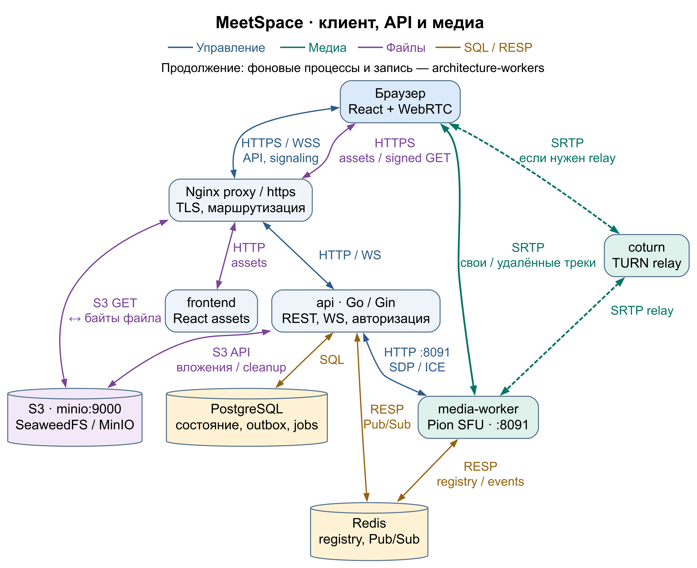

<a id="architecture-storage"></a>

## 2.2. Состояние и фоновые задачи

| Компонент | Что он хранит или делает | Значение для эксплуатации |
|---|---|---|
| PostgreSQL | Аккаунты, сессии, права, встречи, сообщения, задания, метаданные файлов, настройки и аудит | Аватар пользователя хранится в `user_avatars.data` как JPEG. Версия находится в `users.avatar_version`, описание — в `users.bio`. |
| S3, сервис `minio` | Вложения, фотографии групп и опубликованные файлы записи | В базовом Compose используется MinIO, в защищённой конфигурации — SeaweedFS с S3 API. БД и объекты восстанавливают из согласованных копий. |
| Redis | Присутствие, маршруты медиакомнат, краткоживущие блокировки, события Pub/Sub | После разрыва подключения клиент восстанавливает постоянные данные через API. |
| RabbitMQ | Очередь команд начала и окончания записи | Диспетчер API отправляет команды из PostgreSQL outbox. Захват и публикацию выполняет `record-worker`. |
| Локальный каталог Record Worker | Исходные дорожки, описания фрагментов и промежуточные сегменты, обычно в `/storage/records/` | Для восстановления после прерывания обработчику нужны файлы соответствующей записи. |
| Product Worker | Обрабатывает задания PostgreSQL для уведомлений, почты, календарных интеграций и синхронизации каталога | Отказ доставки или LDAP исследуют по статусу задания, настройкам и журналу обработчика. |
| Служебные сервисы | `migrate` применяет миграции. Prometheus собирает метрики при включении профиля наблюдения | Готовность процессов, метрики и диагностика доступны на служебных интерфейсах. |

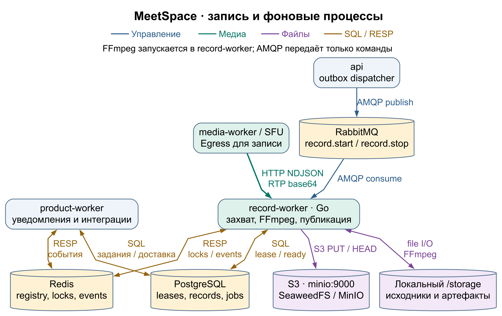

<a id="recording"></a>

# 3. Видеосвязь и запись

<a id="recording-connect"></a>

## 3.1. Как участник подключается к SFU

1. После допуска во встречу клиент получает одноразовый билет и открывает `/api/v1/conferences/{id}/ws`. Билет передаётся в параметре `ticket`. Срок по умолчанию — 45 секунд.
2. Браузер получает разрешение на выбранные источники и отправляет `media.join`. API проверяет участие, выбирает SFU по реестру Redis и привязывает медиасессию к физическому соединению. Ответ `media.joined` содержит `mediaPeerId`, ICE-серверы, текущие дорожки и ограничения.
3. Клиент создаёт `RTCPeerConnection` с `max-bundle` и отправляет `media.offer`. После `media.answer` он применяет ответ через `setRemoteDescription`, добавляет отложенные ICE-кандидаты и подтверждает ревизию событием `media.ready`. Новое согласование выполняется при изменении источников или подписок. Кандидаты передаются событиями `media.ice`.
4. Микрофон и камера используют `getUserMedia()`, демонстрация — `getDisplayMedia()`. Источники `video/screen` и `audio/screen` различаются. Звук демонстрации зависит от возможностей браузера и выбранного источника. Остановка публикации освобождает дорожку, `media.leave` закрывает медиасессию. При закрытии WebSocket контроллер освобождает ресурсы его физического соединения.

Состояние WebSocket и состояние ICE проверяют раздельно. При `disconnected` браузер даёт медиасоединению 8 секунд на восстановление. По истечении этого времени пользователь может подключить устройства заново. По умолчанию SFU ограничивает согласование 15 секундами. Справочник событий и ошибок находится в главе 4.

<a id="recording-start"></a>

## 3.2. Права и доставка команды

| Операция | Условия |
|---|---|
| Начать | Зарегистрированный допущенный участник со статусом `joined` в активной встрече. `POST /api/v1/conferences/{id}/recordings` возвращает 202. Наличие активной записи вызывает конфликт 409. |
| Остановить | Инициатор или владелец встречи со статусом `joined` или `left` после допуска. Роль соорганизатора сама по себе недостаточна для остановки чужой записи. |
| Посмотреть | Допущенный текущий или бывший участник с правом чтения истории, в том числе гость соответствующей встречи. Учитываются удаление записи и срок хранения. |
| Удалить | Зарегистрированный инициатор или владелец после завершения записи и освобождения права обработки. |

При запуске API одной транзакцией создаёт `record` в состоянии `starting` и строку `recording_outbox`. Диспетчер проверяет очередь каждые 250 мс и выбирает до 16 команд за цикл. Временная отметка владения командой действует 15 секунд, на попытку отводится 5 секунд. Для запуска захватывается блокировка конференции в Redis. После подтверждения RabbitMQ диспетчер отмечает команду доставленной. Сбой допускает повторную доставку.

По умолчанию `record.start` и `record.stop` идут через обменник `go-recorder.commands` с ключом `record.commands` в очередь `go-recorder.recording.commands`. После ошибки первой обработки сообщение возвращается в очередь. Повторная ошибка и некорректное сообщение направляются в `{queue}.failed`. Пределы этой очереди — 7 суток, 10 000 сообщений, 64 МиБ. Размер тела команды ограничен 64 КиБ.

<a id="recording-processing"></a>

## 3.3. Режимы и формирование файла

Record Worker получает ограниченное по времени право работать с записью в PostgreSQL и открывает внутренний HTTP-поток Egress от SFU. Формат — `application/x-ndjson`. После `hello` начинается запись. Сведения о дорожках, RTP в Base64, окончание дорожек и контрольные сообщения приходят в том же потоке. Входные кодеки — VP8 с частотой 90 кГц и Opus 48 кГц, до двух каналов звука.

| Значение `mode` | Результат |
|---|---|
| `composite`, по умолчанию | MP4 с H.264 и AAC, JPEG-превью. Без демонстрации камеры образуют сетку. При демонстрации первый экран по порядку сортировки занимает весь кадр либо три четверти ширины при наличии камер. |
| `screen_focus` | При наличии демонстрации в кадре только выбранный экран. В остальное время используется та же сетка камер. |
| `audio_only` | `final.mp4` с AAC, MIME `audio/mp4`, тип `final_audio`. |
| `individual_tracks` | Итоговый аудиофайл и `tracks.zip` с исходными дорожками IVF/OGG и манифестом. |

Для компоновки источники сортируются по идентификаторам участника и дорожки. Worker сохраняет исходники и `chunk_*.json`, FFmpeg готовит сегменты. Очередь вмещает четыре фрагмента. Для видео применяются `libx264`, `veryfast`, CRF 23 и `yuv420p`. Звук сводится в AAC 128 кбит/с, 48 кГц, стерео. Обработка одного сегмента ограничена двумя минутами.

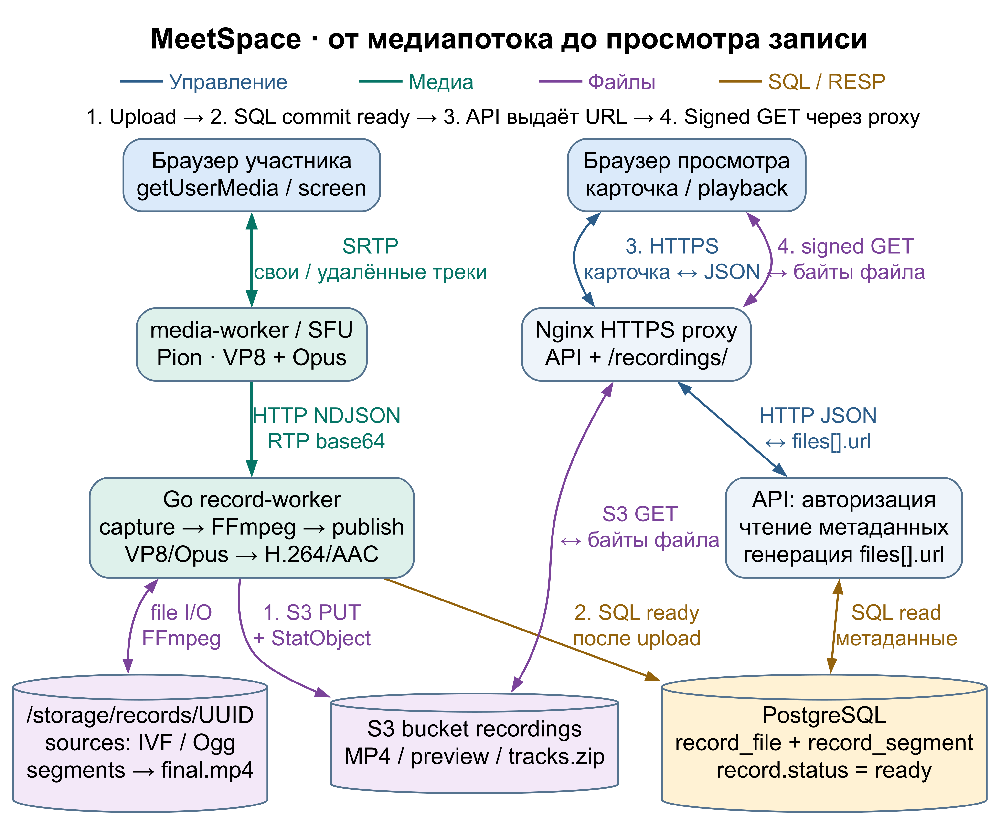

<a id="recording-limits"></a>

## 3.4. Параметры записи

| Параметр | По умолчанию | Допустимые значения и единицы |
|---|---|---|
| `segmentDurationSec` в запросе | 5 с | 2–30 с. Отсутствующее поле или 0 выбирает значение по умолчанию. |
| `RECORDING_WIDTH` / `RECORDING_HEIGHT` | 1280 / 720 | Чётные значения, ширина 320–1920, высота 240–1080 пикселей. |
| `RECORDING_FPS` | 30 | 10–30 кадров/с. |
| `RECORDING_FFMPEG_CONCURRENCY` / `RECORDING_MAX_ACTIVE` | 1 / 2 | 1–4 параллельные операции компоновки и 1–8 активных записей на обработчик. |
| `RECORDING_MAX_MIB` / `RECORDING_MAX_DURATION` | 10240 МиБ / 4 ч | 1–102400 МиБ принятых медиаданных и 1 мин–24 ч захвата. Место под временные файлы требуется дополнительно. |
| `RECORDING_LEASE_TTL` / `RECORDING_POLL_INTERVAL` | 20 с / 1 с | Владение обработкой действует 10–60 с. Опрос — от 100 мс до четверти срока владения. |
| `RECORDING_KEEP_LOCAL` | `false` | `true` сохраняет рабочие файлы и после успешной публикации. |

<a id="recording-states"></a>

## 3.5. Остановка, публикация и восстановление

Обычно запись проходит состояния `starting` → `recording` → `stopping` → `finalizing` → `uploading` → `ready`. API отдаёт `processing` для двух этапов между остановкой и готовностью. Запрос остановки сохраняет состояние и команду `record.stop` в одной транзакции. Обработчик также опрашивает БД и видит запрос, даже если команда ещё в очереди.

1. Worker закрывает Egress, завершает последний фрагмент и восстанавливает недостающие сегменты по сохранённым описаниям. FFmpeg объединяет совместимые сегменты. ffprobe проверяет кодеки, положительную длительность и размер от 1024 байт. Для видео при наличии длительности аудио допустимая разница — до 0,35 с.
2. После вычисления SHA-256 Worker выгружает основной файл и дополнительные материалы в S3. Ключ начинается с `recordings/{conferenceId}/{recordId}/artifacts/{recorderToken}/`. Для каждого файла действует таймаут 10 минут. После загрузки `StatObject` сверяет размер.
3. Транзакция фиксирует файлы, сегменты, размер, длительность и `ready`. Затем отправляется `recording.ready`. Для просмотра приложение использует `files[].url`. Подпись действует 24 часа, если объект не удалён раньше. По умолчанию успешная публикация освобождает локальный рабочий каталог.

| Ситуация | Что происходит и что проверять |
|---|---|
| Достигнут предел длительности | Worker запрашивает штатную остановку с причиной `duration_limit` и завершает захват. |
| Нарушена последовательность пакетов, исчерпан лимит байтов или поток не читается более 15 с | Смотрите состояние и события записи, доступность SFU и свободное место. При ошибке Worker сохраняет завершённые фрагменты и пытается отметить запись как `failed`. |
| Процесс перезапущен во время захвата | Непрерывный захват прерван. Для остановки, финализации или загрузки обработчик может продолжить работу при наличии соответствующего каталога с сегментами. Переход права обработки между узлами сам файлы не переносит. |
| Утрачено право обработки или загрузилась лишь часть объектов | У каждой попытки собственный токен и префикс объектов. Прежний обработчик утрачивает возможность зафиксировать результат другой попытки. |
| Истёк срок хранения | API запускает очистку при старте и затем раз в минуту. Применяется текущая настройка `recordingRetentionDays`, по умолчанию семь дней. Временные файлы неудачной записи проверяют отдельно. |

<a id="section-021"></a>

# 4. REST API и WebSocket

<a id="api-conventions"></a>

## 4.1. Адреса, доступ и ошибки

Пути пользовательских REST-маршрутов приведены относительно `/api/v1`. Например, `GET /auth/me` означает `GET /api/v1/auth/me`. Параметр пути с двоеточием обозначает UUID, кроме кода приглашения, провайдера и типа элемента папки. Защищённый маршрут принимает `Authorization: Bearer <accessToken>`. Успешный пользовательский JSON обычно содержит `status:"success"` и `item` или `items`. Отклонения приведены в таблицах. Знак ? после имени поля обозначает необязательное поле. Число в скобках рядом с диапазоном — значение по умолчанию. Курсоры выдаёт сервер. Для следующей страницы клиент передаёт полученный курсор без преобразования.

| Обозначение | Условия |
|---|---|
| Аккаунт | Зарегистрированный пользователь с действующим токеном и, для постоянной авторизации, действующей серверной сессией. |
| История встречи | Допущенный участник со статусом joined или left. Гостевой токен привязан к одной конференции. Вне её префикса гостю доступны GET /auth/me, /capabilities, /webrtc/config, /attachments/policy и POST /auth/logout. |
| Чат встречи | Чтение требует доступа к истории и действующего членства в чате. Для отправки нужны активная конференция и вошедший участник. Для управления проверяются роли owner и co_host. |
| Диалог | Аккаунт с доступом к личному или групповому диалогу. Скрытие диалога, выход из группы и личная граница очистки истории учитываются при чтении. |
| Панель администратора | Отдельные слушатель, cookie и проверка CSRF. См. 4.16. |

Общий декодер принимает ровно один JSON-документ до 32 КиБ и отклоняет неизвестные поля. При ошибке декодирования, включая превышение этого предела, API возвращает 400. Для файлов, телеметрии и внутренних команд установлены отдельные пределы. Ошибка прикладного API имеет форму `{"status":"failed","message":"…"}`.

| Код HTTP | Действие клиента и причина |
|---|---|
| 400 / 415 | Некорректный JSON или параметры с отдельным обработчиком. Для операций сессии 415 означает недопустимый Content-Type. |
| 401 / 403 | Истёк или отозван токен, отсутствует авторизация (401). Недостаточно прав, неверный Origin или нарушена область гостевого токена (403). |
| 404 / 409 | Ресурс отсутствует или скрыт правилами доступа (404). Конфликт состояния, версии, идемпотентного ключа или прикладного лимита (409). |
| 422 / 429 | Некорректные значения полей и параметров (422). Лимит запросов или соединений (429), часто с Retry-After. |
| 500 / 503 / 504 | Внутренняя ошибка, недоступность службы или ожидание зависимости превысило срок. Во время управляемой остановки API отвечает 503. |

<a id="api-auth"></a>

## 4.2. Сессии, профиль и источник аккаунтов

Для операций управления сессиями браузер передаёт Origin публичного приложения. Сервер отклоняет `Sec-Fetch-Site: cross-site`, принимает клиент без Origin и Fetch Metadata и требует `application/json` для непустого тела. Постоянная сессия использует `meetrix_session` и `meetrix_account_<UUID>` с путём `/api/v1/auth`, HttpOnly, SameSite=Lax, сроком 400 дней и Secure вне local. Браузер может сохранить пять аккаунтов. Ответ LoginResponse содержит `status, accessToken, tokenType, expiresIn, user`. Секрет обновления приходит в cookie.

| Метод и путь | Назначение и доступ | Запрос и результат |
|---|---|---|
| `GET /auth/providers` | Узнать выбранный для платформы источник. Публично. | 200 {mode, registrationEnabled, passwordRecoveryEnabled, ldap:{enabled, label}}. mode равен local или ldap. 503 при ошибке чтения настроек. |
| `POST /auth/register` | Создать локальный аккаунт. Same-origin. | {email, password, displayName?}. Пароль 8–128 символов, имя до 100. 201 {status, user}. 409 при занятом email. |
| `POST /auth/login` | Войти через настроенный источник. Same-origin. | {email, password}. В режиме ldap сервер проверяет email и пароль через каталог. 200 LoginResponse и cookie. 401 при неверных данных, 403 при запрете аккаунта, 409 при конфликте. |
| `POST /auth/ldap/login` | Совместимый корпоративный вход. Same-origin. | {login, password}. Принимает настроенный идентификатор каталога. 200 LoginResponse. 403 при выключенном LDAP, 409 при конфликте идентичности или email, 503 при недоступности зависимости. |
| `POST /auth/verify-email` | Подтвердить адрес по одноразовой ссылке. Same-origin. | {token}. Срок токена 24 часа. 200 {status}. |
| `POST /auth/verify-email/resend` | Повторно запросить письмо. Same-origin. | {email}. 200 с нейтральным сообщением. Доставка зависит от состояния аккаунта и SMTP. |
| `POST /auth/password-recovery` | Запросить восстановление локального пароля. Same-origin. | {email}. 200 с нейтральным сообщением, 403 для заблокированного аккаунта. |
| `POST /auth/reset-password` | Заменить локальный пароль. Same-origin. | {token, password}. Токен одноразовый, срок один час. 200 {status}. Старые сессии отзываются. |
| `POST /auth/refresh` | Обновить токен по cookie. Same-origin. | Пусто или {userId}. 200 LoginResponse с обновлёнными cookie. |
| `POST /auth/accounts/list` | Прочитать сохранённые аккаунты. Cookie, same-origin. | Пусто или {}. 200 {status, items}. Просроченные cookie удаляются. |
| `POST /auth/accounts/switch` | Активировать сохранённый аккаунт. Cookie, same-origin. | {userId}. Требуется cookie этого аккаунта. 200 LoginResponse. |
| `POST /auth/session` | Создать постоянную сессию. Аккаунт, same-origin. | Пусто или {userId}. 200 LoginResponse и cookie. |
| `POST /auth/logout` | Отозвать сессию. Cookie, same-origin. | Пусто или {userId}. Bearer необязателен при постоянных сессиях. 200 {status}, cookie удаляются. |
| `GET /auth/me` | Прочитать свой профиль. Bearer. | 200 {status, user}. У гостя пустой email и заполнен guestConferenceId. |
| `PATCH /auth/me` | Изменить свой профиль. Аккаунт. | {displayName?, bio?}. Нужно хотя бы одно поле. 200 {status, user}. Ошибки 400 для null или неверного типа, 422 для недопустимого значения, 403 для изменения имени LDAP-пользователя. |
| `DELETE /auth/me` | Удалить собственный локальный аккаунт. Same-origin и Bearer. | {password}. 200 {status}, cookie удаляются. Неверный пароль даёт 422. |
| `PUT /auth/me/avatar` | Загрузить своё фото. Аккаунт. | Байты image/jpeg или image/png, до 2 МиБ и 2048 пикселей по каждой стороне. 200 {status, user} с avatarVersion. |
| `DELETE /auth/me/avatar` | Удалить своё фото. Аккаунт. | 200 {status, user} без avatarVersion. |
| `GET /users/:id/avatar/content` | Прочитать фото пользователя. Аккаунт. | 200 image/jpeg, private, no-store. 404 при отсутствии фото. |

В запросе PATCH имя содержит 1–100 символов. Поле `bio` допускает до 1000 кодовых точек Unicode, табуляцию и переносы строк. CRLF преобразуется в LF. Пустая строка очищает текст, пропуск поля сохраняет значение. Для аватара сервер удаляет метаданные, вырезает квадрат по центру и кодирует JPEG до 512×512. При включённом ограничителе в минуту разрешены 10 загрузок, 30 удалений и 120 чтений на пользователя. Хранение профиля и работа каталога описаны в главах 5 и 9.

<a id="api-conferences"></a>

## 4.3. Конференции, приглашения, модерация и поиск

| Метод и путь | Назначение | Доступ | Запрос и результат |
|---|---|---|---|
| `POST /conference-invites/:code/guest` | Войти по приглашению гостем | Публично, для возобновления нужен гостевой Bearer | {displayName}. 200 {status, accessToken, tokenType, expiresIn, user, item}. Токен действует 3 часа в пределах одной встречи. |
| `GET /conferences/:id/invitation-users` | Найти получателей приглашения | Владелец или вошедший соорганизатор активной встречи | query длиной 2–100 символов. 200 {status, items:[{id, email, displayName}]}. |
| `POST /conferences/:id/invitations` | Отправить приглашения | Владелец или вошедший соорганизатор активной встречи | {emails?, userIds?}, всего 1–20 адресатов. 202 {status, items}, поля результата — id, email, userId, status. |
| `POST /conferences` | Создать встречу | Аккаунт | {title, waitingRoomEnabled?, scheduledAt?, plannedDurationMin?}. Название 1–200 символов. Время в будущем (RFC3339), длительность 1–1440 мин и только вместе с scheduledAt. 201 {status, item}. |
| `GET /conferences` | Список встреч | Аккаунт | limit 1–100 (20), offset ≥0 (0). 200 {status, items}. |
| `GET /conferences/:id` | Карточка встречи | История встречи | 200 {status, item:Conference}. |
| `POST /conferences/:id/start` | Начать встречу | Владелец | Из created или scheduled в active. 200 {status, item}. |
| `POST /conferences/:id/finish` | Завершить встречу | Владелец | Из active в finished. 200 {status, item}. |
| `POST /conferences/:id/cancel` | Отменить встречу | Владелец | Из created или scheduled в cancelled. 200 {status, item}. |
| `POST /conferences/:id/join` | Войти или вернуться | Bearer в пределах встречи | Пустое тело или {inviteCode}. Новому участнику нужен действующий код. 200 {status, item:Participant} с admissionState. |
| `POST /conferences/:id/leave` | Покинуть встречу | Собственное участие | 200 {status, item:Participant}. |
| `GET /conferences/:id/participants` | Список участников | История встречи | limit 1–100 (20), offset ≥0. 200 {status, items}. Состояния waiting и rejected видны владельцу и соорганизатору. |
| `GET /conferences/:id/participants/me` | Состояние своего допуска | Собственное участие | 200 {status, item:Participant}. |
| `POST /conferences/:id/participants/:participantId/admission` | Решить запрос на вход | Вошедший owner или co_host | {decision}, admit или reject. 200 {status, item:Participant}. Конфликт состояния даёт 409. |
| `PUT /conferences/:id/schedule` | Перенести встречу | Владелец встречи в scheduled | {scheduledAt, plannedDurationMin?}. Время в будущем (RFC3339), длительность 1–1440 мин. 200 {status, item}. |
| `GET /conferences/:id/history` | Открыть историю | История встречи в finished или cancelled | 200 {status, item}. В item входят conference, owner, durationSec, participantCount, participants, participantsTruncated, recordings, chatAvailable, chatReadOnly. |
| `GET /me/conferences` | Получить личную ленту | Аккаунт | view=upcoming/active/past, scope=all/owned/participating, sort=newest/oldest. По умолчанию upcoming, all, newest. Фильтры status, from и to (RFC3339), cursor, limit 1–100 (20). 200 {status, items, nextCursor}. |
| `GET /conference-invites/:code` | Проверить код приглашения | Публично | 200 {status, item} с id, title, status, waitingRoomEnabled, scheduledAt. 404 для недоступного кода. |
| `POST /conference-invites/:code/join` | Присоединиться по коду | Аккаунт | Пустое тело или {}. 200 {status, item:Participant}. |
| `PUT /conferences/:id/participants/me/media` | Обновить состояние устройств | Собственное участие в joined | {connectionId, sequence, microphoneEnabled, cameraEnabled, screenSharing}. sequence от 1 до 9007199254740991. Повторный или устаревший номер игнорируется. 200 {status, item}. |
| `POST /conferences/:id/participants/:participantId/moderation` | Изменить роль, исключить или ограничить участника | Владелец, для соорганизатора действуют ограничения роли | {action, blocked?, role?}. Для mute/camera/screen нужен blocked, для role — co_host или participant. Для kick достаточно action. 200 {status, item:Participant}. |

Для `/me/conferences` курсор привязан к направлению сортировки. Сначала сравнивается дата завершения, при её отсутствии дата расписания или создания, затем UUID. Для допуска нужны роль организатора или соорганизатора и состояние joined. Вошедший владелец может модерировать другого допущенного участника. Соорганизатору доступны только mute, screen и kick для роли participant. Целью модерации нельзя выбрать себя или владельца.

| Метод и путь | Назначение и доступ | Запрос и результат |
|---|---|---|
| `GET /search` | Найти доступные встречи по ключевым словам. Аккаунт. | q обязателен, 1–500 символов и до 2000 байт. mode=keyword, source=all/conference, membership=all/owned/participating. Дополнительные фильтры conferenceId, participantId, from и to (RFC3339). limit 1–100 (20), offset 0–10000. 200 {status, items, total, limit, offset, effectiveMode}, ошибки валидации 422. |

| Метод и путь | Назначение | Доступ | Запрос и результат |
|---|---|---|---|
| `POST /conferences/:id/reactions` | Отправить временную реакцию | Вошедший и допущенный участник активной встречи | {emoji}. Разрешены U+1F44D, U+1F44F, U+2764 U+FE0F и U+1F602. 200 {status}. Доставка через reaction.created. |

<a id="api-recordings"></a>

## 4.4. Записи и библиотека

| Метод и путь | Назначение | Доступ | Запрос и результат |
|---|---|---|---|
| `POST /conferences/:id/recordings` | Начать запись | Вошедший зарегистрированный участник активной встречи | Пустое тело или {mode?, segmentDurationSec?}. Режимы composite (по умолчанию), audio_only, individual_tracks, screen_focus. Длительность сегмента 2–30 с (5). 202 {status, item:RecordCard}. |
| `GET /conferences/:id/recordings` | Список записей встречи | История встречи | limit 1–100 (20), offset ≥0. 200 {status, items:RecordCard[]}. |
| `GET /conferences/:id/recordings/:recordingId` | Открыть запись | История встречи | 200 {status, item:RecordCard} с файлами, сегментами и доступными URL. 404 для записи другой встречи. |
| `DELETE /conferences/:id/recordings/:recordingId` | Удалить завершённую запись | История встречи и аккаунт владельца или инициатора | 200 {status}. Если обработка идёт, ответ 409. |
| `POST /conferences/:id/recordings/:recordingId/stop` | Остановить запись | История встречи и аккаунт владельца или инициатора | Пустое тело или {}. 202 {status, item:RecordCard}. При повторе после перехода в обработку состояние сохраняется. |

| Метод и путь | Назначение и доступ | Запрос и результат |
|---|---|---|
| `GET /recordings` | Библиотека записей доступных встреч. Аккаунт, участник со статусом joined или left, допущенный на встречу. | cursor, limit 1–100 (30). 200 {status, items:[{conference, recording}], nextCursor}. 422 при неверном или повторённом параметре страницы. |

Библиотека учитывает срок хранения и включает записи активных встреч. Сортировка идёт по убыванию времени создания и внутреннего ID. Ссылка приглашения из объекта конференции исключается. Начало и остановка записи возвращают 202 после приёма команды. При уже запущенной записи или неподходящем состоянии встречи начало возвращает 409. Карточка записи содержит подписанные ссылки только на доступные файлы. Запросивший запись и владелец встречи могут удалить её после завершения обработки.

<a id="api-messages"></a>

## 4.5. Сообщения, вложения и пересылка

Оба набора маршрутов в таблице имеют одинаковые суффиксы. База чата конференции — `/api/v1/conferences/:id`, база личного или группового диалога — `/api/v1/conversations/:id`. Для чтения действуют правила раздела 4.1. Отправка и загрузка в чат встречи требуют права записи, в диалог — действующего членства. Только автор может редактировать своё сообщение. В чате встречи организатор и соорганизатор также могут удалять чужие сообщения.

| Метод и путь | Назначение и доступ | Запрос и результат |
|---|---|---|
| `GET /messages` | История сообщений. | before, limit 1–100 (50). 200 {status, items, nextCursor, unreadCount, lastReadMessageId}. |
| `POST /messages` | Отправить сообщение. | {clientRequestId, text?, replyTo?, attachmentIds?}. Нужен текст до 4000 символов или 1–5 вложений. 201 {status, item}, повтор с тем же содержимым даёт 200, с другим — 409. |
| `PATCH /messages/:messageId` | Изменить текст своего сообщения. | {text}, до 4000 символов. Пустая строка допустима при наличии вложений. 200 {status, item}, увеличивается version. |
| `DELETE /messages/:messageId` | Удалить доступное сообщение. | 200 {status, item}. Ответ содержит deletedAt и пустой текст. При выборе нескольких сообщений клиент отправляет последовательные отдельные DELETE. Ранее завершённые удаления сохраняются при ошибке следующего. |
| `GET /chat/read` | Прочитать отметку просмотра. | 200 {status, item:{lastReadMessageId, unreadCount}}. |
| `PUT /chat/read` | Передвинуть отметку вперёд. | {messageId}. 200 {status, item:{lastReadMessageId, unreadCount}}. |
| `POST /attachments/init` | Зарезервировать загрузку. Будущий владелец вложения. | {clientRequestId, filename, size, mimeType?}. Имя 1–180 символов без компонентов пути. Минимум 1 байт. 201 для новой загрузки или 200 для повтора. Ответ {status, item, uploadUrl}. |
| `PUT /attachments/:attachmentId/content` | Загрузить байты. Владелец вложения. | Тело должно совпасть с заявленным размером и пройти проверку содержимого. 200 {status, item}. 409 при занятой или просроченной загрузке. |
| `POST /attachments/:attachmentId/finalize` | Зафиксировать загрузку. Владелец вложения. | 200 {status, item}. 409, если байты ещё не загружены. Передайте ID готового вложения в POST /messages. |
| `GET /attachments/:attachmentId/download` | Получить ссылку на прикреплённый файл. | 200 {status, url, expiresAt} для подписанной ссылки. Для группы также передаётся authenticated:true, URL ведёт на защищённый маршрут чтения. Видимость проверяется по сообщению и правам читателя. |

| Метод и путь | Назначение и доступ | Запрос и результат |
|---|---|---|
| `GET /attachments/policy` | Действующий предел одного вложения. Bearer, включая гостя. | 200 {maxBytes}, без status. 503 при недоступной или недопустимой настройке. |
| `POST /conversations/:id/messages/forward` | Переслать в указанный личный или групповой диалог. Нужны право чтения источника и право записи в целевой диалог. | JSON {sourceType, sourceId, messageIds, clientRequestId}. sourceType — conversation или conference, messageIds — от 1 до 30 разных UUID. 201 {status, items}, при повторе 200. |

Предел одного файла задаёт `attachmentMaxBytes`, по умолчанию 10 МиБ, диапазон 1024 байта – 100 МиБ. Имя, размер, расширение, MIME и содержимое проверяются на сервере. Поддерживаются JPEG, PNG, WebP и разрешённые документы и архивы. Перечень расширений и сигнатур приведён в `docs/ATTACHMENTS.md`. При пересылке допустимы до 20 вложений общим объёмом 100 МиБ. Сервер проверяет видимость и личную границу очистки исходной истории и создаёт копии для целевого диалога. `forwardedSenderName` сохраняет имя первоначального автора. Изменение источника или конфликт ключа даёт 409, превышение лимитов — 422. Записи истории звонка и недоступные сообщения пересылать нельзя.

<a id="api-meeting-chat"></a>

## 4.6. Управление чатом встречи

| Метод и путь | Назначение | Доступ | Запрос и результат |
|---|---|---|---|
| `GET /conferences/:id/chat/info` | Карточка чата | Чтение чата встречи | 200 {status, item} с conferenceId, title, description, inviteUrl, participantCount, notificationsEnabled, canEdit, canInvite. |
| `GET /conferences/:id/chat/members` | Список участников и присутствие | Чтение чата встречи | after, limit 1–100 (50). 200 {status, items:MemberView[], nextCursor}. |
| `PATCH /conferences/:id/chat/info` | Изменить название или описание | Владелец с доступом к чату | {title?, description?}. Хотя бы одно поле. Название 1–200, описание до 1000 символов. 200 {status, item:ChatInfo}. |
| `GET /conferences/:id/chat/preferences` | Прочитать настройку уведомлений | Чтение чата встречи | 200 {status, item:{notificationsEnabled}}. |
| `PUT /conferences/:id/chat/preferences` | Изменить настройку уведомлений | Чтение чата встречи | {notificationsEnabled:boolean}. 200 {status, item:{notificationsEnabled}}. |
| `DELETE /conferences/:id/chat/membership` | Выйти из чата | Собственное допущенное участие | 200 {status}. |
| `GET /conferences/:id/chat/messages/search` | Искать сообщения | Чтение чата встречи | q длиной 2–200 символов, before, limit 1–50 (20). 200 {status, items, nextCursor}. |
| `GET /conferences/:id/chat/messages/:messageId/context` | Открыть контекст сообщения | Чтение чата встречи | 200 {status, items, nextCursor, unreadCount, lastReadMessageId}. |
| `GET /conferences/:id/chat/materials` | Получить материалы | Чтение чата встречи | kind=image/file/link, before, limit 1–50 (20). 200 {status, items:Material[], nextCursor}. |
| `GET /conferences/:id/chat/pins` | Список важных сообщений | Чтение чата встречи | before, limit 1–50 (20). 200 {status, items, nextCursor}. |
| `PUT /conferences/:id/chat/pins/:messageId` | Добавить в важные | Чтение чата встречи | 200 {status}. 404 для удалённого или недоступного сообщения. |
| `DELETE /conferences/:id/chat/pins/:messageId` | Убрать из важных | Чтение чата встречи | 200 {status}. Операцию можно повторить. |

Поля `canEdit` и `canInvite` приходят в карточке чата. Список участников поддерживает курсор `after`. Настройка уведомлений и важные сообщения встречи принадлежат текущему участнику. Получение ссылки приглашения и добавление адресатов — разные операции. Проверку прав на приглашение выполняет сервер.

<a id="api-dialogs"></a>

## 4.7. Личные диалоги и группы

| Метод и путь | Назначение | Доступ | Запрос и результат |
|---|---|---|---|
| `GET /users` | Найти собеседника | Аккаунт | search длиной 2–100 символов, по displayName. 200 {status, items:Peer[]}, до 20 других пользователей. |
| `GET /conversations` | Получить переписки | Аккаунт | before, limit 1–100 (50), type=all/direct/group, search до 100 символов, unreadOnly (bool). 200 {items, nextCursor, unreadCount}. |
| `POST /conversations/direct` | Открыть личный диалог | Аккаунт | {userId} другого пользователя. 201 {status, item:Conversation} для нового диалога, 200 для существующего. |
| `POST /conversations/group` | Создать группу | Аккаунт | {clientRequestId, name, description?, memberIds?}. Название 1–50 символов, описание до 200. Всего до 100 участников. 201 {status, item}, при повторе 200. |
| `GET /conversations/:id` | Карточка переписки | Диалог | 200 {status, item:Conversation}. |
| `GET /conversations/:id/peer-presence` | Узнать присутствие собеседника | Участник личного диалога | 200 {status, item:{conversationId, peerId, online}}. Некорректный id даёт 400. |
| `PATCH /conversations/:id/preferences` | Изменить уведомления | Диалог | {notificationsEnabled:boolean}. 200 {status, item:Conversation}. |
| `POST /conversations/:id/clear-history` | Очистить свою историю | Участник личного диалога | 200 {status, item:Conversation} с historyClearedThrough. |
| `POST /conversations/:id/hide` | Скрыть переписку у себя | Участник личного диалога | 200 {status, hidden:true, historyClearedThrough}. |
| `GET /conversations/:id/pins` | Список закреплённых сообщений | Диалог | before, limit 1–100 (50). 200 {items, nextCursor}. |
| `PUT /conversations/:id/pins/:messageId` | Закрепить текстовое сообщение | Диалог | 200 {status}. Повторное закрепление может дать 409. |
| `DELETE /conversations/:id/pins/:messageId` | Снять закрепление | Диалог | 200 {status}. |
| `PATCH /conversations/:id` | Обновить сведения о группе | Владелец или администратор группы | {name?, description?}, минимум одно поле. Название 1–50, описание до 200 символов. 200 {status, item}. |
| `DELETE /conversations/:id` | Удалить группу | Владелец группы | 200 {status}. |
| `GET /conversations/:id/members` | Прочитать список участников | Участник группы | 200 {status, items}, сведения об участнике включают id, displayName, role, online. |
| `POST /conversations/:id/members` | Добавить участников | Владелец или администратор группы | {userIds:UUID[]}. После добавления не более 100 участников. 200 {status, item:Conversation}. |
| `DELETE /conversations/:id/members/:userId` | Исключить участника | Владелец группы или администратор в отношении member | 200 {status, item:Conversation}. |
| `PATCH /conversations/:id/members/:userId` | Назначить роль | Владелец группы | {role}, admin или member. 200 {status, item:Conversation}. |
| `POST /conversations/:id/leave` | Выйти из группы | Участник группы | Пустое тело или {}. 200 {status}. Если владелец оставляет в группе других участников, сначала требуется передача прав. |
| `POST /conversations/:id/ownership` | Передать владение | Владелец группы | {userId} другого участника. 200 {status, item:Conversation}. Прежний владелец получает admin. |
| `POST /conversations/:id/read` | Отметить просмотр | Диалог | {messageId}. 200 {status, item:{lastReadMessageId, unreadCount}}. Эквивалент PUT /chat/read из 4.5. |
| `GET /conversations/:id/profiles/:userId` | Прочитать полный профиль | Оба пользователя состоят в переписке | 200 {status, item:{id, displayName, email, bio}}. Пустой bio — строка нулевой длины. 404 для недоступного профиля. |
| `GET /conversations/:id/materials` | Читать материалы переписки | Диалог | kind=media/file/link, image — синоним media. before, limit 1–100 (50). 200 {status, items:Material[], nextCursor}. |

Граница `historyClearedThrough` действует только для текущего участника. Закрепление сообщения видно всему диалогу. Владелец может передать группу, после чего получает роль admin. Для выхода владельца при наличии других участников сначала требуется передача прав. Участник группы с ролью admin может исключать только member. Достижение лимита группы, повторное закрепление или выход единственного владельца без передачи при оставшихся участниках могут вернуть 409.

<a id="api-dialog-files"></a>

## 4.8. Материалы и поиск в диалогах

| Метод и путь | Назначение | Доступ | Запрос и результат |
|---|---|---|---|
| `PUT /conversations/:id/avatar` | Установить фото группы | Владелец или администратор группы | Байты JPEG/PNG, до 2 МиБ, каждая сторона до 2048 px, всего до 4 × 1024² пикселей. 200 {status, item:Conversation} с avatarVersion. |
| `DELETE /conversations/:id/avatar` | Удалить фото группы | Владелец или администратор группы | 200 {status, item:Conversation}. |
| `GET /conversations/:id/avatar/content` | Получить фото группы | Участник группы | 200 image/jpeg или image/png с Content-Length и private, no-store. |
| `GET /conversations/:id/attachments/:attachmentId/content` | Скачать прикреплённый файл | Участник группы | 200 application/octet-stream с Content-Disposition: attachment и Content-Length. |
| `GET /conversations/:id/messages/search` | Найти сообщения | Диалог | q длиной 2–200 символов, before, limit 1–50 (20). 200 {status, items, nextCursor, unreadCount, lastReadMessageId}. |
| `GET /conversations/:id/messages/:messageId/context` | Открыть контекст сообщения | Диалог | 200 {status, items, nextCursor, unreadCount, lastReadMessageId}. |

Полный профиль через `GET /conversations/:id/profiles/:userId` выдаётся только при действующем членстве обоих пользователей. Выход, скрытие диалога, удаление группы либо блокировка целевого аккаунта закрывают доступ. Глобальный поиск и краткая карточка не содержат `email` и `bio`. Чтение профиля и материалов сохраняет отметку прочтения.

`GET /conversations/:id/materials` выбирает сообщения после личной границы очистки и вложения со статусом attached. Вид media (псевдоним image) включает MIME image/* и video/*, file — остальные вложения, link — HTTP(S)-ссылки в тексте. Курсор учитывает вид, диалог и позицию внутри сообщения. Имена видов материалов чата встречи приведены в 4.6. Для групп защищённый URL из download требует Bearer при получении байтов. Для личного диалога и чата встречи download возвращает временную подписанную ссылку.

<a id="api-folders-calls"></a>

## 4.9. Папки и личные звонки

| Метод и путь | Назначение | Доступ | Запрос и результат |
|---|---|---|---|
| `GET /folders` | Список папок | Аккаунт, собственные папки | Фильтр itemKind=conversation/conference задаётся вместе с itemId. 200 {status, items:Folder[]}. При фильтрации присутствует contains. |
| `POST /folders` | Создать папку | Аккаунт | {name}, 1–50 символов. 201 {status, item}. 409 при совпадении имени или достижении лимита 100 папок. |
| `PUT /folders/order` | Изменить порядок | Владелец папок | {ids}, полный массив UUID без повторов. 200 {status, items}. 409, если набор папок изменился. |
| `GET /folders/:id` | Карточка папки | Владелец | 200 {status, item:Folder}. Чужая папка даёт 404. |
| `PATCH /folders/:id` | Переименовать папку | Владелец | {name}, 1–50 символов. 200 {status, item}. Существующее имя даёт 409. |
| `DELETE /folders/:id` | Удалить папку | Владелец | 200 {status}. |
| `GET /folders/:id/items` | Список элементов | Владелец | before, limit 1–100 (50), type=all/conversation/conference, search. 200 {items, nextCursor}. |
| `GET /folder-items` | Выбрать доступные встречи и чаты | Аккаунт | folderId, before, limit 1–100 (50), type=all/conversation/conference, search. 200 {items:[{type, item, inFolder}], nextCursor}. |
| `PUT /folders/:id/items/:kind/:itemId` | Добавить элемент | Владелец с доступом к встрече или диалогу | kind=conversation/conference, itemId — UUID. 200 {status, item:Folder}. |
| `DELETE /folders/:id/items/:kind/:itemId` | Убрать элемент | Владелец | kind=conversation/conference. 200 {status, item:Folder}. |

| Метод и путь | Назначение | Доступ | Запрос и результат |
|---|---|---|---|
| `POST /calls` | Начать вызов | Аккаунт | {targetUserId, clientRequestId, clientId}. Все три поля — UUID, адресат отличается от инициатора. 201 {status, item:Call} в ringing, при повторе 200. |
| `GET /calls/active` | Текущий звонок | Аккаунт | 200 {status, item}. Если звонка нет, item равен null. |
| `GET /calls/:id` | Карточка звонка | Инициатор или получатель | 200 {status, item:Call}. 404 для недоступного звонка. |
| `POST /calls/:id/accept` | Принять вызов | Получатель | {clientId}. 200 {status, item:Call} в accepted с conferenceId. 409 при конфликте состояния или устройства. |
| `POST /calls/:id/decline` | Отклонить вызов | Получатель | Обязательное тело {} или {clientId}. 200 {status, item:Call} в declined. |
| `POST /calls/:id/cancel` | Отменить исходящий вызов | Инициатор и его клиент | {clientId}. 200 {status, item:Call} в cancelled. |
| `POST /calls/:id/end` | Завершить разговор | Владелец медиаклиента одной из сторон | {clientId}. 200 {status, item:Call} в ended. |
| `POST /calls/:id/heartbeat` | Подтвердить активность | Владелец медиаклиента принятого вызова | {clientId}. 200 {status, item:Call}. 409 при другом клиенте или неверном состоянии. |

Операции звонка проверяют участника, состояние звонка и привязку `clientId`. Повтор создания с прежним ключом и иным адресатом либо звонок занятому пользователю даёт 409. Принять можно только входящий звонок в состоянии ringing. Клиент, принявший звонок, использует возвращённый conferenceId для медиасоединения и отправляет heartbeat в состоянии accepted.

<a id="api-notifications"></a>

## 4.10. Уведомления, SSE и календари

| Метод и путь | Назначение и доступ | Запрос и результат |
|---|---|---|
| `GET /notifications` | Лента уведомлений текущего аккаунта. | cursor, limit 1–100 (30). 200 {items, nextCursor, unreadCount}. |
| `POST /notifications/:notificationId/read` | Отметить своё уведомление прочитанным. | Пусто или {}. 200 {item}, повтор допускается. 404 при недоступном уведомлении. |
| `GET /notifications/events` | Поток SSE для аккаунта. Bearer только в заголовке. | 200 text/event-stream, без параметров URL. : connected, затем data: <Envelope JSON> и : keepalive каждые 15 с. |

SSE передаёт `notification.created` с `data.notification` и `notification.read` с `data.id`. Поток не содержит полей SSE id и event. После разрыва перечитайте HTTP-ленту. Сессия проверяется перед доставкой и при keepalive. Поток завершается при истечении токена, отзыве сессии, drain, потере подписки Redis или ошибке записи. Лимиты составляют 4 потока и 12 подключений в минуту на пользователя (429), до 256 потоков на процесс (503) и до 8192 байт проверяемого события.

| Метод и путь | Назначение | Доступ | Запрос и результат |
|---|---|---|---|
| `GET /notifications/preferences` | Прочитать способы доставки | Аккаунт | 200 объект с полями invitation, reminder, recording, email, push. |
| `PUT /notifications/preferences` | Заменить настройки | Аккаунт | Пустое тело или полный набор логических invitation, reminder, recording, email, push. Пропущенные поля получают false. 200 сохранённые настройки. |
| `GET /notifications/devices` | Список устройств | Аккаунт | 200 {items:Device[]}, без токенов. |
| `POST /notifications/devices` | Зарегистрировать устройство | Аккаунт | {platform, token}. Платформы web/ios/android, токен 8–8192 байт. 201 {item:Device}. Без доступа к push или шифрованию возможен 503. |
| `DELETE /notifications/devices/:deviceId` | Отозвать устройство | Владелец устройства | 204. Чужое или отсутствующее устройство даёт 404. |
| `GET /integrations/capabilities` | Доступные интеграции | Аккаунт | 200 {email, push, calendar, calendarOAuthConfigured, mockConnectAllowed}. |
| `GET /integrations/calendars` | Список календарей | Аккаунт | 200 {items:CalendarConnection[]}. |
| `POST /integrations/calendars/mock` | Создать тестовое подключение | Аккаунт, разрешён mock | Пустое тело или {}. 201 {item:CalendarConnection}. |
| `GET /integrations/calendars/:provider/connect` | Начать OAuth | Аккаунт | provider=generic. 200 {authUrl, state}. Одноразовый state действует 10 мин. |
| `POST /integrations/calendars/:provider/callback` | Обработать OAuth-код | Аккаунт | provider=generic. {code, state}. Код 1–4096 байт, state 43 символа. 200 {item:CalendarConnection}. |
| `DELETE /integrations/calendars/:provider` | Отключить календарь | Владелец подключения | В параметре :provider передаётся UUID подключения из списка calendars. 204. Строка generic приводит к 422. |
| `GET /conferences/:id/calendar` | Связанные события календаря | Владелец или соорганизатор с доступом к истории встречи | 200 {items:CalendarMapping[]}, до 10 элементов. |

Подключение OAuth работает для `generic`. Сервер вернёт 503, если провайдер, шифрование или тестовый режим mock не настроены. Истёкший или повторно использованный OAuth state вызывает 422. В ответах с устройствами и календарями нет секретных токенов.

<a id="api-platform"></a>

## 4.11. Возможности платформы и телеметрия

| Метод и путь | Назначение и доступ | Запрос и результат |
|---|---|---|
| `GET /capabilities` | Получить возможности платформы. Bearer, включая гостя. | 200 {status, capabilities:{recordingModes}, buildVersion}. |
| `GET /platform/summary` | Операционные агрегаты. Нужен аккаунт с users.is_admin. | 200 JSON со сводкой. Административный интерфейс использует отдельную сессию. |
| `POST /client-errors` | Принять ошибку веб-клиента. Публично при CLIENT_TELEMETRY_ENABLED=true. | application/json до 8192 байт. Обязательны version, route, code, browser. Необязательный stack содержит до пяти {file, line, column}. 202 {status:"accepted"}. |

Приёмник допускает маршруты приложения из своего списка и имена JS-файлов сборки. Для `code` разрешены `uncaught_error`, `unhandled_rejection`, `react_render_error`. Для `browser` — `chromium`, `firefox`, `safari`, `edge`, `other`. Отключённый приёмник отвечает 404, неверный MIME даёт 415, лишние байты — 413, нарушение формата — 400. При включённом ограничителе допускаются 30 запросов с одного IP и 300 запросов на весь сервис в минуту.

<a id="api-websocket"></a>

## 4.12. WebSocket конференции и глобальный канал аккаунта

| Метод и путь | Назначение и доступ | Запрос и результат |
|---|---|---|
| `GET /webrtc/config` | Получить ICE/TURN-конфигурацию. Bearer, включая гостя. | 200 {iceServers:[{urls, username?, credential?}], iceTransportPolicy?, expiresAt?}. expiresAt — Unix-время в секундах. |
| `POST /conferences/:id/ws-ticket` | Одноразовый билет участника встречи. Bearer. | Пустое тело или {clientId?}, до 1024 байт. 201 {ticket, expiresAt}. Срок ограничен WS_TICKET_TTL и остатком срока токена. |
| `GET /conferences/:id/ws` | Подключить сигнализацию встречи. Билет либо Bearer, проверка Origin и участия. | Upgrade с единственным query ticket либо заголовок Authorization. Raw query до 512 байт, подпротокол go-recorder.v1. 101, первый Envelope имеет тип conference.state. |
| `POST /ws-ticket` | Одноразовый глобальный билет. Аккаунт с действующей сессией. | Тело игнорируется. 201 {ticket, expiresAt} со сроком WS_TICKET_TTL. Лимит обоих видов билетов — 30 в минуту на пользователя для канала встречи и отдельно для глобального канала. |
| `GET /ws` | Глобальный канал аккаунта. Только билет, проверка Origin и сессии. | Upgrade с единственным query ticket длиной 43 символа, raw query до 512 байт. Заголовок Authorization запрещён. 101, conferenceId в Envelope равен пустой строке. |

Билет действует однократно. Для повторного подключения получите новый. При исчерпании лимита билетов сервер возвращает 429 с Retry-After, при превышении предела соединений — 503. На канале конференции клиент отправляет текстовые сообщения UTF-8. В Envelope обязательны version=1, непустой UUID id, conferenceId из URL, время RFC3339 и поля type и data по типу команды. В запросе отсутствует replyTo. Сервер использует replyTo в ответах.

```json
{"version":1,"id":"<UUID>","conferenceId":"<UUID>","timestamp":"2026-11-18T09:00:00Z","type":"media.join","data":{}}
```

**Команды клиента в конференции**

| Тип | data | Результат |
|---|---|---|
| `webrtc.offer` | `{targetConnectionId:UUID, sdp:string}` | Адресат получает `webrtc.offer`, отправитель - `ack` |
| `webrtc.answer` | `{targetConnectionId:UUID, sdp:string}` | Адресат получает `webrtc.answer`, отправитель - `ack` |
| `webrtc.ice` | `{targetConnectionId:UUID, candidate:object}` | Адресат получает `webrtc.ice`, отправитель - `ack` |
| `media.join` | `{}` | Ответ `media.joined` |
| `media.offer` | `{mediaPeerId:UUID, negotiationId:UUID, sdp:string, publications?:[{mid, source, trackId?}]}` | Ответ `media.answer` |
| `media.ready` | `{mediaPeerId:UUID, negotiationId:UUID}` | Подтверждение `ack` |
| `media.ice` | `{mediaPeerId:UUID, candidate:ICECandidateInit или null}` | Подтверждение `ack` |
| `media.leave` | `{mediaPeerId?:UUID}`, допустим также `{}` | Ответ `media.left`, в том числе при повторном выходе |
| `media.unpublish` | `{mediaPeerId:UUID, trackId:string}` | Подтверждение `ack`, принимающий медиасервер требует UUID в trackId |

Сигналы `webrtc.*` адресуются другому физическому соединению той же конференции. Поля senderConnectionId и senderParticipantId добавляет сервер. Для SDP нужен непустой sdp, для ICE — объект candidate. В `media.offer` допускаются до четырёх publications с уникальными mid и source, длина mid до 64 и trackId захвата до 128 символов. В `media.ice` используются поля ICECandidateInit и null для конца сбора кандидатов.

**События сервера в конференции**

| Тип Envelope | Данные и назначение |
|---|---|
| `conference.state`, `participant.connected`, `participant.disconnected` | Снимок State содержит connectionId, participantId, status, participants, данные присутствия presence дополняют ParticipantView полями online, connections, connectionIds |
| `webrtc.offer`, `webrtc.answer`, `webrtc.ice` | Объект Signal содержит targetConnectionId, добавленные сервером senderConnectionId, senderParticipantId и sdp либо candidate, replyTo указывает исходный запрос |
| `ack` | Подтверждение `{type:&lt;подтверждённый тип&gt;}` с привязкой replyTo |
| `error` | Ошибка `{code:string}`, replyTo передаётся, если id запроса допустим |
| `media.joined` | Результат подключения: mediaPeerId, workerId, maxPeers, iceServers, tracks, videoCapture, policy, replyTo. Поля iceTransportPolicy/iceExpiresAt внутреннего Result в это сообщение не переносятся |
| `media.answer` | Ответ на согласование: mediaPeerId, negotiationId, sdp, replyTo |
| `media.left` | Результат выхода: mediaPeerId, replyTo |
| `media.ice` | Кандидат ICE: mediaPeerId, candidate, candidate - объект либо null |
| `media.state` | Состояние медиасоединения: mediaPeerId, state, state отражает состояние PeerConnection |
| `media.tracks` | Текущий набор дорожек и его версия: mediaPeerId, revision, tracks |
| `media.renegotiate` | Запрос нового согласования: mediaPeerId, revision, клиент должен создать новый offer |
| `media.published` | Опубликованная дорожка: mediaPeerId, track |
| `media.unpublished` | Снятая с публикации дорожка: mediaPeerId, trackId |
| `media.error` | Ошибка медиапотока: mediaPeerId, code, реализованный код - unsupported_codec_or_simulcast |
| `media.policy` | Обновлённые ограничения медиасоединения: mediaPeerId, policy |
| `participant.waiting`, `participant.admitted`, `participant.rejected`, `participant.media.updated`, `participant.role.updated`, `participant.kicked` | Обновлённые сведения об участнике: `{participant:ParticipantView}` |
| `reaction.created` | Временная реакция участника: participantId, emoji |
| `chat.message.created`, `chat.message.updated`, `chat.message.deleted` | Созданное, изменённое или удалённое сообщение в структуре Message DTO |
| `chat.read.updated` | Отметка прочтения в структуре ReadState DTO, событие адресовано конкретному участнику |
| `recording.starting`, `recording.started`, `recording.stopping`, `recording.processing`, `recording.ready`, `recording.failed`, `recording.deleted` | Состояние записи: recordingId, conferenceId, status, mode, requestedBy, события сервиса записи (Record Worker) дополнительно содержат error |

Сервер проверяет права перед доставкой. События participant.waiting и participant.rejected видны только участникам с CanAdmit. Выход, исключение, завершение или отмена встречи закрывают канал при обновлении состояния. Ошибки отдельных команд приходят как `error` с кодом invalid_message, invalid_envelope, unsupported_event, invalid_signal, invalid_target, invalid_ice, invalid_sdp или target_unavailable. Для медиакоманд коды приведены в 4.13.

По умолчанию Ping отправляется каждую секунду, Pong ожидается 4 секунды. В канале конференции Pong повторяет connectionId из Ping. Это служебные кадры WebSocket. Проверка доступа выполняется перед командой и при корректном Pong. При постоянной авторизации отзыв сессии завершает канал. Предел входного сообщения — 270336 байт, исходного — 1 МиБ, SDP — 128 КиБ, ICE — 4096 байт. Ограничитель пропускает 20 сообщений/с со всплеском до 40. Обычный TTL билета — 45 секунд.

Код закрытия 1000 означает client_closed, 1001 — server_shutdown или presence_timeout. Для прикладных причин используется 1008, например при rate_limited, slow_client, broker_unavailable, authentication_revoked и membership_closed. Переполнение низкоприоритетной очереди допускает пропуск событий чата и реакций. После переподключения сохранённое состояние восстанавливают через HTTP.

**События глобального канала**

| Тип Envelope | Данные и назначение |
|---|---|
| `user.presence` | Присутствие текущего пользователя: userId, online, connections |
| `message.created`, `message.updated`, `message.deleted` | Сообщение диалога: conversationId, type (direct/group),message. При доставке добавляются notificationsEnabled, historyClearedThrough, предварительный просмотр ответа reply-preview скрывается, если он относится к ранее очищенной истории |
| `conversation.updated`, `conversation.pins.updated` | Изменение диалога или его закреплённых сообщений: conversationId, type |
| `conversation.member.added`, `conversation.member.updated`, `conversation.member.removed` | Изменение участия в диалоге: conversationId, type, userId, role |
| `conversation.read.updated` | Обновлённая отметка прочтения: conversationId, type, state |
| `conversation.preferences.updated`, `conversation.history.cleared` | Изменение настроек или очистка истории: conversationId, type, userId, item, historyClearedThrough. Состояние актуализируется при доставке |
| `conversation.hidden` | Скрытие диалога: conversationId, type, userId, hidden:true, historyClearedThrough |
| `call.updated` | Обновлённый звонок: `{call:Call}` |
| `notification.created` | Новое уведомление: `{notification:Notification}` |
| `notification.read` | Прочитанное уведомление: `{id:UUID}` |
| `folder.created`, `folder.updated`, `folder.deleted`, `folder.items.updated` | Изменение папки или её содержимого: `{folderId:UUID}`, получает только владелец папки |
| `folder.reordered` | `{}`, получает только владелец, после чего клиент заново запрашивает порядок папок |

Глобальный канал принимает от клиента только служебные кадры. Отправка прикладных данных завершает соединение. Начального снимка нет, доступ перепроверяется каждые пять секунд. Перед выдачей сообщения проверяется членство. Исключённый участник может получить минимальное conversation.member.removed. Изменения личных настроек, очистка истории и скрытие доставляются только адресату. События папок получает их владелец.

<a id="api-sfu"></a>

## 4.13. Внутренний протокол SFU и поток для записи

Маршруты раздела приведены от корня внутреннего HTTP-сервера media-worker. Кроме `/healthz`, они требуют `Authorization: Bearer <MEDIA_INTERNAL_SECRET>`. В ответах используется no-store. Для команд применяется строгий JSON до 1 МиБ. Нужны requestId, равный X-Request-ID, и доверенная привязка к комнате. Команды соединения используют binding с conferenceId, participantId, sessionId, connectionId, userId и authorizationExpiresAt (RFC3339), а также route с workerId, endpoint и leaseId. API формирует binding из аутентифицированной сессии.

| Метод и путь | Назначение и доступ | Запрос и результат |
|---|---|---|
| `GET /healthz` | Готовность медиадвижка. Без авторизации. | 204 при готовности, иначе 503. |
| `GET /internal/media/metrics` | Снимок SFU. Межсервисный секрет. | 200 JSON со счётчиками комнат, соединений, дорожек, RTP, записей и пропусков. |
| `POST /internal/media/join` | Создать или вернуть peer. Межсервисный секрет. | Команда с подписанным ticket и необязательной policy. 200 Result с mediaPeerId, workerId, maxPeers, iceServers, tracks, videoCapture и политикой. В Result также возможны iceTransportPolicy и iceExpiresAt. |
| `POST /internal/media/offer` | Согласовать SDP. Межсервисный секрет. | mediaPeerId, negotiationId, sdp (до 128 КиБ), необязательные publications и policy. 200 с negotiationId и ответным sdp. Повтор с тем же содержимым возвращает сохранённый ответ. |
| `POST /internal/media/ready` | Подтвердить применение SDP-ответа. Межсервисный секрет. | mediaPeerId, negotiationId. 200 Result. |
| `POST /internal/media/ice` | Передать ICE-кандидат. Межсервисный секрет. | mediaPeerId, candidate: объект ICECandidateInit до 4096 байт или null. 200 Result. |
| `POST /internal/media/leave` | Освободить peer. Межсервисный секрет. | mediaPeerId. Удаление допускается при потере готовности, владения комнатой или истечении сессии с прежней привязкой. 200 Result. |
| `POST /internal/media/unpublish` | Снять публикацию. Межсервисный секрет. | mediaPeerId, trackId — UUID. 200 Result. |
| `POST /internal/media/policy` | Применить ограничения участника. Межсервисный секрет. | requestId, conferenceId, route, participantId, policy. Для policy нужны version ≥0 и логические поля ограничений. 200 Result. |
| `POST /internal/media/close` | Закрыть комнату. Межсервисный секрет. | requestId, conferenceId, route. 200 Result. |
| `POST /internal/media/egress` | Читать RTP для записи. Межсервисный секрет. | JSON до 4096 байт с requestId, conferenceId, recordingId, route, segmentDurationSec (1–30). 200 application/x-ndjson и заголовок X-Request-ID. |

UUID в командах канонические. Команды соединения проверяют готовность, владельца комнаты, binding и сессию с исключением для очистки при leave. Для policy и close используются conferenceId и route без ticket, mediaPeerId, sdp и candidate. Структура Track содержит id, streamId, mediaPeerId, participantId, kind и source. Источники дорожек — microphone, camera, video/screen и audio/screen. Поля policy — version, microphoneBlocked, cameraBlocked, screenBlocked, kicked.

Кадр egress содержит type, sequence, capturedAt (UnixNano) и в зависимости от типа track, trackId, rtp (Base64) или code. Допустимы hello, track, rtp, track.end, ping и error. Для EgressTrack к Track добавляются mimeType, clockRate, channels, payloadType и ssrc. Поток читает Record Worker. Команды старта и остановки он получает через RabbitMQ.

Ошибка медиа-API имеет поле code. Статусы 400, 401, 403 и 404 соответствуют invalid_media_signal, media_unauthorized, media_policy_blocked и media_peer_not_found. При 409 возможны media_ownership_lost, media_negotiation_conflict или screen_sharing_conflict. При нехватке ресурсов — 429 media_limit_exceeded, при недоступном сервисе — 503 media_unavailable. Неизвестная ошибка также может дать 400 с media_unavailable.

<a id="api-diagnostics"></a>

## 4.14. HTTP-диагностика процессов

Служебные пути приведены от корня соответствующего HTTP-слушателя. Для `/metrics` и `/operations/drain` требуется Bearer со значением METRICS_SECRET длиной от 32 байт. При отсутствии подходящего секрета ответ 404.

| Метод и путь | Назначение и доступ | Запрос и результат |
|---|---|---|
| `GET /health` | Проверить HTTP-сервер API. | 200 {status:"ok"}. На отдельном административном слушателе есть свой GET /health при включённой панели. |
| `GET /version` | Версия исполняемого файла. | 200 {version, commit, buildTime}. Без метаданных сборки возвращаются dev/unknown. |
| `GET /health/live` | Проверить процесс. | 200 {status:"alive"}. |
| `GET /health/ready` | Проверить готовность и зависимости. | 200 {status:"ready"} либо 503 {status:"not_ready"}. |
| `GET /operations/drain` | Состояние управляемой остановки. Служебный Bearer. | 200 {draining, active, ready}. |
| `POST /operations/drain` | Снять готовность и прекратить приём новой работы. Служебный Bearer. | 200 {draining, active, ready}. Процесс завершает активную работу по своей политике. |
| `GET /metrics` | Считать счётчики Prometheus. Служебный Bearer. | 200 text/openmetrics или текстовое представление по согласованию HTTP. |
| `* /health` | Проверить HTTP-сервер Record Worker. | 200 {status:"ok"}. Обработчик принимает любой метод. |

Профилирование включается отдельным PPROF_PORT на 127.0.0.1. Значение 0 отключает слушатель. По пути `/debug/pprof/` доступны индекс и именованные профили. Зарегистрированы также `/debug/pprof/profile`, `/debug/pprof/trace`, `/debug/pprof/heap`, `/debug/pprof/goroutine`, `/debug/pprof/mutex` и `/debug/pprof/block`. Обычно используют GET. Параметр seconds допускает дробное значение больше нуля и не более 60. Нарушение этого условия даёт 400.

<a id="api-dto"></a>

## 4.15. Структуры ответов

| DTO | Основные поля JSON |
|---|---|
| User | id, email, authSource, displayName, bio, isAdmin, createdAt, updatedAt. В зависимости от профиля присутствуют avatarVersion, guestConferenceId, emailVerificationRequired. |
| Conference | id, ownerId, title, inviteCode, inviteUrl, status, waitingRoomEnabled, scheduledAt, plannedDurationMin, createdAt, updatedAt, startedAt, finishedAt. inviteUrl в этом объекте — относительный путь API для поиска по коду. |
| Participant | id, conferenceId, userId, displayName, role, status, admissionState, admissionVersion, admissionDecidedAt, время входа и выхода. Поля microphoneEnabled, cameraEnabled, screenSharing отражают состояние устройств. Ограничения имеют версию mediaPolicyVersion. |
| RecordCard | uuid, conferenceId, mode, status, requestedBy, segmentDurationSec, время, размер, files и segments. Возможны events и URL доступных файлов. Внешний status processing объединяет внутренние этапы finalizing и uploading. |
| Message | id, sequence (строка), conferenceId либо conversationId, senderId, senderName, clientRequestId, text, replyTo, replyPreview, version, createdAt, updatedAt, deletedAt, attachments. Дополнительно могут передаваться important, pinned, call и forwardedSenderName. |
| Attachment | id, conferenceId либо conversationId, ownerId, clientRequestId, filename, mimeType, size, checksum, status, messageId, createdAt, updatedAt, expiresAt. |
| Conversation | id, type, для direct — peer. Для group — name, description, createdBy, memberCount, myRole, avatarVersion. Общие сведения включают lastSender, lastMessageAt, lastMessageId, preview, unreadCount, notificationsEnabled, historyClearedThrough и временные метки. |
| ConversationUserProfile | id, displayName, email, bio. Клиент получает полный профиль после проверки совместного членства. |
| Material | message и при наличии attachment или url. Страница содержит items и nextCursor. |
| Folder | id, name, position, itemCount, conversationCount, conferenceCount, createdAt, updatedAt. Параметр contains возвращается при проверке элемента. |
| Call | id, caller, callee, conversationId, conferenceId, status, version, временные метки и привязка клиентов. После перехода используйте состояние из ответа. |
| Notification | id, userId, type, version, payload, createdAt, readAt. Payload содержит идентификаторы и состояния объектов. |

<a id="api-admin"></a>

## 4.16. Административный API

Все пути таблицы относятся к `/api/v1/admin` на отдельном административном слушателе. За прокси обычно используется HTTPS-порт 8081, внутренний порт API — 8082. Вход принимает логин и пароль администратора. Последующие запросы используют cookie `__Secure-meetspace_admin_session`. Для всех изменяющих запросов обязательны точный Origin административного интерфейса и `Content-Type: application/json`. Кроме входа, им также требуется `X-CSRF-Token` из ответа login или me. Обычный предел тела 16 КиБ, для PATCH настроек — 96 КиБ.

| Метод и путь | Назначение | Запрос и результат |
|---|---|---|
| `POST /auth/login` | Войти по логину и паролю администратора | {username, password}. 200 {administrator, csrfToken} и Set-Cookie. |
| `GET /auth/me` | Проверить сессию и получить CSRF | 200 {administrator, csrfToken}. |
| `POST /auth/logout` | Завершить сессию | 204, cookie очищается. |
| `POST /auth/password` | Сменить собственный пароль | {currentPassword, password}. 204. |
| `GET /administrators` | Список администраторов | 200, страница с поиском и сортировкой. |
| `POST /administrators` | Создать администратора | {username, password, name, email?}. 201 Administrator. |
| `PATCH /administrators/:id` | Обновить данные или статус | {username?, name?, email?, status?}, статус active или blocked. 200 Administrator. Запрещена блокировка себя и последнего активного администратора. |
| `DELETE /administrators/:id` | Удалить администратора | 204. Собственный аккаунт и последний активный администратор защищены. |
| `POST /administrators/:id/password` | Назначить новый пароль | {password, currentPassword?}. Для своего аккаунта нужен currentPassword. 204. |
| `GET /users` | Список пользовательских аккаунтов | 200, страница с профилями и состоянием доступа. |
| `PATCH /users/:id` | Изменить доступ пользователя | {status}, active или blocked. Блокировка отзывает сессии. 200 UserView. Попытка снять ограничение каталога даёт 409. |
| `GET /dashboard` | Сводка платформы | 200, текущие показатели. |
| `GET /conferences` | Список встреч | 200, страница метаданных. |
| `GET /chats` | Статистика диалогов | 200, агрегаты чатов и сообщений. |
| `GET /recordings` | Список записей | 200, страница с серверными фильтрами. |
| `DELETE /recordings/:id` | Удалить сохранённую запись | 204. Сначала необходимо завершить обработку записи. |
| `GET /files` | Статистика файлов | 200, количество и объём по метаданным базы. |
| `GET /system` | Проверить компоненты | 200, состояния и время проверок. |
| `GET /settings` | Прочитать настройки и их ревизию | 200 {items, revision}. Для секретов передаётся признак configured. |
| `PATCH /settings` | Сохранить изменённые поля | {revision, changes}. 200 {items, revision}. Устаревшая ревизия даёт 409. |
| `GET /audit` | Журнал административных действий | 200, страница событий. |
| `GET /errors` | Сводка и группы ошибок | 200 {items, nextCursor, summary, retentionDays, maxRecords}. |
| `GET /errors/:id` | Открыть одну группу ошибок | 200 с подробностями. Отсутствующая запись даёт 404. |
| `POST /errors/client` | Принять телеметрию браузера панели | 202 {status:"accepted"}. Нужны административная сессия и CSRF. |
| `GET /directory/status` | Проверить ход синхронизации | 200 SyncStatus с датами, счётчиками и errorCode. |
| `POST /directory/test` | Проверить сохранённые параметры LDAP | {revision}. 200 с результатом проверки первой страницы. |
| `POST /directory/sync` | Запустить синхронизацию LDAP | {revision}. 200 {status:"queued"}. Завершение проверяют через GET /directory/status. |

Списки поддерживают page (по умолчанию 1), pageSize (20, максимум 100), q, status, sort, order и в аудите action, objectType. Допустимые сортировки и фильтры зависят от раздела. Для `GET /errors` поддерживаются только service, level, code, requestId, from, to, cursor и pageSize. Для журнала pageSize по умолчанию 25 (1–100), from и to принимают RFC3339Nano, level — ERROR или WARN. Повторённые или неизвестные параметры дают 400. В `GET /errors/:id` требуется канонический UUID без параметров URL.

Административный API возвращает DTO напрямую. Ошибка имеет вид `{"error":"conflict","message":"…"}`. Возможны 400 invalid_input, 401 unauthorized, 403 forbidden, 404 not_found, 409 conflict, 429 rate_limited с Retry-After: 900, 503 unavailable и 500 internal_error. Приёмник ошибок дополнительно проверяет MIME и размер (415/413).

Операции каталога используют сохранённую revision ≥1. Тест проверяет соединение, bind и поиск первой страницы до 500 записей. Sync только ставит задание для product-worker. При конфликте ревизий перечитайте `GET /settings`. У секретов в ответе есть secret=true, value=null и признак configured. Настройка и диагностика административной панели и каталога описаны в главах 8 и 9.

<a id="section-050"></a>

# 5. База данных и миграции

PostgreSQL хранит учётные записи, права, историю встреч и чатов, состояние фоновых заданий и метаданные объектов. Файлы записей, вложения и изображения групп находятся в объектном хранилище. Фотографии пользователей хранятся непосредственно в PostgreSQL.

<a id="section-051"></a>

## 5.1. Версии схемы и проверка установки

Мигратор читает каталог `database/migrations/`. На чистой базе он создаёт реестр и выполняет по всем 53 базовым файлам сначала секцию `structure`, затем `constraints` и `references`. Секция `structure` устанавливает расширения `pgcrypto` и `pg_trgm`. Такой порядок разрешает взаимные ссылки таблиц. Следом выполняются обычные нумерованные миграции.

| Версия в реестре | Что проверяет или применяет мигратор |
|---|---|
| 49 и 50 исторических установок | У полностью применённой совместимой истории проверяет контрольные суммы и отпечаток структуры. При совпадении регистрирует базовые файлы без повторного создания таблиц. Неполную историю или изменённую схему отклоняет. |
| 50 и 51–103 | 50 — совместимый маркер базовой схемы. Его SHA-256 вычисляется по содержимому базовых файлов с историческими именами. Физические файлы начинаются с 51. |
| 104 | Добавляет необязательное имя автора пересланного сообщения. Для заполненного имени допустимо от 1 до 100 символов. |
| 105 | Добавляет текст профиля до 1000 символов. У существующих и новых пользователей по умолчанию записывается пустая строка. |

Мигратор работает в транзакции под `pg_advisory_xact_lock(748239105)`. Общий тайм-аут составляет 5 минут, `lock_timeout` — 15 секунд. При ошибке транзакция откатывается. В режиме `AUTO_MIGRATE=false` приложение за 15 секунд сверяет реестр и SHA-256 применённых файлов. Любое изменение уже применённого SQL нарушает проверку. Изменения схемы выпускают следующим нумерованным файлом.

После чистой установки в реестре 56 записей, в схеме 54 таблицы с учётом реестра, 530 столбцов и 9 последовательностей. При обновлении исторические записи сохраняются, поэтому число строк само по себе не подтверждает совместимость. Для проверки в `psql` выберите базу MeetSpace и выполните запросы.

```sql
SELECT name, applied_at, duration_ms
FROM release_schema_migrations ORDER BY name DESC LIMIT 5;

SELECT count(*) AS tables
FROM information_schema.tables
WHERE table_schema = current_schema() AND table_type = 'BASE TABLE';
```

В справочнике перечислены столбцы с их SQL-типами. Знак ? после имени означает, что допускается NULL. PK обозначает первичный ключ, U — ограничение UNIQUE. Каждая стрелка связывает столбцы дочерней строки со столбцами родителя в том же порядке. Стрелка без пометки означает ON DELETE RESTRICT. Иные правила указаны у соответствующих связей. Для всех FK действует ON UPDATE NO ACTION. На ER-схемах сплошные стрелки обозначают внешние ключи, пунктирные — ссылки, согласованность которых поддерживает приложение.

<a id="db-2"></a>

## 5.2. Учётные записи, сессии и подтверждение доступа

Адрес `users.email` хранится в нижнем регистре без внешних пробелов и уникален. `auth_source` принимает `local` или `ldap`. Корпоративная учётная запись использует тот же локальный профиль. Признак явной блокировки, запрет каталога, версия авторизации и дата отзыва используются при проверке доступа. Для гостевого аккаунта `guest_conference_id` указывает область доступа без FK. Гость не может иметь признак `is_admin`. Вход в отдельную админку описан в главе 8.

| Таблица и назначение | Столбцы по типам | Ключи и внешние ссылки |
|---|---|---|
| `users`<br>Зарегистрированные пользователи и гости. Локальные имя, текст «О себе» и версия фотографии. | **uuid** `id`, `guest_conference_id`?, `avatar_version`?<br>**varchar(254)** `email`<br>**text** `password_hash`, `auth_source`, `bio`<br>**varchar(100)** `display_name`?<br>**timestamptz** `created_at`, `updated_at`, `auth_invalid_before`?, `email_verified_at`?, `deleted_at`?<br>**boolean** `is_admin`, `is_blocked`, `email_verification_required`, `ldap_disabled`<br>**bigint** `auth_version` | **PK** `id`<br>**U** `email` |
| `user_avatars`<br>Текущая фотография пользователя. Обработанный JPEG в data занимает от 1 до 262 144 байт. | **uuid** `user_id`, `version`<br>**bytea** `data`<br>**timestamptz** `updated_at` | **PK** `user_id`<br>`user_id` → `users` (`id`) · CASCADE |
| `auth_sessions`<br>Жизненный цикл пользовательской сессии. Момент отзыва сохраняется в revoked_at. | **uuid** `id`, `user_id`<br>**timestamptz** `created_at`, `revoked_at`? | **PK** `id`<br>`user_id` → `users` (`id`) · CASCADE |
| `auth_session_tokens`<br>Связь хеша токена с пользовательской сессией. | **char(64)** `token_hash`<br>**uuid** `session_id` | **PK** `token_hash`<br>`session_id` → `auth_sessions` (`id`) · CASCADE |
| `auth_legacy_tokens`<br>Учёт токенов старого формата и отзыв связанной авторизации. | **char(64)** `token_hash`<br>**uuid** `user_id`, `session_id`?<br>**timestamptz** `revoked_at`? | **PK** `token_hash`<br>`session_id` → `auth_sessions` (`id`) · CASCADE<br>`user_id` → `users` (`id`) · CASCADE |
| `email_verifications`<br>Текущий запрос подтверждения адреса пользователя. Хеш нужен для проверки, шифротекст — для фоновой отправки. | **uuid** `id`, `user_id`<br>**char(64)** `token_hash`<br>**text** `token_ciphertext`<br>**timestamptz** `created_at`, `expires_at`, `consumed_at`? | **PK** `id`<br>**U** `token_hash`<br>**U** `user_id`<br>`user_id` → `users` (`id`) · CASCADE |
| `password_recoveries`<br>Одноразовый запрос восстановления пароля с временем истечения и потребления. | **uuid** `id`, `user_id`<br>**char(64)** `token_hash`<br>**text** `token_ciphertext`<br>**timestamptz** `created_at`, `expires_at`, `consumed_at`? | **PK** `id`<br>**U** `token_hash`<br>**U** `user_id`<br>`user_id` → `users` (`id`) · CASCADE |

Версия в `users.avatar_version` меняется вместе с `user_avatars.version` в транзакции приложения. Внешний ключ связывает только `user_avatars.user_id` с `users.id`. Удаление пользователя каскадно удаляет фотографию. Для поиска зарегистрированных аккаунтов предусмотрен частичный GIN-индекс `admin_users_search_trgm` по имени и email.

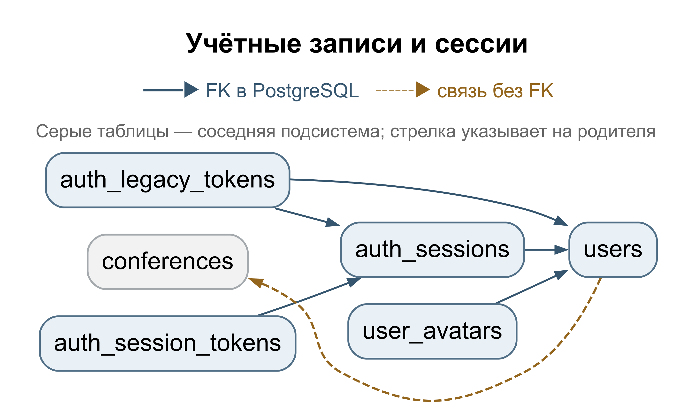

<a id="db-3"></a>

## 5.3. Администраторы, настройки платформы и каталог

Административные аккаунты имеют собственные логины, пароли и сессии. Запись аудита сохраняет имя действовавшего администратора, так что история остаётся читаемой после изменения аккаунта. Поле administrator_id в аудите не объявлено внешним ключом. Триггер `administrator_audit_immutable` запрещает UPDATE, DELETE и TRUNCATE журнала.

| Таблица и назначение | Столбцы по типам | Ключи и внешние ссылки |
|---|---|---|
| `administrators`<br>Независимые административные аккаунты, состояние, дата последнего входа. | **uuid** `id`<br>**varchar(40)** `username`<br>**text** `password_hash`, `status`<br>**varchar(100)** `name`<br>**varchar(254)** `email`?<br>**timestamptz** `created_at`, `updated_at`, `last_login_at`? | **PK** `id`<br>**U** `username` |
| `administrator_sessions`<br>Хеш токена административной сессии и срок действия. | **uuid** `id`, `administrator_id`<br>**char(64)** `token_hash`<br>**timestamptz** `created_at`, `expires_at` | **PK** `id`<br>**U** `token_hash`<br>`administrator_id` → `administrators` (`id`) · CASCADE |
| `administrator_login_limits`<br>Счётчик попыток в окне ограничения входа. | **char(64)** `key_hash`<br>**timestamptz** `window_start`<br>**integer** `attempts` | **PK** `key_hash` |
| `administrator_audit_log`<br>Неизменяемая история действий и снимок реквизитов запроса. | **uuid** `id`, `administrator_id`?<br>**varchar(40)** `username`<br>**varchar(80)** `action`<br>**varchar(60)** `object_type`<br>**varchar(100)** `object_id`<br>**varchar(64)** `ip`<br>**varchar(500)** `user_agent`<br>**jsonb** `metadata`<br>**timestamptz** `created_at` | **PK** `id` |
| `platform_settings`<br>Текущие параметры платформы, ревизия и зашифрованные пароли SMTP и LDAP. | **boolean** `singleton`<br>**bigint** `revision`<br>**jsonb** `values`<br>**text** `smtp_password_ciphertext`, `ldap_bind_password_ciphertext`<br>**timestamptz** `updated_at` | **PK** `singleton` |
| `ldap_identities`<br>Сопоставление внешнего идентификатора с локальным пользователем, имя входа в каталоге и время наблюдения. | **text** `provider_id`, `external_id`, `login`<br>**uuid** `user_id`<br>**timestamptz** `last_seen_at` | **PK** `provider_id`, `external_id`<br>**U** `user_id`<br>`user_id` → `users` (`id`) · NO ACTION |
| `ldap_directory_state`<br>Время последнего снимка каталога. | **boolean** `singleton`<br>**timestamptz** `last_snapshot_at`? | **PK** `singleton` |
| `ldap_sync_runs`<br>Состояние синхронизации, ревизия, код ошибки и счётчики. | **boolean** `singleton`<br>**timestamptz** `last_requested_at`?, `last_started_at`?, `last_completed_at`?, `last_succeeded_at`?<br>**bigint** `requested_revision`<br>**uuid** `job_id`?, `lease_token`?<br>**text** `status`<br>**varchar(64)** `error_code`<br>**integer** `imported`, `updated`, `disabled`, `total` | **PK** `singleton` |

Для `platform_settings`, `ldap_directory_state` и `ldap_sync_runs` базовая схема создаёт по одной строке с `singleton=true`. `ldap_sync_runs` показывает текущее или последнее выполнение. Отложенные задания хранятся в `background_jobs`, где частичный уникальный индекс `idx_ldap_sync_one_pending` допускает только одно задание `directory.sync` в состояниях `queued` и `processing` суммарно. Каталог идентифицирует пользователя парой provider_id и external_id. Логин и email могут меняться независимо от этой пары.

<a id="db-4"></a>

## 5.4. Конференции, участие и допуск

У конференции есть владелец и уникальный код приглашения. Тип `meeting` обозначает встречу, `direct_call` — служебную конференцию звонка. Период участия и транспортное подключение учитываются отдельно. Составной FK сессии связывает одновременно участника, встречу и пользователя.

| Таблица и назначение | Столбцы по типам | Ключи и внешние ссылки |
|---|---|---|
| `conferences`<br>Карточка встречи, владелец, расписание и состояние, поисковый вектор. | **uuid** `id`, `owner_id`<br>**varchar(200)** `title`<br>**varchar(32)** `invite_code`<br>**varchar(16)** `status`<br>**timestamptz** `started_at`?, `finished_at`?, `created_at`, `updated_at`, `scheduled_at`?, `integration_version_at`<br>**boolean** `waiting_room_enabled`<br>**integer** `planned_duration_min`?<br>**bigint** `integration_version`<br>**tsvector** `search_vector`?<br>**varchar(1000)** `chat_description`<br>**text** `kind` | **PK** `id`<br>**U** `invite_code`<br>`owner_id` → `users` (`id`) |
| `conference_participants`<br>Членство пользователя, роль, допуск и политика микрофона, камеры и экрана. | **uuid** `id`, `conference_id`, `user_id`?<br>**varchar(100)** `display_name`<br>**varchar(16)** `role`, `status`, `admission_state`<br>**timestamptz** `joined_at`?, `left_at`?, `created_at`, `updated_at`, `admission_decided_at`?<br>**boolean** `microphone_enabled`, `camera_enabled`, `screen_sharing`, `microphone_blocked`, `camera_blocked`, `screen_blocked`<br>**bigint** `media_policy_version`, `admission_version` | **PK** `id`<br>**U** `conference_id`, `user_id`<br>`conference_id` → `conferences` (`id`)<br>`user_id` → `users` (`id`) |
| `participant_sessions`<br>Отдельное подключение и последнее состояние медиоустройств. | **uuid** `id`, `conference_id`, `participant_id`, `user_id`, `connection_id`<br>**varchar(16)** `status`<br>**timestamptz** `connected_at`, `disconnected_at`?, `last_seen_at`<br>**bigint** `media_sequence`<br>**boolean** `microphone_enabled`, `camera_enabled`, `screen_sharing` | **PK** `id`<br>**U** `connection_id`<br>`participant_id`, `conference_id`, `user_id` → `conference_participants` (`id`, `conference_id`, `user_id`) · CASCADE |
| `conference_invitations`<br>Приглашение по email, результат отправки и пользователь при наличии. | **uuid** `id`, `conference_id`, `requested_by`, `user_id`?<br>**varchar(254)** `email`<br>**varchar(16)** `status`<br>**varchar(64)** `error_code`<br>**timestamptz** `created_at`, `sent_at`? | **PK** `id`<br>**U** `conference_id`, `email`<br>`conference_id` → `conferences` (`id`)<br>`requested_by` → `users` (`id`)<br>`user_id` → `users` (`id`) |
| `conference_moderation_audit`<br>Действия модератора с указанием инициатора и затронутого участника. | **bigint** `id`<br>**uuid** `conference_id`, `actor_id`, `participant_id`<br>**varchar(16)** `action`, `role`?<br>**boolean** `blocked`?<br>**timestamptz** `created_at` | **PK** `id`<br>`actor_id` → `conference_participants` (`id`) · NO ACTION<br>`conference_id` → `conferences` (`id`) · CASCADE<br>`participant_id` → `conference_participants` (`id`) · NO ACTION |

Для пользователя и конференции допустима одна строка участия. Частичный уникальный индекс `idx_conference_participants_single_owner` допускает одного участника с ролью `owner` на встречу. Уникальность тройки `id, conference_id, user_id` обеспечивает `idx_participant_session_identity`. Время последнего наблюдения сессии не предшествует подключению. Номер изменения медиасостояния находится в диапазоне 0–9007199254740991. Плановая длительность задаётся вместе с scheduled_at, от 1 до 1440 минут. GIN-индекс `idx_conferences_search` ускоряет поиск по вычисляемому search_vector.

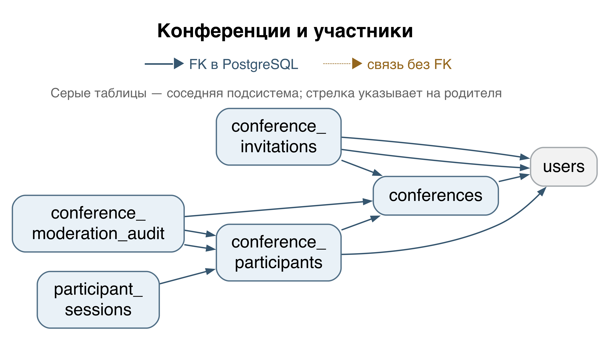

<a id="db-5"></a>

## 5.5. Запись, файлы и очередь команд

Внутренний числовой `record.id` связывает сегменты, события и файлы. Публичный `record.uuid` используется в команде очереди и уведомлении о готовности. Для конференционной записи `platform_conference_id` совпадает с `conference_id`. Частичные уникальные индексы `idx_record_one_active_conference` и `idx_record_one_active_composite` ограничивают запуск записи на одной конференции, пока предыдущая ещё создаётся, пишется, останавливается, финализируется или загружается.

| Таблица и назначение | Столбцы по типам | Ключи и внешние ссылки |
|---|---|---|
| `record`<br>Состояние сеанса записи, параметры качества, временные отметки и право обработки воркером. | **bigint** `id`, `size_bytes`?<br>**uuid** `uuid`, `conference_id`, `requested_by`?, `platform_conference_id`?, `recorder_token`?<br>**varchar(32)** `source_type`, `transport_type`, `status`, `layout`?, `audio_mode`?<br>**varchar(128)** `source_session_id`?, `storage_bucket`?, `worker_id`?<br>**varchar(16)** `requested_quality`?, `effective_quality`?, `quality_mode`, `min_quality`?<br>**smallint** `width`?, `height`?, `fps`?, `segment_duration_sec`?, `reconnect_grace_sec`<br>**boolean** `need_preview`<br>**text** `storage_object_key`?, `preview_object_key`?, `error_message`?<br>**integer** `duration_sec`?<br>**timestamptz** `started_at`?, `stopped_at`?, `ended_at`?, `created_at`, `updated_at`, `deleted_at`?, `recorder_lease_until`?, `media_started_at`?<br>**varchar(64)** `ended_reason`?<br>**jsonb** `metadata_json`?<br>**varchar(24)** `mode` | **PK** `id`<br>**U** `uuid`<br>`platform_conference_id` → `conferences` (`id`) |
| `record_segment`<br>Сегмент записи, локальный путь, ключ объекта, размер, длительность и контрольная сумма. | **bigint** `id`, `record_id`, `size_bytes`?<br>**uuid** `uuid`<br>**integer** `seq_no`, `duration_ms`?<br>**varchar(32)** `status`<br>**text** `local_path`?, `object_key`?, `error_message`?<br>**varchar(255)** `file_name`?<br>**varchar(100)** `mime_type`?<br>**timestamptz** `started_at`?, `ended_at`?, `created_at`, `updated_at`<br>**varchar(64)** `checksum_sha256`?<br>**varchar(16)** `effective_quality`?<br>**smallint** `width`?, `height`?, `fps`? | **PK** `id`<br>**U** `record_id`, `seq_no`<br>**U** `uuid`<br>`record_id` → `record` (`id`) · CASCADE |
| `record_file`<br>Артефакт в хранилище, тип, контрольная сумма и признак основного файла. | **bigint** `id`, `record_id`, `size_bytes`?<br>**uuid** `uuid`<br>**varchar(32)** `file_type`<br>**varchar(128)** `bucket`<br>**text** `object_key`<br>**varchar(255)** `file_name`?<br>**varchar(100)** `mime_type`<br>**integer** `duration_sec`?<br>**varchar(64)** `checksum_sha256`?<br>**boolean** `is_primary`, `is_public`<br>**jsonb** `metadata_json`?<br>**timestamptz** `created_at`, `updated_at` | **PK** `id`<br>**U** `bucket`, `object_key`<br>**U** `uuid`<br>`record_id` → `record` (`id`) · CASCADE |
| `record_event`<br>Диагностическое событие по записи и, при наличии, по сегменту. | **bigint** `id`, `record_id`, `segment_id`?<br>**varchar(64)** `event_type`<br>**varchar(32)** `event_source`<br>**varchar(16)** `severity`<br>**text** `message`?<br>**jsonb** `payload_json`?<br>**varchar(128)** `correlation_id`?, `worker_id`?<br>**timestamptz** `created_at` | **PK** `id`<br>`record_id` → `record` (`id`) · CASCADE<br>`segment_id` → `record_segment` (`id`) · SET NULL |
| `recording_outbox`<br>Команда записи, маркер захвата и подтверждение публикации. | **bigint** `id`<br>**uuid** `record_id`, `claim_token`?<br>**varchar(16)** `command_type`<br>**varchar(64)** `reason`<br>**timestamptz** `claimed_until`?, `published_at`?, `created_at` | **PK** `id`<br>**U** `record_id`, `command_type`<br>`record_id` → `record` (`uuid`) · CASCADE |

Типы артефактов в SQL — `final_mp4`, `final_audio`, `tracks_archive`, `preview_jpg`, `debug_log`. Частичный уникальный индекс `idx_record_file_primary_unique` допускает не более одного основного файла для каждой записи. Непубликованные команды выбираются по `idx_recording_outbox_pending`. Поля claim_token и claimed_until позволяют повторить отправку после истечения права обработки. Для поиска событий по дополнительным данным используется GIN-индекс `idx_record_event_payload_json`.

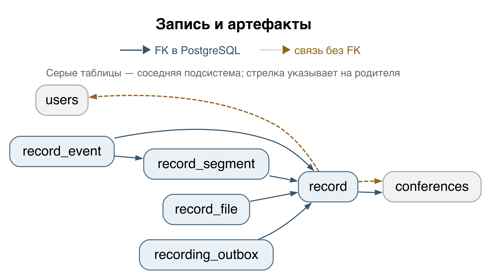

<a id="db-6"></a>

## 5.6. Чат конференции

Сообщения упорядочены по sequence внутри встречи. Повтор запроса идентифицируется сочетанием встречи, отправителя и client_request_id. Состояние прочтения, персональные закрепления и настройки уведомлений хранятся отдельно от сообщений. Текст допускает до 4000 символов, ограничение размера одного вложения в SQL — 100 МиБ.

| Таблица и назначение | Столбцы по типам | Ключи и внешние ссылки |
|---|---|---|
| `chat_messages`<br>Текст, ответ, номер в истории, версия и логическое удаление. | **uuid** `id`, `conference_id`, `sender_user_id`, `client_request_id`, `reply_to_id`?<br>**bigint** `sequence`, `version`<br>**char(64)** `request_fingerprint`<br>**text** `text`<br>**timestamptz** `created_at`, `updated_at`, `deleted_at`? | **PK** `id`<br>**U** `conference_id`, `sender_user_id`, `client_request_id`<br>`conference_id` → `conferences` (`id`)<br>`reply_to_id` → `chat_messages` (`id`)<br>`sender_user_id` → `users` (`id`) |
| `chat_attachments`<br>Метаданные объекта, владелец, запрос загрузки, привязка к сообщению и очистка. | **uuid** `id`, `conference_id`, `owner_user_id`, `client_request_id`, `message_id`?, `upload_token`?<br>**varchar(720)** `filename`<br>**varchar(80)** `mime_type`<br>**bigint** `size`<br>**char(64)** `checksum`<br>**varchar(16)** `status`<br>**text** `object_key`<br>**timestamptz** `upload_lease_until`?, `uploaded_at`?, `cleaned_at`?, `created_at`, `updated_at`, `expires_at` | **PK** `id`<br>**U** `conference_id`, `owner_user_id`, `client_request_id`<br>`conference_id` → `conferences` (`id`)<br>`message_id` → `chat_messages` (`id`)<br>`owner_user_id` → `users` (`id`) |
| `chat_read_states`<br>Последнее прочитанное сообщение и его номер для каждого пользователя. | **uuid** `conference_id`, `user_id`, `last_read_message_id`<br>**bigint** `last_read_sequence`<br>**timestamptz** `updated_at` | **PK** `conference_id`, `user_id`<br>`conference_id` → `conferences` (`id`)<br>`last_read_message_id` → `chat_messages` (`id`)<br>`user_id` → `users` (`id`) |
| `conference_chat_pins`<br>Персональное закрепление сообщения встречи. | **uuid** `conference_id`, `user_id`, `message_id`<br>**timestamptz** `created_at` | **PK** `conference_id`, `user_id`, `message_id`<br>`conference_id`, `message_id` → `chat_messages` (`conference_id`, `id`)<br>`user_id` → `users` (`id`) |
| `conference_chat_preferences`<br>Пользовательские настройки уведомлений и отметка выхода из чата. | **uuid** `conference_id`, `user_id`<br>**boolean** `notifications_enabled`<br>**timestamptz** `left_at`?, `updated_at` | **PK** `conference_id`, `user_id`<br>`conference_id` → `conferences` (`id`) · CASCADE<br>`user_id` → `users` (`id`) |
| `chat_notification_jobs`<br>Курсор фоновой рассылки уведомлений о сообщении и момент завершения. | **uuid** `message_id`, `conference_id`, `cursor_participant_id`?<br>**timestamptz** `completed_at`?, `created_at` | **PK** `message_id`<br>`conference_id` → `conferences` (`id`)<br>`message_id` → `chat_messages` (`id`) |

Уникальные индексы `chat_messages_conference_sequence` и `chat_messages_conference_id_id` обеспечивают пары (conference_id, sequence) и (conference_id, id). Составной FK закрепления гарантирует принадлежность сообщения той же встрече. Для неудалённых сообщений действуют индексы `chat_messages_text_search` по триграммам и `chat_messages_unread` по курсору. Фоновые процессы находят незавершённые рассылки и просроченные загрузки по частичным индексам.

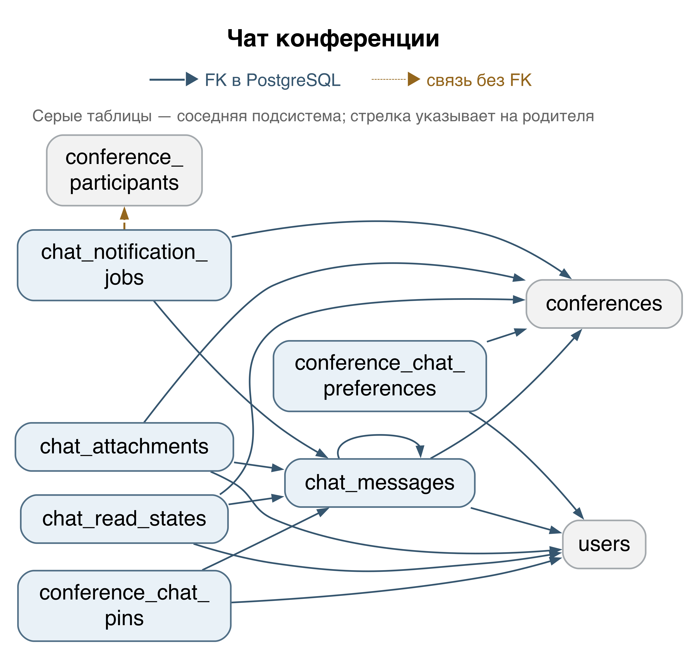

<a id="db-7"></a>

## 5.7. Личные и групповые чаты

Личная переписка задаётся упорядоченной парой пользователей. Отложенные триггеры `direct_pair_conversation` и `direct_pair_members` проверяют состав при фиксации транзакции. В личной переписке должны остаться оба активных участника пары, в действующей группе — от 1 до 100 активных участников и ровно один владелец. У удалённой группы активных участников быть не должно.

| Таблица и назначение | Столбцы по типам | Ключи и внешние ссылки |
|---|---|---|
| `conversations`<br>Личная переписка либо группа, данные группы и указатель на последнее сообщение. | **uuid** `id`, `user_low_id`?, `user_high_id`?, `last_message_id`?, `created_by`?, `avatar_version`?, `group_create_request_id`?<br>**text** `type`, `name`?, `description`, `avatar_key`?<br>**timestamptz** `created_at`, `updated_at`, `last_message_at`?, `deleted_at`?<br>**bigint** `metadata_version`<br>**char(64)** `group_request_fingerprint`? | **PK** `id`<br>**U** `created_by`, `group_create_request_id`<br>**U** `user_low_id`, `user_high_id`<br>`id`, `last_message_id` → `conversation_messages` (`conversation_id`, `id`)<br>`created_by` → `users` (`id`)<br>`user_high_id` → `users` (`id`)<br>`user_low_id` → `users` (`id`) |
| `conversation_members`<br>Членство, роль, курсоры чтения и очистки истории, видимость и отключение уведомлений. | **uuid** `conversation_id`, `user_id`, `last_read_message_id`?<br>**bigint** `last_read_sequence`, `history_cleared_through`<br>**timestamptz** `joined_at`, `updated_at`, `left_at`?, `hidden_at`?<br>**text** `role`<br>**boolean** `notifications_enabled` | **PK** `conversation_id`, `user_id`<br>`conversation_id` → `conversations` (`id`)<br>`conversation_id`, `last_read_message_id`, `last_read_sequence` → `conversation_messages` (`conversation_id`, `id`, `sequence`)<br>`user_id` → `users` (`id`) |
| `conversation_messages`<br>Текстовое сообщение или событие звонка, ответ, версия и подпись автора пересылки. | **uuid** `id`, `conversation_id`, `sender_user_id`, `client_request_id`, `reply_to_id`?, `call_id`?<br>**bigint** `sequence`, `version`<br>**char(64)** `request_fingerprint`<br>**text** `text`, `kind`, `forwarded_sender_name`?<br>**timestamptz** `created_at`, `updated_at`, `deleted_at`? | **PK** `id`<br>**U** `call_id`<br>**U** `conversation_id`, `id`<br>**U** `conversation_id`, `id`, `sequence`<br>**U** `conversation_id`, `sender_user_id`, `client_request_id`<br>`call_id` → `direct_calls` (`id`)<br>`conversation_id` → `conversations` (`id`)<br>`conversation_id`, `reply_to_id` → `conversation_messages` (`conversation_id`, `id`)<br>`conversation_id`, `sender_user_id` → `conversation_members` (`conversation_id`, `user_id`) |
| `conversation_attachments`<br>Вложения, объект в хранилище, привязка к сообщению и участнику чата. | **uuid** `id`, `conversation_id`, `owner_user_id`, `client_request_id`, `message_id`?, `upload_token`?<br>**varchar(720)** `filename`<br>**varchar(80)** `mime_type`<br>**bigint** `size`<br>**char(64)** `checksum`<br>**varchar(16)** `status`<br>**text** `object_key`<br>**timestamptz** `upload_lease_until`?, `uploaded_at`?, `cleaned_at`?, `created_at`, `updated_at`, `expires_at` | **PK** `id`<br>**U** `conversation_id`, `owner_user_id`, `client_request_id`<br>`conversation_id` → `conversations` (`id`)<br>`conversation_id`, `message_id` → `conversation_messages` (`conversation_id`, `id`)<br>`conversation_id`, `owner_user_id` → `conversation_members` (`conversation_id`, `user_id`) |
| `conversation_avatar_objects`<br>Объекты аватара группы, контрольная сумма и состояние очистки. | **uuid** `id`, `conversation_id`, `cleanup_token`?<br>**text** `object_key`, `content_type`, `state`<br>**bigint** `size`<br>**char(64)** `checksum`<br>**timestamptz** `cleanup_after`, `created_at`, `updated_at` | **PK** `id`<br>**U** `object_key`<br>`conversation_id` → `conversations` (`id`) |
| `conversation_message_pins`<br>Общее закрепление сообщения и участник, выполнивший действие. | **uuid** `conversation_id`, `message_id`, `pinned_by_user_id`<br>**timestamptz** `created_at` | **PK** `conversation_id`, `message_id`<br>`conversation_id`, `message_id` → `conversation_messages` (`conversation_id`, `id`) · CASCADE<br>`conversation_id`, `pinned_by_user_id` → `conversation_members` (`conversation_id`, `user_id`) |

Составные внешние ключи удерживают ответы, вложения, закрепления и курсор прочтения в пределах одного чата. Частичные индексы членов различают активные и видимые диалоги. Уникальный индекс `conversation_members_one_owner` ограничивает число активных владельцев. Индекс `conversation_messages_cursor` обеспечивает уникальность sequence в пределах чата. Подпись `forwarded_sender_name` хранится как текст. Для сообщения звонка используется внешний ключ call_id. Для обычного текста действуют предел 4000 символов и проверка версии. У группы имя длиной 1–50 символов и описание до 200 символов.

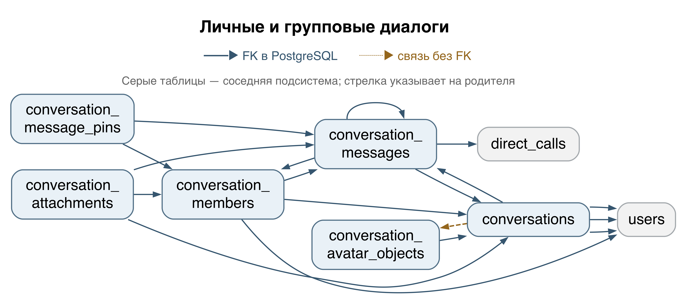

<a id="db-8"></a>

## 5.8. Личные звонки и папки

Звонок связывает личную переписку со служебной конференцией. У каждого звонящего или принимающего пользователя на время вызова занят один слот. Запись в direct_call_slots по первичному ключу user_id предотвращает наложение вызовов. При истечении срока звонка или права клиента на удержание соединения для поиска таких вызовов предусмотрены частичные индексы `direct_calls_expiring` и `direct_calls_leases`.

| Таблица и назначение | Столбцы по типам | Ключи и внешние ссылки |
|---|---|---|
| `direct_calls`<br>Участники и устройства вызова, состояние, сроки и версия. | **uuid** `id`, `conversation_id`, `conference_id`?, `caller_user_id`, `callee_user_id`, `caller_client_id`, `accepted_by_client_id`?, `client_request_id`<br>**text** `status`<br>**bigint** `version`<br>**timestamptz** `created_at`, `expires_at`, `accepted_at`?, `ended_at`?, `caller_lease_until`?, `callee_lease_until`? | **PK** `id`<br>**U** `caller_user_id`, `client_request_id`<br>**U** `conference_id`<br>`callee_user_id` → `users` (`id`)<br>`caller_user_id` → `users` (`id`)<br>`conference_id` → `conferences` (`id`)<br>`conversation_id`, `callee_user_id` → `conversation_members` (`conversation_id`, `user_id`) · NO ACTION<br>`conversation_id`, `caller_user_id` → `conversation_members` (`conversation_id`, `user_id`) · NO ACTION<br>`conversation_id` → `conversations` (`id`) |
| `direct_call_slots`<br>Текущий занятый слот пользователя. | **uuid** `user_id`, `call_id` | **PK** `user_id`<br>`call_id` → `direct_calls` (`id`)<br>`user_id` → `users` (`id`) |
| `folders`<br>Личная папка пользователя, нормализованное имя и позиция. | **uuid** `id`, `user_id`<br>**text** `name`, `name_key`<br>**integer** `position`<br>**timestamptz** `created_at`, `updated_at` | **PK** `id`<br>**U** `user_id`, `name_key`<br>**U** `user_id`, `position` (отложенное)<br>`user_id` → `users` (`id`) · CASCADE |
| `folder_conversations`<br>Принадлежность чата папке. | **uuid** `folder_id`, `conversation_id`<br>**timestamptz** `created_at` | **PK** `folder_id`, `conversation_id`<br>`conversation_id` → `conversations` (`id`) · CASCADE<br>`folder_id` → `folders` (`id`) · CASCADE |
| `folder_conferences`<br>Принадлежность встречи папке. | **uuid** `folder_id`, `conference_id`<br>**timestamptz** `created_at` | **PK** `folder_id`, `conference_id`<br>`conference_id` → `conferences` (`id`) · CASCADE<br>`folder_id` → `folders` (`id`) · CASCADE |

Допустимые состояния звонка — `ringing`, `accepted`, `declined`, `cancelled`, `ended`, `missed`. Имя папки содержит 1–50 символов. Ограничение UNIQUE на (user_id, position) отложено до конца транзакции, поэтому перестановка позиций разрешена в несколько шагов.

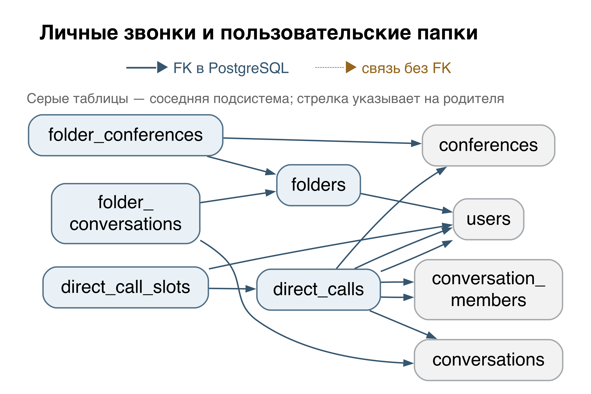

<a id="db-9"></a>

## 5.9. Уведомления, очереди и телеметрия

Уведомление пользователя, задание на рассылку и фоновое действие имеют разные сроки жизни. Производитель сохраняет событие или задание в транзакции изменения предметных данных, затем обработчик выполняет доставку. Уникальные ключи учитывают пользователя, сущность или версию. Просроченное право обработки определяется по lease_until, текущий исполнитель — по lease_token.

| Таблица и назначение | Столбцы по типам | Ключи и внешние ссылки |
|---|---|---|
| `notifications`<br>Уведомление для пользователя, его полезные данные, чтение и публикация. | **uuid** `id`, `user_id`<br>**varchar(40)** `type`<br>**integer** `version`<br>**jsonb** `payload`<br>**text** `dedup_key`<br>**timestamptz** `created_at`, `read_at`?, `published_at`? | **PK** `id`<br>**U** `user_id`, `dedup_key`<br>`user_id` → `users` (`id`) |
| `notification_jobs`<br>Задания на уведомления о допуске и готовности записи. | **bigint** `id`, `entity_version`<br>**varchar(40)** `kind`<br>**uuid** `entity_id`, `conference_id`, `user_id`?, `participant_id`?, `recording_id`?, `cursor_participant_id`?<br>**varchar(16)** `admission_state`?<br>**timestamptz** `created_at`, `available_at`, `processed_at`? | **PK** `id`<br>**U** `kind`, `entity_id`, `entity_version`<br>`participant_id` → `conference_participants` (`id`)<br>`recording_id` → `record` (`uuid`)<br>`user_id` → `users` (`id`) |
| `notification_preferences`<br>Предпочтения пользователя по типам уведомлений и каналам доставки. | **uuid** `user_id`<br>**boolean** `invitation`, `reminder`, `recording`, `email`, `push`<br>**timestamptz** `updated_at` | **PK** `user_id`<br>`user_id` → `users` (`id`) |
| `background_jobs`<br>Фоновые задачи с числом попыток, сроком следующего запуска и захватом обработчиком. | **uuid** `id`, `entity_id`, `conference_id`, `user_id`?, `lease_token`?<br>**varchar(64)** `kind`, `error_code`?<br>**bigint** `version`<br>**jsonb** `payload`<br>**varchar(255)** `dedup_key`<br>**varchar(16)** `state`<br>**integer** `attempts`, `max_attempts`<br>**timestamptz** `available_at`, `lease_until`?, `created_at`, `updated_at`, `finished_at`? | **PK** `id`<br>**U** `dedup_key` |
| `error_events`<br>Ошибки, агрегированные по отпечатку с временем первого и последнего наблюдения. | **uuid** `id`<br>**char(64)** `fingerprint`<br>**varchar(32)** `service`<br>**varchar(120)** `instance`, `release`<br>**varchar(8)** `level`<br>**varchar(80)** `code`<br>**varchar(300)** `message`<br>**varchar(200)** `route`<br>**varchar(36)** `request_id`<br>**timestamptz** `first_seen`, `last_seen`<br>**bigint** `occurrences`<br>**varchar(16)** `browser`<br>**jsonb** `stack` | **PK** `id`<br>**U** `fingerprint` |
| `error_event_batches`<br>Идентификаторы принятых пакетов ошибок для предотвращения повторного учёта. | **uuid** `id`<br>**timestamptz** `created_at` | **PK** `id` |
| `release_schema_migrations`<br>Реестр мигратора с SHA-256 и длительностью применения в миллисекундах. | **text** `name`<br>**char(64)** `checksum`<br>**timestamptz** `applied_at`<br>**bigint** `duration_ms` | **PK** `name` |

Изменение допуска создаёт задание `admission.decided`, готовая запись может создать `recording.ready`. Для их очереди используются `idx_notification_jobs_pending` и отдельный курсор пакетной доставки. Для фоновых задач действуют `idx_background_jobs_available` и `idx_background_jobs_failed_recent`. У `notification_jobs.conference_id` нет FK к conferences. В `error_events` счётчик occurrences агрегирует одинаковые отпечатки, индекс `error_events_request_idx` поддерживает диагностику по request_id.

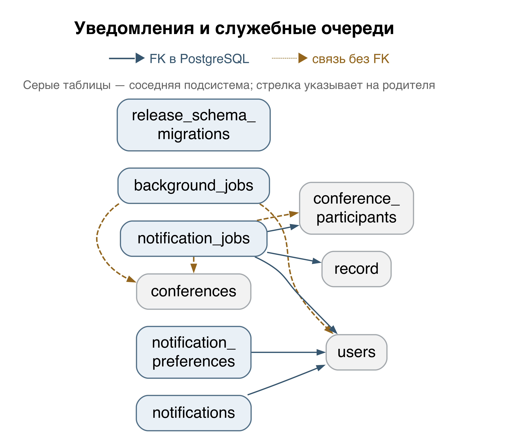

<a id="db-10"></a>

## 5.10. Календари, push-устройства и внешняя доставка

OAuth-состояние одноразовое и ограничено сроком хранения. Учётные данные календаря и адреса push-доставки хранятся зашифрованными. Для идентификации устройства используется отпечаток токена. У одной встречи может быть отдельное отображение во внешнее событие для каждого подключения календаря.

| Таблица и назначение | Столбцы по типам | Ключи и внешние ссылки |
|---|---|---|
| `calendar_connections`<br>Календарь пользователя и зашифрованные токены доступа и обновления. | **uuid** `id`, `user_id`<br>**text** `provider`, `calendar_id`, `status`, `access_ciphertext`, `refresh_ciphertext`, `scopes`<br>**timestamptz** `expires_at`?, `created_at`, `updated_at` | **PK** `id`<br>**U** `user_id`, `provider`, `calendar_id`<br>`user_id` → `users` (`id`) |
| `calendar_oauth_states`<br>Хеш одноразового состояния и зашифрованный PKCE verifier. | **uuid** `id`, `user_id`<br>**text** `provider`, `state_hash`, `verifier_ciphertext`<br>**timestamptz** `expires_at`, `used_at`? | **PK** `id`<br>**U** `state_hash`<br>`user_id` → `users` (`id`) |
| `calendar_event_mappings`<br>Соответствие встречи внешнему событию и версия синхронизации. | **uuid** `id`, `conference_id`, `connection_id`<br>**text** `provider`, `external_calendar_id`, `external_event_id`, `sync_status`<br>**bigint** `source_version`<br>**timestamptz** `last_synced_at`? | **PK** `id`<br>**U** `conference_id`, `connection_id`<br>`conference_id` → `conferences` (`id`)<br>`connection_id` → `calendar_connections` (`id`) |
| `push_devices`<br>Устройства пользователя, шифротекст токена, отзыв и отключение. | **uuid** `id`, `user_id`<br>**text** `platform`, `provider`, `token_ciphertext`, `token_fingerprint`<br>**timestamptz** `created_at`, `updated_at`, `revoked_at`?, `disabled_at`? | **PK** `id`<br>**U** `user_id`, `provider`, `token_fingerprint`<br>`user_id` → `users` (`id`) |
| `integration_deliveries`<br>Результат обработки задания для внешнего канала и пользователя. | **uuid** `job_id`, `user_id`<br>**text** `channel`, `status`, `error_code`<br>**timestamptz** `created_at` | **PK** `job_id`<br>`job_id` → `background_jobs` (`id`)<br>`user_id` → `users` (`id`) |

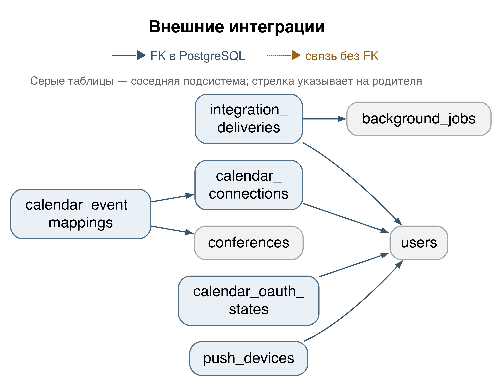

<a id="db-11"></a>

## 5.11. Структурированные поля и проверка каталога

| Поле JSONB | Содержание и проверка |
|---|---|
| `platform_settings.values` | Объект ревизионных настроек. CHECK требует объект JSON. Пароли SMTP и LDAP располагаются в отдельных зашифрованных полях той же строки. |
| `administrator_audit_log.metadata` | Метаданные конкретного административного действия. По умолчанию пустой объект. |
| `error_events.stack` | Массив стека не более чем из пяти элементов. Тип и длину ограничивает CHECK. |
| `notifications.payload` | Поля зависят от типа уведомления. Например, ссылки на conferenceId, invitationId, messageId, conversationId или recordingId, время scheduledAt и состояние admissionState. |
| `background_jobs.payload` | Содержимое зависит от kind. Для внешней доставки содержит notificationId и channel, для напоминания — scheduledAt и offsetSec. Курсор cursorParticipantId продолжает пакетную обработку. Ограничение SQL — 32 768 байт текстового представления. |
| `record_file.metadata_json` | Для результата конференционной записи обработчик сохраняет timelineOriginNs и mode. Поле допускает NULL. |
| `record.metadata_json`, `record_event.payload_json` | Дополнительные данные записи и диагностического события. База допускает произвольный JSON либо NULL. |

Триггеры обновляют отметки времени, проверяют состав чатов, защищают административный аудит и создают задания для уведомлений и внешних интеграций. Девять последовательностей нумеруют сообщения двух видов чатов, модераторский аудит, задания уведомлений и строки подсистемы записи. Для курсора сообщений используйте sequence вместе с идентификатором чата или встречи. Нумерация допускает пропуски.

Чтобы увидеть действующие DEFAULT, выражения CHECK, правила внешних ключей и точные предикаты всех индексов, выполните команды в `psql` на проверяемой базе. Ниже пример для таблицы сообщений. Запросы читают системные представления и каталог.

```sql
SELECT column_name, data_type, column_default, is_nullable
FROM information_schema.columns
WHERE table_schema = current_schema() AND table_name = 'conversation_messages'
ORDER BY ordinal_position;

SELECT conname, pg_get_constraintdef(oid) FROM pg_constraint
WHERE conrelid = 'conversation_messages'::regclass ORDER BY conname;

SELECT indexname, indexdef FROM pg_indexes
WHERE schemaname = current_schema() AND tablename = 'conversation_messages'
ORDER BY indexname;
```

<a id="install"></a>

# 6. Установка и конфигурация

<a id="install-options"></a>

## 6.1. Как выбрать способ установки

| Задача | Способ | Что определяет состав |
|---|---|---|
| Новый выделенный Linux-сервер | `sudo bash install.sh`. Загружает готовые образы и запускает интерактивный мастер | Манифест проверенного пакета для `linux/amd64` или `linux/arm64`. Сборки на сервере нет |
| Собрать определённый коммит | `sudo bash install.sh --mode source --ref main`. Вместо ветки можно указать полный SHA | Сборка `hardened-shared-host` в Docker, проверка образов и тот же мастер. Опция `--build-mode low-memory` уменьшает параллелизм |
| Разработка | `docker-compose.yml` и локальный `.env` в рабочей копии | Исходники, локальная инфраструктура и отдельные тестовые порты |
| Выпуск под управлением оператора | `scripts/release/release.sh` и конфигурация соответствующей среды | `classic` использует собственный TLS-прокси, MinIO и Grafana. В `hardened-shared-host` применяются SeaweedFS и внешний TLS-прокси |

Мастер пишет собственные файлы Compose и запускает HTTPS на 443. В ручном варианте `hardened-shared-host` прокси по умолчанию принимает трафик на `127.0.0.1:19080` за внешней точкой завершения TLS. Планы размещения различаются даже у одного пакета.

<a id="install-host"></a>

## 6.2. Подготовка сервера и сети

Нужны Linux, интерактивный терминал, права root и локальный Docker Engine с Compose от 2.24.4. Системные зависимости и Docker мастер может установить через APT на Debian/Ubuntu. Для OCI-пакета с `imageConfigIDs` требуется containerd image store. Для сборки из исходников также нужны Buildx и сетевой доступ к реестрам образов, зависимостей и базе Trivy.

Ориентир для сборки — 4 CPU, 8 ГиБ RAM и 35 ГиБ свободного места. Для готового выпуска мастер проверяет каталог установки на размер пакета плюс 15 ГиБ, а файловую систему Docker отдельно на 15 ГиБ. При расчёте ёмкости учитывайте объём будущих записей, вложений и копий. Проверьте `uname -m`, `free -h`, `df -h /opt /var/tmp` и `docker compose version`.

Настройте одну публичную A-запись на IPv4, назначенный интерфейсу сервера. Несколько адресов A, запись AAAA и несовпадение DNS с интерфейсом приводят к отказу мастера. Сверьте DNS и `ip -4 addr show scope global`. Проверьте занятость портов через `ss -lntup`. Правила firewall на сервере и у провайдера настраивает оператор.

| Порт | Кто подключается | Назначение |
|---|---|---|
| 443/TCP | Пользователи | HTTPS, API, WebSocket, SSE, подписанное чтение файлов |
| 80/TCP | Центр сертификации | Проверка домена при выпуске и продлении Let's Encrypt в режиме standalone |
| 8081/TCP либо выбранный порт | Администраторы | Отдельная HTTPS-панель. Мастер допускает 1024–65535, проверяет конфликт с другими службами. Ограничьте доступ административной сетью или VPN |
| 50010/UDP и TCP | Клиенты WebRTC | Прямое соединение с SFU |
| 3478/UDP и TCP, 5349/TCP | Клиенты за NAT | STUN/TURN и TURN поверх TLS |
| 49160–49259/UDP | Удалённые узлы ICE | Диапазон ретрансляции Coturn |

PostgreSQL, Redis, RabbitMQ, S3 и внутренние HTTP-порты доступны в частной сети. Prometheus по умолчанию публикуется на loopback, порт 19090. Мастер также проверяет 13001/TCP для Grafana в `classic`.

<a id="install-images"></a>

## 6.3. Получение выпуска и шаги мастера

На новом сервере загрузите установщик и проверьте опубликованную контрольную сумму.

```bash
mkdir -p meetspace-setup && cd meetspace-setup
curl -fSL --proto '=https' --proto-redir '=https' \
  https://meeting.janickiy.com/downloads/install.sh -o install.sh
curl -fSL --proto '=https' --proto-redir '=https' \
  https://meeting.janickiy.com/downloads/install.sh.sha256 -o install.sh.sha256
sha256sum --check install.sh.sha256 && sudo bash install.sh
```

Режим `images` выбирает последний по времени публикации совместимый релиз с `prebuilt.json` и архивом для архитектуры хоста. Подходят предварительные релизы с образами. Черновики и релизы только с исходниками пропускаются. Для фиксированной версии передайте `--mode images --release` и точный тег выпуска образов. Если пакет отсутствует, загрузчик сообщает об ошибке. Коммит инструментов установки и коммит приложения могут различаться.

1. Укажите домен. Проверьте выбранный IPv4 и параметры размещения. По умолчанию каталог установки `/opt/meetspace`, проект `meetspace`, частная подсеть `172.30.240.0/24`.
2. Выберите Let's Encrypt либо существующий абсолютный каталог с `fullchain.pem` и `privkey.pem`. Для Let's Encrypt нужны внешний порт 80 и согласие с условиями центра сертификации.
3. При необходимости настройте SMTP. Затем выберите HTTPS-порт админки и проверьте итоговую сводку. При подтверждении мастер записывает конфигурацию и создаёт независимые секреты.
4. Мастер проверяет и загружает образы, запускает PostgreSQL, Redis, RabbitMQ и S3, проверяет совместимость прежних служб и выполняет миграции отдельной задачей `migrate`. При отсутствии администраторов запрашивает логин и пароль первого администратора.
5. После запуска приложений мастер проверяет сайт, версии и административный HTTPS с реальным именем хоста. Затем предлагает создать обычный пользовательский аккаунт. Для проверки связи позвоните с устройства в другой сети, включите экран, запишите короткий фрагмент и проверьте воспроизведение.

Копия `config/meetspace.env` закрыта правами `0600`. При настройке почты мастер отдельно создаёт `config/smtp.env` для `api` и `product-worker`. `installation.json` содержит состояние установки, `bundle/release/release.json` — технические сведения об образах.

```bash
sudo /opt/meetspace/manage.sh status
sudo jq '{root,project,domain,complete,adminHTTPSPort}' /opt/meetspace/installation.json
sudo jq '{version,commit,deploymentLayout,artifactMode}' /opt/meetspace/bundle/release/release.json
```

Если запуск остановился после создания каталога, сохраните пакет и состояние. После устранения причины выполните `sudo bash install.sh --resume /opt/meetspace` из каталога проверенного актуального загрузчика. Он загружает мастер закреплённого коммита и продолжает прежнюю установку с её данными и образами. При исправном сохранённом мастере подходит команда `sudo python3 -I /opt/meetspace/config/installer.py --resume /opt/meetspace`. В частности, при старой ошибке Compose о `live-worker` используйте исправленный загрузчик. Добавлять службу в Compose не требуется. Если сбой произошёл при подготовке исходников до создания установки, используйте команду продолжения именно для каталога сборки, напечатанную загрузчиком.

<a id="install-release"></a>

## 6.4. Публикация готовых образов

| Событие GitHub Actions | Требование к источнику | Результат |
|---|---|---|
| Публикация исходного Release | Семантический тег вида `0.6.5` или `v0.6.5` на коммите, входящем в историю `main` | Отдельный предварительный релиз вида `v0.6.5-prebuilt.release-ID`, где ID присваивает GitHub |
| Создание тега `v*-prebuilt.*` | Новый допустимый тег на коммите из истории `main` | Готовый выпуск под этим тегом |
| `Run workflow` | Ветка `main`, уникальный параметр `version` вида `vX.Y.Z` с допустимым суффиксом при необходимости | Готовый выпуск под переданным именем |

`.github/workflows/server-images.yml` создаёт черновик, собирает образы на отдельных нативных runners для amd64 и arm64, проверяет SBOM и отчёты сканирования. Публикация общего индекса выполняется после обеих успешных сборок. Опубликованный prebuilt-релиз не запускает повторную сборку по событию Release. При сбое исследуйте шаг сборки и черновик в Actions, при новой попытке учитывайте запрет перезаписывать существующий выпуск.

Для публикации самого загрузчика сопровождающий использует `scripts/release/package-installer.sh`. В каталог загрузок поступают согласованные `install.sh`, `install.sh.sha256`, `source.json` и архив исходников, названный по коммиту. Публикуемый скрипт закрепляет полный SHA инструментов.

<a id="install-local"></a>

## 6.5. Локальная разработка

В новой копии проекта скопируйте `.env.example` в `.env`, установите права `0600` и задайте независимые секреты для JWT и зависимостей. Для локального HTTP задайте `APP_ENV=local`, `PUBLIC_FRONTEND_URL=http://localhost:5173` и `MINIO_PUBLIC_ENDPOINT=http://localhost:9000`. В `MEDIA_NAT_IPS` укажите адрес хоста, достижимый браузером.

```bash
docker network inspect gateway_default >/dev/null 2>&1 || docker network create gateway_default
docker compose config --quiet && docker compose up -d --build \
  api media-worker record-worker product-worker frontend
docker compose ps
```

Если в `GATEWAY_NETWORK` задано другое имя, создайте сеть с этим именем. Для HTTPS на тестовом устройстве выполните `HTTPS_CERT_IP=127.0.0.1 sh scripts/generate-https-certs.sh`, заменив IP на фактический адрес компьютера при доступе по сети. Импортируйте только публичный `dockers/https/certs/go-recorder-local-ca.pem` в доверенные CA этого устройства. Поставьте `PUBLIC_FRONTEND_URL` и `MINIO_PUBLIC_ENDPOINT` равными `https://<имя-или-IP>:18482`, выполните `docker compose up -d --build` и откройте тот же адрес в браузере. Повторная генерация заменяет файлы локальных сертификатов.

<a id="install-manual-run"></a>

## 6.6. Ручное развёртывание проверенного выпуска

Понадобятся Docker с Compose, Bash, Git, jq, Python 3, OpenSSL, ripgrep, утилита SHA-256, полный пакет выпуска и его манифест. Для production подготовьте отчёт допуска, относящийся к тому же коммиту, версии и SHA-256 манифеста. У архивного выпуска рядом с `release.json` должны быть `images.tar`, SBOM и отчёты, у реестрового — доступ к указанным digest.

1. Откройте отдельную копию репозитория на коммите `.commit` из `release.json`. Скопируйте `.env.production.example` в закрытый файл вне Git. Заполните параметры из следующего раздела, включая реальные домен, IP и доверенную сеть прокси.
2. Создайте `RECORDER_STORAGE_DIR` с владельцем `1000:1000` и режимом `0750`. Задайте `TLS_CERT_DIR`, `TURN_TLS_CERT_DIR` и поместите в них пару сертификата и ключа. Задайте `METRICS_TOKEN_FILE` с содержимым `METRICS_SECRET`. Для `classic` требуется также `GRAFANA_PASSWORD_FILE`. Обеспечьте чтение файлов соответствующими сервисами.
3. При `hardened-shared-host` подготовьте внешний TLS-прокси, проверьте проксирование WebSocket/SSE и чтение подписанных файлов. Сверьте подсеть `172.31.242.0/24` с сетями хоста. Тома MinIO и SeaweedFS имеют разные форматы. Сохраняйте существующую схему хранения при обновлении.
4. В Bash задайте действительные абсолютные пути и проверьте конфигурацию. Следующие команды используют один и тот же проект во всех шагах.

```bash
read -r -p 'Файл окружения: ' MS_ENV
read -r -p 'Манифест выпуска: ' MS_MANIFEST
read -r -p 'Отчёт допуска: ' MS_EVIDENCE
ms_release() {
  bash scripts/release/release.sh "$1" --environment production --project recorder-production \
    --env-file "$MS_ENV" --manifest "$MS_MANIFEST" --evidence "$MS_EVIDENCE"
}
ms_release validate
```

После успешной проверки и согласования окна внесите версию из проверенного манифеста. `pull` получает образы, `migrate` запускает зависимости и отдельную миграцию, `deploy` последовательно запускает приложения, прокси и мониторинг.

```bash
read -r -p 'Подтверждённая версия: ' RELEASE_PRODUCTION_APPROVAL
export RELEASE_PRODUCTION_APPROVAL
ms_release pull && ms_release migrate && ms_release deploy
```

При самостоятельном включении админки (`ADMIN_ENABLED=true`) первоначальный аккаунт создайте серверной CLI из раздела 8. В мастере это происходит автоматически.

<a id="install-configuration"></a>

## 6.7. Параметры окружения и настройки в БД

Мастер заполняет значения из `.env.production.example`, затем формирует локальные файлы Compose. В ручном выпуске их задаёт оператор. Настройки, сохранённые через админку, переопределяют соответствующие исходные значения для приложения. Изменение env у запущенного контейнера требует его пересоздания. Значения ниже относятся к указанному слою конфигурации.

| Подсистема | Важные параметры | Какие значения использовать |
|---|---|---|
| Публичный адрес | `PUBLIC_FRONTEND_URL`, `MINIO_PUBLIC_ENDPOINT`, `WS_ALLOWED_ORIGINS`, `HTTP_TRUSTED_PROXIES` | Для сервера задайте действительные HTTPS-origin и подсеть прокси. Мастер ставит свой домен для всех трёх адресов |
| Админка | `ADMIN_ENABLED`, `ADMIN_HTTPS_PORT`, `ADMIN_HTTP_PORT`, `ADMIN_PUBLIC_URL` | Шаблон production выключает панель, мастер включает. Внешний порт по умолчанию 8081, внутренний API в production Compose закреплён на 8082. При пустом admin origin используется HTTPS-имя публичного сайта с административным портом |
| Секреты production | `JWT_SECRET`, `MEDIA_TICKET_SECRET`, `MEDIA_INTERNAL_SECRET`, `METRICS_SECRET`, `TURN_SHARED_SECRET` | Независимые значения от 32 байт. Шаблон оставляет их пустыми, мастер генерирует |
| PostgreSQL и Redis | `POSTGRES_HOST`, `POSTGRES_PORT`, `POSTGRES_DB`, `POSTGRES_USER`, `POSTGRES_PASSWORD`, `REDIS_HOST`, `REDIS_PORT`, `REDIS_PASSWORD` | Имена сервисов `postgres` и `redis`, порты 5432 и 6379. Имена базы/пользователя и приватные пароли должны совпадать с настройками контейнеров. В production пароли PostgreSQL, Redis, RabbitMQ и S3 должны содержать не менее 16 байт |
| RabbitMQ и S3 | `RABBIT_MQ_HOST`, `RABBIT_MQ_PORT`, `RABBIT_MQ_USER`, `RABBIT_MQ_PASSWORD`, `MINIO_ENDPOINT`, `MINIO_BUCKET`, `MINIO_ROOT_USER`, `MINIO_ROOT_PASSWORD` | Брокер `rabbitmq:5672`, S3 `minio:9000`, бакет по умолчанию `recordings`. В hardened имя сервиса `minio` указывает на SeaweedFS |
| Соединения с БД и HTTP | `DB_MAX_OPEN`, `DB_MAX_IDLE`, `DB_CONNECTION_LIFETIME`, `DB_QUERY_TIMEOUT`, `HTTP_MAX_BODY_BYTES` | Go/шаблон 20/10 соединений, мастер 10/2. Время жизни 30 мин, тайм-аут запроса в production-шаблоне 10 с. Базовый предел HTTP 1 МиБ. Для ряда обработчиков установлены собственные пределы |
| ICE и SFU | `MEDIA_NAT_IPS`, `MEDIA_UDP_PORT`, `MEDIA_TCP_PORT`, `TURN_PUBLIC_IP`, `TURN_REALM`, `TURN_URLS` | Укажите достижимый IP и TURN URI. UDP SFU 50010. Для TCP код Go по умолчанию использует 0, шаблон сервера включает порт 50010. `TURN_CREDENTIAL_TTL` по умолчанию 10 мин |
| Комнаты и сигнализация | `MEDIA_MAX_PEERS`, `MEDIA_MAX_ROOMS`, `WS_MAX_CONNECTIONS` | В production-шаблоне 10 участников, 20 комнат, максимум 1000 WebSocket-подключений. Первые два лимита доступны для изменения через панель |
| Запись | `STORAGE_PATH`, `RECORDING_MAX_ACTIVE`, `RECORDING_FFMPEG_CONCURRENCY`, `RECORDING_MAX_DURATION`, `RECORDING_MAX_MIB`, `RECORDING_DISK_RESERVE_MIB` | `/storage`, до 2 активных записей, 1 сборка FFmpeg одновременно, 4 ч, 10 240 МиБ на запись. Резерв диска 256 МиБ в Go и 1024 МиБ в серверном шаблоне |
| Доступность и метрики | `HEALTH_PROBE_INTERVAL`, `HEALTH_PROBE_TIMEOUT`, `SHUTDOWN_TIMEOUT`, `PPROF_PORT` | По умолчанию 2 с, 1 с, 20 с и 0 (профилировщик выключен). Prometheus использует `METRICS_TOKEN_FILE` со значением `METRICS_SECRET` |
| Интеграции | `EMAIL_PROVIDER_MODE`, `PUSH_PROVIDER_MODE`, `CALENDAR_PROVIDER_MODE`, `PROVIDER_TIMEOUT` | Исходный режим `noop`, тайм-аут 15 с. Для HTTP-провайдера нужны endpoint и token соответствующего префикса. Для SMTP задайте сервер, порт, логин, пароль, отправителя и режим TLS |
| Ключ провайдеров | `PROVIDER_TOKEN_ENCRYPTION_KEY` | 32 случайных байта в стандартном Base64. Мастер создаёт ключ. Он необходим для закрытых данных интеграций, включая сохранение bind-пароля и SMTP-пароля через панель. API и product-worker должны читать одинаковое значение |
| Фоновые задания | `PRODUCT_WORKER_PORT`, `PRODUCT_POLL_INTERVAL`, `PRODUCT_MAX_ATTEMPTS`, `REMINDER_OFFSETS` | Серверный шаблон задаёт 8092, 5 с, 5 попыток и напоминание за 3 ч. Отдельные типы заданий, в частности LDAP, имеют собственные пределы |

Рабочая конфигурация и резервные копии содержат секреты. Для проверки подстановки значений используйте `docker compose config --quiet` с полным контекстом установки. Не прикладывайте результат полного `config` и содержимое файлов окружения к отчётам.

<a id="ops"></a>

# 7. Эксплуатация, резервные копии и диагностика

<a id="ops-context"></a>

## 7.1. Выбор установки и проверка готовности

Для установки мастером войдите в административную Bash-оболочку (`sudo -i`). Функция ниже использует каталог, проект и компоновку именно этой установки. Выполните её определение в каждом новом сеансе, из которого обслуживаете сервер.

```bash
MS_ROOT=/opt/meetspace
MS_PROJECT=$(jq -er .project "$MS_ROOT/installation.json")
MS_DEPLOY="$MS_ROOT/bundle/deployment"
MS_LAYOUT=$(jq -er .deploymentLayout "$MS_ROOT/bundle/release/release.json")
case "$MS_LAYOUT" in
  hardened-shared-host) MS_EXTRA=docker-compose.hardened.yml ;;
  classic) MS_EXTRA=docker-compose.grafana.yml ;;
  *) echo 'Неизвестная компоновка' >&2; exit 1 ;;
esac
compose() {
  docker compose --project-name "$MS_PROJECT" --env-file "$MS_ROOT/config/meetspace.env" \
    -f "$MS_DEPLOY/docker-compose.production.yml" -f "$MS_DEPLOY/$MS_EXTRA" \
    -f "$MS_ROOT/config/compose.json" -f "$MS_ROOT/config/turn.yml" "$@"
}
compose --profile observability --profile migration config --quiet
compose --profile observability ps -a
```

Для **ручного выпуска** откройте отдельную Bash-оболочку в исходниках установленного коммита. С установленными `MS_ENV` и `MS_MANIFEST` из раздела 6 выполните `source scripts/release/common.sh`, затем `parse_release_args --environment production --project recorder-production --env-file "$MS_ENV" --manifest "$MS_MANIFEST"` и `validate_release`. Полученная функция `compose` использует компоновку общего релиза. Команды `ps`, `logs` и `exec` ниже подходят обоим вариантам.

```bash
for pair in api:8085 record-worker:8090 media-worker:8091 product-worker:8092; do
  svc=$(echo "$pair" | cut -d: -f1)
  port=$(echo "$pair" | cut -d: -f2)
  compose exec -T "$svc" wget -qO- "http://127.0.0.1:$port/health/ready" || break
done
compose logs --since 15m --tail 100 api record-worker media-worker product-worker
compose exec -T api sh -ec \
  'wget -qO- --header="Authorization: Bearer $METRICS_SECRET" http://127.0.0.1:8085/metrics'
```

`/health/live` сообщает, что процесс отвечает. `/health/ready` с кодом 503 требует проверить зависимости, диск и состояние drain. Рабочий ответ готовности — `{"status":"ready"}`. Внешний прокси блокирует служебные маршруты. Для сверки выпуска запросите `/version` (API) и `/version.json` (frontend) на публичном HTTPS.

<a id="ops-drain"></a>

## 7.2. Как завершить активные работы

Перед обслуживанием ограничьте новые подключения на внешнем входе. Завершите активные записи штатно, пока API ещё принимает команды, и дождитесь готовности файлов в S3. Для резервной копии дополнительно приостановите все остальные источники записи, включая админку, загрузки и внешние задания.

```bash
compose exec -T rabbitmq rabbitmqctl list_queues name messages_ready messages_unacknowledged consumers
compose exec -T postgres sh -ec \
  'exec psql -v ON_ERROR_STOP=1 -U "$POSTGRES_USER" -d "$POSTGRES_DB"' <<'SQL'
SELECT count(*) FROM recording_outbox WHERE published_at IS NULL;
SELECT state, count(*) FROM background_jobs GROUP BY state ORDER BY state;
SQL
```

В нестандартном RabbitMQ vhost передайте `-p` с его именем. Выясните причину непустой очереди ошибок. Когда встречи, записи и фоновые работы завершены, запросите drain на четырёх процессах.

```bash
ms_drain() {
  compose exec -T "$1" sh -ec \
    'wget -qO- --post-data="" --header="Authorization: Bearer $METRICS_SECRET" \
       "http://127.0.0.1:$1/operations/drain"' sh "$2" &&
  compose exec -T "$1" sh -ec \
    'wget -qO- --header="Authorization: Bearer $METRICS_SECRET" \
       "http://127.0.0.1:$1/operations/drain"' sh "$2"
}
ms_drain api 8085 && ms_drain media-worker 8091 &&
  ms_drain record-worker 8090 && ms_drain product-worker 8092
```

Дождитесь `draining=true` и `active=0` в ответе GET каждого процесса. Если работа ещё идёт, повторяйте GET и проверяйте очереди. Остановка и запуск записи используют одну очередь. Если включить drain слишком рано, возвращаемые на повтор команды старта могут задержать команды остановки. Перезапуск SFU разрывает соединения активных комнат.

Чтобы выйти из drain на **установке мастера**, пересоздайте прикладные процессы того же выпуска. Переход к другим образам требует отдельной процедуры. После перезапуска повторите проверки из 7.1 и снимите ограничение подключений. Для ручного выпуска используйте `ms_release resume` с установленным манифестом и соответствующим допуском.

```bash
compose up -d --no-build --no-deps --force-recreate --wait --wait-timeout 240 \
  media-worker record-worker product-worker api frontend
```

<a id="ops-backup"></a>

## 7.3. Согласованная копия PostgreSQL, S3 и конфигурации

Дамп БД содержит связь записи или вложения с ключом объекта. Файл находится в S3, а незавершённая запись может оставаться в `/storage`. БД и бакет копируются последовательно, поэтому сохраняйте запрет записи в оба хранилища до завершения операции. Логическая копия включает текущие версии объектов. Для незавершённых записей и состояния брокера нужен отдельный план.

Следующий блок предназначен для **установки мастером** в Bash из 7.1. В нём сначала создаётся новый закрытый каталог, затем записываются дамп, объекты, конфигурация и контрольные суммы. Появление итогового `backup.json` отмечает завершение копирования.

```bash
(
  set -euo pipefail
  umask 077
  install -d -m 0700 /var/backups/meetspace
  dest=$(mktemp -d /var/backups/meetspace/backup.XXXXXXXX)
  cp "$MS_ROOT/bundle/release/release.json" "$dest/release.json"
  compose exec -T postgres timeout 600 sh -ec \
    'PGPASSWORD="$POSTGRES_PASSWORD" exec pg_dump -U "$POSTGRES_USER" -d "$POSTGRES_DB" \
      --format=custom --no-owner --no-acl --lock-wait-timeout=5s' > "$dest/postgres.dump"
  test -s "$dest/postgres.dump"
  compose run --rm --no-deps --user "$(id -u):$(id -g)" --entrypoint /app/object-backup \
    -v "$dest:/backup" api backup --dir /backup/objects
  tar -C "$MS_ROOT" -czf "$dest/installation-private.tar.gz" config secrets certs installation.json manage.sh
  tar -tzf "$dest/installation-private.tar.gz" >/dev/null
  sha() { sha256sum "$1" | cut -d' ' -f1; }
  jq -n --arg v "$(jq -er .version "$dest/release.json")" --arg c "$(jq -er .commit "$dest/release.json")" \
    --arg r "$(sha "$dest/release.json")" --arg d "$(sha "$dest/postgres.dump")" \
    --arg o "$(sha "$dest/objects/manifest.json")" --arg t "$(date -u +%FT%TZ)" \
    '{schemaVersion:1,version:$v,commit:$c,releaseManifestSHA256:$r,databaseSHA256:$d,
      objectsManifestSHA256:$o,createdAt:$t,restoreVerified:false}' > "$dest/backup.json.tmp"
  mv "$dest/backup.json.tmp" "$dest/backup.json"
  printf 'Копия сохранена в %s\n' "$dest"
)
```

Храните отдельно полный проверенный пакет выпуска и закрытый архив установки вместе с ключом шифрования провайдеров. Перенесите резервную копию в зашифрованное внешнее хранилище. В ручной схеме после подтверждённой остановки всех операций записи используйте тот же проект и установленный манифест. Введите новый абсолютный путь, которого ещё нет на диске.

```bash
read -r -p 'Новый каталог резервной копии: ' MS_BACKUP
RELEASE_BACKUP_QUIESCED=1 bash scripts/release/backup.sh --environment production \
  --project recorder-production --env-file "$MS_ENV" --manifest "$MS_MANIFEST" --output "$MS_BACKUP"
```

Закрытые файлы конфигурации ручного выпуска также сохраните отдельно.

<a id="ops-restore"></a>

## 7.4. Проверка восстановления

Подготовьте **отдельный** local/staging-проект с доступными PostgreSQL и S3, совместимыми образами и собственными реквизитами. В копии исходников общего выпуска задайте реальные пути этой среды и копии. Скрипт отказывает при выборе production.

```bash
read -r -p 'Env отдельного стенда: ' MS_RESTORE_ENV
read -r -p 'Манифест стенда: ' MS_RESTORE_MANIFEST
read -r -p 'Каталог резервной копии: ' MS_BACKUP
bash scripts/release/restore-check.sh --environment staging --project recorder-staging-restore \
  --env-file "$MS_RESTORE_ENV" --manifest "$MS_RESTORE_MANIFEST" --backup "$MS_BACKUP"
```

Скрипт сверяет SHA-256, создаёт новую БД и новый бакет, запускает `pg_restore` в транзакции, повторно читает БД, проверяет журнал миграций, контрольные суммы объектов и политику бакета. Подписанное чтение проверяется для непустого бакета. В `restore-check-*.json` сохраняются имена восстановленных ресурсов и результаты. Они остаются на стенде для проверки.

Для проверки приложения разверните исходный выпуск в изолированном окружении, задайте `POSTGRES_DB` и `MINIO_BUCKET` равными восстановленным именам, верните исходный ключ `PROVIDER_TOKEN_ENCRYPTION_KEY` и предоставьте выбранным служебным аккаунтам доступ к данным. Проверьте вход, содержимое чатов, вложения и воспроизведение записей. Значения RPO/RTO устанавливают по требованиям эксплуатации и измерениям полного восстановления. Успешный `restore-check` сам по себе проверяет только восстановление данных в изолированной среде.

<a id="ops-diagnosis"></a>

## 7.5. Диагностика по симптому

| Симптом | Где проверить | На что обратить внимание |
|---|---|---|
| HTTPS недоступен или возвращает 502 | DNS, сертификат, `compose logs --tail 100 proxy api frontend`, внутренняя готовность API | Имя в сертификате, полный chain, доступность upstream. Внешние 404 на служебных путях ожидаемы |
| Панель не открывается | Административный origin и разрешённый TCP-порт, `ADMIN_ENABLED`, `compose logs proxy api` | При тесте без cookie на порту панели `/api/v1/admin/auth/me` даёт 401, на публичном 443 — 404 |
| Сообщения видны, собеседника не слышно | `media-worker`, браузерная статистика ICE, `MEDIA_NAT_IPS`, выдача TURN, firewall | Выбранная пара ICE, достижимый адрес SFU, UDP/TCP 50010, правильные realm/secret и диапазон ретрансляции. Проверьте звонок из другой сети |
| Запись зависла или нет файла | `record-worker`, состояние записи и outbox, статистика RabbitMQ, место и владелец `/storage`, S3 | Команда дошла до обработчика, публикация объекта завершена. Не удаляйте незавершённые фрагменты до разбора |
| Ошибки PostgreSQL | `compose exec -T postgres sh -ec 'pg_isready -U "$POSTGRES_USER" -d "$POSTGRES_DB"'` и журнал службы | Свободное место, лимит соединений, журнал миграций и версия установленного выпуска |
| Потеря присутствия и ошибки Redis | `compose exec -T redis sh -ec 'REDISCLI_AUTH="$REDIS_PASSWORD" redis-cli ping'` | В норме `PONG`. Проверьте память и доступ к сервису |
| Растёт очередь | `rabbitmq-diagnostics -q ping` внутри `rabbitmq`, команды из 7.2 и журнал соответствующего worker | Различайте команды записи RabbitMQ и фоновые задания `background_jobs` в PostgreSQL |
| Ошибки LDAP или писем | Журнал API, `product-worker`, диагностика глав 8–9 | TLS, действующие настройки, наличие прежнего ключа шифрования, конечное состояние задания и реальная доставка |

Проверяйте объём `df -h "$MS_ROOT/storage"` и `docker system df`. Внутри контейнера запись ведёт UID 1000, стандартный каталог на хосте имеет режим `0750`. `RECORDING_KEEP_LOCAL=true` оставляет материалы успешно завершённой составной записи. Перед удалением временного файла сопоставьте его с UUID и конечным состоянием записи, проверьте объект в S3 и отсутствие активного FFmpeg.

Для Let's Encrypt проверьте `systemctl status certbot.timer` и `journalctl -u certbot.service`. Для своего сертификата замените файлы в исходном каталоге и выполните `sudo /opt/meetspace/manage.sh certificates`. Если рабочие файлы в `certs/` уже заменены штатным внешним средством, выполните `manage.sh reload-tls` из каталога установки. Nginx перечитает сертификат, а Coturn будет перезапущен. Учитывайте действующие соединения TURN.

<a id="ops-upgrades"></a>

## 7.6. Обновление и откат

Установщик обслуживает первичное развёртывание и продолжение незавершённого запуска. Для обновления **ручного выпуска** проверьте манифест, его совместимость с текущей БД, резервную копию и откат на изолированном стенде. Зафиксируйте версии до работ, общий `RELEASE_LOCK_DIR` для операторов одного проекта и согласованное окно. Затем используйте последовательность `validate → pull → migrate → deploy` из 6.6 с новым манифестом. Изменение образа работающей инфраструктуры, например PostgreSQL, требует отдельного плана.

При **откате приложения** из той же Bash-оболочки ручного выпуска выберите манифест прежних образов и отчёт именно для него. Подтвердите его совместимость с уже применёнными миграциями. Скрипт `rollback` меняет приложения и не выполняет обратные миграции.

```bash
read -r -p 'Манифест прежнего выпуска: ' MS_MANIFEST
read -r -p 'Отчёт допуска отката: ' MS_EVIDENCE
read -r -p 'Версия прежнего выпуска: ' RELEASE_PRODUCTION_APPROVAL
export RELEASE_PRODUCTION_APPROVAL
ms_release validate && ms_release rollback
```

Для **установки мастером** сохраняйте её `config/compose.json`, `config/turn.yml`, имена томов и точные образы. Штатной команды `manage.sh upgrade` нет, а общий `release.sh` использует другую цепочку Compose. Возврат только образов при несовместимой схеме БД не восстанавливает данные. В таком случае нужна согласованная точка восстановления PostgreSQL, S3 и конфигурации. После работ проверьте HTTPS, активный выпуск, вход, переписку, вызов и запись.


<a id="admin-console"></a>

# 8. Административная панель

<a id="admin-boundary"></a>

## 8.1. Адрес панели и проверка доступа

Панель — отдельное React-приложение (`admin/`) с React Router и TanStack Query. Nginx раздаёт его сборку и проксирует `/api/v1/admin/*` на отдельный HTTP-сервер Go API внутри контейнера. PostgreSQL хранит административные аккаунты и сессии. Пользовательское право `users.is_admin` и роли организатора встречи или владельца группы действуют в других частях продукта.

Адрес панели имеет вид `https://meet.example.com:8081/`. Внутри штатного прокси HTTPS-порт равен 8081, внутренний upstream — `api:8082`. Для изменения внешнего порта задаются `ADMIN_HTTPS_PORT` и согласованный `ADMIN_PUBLIC_URL`. При `ADMIN_ENABLED=false` Go не поднимает административный listener, а стартовый скрипт Nginx убирает соответствующий HTTPS-сервер. При изменении окружения пересоздайте API и прокси в действующем Compose-проекте.

Установку мастера можно проверить из сети администратора. Команды для Bash используют данные `installation.json` со стандартным путём. Страница панели должна вернуть 200, проверка административной сессии без cookie — 401, административный путь на публичном порту — 404.

```bash
domain=$(sudo jq -er .domain /opt/meetspace/installation.json)
port=$(sudo jq -er .adminHTTPSPort /opt/meetspace/installation.json)
for url in "https://$domain:$port/" "https://$domain:$port/api/v1/admin/auth/me" \
           "https://$domain/api/v1/admin/auth/me"; do
  curl -sS -o /dev/null -w '%{http_code}\n' "$url"
done
```

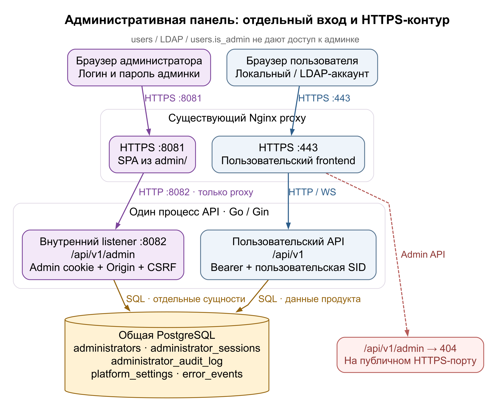

<a id="admin-authentication"></a>

## 8.2. Начальный администратор и сессии

Мастер получает статус через CLI и создаёт первого администратора после миграций, до запуска приложения. Возобновление установки сохраняет существующие аккаунты и пароли. Мастер предлагает логин `admin`, пароль вводится скрыто и не попадает в env.

Для ручной установки сначала выполните `compose exec -T api /app/meetspace-admin status` в контексте раздела 7.1. При ответе `"exists":false` и работающем API создайте первого администратора командой ниже. JSON передаётся в контейнер через stdin. Python читает пароль с управляющего терминала.

```bash
read -r -p 'Логин администратора: ' MS_ADMIN
python3 -c 'import getpass,json,sys
password=getpass.getpass("Пароль: ")
if password != getpass.getpass("Повторите пароль: "): sys.exit("Пароли различаются")
print(json.dumps({"username":sys.argv[1],"password":password}))' "$MS_ADMIN" |
  compose exec -T api /app/meetspace-admin bootstrap
```

Панель принимает логин и пароль. Контактный email администратора необязателен. Логин нормализуется в нижний регистр, содержит 3–40 символов и начинается с латинской буквы или цифры. После первого символа API допускает также `. @ + _ -`. Мастер создания и его команда локального сброса допускают из специальных символов только `. _ -`. Пароль — 8–128 символов Unicode и максимум 512 байт UTF-8. В БД хранится хеш Argon2id.

Сессия действует 12 часов. Сервер сохраняет SHA-256 от случайного токена (32 байта) и выставляет cookie `__Secure-meetspace_admin_session` с `Secure`, `HttpOnly`, `SameSite=Strict` и `Path=/api/v1/admin`. На входе нужны точный `Origin` панели и JSON. После входа изменяющие запросы дополнительно передают `X-CSRF-Token`, выданный для сессии. Запросы с `Sec-Fetch-Site: cross-site` отклоняются. За 15 минут допускается до 10 попыток на логин и до 30 на IP.

Для стандартной установки мастер предоставляет `sudo /opt/meetspace/manage.sh reset-admin-password`. Для ручной установки или логина с `@`/`+` используйте тот же защищённый ввод JSON, заменив `bootstrap` на `reset-password`. Смена пароля, блокировка и удаление администратора отзывают его сессии. Восстановление административного пароля по email не предусмотрено.

<a id="admin-sections"></a>

## 8.3. Доступные операции и журналы

| Раздел | Что доступно | Ограничение |
|---|---|---|
| Главная, Система | Счётчики пользователей, конференций и записей, служебные состояния и проверки зависимостей | По инциденту сверьте состояние с readiness и журналами сервисов |
| Пользователи | Серверный поиск, фильтры, блокировка и восстановление доступа | Блокировка отзывает сессии и закрывает операции аккаунта, сохраняя встречи и переписку. Для LDAP отдельно учитывается отключение каталогом |
| Администраторы | Создание, редактирование, смена пароля, блокировка и удаление | Запрещено удалить или заблокировать себя либо последнего активного администратора. Отдельных уровней ролей внутри панели нет |
| Конференции | Просмотр встреч, организаторов, участников и состояний | Раздел предназначен для чтения |
| Чаты, Файлы | Статистика личных, групповых и конференционных чатов, метаданные и объём объектов | Содержимое личной переписки скрыто. Размеры берутся из метаданных приложения |
| Записи | Фильтры, состояния, длительность, размер, допустимое удаление | Сначала завершите активную запись |
| Настройки | Лимиты, политика хранения, SMTP, подтверждение email и корпоративный каталог | Требуется актуальная ревизия конфигурации |
| Журнал аудита | Администратор, время, действие, объект, IP и разрешённые метаданные | `administrator_audit_log` защищён от UPDATE, DELETE и TRUNCATE. По изменениям настроек сохраняются имена полей |
| Ошибки | Группировка и просмотр технических сбоев приложений, браузерной телеметрии | Системные журналы Docker и ОС здесь не импортируются. Приём публичных событий зависит от `CLIENT_TELEMETRY_ENABLED` |

Журнал ошибок хранит группы до 14 дней от первого события, максимум 20 000 групп. Повтор увеличивает счётчик и обновляет время последнего события. При превышении лимита первыми удаляются группы с самым давним последним событием.

Разблокировка даёт пользователю возможность снова войти при выполнении остальных условий доступа. Она не возобновляет ранее отозванные сессии. Контракты административного API, включая операции с каталогом, приведены в [разделе 4.16](#api-admin).

<a id="admin-runtime-settings"></a>

## 8.4. Лимиты и отправка писем

Панель хранит переопределения в `platform_settings`. Ревизия защищает от потери параллельных изменений. При ответе 409 загрузите актуальные настройки и повторно сверьте свой черновик. Журнал аудита фиксируется в той же транзакции. Доступные диапазоны включают 1024 байта–100 МиБ на вложение, 1–100 участников, 1–10 000 комнат и 1–3650 дней хранения записей. Уменьшение лимитов не удаляет существующие вложения и не отключает участников. Медиасервер перечитывает ограничения примерно каждые пять секунд и применяет их при создании комнаты и новых подключениях. Увеличение срока хранения применяется к сохранившимся записям.

Чтобы настроить исходящую почту, откройте настройки панели.

1. Заполните SMTP host без схемы и порта, отдельный порт, логин, пароль и допустимый адрес отправителя. Обычно используют TLS на 465 или обязательный STARTTLS на 587. При настройке мастером убедитесь, что сервер поддерживает AUTH PLAIN поверх TLS.
2. Сохраните включённый SMTP. API и product-worker должны иметь одинаковый `PROVIDER_TOKEN_ENCRYPTION_KEY` для расшифровки сохранённого пароля. Пустое поле пароля при повторном сохранении оставляет действующее значение.
3. При необходимости отдельно включите «Подтверждение email» после сохранения рабочей конфигурации SMTP. Подтвердите получение письма и открытие одноразовой ссылки. Для нового локального пользователя срок подтверждения email — 24 часа. Для восстановления локального пароля — один час.
4. Для отключения сначала снимите требование подтверждения email, сохраните его и затем выключите SMTP в панели. Прямое изменение `EMAIL_PROVIDER_MODE=noop` действует только как исходное значение, если БД не переопределяет соответствующую настройку.

Пользовательские уведомления в интерфейсе доступны и без отправки писем. При проблемах доставки проверьте `product-worker`, состояние фонового задания, TLS и фактическое получение письма на адрес проверки.

<a id="ldap-directory"></a>

# 9. LDAP и Active Directory

<a id="ldap-configuration"></a>

## 9.1. Подключение каталога

В «Настройки → LDAP / Active Directory» администратор выбирает один из двух источников зарегистрированных аккаунтов — «Локальные аккаунты» или «Только LDAP». Приложение использует каталог для проверки пароля, сверки принадлежности разрешённой группе и обновления профилей. Права отдельной административной панели выдаются независимо. Настройте сетевой доступ от API и product-worker к каталогу.

| Параметр | Как заполнить |
|---|---|
| URL и TLS | `ldaps://directory.example.invalid:636` или `ldap://directory.example.invalid:389` с обязательным StartTLS. URL содержит имя и, при необходимости, порт. Минимальная версия TLS 1.2. Проверяются имя сервера и цепочка CA |
| Корпоративный CA | Вставьте PEM-содержимое сертификата CA, максимум 64 КиБ. Оно дополняет системный набор доверенных сертификатов |
| Base DN, Users DN, Group DN | Укажите общий корень, поддерево поиска пользователей и точный DN разрешённой группы. Оба последних DN должны совпадать с базой или находиться ниже неё |
| Bind DN и пароль | Служебной записи нужны права чтения пользователей, членства и запрошенных атрибутов. Она может находиться в другой ветке. Пароль сохраняется в `platform_settings.ldap_bind_password_ciphertext` с AES-256-GCM и отдельной аутентифицированной привязкой. В браузер возвращается только признак его наличия |
| Синхронизация и тайм-аут | Период 5–1440 мин, по умолчанию 60. Тайм-аут операции LDAP 2–60 с, по умолчанию 10. У фонового задания также есть общий предел времени |

Предустановки в интерфейсе задают начальные значения, которые можно адаптировать к схеме организации.

| Назначение | Active Directory (`ad`) | Обычный LDAP и LLDAP (`generic`) |
|---|---|---|
| Фильтр | `(&(objectClass=user)(!(objectClass=computer)))` | `(objectClass=person)` |
| Логин каталога / постоянный ID | `sAMAccountName` / `objectGUID` | `uid` / `entryUUID` |
| Имя и email | `displayName`, `mail` | `cn`, `mail` |
| Членство | `memberOf`, при включённых вложенных группах правило `1.2.840.113556.1.4.1941` | `memberOf` с поддержкой поиска по атрибуту членства. Вложенные группы в этом режиме отключены |

Сначала сохраните конфигурацию и нажмите «Проверить подключение». Проверка доступна и при отключённом корпоративном входе. Она выполняет TLS, bind, проверяет области пользователей и группы, затем запрашивает первую страницу до 500 записей. Нулевой результат может означать верный, но пустой фильтр. Перед полной синхронизацией подтвердите его содержимое. Пустой полный снимок отключает ранее связанные LDAP-аккаунты.

<a id="ldap-login-and-revocation"></a>

## 9.2. Вход, профиль и отзыв доступа

При корпоративном режиме общая форма принимает email и пароль. Служебная запись ищет одного пользователя по настроенному почтовому атрибуту. Клиент проверяет обязательные атрибуты, состояние записи AD и членство в разрешённой группе, затем выполняет bind с DN пользователя и введённым паролем. После успешного bind API создаёт или обновляет локальный профиль и выдаёт обычную сессию с SID. Для совместимости доступен отдельный вход по логину каталога. Подробности — в [разделе 4.2](#api-auth).

Постоянный внешний ID связан с UUID пользователя в `ldap_identities`. Изменение email или логина при сохранённом ID оставляет встречи и сообщения за тем же UUID. Конфликт с уже занятым email требует вмешательства администратора. Каталог управляет именем, email, паролем и членством. Загруженный аватар хранится в PostgreSQL в `user_avatars.data`, его версия — в `users.avatar_version`, текст «О себе» до 1000 символов — в `users.bio`. Синхронизация сохраняет эти поля.

| Событие | Что происходит с доступом |
|---|---|
| Каталог недоступен | Новый корпоративный вход и новая синхронизация завершаются ошибкой. Обычные запросы уже вошедшего пользователя проверяют локальную сессию и признаки состояния аккаунта, без сетевого запроса в LDAP |
| Смена источника аккаунтов | Отзываются сессии и старые токены зарегистрированных пользователей обоих источников. Гостевые и административные сессии сохраняются. Повторное переключение не оживляет отозванную сессию |
| Изменение параметров безопасности LDAP без смены режима | Отзываются корпоративные сессии и токены. Изменение только периода синхронизации или тайм-аута такого эффекта не даёт |
| Выход из группы, отключение или истечение учётной записи AD | Новый вход проверяет состояние сразу. Успешный полный снимок отключает соответствующее LDAP-представление в MeetSpace и отзывает уже выданные сессии |
| Блокировка оператором MeetSpace | Действует независимо от каталога. Повторное появление записи в LDAP с тем же ID сохраняет прежний UUID, но не снимает административную блокировку |

В корпоративном режиме локальная регистрация и восстановление пароля через MeetSpace отключены. Для смены корпоративного пароля пользователь обращается в свою организацию.

<a id="ldap-synchronization"></a>

## 9.3. Полный снимок и проверка результата

При переходе на «Только LDAP» предупредите пользователей о повторном входе. Сохраните настройки, запустите «Синхронизировать сейчас» и дождитесь конечного статуса. Ручной запуск требует включённого каталога и текущей ревизии сохранённых настроек. Ответ о постановке в очередь сам по себе не подтверждает обновление профилей.

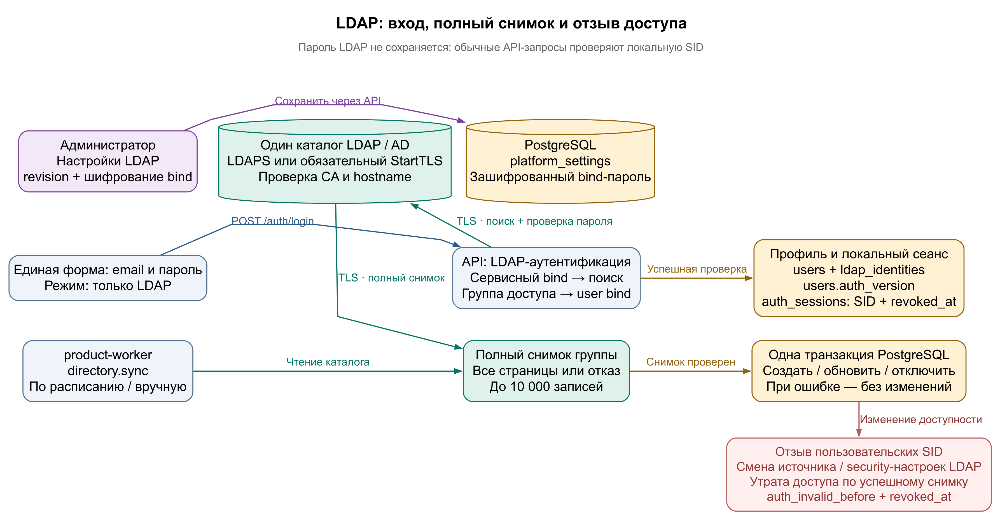

Планировщик product-worker раз в 15 с проверяет срок следующей синхронизации. Задание `directory.sync` живёт в `background_jobs`, допускает до трёх попыток и выполняется не более двух минут за попытку. Ограничение очереди предотвращает появление второго одновременного задания. Чтение идёт страницами по 500 записей, максимум 10 000 пользователей. Клиент отклоняет неполный обход, referrals, повтор курсора, дубли идентификаторов, логинов и email, а также отсутствие обязательных атрибутов. Для AD учитываются `userAccountControl` и `accountExpires`.

Только после полного обхода одна транзакция PostgreSQL применяет снимок, отключает отсутствующих, сверяет ревизию и право worker на фиксацию. Ошибка чтения либо конфликт откатывает применение. При повторном появлении пользователя возвращается прежний аккаунт и требуется новый вход, если прежние сессии были отозваны. Сводка запуска в панели показывает состояние, время последнего успеха и количества добавленных, обновлённых и отключённых профилей. Описание таблиц приведено в главе 5.

<a id="ldap-diagnostics"></a>

## 9.4. Диагностика и тестовый каталог

| Признак | Проверка |
|---|---|
| TLS, timeout, `directory_unavailable` | Разрешение имени и маршрут от API и product-worker, порт, SAN сертификата, срок и цепочка CA. Затем bind DN, пароль, права чтения и общий ключ шифрования |
| Ноль пользователей или отказ членства | Users DN, пользовательский фильтр, точный Group DN, значение `memberOf` на записи и поддержка вложенных групп выбранным каталогом |
| `directory_incomplete_scan` или `directory_conflict` | Управление страницами, referrals, значения обязательных атрибутов, лимит снимка, дубликаты и конфликт email с локальным аккаунтом |
| Задание в очереди или устарела ревизия | Готовность product-worker и состояние `background_jobs`. После чужого изменения настроек обновите форму, повторите проверку и запросите статус |

Для репетиции есть изолированный LLDAP v0.6.3. В `tools/ldap-dev` выполните `python3 setup.py`. Для backend на хосте адрес `ldaps://127.0.0.1:6360`, для подключённых к тестовой сети контейнеров — `ldaps://ldap:6360`. Добавьте `docker-compose.ldap-dev.yml` к локальному Compose-контексту API и product-worker и вставьте в настройки PEM тестового CA. Стенд проверяет режим `generic`. Семантику `objectGUID`, вложенных групп, блокировок и истечения аккаунтов следует проверить отдельно в целевом домене Windows AD.

<a id="verification"></a>

# 10. Источники и границы проверки

Редакция сверена с веткой `main` репозитория MeetSpace по коммиту `adf101fd6595aff4818f61b266b28175bb8311d2`. Для другой поставки проверьте SHA исходного кода, манифест образов и историю миграций. Настройки конкретного сервера могут переопределять значения из примеров. [Исходный код проверенной редакции](https://github.com/janickiy/meet-space/tree/adf101fd6595aff4818f61b266b28175bb8311d2).

| Что проверено | Как воспроизвести или уточнить |
|---|---|
| Публичные и административные методы | `internal/app/api.go` связывает регистраторы маршрутов с обработчиками. Административный маршрутизатор создаётся отдельно. События комнаты и пользователя определены в `internal/transport/websocket/` и прикладных сервисах. |
| Медиасвязь и запись | `frontend/src/media.ts`, `internal/usecase/media/`, `internal/infrastructure/sfu/`, `internal/usecase/recorder/` и `internal/infrastructure/composite/`. Параметры входа проверяют конфигурация и обработчик, формат результата — FFmpeg и ffprobe. |
| Миграции | Мигратор этого коммита выполнен на отдельной чистой базе PostgreSQL 14.13. Словарь главы 5 сопоставлен с системным каталогом, включая столбцы, ключи и ограничения. В поставке используется PostgreSQL 16. |
| Установка и управление | `install.sh`, `scripts/install/`, `scripts/release/`, workflow `.github/workflows/server-images.yml`, производственные файлы Compose и шаблоны Nginx. Порядок приёмки конкретного сервера приведён в главах 6–9. |
| Аккаунты и каталог | `admin/src/`, `internal/usecase/admin/`, `internal/usecase/auth/`, `internal/usecase/directory/`, `internal/infrastructure/ldap/` и репозитории PostgreSQL определяют доступ, применение настроек и отзыв сессий. |

Результаты документальной и локальной технической проверки зафиксированы в отчёте аудита. Доставку почты, соединение через TURN из внешней сети, восстановление резервной копии и работу с промышленным контроллером домена проверяют на целевом окружении.

<a id="support"></a>

# 11. Техническая поддержка

Сообщения об ошибках и вопросы установки можно направить автору проекта. [Email](mailto:janickiy@mail.ru) · [Telegram](https://t.me/janickiy) · [Репозиторий MeetSpace](https://github.com/janickiy/meet-space).

Укажите версию и commit, архитектуру, способ установки, время сбоя с часовым поясом и шаги воспроизведения. Приложите ожидаемый и фактический результат, состояние нужного сервиса и короткий фрагмент журнала рядом с ошибкой.

| Сценарий | Что поможет локализовать проблему |
|---|---|
| Вход или LDAP | Источник аккаунтов, ревизия настроек, время и статус последней проверки или синхронизации. Для административного входа укажите порт и HTTP-статус. |
| Встреча или звонок | Версия браузера, число участников, состояние WebSocket и ICE, тип выбранного кандидата и результат проверки из второй сети. |
| Запись | Идентификатор, режим, состояние и причина остановки, наличие локальных сегментов, свободное место на диске. |
| Обновление или установка | Версия установщика и пакета, платформа, шаг сбоя и краткий вывод без значений секретов. |

Перед отправкой удалите из фрагментов журналов пароли, токены, Cookie, приватные ключи, подписанные URL и персональные данные.
