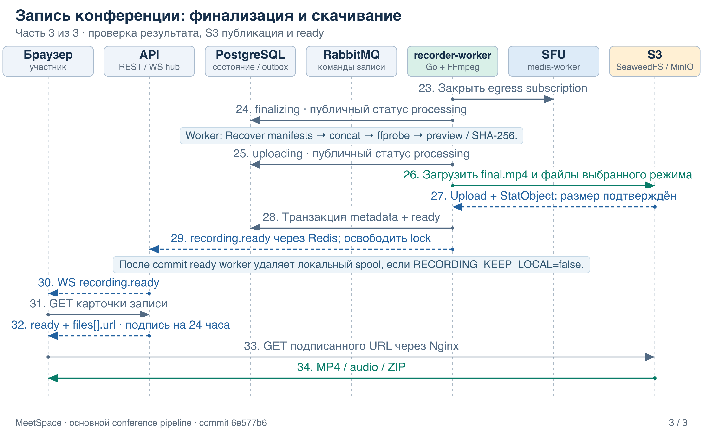
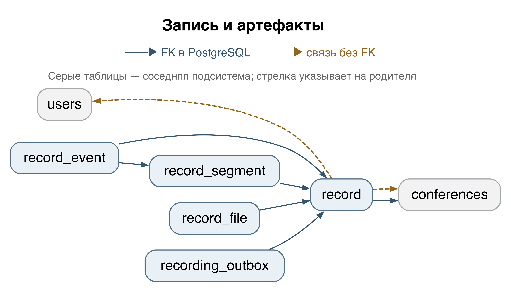
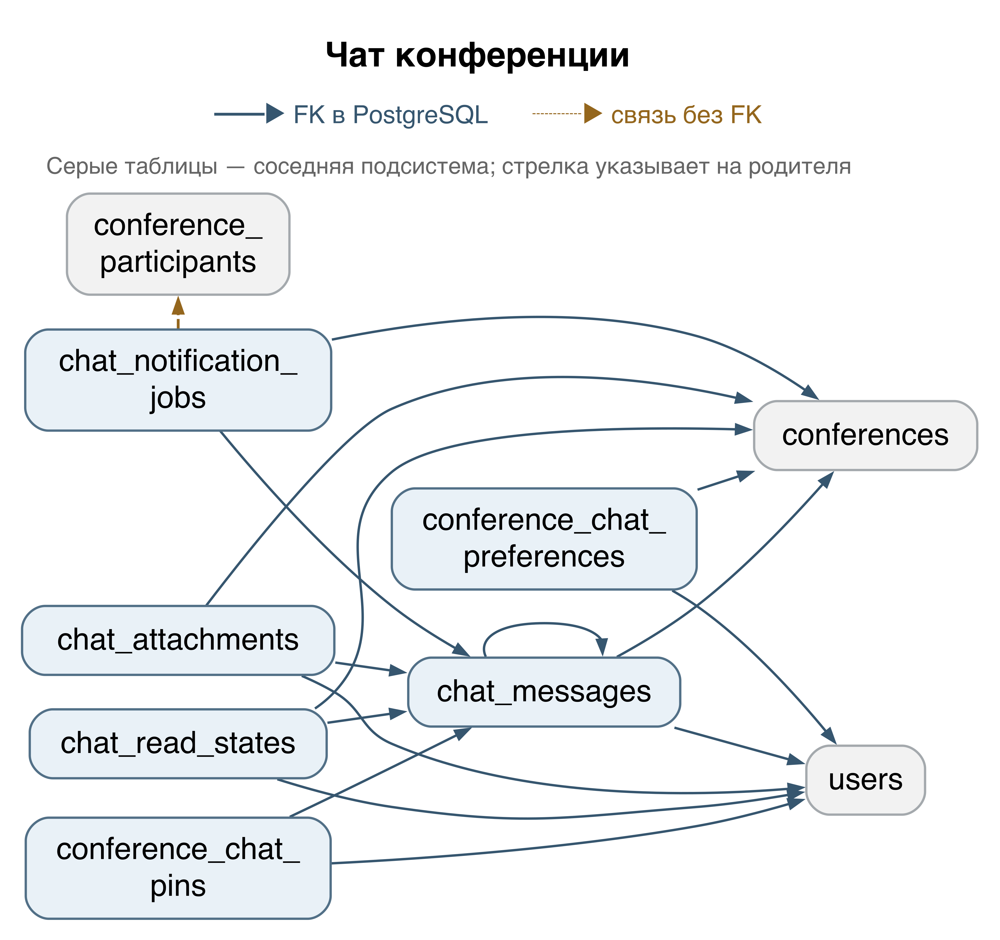
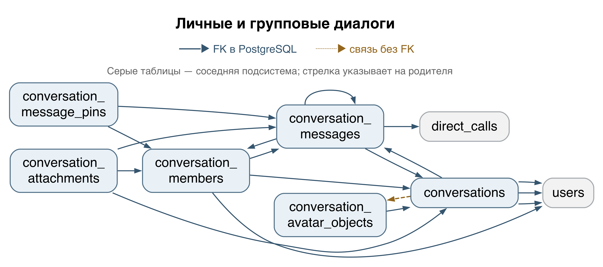
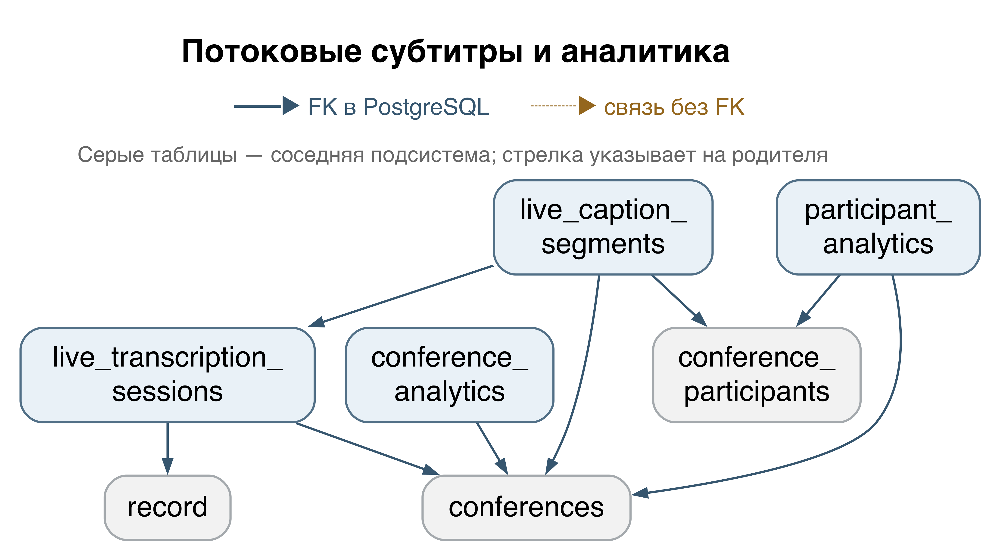
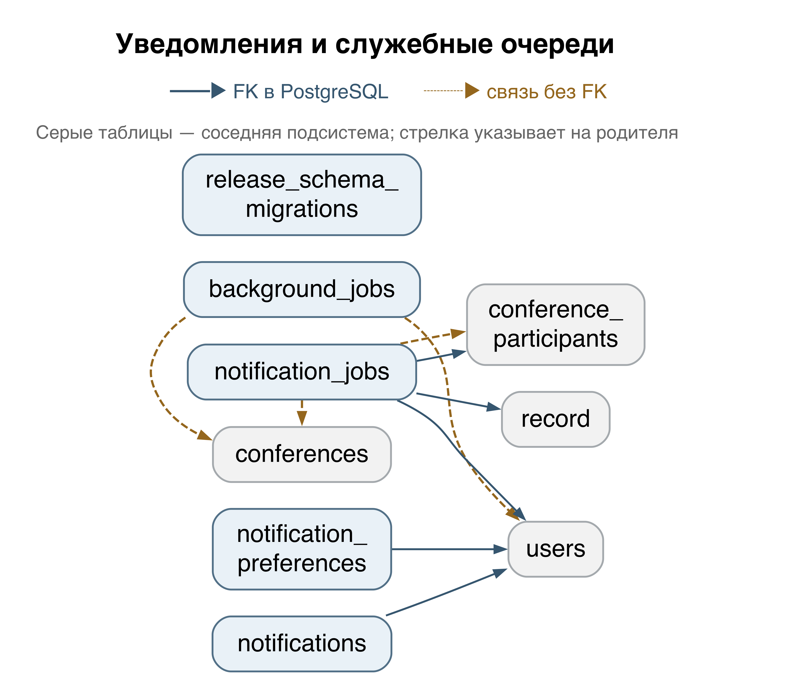

# MeetSpace — техническая документация

**Архитектура, запись видеопотока, API, база данных и ручная установка**

Репозиторий: [github.com/janickiy/meet-space](https://github.com/janickiy/meet-space)  
Ветка: `main`  
Commit: `6e577b6cced4e34d1c031353fbb9055909055185`  
Дата проверки: **20 октября 2026 г.**

## Содержание

  - [Об этом документе](#section-001)
- [1. Назначение и структура проекта](#section-002)
  - [1.1. Что представляет собой MeetSpace](#section-003)
  - [1.2. Карта исходного кода](#section-004)
- [2. Архитектура и роли компонентов](#section-005)
  - [2.1. Процессы и границы ответственности](#section-006)
  - [2.2. Три независимых канала](#section-007)
  - [2.3. Local, classic production и текущий installer](#section-008)
  - [2.4. Spool и S3 — разные уровни хранения](#section-009)
- [3. Запись видеопотока из браузера](#section-010)
  - [3.1. Подключение и получение медиадорожек](#section-011)
  - [3.2. Запуск записи и права](#section-012)
  - [3.3. Команда, аренда и egress](#section-013)
  - [3.4. Формирование локальных сегментов и режимы](#section-014)
  - [3.5. Остановка, финализация и upload](#section-015)
  - [3.6. Состояния без скрытых переходов](#section-016)
  - [3.7. Ошибки, повторы и границы восстановления](#section-017)
  - [3.8. Проверяемые HTTP примеры](#section-018)
  - [3.9. Что осталось от legacy recorder](#section-019)
  - [3.10. Существенные расхождения README с кодом](#section-020)
- [4. API и протоколы реального времени](#section-021)
  - [4.1. Общие соглашения и доступ](#section-022)
  - [4.2. Аутентификация и аккаунты](#section-023)
  - [4.3. Конференции, участники и приглашения](#section-024)
  - [4.4. Записи конференций](#section-025)
  - [4.5. Сообщения и вложения конференций](#section-026)
  - [4.6. Действия с чатом конференции](#section-027)
  - [4.7. Личные диалоги и группы](#section-028)
  - [4.8. Сообщения и вложения личных/групповых диалогов](#section-029)
  - [4.9. Поиск в диалогах и защищенные файлы групп](#section-030)
  - [4.10. Папки пользователя](#section-031)
  - [4.11. Личные звонки](#section-032)
  - [4.12. Транскрипции, summary и поиск](#section-033)
  - [4.13. Живые субтитры, аналитика и реакции](#section-034)
  - [4.14. Уведомления и SSE](#section-035)
  - [4.15. Календарь и каналы доставки](#section-036)
  - [4.16. Возможности, администрирование и telemetry](#section-037)
  - [4.17. WebSocket: HTTP подключение и ICE](#section-038)
  - [4.18. Внутренний mediaworker](#section-039)
  - [4.19. Health, readiness, metrics и drain](#section-040)
  - [4.20. Внутренний recorder-worker](#section-041)
  - [4.21. Профилирование: отдельный loopback listener](#section-042)
  - [4.22. Основные структуры ответа](#section-043)
  - [4.23. SSE уведомлений](#section-044)
  - [4.24. Общие правила внутренних media API](#section-045)
  - [4.25. Протокол WebSocket конференции](#section-046)
  - [4.26. Глобальный WebSocket пользователя](#section-047)
  - [4.27. Границы legacy recorder API](#section-048)
  - [4.28. Контроль полноты и особенности регистрации](#section-049)
- [5. База данных](#section-050)
  - [5.1. Проверка полноты и миграционный механизм](#section-051)
  - [5.2. Как читать словарь и ER-схемы](#section-052)
  - [5.3. users](#section-053)
  - [5.4. auth_sessions](#section-054)
  - [5.5. auth_session_tokens](#section-055)
  - [5.6. auth_legacy_tokens](#section-056)
  - [5.7. conferences](#section-057)
  - [5.8. conference_participants](#section-058)
  - [5.9. participant_sessions](#section-059)
  - [5.10. conference_moderation_audit](#section-060)
  - [5.11. conference_invitations](#section-061)
  - [5.12. record](#section-062)
  - [5.13. record_segment](#section-063)
  - [5.14. record_file](#section-064)
  - [5.15. record_event](#section-065)
  - [5.16. recording_outbox](#section-066)
  - [5.17. chat_messages](#section-067)
  - [5.18. chat_read_states](#section-068)
  - [5.19. chat_attachments](#section-069)
  - [5.20. conference_chat_preferences](#section-070)
  - [5.21. conference_chat_pins](#section-071)
  - [5.22. chat_notification_jobs](#section-072)
  - [5.23. conversations](#section-073)
  - [5.24. conversation_members](#section-074)
  - [5.25. conversation_messages](#section-075)
  - [5.26. conversation_attachments](#section-076)
  - [5.27. conversation_avatar_objects](#section-077)
  - [5.28. conversation_message_pins](#section-078)
  - [5.29. direct_calls](#section-079)
  - [5.30. direct_call_slots](#section-080)
  - [5.31. folders](#section-081)
  - [5.32. folder_conversations](#section-082)
  - [5.33. folder_conferences](#section-083)
  - [5.34. transcripts](#section-084)
  - [5.35. transcript_segments](#section-085)
  - [5.36. meeting_summaries](#section-086)
  - [5.37. content_search_indexes](#section-087)
  - [5.38. content_embeddings](#section-088)
  - [5.39. embedding_cache](#section-089)
  - [5.40. live_transcription_sessions](#section-090)
  - [5.41. live_caption_segments](#section-091)
  - [5.42. participant_analytics](#section-092)
  - [5.43. conference_analytics](#section-093)
  - [5.44. notifications](#section-094)
  - [5.45. notification_jobs](#section-095)
  - [5.46. notification_preferences](#section-096)
  - [5.47. background_jobs](#section-097)
  - [5.48. release_schema_migrations](#section-098)
  - [5.49. push_devices](#section-099)
  - [5.50. calendar_connections](#section-100)
  - [5.51. calendar_oauth_states](#section-101)
  - [5.52. calendar_event_mappings](#section-102)
  - [5.53. integration_deliveries](#section-103)
  - [5.54. JSONB-контракты](#section-104)
  - [5.55. Функции, триггеры и последовательности](#section-105)
  - [5.56. Изменения схемы, которые нельзя потерять при чтении миграций](#section-106)
- [6. Ручная установка через Docker Compose](#section-107)
  - [6.1. Выбранный вариант и требования](#section-108)
  - [6.2. Получение исходников и запуск](#section-109)
  - [6.3. Конфигурация и каталоги](#section-110)
  - [6.4. Что выполняется при подготовке и запуске](#section-111)
  - [6.5. Домен, HTTPS и TURN](#section-112)
  - [6.6. Сетевые порты](#section-113)
  - [6.7. Проверка после установки](#section-114)
- [7. Эксплуатация и диагностика](#section-115)
  - [7.1. Наблюдение и конфигурация](#section-116)
  - [7.2. Безопасная остановка и перезапуск](#section-117)
  - [7.3. Диск, файлы и резервные копии](#section-118)
  - [7.4. Диагностика по симптому](#section-119)
- [8. Источники и границы проверки](#section-120)
  - [8.1. Основные источники](#section-121)
  - [8.2. Что проверено и что требует проверки на сервере](#section-122)
- [9. Поддержка и индивидуальная разработка](#section-123)
  - [Техническая поддержка](#section-124)
  - [Индивидуальная доработка MeetSpace](#section-125)
  - [Контакты](#section-126)

<a id="section-001"></a>

## Об этом документе

Документ составлен по локальному исходному коду указанного коммита. Секреты и данные удалённого сервера не использовались. Приложение на production в рамках этой работы не запускалось и не проверялось.

Проверены регистрации маршрутов, обработчики, middleware, миграции, модели, запросы, конфигурация Compose и установочные скрипты. Базовые SQL-миграции дополнительно выполнены в отдельном временном PostgreSQL 14.13; deployment использует PostgreSQL 16. Ветка pgvector проверена структурно без настоящего расширения. Эти ограничения подробно указаны в разделах 5 и 8.

Материалы комплекта: этот PDF; редактируемый Markdown; отрисованные схемы и их DOT/Mermaid-исходники; машинные каталоги API и схемы БД. Технические пути в тексте относятся к корню репозитория, если не указано иное. Редкие символы emoji в PDF представлены кодами Unicode вида U+1F602; исходные символы сохранены в Markdown.

<a id="section-002"></a>

# 1. Назначение и структура проекта

<a id="section-003"></a>

## 1.1. Что представляет собой MeetSpace

MeetSpace — приложение для видеоконференций с браузерным интерфейсом, комнатами и участниками, камерой, микрофоном, демонстрацией экрана, чатами и серверной записью встреч. Дополнительные процессы обслуживают уведомления, интеграции, распознавание речи, субтитры, сводки и поиск. Название каталога `go-recorder` отражает происхождение проекта, но текущий продукт существенно шире отдельного REST API записи.

Описание проверено по исходному коду коммита `6e577b6cced4e34d1c031353fbb9055909055185` от состояния репозитория на 20 октября 2026 года. Оно описывает реализованное поведение и конфигурацию, а не подтверждает состояние внешнего сервера. Production не опрашивался.

Текущий интерфейс запускает общую запись конференции через `/api/v1/conferences/{id}/recordings`. Эта запись получает медиадорожки от SFU и формирует результат на сервере. Браузер не создаёт итоговый MP4 посредством `MediaRecorder` и не отправляет видеофайл в RabbitMQ. Сохранившийся отдельный WebRTC ingest recorder-worker относится к прежнему, legacy пути и не является путём кнопки «Начать запись» в текущем UI.

Источник: `frontend/src/components/RecordingPanel.tsx`, `frontend/src/api.ts`, `frontend/src/media.ts`, `internal/app/api.go`, `internal/app/worker.go`.

<a id="section-004"></a>

## 1.2. Карта исходного кода

| Путь | Назначение | Ключевые файлы |
|---|---|---|
| `cmd/api/main.go` | Точка запуска HTTP API: `app.RunAPI()`  `main.go` → `internal/app/api.go` |
| `cmd/worker/main.go` | Точка запуска Go recorder-worker: `app.RunWorker()`  `main.go` → `internal/app/worker.go` |
| `cmd/media-worker/main.go` | Отдельный процесс SFU: `app.RunMediaWorker()`  `main.go` → `internal/app/media_worker.go` |
| `cmd/product-worker/main.go` | Фоновые продуктовые задания: `app.RunProductWorker()`  `main.go` → `internal/app/product.go` |
| `cmd/live-worker/main.go` | Обработка живых субтитров: `app.RunLiveWorker()`  `main.go` → `internal/app/live.go` |
| `cmd/main/main.go` | Совместимый общий CLI с командами `serve`, `api`, `worker`, `migrate`, `version`  `main.go` |
| `internal/app/` | Сборка зависимостей процессов; HTTP handlers по областям продукта  `api.go`, `worker.go`, `operations.go` |
| `internal/domain/` | Доменные типы, статусы, DTO и ошибки; `records`, `media`, `conferences`, `captions` и другие области  `records/models.go`, `records/conference.go` |
| `internal/usecase/recordings/` | Пользовательский сценарий записи конференции, проверенные обращения к repository, outbox dispatcher  `service.go`, `dispatcher.go` |
| `internal/usecase/recorder/` | Выполнение команд worker, composite capture, финализация, публикация артефактов, retention  `composite.go`, `composite_artifacts.go`, `retention.go` |
| `internal/usecase/media/` | Авторизованное управление SFU, выбор владельца комнаты, внутренний HTTP клиент  `controller.go`, `client.go` |
| `internal/infrastructure/sfu/` | Pion WebRTC, комнаты, peers, tracks, RTP/RTCP, политики и egress  `manager.go` |
| `internal/infrastructure/composite/` | Чтение egress, исходные дорожки, манифесты фрагментов, раскладка, композиция и ZIP  `capture.go`, `composer.go`, `layout.go`, `archive.go` |
| `internal/infrastructure/ffmpeg/` | Запуск FFmpeg/ffprobe, склейка и проверка результата; legacy сегментация, аудио для STT  `composite.go`, `postprocessor.go`, `segment_recorder.go` |
| `internal/infrastructure/webrtc/` | Legacy WebRTC ingest recorder-worker  `manager.go`, `shutdown.go` |
| `internal/infrastructure/postgres/` | Репозитории и транзакции; записи, файлы, сегменты, outbox, leases, удаление  `migrations.go` |
| `internal/infrastructure/redis/` | Registry SFU, realtime Pub/Sub, presence, locks и rate limit  `media.go`, `realtime.go`, `user_presence.go` |
| `internal/infrastructure/rabbitmq/` | Доставка двух команд записи, подтверждения, повторы и карантин  `commands.go` |
| `internal/infrastructure/storage/` | S3 клиент и безопасная очистка локальных каталогов  `local/cleanup.go` |
| `internal/transport/http/`, `websocket/`, `mediaworker/` | Регистрация маршрутов REST, WebSocket и внутреннего управления медиа  `router.go`, `conference_recording_routes.go` |
| `database/migrations/` | Версионированная схема PostgreSQL  `000001_create_record_table.up.sql` … `000035_*.up.sql` |
| `frontend/` | React, TypeScript, Vite; браузерный WebRTC клиент и UI  `src/media.ts`, `src/api.ts`, `src/components/RecordingPanel.tsx` |
| `dockers/`, `docker-compose*.yml` | Сборка образов, сеть, тома, reverse proxy, TURN, наблюдаемость  `docker-compose.yml`, `docker-compose.production.yml` (корень репозитория) |
| `install.sh`, `scripts/install/`, `scripts/release/` | Установка из исходников, упаковка, развертывание и управление выпуском  `scripts/install/from-source.py`, `scripts/install/wizard.py`, `scripts/release/build.sh` |
| `docs/` | Документация и инструкции, сверяемые с кодом | `INSTALLATION.md`, `API.md`, `media-sfu.md`, `direct-calls.md` |

Версии следует брать из manifest-файлов коммита: в `go.mod` указан Go `1.26.9`, Pion WebRTC v4, Gin, GORM/pgx, Redis client, AMQP client и MinIO Go SDK. Во frontend используются React `19.3.0`, TypeScript `7.0.2`, Vite `8.3.1`; Node ограничен полем `engines` в `frontend/package.json`. Эти сведения описывают зафиксированный проект, а не выбор последних доступных версий.

<a id="section-005"></a>

# 2. Архитектура и роли компонентов

<a id="section-006"></a>

## 2.1. Процессы и границы ответственности

Типовая топология — несколько контейнеров Docker Compose на одном Linux-хосте. Разделение процессов позволяет отдельно ограничивать CPU и память SFU, обработки записи и продуктовых задач. Наличие распределённых leases не означает, что готова автоматическая кластерная конфигурация с общим spool.

| Компонент | Реальное имя сервиса или модуля | Ответственность | Взаимодействие |
|---|---|---|---|
| Браузерный UI | `frontend` | Nginx раздаёт собранный React интерфейс | Браузер; API через same-origin proxy |
| Reverse proxy | `proxy` в production; `https` в local | Nginx завершает TLS, маршрутизирует UI, REST/WS и подписанное чтение объектов | Входящий HTTPS; `api`, `frontend`, `minio:9000` |
| API | `api` | Go + Gin; авторизация, REST, WebSocket hub, бизнес-операции, outbox dispatcher, retention | PostgreSQL, Redis, RabbitMQ publisher, S3, внутренний HTTP SFU |
| WebRTC / SFU | `media-worker` | Go SFU на Pion; принимает и пересылает медиадорожки участников; выдаёт recording/captions egress | WebRTC от браузеров; Redis registry/realtime; внутренний HTTP `8091` |
| Go recorder-worker | `worker` | **Go recorder-worker**, бинарник `/app/go-recorder-worker`; получает команды, арендует запись, читает SFU egress, управляет FFmpeg и публикует артефакты | RabbitMQ consumer, PostgreSQL, Redis, SFU HTTP egress, `/storage`, S3; служебный HTTP `8090` |
| Фоновые задания | `product-worker` | Go обработчик PostgreSQL background jobs: интеграции, уведомления, STT, AI, поиск/индексация и аналитические задачи | PostgreSQL, S3, провайдеры; FFmpeg для извлечения аудио; служебный HTTP `8092` |
| Живые субтитры | `live-worker` | Go worker живых субтитров; получает отдельный audio tap SFU и вызывает распознавание | PostgreSQL, Redis, SFU egress, FFmpeg и провайдер речи; HTTP `8093` |
| База данных | `postgres` | Долговременное состояние продукта, записи и их метаданные, outbox и фоновые задания | SQL от API и соответствующих workers |
| Координация и realtime | `redis` | Владение медиакомнатами и worker registry, realtime события, присутствие, rate limit, lock конференционной записи | API, SFU, recorder-worker, live-worker |
| Очередь команд | `rabbitmq` | Устойчивая очередь команд записи | API publisher → recorder-worker consumer |
| Объектное хранилище | `minio` | Имя S3 endpoint; конкретный сервер — **SeaweedFS в hardened установке** либо MinIO в classic/local | S3 API для артефактов; закрытое хранение объектов |
| TURN / STUN | `coturn` | TURN relay для соединений, которым требуется ретрансляция | Браузеры ↔ SFU через TURN; UDP/TCP/TLS |
| Миграции | `migrate` | Разовый процесс миграций; production profile `migration` | PostgreSQL |
| Наблюдаемость | `prometheus`, `grafana` | Опциональная наблюдаемость соответствующих overlays/profiles | Метрики и панели |
| Кодирование и композиция | `internal/infrastructure/composite/`, `ffmpeg/`; дочерние процессы FFmpeg/ffprobe внутри `worker` | Сборка H.264/AAC, проверка результата, preview | Локальные IVF/OGG → MP4/JPEG, чтение/запись `/storage` |
| Локальное хранилище | `worker:/storage`, `STORAGE_PATH` | Spool, исходные дорожки и промежуточные/итоговые файлы перед upload | Bind mount хоста; файлы capture и FFmpeg |

SFU не запускает FFmpeg и не записывает файлы в S3: его задача — транспорт, управление дорожками и выдача egress. API не проксирует RTP браузерных соединений. Recorder-worker — отдельный Go процесс; FFmpeg является запускаемым им дочерним процессом, а не самостоятельным сетевым сервисом Compose.

Источники: `internal/app/api.go`, `internal/app/worker.go`, `internal/app/media_worker.go`, `internal/app/product.go`, `internal/app/live.go`, `docker-compose.yml`, `docker-compose.production.yml`, `dockers/*/Dockerfile`.

**Схема 1. Архитектура.** Исходники: `architecture.dot`, `architecture.mmd`.


<a id="section-007"></a>

## 2.2. Три независимых канала

| Канал | Что передаётся | Транспорт и участники |
|---|---|---|
| Пользовательское управление и signaling | Start/stop/read, SDP, ICE, сведения о дорожках, состояния комнаты | HTTPS REST и WSS браузер ↔ API; API → SFU по авторизованному внутреннему HTTP |
| Доставка команды записи | Небольшой JSON `record.start` либо `record.stop` с UUID записи | PostgreSQL outbox → RabbitMQ → recorder-worker |
| Медиаданные | Закодированные камера/экран/аудио, затем фрагменты и финальные объекты | WebRTC браузер ↔ SFU; SFU → worker в длительном HTTP NDJSON egress; worker → локальные файлы/FFmpeg → S3 |

События `recording.starting`, `recording.started`, `recording.stopping`, `recording.processing`, `recording.ready`, `recording.failed` доходят до UI через realtime слой и Redis, затем WebSocket API. RabbitMQ в этой реализации не является шиной медиапакетов или каналом этих UI событий. Подтверждение AMQP команды также не подтверждает, что весь MP4 уже создан.

<a id="section-008"></a>

## 2.3. Local, classic production и текущий installer

Базовый `docker-compose.yml` предназначен для локального сценария: собирает образы из checkout, публикует отладочные порты, использует `app-network` и внешнюю gateway сеть. Сервис `minio` действительно запускает MinIO, собранный по `dockers/minio/Dockerfile`, и монтирует `./dockers/minio/data:/data`. Локальный recorder-worker монтирует `./dockers/storage/data:/storage`.

`docker-compose.production.yml` использует переданные неизменяемые image references, закрытую сеть `private`, отдельную миграцию, лимиты ресурсов и production окружение. Сам по себе этот файл всё ещё содержит классическое определение MinIO с томом `minio:/data`.

**Новая установка через текущие `install.sh` и `scripts/install/from-source.py` собирает выпуск `hardened-shared-host`.** Мастер `scripts/install/wizard.py` запускает следующую комбинацию: `docker-compose.production.yml` + `docker-compose.hardened.yml` + сгенерированный `config/compose.json` + сгенерированный `config/turn.yml`. Ветка выбора classic существует, но текущая сборка from-source выбирает hardened. Имя layout не означает, что standalone installer подмешивает `docker-compose.shared-host.yml`: у мастера собственный override.

Hardened overlay заменяет сервер сервиса `minio` на SeaweedFS (`dockers/object-storage/Dockerfile`, базовый SeaweedFS `4.48`) и том на `objects:/data`. Сохраняются адрес `minio:9000`, SDK MinIO и переменные `MINIO_*` для совместимости S3 клиента. Это не свидетельство запуска MinIO сервера. Старый MinIO volume несовместим с форматом SeaweedFS и автоматически не подключается. Подписанное чтение остаётся на общем HTTPS origin через Nginx.

Installer создаёт `<installation-root>/config/meetspace.env`, `<installation-root>/storage`, каталог сертификатов и служебные файлы. `RECORDER_STORAGE_DIR=<installation-root>/storage` монтируется в worker как `/storage`; каталог заранее принадлежит UID/GID `1000:1000`. TURN override включает `network_mode: host`, удаляет Compose `networks`/`ports` и задаёт `TURN_BIND_PUBLIC=true`. Поэтому при описании установленного сервера нельзя переносить локальные опубликованные порты/volumes из README без проверки выбранного layout.

Источники: `scripts/install/from-source.py`, `scripts/install/wizard.py:make_configuration`, `scripts/install/wizard.py:compose_args`, `docker-compose.hardened.yml`, `docker-compose.production.yml`, `dockers/object-storage/Dockerfile`.

<a id="section-009"></a>

## 2.4. Spool и S3 — разные уровни хранения

| Уровень | Где расположен | Содержимое и жизненный цикл |
|---|---|---|
| Локальный spool worker | `STORAGE_PATH`, обычно `/storage`; bind mount на хост | Исходные VP8/Opus fragments, манифесты, составленные MP4 segments, `concat.txt`, финальные файлы перед upload. Нужен во время записи и для восстановления финализации |
| Служебный legacy temp | `/storage/tmp/{recordId}/` | `input.sdp` для loopback RTP → FFmpeg; не используется как основная структура composite |
| S3-compatible bucket | Обычно bucket `recordings` в сервисе `minio` | Итоговый MP4/audio, preview, tracks ZIP; объектные данные SeaweedFS/MinIO находятся в отдельном volume |
| PostgreSQL | `record`, `record_file`, `record_segment`, `record_event`, `recording_outbox` | Состояние, права и связи, metadata файлов, sizes/checksums, события, команды; не сами видеобайты |

У API нет mount `/storage` в production Compose. SFU также не разделяет этот каталог. Резервная копия только PostgreSQL не содержит видео; копия только S3 не содержит прав доступа и связей записей. Spool важен для незавершённой записи, но готовые пользовательские скачивания читаются из S3.

<a id="section-010"></a>

# 3. Запись видеопотока из браузера

<a id="section-011"></a>

## 3.1. Подключение и получение медиадорожек

1. Авторизованный участник входит в конференцию. Frontend получает одноразовый WS ticket и открывает `/api/v1/conferences/{id}/ws?ticket=…`. Сигнальные команды используют `media.join`, `media.offer`, `media.answer`, `media.ready`, `media.ice`, `media.leave`, `media.unpublish` и связанные события.
2. `getUserMedia` получает микрофон и камеру; `getDisplayMedia` — демонстрацию экрана и доступное браузеру аудио экрана. Разрешение на устройства предоставляет сам браузер.
3. Браузер создаёт `RTCPeerConnection` с `bundlePolicy: "max-bundle"`; предусмотрены источники `microphone`, `camera`, `video/screen`, `audio/screen` и слоты приёма удалённых дорожек. Предпочтения кодеков: VP8 для видео, Opus для аудио.
4. API проверяет членство/сессию, через Redis registry назначает SFU владельцем комнаты и передаёт команды в `/internal/media/{action}`. Внутренние вызовы защищены `MEDIA_INTERNAL_SECRET`; привязка к участнику и владельцу комнаты подтверждается ticket/lease.
5. Медиапакеты идут от браузера непосредственно в SFU по WebRTC, при необходимости через TURN. API и RabbitMQ этот трафик не переносят. Pion SFU пересылает дорожки разрешённым участникам и параллельно может отдавать их recorder-worker.

Источники: `frontend/src/media.ts`, `frontend/src/realtime.ts`, `internal/transport/websocket/handler.go`, `internal/usecase/media/controller.go`, `internal/usecase/media/client.go`, `internal/infrastructure/sfu/manager.go`.

<a id="section-012"></a>

## 3.2. Запуск записи и права

В UI панель записи читает серверные capabilities и список записей, запрещает повторный клик и отправляет `POST /api/v1/conferences/{id}/recordings` с `{"mode":"composite","segmentDurationSec":5}`. Если mode пропущен, сервер использует `composite`; если длительность равна 0/пропущена, используется 5 секунд. Допустимый диапазон — 2–30 секунд.

| Действие | Фактическое требование backend |
|---|---|
| Начать запись | Действующий Bearer token; участник этой конференции `joined` и admitted; обычный зарегистрированный аккаунт; конференция `active`; нет записи в `starting`, `recording`, `degraded`, `stopping`, `finalizing`, `uploading` |
| Остановить | Обычный аккаунт, admitted членство `joined` **или `left`**; пользователь — инициатор `requestedBy` либо владелец конференции с ролью `owner` |
| Читать карточку/список и получить ссылки | Admitted членство `joined` или `left`; запись относится к этой конференции, не удалена и не истекла. Guest token допускается в рамках своей конференции |
| Удалить | Те же права владельца/инициатора, что для stop; запись terminal и нет действующей recorder lease |

Роль `co_host` сама по себе не даёт права остановить чужую запись. Обычный участник может начать запись: ограничение «только организатор» неверно. Участник `left` может остановить свою запись через API, хотя UI включает кнопку stop только для `joined`. Waiting/rejected/kicked доступ не получают. Гость не может начать/остановить/удалить запись, но чтение разрешается по членству, без проверки `requireRecordingAccount`.

В одной SQL транзакции создаются `record` со статусом `starting` и строка `recording_outbox`. Сохраняются mode, `source_type=conference`, `transport_type=sfu`, `platform_conference_id`, `requested_by`. Повторный start при активной записи возвращает `409`, а не создаёт вторую запись. HTTP `202 Accepted` сообщает принятие операции; финальный файл ещё отсутствует.

Источники: `internal/usecase/recordings/service.go`, `internal/infrastructure/postgres/conference_recording_repository.go`, `internal/domain/conferences/product.go`, `internal/transport/http/middleware/auth.go`, `frontend/src/components/RecordingPanel.tsx`.

<a id="section-013"></a>

## 3.3. Команда, аренда и egress

Outbox dispatcher API проверяет очередь каждые 250 мс, обрабатывает до 16 элементов за проход, захватывает элемент на 15 секунд и сохраняет порядок команд одной записи. Для start он получает Redis lock `record:conference:{conferenceId}:lock`, затем публикует persistent JSON в durable direct exchange `go-recorder.commands`, очередь `go-recorder.recording.commands`, routing key `record.commands`. После publisher confirm outbox отмечается опубликованным. Ошибка оставляет команду доступной для повтора с задержкой 1 секунда.

Примеры AMQP payload, не браузерных медиаданных:

```json
{"type":"record.start","recordId":"22222222-2222-4222-8222-222222222222","segmentDurationSec":5}
```

```json
{"type":"record.stop","recordId":"22222222-2222-4222-8222-222222222222","reason":"participant_requested"}
```

`WorkerService` читает запись из БД и направляет conference modes в `CompositeService`. Worker получает уникальный `recorder_token` и lease в PostgreSQL; переходы состояния и фиксация ready требуют текущий token и непросроченную lease. По умолчанию lease — 20 секунд, продление через четверть TTL. Отдельный reconcile раз в секунду подбирает активные записи; ограничение по умолчанию — две одновременно обрабатываемые записи на worker. ACK команды composite происходит после успешного запуска фоновой обработки, а не после завершения записи.

Worker запрашивает текущего владельца конференции в Redis и открывает `POST http://media-worker:8091/internal/media/egress` с UUID запроса, записи, конференции, route/lease и длительностью сегмента. SFU проверяет внутреннюю авторизацию, совпадение route/owner, допустимость request ID и состояние lease. Ответ — **`application/x-ndjson`**, последовательность JSON frames `hello`, `track`, `rtp`, `track.end`, `ping`, `error`. Поле `rtp` содержит сериализованный `[]byte`, то есть base64 внутри JSON. Это длительное HTTP соединение по внутренней сети, не RabbitMQ и не второй WebRTC peer recorder-worker.

У frames есть последовательный `sequence` и `capturedAt` в наносекундах. SFU отправляет heartbeat каждую секунду и запрашивает ключевые кадры с периодом сегмента. Recorder проверяет порядок, timestamp, размер строки, количество дорожек и общий объём. Поддерживаемые composite входы — VP8/90 kHz и Opus/48 kHz, до двух каналов аудио. При переполнении egress queue подписка завершается ошибкой; молчаливое пропускание пакетов для записи не предусмотрено.

Источники: `internal/usecase/recordings/dispatcher.go`, `internal/infrastructure/rabbitmq/commands.go`, `internal/usecase/recorder/composite.go`, `internal/infrastructure/postgres/composite_record_repository.go`, `internal/transport/mediaworker/control_egress.go`, `internal/domain/media/egress.go`.

**Схема 2. Передача и преобразование медиаданных.** Исходники: `media-flow.dot`, `media-flow.mmd`.


<a id="section-014"></a>

## 3.4. Формирование локальных сегментов и режимы

После `hello` composer вызывает `OnStarted`: `starting → recording`, выставляется `started_at`, публикуется `recording.started`. Важная деталь: код не ждёт первого RTP. При существующем owner комнаты возможны сегменты с фоновым изображением и тишиной; если media owner ещё не существует, получение egress завершится ошибкой. Подсказка UI «Для начала нужен медиапоток участника» не является точным описанием триггера `recording`.

RTP депакетизируется, учитываются порядок/задержки и ключевые кадры. Для каждого окна сохраняются исходные дорожки, затем атомарно переименовывается JSON manifest. FFmpeg композитора делает готовый сегмент и переименовывает `.partial.mp4` в окончательное имя. Очередь композиции ограничена четырьмя chunks; при отставании формируется ошибка с сохранением записанных chunks.

```text
/storage/records/{recordId}/
  sources/000000_{trackId}.ivf      # видео VP8
  sources/000000_{trackId}.ogg      # аудио Opus
  chunk_000000.json                # временная шкала, источники, offset/end, layout
  segment_000000.mp4               # готовый сегмент H.264/AAC либо audio-only AAC
  segment_000001.mp4
  concat.txt
  final.mp4
  preview.jpg                     # только режимы с итоговым видео
```

| Mode | Результат и правила |
|---|---|
| `composite` | MP4 H.264 + смешанное AAC аудио и JPEG preview. Камеры располагаются сеткой; при экране основной экран занимает всё поле либо 3/4 ширины с камерами сбоку |
| `screen_focus` | Такой же видеоформат; при активной демонстрации выбранный экран занимает весь кадр. Без экрана используется обычная раскладка камер |
| `audio_only` | Только смешанное аудио AAC в контейнере MP4, fileType `final_audio`, MIME `audio/mp4`; файл всё равно называется `final.mp4`; без JPEG |
| `individual_tracks` | Основной результат — такой же аудио MP4; дополнительно `tracks.zip` с исходными фрагментами дорожек `.ivf`/`.ogg` и `manifest.json`, где указаны участник, источник, track instance и интервалы. Это не набор отдельных готовых MP4 на каждого участника |
| `legacy` | Другой pipeline прямого WebRTC ingest; не допустимый mode публичного conference start |

По умолчанию видео 1280×720, 30 fps, `libx264`, preset `veryfast`, CRF 23, `yuv420p`; аудио AAC 128 kbit/s, 48 kHz, stereo. FFmpeg scale/pad/overlay размещает изображение, а `amix` и limiter смешивают аудио; silent source обеспечивает аудиопоток даже без микрофонов. Раскладка детерминирована по participant/track IDs и не повторяет DOM браузерной сетки или выбор активного спикера.

Настройки находятся в `internal/config/composite.go`: `RECORDING_WIDTH`, `RECORDING_HEIGHT`, `RECORDING_FPS`, `RECORDING_FFMPEG_CONCURRENCY` (по умолчанию 1), `RECORDING_MAX_ACTIVE` (2), `RECORDING_MAX_MIB` (10240), `RECORDING_MAX_DURATION` (4h), lease/poll interval, `RECORDING_KEEP_LOCAL` (false). Ограничение объёма в capture считает полученные RTP bytes; оно не является общей файловой квотой spool со всеми перекодированными копиями. FFmpeg одного сегмента ограничен двумя минутами.

Источники: `internal/infrastructure/composite/capture.go`, `internal/infrastructure/composite/composer.go`, `internal/infrastructure/composite/layout.go`, `internal/infrastructure/composite/audio.go`, `internal/infrastructure/composite/archive.go`, `internal/config/composite.go`.

<a id="section-015"></a>

## 3.5. Остановка, финализация и upload

Stop не передаёт браузерный поток повторно. API транзакционно выставляет `stopping`, `stopped_at`, причину (`owner_requested` или `participant_requested`) и записывает `record.stop` в outbox. Завершение конференции вызывает такую же остановку с причиной `conference_finished`. Достигнутый лимит длительности отмечает `duration_limit`. Capture мониторит статус в PostgreSQL и закрывает входящий egress; это позволяет остановиться даже до доставки соответствующей AMQP команды.

Worker завершает последний chunk, переводит запись в `finalizing`, публикует `recording.processing`. `Composer.Recover` читает сохранённые `chunk_*.json` и досоздаёт отсутствующие сегменты. PostProcessor сортирует `segment_*.*`, исключает `.partial`, пустые и непригодные для ffprobe файлы, составляет `concat.txt`. Composite segments уже закодированы одинаково и склеиваются `-c copy -movflags +faststart`. Audio modes склеиваются только с аудиопотоком. Итог проверяется через ffprobe: MP4, положительная длительность, размер не менее 1024 bytes, H.264/AAC там, где они требуются; для видео расхождение длительности аудио и видео не должно превышать 0,35 секунды.

Для видео создаётся JPEG около секунды 1, при неудаче — на секунде 0. Считаются размеры и SHA-256. Затем состояние становится `uploading`. S3 upload ограничен десятью минутами на файл, SDK настроен на до трёх повторов; после загрузки выполняется `StatObject` и проверяется размер. SHA-256 сохраняется в БД, но server-side проверка upload в данном методе сравнивает именно размер.

Ключи **текущего conference pipeline**:

```text
bucket: recordings
key: recordings/{conferenceId}/{recordId}/artifacts/{recorderToken}/final.mp4
key: recordings/{conferenceId}/{recordId}/artifacts/{recorderToken}/preview.jpg
key: recordings/{conferenceId}/{recordId}/artifacts/{recorderToken}/tracks.zip
```

`preview.jpg` и `tracks.zip` присутствуют только в соответствующих режимах. Первый `recordings` — имя bucket, второй — начало object key; поэтому подписанный path-style URL обычно начинается `/recordings/recordings/{conferenceId}/…`. URL всегда следует брать из API, не конструировать по строковой схеме.

После успешной загрузки всех нужных артефактов `SaveCompositeArtifacts` в одной SQL транзакции записывает `record_file`, метаданные закрытых `record_segment`, ссылки/размер/длительность в `record`, и переводит статус в `ready`. `ended_at` — момент завершения обработки; `stopped_at` — запрос остановки; `started_at` — переход после egress hello. `media_started_at` дополнительно сохраняется из timeline origin manifest для выравнивания контента и не входит в `Record` JSON DTO. В `record_file.metadataJson` сохраняются `timelineOriginNs` и mode.

Публикуется `recording.ready`, освобождается lock. По умолчанию каталог `/storage/records/{recordId}` удаляется **после** фиксации готовности. `RECORDING_KEEP_LOCAL=true` оставляет его. Метаданные сегментов сохраняются, но сами composite segments в S3 не загружаются: ожидать URL каждого сегмента в карточке нельзя.

Источники: `internal/usecase/recorder/composite.go`, `internal/usecase/recorder/composite_artifacts.go`, `internal/infrastructure/ffmpeg/postprocessor.go`, `internal/infrastructure/ffmpeg/composite.go`, `internal/infrastructure/ffmpeg/audio_finalize.go`, `internal/infrastructure/storage/s3/client.go`, `internal/infrastructure/postgres/composite_record_repository.go`.

<a id="section-016"></a>

## 3.6. Состояния без скрытых переходов

| Значение в БД | Значение публичного API/UI | Как используется в текущем коде |
|---|---|---|
| `starting` | `starting` | Создана запись/outbox; worker ещё запускает egress. `hello` переводит в `recording`; ранний stop — в `stopping`; ошибка — в `failed` |
| `recording` | `recording` | Capture работает. Stop/завершение конференции/лимит длительности → `stopping`; ошибка → `failed` |
| `degraded` | `degraded` | Определён в модели, учитывается API как активный и может быть остановлен. Нормальный composite pipeline сам его не выставляет; его reconcile/claim не выбирают этот статус |
| `stopping` | `stopping` | Принят stop, закрывается capture; далее `finalizing` либо `failed` |
| `finalizing` | `processing` | Восстановление сегментов, склейка, ffprobe, preview; затем `uploading` либо `failed` |
| `uploading` | `processing` | Публикация и транзакция артефактов; затем `ready` либо `failed`. При повторной обработке допускается возврат в `finalizing` |
| `ready` | `ready` | Terminal; metadata зафиксирована, ссылки файлов доступны |
| `partial_ready` | `partial_ready` | Terminal в общей модели/retention. Проверенный composite pipeline сам его не выставляет и не обещает частичное восстановление через UI |
| `failed` | `failed` | Terminal; ошибка capture/композиции/проверки/upload. Уцелевшие локальные chunks сохраняются; пользователь видит безопасное сообщение |
| `cancelled` | `cancelled` | Terminal в общей модели/retention. Публичного recording cancel endpoint и штатного перехода composite в него нет |

`processing` — представление `finalizing`/`uploading`, а не самостоятельный сохранённый статус. UI узнаёт об изменениях через WS invalidation и повторное чтение списка; во время активной конференции `RecordingPanel` опрашивает его каждые 3 секунды. Терминальные `partial_ready`/`cancelled` в модели нельзя трактовать как доказательство реализованного пользовательского сценария.

Источники: `internal/domain/records/models.go`, `internal/domain/records/conference.go`, `internal/infrastructure/postgres/composite_record_repository.go`, `internal/infrastructure/postgres/conference_recording_repository.go`, `frontend/src/components/RecordingPanel.tsx`.

<a id="section-017"></a>

## 3.7. Ошибки, повторы и границы восстановления

| Сбой | Реакция |
|---|---|
| AMQP publish не подтверждён | Publisher переподключается и повторяет отправку; outbox остаётся для повторной доставки, возможен дубль |
| Handler команды вернул ошибку | Первый delivery получает NACK/requeue; повторно доставленная ошибочная команда уходит в `{queue}.failed` после подтверждённой публикации |
| Некорректный JSON/UUID/type либо тело AMQP больше 64 KiB | Карантин сразу; failed queue ограничена 7 сутками, 10000 сообщениями и 64 MiB |
| Команда продублирована | Проверка статуса и recorder lease защищают от параллельной обработки; terminal commands не запускают новую запись |
| Завершился async composite capture после ACK | Сам pipeline записывает `failed`; повтор AMQP не является автоматическим повтором всей записи |
| Потеря egress, 15 секунд без чтения, переполнение очереди, неверный sequence/codec, лимиты дорожек/байтов | Capture прерывается, сохраняются завершённые chunks; обычно `failed`. Нормальное окончание потока допускается, если БД уже `stopping` |
| Истёк worker lease | Старый worker теряет право изменять запись/фиксировать ready; контекст отменяется. Новый worker может захватить активную запись |
| Worker перезапущен в `recording` либо `starting` с прежним token | Непрерывная запись не возобновляется: код выставляет ошибку interrupted; завершённые chunks сохраняются |
| Worker перезапущен в `stopping`/`finalizing`/`uploading` | Reconcile может досоздать segments и повторить финализацию при наличии соответствующего локального каталога |
| Upload прошёл частично либо SQL commit артефактов не состоялся | У текущей попытки отдельный token prefix; deferred cleanup пытается удалить этот prefix, не затрагивая другие попытки |
| Ошибка удаления spool после ready | Ready остаётся; пишется лог cleanup failure. Готовое S3 содержимое не отменяется |

Ограничение восстановления существенно для масштабирования: Compose монтирует локальную директорию в один worker. Другой хост без того же spool не сможет восстановить его chunks, даже если сумел получить PostgreSQL lease. Автоматическая миграция незавершённой записи между хостами и автоматический перезапуск `failed` публичным API здесь не реализованы.

Retention API запускается при старте и затем раз в минуту. Терминальные записи старше 7 дней скрываются уже в read/list query; sweep удаляет их S3 объекты и file/segment metadata, устанавливает `deleted_at`, при условии отсутствия действующего recorder lease. Ошибка удаления повторяется в следующих проходах. Это очистка S3/БД, а не сборщик оставленного локального spool неудачных записей. Отдельный отказоустойчивый cleaner всех orphan artifact prefixes и локальных failed-каталогов в рассмотренном пути не заявлен.

Источники: `internal/infrastructure/rabbitmq/commands.go`, `internal/usecase/recorder/composite.go`, `internal/usecase/recorder/composite_artifacts.go`, `internal/usecase/recorder/retention.go`, `internal/infrastructure/postgres/record_retention.go`.

**Схема 3. Последовательность start → capture → stop → download.** Исходник: `recording-sequence.mmd`.




<a id="section-018"></a>

## 3.8. Проверяемые HTTP примеры

Ниже условный домен и UUID; команды предназначены для собственного тестового окружения. `TOKEN` — действующий access token пользователя с правами из таблицы выше. API prefix обязателен. Curl примеры не устанавливают соединение с production автоматически.

```bash
BASE='https://meet.example.test'
TOKEN='<access-token>'
CONF='11111111-1111-4111-8111-111111111111'

# Start: HTTP 202; полное тело сохраняется, наружу выводятся выбранные поля.
curl --fail-with-body --silent --show-error \
  -X POST "$BASE/api/v1/conferences/$CONF/recordings" \
  -H "Authorization: Bearer $TOKEN" \
  -H 'Content-Type: application/json' \
  --data '{"mode":"composite","segmentDurationSec":5}' \
  > recording-start.json
jq '{status,item:(.item|{uuid,conferenceId,mode,status,requestedBy})}' recording-start.json
REC=$(jq -er '.item.uuid' recording-start.json)
```

Пример JSON **проекции jq** успешного ответа; фактический handler возвращает также остальные поля `RecordCard`:

```json
{
  "status": "success",
  "item": {
    "uuid": "22222222-2222-4222-8222-222222222222",
    "conferenceId": "11111111-1111-4111-8111-111111111111",
    "mode": "composite",
    "status": "starting",
    "requestedBy": "33333333-3333-4333-8333-333333333333"
  }
}
```

```bash
# Stop: HTTP 202; тело пустого JSON-объекта допустимо.
curl --fail-with-body --silent --show-error \
  -X POST "$BASE/api/v1/conferences/$CONF/recordings/$REC/stop" \
  -H "Authorization: Bearer $TOKEN" \
  -H 'Content-Type: application/json' --data '{}' \
  | jq '{status,item:(.item|{uuid,status,endedReason})}'
```

Пример проекции после запроса участника-инициатора (для владельца reason будет `owner_requested`):

```json
{"status":"success","item":{"uuid":"22222222-2222-4222-8222-222222222222","status":"stopping","endedReason":"participant_requested"}}
```

Состояние читается обычным GET карточки — отдельного `/status` маршрута нет:

```bash
curl --fail-with-body --silent --show-error \
  "$BASE/api/v1/conferences/$CONF/recordings/$REC" \
  -H "Authorization: Bearer $TOKEN" > recording-status.json
jq '{status,item:(.item|{uuid,status,mode,durationSec,sizeBytes})}' recording-status.json
```

Условный пример проекции готовой записи:

```json
{"status":"success","item":{"uuid":"22222222-2222-4222-8222-222222222222","status":"ready","mode":"composite","durationSec":42,"sizeBytes":1520000}}
```

Минимальная JSON-проекция готовой записи с основным файлом по `RecordCard.Files[]` / `RecordFileView` (`internal/domain/records/dto.go`, `internal/domain/records/models.go`). Поле `url` ниже — явно обозначенный placeholder; рабочую подписанную ссылку возвращает API. Остальные поля файла и JPEG preview в этой проекции опущены:

```json
{
  "status": "success",
  "item": {
    "uuid": "22222222-2222-4222-8222-222222222222",
    "status": "ready",
    "files": [
      {
        "fileType": "final_mp4",
        "mimeType": "video/mp4",
        "fileName": "final.mp4",
        "url": "<подписанный HTTPS URL из ответа API>"
      }
    ]
  }
}
```

Список возвращает `items`; `limit` по умолчанию 20, диапазон 1–100, `offset` неотрицателен, порядок — новые записи первыми:

```bash
curl --fail-with-body --silent --show-error \
  "$BASE/api/v1/conferences/$CONF/recordings?limit=20&offset=0" \
  -H "Authorization: Bearer $TOKEN" \
  | jq '{status,items:[.items[]|{uuid,mode,status}]}'
```

```json
{"status":"success","items":[{"uuid":"22222222-2222-4222-8222-222222222222","mode":"composite","status":"ready"}]}
```

Скачивание выполняется по `files[].url`, который выдал авторизованный GET; отдельного conference `/download` endpoint нет. Подписанная ссылка действует 24 часа. После получения ссылки объект читается по её подписи, без Bearer заголовка; знание URL даёт возможность чтения на время действия подписи.

```bash
# Сначала обновляем карточку, чтобы получить актуальную подписанную ссылку.
curl --fail-with-body --silent --show-error \
  "$BASE/api/v1/conferences/$CONF/recordings/$REC" \
  -H "Authorization: Bearer $TOKEN" > recording-status.json
URL=$(jq -er 'select(.item.status == "ready") | .item.files[] | select(.fileType == "final_mp4" or .fileType == "final_audio") | .url' recording-status.json)
curl --fail --location --show-error "$URL" --output final.mp4
```

Для ZIP выбирается `fileType == "tracks_archive"`, для preview — `preview_jpg`. До `ready` команда извлечения основной ссылки завершится ошибкой, что предотвращает скачивание несуществующего результата.

Типовые отказы имеют JSON `{"status":"failed","message":"…"}`: `400` — некорректное тело/неизвестные поля; `401` — невалидный token; `403` — права; `404` — недоступная запись/маршрут; `409` — уже активная запись; `422` — невалидный UUID, mode или длительность; `429` — rate limit. Например, повторный start:

```json
{"status":"failed","message":"recording is already active"}
```

Источники: `internal/app/recordings/handler.go`, `internal/transport/http/conference_recording_routes.go`, `internal/app/httpresponse/response.go`, `internal/usecase/recorder/service.go:recordCard`, `internal/infrastructure/storage/s3/client.go`, `dockers/production/routes.conf`.

<a id="section-019"></a>

## 3.9. Что осталось от legacy recorder

`internal/infrastructure/webrtc/manager.go` принимает SDP offer напрямую в recorder-worker, создаёт Pion peer и перенаправляет RTP через loopback UDP в FFmpeg. Подготовка создаёт `/storage/records/{id}` и `/storage/tmp/{id}/input.sdp`. `SegmentRecorder` копирует кодеки в Matroska `segment_%06d.mkv`, а legacy postprocessor перекодирует при финализации в H.264/AAC MP4. Legacy поддержка входных кодеков шире composite: VP8/VP9/H.264 и Opus/PCMU/PCMA в SDP builder.

Во внутреннем HTTP worker сохранены `POST /records/{id}/start`, `/stop`, `/webrtc/offer`; они требуют `WORKER_INTERNAL_SECRET` и предварительно проверяют, что запись legacy. Conference record туда направить нельзя. README также упоминает gateway alias `/api/v1/record-worker/...`; фактический listener worker использует `/records/...`, а пользовательский production proxy служебные пути не предоставляет. Публичный API создания legacy записи удалён; текущий frontend этот механизм не вызывает.

Legacy финальные object keys — `records/{recordId}/final.mp4` и `records/{recordId}/preview.jpg`. После успешной публикации legacy удаляет свой `records/{id}` и `tmp/{id}`; при ошибке очищаются только пустые деревья, чтобы не потерять непустые исходные материалы. Production Compose отключает выделенные legacy WebRTC порты настройками `WEBRTC_UDP_PORT=0`, `WEBRTC_TCP_PORT=0` и не публикует их; основной conference путь работает через SFU `MEDIA_*` порты.

Источники: `internal/app/worker.go:handleWorkerRecords`, `internal/usecase/recorder/service.go`, `internal/infrastructure/webrtc/manager.go`, `internal/infrastructure/ffmpeg/segment_recorder.go`, `docker-compose.production.yml`.

<a id="section-020"></a>

## 3.10. Существенные расхождения README с кодом

| Что можно прочитать в README | Уточнение по текущему коду |
|---|---|
| Проект — REST API записи; worker в основном поднимает WebRTC ingest | Продукт включает конференции и несколько workers; основная UI запись — SFU egress/composite, прямой ingest legacy |
| Go `1.24` в блоке recorder worker | `go.mod` и Docker build stages закрепляют `1.26.9` |
| Список процессов и дерево `cmd/` не включают live-worker | `cmd/live-worker`, app bootstrap и Compose service существуют; живые субтитры вынесены отдельно |
| MinIO сервер и console `9001` описаны как общий вариант хранилища | Верно для classic/local; новый source installer собирает hardened SeaweedFS под именем `minio`; console MinIO к нему не относится |
| Redis описан преимущественно как recording lock и rate limit | Он также обеспечивает SFU registry/ownership, realtime и presence |
| Object keys `records/{recordId}/final.mp4` | Это legacy; conference pipeline использует `recordings/{conferenceId}/{recordId}/artifacts/{token}/…` |
| Финализация всегда создаёт MP4 и JPEG | Audio modes дают audio MP4 без preview, individual_tracks добавляет ZIP |
| Сегменты и каталоги `dockers/...` рассматриваются универсально | Это local mounts; installer использует отдельный `<installation-root>/storage` и Docker named volumes для S3/БД |
| Описание старых внутренних worker routes может выглядеть как маршрут конференционной записи | Текущий public router регистрирует conference API; действующий UI не обращается к legacy endpoints |

Отдельные неточности есть и в диагностических строках кода: сообщение `Validated composite MP4 and preview uploaded` используется после ready для всех conference modes, в том числе audio-only; `MinIO` в логах upload означает S3 клиент и не доказывает конкретный storage server. Для эксплуатационной документации приоритет имеют Compose overlays, handlers, state transitions и фактически создаваемые артефакты.

<a id="section-021"></a>

# 4. API и протоколы реального времени

Каталог построен по коду commit `6e577b6cced4e34d1c031353fbb9055909055185` на 20 октября 2026 года. Он описывает **177 регистраций/контрактов HTTP** с учетом разных сервисов: **149** маршрутов основного API (143 из `*_routes.go`, 5 WS/ICE и `GET /health`), **11** mediaworker, **4** recorder-worker, **6** общих operations и **7** явных profiling-регистраций. Шесть operations-путей подключаются к нескольким процессам и посчитаны один раз как общий контракт. SSE входит в 143 бизнес-маршрута; HTTP Upgrade WebSocket входит в пять WS/ICE маршрутов.

<a id="section-022"></a>

## 4.1. Общие соглашения и доступ

Основной REST prefix — `/api/v1`. `:id`, `:participantId`, `:recordingId`, `:messageId`, `:attachmentId`, `:userId`, `:deviceId`, `:itemId` в таблицах — параметры пути; если не оговорено иное, это ненулевые UUID. `:code` — код приглашения, `:kind` — вид элемента папки. Суффикс `*` возле JSON/query поля означает обязательность. Значение в скобках — значение по умолчанию. Неупомянутые query/body поля контрактом не требуются. Курсоры нужно передавать как непрозрачные строки из предыдущего ответа.

`Bearer` означает `Authorization: Bearer <accessToken>`. Middleware проверяет JWT и, при наличии постоянной сессии, ее действительность на сервере. Cookies не заменяют Bearer на защищенных бизнес-маршрутах. Обозначение «аккаунт» исключает гостей. Гостевой JWT ограничен одной конференцией; дополнительно разрешены `GET /auth/me`, `GET /capabilities`, `GET /webrtc/config` и `POST /auth/logout` внутри `/api/v1`. Доступ к истории требует `admissionState=admitted` и `status=joined/left`; возможность участвовать требует `joined`. Ожидающий, отклоненный или исключенный участник не получает доступ к истории. Права проверяются в usecase/repository, поэтому наличие токена само по себе недостаточно.

В чатах конференций чтение также запрещено после выхода из чата. Запись сообщений/вложений требует `active` конференцию и вошедшего участника. Личные и групповые conversations требуют действующего нескрытого членства. Изменение сообщений разрешено автору; удаление чужого сообщения разрешено owner/co_host только для конференционного чата. Роли группы `owner/admin/member` отличаются от ролей конференции `owner/co_host/participant/guest` и от глобального `users.is_admin`.

Session endpoints проверяют same-origin: `Sec-Fetch-Site: cross-site` запрещен, браузерный Origin должен совпасть с настроенным публичным origin. CLI без Origin и Fetch Metadata допустим. Если тело непустое, требуется `Content-Type: application/json` (иначе 415). Cookie `meetrix_session` и `meetrix_account_<UUID>` имеют HttpOnly, SameSite=Lax, path `/api/v1/auth`, Secure вне local; срок cookie 400 дней. В браузере сохраняется до пяти аккаунтов. Refresh secret не включается в JSON ответа. В фактической сборке `internal/app/api.go` включает persistent sessions, поэтому logout зарегистрирован публично с cookie/same-origin защитой; ветка без persistent sessions регистрирует тот же путь под Bearer.

Большинство JSON-ответов имеют `status:"success"` и `item` или `items`. Исключения явно перечислены в таблицах: интеграции, некоторые списки, ICE/tickets, SSE и внутренние API. Общий JSON parser допускает один документ до 32 KiB, отклоняет неизвестные поля и trailing JSON. Невалидный/слишком большой JSON в этом parser дает **400**, а не универсальный 413. Raw uploads, WS tickets, telemetry и mediaworker имеют собственные лимиты.

| Статус | Общий смысл и тело |
|---|---|
| 400 | Невалидный JSON/неизвестные поля: `{status:"failed",message:"invalid json body or unknown fields"}`. |
| 401 | Нет/невалиден/отозван токен: `{status:"failed",message:...}`. |
| 403 | Недостаточно прав, неверная область гостя, нет допуска или same-origin отклонен. |
| 404 | Ресурс отсутствует либо недоступен по условиям конкретного repository. |
| 409 | Текущее состояние ресурса не допускает действие; конфликт идемпотентности/версии/лимита. |
| 422 | Поля, UUID, пагинация или доменные параметры не прошли проверку. |
| 429 | Сработал rate limiter; обычно `Retry-After`. Некоторые WS/SSE/reaction handlers используют `{error:...}` или пустое тело. |
| 500 / 503 / 504 | Неожиданная ошибка / временно недоступная зависимость или выключенная функция / тайм-аут. Неожиданный 500 скрывает детали: `internal server error`. |

Эти общие ошибки применяются к таблицам без повторения всех кодов в каждой строке; последняя колонка выделяет значимые причины конкретной операции. Основной API также использует общий middleware request-id, метрик и drain; во время drain бизнес-запросы получают 503. Большинство приватных ответов имеют `Cache-Control: private, no-store` либо `no-store`. URL из файловых ответов могут быть временными capability URLs; пользователь должен считать их секретными.

Источники общих правил: `internal/app/httpresponse/response.go`, `internal/transport/http/middleware/auth.go`, `admin.go`, `rate_limit.go`, `internal/app/auth/{handler,sessions,accounts}.go`, `internal/domain/conferences/product.go`.

<a id="section-023"></a>

## 4.2. Аутентификация и аккаунты

Регистрация/обработчики: `internal/transport/http/platform_routes.go`.

| Метод и путь | Доступ и назначение | Запрос | Ответ и ошибки |
|---|---|---|---|
| `POST /api/v1/auth/register` | Публичный; same-origin<br>Регистрация учетной записи | JSON: email*; password* 8–128 символов; displayName ≤100, необязателен | 201: status, user<br>Ошибки: 409 email занят; 422 поля; 403 origin; 415 Content-Type |
| `POST /api/v1/auth/login` | Публичный; same-origin<br>Вход и сохранение браузерного сеанса | JSON: email*, password* | 200: status, accessToken, tokenType, expiresIn, user; Set-Cookie<br>Ошибки: 401 неверные данные; 409 лимит 5 аккаунтов в браузере; 403 origin; 415 Content-Type |
| `POST /api/v1/auth/refresh` | Cookie; same-origin<br>Новый access token из постоянной сессии | Пусто или JSON {userId}; meetrix_session либо meetrix_account_&lt;userId&gt; | 200: LoginResponse; обновленные cookie<br>Ошибки: 401 отсутствует/отозвана сессия; 403 другой аккаунт/origin; 503 сессии выключены |
| `POST /api/v1/auth/accounts/list` | Cookie; same-origin<br>Список сохраненных аккаунтов браузера | Пусто или {}; cookies meetrix_account_&lt;id&gt; | 200: status, items: User[]; недействительные cookies удаляются<br>Ошибки: 409 лимит аккаунтов; 503 сессии выключены; 403 origin |
| `POST /api/v1/auth/accounts/switch` | Cookie; same-origin<br>Выбрать активный аккаунт | JSON: userId* канонический UUID; его meetrix_account_&lt;id&gt; | 200: LoginResponse; Set-Cookie meetrix_session<br>Ошибки: 401 cookie недействителен; 403 несовпадение владельца; 422 UUID; 503 функция выключена |
| `POST /api/v1/auth/logout` | Cookie; same-origin; Bearer необязателен<br>Отозвать выбранный постоянный сеанс | Пусто или JSON {userId}; cookie сеанса; опциональный Bearer для привязки доступа | 200: status=success; удаление соответствующих cookies<br>Ошибки: 403 origin; 400 JSON; 503 нет session service |
| `GET /api/v1/auth/me` | Bearer; гость допустим в своей области<br>Профиль текущего пользователя | Без тела и query | 200: status, user; у гостя email пустой, guestConferenceId<br>Ошибки: 401 отсутствует аккаунт/сессия |
| `PATCH /api/v1/auth/me` | Bearer аккаунта<br>Изменить отображаемое имя | JSON: displayName* 1–100 символов без управляющих символов | 200: status, user<br>Ошибки: 422 имя; 403 гостевой scope |
| `DELETE /api/v1/auth/me` | Bearer аккаунта; same-origin<br>Удалить аккаунт с проверкой пароля | JSON: password* | 200: status=success; удаление cookies аккаунта<br>Ошибки: 422 неверный/пустой пароль; 403 origin/гость; 503 нет account service |
| `POST /api/v1/auth/session` | Bearer аккаунта; same-origin<br>Перенести существующий доступ в постоянную сессию | Пусто или {userId}; используется аккаунт Bearer, его cookie либо meetrix_session | 200: LoginResponse; cookies<br>Ошибки: 401 недействительный доступ; 403 гость/origin; 503 сессии выключены |

<a id="section-024"></a>

## 4.3. Конференции, участники и приглашения

Регистрация/обработчики: `internal/transport/http/guest_routes.go`, `internal/transport/http/invitation_routes.go`, `internal/transport/http/platform_routes.go`.

| Метод и путь | Доступ и назначение | Запрос | Ответ и ошибки |
|---|---|---|---|
| `POST /api/v1/conference-invites/:code/guest` | Публичный; при возобновлении гостевой Bearer<br>Войти гостем по приглашению | code; JSON displayName*; Authorization необязателен и должен содержать гостевой токен | 200: status,accessToken,tokenType=Bearer,expiresIn=3600,user,item: Participant<br>Ошибки: 401 ошибочный токен; 403 обычный аккаунт/другая конференция/отклонен; 404 code; 409 завершена; 422 имя; 429 |
| `GET /api/v1/conferences/:id/invitation-users` | Аккаунт; owner либо вошедший co_host в active конференции<br>Найти адресатов приглашения | id; query* 2–100 символов | 200: status,items: id,email,displayName<br>Ошибки: 422 query; 403 роль; 409 конференция завершена; 404 |
| `POST /api/v1/conferences/:id/invitations` | Аккаунт; owner либо вошедший co_host в active конференции<br>Поставить доставку приглашений | id; JSON emails[] и/или userIds[] UUID; всего 1–20 адресатов | 202: status,items: InvitationResult[] (id,email,userId,status)<br>Ошибки: 422 список/email; 403 роль; 409 конференция закрыта; 404 |
| `POST /api/v1/conferences` | Bearer аккаунта<br>Создать конференцию | JSON: title* 1–200; waitingRoomEnabled; scheduledAt RFC3339 в будущем; plannedDurationMin 1–1440 только с scheduledAt | 201: status, item: Conference<br>Ошибки: 422 название/расписание; 403 гость |
| `GET /api/v1/conferences` | Bearer аккаунта<br>Доступные конференции | Query: limit 1–100 (20), offset ≥0 (0) | 200: status, items: Conference[]<br>Ошибки: 422 pagination; 403 гость |
| `GET /api/v1/conferences/:id` | Bearer; доступ к истории конференции<br>Карточка конференции | id UUID | 200: status, item: Conference<br>Ошибки: 403 нет допуска; 404 конференция |
| `POST /api/v1/conferences/:id/start` | Bearer; owner конференции<br>Начать created/scheduled конференцию | id; пусто или {} | 200: status, item с status=active<br>Ошибки: 403 чужой owner; 409 недопустимый переход; 404 |
| `POST /api/v1/conferences/:id/finish` | Bearer; owner конференции<br>Завершить active конференцию | id; пусто или {} | 200: status, item с status=finished<br>Ошибки: 403; 409 если не active; 404 |
| `POST /api/v1/conferences/:id/cancel` | Bearer; owner конференции<br>Отменить created/scheduled конференцию | id; пусто или {} | 200: status, item с status=cancelled<br>Ошибки: 403; 409 недопустимый переход; 404 |
| `POST /api/v1/conferences/:id/join` | Bearer в разрешенной области<br>Создать/возобновить членство | id; пусто либо JSON {inviteCode}; для нового членства нужен действующий inviteCode | 200: status, item: Participant, включая admissionState<br>Ошибки: 403 неверное приглашение/rejected/kicked; 409 состояние конференции; 422 code |
| `POST /api/v1/conferences/:id/leave` | Bearer; собственное членство<br>Выйти из конференции | id; пусто или {} | 200: status, item: Participant<br>Ошибки: 403 нет членства; 404 |
| `GET /api/v1/conferences/:id/participants` | Bearer; доступ к истории<br>Список участников; waiting/rejected видны owner/co_host | id; limit 1–100 (20), offset ≥0 | 200: status, items: Participant[]<br>Ошибки: 403 нет допуска; 404; 422 pagination |
| `GET /api/v1/conferences/:id/participants/me` | Bearer; собственное членство<br>Состояние допуска текущего участника | id | 200: status, item: Participant<br>Ошибки: 403/404 нет доступного членства |
| `POST /api/v1/conferences/:id/participants/:participantId/admission` | Bearer; вошедший owner/co_host<br>Принять/отклонить ожидающего участника | id, participantId UUID; JSON decision*=admit/reject | 200: status, item: Participant<br>Ошибки: 403 роль; 409 состояние допуска/конференции; 422 decision; 404 |
| `PUT /api/v1/conferences/:id/schedule` | Bearer; owner<br>Изменить расписание scheduled конференции | id; JSON scheduledAt* RFC3339 в будущем; plannedDurationMin 1–1440 | 200: status, item: Conference<br>Ошибки: 403 не owner; 409 конференция не scheduled; 422 время/длительность; 404 |
| `GET /api/v1/conferences/:id/history` | Bearer; доступ к истории<br>История finished/cancelled конференции | id | 200: status, item: conference, owner, durationSec, participantCount, participants, participantsTruncated, recordings, chatAvailable, chatReadOnly<br>Ошибки: 403; 409 еще не завершена; 404 |
| `GET /api/v1/me/conferences` | Bearer аккаунта<br>Лента конференций пользователя | Query view=upcoming/active/past (upcoming), scope=all/owned/participating (all), status, from/to RFC3339, cursor, limit 1–100 (20) | 200: status, items: Conference[], nextCursor<br>Ошибки: 422 фильтры/курсор; 403 гость |
| `GET /api/v1/conference-invites/:code` | Публичный<br>Ограниченная карточка по приглашению | code приглашения | 200: status, item: id,title,status,waitingRoomEnabled,scheduledAt<br>Ошибки: 404 неизвестный/недоступный code |
| `POST /api/v1/conference-invites/:code/join` | Bearer аккаунта<br>Войти по коду приглашения | code; пусто или {} | 200: status, item: Participant<br>Ошибки: 403 запрет повторного входа; 404 code; 409 состояние |
| `PUT /api/v1/conferences/:id/participants/me/media` | Bearer; собственное вошедшее членство<br>Обновить заявленное состояние устройств | id; JSON connectionId* UUID подключенной сессии, sequence* целое 1–9007199254740991; microphoneEnabled,cameraEnabled,screenSharing bool | 200: status,item: Participant; старый/повторный sequence игнорируется<br>Ошибки: 403 нет допуска/подключения/источник заблокирован; 409 комната не active/created; 422 поля |
| `POST /api/v1/conferences/:id/participants/:participantId/moderation` | Bearer; owner; co_host ограниченно<br>Управлять участником | id,participantId; JSON action*=mute/camera/screen/kick/role; blocked* для медиа; role*=co_host/participant для role | 200: status, item: Participant<br>Ошибки: 403 запрещенная цель/роль; 422 несовместимые поля; 404 |

<a id="section-025"></a>

## 4.4. Записи конференций

Регистрация/обработчики: `internal/transport/http/conference_recording_routes.go`.

| Метод и путь | Доступ и назначение | Запрос | Ответ и ошибки |
|---|---|---|---|
| `POST /api/v1/conferences/:id/recordings` | Bearer; вошедший зарегистрированный участник<br>Запросить запись активной конференции | id; пусто либо JSON mode=composite/audio_only/individual_tracks/screen_focus (composite), segmentDurationSec=2–30 (5) | 202: status, item: RecordCard; запуск асинхронный<br>Ошибки: 403 гость/нет допуска; 409 конференция не active или запись уже активна; 422 mode/segment; 404 |
| `GET /api/v1/conferences/:id/recordings` | Bearer; доступ к истории<br>Список записей конференции | id; limit 1–100 (20), offset ≥0 | 200: status, items: RecordCard[]<br>Ошибки: 403; 404; 422 |
| `GET /api/v1/conferences/:id/recordings/:recordingId` | Bearer; доступ к истории<br>Карточка записи и доступные файлы | id,recordingId UUID | 200: status, item: RecordCard с files, segments и URL<br>Ошибки: 403; 404 чужая/удаленная запись |
| `DELETE /api/v1/conferences/:id/recordings/:recordingId` | Bearer; зарегистрированный owner или requestedBy; доступ к истории<br>Удалить завершенную запись и ее артефакты | id,recordingId; без тела | 200: status=success<br>Ошибки: 403; 409 еще обрабатывается; 404; ошибка хранилища 500/503 |
| `POST /api/v1/conferences/:id/recordings/:recordingId/stop` | Bearer; зарегистрированный owner или requestedBy; доступ к истории<br>Запросить остановку записи | id,recordingId; пусто или {} | 202: status, item: RecordCard; остановка асинхронна и идемпотентна для terminal/processing<br>Ошибки: 403; 404 |

<a id="section-026"></a>

## 4.5. Сообщения и вложения конференций

Регистрация/обработчики: `internal/transport/http/chat_routes.go`.

| Метод и путь | Доступ и назначение | Запрос | Ответ и ошибки |
|---|---|---|---|
| `GET /api/v1/conferences/:id/messages` | Bearer; допущенный участник joined/left, не вышедший из чата<br>История сообщений | id; query before cursor, limit 1–100 (50) | 200: status, items: Message[], nextCursor, unreadCount, lastReadMessageId<br>Ошибки: 403 членство/выход из чата; 422 cursor/limit; 404 |
| `POST /api/v1/conferences/:id/messages` | Bearer; допущенный joined участник active конференции, не вышедший из чата<br>Отправить сообщение с идемпотентностью | id; JSON clientRequestId* UUID, text ≤4000 символов, replyTo UUID, attachmentIds ≤5; нужен текст или вложение | 201 новый/200 повтор: status,item: Message<br>Ошибки: 409 ключ использован с другим содержимым/чат read-only/вложение не готово; 422 поля; 403 |
| `PATCH /api/v1/conferences/:id/messages/:messageId` | Bearer; допущенный joined участник active конференции, не вышедший из чата; только автор<br>Изменить текст сообщения | id,messageId; JSON text ≤4000; пусто только при вложениях | 200: status,item: Message с новой version<br>Ошибки: 403 чужое/служебное сообщение; 409 удалено/read-only; 422 пустой текст; 404 |
| `DELETE /api/v1/conferences/:id/messages/:messageId` | Bearer; допущенный joined участник active конференции, не вышедший из чата; автор; в конференции также owner/co_host<br>Мягко удалить сообщение | id,messageId; без тела | 200: status,item: Message с deletedAt и пустым text<br>Ошибки: 403 чужое/история звонка; 409 read-only; 404 |
| `GET /api/v1/conferences/:id/chat/read` | Bearer; допущенный участник joined/left, не вышедший из чата<br>Текущая граница прочтения | id | 200: status,item: lastReadMessageId,unreadCount<br>Ошибки: 403; 404 |
| `PUT /api/v1/conferences/:id/chat/read` | Bearer; допущенный участник joined/left, не вышедший из чата<br>Монотонно отметить прочитанное | id; JSON messageId* UUID | 200: status,item: lastReadMessageId,unreadCount<br>Ошибки: 422 UUID; 403; 404 сообщение вне доступной истории |
| `POST /api/v1/conferences/:id/attachments/init` | Bearer; допущенный joined участник active конференции, не вышедший из чата; владелец загрузки<br>Создать резервирование вложения | id; JSON clientRequestId* UUID, filename* 1–180 символов без путей, size* 1–10485760; mimeType необязателен; разрешены JPG/PNG/WebP/PDF/TXT/CSV | 201 новый/200 повтор: status,item: Attachment,uploadUrl<br>Ошибки: 422 метаданные/MIME/размер; 409 конфликт ключа/read-only; 403 |
| `PUT /api/v1/conferences/:id/attachments/:attachmentId/content` | Bearer; допущенный joined участник active конференции, не вышедший из чата; владелец вложения<br>Передать байты в зарезервированное вложение | id,attachmentId; raw body, до 10 MiB; размер должен совпасть с init | 200: status,item: Attachment<br>Ошибки: 422 размер/содержимое; 409 истекло/занято/read-only; 403; 404 |
| `POST /api/v1/conferences/:id/attachments/:attachmentId/finalize` | Bearer; допущенный joined участник active конференции, не вышедший из чата; владелец вложения<br>Проверить и завершить загрузку | id,attachmentId; пусто или {} | 200: status,item: Attachment<br>Ошибки: 409 файл не загружен/состояние; 422 содержимое; 403; 404 |
| `GET /api/v1/conferences/:id/attachments/:attachmentId/download` | Bearer; допущенный участник joined/left, не вышедший из чата<br>Получить способ скачивания вложения | id,attachmentId | 200: status,url,expiresAt (+5 минут); для group также authenticated=true, url ведет на защищенный content route<br>Ошибки: 403; 404 недоступное/удаленное вложение |

<a id="section-027"></a>

## 4.6. Действия с чатом конференции

Регистрация/обработчики: `internal/transport/http/chat_actions_routes.go`.

| Метод и путь | Доступ и назначение | Запрос | Ответ и ошибки |
|---|---|---|---|
| `GET /api/v1/conferences/:id/chat/info` | Bearer; допущенный участник joined/left, не вышедший из чата<br>Название, описание и права конференционного чата | id | 200: status,item: conferenceId,title,description,inviteUrl,participantCount,notificationsEnabled,canEdit,canInvite<br>Ошибки: 403; 404 |
| `GET /api/v1/conferences/:id/chat/members` | Bearer; допущенный участник joined/left, не вышедший из чата<br>Участники чата и presence | id; after cursor, limit 1–100 (50) | 200: status,items: MemberView[],nextCursor<br>Ошибки: 403; 422 cursor/limit; 404 |
| `PATCH /api/v1/conferences/:id/chat/info` | Bearer; owner с доступом к чату<br>Изменить метаданные чата/конференции | id; JSON title 1–200 и/или description ≤1000; хотя бы одно поле | 200: status,item: ChatInfo<br>Ошибки: 403 право canEdit; 422 поля; 404 |
| `GET /api/v1/conferences/:id/chat/preferences` | Bearer; допущенный участник joined/left, не вышедший из чата<br>Личная настройка уведомлений | id | 200: status,item: notificationsEnabled<br>Ошибки: 403; 404 |
| `PUT /api/v1/conferences/:id/chat/preferences` | Bearer; допущенный участник joined/left, не вышедший из чата<br>Изменить личную настройку уведомлений | id; JSON notificationsEnabled* bool | 200: status,item: notificationsEnabled<br>Ошибки: 422 поле отсутствует; 403; 404 |
| `DELETE /api/v1/conferences/:id/chat/membership` | Bearer; допущенное собственное членство<br>Выйти из чата конференции | id; без тела | 200: status=success<br>Ошибки: 403; 404 |
| `GET /api/v1/conferences/:id/chat/messages/search` | Bearer; допущенный участник joined/left, не вышедший из чата<br>Поиск сообщений конференции | id; q* 2–200 символов; before; limit 1–50 (20) | 200: status,items: Message[],nextCursor<br>Ошибки: 422 q/cursor/limit; 403; 404 |
| `GET /api/v1/conferences/:id/chat/messages/:messageId/context` | Bearer; допущенный участник joined/left, не вышедший из чата<br>Окружение найденного сообщения | id,messageId | 200: status,items,nextCursor,unreadCount,lastReadMessageId<br>Ошибки: 403; 404 |
| `GET /api/v1/conferences/:id/chat/materials` | Bearer; допущенный участник joined/left, не вышедший из чата<br>Изображения, файлы или ссылки из сообщений | id; kind*=image/file/link; before; limit 1–50 (20) | 200: status,items: Material[],nextCursor<br>Ошибки: 422 kind/cursor/limit; 403; 404 |
| `GET /api/v1/conferences/:id/chat/pins` | Bearer; допущенный участник joined/left, не вышедший из чата<br>Личные важные сообщения конференции | id; before; limit 1–50 (20) | 200: status,items: Message[],nextCursor<br>Ошибки: 403; 422 cursor/limit; 404 |
| `PUT /api/v1/conferences/:id/chat/pins/:messageId` | Bearer; допущенный участник joined/left, не вышедший из чата<br>Добавить сообщение в личные важные | id,messageId; без тела | 200: status=success<br>Ошибки: 403; 404 сообщение удалено/не найдено |
| `DELETE /api/v1/conferences/:id/chat/pins/:messageId` | Bearer; допущенный участник joined/left, не вышедший из чата<br>Удалить сообщение из личных важных | id,messageId; без тела | 200: status=success; идемпотентно<br>Ошибки: 403; 422 UUID |

<a id="section-028"></a>

## 4.7. Личные диалоги и группы

Регистрация/обработчики: `internal/transport/http/personal_routes.go`.

| Метод и путь | Доступ и назначение | Запрос | Ответ и ошибки |
|---|---|---|---|
| `GET /api/v1/users` | Аккаунт<br>Найти пользователей для диалога | Query search* 2–100 символов; поиск по displayName; до 20 других зарегистрированных пользователей | 200: status,items: Peer[] (id,displayName)<br>Ошибки: 422 search; 403 гость |
| `GET /api/v1/conversations` | Аккаунт<br>Список личных/групповых диалогов | Query before,limit 1–100 (50),type=all/direct/group,search ≤100,unreadOnly bool | 200: items: Conversation[],nextCursor,unreadCount (без status)<br>Ошибки: 422 фильтры/cursor; 403 |
| `POST /api/v1/conversations/direct` | Аккаунт<br>Открыть или создать личный диалог | JSON userId* UUID другого зарегистрированного пользователя | 201 новый/200 существующий: status,item: Conversation<br>Ошибки: 422 UUID/сам с собой; 403/404 адресат недоступен |
| `POST /api/v1/conversations/group` | Аккаунт<br>Создать группу с идемпотентностью | JSON clientRequestId* UUID,name* 1–50,description ≤200,memberIds UUID[]; всего ≤100 участников | 201 новый/200 повтор: status,item: Conversation<br>Ошибки: 422 поля; 409 ключ с другим запросом/лимит; 404 участник |
| `GET /api/v1/conversations/:id` | Аккаунт; член conversation<br>Карточка диалога | id | 200: status,item: Conversation<br>Ошибки: 403 нет членства/скрыт; 404 |
| `GET /api/v1/conversations/:id/peer-presence` | Аккаунт; член direct conversation<br>Онлайн-статус собеседника | id | 200: status,item: conversationId,peerId,online<br>Ошибки: 400 неверный id; 403 доступ/не direct |
| `PATCH /api/v1/conversations/:id/preferences` | Аккаунт; член conversation<br>Личная настройка уведомлений | id; JSON notificationsEnabled* bool | 200: status,item: Conversation<br>Ошибки: 422 поле отсутствует; 403 |
| `POST /api/v1/conversations/:id/clear-history` | Аккаунт; член direct conversation<br>Скрыть прежнюю историю только для себя | id; без тела | 200: status,item: Conversation с historyClearedThrough<br>Ошибки: 403 доступ/не direct |
| `POST /api/v1/conversations/:id/hide` | Аккаунт; член direct conversation<br>Скрыть диалог для себя | id; без тела | 200: status,hidden=true,historyClearedThrough<br>Ошибки: 403 доступ/не direct |
| `GET /api/v1/conversations/:id/pins` | Аккаунт; член conversation<br>Общие закрепленные сообщения диалога | id; before; limit 1–100 (50) | 200: items: Message[],nextCursor (без status)<br>Ошибки: 403; 422 cursor; 404 |
| `PUT /api/v1/conversations/:id/pins/:messageId` | Аккаунт; член conversation<br>Закрепить доступное текстовое сообщение для диалога | id,messageId; без тела | 200: status=success<br>Ошибки: 409 уже 20 закрепленных; 404 удалено/служебное/за границей истории; 403 |
| `DELETE /api/v1/conversations/:id/pins/:messageId` | Аккаунт; член conversation<br>Открепить сообщение диалога | id,messageId; без тела | 200: status=success<br>Ошибки: 403; 404 сообщение недоступно |
| `PATCH /api/v1/conversations/:id` | Аккаунт; owner/admin группы<br>Изменить имя и описание группы | id; JSON name 1–50 и/или description ≤200 | 200: status,item: Conversation<br>Ошибки: 403 роль; 422 поля; 404 |
| `DELETE /api/v1/conversations/:id` | Аккаунт; owner группы<br>Удалить группу | id; без тела | 200: status=success<br>Ошибки: 403 роль/не группа; 404 |
| `GET /api/v1/conversations/:id/members` | Аккаунт; член группы<br>Список участников группы | id | 200: status,items: Member[] (id,displayName,role,online)<br>Ошибки: 403; 404 |
| `POST /api/v1/conversations/:id/members` | Аккаунт; owner/admin группы<br>Добавить зарегистрированных участников | id; JSON userIds* UUID[]; итог ≤100 участников | 200: status,item: Conversation<br>Ошибки: 403 роль; 409 лимит; 422 список; 404 пользователь |
| `DELETE /api/v1/conversations/:id/members/:userId` | Аккаунт; owner/admin группы<br>Удалить участника; admin может удалить только member | id,userId; без тела | 200: status,item: Conversation<br>Ошибки: 403 владелец/недостаточная роль; 409 самоудаление (использовать leave); 404 |
| `PATCH /api/v1/conversations/:id/members/:userId` | Аккаунт; owner группы<br>Назначить admin/member | id,userId; JSON role*=admin/member | 200: status,item: Conversation<br>Ошибки: 403 собственная роль/owner/не владелец; 422 role; 404 |
| `POST /api/v1/conversations/:id/leave` | Аккаунт; член группы<br>Выйти из группы | id; пусто или {} | 200: status=success<br>Ошибки: 409 owner должен передать владение, если остаются участники; 403 |
| `POST /api/v1/conversations/:id/ownership` | Аккаунт; owner группы<br>Передать владение другому участнику; прежний owner становится admin | id; JSON userId* UUID участника | 200: status,item: Conversation<br>Ошибки: 403 сам себе/не owner; 404 участник; 422 UUID |
| `POST /api/v1/conversations/:id/read` | Аккаунт; член conversation<br>Алиас отметки прочитанного | id; JSON messageId* UUID | 200: status,item: lastReadMessageId,unreadCount<br>Ошибки: 403; 404 сообщение; 422 UUID |

<a id="section-029"></a>

## 4.8. Сообщения и вложения личных/групповых диалогов

Регистрация/обработчики: `internal/transport/http/chat_routes.go`.

| Метод и путь | Доступ и назначение | Запрос | Ответ и ошибки |
|---|---|---|---|
| `GET /api/v1/conversations/:id/messages` | Bearer аккаунта; действующий член нескрытого conversation<br>История сообщений | id; query before cursor, limit 1–100 (50) | 200: status, items: Message[], nextCursor, unreadCount, lastReadMessageId<br>Ошибки: 403 членство/выход из чата; 422 cursor/limit; 404 |
| `POST /api/v1/conversations/:id/messages` | Bearer аккаунта; действующий член нескрытого conversation<br>Отправить сообщение с идемпотентностью | id; JSON clientRequestId* UUID, text ≤4000 символов, replyTo UUID, attachmentIds ≤5; нужен текст или вложение | 201 новый/200 повтор: status,item: Message<br>Ошибки: 409 ключ использован с другим содержимым/чат read-only/вложение не готово; 422 поля; 403 |
| `PATCH /api/v1/conversations/:id/messages/:messageId` | Bearer аккаунта; действующий член нескрытого conversation; только автор<br>Изменить текст сообщения | id,messageId; JSON text ≤4000; пусто только при вложениях | 200: status,item: Message с новой version<br>Ошибки: 403 чужое/служебное сообщение; 409 удалено/read-only; 422 пустой текст; 404 |
| `DELETE /api/v1/conversations/:id/messages/:messageId` | Bearer аккаунта; действующий член conversation; только автор сообщения<br>Мягко удалить сообщение | id,messageId; без тела | 200: status,item: Message с deletedAt и пустым text<br>Ошибки: 403 чужое/история звонка; 409 read-only; 404 |
| `GET /api/v1/conversations/:id/chat/read` | Bearer аккаунта; действующий член нескрытого conversation<br>Текущая граница прочтения | id | 200: status,item: lastReadMessageId,unreadCount<br>Ошибки: 403; 404 |
| `PUT /api/v1/conversations/:id/chat/read` | Bearer аккаунта; действующий член нескрытого conversation<br>Монотонно отметить прочитанное | id; JSON messageId* UUID | 200: status,item: lastReadMessageId,unreadCount<br>Ошибки: 422 UUID; 403; 404 сообщение вне доступной истории |
| `POST /api/v1/conversations/:id/attachments/init` | Bearer аккаунта; действующий член нескрытого conversation; владелец загрузки<br>Создать резервирование вложения | id; JSON clientRequestId* UUID, filename* 1–180 символов без путей, size* 1–10485760; mimeType необязателен; разрешены JPG/PNG/WebP/PDF/TXT/CSV | 201 новый/200 повтор: status,item: Attachment,uploadUrl<br>Ошибки: 422 метаданные/MIME/размер; 409 конфликт ключа/read-only; 403 |
| `PUT /api/v1/conversations/:id/attachments/:attachmentId/content` | Bearer аккаунта; действующий член нескрытого conversation; владелец вложения<br>Передать байты в зарезервированное вложение | id,attachmentId; raw body, до 10 MiB; размер должен совпасть с init | 200: status,item: Attachment<br>Ошибки: 422 размер/содержимое; 409 истекло/занято/read-only; 403; 404 |
| `POST /api/v1/conversations/:id/attachments/:attachmentId/finalize` | Bearer аккаунта; действующий член нескрытого conversation; владелец вложения<br>Проверить и завершить загрузку | id,attachmentId; пусто или {} | 200: status,item: Attachment<br>Ошибки: 409 файл не загружен/состояние; 422 содержимое; 403; 404 |
| `GET /api/v1/conversations/:id/attachments/:attachmentId/download` | Bearer аккаунта; действующий член нескрытого conversation<br>Получить способ скачивания вложения | id,attachmentId | 200: status,url,expiresAt (+5 минут); для group также authenticated=true, url ведет на защищенный content route<br>Ошибки: 403; 404 недоступное/удаленное вложение |

<a id="section-030"></a>

## 4.9. Поиск в диалогах и защищенные файлы групп

Регистрация/обработчики: `internal/transport/http/personal_asset_routes.go`, `internal/transport/http/personal_search_routes.go`.

| Метод и путь | Доступ и назначение | Запрос | Ответ и ошибки |
|---|---|---|---|
| `PUT /api/v1/conversations/:id/avatar` | Аккаунт; owner/admin группы<br>Загрузить аватар группы | id; raw JPEG/PNG; Content-Type image/jpeg или image/png; ≤2 MiB, стороны ≤2048 и ≤4 Mi pixels | 200: status,item: Conversation с avatarVersion<br>Ошибки: 422 формат/размер/изображение; 403 роль; 404 |
| `DELETE /api/v1/conversations/:id/avatar` | Аккаунт; owner/admin группы<br>Удалить аватар группы | id | 200: status,item: Conversation<br>Ошибки: 403; 404 |
| `GET /api/v1/conversations/:id/avatar/content` | Аккаунт; действующий член группы<br>Прочитать аватар через авторизованный поток | id | 200: байты image/jpeg или image/png, Content-Length, private/no-store<br>Ошибки: 403; 404 отсутствует; поток может оборваться при отзыве доступа |
| `GET /api/v1/conversations/:id/attachments/:attachmentId/content` | Аккаунт; действующий член группы<br>Скачать вложение через авторизованный поток | id,attachmentId | 200: application/octet-stream, Content-Disposition attachment, Content-Length<br>Ошибки: 403; 404 вложение недоступно; ошибка после начала прерывает поток |
| `GET /api/v1/conversations/:id/messages/search` | Аккаунт; член conversation<br>Поиск сообщений личного/группового диалога | id; q* 2–200 символов; before; limit 1–50 (20) | 200: status,items,nextCursor,unreadCount,lastReadMessageId<br>Ошибки: 403; 422 q/cursor/limit; 404 |
| `GET /api/v1/conversations/:id/messages/:messageId/context` | Аккаунт; член conversation<br>Контекст сообщения диалога | id,messageId | 200: status,items,nextCursor,unreadCount,lastReadMessageId<br>Ошибки: 403; 404 |

<a id="section-031"></a>

## 4.10. Папки пользователя

Регистрация/обработчики: `internal/transport/http/folder_routes.go`.

| Метод и путь | Доступ и назначение | Запрос | Ответ и ошибки |
|---|---|---|---|
| `GET /api/v1/folders` | Аккаунт; собственные папки<br>Список папок и, опционально, принадлежность элемента | Query itemKind=conversation/conference и itemId UUID совместно | 200: status,items: Folder[]; contains при фильтре<br>Ошибки: 422 фильтр; 403 |
| `POST /api/v1/folders` | Аккаунт<br>Создать папку | JSON name* 1–50 символов | 201: status,item: Folder<br>Ошибки: 422 name; 409 лимит 100 папок/конфликт имени |
| `PUT /api/v1/folders/order` | Аккаунт; собственные папки<br>Переставить папки | JSON ids* UUID[]; полный список без повторов | 200: status,items: Folder[]<br>Ошибки: 422 список; 409 набор устарел; 403 |
| `GET /api/v1/folders/:id` | Аккаунт; владелец папки<br>Карточка папки | id | 200: status,item: Folder<br>Ошибки: 404 чужая/нет папки |
| `PATCH /api/v1/folders/:id` | Аккаунт; владелец папки<br>Переименовать папку | id; JSON name* 1–50 | 200: status,item: Folder<br>Ошибки: 422 имя; 409 конфликт имени; 404 |
| `DELETE /api/v1/folders/:id` | Аккаунт; владелец папки<br>Удалить папку | id | 200: status=success<br>Ошибки: 404 |
| `GET /api/v1/folders/:id/items` | Аккаунт; владелец папки<br>Содержимое папки | id; before; limit 1–100 (50),type=all/conversation/conference,search | 200: items: {type,item,inFolder?}[],nextCursor<br>Ошибки: 422 фильтр/cursor; 404 |
| `GET /api/v1/folder-items` | Аккаунт<br>Доступные элементы для добавления в папку | Query folderId UUID, before,limit 1–100 (50),type=all/conversation/conference,search | 200: items: {type,item,inFolder}[],nextCursor<br>Ошибки: 422 фильтр/cursor; 404 folder |
| `PUT /api/v1/folders/:id/items/:kind/:itemId` | Аккаунт; владелец папки и доступ к элементу<br>Добавить элемент в папку | id,itemId UUID; kind=conversation/conference; без тела | 200: status,item: Folder<br>Ошибки: 422 kind; 403 элемент недоступен; 404 |
| `DELETE /api/v1/folders/:id/items/:kind/:itemId` | Аккаунт; владелец папки<br>Убрать элемент из папки | id,itemId UUID; kind=conversation/conference | 200: status,item: Folder<br>Ошибки: 422 kind; 403/404 недоступно |

<a id="section-032"></a>

## 4.11. Личные звонки

Регистрация/обработчики: `internal/transport/http/call_routes.go`.

| Метод и путь | Доступ и назначение | Запрос | Ответ и ошибки |
|---|---|---|---|
| `POST /api/v1/calls` | Аккаунт<br>Позвонить зарегистрированному пользователю | JSON targetUserId*,clientRequestId*,clientId* — канонические UUID; target не равен себе | 201 новый/200 повтор: status,item: Call (ringing)<br>Ошибки: 422 поля; 409 пользователь занят/ключ использован иначе; 404 адресат |
| `GET /api/v1/calls/active` | Аккаунт<br>Текущий звонок пользователя | Без тела/query | 200: status,item: Call либо null<br>Ошибки: 401/403 |
| `GET /api/v1/calls/:id` | Аккаунт; caller или callee<br>Состояние звонка | id — канонический UUID | 200: status,item: Call<br>Ошибки: 404 нет доступного звонка; 422 UUID |
| `POST /api/v1/calls/:id/accept` | Аккаунт; callee<br>Принять входящий звонок | id; JSON clientId* UUID выбранного клиента | 200: status,item: Call (accepted), conferenceId для медиасоединения<br>Ошибки: 403 не callee; 409 уже не ringing/занят другим клиентом; 422 |
| `POST /api/v1/calls/:id/decline` | Аккаунт; callee<br>Отклонить входящий звонок | id; JSON {} либо {clientId}; тело JSON обязательно, clientId необязателен | 200: status,item: Call (declined)<br>Ошибки: 403 не callee; 409 состояние; 422 id |
| `POST /api/v1/calls/:id/cancel` | Аккаунт; caller и его clientId<br>Отменить исходящий звонок | id; JSON clientId* UUID | 200: status,item: Call (cancelled)<br>Ошибки: 403 не владелец клиента; 409 состояние; 422 |
| `POST /api/v1/calls/:id/end` | Аккаунт; caller/callee, владеющий медиаклиентом<br>Завершить принятый звонок | id; JSON clientId* UUID | 200: status,item: Call (ended)<br>Ошибки: 403 не владелец клиента; 409 состояние; 422 |
| `POST /api/v1/calls/:id/heartbeat` | Аккаунт; владелец медиаклиента принятого звонка<br>Продлить lease звонка | id; JSON clientId* UUID | 200: status,item: Call<br>Ошибки: 409 не accepted/чужой clientId; 422 |

<a id="section-033"></a>

## 4.12. Транскрипции, summary и поиск

Регистрация/обработчики: `internal/transport/http/content_routes.go`.

| Метод и путь | Доступ и назначение | Запрос | Ответ и ошибки |
|---|---|---|---|
| `GET /api/v1/conferences/:id/recordings/:recordingId/transcript` | Bearer; доступ к истории<br>Метаданные транскрипции записи | id,recordingId | 200: status,item: Transcript либо null,enabled,canRetry,providerMode<br>Ошибки: 403; 404 запись |
| `GET /api/v1/conferences/:id/recordings/:recordingId/transcript/segments` | Bearer; доступ к истории<br>Страница текста с временными метками | id,recordingId; limit 1–200 (100),offset 0–100000 (0) | 200: status,items: Segment[],total,limit,offset<br>Ошибки: 409 транскрипция не ready; 422 pagination; 403; 404 |
| `POST /api/v1/conferences/:id/recordings/:recordingId/transcript/retry` | Bearer; owner/co_host с доступом к истории<br>Поставить первую/повторную транскрипцию | id,recordingId; пусто или {} | 202: status,item: Transcript,enabled,canRetry=false,providerMode<br>Ошибки: 409 запись не готова/не failed/лимит/пауза повторов; 503 STT выключен; 403; 404 |
| `GET /api/v1/conferences/:id/recordings/:recordingId/summary` | Bearer; доступ к истории<br>Прочитать AI summary | id,recordingId | 200: status,item: Summary либо null,enabled,canRegenerate,providerMode<br>Ошибки: 403; 404 |
| `POST /api/v1/conferences/:id/recordings/:recordingId/summary/regenerate` | Bearer; owner/co_host с доступом к истории<br>Поставить повторную генерацию summary | id,recordingId; пусто или {} | 202: status,item: Summary,enabled,canRegenerate=false,providerMode<br>Ошибки: 409 нет готовой транскрипции/лимит/пауза повторов; 503 AI выключен; 403; 404 |
| `GET /api/v1/search` | Bearer аккаунта; фильтрация доступных конференций<br>Поиск конференций, транскрипций и summary | Query q* ≤500 символов/2000 байт; source=all/conference/transcript/summary; mode=keyword/semantic/hybrid; conferenceId,participantId UUID; membership=all/owned/participating; from/to RFC3339; limit 1–100 (20),offset 0–10000 | 200: status,items: SearchResult[],total,limit,offset,effectiveMode,fallbackReason<br>Ошибки: 422 фильтры; 429; 503 инфраструктура; semantic/hybrid могут вернуться как fallback |

<a id="section-034"></a>

## 4.13. Живые субтитры, аналитика и реакции

Регистрация/обработчики: `internal/transport/http/captions_routes.go`, `internal/transport/http/engagement_routes.go`.

| Метод и путь | Доступ и назначение | Запрос | Ответ и ошибки |
|---|---|---|---|
| `GET /api/v1/conferences/:id/captions` | Bearer; доступ к истории<br>Состояние живых субтитров | id | 200: status,item: available,enabled,canManage,status,language,generation,sessionId,canonicalRecordingId<br>Ошибки: 403; 404 |
| `PUT /api/v1/conferences/:id/captions` | Bearer; вошедший owner/co_host<br>Включить/выключить живые субтитры | id; JSON enabled* bool; language=auto/ru/en (auto) | 200: status,item: CaptionState<br>Ошибки: 422 язык/поле; 403 роль; 409 конференция не active; 503 функция отключена; 429 |
| `GET /api/v1/conferences/:id/captions/segments` | Bearer; доступ к истории<br>Сохраненные финальные субтитры после курсора | id; afterCursor ≥0 (0),limit 1–200 (100) | 200: status,items: Caption[],nextCursor,hasMore<br>Ошибки: 422 cursor/limit; 403; 404 |
| `GET /api/v1/conferences/:id/analytics` | Bearer; доступ к истории<br>Аналитика конференции | id | 200: status,item: ConferenceAnalytics (включая participants,timeline,approximateSpeaking)<br>Ошибки: 403; 404 |
| `POST /api/v1/conferences/:id/recordings/:recordingId/search/reindex` | Bearer; owner/co_host с доступом к истории<br>Поставить повторную индексацию готовой транскрипции | id,recordingId; тело не читается | 202: status=success<br>Ошибки: 403; 409 нет ready transcript/прошло &lt;5 минут; 503 embeddings/index недоступны; 404 |
| `POST /api/v1/conferences/:id/reactions` | Bearer; вошедший допущенный участник active конференции<br>Разослать временную реакцию | id; JSON emoji*=👍/👏/❤️/😂 | 200: status=success; WS reaction.created<br>Ошибки: 422 emoji; 403 допуск; 409 не active; 429 лимит реакций |

<a id="section-035"></a>

## 4.14. Уведомления и SSE

Регистрация/обработчики: `internal/transport/http/notification_routes.go`.

| Метод и путь | Доступ и назначение | Запрос | Ответ и ошибки |
|---|---|---|---|
| `GET /api/v1/notifications` | Bearer аккаунта; только свои видимые уведомления<br>Лента уведомлений | Query cursor,limit 1–100 (30) | 200: items: Notification[],nextCursor,unreadCount (без status)<br>Ошибки: 422 cursor/limit; 403 гость |
| `GET /api/v1/notifications/events` | Bearer аккаунта в заголовке; query запрещен<br>Поток SSE уведомлений | Без query/body; Authorization: Bearer; Last-Event-ID не воспроизводит историю | 200: text/event-stream; data: Envelope для notification.created/read; keepalive 15 c<br>Ошибки: 401 query/токен; 429 &gt;4 потоков на пользователя или &gt;12 подключений/мин; 503 &gt;256 потоков/Redis |
| `POST /api/v1/notifications/:notificationId/read` | Bearer аккаунта; собственное видимое уведомление<br>Отметить уведомление прочитанным | notificationId UUID; пусто или {} | 200: item: Notification (без status); идемпотентно<br>Ошибки: 404 недоступное уведомление; 422 UUID |

<a id="section-036"></a>

## 4.15. Календарь и каналы доставки

Регистрация/обработчики: `internal/transport/http/integration_routes.go`.

| Метод и путь | Доступ и назначение | Запрос | Ответ и ошибки |
|---|---|---|---|
| `GET /api/v1/notifications/preferences` | Bearer аккаунта<br>Настройки каналов и видов уведомлений | Без тела/query | 200: объект invitation,reminder,recording,summary,email,push (без status)<br>Ошибки: 401/403 |
| `PUT /api/v1/notifications/preferences` | Bearer аккаунта<br>Сохранить полный набор настроек уведомлений | Пусто либо JSON invitation,reminder,recording,summary,email,push bool; пропущенные bool получают false | 200: сохраненный объект Preferences (без status)<br>Ошибки: 400 JSON; 401/403 |
| `GET /api/v1/notifications/devices` | Bearer аккаунта<br>Зарегистрированные push-устройства | Без тела/query | 200: items: Device[] без токенов<br>Ошибки: 401/403 |
| `POST /api/v1/notifications/devices` | Bearer аккаунта<br>Зарегистрировать push-устройство | JSON platform*=web/ios/android,token* 8–8192 байт | 201: item: Device без токена<br>Ошибки: 422 поля; 503 push/cipher недоступны |
| `DELETE /api/v1/notifications/devices/:deviceId` | Bearer аккаунта; собственное устройство<br>Отозвать push-устройство | deviceId UUID | 204 без тела<br>Ошибки: 422 UUID; 404 чужое/не найдено |
| `GET /api/v1/integrations/capabilities` | Bearer аккаунта<br>Настроенные провайдеры интеграций | Без тела/query | 200: email,push,calendar,calendarOAuthConfigured,mockConnectAllowed<br>Ошибки: 401/403 |
| `GET /api/v1/integrations/calendars` | Bearer аккаунта<br>Список календарных подключений | Без тела/query | 200: items: CalendarConnection[] без секретов<br>Ошибки: 401/403 |
| `POST /api/v1/integrations/calendars/mock` | Bearer аккаунта; разрешенный mock-режим<br>Создать mock-подключение календаря | Пусто или {} | 201: item: CalendarConnection<br>Ошибки: 503 mock connect выключен |
| `GET /api/v1/integrations/calendars/:provider/connect` | Bearer аккаунта<br>Начать OAuth календаря | provider=generic | 200: authUrl,state; одноразовый state живет 10 минут<br>Ошибки: 503 иной provider/OAuth/cipher недоступны |
| `POST /api/v1/integrations/calendars/:provider/callback` | Bearer аккаунта<br>Завершить OAuth календаря | provider=generic; JSON code* 1–4096 байт,state* 43 символа | 200: item: CalendarConnection<br>Ошибки: 422 поля/истекший или использованный state; 503 provider/cipher/обмен OAuth |
| `DELETE /api/v1/integrations/calendars/:provider` | Bearer аккаунта; свое подключение<br>Отключить календарь | Параметр с именем provider фактически UUID подключения из calendars.items[].id | 204 без тела<br>Ошибки: 422 если передать generic вместо UUID; 404 подключение |
| `GET /api/v1/conferences/:id/calendar` | Bearer; owner/co_host с доступом к истории<br>Календарные события конференции | id UUID | 200: items: CalendarMapping[], не более 10<br>Ошибки: 403 нет роли/допуска; 422 UUID |

<a id="section-037"></a>

## 4.16. Возможности, администрирование и telemetry

Регистрация/обработчики: `internal/transport/http/platform_status_routes.go`, `internal/transport/http/telemetry_routes.go`.

| Метод и путь | Доступ и назначение | Запрос | Ответ и ошибки |
|---|---|---|---|
| `GET /api/v1/capabilities` | Bearer; гостям разрешено<br>Функции платформы при текущей конфигурации | Без тела/query | 200: status,capabilities: liveCaptions,transcription,aiSummary,semanticSearch,meetingAnalytics,recordingModes; buildVersion<br>Ошибки: 401 |
| `GET /api/v1/admin/summary` | Bearer аккаунта; users.is_admin=true, проверка БД на каждом запросе<br>Операционная сводка администратора | Без тела/query | 200: status,item: asOf,activeConferences,joinedParticipants,activeRecordings,queuedJobs,failed*24h,apiReady,mediaWorkerReady,dependencies,recentFailures<br>Ошибки: 401; 403 не global admin; 503 зависимости |
| `POST /api/v1/client-errors` | Публичный; CLIENT_TELEMETRY_ENABLED=true<br>Принять ограниченный отчет об ошибке браузера | Content-Type application/json; ≤8192 байт; JSON version*,route* из allowlist,code*=uncaught_error/unhandled_rejection/react_render_error,browser*=chromium/firefox/safari/edge/other,stack ≤5 {file,line,column}; file — имя сборочного JS asset | 202 без тела<br>Ошибки: 404 выключено; 415 MIME; 413 размер; 400 JSON/allowlist; 429 30/IP и 300 глобально в минуту |

<a id="section-038"></a>

## 4.17. WebSocket: HTTP подключение и ICE

Регистрация/обработчики: `internal/transport/websocket/handler.go`, `internal/transport/websocket/user_handler.go`.

| Метод и путь | Доступ и назначение | Запрос | Ответ и ошибки |
|---|---|---|---|
| `POST /api/v1/conferences/:id/ws-ticket` | Bearer access token; гость только своей конференции; AuthorizeClient проверяет участие<br>Получить билет подключения к конференции. | id: ненулевой UUID. Необязательный JSON {clientId?: UUID}, максимум 1024 байта; пустое тело допустимо. | 201 {ticket:string,expiresAt:RFC3339}; Cache-Control:no-store. Одноразовый билет привязан к конференции; TTL=min(WS_TICKET_TTL,остаток срока access token).<br>Ошибки: Общие HTTP ошибки. При 30 билетах/мин на пользователя: 429 {error:"too many connection tickets"}, Retry-After:60. |
| `GET /api/v1/conferences/:id/ws` | Одноразовый ticket ИЛИ Bearer access token; активное участие/сессия; Origin проверяется<br>Открыть канал конференции, сигнализации и media-команд. | id: UUID; query только ticket (один параметр, raw query &lt;=512 байт), либо Authorization без ticket. WebSocket Upgrade; поддерживается subprotocol go-recorder.v1. | 101 Switching Protocols; начальное conference.state; затем события и ответы JSON Envelope v1.<br>Ошибки: Общие HTTP ошибки. 503 без тела при MaxConnections; ошибки Upgrade 400/403/405 по Gorilla. После Upgrade ошибки/закрытие уже WS. |
| `GET /api/v1/webrtc/config` | Bearer access token; разрешено гостям<br>Получить ICE/TURN конфигурацию клиента. | Без тела и обязательных query. | 200 {iceServers:[{urls:string[],username?:string,credential?:string}],iceTransportPolicy?:string,expiresAt?:UnixSeconds}; Cache-Control:no-store.<br>Ошибки: Общие HTTP ошибки.  |
| `POST /api/v1/ws-ticket` | Bearer зарегистрированного аккаунта; Account и активная серверная сессия; гости запрещены<br>Получить одноразовый билет глобального канала пользователя. | Тело не читается. | 201 {ticket:string,expiresAt:RFC3339}; Cache-Control:no-store. TTL=WS_TICKET_TTL; scope global.<br>Ошибки: Общие HTTP ошибки. 429 без тела при 30 билетах/мин, Retry-After:60. Ошибка limiter:503. |
| `GET /api/v1/ws` | Только одноразовый global ticket; Authorization запрещён; Account и активная сессия; Origin проверяется<br>Открыть глобальный канал диалогов, звонков, уведомлений и присутствия. | Ровно query ticket длиной 43 символа; raw query &lt;=512 байт; WebSocket Upgrade. | 101; односторонние JSON Envelope v1 с conferenceId:"". Серверные Ping и клиентские Pong.<br>Ошибки: Общие HTTP ошибки. 503 без тела при drain/MaxConnections; неверный query:401. Прикладное клиентское сообщение завершает соединение. |

<a id="section-039"></a>

## 4.18. Внутренний mediaworker

Регистрация/обработчики: `internal/transport/mediaworker/control_egress.go`, `internal/transport/mediaworker/handler.go`.

Доступ «Media secret» означает точный `Authorization: Bearer <MEDIA_INTERNAL_SECRET>`. Общая ошибка M: JSON `{code}`; 400 `invalid_media_signal`, 401 `media_unauthorized`, 403 `media_policy_blocked`, 404 `media_peer_not_found`, 409 `media_ownership_lost`/`media_negotiation_conflict`/`screen_sharing_conflict`, 429 `media_limit_exceeded`, 503 `media_unavailable`. Конкретный набор зависит от операции и движка; неизвестная ошибка может получить HTTP 400 с `media_unavailable`.

Command C — строгий JSON до 1 MiB: `requestId` UUID равен `X-Request-ID`; `binding={conferenceId,participantId,sessionId,connectionId,userId,authorizationExpiresAt}`; идентификаторы canonical UUID, expiration RFC3339; `route={workerId,endpoint,leaseId}`, leaseId canonical UUID. Остальные поля по строке таблицы.

| Метод и путь | Доступ и назначение | Запрос | Ответ и ошибки |
|---|---|---|---|
| `GET /healthz` | Не требуется<br>Готовность media worker. | Без тела. | 204 без тела при Ready.<br>Ошибки: 503 без тела при неготовности. |
| `GET /internal/media/metrics` | Media secret; no-store<br>Снимок счётчиков SFU. | Без тела. | 200 JSON Stats: roomsActive,mediaPeersActive,tracksPublished,subscriptions,peerConnectionTotal,peerConnectionFailures,relayConnections,directConnections,packetsForwarded,bytesForwarded,packetsDropped,recordingOutputs,recordingDrops,audioTaps,audioTapDrops.<br>Ошибки: 401 {code:"media_unauthorized"}. |
| `POST /internal/media/join` | Media secret; no-store<br>Создать/получить peer и конфигурацию SFU. | Command C; ticket — подписанный media ticket для binding/route; policy?={version,microphoneBlocked,cameraBlocked,screenBlocked,kicked}. | 200 Result: mediaPeerId,workerId,maxPeers,iceServers?,iceTransportPolicy?,iceExpiresAt?,tracks?,videoCapture,policy?.<br>Ошибки: Ошибка M; см. общий набор выше |
| `POST /internal/media/offer` | Media secret; no-store<br>Применить SDP offer; повтор той же negotiationId с тем же SDP/publications возвращает сохранённый answer, с другим содержимым — конфликт. | Command C; mediaPeerId UUID; negotiationId UUID; sdp непустой &lt;=128 KiB; publications:[{mid,source,trackId?}] или null; policy? . | 200 JSON Result: mediaPeerId и videoCapture:{maxWidth,maxHeight,maxFrameRate} всегда сериализуются; прочие поля omitempty. Дополнительно negotiationId,sdp ответа.<br>Ошибки: Ошибка M; см. общий набор выше |
| `POST /internal/media/ready` | Media secret; no-store<br>Подтвердить применение answer клиентом. | Command C; mediaPeerId,negotiationId UUID; sdp,candidate,trackId должны отсутствовать/быть пустыми. | 200 JSON Result: mediaPeerId и videoCapture:{maxWidth,maxHeight,maxFrameRate} всегда сериализуются; прочие поля omitempty.<br>Ошибки: Ошибка M; см. общий набор выше |
| `POST /internal/media/ice` | Media secret; no-store<br>Добавить ICE candidate либо завершить сбор кандидатов. | Command C; mediaPeerId UUID; candidate: объект ICECandidateInit либо null, &lt;=4096 байт. | 200 JSON Result: mediaPeerId и videoCapture:{maxWidth,maxHeight,maxFrameRate} всегда сериализуются; прочие поля omitempty.<br>Ошибки: Ошибка M; см. общий набор выше |
| `POST /internal/media/leave` | Media secret; no-store<br>Удалить peer. Допускается cleanup после потери readiness/lease/срока сессии; чужая binding запрещена. | Command C; mediaPeerId UUID. | 200 JSON Result: mediaPeerId и videoCapture:{maxWidth,maxHeight,maxFrameRate} всегда сериализуются; прочие поля omitempty.<br>Ошибки: Ошибка M; см. общий набор выше |
| `POST /internal/media/unpublish` | Media secret; no-store<br>Снять опубликованный серверный track. | Command C; mediaPeerId UUID; trackId canonical UUID. | 200 JSON Result: mediaPeerId и videoCapture:{maxWidth,maxHeight,maxFrameRate} всегда сериализуются; прочие поля omitempty.<br>Ошибки: Ошибка M; см. общий набор выше |
| `POST /internal/media/policy` | Media secret; no-store<br>Обновить ограничения источников участника. | Строгий Command &lt;=1 MiB; requestId UUID = X-Request-ID; conferenceId UUID; route={workerId,endpoint,leaseId UUID}; mediaPeerId,sdp,candidate,ticket запрещены. participantId UUID; policy с version&gt;=0 и булевыми блокировками. | 200 Result с mediaPeerId:"" и videoCapture с нулевыми значениями.<br>Ошибки: Ошибка M; см. общий набор выше |
| `POST /internal/media/close` | Media secret; no-store<br>Закрыть медиакомнату. | Строгий Command &lt;=1 MiB; requestId UUID = X-Request-ID; conferenceId UUID; route={workerId,endpoint,leaseId UUID}; mediaPeerId,sdp,candidate,ticket запрещены. Дополнительные поля не требуются. | 200 Result с mediaPeerId:"" и videoCapture с нулевыми значениями.<br>Ошибки: Ошибка M; см. общий набор выше |
| `POST /internal/media/egress` | Media secret; no-store<br>Пассивно получать RTP для записи либо только аудио для captions; не WebSocket. | Строгий JSON &lt;=4096 байт: {requestId:UUID,conferenceId:UUID,recordingId:UUID,route:{workerId,endpoint,leaseId:UUID},segmentDurationSec:1..30,purpose?:"recording"&#124;"captions"}; requestId=X-Request-ID. Пустой purpose означает запись. | 200 поток application/x-ndjson; X-Request-ID. Frame={type,sequence,capturedAt:UnixNano,track?:EgressTrack,trackId?:UUID,rtp?:base64,code?:string}; type: hello,track,rtp,track.end,ping,error. EgressTrack=Track+mimeType,clockRate,channels,payloadType,ssrc.<br>Ошибки: Ошибка M; см. общий набор выше |

<a id="section-040"></a>

## 4.19. Health, readiness, metrics и drain

Регистрация/обработчики: `internal/operations/drain.go`, `internal/operations/runtime.go`, `internal/transport/http/router.go`.

| Метод и путь | Доступ и назначение | Запрос | Ответ и ошибки |
|---|---|---|---|
| `GET /health` | Публичный<br>Простой health основного API; без проверки зависимостей | Без тела/query | 200: {status:"ok"}<br>Ошибки: При общем drain middleware — 503 |
| `GET /version` | Не требуется<br>Информация о сборке; общий маршрут сервисов. | Без тела. | 200 {version,commit,buildTime}; dev/unknown при отсутствии build metadata; Cache-Control:no-store; X-Content-Type-Options:nosniff.<br>Ошибки: Специальных ошибок handler нет. |
| `GET /health/live` | Не требуется<br>Проверка живости процесса. | Без тела. | 200 {status:"alive"}; Cache-Control:no-store.<br>Ошибки: Специальных ошибок handler нет. |
| `GET /health/ready` | Не требуется<br>Готовность зависимостей и процесса. | Без тела. | 200 {status:"ready"}; Cache-Control:no-store.<br>Ошибки: 503 {status:"not_ready"}, включая drain. |
| `GET /operations/drain` | Authorization: Bearer &lt;METRICS_SECRET&gt;, секрет минимум 32 байта<br>Запросить статус graceful drain. | Без тела. | 200 {draining:boolean,active:number,ready:boolean}; Cache-Control:no-store.<br>Ошибки: 404 text/plain при неверном/отсутствующем секрете. |
| `POST /operations/drain` | Authorization: Bearer &lt;METRICS_SECRET&gt;, секрет минимум 32 байта<br>Включить drain, снять readiness и вызвать service hook; вернуть статус. | Без тела. | 200 {draining:boolean,active:number,ready:boolean}; Cache-Control:no-store.<br>Ошибки: 404 text/plain при неверном/отсутствующем секрете. |
| `GET /metrics` | Authorization: Bearer &lt;METRICS_SECRET&gt;, секрет минимум 32 байта<br>Метрики процесса/приложения; не JSON. | Без тела; HTTP negotiation формата Prometheus. | 200 метрики Prometheus text/openmetrics.<br>Ошибки: 404 text/plain без секрета; promhttp ограничивает 2 параллельных запроса и 5 s, возможен 503 при перегрузке/тайм-ауте, 500 при ошибке сбора. |

<a id="section-041"></a>

## 4.20. Внутренний recorder-worker

Регистрация/обработчики: `internal/app/worker.go`.

| Метод и путь | Доступ и назначение | Запрос | Ответ и ошибки |
|---|---|---|---|
| `* /health` | Не требуется<br>Legacy health recorder-worker. | Метод не ограничен; тело не читается. | 200 {status:"ok"}.<br>Ошибки: Специальных ошибок нет; readiness не проверяется. |
| `POST /records/:id/start` | Authorization: Bearer &lt;WORKER_INTERNAL_SECRET&gt;, секрет минимум 32 байта; worker Ready<br>Передать legacy record.start; устаревшие переходы идемпотентны. | id: существующая legacy recording, не composite. JSON Command: reason?:string,segmentDurationSec?:int; type и recordId из тела игнорируются и заменяются маршрутом. Пустое тело не допускается. Ограничение HTTP_MAX_BODY_BYTES. | 200 {status:"success"}.<br>Ошибки: 404 text/plain: auth, неправильный метод/путь, отсутствующая/composite запись; 503 "worker unavailable"; 400 text/plain при Decode или ошибке HandleCommand. |
| `POST /records/:id/stop` | Authorization: Bearer &lt;WORKER_INTERNAL_SECRET&gt;, секрет минимум 32 байта; worker Ready<br>Передать legacy record.stop; устаревшие переходы идемпотентны. | id: существующая legacy recording, не composite. JSON Command: reason?:string,segmentDurationSec?:int; type и recordId из тела игнорируются и заменяются маршрутом. Пустое тело не допускается. Ограничение HTTP_MAX_BODY_BYTES. | 200 {status:"success"}.<br>Ошибки: 404 text/plain: auth, неправильный метод/путь, отсутствующая/composite запись; 503 "worker unavailable"; 400 text/plain при Decode или ошибке HandleCommand. |
| `POST /records/:id/webrtc/offer` | Authorization: Bearer &lt;WORKER_INTERNAL_SECRET&gt;, секрет минимум 32 байта; worker Ready<br>Передать SDP legacy WebRTC ingest. GET/download в этом /records/ handler не реализован. | id: существующая legacy запись; JSON {type:"offer",sdp:string}; ограничение HTTP_MAX_BODY_BYTES. | 200 {type:"answer",sdp:string}.<br>Ошибки: 404 text/plain: auth/запись/composite/метод; 503 "worker unavailable"; 400 text/plain при JSON/ingest ошибке. |

<a id="section-042"></a>

## 4.21. Профилирование: отдельный loopback listener

Регистрация/обработчики: `internal/operations/runtime.go`.

`*` означает отсутствие ограничения метода в регистрации. Эти семь явных регистраций существуют только при включенном profiling на отдельном loopback listener; pprof index дополнительно обслуживает именованные runtime profiles по префиксу. Для `GET`-patterns net/http также принимает HEAD; Gin автоматически не получает HEAD-route.

| Метод и путь | Доступ и назначение | Запрос | Ответ и ошибки |
|---|---|---|---|
| `* /debug/pprof/` | Без token; только 127.0.0.1:PPROF_PORT, отключено при порте 0<br>Одна из 7 явных регистраций profiling. /debug/pprof/ — также prefix fallback для имён runtime profiles. | Маршрутизатор не ограничивает метод; обычно GET. Необязательный seconds должен быть числом 0&lt;seconds&lt;=60. Остальные параметры стандартного net/http/pprof. | 200 HTML index для /; для профиля — стандартный текст/бинарный профиль; для trace — trace.<br>Ошибки: 400 text/plain при недопустимом seconds; стандартные ошибки pprof (например, неизвестный профиль 404). |
| `* /debug/pprof/profile` | Без token; только 127.0.0.1:PPROF_PORT, отключено при порте 0<br>Одна из 7 явных регистраций profiling. /debug/pprof/ — также prefix fallback для имён runtime profiles. | Маршрутизатор не ограничивает метод; обычно GET. Необязательный seconds должен быть числом 0&lt;seconds&lt;=60. Остальные параметры стандартного net/http/pprof. | 200 HTML index для /; для профиля — стандартный текст/бинарный профиль; для trace — trace.<br>Ошибки: 400 text/plain при недопустимом seconds; стандартные ошибки pprof (например, неизвестный профиль 404). |
| `* /debug/pprof/trace` | Без token; только 127.0.0.1:PPROF_PORT, отключено при порте 0<br>Одна из 7 явных регистраций profiling. /debug/pprof/ — также prefix fallback для имён runtime profiles. | Маршрутизатор не ограничивает метод; обычно GET. Необязательный seconds должен быть числом 0&lt;seconds&lt;=60. Остальные параметры стандартного net/http/pprof. | 200 HTML index для /; для профиля — стандартный текст/бинарный профиль; для trace — trace.<br>Ошибки: 400 text/plain при недопустимом seconds; стандартные ошибки pprof (например, неизвестный профиль 404). |
| `* /debug/pprof/heap` | Без token; только 127.0.0.1:PPROF_PORT, отключено при порте 0<br>Одна из 7 явных регистраций profiling. /debug/pprof/ — также prefix fallback для имён runtime profiles. | Маршрутизатор не ограничивает метод; обычно GET. Необязательный seconds должен быть числом 0&lt;seconds&lt;=60. Остальные параметры стандартного net/http/pprof. | 200 HTML index для /; для профиля — стандартный текст/бинарный профиль; для trace — trace.<br>Ошибки: 400 text/plain при недопустимом seconds; стандартные ошибки pprof (например, неизвестный профиль 404). |
| `* /debug/pprof/goroutine` | Без token; только 127.0.0.1:PPROF_PORT, отключено при порте 0<br>Одна из 7 явных регистраций profiling. /debug/pprof/ — также prefix fallback для имён runtime profiles. | Маршрутизатор не ограничивает метод; обычно GET. Необязательный seconds должен быть числом 0&lt;seconds&lt;=60. Остальные параметры стандартного net/http/pprof. | 200 HTML index для /; для профиля — стандартный текст/бинарный профиль; для trace — trace.<br>Ошибки: 400 text/plain при недопустимом seconds; стандартные ошибки pprof (например, неизвестный профиль 404). |
| `* /debug/pprof/mutex` | Без token; только 127.0.0.1:PPROF_PORT, отключено при порте 0<br>Одна из 7 явных регистраций profiling. /debug/pprof/ — также prefix fallback для имён runtime profiles. | Маршрутизатор не ограничивает метод; обычно GET. Необязательный seconds должен быть числом 0&lt;seconds&lt;=60. Остальные параметры стандартного net/http/pprof. | 200 HTML index для /; для профиля — стандартный текст/бинарный профиль; для trace — trace.<br>Ошибки: 400 text/plain при недопустимом seconds; стандартные ошибки pprof (например, неизвестный профиль 404). |
| `* /debug/pprof/block` | Без token; только 127.0.0.1:PPROF_PORT, отключено при порте 0<br>Одна из 7 явных регистраций profiling. /debug/pprof/ — также prefix fallback для имён runtime profiles. | Маршрутизатор не ограничивает метод; обычно GET. Необязательный seconds должен быть числом 0&lt;seconds&lt;=60. Остальные параметры стандартного net/http/pprof. | 200 HTML index для /; для профиля — стандартный текст/бинарный профиль; для trace — trace.<br>Ошибки: 400 text/plain при недопустимом seconds; стандартные ошибки pprof (например, неизвестный профиль 404). |

<a id="section-043"></a>

## 4.22. Основные структуры ответа

| DTO | Существенные JSON поля |
|---|---|
| User | `id,email,displayName,isAdmin,createdAt,updatedAt`, у гостя `guestConferenceId`; пароль и refresh secret отсутствуют. |
| Conference | `id,ownerId,title,inviteCode,inviteUrl,status,waitingRoomEnabled,scheduledAt,plannedDurationMin,createdAt,updatedAt,startedAt,finishedAt`. `inviteUrl` в DTO — относительный API путь lookup. |
| Participant | `id,conferenceId,userId,displayName,role,status,admissionState,admissionVersion,admissionDecidedAt`; времена вступления/выхода; `microphoneEnabled,cameraEnabled,screenSharing`; блокировки источников и `mediaPolicyVersion`. |
| RecordCard | Поля записи `uuid,conferenceId,mode,status,requestedBy,segmentDurationSec` и временные/размерные метаданные; `files[]`, `segments[]`, иногда `events[]`. Файлы/сегменты содержат `url`, если он доступен. `finalizing/uploading` могут отображаться как `processing`. |
| Message | `id,sequence` (sequence сериализуется строкой), `conferenceId` либо `conversationId`, `senderId,senderName,clientRequestId,text,replyTo,replyPreview,version,createdAt,updatedAt,deletedAt,attachments`; опционально `important,pinned,call`. |
| Attachment | `id,conferenceId/conversationId,ownerId,clientRequestId,filename,mimeType,size,checksum,status,messageId,createdAt,updatedAt,expiresAt`; storage key и upload lease не выдаются. |
| Conversation | `id,type`, для direct `peer`, для group `name,description,createdBy,memberCount,myRole,avatarVersion`; `lastSender,lastMessageAt,lastMessageId,preview,unreadCount,notificationsEnabled,historyClearedThrough` и времена. |
| Folder | `id,name,position,itemCount,conversationCount,conferenceCount,createdAt,updatedAt`, опционально `contains`. |
| Call | Идентификатор и стороны caller/callee, `conversationId,conferenceId,status,version`, времена ring/accept/end и привязка выбранных клиентов; использовать server state после каждого изменения. |
| Transcript / Segment | Transcript: `id,conferenceId,recordingId,status,language,provider,generation,errorCode,errorMessage`; Segment: `id,transcriptId,startMs,endMs,speakerId,speakerLabel,text,confidence`. |
| Summary | `id,conferenceId,transcriptId,transcriptGeneration,status,generation,summary,keyPoints,actionItems,topics,provider,model,promptVersion,schemaVersion`; `actionItems` включают `text,assignee,dueDate,sourceSegmentIds`. |
| Notification | `id,userId,type,version,payload,createdAt,readAt`. Payload содержит ссылки/состояния (`conferenceId,conversationId,recordingId,messageId,...`), а не содержимое сообщения. |

Источники DTO: `internal/domain/{users,conferences,records,chat,personal,folders,calls,content,notifications,integrations,platform,captions,analytics}`. Не следует выводить обязательность входного поля только из отсутствия `omitempty` в Go-структуре: фактические проверки описаны выше.

<a id="section-044"></a>

## 4.23. SSE уведомлений

`GET /api/v1/notifications/events` использует Bearer в заголовке; любой query отвергается. Ответ `text/event-stream`, `Cache-Control: no-store`, `X-Accel-Buffering: no`. Начало — `: connected`, затем комментарий `: keepalive` каждые 15 секунд. Прикладные записи имеют формат `data: <Envelope JSON>`, без SSE event/id полей. Реализованы только `notification.created` (`data.notification`) и `notification.read` (`data.id`). История не воспроизводится по `Last-Event-ID`; после переподключения клиент перечитывает HTTP список уведомлений.

Поток заканчивается при истечении access token, отзыве постоянной сессии, drain, разрыве Redis-подписки или записи клиенту. Сессию перепроверяют на keepalive и перед доставкой. Существование и видимость `notification.created` перепроверяются. Лимиты: четыре потока на пользователя, 256 на процесс, 12 попыток подключения в минуту на пользователя; размер проверяемого payload до 8192 байт. Источники: `internal/app/notifications/{events,streams,handler}.go`.

<a id="section-045"></a>

## 4.24. Общие правила внутренних media API

`Command.binding` формирует доверенный API server из WebSocket-сессии. Внешний клиент не может подменять его через `media.*`. UUID проверяются в canonical форме. Кроме `leave`, команды peer проверяют readiness, текущего владельца комнаты, совпадение binding и действующее присутствие сессии. `join` дополнительно проверяет подписанный media ticket. `policy`/`close` работают как сервисные команды по `conferenceId`. Поля unknown и второй JSON документ отвергаются.

`Track` содержит `{id,streamId,mediaPeerId,participantId,kind,source}`. `kind` — `audio` или `video`; `source` — `microphone`, `camera`, `video/screen`, `audio/screen`. `ParticipantPolicy` содержит `{version,microphoneBlocked,cameraBlocked,screenBlocked,kicked}`. `Result.videoCapture` сериализуется даже для команд без настройки видео (нулевой объект), поскольку поле не помечено `omitempty`.

Источники: `internal/domain/media/media.go`, `internal/domain/media/egress.go`, `internal/domain/media/errors.go`, `internal/transport/mediaworker/handler.go`, `internal/transport/mediaworker/control_egress.go`, `internal/infrastructure/sfu/*`.

<a id="section-046"></a>

## 4.25. Протокол WebSocket конференции

Все прикладные сообщения — текстовый UTF-8 JSON `Envelope`:

```json
{"version":1,"id":"<UUID>","type":"media.join","conferenceId":"<UUID>","timestamp":"2026-10-20T12:00:00Z","data":{}}
```

Клиент обязан передать version=1, ненулевой id UUID, совпадающий с URL conferenceId и ненулевой timestamp; `replyTo` в клиентском сообщении запрещён. Неизвестные поля и несколько JSON значений запрещены. Сервер формирует новый id/timestamp и связывает ответы с исходным id через `replyTo`. Timestamp проверяется на наличие, окно допустимого смещения времени не задано.

**9 реализованных входящих JSON типов:**

| Тип | data | Результат |
|---|---|---|
| `webrtc.offer` | `{targetConnectionId:UUID,sdp:string}` | Адресату `webrtc.offer`, отправителю `ack` |
| `webrtc.answer` | `{targetConnectionId:UUID,sdp:string}` | Адресату `webrtc.answer`, отправителю `ack` |
| `webrtc.ice` | `{targetConnectionId:UUID,candidate:object}` | Адресату `webrtc.ice`, отправителю `ack` |
| `media.join` | `{}` | `media.joined` |
| `media.offer` | `{mediaPeerId:UUID,negotiationId:UUID,sdp:string,publications?:[{mid,source,trackId?}]}` | `media.answer` |
| `media.ready` | `{mediaPeerId:UUID,negotiationId:UUID}` | `ack` |
| `media.ice` | `{mediaPeerId:UUID,candidate:ICECandidateInit или null}` | `ack` |
| `media.leave` | `{mediaPeerId?:UUID}`; `{}` допустимо | `media.left`, включая повторный выход |
| `media.unpublish` | `{mediaPeerId:UUID,trackId:string}` | `ack`; downstream worker требует UUID trackId |

`webrtc.*` — маршрутизация между физическими соединениями одной конференции. Target не должен совпадать с собственным connectionId. Клиентские senderConnectionId/senderParticipantId запрещены; сервер добавляет их перед доставкой. Для SDP запрещён candidate, для ICE запрещён SDP. `media.offer` поддерживает не более 4 publications, уникальные mid и source; mid длиной до 64, trackId захвата до 128. `media.ice` принимает поля candidate,sdpMid,sdpMLineIndex,usernameFragment. Входящий `media.answer`, `signal.*`, JSON `ping`/`pong` и другие типы не реализованы.

**40 реализованных исходящих типов конференционного канала:**

| Типы | data и назначение | Источник |
|---|---|---|
| `conference.state`, `participant.connected`, `participant.disconnected` | State: connectionId,participantId,status,participants; presence добавляет online,connections,connectionIds к ParticipantView | `internal/usecase/realtime/hub.go` |
| `webrtc.offer`, `webrtc.answer`, `webrtc.ice` | Signal с targetConnectionId и добавленными senderConnectionId,senderParticipantId; sdp либо candidate; replyTo исходного запроса | `internal/transport/websocket/messages.go` |
| `ack` | `{type:&lt;подтверждённый тип&gt;}` и replyTo | `messages.go`, `internal/usecase/media/controller.go` |
| `error` | `{code:string}`, replyTo если допустимый id | `internal/transport/websocket/handler.go:772` |
| `media.joined` | mediaPeerId,workerId,maxPeers,iceServers,tracks,videoCapture,policy; replyTo. iceTransportPolicy/iceExpiresAt из внутреннего Result сюда не переносятся | `internal/usecase/media/controller.go:420` |
| `media.answer` | mediaPeerId,negotiationId,sdp; replyTo | `internal/usecase/media/controller.go:346` |
| `media.left` | mediaPeerId; replyTo | `internal/usecase/media/controller.go` |
| `media.ice` | mediaPeerId,candidate (объект или null) | `internal/infrastructure/sfu/peer.go:109` |
| `media.state` | mediaPeerId,state (состояние PeerConnection) | `internal/infrastructure/sfu/peer.go:113` |
| `media.tracks` | mediaPeerId,revision,tracks | `internal/infrastructure/sfu/peer.go:287` |
| `media.renegotiate` | mediaPeerId,revision; клиент создаёт новый offer | `internal/infrastructure/sfu/peer.go:288` |
| `media.published` | mediaPeerId,track | `internal/infrastructure/sfu/tracks.go:229` |
| `media.unpublished` | mediaPeerId,trackId | `internal/infrastructure/sfu/tracks.go:488` |
| `media.error` | mediaPeerId,code; реализован unsupported_codec_or_simulcast | `internal/infrastructure/sfu/tracks.go:64` |
| `media.policy` | mediaPeerId,policy | `internal/infrastructure/sfu/policy.go:70` |
| `participant.waiting`, `participant.admitted`, `participant.rejected`, `participant.media.updated`, `participant.role.updated`, `participant.kicked` | `{participant:ParticipantView}` | `internal/usecase/conferences/service.go`, `product.go`, `control.go` |
| `reaction.created` | participantId,emoji | `internal/usecase/realtime/engagement.go:99` |
| `chat.message.created`, `chat.message.updated`, `chat.message.deleted` | Message DTO | `internal/usecase/chat/service.go` |
| `chat.read.updated` | ReadState DTO; адресовано участнику | `internal/usecase/chat/service.go:556` |
| `recording.starting`, `recording.started`, `recording.stopping`, `recording.processing`, `recording.ready`, `recording.failed`, `recording.deleted` | recordingId,conferenceId,status,mode,requestedBy; события recorder worker также содержат error | `internal/usecase/recordings/*`, `internal/usecase/recorder/composite.go`, `internal/app/worker.go:331` |
| `caption.partial`, `caption.final` | Caption: cursor,generation,id,conferenceId,sessionId,participantId,speaker,trackInstanceId,utteranceId,sequence,revision,startMs,endMs,text,language,final,createdAt | `internal/usecase/captions/worker.go`, `internal/domain/captions/captions.go` |
| `caption.status` | sessionId,generation,status,enabled | `internal/usecase/captions/worker.go` |

Для `caption.*`, `chat.*`, `recording.*`, `reaction.*`, `participant.*` доступ повторно проверяется по roster при доставке; `participant.waiting` и `participant.rejected` получают участники с CanAdmit. Если членство прекращено или конференция завершена/отменена, state-перестроение закрывает сокет.

**Ошибки JSON протокола:** invalid_message,invalid_envelope,unsupported_event,invalid_signal,invalid_target,invalid_ice,invalid_sdp,target_unavailable; media-команды используют media_unavailable,invalid_media_signal,media_unauthorized,media_ownership_lost,media_limit_exceeded,media_peer_not_found,media_negotiation_conflict,screen_sharing_conflict,media_policy_blocked. Ошибка запроса обычно приходит как `error` и не закрывает канал.

**Контроль соединения:** сервер посылает WebSocket Ping с connectionId; клиент Pong должен повторять payload. JSON ping/pong не заменяют контрольные кадры. Клиентский Ping получает Pong. Проверка сессии выполняется перед командой и при подтверждённом Pong. Для persistent auth-session истечение отдельного access JWT не обрывает соединение; отзыв сессии обрывает. Default: Ping 1 s, Pong timeout 4 s, message 270336 байт, outbound 1 MiB, SDP 128 KiB, ICE 4096 байт, 20 сообщений/s, burst 40, ticket 45 s. Значения настраиваются в `internal/config/realtime.go`.

Close code 1000 — client_closed; 1001 — server_shutdown/presence_timeout; остальные прикладные причины — 1008 (например authentication_expired,authentication_revoked,authentication_unavailable,rate_limited,text_messages_only,slow_client,broker_unavailable,membership_closed,state_unavailable,outbound_too_large). Переполнение очереди приоритетных событий закрывает сокет. Caption, reaction и chat события могут быть отброшены при заполненной низкоприоритетной очереди; для восстановления используется HTTP история.

<a id="section-047"></a>

## 4.26. Глобальный WebSocket пользователя

`GET /api/v1/ws?ticket=...` использует тот же Envelope v1, но `conferenceId` пустой. Входящих прикладных JSON типов **0**: любое data-message завершает reader. Серверные Ping требуют Pong; проверка аккаунта/сессии проводится каждые 5 секунд. Начального snapshot-события не предусмотрено.

**21 реализованный исходящий тип:**

| Типы | data | Источник |
|---|---|---|
| `user.presence` | userId,online,connections; текущий пользователь | `internal/transport/websocket/user_handler.go` |
| `message.created`, `message.updated`, `message.deleted` | conversationId,type (direct/group),message; доставка добавляет notificationsEnabled,historyClearedThrough и скрывает reply-preview ранее очищенной истории | `internal/usecase/personal/events.go:78`, `internal/transport/websocket/user_delivery.go` |
| `conversation.updated`, `conversation.pins.updated` | conversationId,type | `internal/app/personal/*`, `internal/usecase/personal/assets.go` |
| `conversation.member.added`, `conversation.member.updated`, `conversation.member.removed` | conversationId,type,userId,role | `internal/app/personal/group_handler.go` |
| `conversation.read.updated` | conversationId,type,state | `internal/usecase/personal/events.go:199` |
| `conversation.preferences.updated`, `conversation.history.cleared` | conversationId,type,userId,item,historyClearedThrough; состояние обновляется при доставке | `internal/app/personal/direct_actions_handler.go`, `internal/transport/websocket/user_delivery.go` |
| `conversation.hidden` | conversationId,type,userId,hidden:true,historyClearedThrough | те же источники |
| `call.updated` | `{call:Call}` | `internal/usecase/calls/service.go:128` |
| `notification.created` | `{notification:Notification}` | `internal/usecase/notifications/service.go:229` |
| `notification.read` | `{id:UUID}` | `internal/usecase/notifications/service.go:185` |
| `folder.created`, `folder.updated`, `folder.deleted`, `folder.items.updated` | `{folderId:UUID}`, только владельцу папки | `internal/usecase/folders/events.go:54`, `internal/app/folders/handler.go` |
| `folder.reordered` | `{}`, только владельцу; клиент перечитывает порядок | `internal/usecase/folders/events.go:60` |

`message.*`/`conversation.*` проверяют membership перед доставкой. Минимальный conversation.member.removed разрешён удалённому пользователю. User-specific preferences/history/hidden доставляются только адресату; history/hidden разрешены для direct, preferences также для group. Канал подписан на user bus и технически может пропускать дополнительные доверенные типы: таблица перечисляет подтверждённые в текущем коде producers.

<a id="section-048"></a>

## 4.27. Границы legacy recorder API

В `internal/app/worker.go` префикс `/records/` не предоставляет скачивание файла. Он принимает только три POST-маршрута выше; GET и неизвестные подпути отвечают 404. Скачивание вложений и файлов, зарегистрированное другими HTTP handlers, относится к соответствующим разделам каталога.


<a id="section-049"></a>

## 4.28. Контроль полноты и особенности регистрации

Проверка выполнялась по исходникам без обращения к production. Автоматическое извлечение нашло **130 синтаксических вызовов** `.GET/.POST/.PUT/.PATCH/.DELETE` в 18 файлах `internal/transport/http/*_routes.go`. После раскрытия цикла пяти call actions (+4), повторной регистрации 10 общих message/file routes для второго namespace (+10) и устранения взаимоисключающих веток logout (−1) получено **143 уникальных method+path**. Все 143 присутствуют в каталоге и `api-inventory.json`; отсутствующих и лишних маршрутов этой группы — **0**. `router.go` добавляет еще один API health. Пять WS/ICE, 11 mediaworker, 6 общих operations, 4 recorder-worker и 7 profiling сверены отдельно по регистрациям и dispatch-коду. Итого **177 строк**; неявный HEAD у net/http, автоматические перенаправления slash и именованные runtime profiles под pprof index не раздувают счетчик.

| Семейство регистраций | Число |
|---|---:|
| `call_routes` | 8 |
| `captions_routes` | 5 |
| `chat_actions_routes` | 12 |
| `chat_routes` | 20 |
| `conference_recording_routes` | 5 |
| `content_routes` | 6 |
| `engagement_routes` | 1 |
| `folder_routes` | 10 |
| `guest_routes` | 1 |
| `integration_routes` | 12 |
| `invitation_routes` | 2 |
| `notification_routes` | 3 |
| `personal_asset_routes` | 4 |
| `personal_routes` | 21 |
| `personal_search_routes` | 2 |
| `platform_routes` | 28 |
| `platform_status_routes` | 2 |
| `telemetry_routes` | 1 |
| `API health` | 1 |
| `WebSocket HTTP` | 5 |
| `Media worker` | 11 |
| `Operations` | 6 |
| `Recorder worker` | 4 |
| `Profiling (отдельный listener)` | 7 |

Обработчики HTTP, прочитанные для тела запросов и ответов: `internal/app/auth/accounts.go`, `internal/app/auth/handler.go`, `internal/app/auth/sessions.go`, `internal/app/calls/handler.go`, `internal/app/captions/handler.go`, `internal/app/chat/actions_handler.go`, `internal/app/chat/handler.go`, `internal/app/chat/search_handler.go`, `internal/app/conferences/control_handler.go`, `internal/app/conferences/guest_handler.go`, `internal/app/conferences/handler.go`, `internal/app/conferences/invitation_handler.go`, `internal/app/conferences/product_handler.go`, `internal/app/content/handler.go`, `internal/app/engagement/handler.go`, `internal/app/folders/handler.go`, `internal/app/integrations/handler.go`, `internal/app/notifications/handler.go`, `internal/app/personal/assets_handler.go`, `internal/app/personal/direct_actions_handler.go`, `internal/app/personal/group_handler.go`, `internal/app/personal/handler.go`, `internal/app/personal/peer_presence_handler.go`, `internal/app/personal/pins_handler.go`, `internal/app/platform/handler.go`, `internal/app/recordings/handler.go`, `internal/app/telemetry/handler.go`. Права и валидация дополнительно сверены с `internal/usecase/*`, `internal/domain/*` и соответствующими `internal/infrastructure/postgres/*_repository.go`.

Алиасы и особенности:

- `POST /api/v1/conversations/:id/read` вызывает тот же `chat.MarkRead`, что `PUT /api/v1/conversations/:id/chat/read`; это два фактических маршрута, оба посчитаны.
- Десять message/file маршрутов существуют под `/conferences/:id` и `/conversations/:id`. Это отдельные ресурсы/политики доступа, хотя handlers общие.
- `POST /api/v1/auth/logout` зарегистрирован один раз: persistent-cookie ветка или Bearer ветка. В текущем API включена первая.
- `DELETE /api/v1/integrations/calendars/:provider` имеет вводящее в заблуждение имя параметра: handler требует UUID подключения, а connect/callback используют строку `generic`.
- Conference chat pins — личные важные сообщения пользователя. Conversation pins — общий список до 20 текстовых сообщений; не путать эти API.
- `GET /health` основного API, `* /health` recorder-worker, `GET /healthz` mediaworker и `/health/live`/`/health/ready` operations — разные проверки на разных listeners. API health не является readiness.
- Общие operations подключаются через `Runtime.RegisterGin` и `Runtime.RegisterMux`; это один набор контрактов на нескольких процессах. Profiling включается отдельно и привязывается к loopback.
- Существующие legacy DTO или сервисные методы сами по себе не образуют public API. В текущем основном router нет старых публичных `/records/...` маршрутов; три legacy команды зарегистрированы только в recorder-worker.

Проверяемые ограничения: каталог отражает ветки текущего commit, а не фактические production значения конфигурации. Доступность провайдеров, интервалы/лимиты из env, зарегистрированные runtime pprof profiles и возвращаемые файлы конкретной записи зависят от запуска. Соответствующие выключенные функции сохраняют зарегистрированные маршруты и возвращают показанный отказ/статус. Перечни ошибок в строках описывают значимые доменные ветки и дополнены общей таблицей инфраструктурных ошибок; публичные тексты могут конкретизироваться `apperrors.Error`.

<a id="section-050"></a>

# 5. База данных

Итоговая схема восстановлена для commit `6e577b6cced4e34d1c031353fbb9055909055185` по всем **35** файлам `database/migrations/*.up.sql` (000001–000035) и служебному DDL из `internal/infrastructure/postgres/migrations.go`. Учтены последующие `ALTER`, снятие ограничений, удаление полей и замены функций. Срез описывает структуру новой базы после всех миграций, а не содержимое какой-либо рабочей базы.


**Полный перечень таблиц.** Включены прикладные и служебные таблицы; две условные таблицы помечены pgvector.

| Таблица | Назначение |
|---|---|
| `auth_legacy_tokens` | Учёт обмена прежних токенов и маркеров logout для защиты от гонок обновления. |
| `auth_session_tokens` | Хеши допустимых токенов постоянных сессий. |
| `auth_sessions` | Постоянные сессии аккаунтов с явным отзывом; срока истечения в таблице нет. |
| `background_jobs` | Постоянная очередь продуктовых задач: аренды, повторы, дедупликация и срок хранения. |
| `calendar_connections` | OAuth-подключения календарей пользователя и зашифрованные токены. |
| `calendar_event_mappings` | Соответствие конференции внешнему событию календаря и версия синхронизации. |
| `calendar_oauth_states` | Одноразовые состояния OAuth/PKCE с ограниченным сроком действия. |
| `chat_attachments` | Метаданные, аренда загрузки и очистка вложений чата конференции. |
| `chat_messages` | История сообщений чата конференции с идемпотентными запросами, ответами и мягким удалением. |
| `chat_notification_jobs` | Постоянный курсор рассылки уведомлений о сообщениях конференции. |
| `chat_read_states` | Персональные границы чтения чата конференции. |
| `conference_analytics` | Сводные объективные показатели конференции и временная шкала присутствия. |
| `conference_chat_pins` | Персональные закрепления сообщений конференции. |
| `conference_chat_preferences` | Персональные уведомления и выход из чата конференции. |
| `conference_invitations` | Явные приглашения по email, их получатели и состояние отправки. |
| `conference_moderation_audit` | Журнал действий модераторов в конференциях. |
| `conference_participants` | Устойчивое членство, допуск и медиаполитика участника конференции. |
| `conferences` | Жизненный цикл встреч и технических конференций личных звонков, расписание и поиск. |
| `content_embeddings` | Опциональные поисковые фрагменты с вектором, текстом и привязкой к записи/расшифровке. **Условно: pgvector.** |
| `content_search_indexes` | Состояние индекса расшифровки для каждого пространства модели; существует и без pgvector. |
| `conversation_attachments` | Вложения диалогов с составными FK, проверяющими принадлежность диалогу. |
| `conversation_avatar_objects` | Жизненный цикл приватных объектов аватаров групп, включая незавершённые загрузки и очистку. |
| `conversation_members` | Членство в диалогах, роли, границы чтения и персональные настройки. |
| `conversation_message_pins` | Общие закрепления сообщений личного или группового диалога. |
| `conversation_messages` | История сообщений и событий личных звонков в direct/group диалогах. |
| `conversations` | Общие метаданные direct и group диалогов; инварианты проверяют CHECK и отложенные триггеры. |
| `direct_call_slots` | Занятый слот пользователя: не более одного активного зарегистрированного звонка на пользователя. |
| `direct_calls` | Состояние личного звонка, идемпотентность, принявший клиент и аренды присутствия. |
| `embedding_cache` | Опциональный кэш эмбеддингов по пространству модели и хешу текста. **Условно: pgvector.** |
| `folder_conferences` | Связь пользовательских папок с конференциями. |
| `folder_conversations` | Связь пользовательских папок с личными/групповыми диалогами. |
| `folders` | Личные папки и их упорядочивание; позиции переставляются в одной транзакции. |
| `integration_deliveries` | Зафиксированный результат внешней доставки конкретного фонового задания. |
| `live_caption_segments` | Версионированные фрагменты live-субтитров с временной привязкой. |
| `live_transcription_sessions` | Состояние потокового распознавания конференции, аренда и разрешение аналитики. |
| `meeting_summaries` | Текущая сводка по расшифровке, подтверждённый JSON AI и версии модели/промпта. |
| `notification_jobs` | Снимки событий допуска/готовности записи для надёжной пакетной рассылки. |
| `notification_preferences` | Пользовательские настройки категорий и каналов уведомлений. |
| `notifications` | Личные продуктовые уведомления, дедупликация, чтение и публикация realtime. |
| `participant_analytics` | Агрегаты присутствия, аудио, демонстрации и сообщений участника; полей поднятия руки уже нет. |
| `participant_sessions` | История отдельных подключений одного участника и медиасостояние подключения. |
| `push_devices` | Зарегистрированные push-устройства; токены шифруются, дубликаты определяются отпечатком. |
| `record` | Настройки, аренда медиаворкера и жизненный цикл записи. Внутренний bigint id и публичный UUID — разные ключи. |
| `record_event` | Диагностические события записи и необязательная привязка к сегменту. |
| `record_file` | Итоговые и вспомогательные артефакты записи в объектном хранилище. |
| `record_segment` | Последовательные временные сегменты записи и их файлы. |
| `recording_outbox` | Транзакционная исходящая очередь команд record.start/record.stop в RabbitMQ. |
| `release_schema_migrations` | Служебный реестр применённых неизменяемых миграций; создаётся кодом migrations.go. |
| `transcript_segments` | Временные текстовые сегменты расшифровки и полнотекстовый индекс. |
| `transcripts` | Одна текущая расшифровка для записи, статус и поколение обработки. |
| `users` | Учётные записи и изолированные гостевые идентичности. |

<a id="section-051"></a>

## 5.1. Проверка полноты и миграционный механизм

Все неизменённые up-миграции выполнены в одной транзакции на новом временном кластере **PostgreSQL 14.13 (Homebrew)** с отключённым TCP, отдельным Unix-сокетом и пустым каталогом данных. Существующие и production-базы не использовались. По завершении проверки временный кластер остановлен, его каталог удалён. Схема извлечена из `pg_attribute`, `pg_constraint`, `pg_index`, `pg_trigger`, `pg_proc` и `pg_sequences`. Независимый статический разбор `CREATE TABLE` и последовательных `ALTER TABLE ADD/DROP COLUMN` сверил имена и порядок **всех 549 полей 51 таблицы** с каталогом: пропущенных и лишних полей нет.

В deployment используется PostgreSQL **16**: `docker-compose.yml:287`, `dockers/postgres/Dockerfile.release:1`; опциональный образ `pgvector/pgvector:0.8.6-pg16` задан в `docker-compose.vector.yml:5`. Поэтому этот прогон подтверждает исполнимость базовых миграций на PG14, но не заменяет проверку deployment на PG16.

Расширения `pgcrypto` и `pg_trgm` обязательны. `vector` подключается условно в 000020. Локально pgvector отсутствовал: базовый прогон создал **49 таблиц, 528 полей и 178 индексов**. Для двух необязательных таблиц неизменённые `CREATE TABLE/INDEX` отдельно применены с временным доменом `vector AS real[]` только для восстановления типов, NULL, defaults, ограничений и имён индексов. Это **структурная проверка**, не проверка настоящего pgvector, его операторов или векторного поиска. С учётом опциональной ветки: **51 таблица, 549 полей, 183 индекса, 51 PK, 94 FK, 38 UNIQUE-ограничений, 108 CHECK, 2 constraint-триггера; 17 пользовательских триггеров, 12 функций и 10 последовательностей**.

| Проверяемая часть | Базовая схема | С опциональным pgvector |
|---|---:|---:|
| Таблицы | 49 | 51 |
| Поля | 528 | 549 |
| Индексы, включая PK/UNIQUE | 178 | 183 |
| Up-миграции | 35 | 35 |
| Независимая сверка имён/порядка полей | выполнена | 549 / 549 совпали |

`migrationFiles` выбирает `*.up.sql`, сортирует по имени, запрещает пустые файлы и вычисляет SHA-256 исходных байтов. `RunMigrations` устанавливает общий timeout 5 минут, `lock_timeout=15s`, берёт транзакционную advisory-блокировку `748239105`, создаёт реестр, проверяет checksums и применяет только отсутствующие миграции. Вся пачка атомарна: ошибка откатывает транзакцию. `AUTO_MIGRATE` по умолчанию `true`; при `false` выполняется проверка реестра с timeout 15 секунд, без применения DDL. Проверяются все файлы текущего релиза; лишние записи реестра этой проверкой не запрещаются.

**Имя реестра — `release_schema_migrations`. Таблица `schema_migrations` данным кодом и миграциями не создаётся.** Down-файлы не участвуют в startup-процессе. Поле `duration_ms` в рабочем runner измеряется для каждой миграции; при документирующем воспроизведении значения реестра были техническими нулями и не являются измерением производительности.

В итоговой схеме нет PostgreSQL `ENUM` (`CREATE TYPE ... AS ENUM`): перечисления реализованы строковыми типами и `CHECK`. Их полные допустимые значения приведены в ограничениях каждой таблицы. Строковые поля без соответствующего CHECK не следует трактовать как закрытые SQL-перечисления.

<a id="section-052"></a>

## 5.2. Как читать словарь и ER-схемы

В таблицах полей `NULL: да` означает допустимый NULL; `—` в default — отсутствие SQL DEFAULT. Для serial показан `nextval`, для вычисляемых столбцов — `GENERATED STORED`, а не обычный default. `timestamptz` — timestamp with time zone, `varchar(n)` — character varying(n), `char(n)` — character(n). Описания назначения уточняют приложение; фактические ограничения задаёт DDL.

PK идентифицирует строку; UNIQUE запрещает повтор ненулевых ключей (обычная семантика NULL PostgreSQL); CHECK ограничивает значения и согласованность полей. Для FK далее явно указан `ON DELETE`; у всех FK `ON UPDATE NO ACTION`, все они недеферрируемые. `RESTRICT` немедленно запрещает удаление используемого родителя; `NO ACTION` проверяет ссылочную целостность по обычным правилам; `CASCADE` удаляет зависимые строки; `SET NULL` обнуляет ссылку. Исключения по отложенности относятся к UNIQUE позиции папки и двум constraint-триггерам, не к FK.

Каждый индекс перечислен отдельно, включая автоматически созданные для PK/UNIQUE: это позволяет проверить полный физический состав. Полные выражения PostgreSQL, nullable/default, все FK-колонки и правила, исходные функции, SHA-256 миграций и результаты сверки сохранены в `database-schema.json`.

ER разделены по подсистемам. Сплошная стрелка показывает **реальный FK** от дочерней таблицы к родительской; полные исходники содержат столбцы и действие удаления. На компактных схемах в PDF эти детали вынесены в словарь ограничений ниже, чтобы сохранить читаемость. Пунктир показывает **логическую связь без FK**. Серые узлы — опорные таблицы соседней подсистемы. Составные ключи показаны совместно; optional pgvector явно подписан. Все 94 реальных FK входят ровно в один исходник подсистемы.

| Подсистема | Таблиц в разделе | Исходники ER |
|---|---:|---|
| Учётные записи и сессии | 4 | `er-01-identity.dot`, `er-01-identity.mmd` |
| Конференции и участники | 5 | `er-02-conferences.dot`, `er-02-conferences.mmd` |
| Запись и артефакты | 5 | `er-03-recording.dot`, `er-03-recording.mmd` |
| Чат конференции | 6 | `er-04-conference-chat.dot`, `er-04-conference-chat.mmd` |
| Личные и групповые диалоги | 6 | `er-05-conversations.dot`, `er-05-conversations.mmd` |
| Личные звонки и пользовательские папки | 5 | `er-06-calls-folders.dot`, `er-06-calls-folders.mmd` |
| Расшифровки, сводки и поиск | 6 | `er-07-content.dot`, `er-07-content.mmd` |
| Потоковые субтитры и аналитика | 4 | `er-08-analytics.dot`, `er-08-analytics.mmd` |
| Уведомления и служебные очереди | 5 | `er-09-notifications-jobs.dot`, `er-09-notifications-jobs.mmd` |
| Внешние интеграции | 5 | `er-10-integrations.dot`, `er-10-integrations.mmd` |

Связи `record.conference_id`, `record.requested_by`, `users.guest_conference_id`, `background_jobs.conference_id/user_id`, курсоры рассылки, `content_embeddings.segment_id`, пары кэширования эмбеддингов и `conversations.avatar_version` не имеют SQL FK. Отсутствие прямого FK на `background_jobs.conference_id` и `notification_jobs.conference_id` намеренно сохраняет порядок блокировок записи/конференции. UUID внутри JSON и polymorphic `entity_id` также не проверяются PostgreSQL как FK.

Есть различия силы ограничений: ответы и read state чата конференции ссылаются на `chat_messages.id`, поэтому принадлежность конференции дополнительно проверяет код; личные диалоги используют составные FK, включающие `conversation_id`. `participant_sessions` ссылается на составную идентичность `(participant_id, conference_id, user_id)`. FK таблиц `folder_conversations` и `folder_conferences` не подтверждают принадлежность вложенного ресурса владельцу папки; это проверяет слой доступа.


<a id="section-053"></a>

## 5.3. users

Учётные записи и изолированные гостевые идентичности.

Источники: `database/migrations/000006_create_users_table.up.sql`, `database/migrations/000021_admin_capability.up.sql`, `database/migrations/000023_guest_sessions.up.sql`.

**Поля (8).**

| Поле | Тип | NULL | Default / вычисление | Назначение |
|---|---|:---:|---|---|
| `id` | `uuid` | нет | `gen_random_uuid()` | Первичный идентификатор строки |
| `email` | `varchar(254)` | нет | — | Нормализованный адрес электронной почты |
| `password_hash` | `text` | нет | — | Хеш пароля учётной записи |
| `display_name` | `varchar(100)` | да | — | Текущее отображаемое имя аккаунта |
| `created_at` | `timestamptz` | нет | `now()` | Момент создания строки |
| `updated_at` | `timestamptz` | нет | `now()` | Момент последнего изменения строки |
| `is_admin` | `boolean` | нет | `false` | Административные права учётной записи |
| `guest_conference_id` | `uuid` | да | — | Область гостевой учётной записи: UUID конференции, без FK |

**Ограничения (4).**

| Вид | Определение / назначение |
|---|---|
| UNIQUE | `users_email_key`<br>`UNIQUE (email)` |
| CHECK | `users_guest_not_admin`<br>`CHECK (guest_conference_id IS NULL OR is_admin = false)` |
| CHECK | `users_normalized_email`<br>`CHECK (email = lower(btrim(email)))` |
| PK | `users_pkey`<br>`PRIMARY KEY (id)` |

**Индексы (2).**

| Индекс / определение | Назначение |
|---|---|
| `users_email_key`<br>`UNIQUE users USING btree (email)` | Обеспечение UNIQUE users_email_key. |
| `users_pkey`<br>`UNIQUE users USING btree (id)` | Уникальность PK и адресация строки по первичному ключу. |

<a id="section-054"></a>

## 5.4. auth_sessions

Постоянные сессии аккаунтов с явным отзывом; срока истечения в таблице нет.

Источники: `database/migrations/000026_persistent_auth_sessions.up.sql`.

**Поля (4).**

| Поле | Тип | NULL | Default / вычисление | Назначение |
|---|---|:---:|---|---|
| `id` | `uuid` | нет | — | Первичный идентификатор строки |
| `user_id` | `uuid` | нет | — | Пользователь — субъект строки |
| `created_at` | `timestamptz` | нет | `now()` | Момент создания строки |
| `revoked_at` | `timestamptz` | да | — | Момент явного отзыва доступа |

**Ограничения (2).**

| Вид | Определение / назначение |
|---|---|
| PK | `auth_sessions_pkey`<br>`PRIMARY KEY (id)` |
| FK | `auth_sessions_user_id_fkey`<br>`FOREIGN KEY (user_id) REFERENCES users(id) ON DELETE CASCADE` |

**Индексы (2).**

| Индекс / определение | Назначение |
|---|---|
| `auth_sessions_pkey`<br>`UNIQUE auth_sessions USING btree (id)` | Уникальность PK и адресация строки по первичному ключу. |
| `idx_auth_sessions_user`<br>`auth_sessions USING btree (user_id)` | Поиск и порядок доступа по btree (user_id). |

<a id="section-055"></a>

## 5.5. auth_session_tokens

Хеши допустимых токенов постоянных сессий.

Источники: `database/migrations/000026_persistent_auth_sessions.up.sql`.

**Поля (2).**

| Поле | Тип | NULL | Default / вычисление | Назначение |
|---|---|:---:|---|---|
| `token_hash` | `char(64)` | нет | — | SHA-256 аутентификационного токена; исходный токен не хранится |
| `session_id` | `uuid` | нет | — | Постоянная сессия, которой принадлежит токен |

**Ограничения (3).**

| Вид | Определение / назначение |
|---|---|
| PK | `auth_session_tokens_pkey`<br>`PRIMARY KEY (token_hash)` |
| FK | `auth_session_tokens_session_id_fkey`<br>`FOREIGN KEY (session_id) REFERENCES auth_sessions(id) ON DELETE CASCADE` |
| CHECK | `auth_session_tokens_token_hash_check`<br>`CHECK (token_hash ~ '^[a-f0-9]{64}$')` |

**Индексы (2).**

| Индекс / определение | Назначение |
|---|---|
| `auth_session_tokens_pkey`<br>`UNIQUE auth_session_tokens USING btree (token_hash)` | Уникальность PK и адресация строки по первичному ключу. |
| `idx_auth_session_tokens_session`<br>`auth_session_tokens USING btree (session_id)` | Поиск и порядок доступа по btree (session_id). |

<a id="section-056"></a>

## 5.6. auth_legacy_tokens

Учёт обмена прежних токенов и маркеров logout для защиты от гонок обновления.

Источники: `database/migrations/000026_persistent_auth_sessions.up.sql`.

**Поля (4).**

| Поле | Тип | NULL | Default / вычисление | Назначение |
|---|---|:---:|---|---|
| `token_hash` | `char(64)` | нет | — | SHA-256 аутентификационного токена; исходный токен не хранится |
| `user_id` | `uuid` | нет | — | Пользователь — субъект строки |
| `session_id` | `uuid` | да | — | Созданная при обмене legacy-токена постоянная сессия, если существует |
| `revoked_at` | `timestamptz` | да | — | Момент явного отзыва доступа |

**Ограничения (4).**

| Вид | Определение / назначение |
|---|---|
| PK | `auth_legacy_tokens_pkey`<br>`PRIMARY KEY (token_hash)` |
| FK | `auth_legacy_tokens_session_id_fkey`<br>`FOREIGN KEY (session_id) REFERENCES auth_sessions(id) ON DELETE CASCADE` |
| CHECK | `auth_legacy_tokens_token_hash_check`<br>`CHECK (token_hash ~ '^[a-f0-9]{64}$')` |
| FK | `auth_legacy_tokens_user_id_fkey`<br>`FOREIGN KEY (user_id) REFERENCES users(id) ON DELETE CASCADE` |

**Индексы (1).**

| Индекс / определение | Назначение |
|---|---|
| `auth_legacy_tokens_pkey`<br>`UNIQUE auth_legacy_tokens USING btree (token_hash)` | Уникальность PK и адресация строки по первичному ключу. |


<a id="section-057"></a>

## 5.7. conferences

Жизненный цикл встреч и технических конференций личных звонков, расписание и поиск.

Источники: `database/migrations/000007_create_conferences_table.up.sql`, `database/migrations/000012_conference_admission_history.up.sql`, `database/migrations/000016_external_integrations.up.sql`, `database/migrations/000017_recording_content.up.sql`, `database/migrations/000029_conference_chat_actions.up.sql`, `database/migrations/000034_direct_calls.up.sql`.

**Поля (17).**

| Поле | Тип | NULL | Default / вычисление | Назначение |
|---|---|:---:|---|---|
| `id` | `uuid` | нет | `gen_random_uuid()` | Первичный идентификатор строки |
| `owner_id` | `uuid` | нет | — | Владелец конференции |
| `title` | `varchar(200)` | нет | — | Название конференции |
| `invite_code` | `varchar(32)` | нет | — | Уникальный код ссылки-приглашения |
| `status` | `varchar(16)` | нет | `'created'` | Состояние жизненного цикла сущности |
| `started_at` | `timestamptz` | да | — | Момент начала |
| `finished_at` | `timestamptz` | да | — | Время завершения или отмены конференции |
| `created_at` | `timestamptz` | нет | `now()` | Момент создания строки |
| `updated_at` | `timestamptz` | нет | `now()` | Момент последнего изменения строки |
| `waiting_room_enabled` | `boolean` | нет | `false` | Включена комната ожидания |
| `scheduled_at` | `timestamptz` | да | — | Запланированное время начала конференции |
| `planned_duration_min` | `integer` | да | — | Планируемая длительность конференции, минуты |
| `integration_version` | `bigint` | нет | `1` | Версия данных конференции для синхронизации |
| `integration_version_at` | `timestamptz` | нет | `now()` | Время последнего изменения версии интеграции |
| `search_vector` | `tsvector` | да | `GENERATED STORED: to_tsvector('simple'::regconfig, (title))` | Вычисляемый STORED tsvector для полнотекстового поиска |
| `chat_description` | `varchar(1000)` | нет | `''` | Описание чата конференции |
| `kind` | `text` | нет | `'meeting'` | Встреча meeting либо конференция личного звонка direct_call |

**Ограничения (9).**

| Вид | Определение / назначение |
|---|---|
| CHECK | `conferences_invite_code_format`<br>`CHECK (invite_code ~ '^[A-Za-z0-9_-]{32}$')` |
| UNIQUE | `conferences_invite_code_key`<br>`UNIQUE (invite_code)` |
| CHECK | `conferences_kind_check`<br>`CHECK (kind IN ('meeting', 'direct_call'))` |
| CHECK | `conferences_lifecycle_check`<br>`CHECK (status = 'created' AND started_at IS NULL AND finished_at IS NULL OR status = 'scheduled' AND scheduled_at IS NOT NULL AND started_at IS NULL AND finished_at IS NULL OR status = 'active' AND started_at IS NOT NULL AND finished_at IS NULL OR status = 'finished' AND started_at IS NOT NULL AND finished_at IS NOT NULL OR status = 'cancelled' AND started_at IS NULL AND finished_at IS NOT NULL)` |
| FK | `conferences_owner_id_fkey`<br>`FOREIGN KEY (owner_id) REFERENCES users(id) ON DELETE RESTRICT` |
| PK | `conferences_pkey`<br>`PRIMARY KEY (id)` |
| CHECK | `conferences_planned_duration_check`<br>`CHECK (planned_duration_min IS NULL OR scheduled_at IS NOT NULL AND planned_duration_min >= 1 AND planned_duration_min <= 1440)` |
| CHECK | `conferences_status_check`<br>`CHECK (status IN ('created', 'scheduled', 'active', 'finished', 'cancelled'))` |
| CHECK | `conferences_title_not_empty`<br>`CHECK (length(btrim(title)) > 0)` |

**Индексы (6).**

| Индекс / определение | Назначение |
|---|---|
| `conferences_invite_code_key`<br>`UNIQUE conferences USING btree (invite_code)` | Обеспечение UNIQUE conferences_invite_code_key. |
| `conferences_pkey`<br>`UNIQUE conferences USING btree (id)` | Уникальность PK и адресация строки по первичному ключу. |
| `idx_conferences_owner_created`<br>`conferences USING btree (owner_id, created_at DESC)` | Поиск и порядок доступа по btree (owner_id, created_at DESC). |
| `idx_conferences_scheduled`<br>`conferences USING btree (scheduled_at, id) WHERE ((status) = 'scheduled')` | Поиск и порядок доступа по btree (scheduled_at, id). Частичный индекс содержит только строки, отвечающие WHERE. |
| `idx_conferences_search`<br>`conferences USING gin (search_vector)` | Поиск по JSON/полнотекстовому представлению gin (search_vector). |
| `idx_conferences_timeline`<br>`conferences USING btree (COALESCE(finished_at, scheduled_at, created_at) DESC, id DESC)` | Курсорная история конференций по COALESCE(finished_at, scheduled_at, created_at). |

<a id="section-058"></a>

## 5.8. conference_participants

Устойчивое членство, допуск и медиаполитика участника конференции.

Источники: `database/migrations/000008_create_conference_participants_table.up.sql`, `database/migrations/000009_create_participant_sessions_table.up.sql`, `database/migrations/000010_conference_recording_control.up.sql`, `database/migrations/000012_conference_admission_history.up.sql`, `database/migrations/000014_notifications.up.sql`.

**Поля (20).**

| Поле | Тип | NULL | Default / вычисление | Назначение |
|---|---|:---:|---|---|
| `id` | `uuid` | нет | `gen_random_uuid()` | Первичный идентификатор строки |
| `conference_id` | `uuid` | нет | — | Идентификатор конференции |
| `user_id` | `uuid` | да | — | Пользователь — субъект строки |
| `display_name` | `varchar(100)` | нет | — | Имя участника, сохранённое в истории конференции |
| `role` | `varchar(16)` | нет | — | Роль участника |
| `status` | `varchar(16)` | нет | `'left'` | Состояние жизненного цикла сущности |
| `joined_at` | `timestamptz` | да | — | Время входа/вступления |
| `left_at` | `timestamptz` | да | — | Время выхода/отзыва активного членства |
| `created_at` | `timestamptz` | нет | `now()` | Момент создания строки |
| `updated_at` | `timestamptz` | нет | `now()` | Момент последнего изменения строки |
| `microphone_enabled` | `boolean` | нет | `false` | Текущее включение микрофона |
| `camera_enabled` | `boolean` | нет | `false` | Текущее включение камеры |
| `screen_sharing` | `boolean` | нет | `false` | Текущее состояние демонстрации экрана |
| `microphone_blocked` | `boolean` | нет | `false` | Микрофон заблокирован модератором |
| `camera_blocked` | `boolean` | нет | `false` | Камера заблокирована модератором |
| `screen_blocked` | `boolean` | нет | `false` | Демонстрация экрана заблокирована модератором |
| `media_policy_version` | `bigint` | нет | `1` | Версия правил модерации медиа |
| `admission_state` | `varchar(16)` | нет | `'admitted'` | Состояние допуска участника |
| `admission_decided_at` | `timestamptz` | да | — | Момент решения о допуске |
| `admission_version` | `bigint` | нет | `1` | Монотонная версия решения о допуске |

**Ограничения (10).**

| Вид | Определение / назначение |
|---|---|
| CHECK | `conference_participants_admission_check`<br>`CHECK ((admission_state IN ('waiting', 'admitted', 'rejected', 'kicked')) AND admission_version > 0 AND (status <> 'joined' OR admission_state = 'admitted') AND (status <> 'waiting' OR admission_state = 'waiting') AND (status <> 'rejected' OR admission_state = 'rejected') AND (status <> 'kicked' OR admission_state = 'kicked'))` |
| FK | `conference_participants_conference_id_fkey`<br>`FOREIGN KEY (conference_id) REFERENCES conferences(id) ON DELETE RESTRICT` |
| CHECK | `conference_participants_identity_check`<br>`CHECK (user_id IS NULL AND role = 'guest' OR user_id IS NOT NULL AND (role IN ('owner', 'co_host', 'participant')))` |
| CHECK | `conference_participants_joined_check`<br>`CHECK (status <> 'joined' OR joined_at IS NOT NULL AND left_at IS NULL)` |
| CHECK | `conference_participants_left_check`<br>`CHECK (left_at IS NULL OR joined_at IS NOT NULL AND left_at >= joined_at)` |
| UNIQUE | `conference_participants_membership_unique`<br>`UNIQUE (conference_id, user_id)` |
| PK | `conference_participants_pkey`<br>`PRIMARY KEY (id)` |
| CHECK | `conference_participants_role_check`<br>`CHECK (role IN ('owner', 'co_host', 'participant', 'guest'))` |
| CHECK | `conference_participants_status_check`<br>`CHECK (status IN ('joined', 'left', 'waiting', 'rejected', 'kicked'))` |
| FK | `conference_participants_user_id_fkey`<br>`FOREIGN KEY (user_id) REFERENCES users(id) ON DELETE RESTRICT` |

**Индексы (11).**

| Индекс / определение | Назначение |
|---|---|
| `conference_participants_membership_unique`<br>`UNIQUE conference_participants USING btree (conference_id, user_id)` | Обеспечение UNIQUE conference_participants_membership_unique. |
| `conference_participants_pkey`<br>`UNIQUE conference_participants USING btree (id)` | Уникальность PK и адресация строки по первичному ключу. |
| `idx_conference_participants_conference`<br>`conference_participants USING btree (conference_id)` | Поиск и порядок доступа по btree (conference_id). |
| `idx_conference_participants_single_owner`<br>`UNIQUE conference_participants USING btree (conference_id) WHERE ((role) = 'owner')` | Не более одного владельца среди участников конференции. |
| `idx_conference_participants_user`<br>`conference_participants USING btree (user_id)` | Поиск и порядок доступа по btree (user_id). |
| `idx_participant_session_identity`<br>`UNIQUE conference_participants USING btree (id, conference_id, user_id)` | Уникальная составная идентичность для FK сессии к участнику. |
| `idx_participants_admission_decisions`<br>`conference_participants USING btree (admission_decided_at, id) WHERE (admission_decided_at IS NOT NULL)` | Поиск и порядок доступа по btree (admission_decided_at, id). Частичный индекс содержит только строки, отвечающие WHERE. |
| `idx_participants_history`<br>`conference_participants USING btree (conference_id, created_at, id)` | Поиск и порядок доступа по btree (conference_id, created_at, id). |
| `idx_participants_notification_fanout`<br>`conference_participants USING btree (conference_id, id) WHERE ((user_id IS NOT NULL) AND ((admission_state) = 'admitted') AND ((status) = ANY ((ARRAY['joined', 'left']))))` | Поиск и порядок доступа по btree (conference_id, id). Частичный индекс содержит только строки, отвечающие WHERE. |
| `idx_participants_user_admission`<br>`conference_participants USING btree (user_id, admission_state, conference_id)` | Поиск и порядок доступа по btree (user_id, admission_state, conference_id). |
| `idx_participants_waiting`<br>`conference_participants USING btree (conference_id, created_at, id) WHERE (((admission_state) = 'waiting') AND ((status) = 'waiting'))` | Поиск и порядок доступа по btree (conference_id, created_at, id). Частичный индекс содержит только строки, отвечающие WHERE. |

<a id="section-059"></a>

## 5.9. participant_sessions

История отдельных подключений одного участника и медиасостояние подключения.

Источники: `database/migrations/000009_create_participant_sessions_table.up.sql`, `database/migrations/000011_participant_session_media.up.sql`.

**Поля (13).**

| Поле | Тип | NULL | Default / вычисление | Назначение |
|---|---|:---:|---|---|
| `id` | `uuid` | нет | — | Первичный идентификатор строки |
| `conference_id` | `uuid` | нет | — | Идентификатор конференции |
| `participant_id` | `uuid` | нет | — | Идентификатор участника конференции |
| `user_id` | `uuid` | нет | — | Пользователь — субъект строки |
| `connection_id` | `uuid` | нет | — | Уникальный UUID подключения клиента |
| `status` | `varchar(16)` | нет | — | Состояние жизненного цикла сущности |
| `connected_at` | `timestamptz` | нет | — | Время начала подключения |
| `disconnected_at` | `timestamptz` | да | — | Время завершения подключения |
| `last_seen_at` | `timestamptz` | нет | — | Время последнего подтверждения активности подключения |
| `media_sequence` | `bigint` | нет | `0` | Монотонная последовательность медиасостояния клиента |
| `microphone_enabled` | `boolean` | нет | `false` | Текущее включение микрофона |
| `camera_enabled` | `boolean` | нет | `false` | Текущее включение камеры |
| `screen_sharing` | `boolean` | нет | `false` | Текущее состояние демонстрации экрана |

**Ограничения (6).**

| Вид | Определение / назначение |
|---|---|
| UNIQUE | `participant_sessions_connection_id_key`<br>`UNIQUE (connection_id)` |
| CHECK | `participant_sessions_dates`<br>`CHECK (last_seen_at >= connected_at AND (status = 'connected' AND disconnected_at IS NULL OR status = 'disconnected' AND disconnected_at IS NOT NULL AND disconnected_at >= last_seen_at))` |
| FK | `participant_sessions_identity_fk`<br>`FOREIGN KEY (participant_id, conference_id, user_id) REFERENCES conference_participants(id, conference_id, user_id) ON DELETE CASCADE` |
| CHECK | `participant_sessions_media_sequence_check`<br>`CHECK (media_sequence >= 0 AND media_sequence <= '9007199254740991'::bigint)` |
| PK | `participant_sessions_pkey`<br>`PRIMARY KEY (id)` |
| CHECK | `participant_sessions_status`<br>`CHECK (status IN ('connected', 'disconnected'))` |

**Индексы (4).**

| Индекс / определение | Назначение |
|---|---|
| `idx_participant_sessions_connected`<br>`participant_sessions USING btree (connected_at) WHERE ((status) = 'connected')` | Поиск и порядок доступа по btree (connected_at). Частичный индекс содержит только строки, отвечающие WHERE. |
| `idx_participant_sessions_member`<br>`participant_sessions USING btree (participant_id, connected_at DESC)` | Поиск и порядок доступа по btree (participant_id, connected_at DESC). |
| `participant_sessions_connection_id_key`<br>`UNIQUE participant_sessions USING btree (connection_id)` | Обеспечение UNIQUE participant_sessions_connection_id_key. |
| `participant_sessions_pkey`<br>`UNIQUE participant_sessions USING btree (id)` | Уникальность PK и адресация строки по первичному ключу. |

<a id="section-060"></a>

## 5.10. conference_moderation_audit

Журнал действий модераторов в конференциях.

Источники: `database/migrations/000010_conference_recording_control.up.sql`.

**Поля (8).**

| Поле | Тип | NULL | Default / вычисление | Назначение |
|---|---|:---:|---|---|
| `id` | `bigint` | нет | `nextval('conference_moderation_audit_id_seq'::regclass)` | Первичный идентификатор строки |
| `conference_id` | `uuid` | нет | — | Идентификатор конференции |
| `actor_id` | `uuid` | нет | — | Участник, выполнивший модерацию |
| `participant_id` | `uuid` | нет | — | Идентификатор участника конференции |
| `action` | `varchar(16)` | нет | — | Действие модератора |
| `blocked` | `boolean` | да | — | Новое состояние блокировки медиа после модерации |
| `role` | `varchar(16)` | да | — | Роль участника |
| `created_at` | `timestamptz` | нет | `now()` | Момент создания строки |

**Ограничения (4).**

| Вид | Определение / назначение |
|---|---|
| FK | `conference_moderation_audit_actor_id_fkey`<br>`FOREIGN KEY (actor_id) REFERENCES conference_participants(id) ON DELETE NO ACTION` |
| FK | `conference_moderation_audit_conference_id_fkey`<br>`FOREIGN KEY (conference_id) REFERENCES conferences(id) ON DELETE CASCADE` |
| FK | `conference_moderation_audit_participant_id_fkey`<br>`FOREIGN KEY (participant_id) REFERENCES conference_participants(id) ON DELETE NO ACTION` |
| PK | `conference_moderation_audit_pkey`<br>`PRIMARY KEY (id)` |

**Индексы (1).**

| Индекс / определение | Назначение |
|---|---|
| `conference_moderation_audit_pkey`<br>`UNIQUE conference_moderation_audit USING btree (id)` | Уникальность PK и адресация строки по первичному ключу. |

<a id="section-061"></a>

## 5.11. conference_invitations

Явные приглашения по email, их получатели и состояние отправки.

Источники: `database/migrations/000025_meeting_invitations.up.sql`.

**Поля (9).**

| Поле | Тип | NULL | Default / вычисление | Назначение |
|---|---|:---:|---|---|
| `id` | `uuid` | нет | `gen_random_uuid()` | Первичный идентификатор строки |
| `conference_id` | `uuid` | нет | — | Идентификатор конференции |
| `requested_by` | `uuid` | нет | — | Пользователь, запросивший действие |
| `email` | `varchar(254)` | нет | — | Нормализованный адрес электронной почты |
| `user_id` | `uuid` | да | — | Пользователь — субъект строки |
| `status` | `varchar(16)` | нет | `'queued'` | Состояние жизненного цикла сущности |
| `error_code` | `varchar(64)` | нет | `''` | Безопасный машинный код ошибки |
| `created_at` | `timestamptz` | нет | `now()` | Момент создания строки |
| `sent_at` | `timestamptz` | да | — | Момент отправки приглашения |

**Ограничения (7).**

| Вид | Определение / назначение |
|---|---|
| UNIQUE | `conference_invitations_conference_id_email_key`<br>`UNIQUE (conference_id, email)` |
| FK | `conference_invitations_conference_id_fkey`<br>`FOREIGN KEY (conference_id) REFERENCES conferences(id) ON DELETE RESTRICT` |
| CHECK | `conference_invitations_email_check`<br>`CHECK (email = lower(btrim(email)))` |
| PK | `conference_invitations_pkey`<br>`PRIMARY KEY (id)` |
| FK | `conference_invitations_requested_by_fkey`<br>`FOREIGN KEY (requested_by) REFERENCES users(id) ON DELETE RESTRICT` |
| CHECK | `conference_invitations_status_check`<br>`CHECK (status IN ('queued', 'sent', 'failed', 'skipped'))` |
| FK | `conference_invitations_user_id_fkey`<br>`FOREIGN KEY (user_id) REFERENCES users(id) ON DELETE RESTRICT` |

**Индексы (3).**

| Индекс / определение | Назначение |
|---|---|
| `conference_invitations_conference_id_email_key`<br>`UNIQUE conference_invitations USING btree (conference_id, email)` | Обеспечение UNIQUE conference_invitations_conference_id_email_key. |
| `conference_invitations_pkey`<br>`UNIQUE conference_invitations USING btree (id)` | Уникальность PK и адресация строки по первичному ключу. |
| `idx_conference_invitations_user`<br>`conference_invitations USING btree (conference_id, user_id)` | Поиск и порядок доступа по btree (conference_id, user_id). |



<a id="section-062"></a>

## 5.12. record

Настройки, аренда медиаворкера и жизненный цикл записи. Внутренний bigint id и публичный UUID — разные ключи.

Источники: `database/migrations/000001_create_record_table.up.sql`, `database/migrations/000005_add_worker_id_to_record_table.up.sql`, `database/migrations/000010_conference_recording_control.up.sql`, `database/migrations/000014_notifications.up.sql`, `database/migrations/000018_recording_modes.up.sql`, `database/migrations/000021_admin_capability.up.sql`, `database/migrations/000027_recording_page_index.up.sql`.

**Поля (40).**

| Поле | Тип | NULL | Default / вычисление | Назначение |
|---|---|:---:|---|---|
| `id` | `bigint` | нет | `nextval('record_id_seq'::regclass)` | Внутренний последовательный PK записи; отличается от публичного uuid |
| `uuid` | `uuid` | нет | `gen_random_uuid()` | Публичный UUID сущности |
| `conference_id` | `uuid` | нет | — | UUID конференции источника; прямого FK нет, platform_conference_id обеспечивает платформенную связь |
| `requested_by` | `uuid` | да | — | UUID инициатора записи, без FK |
| `source_type` | `varchar(32)` | нет | — | Тип источника записи |
| `source_session_id` | `varchar(128)` | да | — | Внешний идентификатор сессии источника записи |
| `transport_type` | `varchar(32)` | нет | — | Транспорт входящего медиапотока |
| `status` | `varchar(32)` | нет | — | Состояние жизненного цикла сущности |
| `requested_quality` | `varchar(16)` | да | — | Запрошенный профиль разрешения |
| `effective_quality` | `varchar(16)` | да | — | Фактически использованный профиль разрешения |
| `quality_mode` | `varchar(16)` | нет | — | Ручной или автоматический выбор качества |
| `min_quality` | `varchar(16)` | да | — | Минимально допустимый профиль разрешения |
| `layout` | `varchar(32)` | да | — | Композиция видео |
| `audio_mode` | `varchar(32)` | да | — | Режим сведения аудио |
| `width` | `smallint` | да | — | Ширина видео, пиксели |
| `height` | `smallint` | да | — | Высота видео, пиксели |
| `fps` | `smallint` | да | — | Частота кадров в секунду |
| `segment_duration_sec` | `smallint` | да | — | Длительность сегмента записи, секунды |
| `reconnect_grace_sec` | `smallint` | нет | `10` | Ожидание переподключения источника, секунды |
| `need_preview` | `boolean` | нет | `true` | Требуется генерация превью |
| `storage_bucket` | `varchar(128)` | да | — | Bucket итогового файла записи |
| `storage_object_key` | `text` | да | — | Ключ итогового файла записи |
| `preview_object_key` | `text` | да | — | Ключ превью в объектном хранилище |
| `duration_sec` | `integer` | да | — | Длительность в секундах |
| `size_bytes` | `bigint` | да | — | Размер файла в байтах |
| `started_at` | `timestamptz` | да | — | Момент начала |
| `stopped_at` | `timestamptz` | да | — | Время остановки получения медиаданных |
| `ended_at` | `timestamptz` | да | — | Время окончательного завершения |
| `ended_reason` | `varchar(64)` | да | — | Код причины завершения записи |
| `error_message` | `text` | да | — | Текст ошибки |
| `metadata_json` | `jsonb` | да | — | Дополнительные JSON-метаданные; контракт приведён отдельно |
| `created_at` | `timestamptz` | нет | `now()` | Момент создания строки |
| `updated_at` | `timestamptz` | нет | `now()` | Момент последнего изменения строки |
| `deleted_at` | `timestamptz` | да | — | Момент мягкого удаления |
| `worker_id` | `varchar(128)` | да | — | Идентификатор медиаворкера |
| `mode` | `varchar(24)` | нет | `'legacy'` | Стратегия записи |
| `platform_conference_id` | `uuid` | да | — | Подтверждённая FK-связь записи с конференцией MeetSpace |
| `recorder_token` | `uuid` | да | — | Токен владельца записи медиаворкером |
| `recorder_lease_until` | `timestamptz` | да | — | Срок аренды записи медиаворкером |
| `media_started_at` | `timestamptz` | да | — | Начало общей временной шкалы фактических медиаданных |

**Ограничения (11).**

| Вид | Определение / назначение |
|---|---|
| CHECK | `record_audio_mode_check`<br>`CHECK (audio_mode IS NULL OR (audio_mode IN ('mixed', 'separate')))` |
| CHECK | `record_composite_conference_check`<br>`CHECK (mode = 'legacy' AND platform_conference_id IS NULL OR (mode IN ('composite', 'audio_only', 'individual_tracks', 'screen_focus')) AND platform_conference_id IS NOT NULL AND platform_conference_id = conference_id)` |
| CHECK | `record_effective_quality_check`<br>`CHECK (effective_quality IS NULL OR (effective_quality IN ('1080p', '720p', '480p', '360p')))` |
| CHECK | `record_layout_check`<br>`CHECK (layout IS NULL OR (layout IN ('speaker', 'grid', 'screen_share')))` |
| CHECK | `record_min_quality_check`<br>`CHECK (min_quality IS NULL OR (min_quality IN ('1080p', '720p', '480p', '360p')))` |
| PK | `record_pkey`<br>`PRIMARY KEY (id)` |
| FK | `record_platform_conference_id_fkey`<br>`FOREIGN KEY (platform_conference_id) REFERENCES conferences(id) ON DELETE RESTRICT` |
| CHECK | `record_quality_mode_check`<br>`CHECK (quality_mode IN ('manual', 'auto'))` |
| CHECK | `record_requested_quality_check`<br>`CHECK (requested_quality IS NULL OR (requested_quality IN ('1080p', '720p', '480p', '360p')))` |
| CHECK | `record_status_check`<br>`CHECK (status IN ('starting', 'recording', 'degraded', 'stopping', 'finalizing', 'uploading', 'ready', 'partial_ready', 'failed', 'cancelled'))` |
| UNIQUE | `record_uuid_key`<br>`UNIQUE (uuid)` |

**Индексы (13).**

| Индекс / определение | Назначение |
|---|---|
| `idx_record_conference_id`<br>`record USING btree (conference_id)` | Поиск и порядок доступа по btree (conference_id). |
| `idx_record_conference_status`<br>`record USING btree (conference_id, status)` | Поиск и порядок доступа по btree (conference_id, status). |
| `idx_record_created_at`<br>`record USING btree (created_at)` | Поиск и порядок доступа по btree (created_at). |
| `idx_record_ended_at`<br>`record USING btree (ended_at)` | Поиск и порядок доступа по btree (ended_at). |
| `idx_record_failed_recent`<br>`record USING btree (updated_at DESC) WHERE (((status) = 'failed') AND (platform_conference_id IS NOT NULL) AND (deleted_at IS NULL))` | Поиск и порядок доступа по btree (updated_at DESC). Частичный индекс содержит только строки, отвечающие WHERE. |
| `idx_record_notifications`<br>`record USING btree (platform_conference_id, uuid) WHERE (((mode) = 'composite') AND ((status) = ANY ((ARRAY['ready', 'partial_ready']))))` | Поиск и порядок доступа по btree (platform_conference_id, uuid). Частичный индекс содержит только строки, отвечающие WHERE. |
| `idx_record_one_active_composite`<br>`UNIQUE record USING btree (platform_conference_id) WHERE (((mode) = 'composite') AND ((status) = ANY ((ARRAY['starting', 'recording', 'degraded', 'stopping', 'finalizing', 'uploading']))))` | Не более одной активной composite-записи на конференцию; сохранён после 000018. |
| `idx_record_one_active_conference`<br>`UNIQUE record USING btree (platform_conference_id) WHERE (((mode) = ANY ((ARRAY['composite', 'audio_only', 'individual_tracks', 'screen_focus']))) AND ((status) = ANY ((ARRAY['starting', 'recording', 'degraded', 'stopping', 'finalizing', 'uploading']))))` | Не более одной активной платформенной записи любого из четырёх режимов на конференцию. |
| `idx_record_platform_page`<br>`record USING btree (platform_conference_id, created_at DESC, id DESC) WHERE ((deleted_at IS NULL) AND ((mode) = ANY ((ARRAY['composite', 'audio_only', 'individual_tracks', 'screen_focus']))))` | Курсорная выдача записей одной платформенной конференции. |
| `idx_record_status`<br>`record USING btree (status)` | Поиск и порядок доступа по btree (status). |
| `idx_record_worker_id`<br>`record USING btree (worker_id)` | Поиск и порядок доступа по btree (worker_id). |
| `record_pkey`<br>`UNIQUE record USING btree (id)` | Уникальность PK и адресация строки по первичному ключу. |
| `record_uuid_key`<br>`UNIQUE record USING btree (uuid)` | Обеспечение UNIQUE record_uuid_key. |

Оба уникальных индекса активности (`idx_record_one_active_composite` и `idx_record_one_active_conference`) присутствуют одновременно: 000018 добавляет общий индекс, не удаляя ранний. Поля качества/геометрии, source_session_id, deleted_at существуют в DDL даже там, где текущая Go-модель их не перечисляет.

<a id="section-063"></a>

## 5.13. record_segment

Последовательные временные сегменты записи и их файлы.

Источники: `database/migrations/000002_create_record_segment_table.up.sql`.

**Поля (21).**

| Поле | Тип | NULL | Default / вычисление | Назначение |
|---|---|:---:|---|---|
| `id` | `bigint` | нет | `nextval('record_segment_id_seq'::regclass)` | Первичный идентификатор строки |
| `record_id` | `bigint` | нет | — | Идентификатор родительской записи |
| `uuid` | `uuid` | нет | `gen_random_uuid()` | Публичный UUID сущности |
| `seq_no` | `integer` | нет | — | Порядковый номер сегмента записи |
| `status` | `varchar(32)` | нет | — | Состояние жизненного цикла сущности |
| `local_path` | `text` | да | — | Локальный путь временного сегмента |
| `object_key` | `text` | да | — | Ключ приватного объекта в хранилище |
| `file_name` | `varchar(255)` | да | — | Имя файла |
| `mime_type` | `varchar(100)` | да | — | MIME-тип файла |
| `started_at` | `timestamptz` | да | — | Момент начала |
| `ended_at` | `timestamptz` | да | — | Время окончательного завершения |
| `duration_ms` | `integer` | да | — | Длительность в миллисекундах |
| `size_bytes` | `bigint` | да | — | Размер файла в байтах |
| `checksum_sha256` | `varchar(64)` | да | — | SHA-256 файла |
| `effective_quality` | `varchar(16)` | да | — | Фактически использованный профиль разрешения |
| `width` | `smallint` | да | — | Ширина видео, пиксели |
| `height` | `smallint` | да | — | Высота видео, пиксели |
| `fps` | `smallint` | да | — | Частота кадров в секунду |
| `error_message` | `text` | да | — | Текст ошибки |
| `created_at` | `timestamptz` | нет | `now()` | Момент создания строки |
| `updated_at` | `timestamptz` | нет | `now()` | Момент последнего изменения строки |

**Ограничения (6).**

| Вид | Определение / назначение |
|---|---|
| CHECK | `record_segment_effective_quality_check`<br>`CHECK (effective_quality IS NULL OR (effective_quality IN ('1080p', '720p', '480p', '360p')))` |
| PK | `record_segment_pkey`<br>`PRIMARY KEY (id)` |
| FK | `record_segment_record_id_fkey`<br>`FOREIGN KEY (record_id) REFERENCES record(id) ON DELETE CASCADE` |
| UNIQUE | `record_segment_record_seq_unique`<br>`UNIQUE (record_id, seq_no)` |
| CHECK | `record_segment_status_check`<br>`CHECK (status IN ('writing', 'closed', 'uploaded', 'failed', 'skipped'))` |
| UNIQUE | `record_segment_uuid_key`<br>`UNIQUE (uuid)` |

**Индексы (8).**

| Индекс / определение | Назначение |
|---|---|
| `idx_record_segment_created_at`<br>`record_segment USING btree (created_at)` | Поиск и порядок доступа по btree (created_at). |
| `idx_record_segment_record_id`<br>`record_segment USING btree (record_id)` | Поиск и порядок доступа по btree (record_id). |
| `idx_record_segment_record_status`<br>`record_segment USING btree (record_id, status)` | Поиск и порядок доступа по btree (record_id, status). |
| `idx_record_segment_status`<br>`record_segment USING btree (status)` | Поиск и порядок доступа по btree (status). |
| `idx_record_segment_updated_at`<br>`record_segment USING btree (updated_at)` | Поиск и порядок доступа по btree (updated_at). |
| `record_segment_pkey`<br>`UNIQUE record_segment USING btree (id)` | Уникальность PK и адресация строки по первичному ключу. |
| `record_segment_record_seq_unique`<br>`UNIQUE record_segment USING btree (record_id, seq_no)` | Обеспечение UNIQUE record_segment_record_seq_unique. |
| `record_segment_uuid_key`<br>`UNIQUE record_segment USING btree (uuid)` | Обеспечение UNIQUE record_segment_uuid_key. |

<a id="section-064"></a>

## 5.14. record_file

Итоговые и вспомогательные артефакты записи в объектном хранилище.

Источники: `database/migrations/000003_create_record_file_table.up.sql`, `database/migrations/000018_recording_modes.up.sql`.

**Поля (16).**

| Поле | Тип | NULL | Default / вычисление | Назначение |
|---|---|:---:|---|---|
| `id` | `bigint` | нет | `nextval('record_file_id_seq'::regclass)` | Первичный идентификатор строки |
| `record_id` | `bigint` | нет | — | Идентификатор родительской записи |
| `uuid` | `uuid` | нет | `gen_random_uuid()` | Публичный UUID сущности |
| `file_type` | `varchar(32)` | нет | — | Тип артефакта записи |
| `bucket` | `varchar(128)` | нет | — | Имя bucket объектного хранилища |
| `object_key` | `text` | нет | — | Ключ приватного объекта в хранилище |
| `file_name` | `varchar(255)` | да | — | Имя файла |
| `mime_type` | `varchar(100)` | нет | — | MIME-тип файла |
| `size_bytes` | `bigint` | да | — | Размер файла в байтах |
| `duration_sec` | `integer` | да | — | Длительность в секундах |
| `checksum_sha256` | `varchar(64)` | да | — | SHA-256 файла |
| `is_primary` | `boolean` | нет | `false` | Основной итоговый артефакт записи |
| `is_public` | `boolean` | нет | `false` | Сохранённый флаг публичности; приложение выдаёт приватные артефакты через авторизацию |
| `metadata_json` | `jsonb` | да | — | Дополнительные JSON-метаданные; контракт приведён отдельно |
| `created_at` | `timestamptz` | нет | `now()` | Момент создания строки |
| `updated_at` | `timestamptz` | нет | `now()` | Момент последнего изменения строки |

**Ограничения (5).**

| Вид | Определение / назначение |
|---|---|
| UNIQUE | `record_file_bucket_object_unique`<br>`UNIQUE (bucket, object_key)` |
| PK | `record_file_pkey`<br>`PRIMARY KEY (id)` |
| FK | `record_file_record_id_fkey`<br>`FOREIGN KEY (record_id) REFERENCES record(id) ON DELETE CASCADE` |
| CHECK | `record_file_type_check`<br>`CHECK (file_type IN ('final_mp4', 'preview_jpg', 'debug_log', 'final_audio', 'tracks_archive'))` |
| UNIQUE | `record_file_uuid_key`<br>`UNIQUE (uuid)` |

**Индексы (7).**

| Индекс / определение | Назначение |
|---|---|
| `idx_record_file_is_primary`<br>`record_file USING btree (is_primary)` | Поиск и порядок доступа по btree (is_primary). |
| `idx_record_file_primary_unique`<br>`UNIQUE record_file USING btree (record_id) WHERE (is_primary = true)` | Не более одного основного итогового файла на запись. |
| `idx_record_file_record_id`<br>`record_file USING btree (record_id)` | Поиск и порядок доступа по btree (record_id). |
| `idx_record_file_record_type`<br>`record_file USING btree (record_id, file_type)` | Поиск и порядок доступа по btree (record_id, file_type). |
| `record_file_bucket_object_unique`<br>`UNIQUE record_file USING btree (bucket, object_key)` | Обеспечение UNIQUE record_file_bucket_object_unique. |
| `record_file_pkey`<br>`UNIQUE record_file USING btree (id)` | Уникальность PK и адресация строки по первичному ключу. |
| `record_file_uuid_key`<br>`UNIQUE record_file USING btree (uuid)` | Обеспечение UNIQUE record_file_uuid_key. |

<a id="section-065"></a>

## 5.15. record_event

Диагностические события записи и необязательная привязка к сегменту.

Источники: `database/migrations/000004_create_record_event_table.up.sql`.

**Поля (11).**

| Поле | Тип | NULL | Default / вычисление | Назначение |
|---|---|:---:|---|---|
| `id` | `bigint` | нет | `nextval('record_event_id_seq'::regclass)` | Первичный идентификатор строки |
| `record_id` | `bigint` | нет | — | Идентификатор родительской записи |
| `segment_id` | `bigint` | да | — | Необязательная связь с record_segment.id |
| `event_type` | `varchar(64)` | нет | — | Тип события |
| `event_source` | `varchar(32)` | нет | — | Источник события |
| `severity` | `varchar(16)` | нет | `'info'` | Уровень важности диагностического события |
| `message` | `text` | да | — | Диагностическое сообщение |
| `payload_json` | `jsonb` | да | — | Дополнительная диагностика события в JSON |
| `correlation_id` | `varchar(128)` | да | — | Идентификатор корреляции диагностических событий |
| `worker_id` | `varchar(128)` | да | — | Идентификатор медиаворкера |
| `created_at` | `timestamptz` | нет | `now()` | Момент создания строки |

**Ограничения (4).**

| Вид | Определение / назначение |
|---|---|
| PK | `record_event_pkey`<br>`PRIMARY KEY (id)` |
| FK | `record_event_record_id_fkey`<br>`FOREIGN KEY (record_id) REFERENCES record(id) ON DELETE CASCADE` |
| FK | `record_event_segment_id_fkey`<br>`FOREIGN KEY (segment_id) REFERENCES record_segment(id) ON DELETE SET NULL` |
| CHECK | `record_event_severity_check`<br>`CHECK (severity IN ('info', 'warning', 'error'))` |

**Индексы (6).**

| Индекс / определение | Назначение |
|---|---|
| `idx_record_event_correlation_id`<br>`record_event USING btree (correlation_id)` | Поиск и порядок доступа по btree (correlation_id). |
| `idx_record_event_event_type`<br>`record_event USING btree (event_type)` | Поиск и порядок доступа по btree (event_type). |
| `idx_record_event_payload_json`<br>`record_event USING gin (payload_json)` | Поиск по JSON/полнотекстовому представлению gin (payload_json). |
| `idx_record_event_record_created_at`<br>`record_event USING btree (record_id, created_at)` | Поиск и порядок доступа по btree (record_id, created_at). |
| `idx_record_event_severity`<br>`record_event USING btree (severity)` | Поиск и порядок доступа по btree (severity). |
| `record_event_pkey`<br>`UNIQUE record_event USING btree (id)` | Уникальность PK и адресация строки по первичному ключу. |

<a id="section-066"></a>

## 5.16. recording_outbox

Транзакционная исходящая очередь команд record.start/record.stop в RabbitMQ.

Источники: `database/migrations/000010_conference_recording_control.up.sql`.

**Поля (8).**

| Поле | Тип | NULL | Default / вычисление | Назначение |
|---|---|:---:|---|---|
| `id` | `bigint` | нет | `nextval('recording_outbox_id_seq'::regclass)` | Первичный идентификатор строки |
| `record_id` | `uuid` | нет | — | Публичный record.uuid (UUID), в отличие от bigint record_id в файлах/сегментах |
| `command_type` | `varchar(16)` | нет | — | Команда запуска или остановки записи |
| `reason` | `varchar(64)` | нет | `''` | Причина команды остановки записи |
| `claimed_until` | `timestamptz` | да | — | Срок аренды публикации команды |
| `claim_token` | `uuid` | да | — | Токен владения арендой публикации команды |
| `published_at` | `timestamptz` | да | — | Момент подтверждённой публикации |
| `created_at` | `timestamptz` | нет | `now()` | Момент создания строки |

**Ограничения (4).**

| Вид | Определение / назначение |
|---|---|
| CHECK | `recording_outbox_command_type_check`<br>`CHECK (command_type IN ('record.start', 'record.stop'))` |
| PK | `recording_outbox_pkey`<br>`PRIMARY KEY (id)` |
| UNIQUE | `recording_outbox_record_id_command_type_key`<br>`UNIQUE (record_id, command_type)` |
| FK | `recording_outbox_record_id_fkey`<br>`FOREIGN KEY (record_id) REFERENCES record(uuid) ON DELETE CASCADE` |

**Индексы (3).**

| Индекс / определение | Назначение |
|---|---|
| `idx_recording_outbox_pending`<br>`recording_outbox USING btree (id) WHERE (published_at IS NULL)` | Поиск и порядок доступа по btree (id). Частичный индекс содержит только строки, отвечающие WHERE. |
| `recording_outbox_pkey`<br>`UNIQUE recording_outbox USING btree (id)` | Уникальность PK и адресация строки по первичному ключу. |
| `recording_outbox_record_id_command_type_key`<br>`UNIQUE recording_outbox USING btree (record_id, command_type)` | Обеспечение UNIQUE recording_outbox_record_id_command_type_key. |



<a id="section-067"></a>

## 5.17. chat_messages

История сообщений чата конференции с идемпотентными запросами, ответами и мягким удалением.

Источники: `database/migrations/000013_chat_attachments_read.up.sql`, `database/migrations/000029_conference_chat_actions.up.sql`.

**Поля (12).**

| Поле | Тип | NULL | Default / вычисление | Назначение |
|---|---|:---:|---|---|
| `id` | `uuid` | нет | — | Первичный идентификатор строки |
| `sequence` | `bigint` | нет | `nextval('chat_messages_sequence_seq'::regclass)` | Монотонный номер сообщения/фрагмента |
| `conference_id` | `uuid` | нет | — | Идентификатор конференции |
| `sender_user_id` | `uuid` | нет | — | Пользователь — автор сообщения |
| `client_request_id` | `uuid` | нет | — | Клиентский UUID для идемпотентности запроса |
| `request_fingerprint` | `char(64)` | нет | — | SHA-256 нормализованного запроса для идемпотентности |
| `text` | `text` | нет | `''` | Текст сообщения/фрагмента |
| `reply_to_id` | `uuid` | да | — | Ответ на сообщение; FK по id, принадлежность конференции проверяет код |
| `version` | `bigint` | нет | `1` | Версия сущности для оптимистичной конкуренции |
| `created_at` | `timestamptz` | нет | `clock_timestamp()` | Момент создания строки |
| `updated_at` | `timestamptz` | нет | `clock_timestamp()` | Момент последнего изменения строки |
| `deleted_at` | `timestamptz` | да | — | Момент мягкого удаления |

**Ограничения (7).**

| Вид | Определение / назначение |
|---|---|
| FK | `chat_messages_conference_id_fkey`<br>`FOREIGN KEY (conference_id) REFERENCES conferences(id) ON DELETE RESTRICT` |
| UNIQUE | `chat_messages_conference_id_sender_user_id_client_request_i_key`<br>`UNIQUE (conference_id, sender_user_id, client_request_id)` |
| PK | `chat_messages_pkey`<br>`PRIMARY KEY (id)` |
| FK | `chat_messages_reply_to_id_fkey`<br>`FOREIGN KEY (reply_to_id) REFERENCES chat_messages(id) ON DELETE RESTRICT` |
| FK | `chat_messages_sender_user_id_fkey`<br>`FOREIGN KEY (sender_user_id) REFERENCES users(id) ON DELETE RESTRICT` |
| CHECK | `chat_messages_text_check`<br>`CHECK (char_length(text) <= 4000)` |
| CHECK | `chat_messages_version_check`<br>`CHECK (version > 0)` |

**Индексы (6).**

| Индекс / определение | Назначение |
|---|---|
| `chat_messages_conference_id_id`<br>`UNIQUE chat_messages USING btree (conference_id, id)` | Составной уникальный ключ для FK закреплений сообщений конференции. |
| `chat_messages_conference_id_sender_user_id_client_request_i_key`<br>`UNIQUE chat_messages USING btree (conference_id, sender_user_id, client_request_id)` | Обеспечение UNIQUE chat_messages_conference_id_sender_user_id_client_request_i_key. |
| `chat_messages_conference_sequence`<br>`UNIQUE chat_messages USING btree (conference_id, sequence DESC)` | Уникальность sequence внутри конференции и выдача сообщений по убыванию. |
| `chat_messages_pkey`<br>`UNIQUE chat_messages USING btree (id)` | Уникальность PK и адресация строки по первичному ключу. |
| `chat_messages_text_search`<br>`chat_messages USING gin (text gin_trgm_ops) WHERE (deleted_at IS NULL)` | Регистронезависимый поиск по тексту живых сообщений с pg_trgm. |
| `chat_messages_unread`<br>`chat_messages USING btree (conference_id, sequence) INCLUDE (sender_user_id) WHERE (deleted_at IS NULL)` | Подсчёт непрочитанных живых сообщений; sender_user_id включён в покрытие. |

<a id="section-068"></a>

## 5.18. chat_read_states

Персональные границы чтения чата конференции.

Источники: `database/migrations/000013_chat_attachments_read.up.sql`.

**Поля (5).**

| Поле | Тип | NULL | Default / вычисление | Назначение |
|---|---|:---:|---|---|
| `conference_id` | `uuid` | нет | — | Идентификатор конференции |
| `user_id` | `uuid` | нет | — | Пользователь — субъект строки |
| `last_read_message_id` | `uuid` | нет | — | UUID последнего прочитанного сообщения; FK проверяет только id |
| `last_read_sequence` | `bigint` | нет | — | Порядковая граница прочитанных сообщений |
| `updated_at` | `timestamptz` | нет | `clock_timestamp()` | Момент последнего изменения строки |

**Ограничения (4).**

| Вид | Определение / назначение |
|---|---|
| FK | `chat_read_states_conference_id_fkey`<br>`FOREIGN KEY (conference_id) REFERENCES conferences(id) ON DELETE RESTRICT` |
| FK | `chat_read_states_last_read_message_id_fkey`<br>`FOREIGN KEY (last_read_message_id) REFERENCES chat_messages(id) ON DELETE RESTRICT` |
| PK | `chat_read_states_pkey`<br>`PRIMARY KEY (conference_id, user_id)` |
| FK | `chat_read_states_user_id_fkey`<br>`FOREIGN KEY (user_id) REFERENCES users(id) ON DELETE RESTRICT` |

**Индексы (1).**

| Индекс / определение | Назначение |
|---|---|
| `chat_read_states_pkey`<br>`UNIQUE chat_read_states USING btree (conference_id, user_id)` | Уникальность PK и адресация строки по первичному ключу. |

<a id="section-069"></a>

## 5.19. chat_attachments

Метаданные, аренда загрузки и очистка вложений чата конференции.

Источники: `database/migrations/000013_chat_attachments_read.up.sql`.

**Поля (18).**

| Поле | Тип | NULL | Default / вычисление | Назначение |
|---|---|:---:|---|---|
| `id` | `uuid` | нет | — | Первичный идентификатор строки |
| `conference_id` | `uuid` | нет | — | Идентификатор конференции |
| `owner_user_id` | `uuid` | нет | — | Пользователь, загрузивший вложение |
| `client_request_id` | `uuid` | нет | — | Клиентский UUID для идемпотентности запроса |
| `filename` | `varchar(720)` | нет | — | Исходное имя вложения |
| `mime_type` | `varchar(80)` | нет | — | MIME-тип файла |
| `size` | `bigint` | нет | — | Размер объекта в байтах |
| `checksum` | `char(64)` | нет | `''::bpchar` | SHA-256 вложения; пустая строка до подтверждения загрузки |
| `status` | `varchar(16)` | нет | `'pending'` | Состояние жизненного цикла сущности |
| `message_id` | `uuid` | да | — | Идентификатор сообщения |
| `object_key` | `text` | нет | `''` | Ключ приватного объекта в хранилище |
| `upload_token` | `uuid` | да | — | Токен владельца загрузки объекта |
| `upload_lease_until` | `timestamptz` | да | — | Срок аренды загрузки объекта |
| `uploaded_at` | `timestamptz` | да | — | Момент успешной загрузки объекта |
| `cleaned_at` | `timestamptz` | да | — | Момент удаления объекта из хранилища |
| `created_at` | `timestamptz` | нет | `clock_timestamp()` | Момент создания строки |
| `updated_at` | `timestamptz` | нет | `clock_timestamp()` | Момент последнего изменения строки |
| `expires_at` | `timestamptz` | нет | — | Срок действия/ожидания/временного объекта |

**Ограничения (8).**

| Вид | Определение / назначение |
|---|---|
| CHECK | `chat_attachments_check`<br>`CHECK ((status = 'attached') = (message_id IS NOT NULL))` |
| FK | `chat_attachments_conference_id_fkey`<br>`FOREIGN KEY (conference_id) REFERENCES conferences(id) ON DELETE RESTRICT` |
| UNIQUE | `chat_attachments_conference_id_owner_user_id_client_request_key`<br>`UNIQUE (conference_id, owner_user_id, client_request_id)` |
| FK | `chat_attachments_message_id_fkey`<br>`FOREIGN KEY (message_id) REFERENCES chat_messages(id) ON DELETE RESTRICT` |
| FK | `chat_attachments_owner_user_id_fkey`<br>`FOREIGN KEY (owner_user_id) REFERENCES users(id) ON DELETE RESTRICT` |
| PK | `chat_attachments_pkey`<br>`PRIMARY KEY (id)` |
| CHECK | `chat_attachments_size_check`<br>`CHECK (size >= 1 AND size <= 10485760)` |
| CHECK | `chat_attachments_status_check`<br>`CHECK (status IN ('pending', 'ready', 'attached', 'expired'))` |

**Индексы (5).**

| Индекс / определение | Назначение |
|---|---|
| `chat_attachments_cleanup`<br>`chat_attachments USING btree (expires_at, id) WHERE (cleaned_at IS NULL)` | Поиск и порядок доступа по btree (expires_at, id). Частичный индекс содержит только строки, отвечающие WHERE. |
| `chat_attachments_conference_id_owner_user_id_client_request_key`<br>`UNIQUE chat_attachments USING btree (conference_id, owner_user_id, client_request_id)` | Обеспечение UNIQUE chat_attachments_conference_id_owner_user_id_client_request_key. |
| `chat_attachments_message`<br>`chat_attachments USING btree (message_id) WHERE (message_id IS NOT NULL)` | Поиск и порядок доступа по btree (message_id). Частичный индекс содержит только строки, отвечающие WHERE. |
| `chat_attachments_owner_pending`<br>`chat_attachments USING btree (conference_id, owner_user_id) WHERE ((status) = ANY ((ARRAY['pending', 'ready'])))` | Поиск и порядок доступа по btree (conference_id, owner_user_id). Частичный индекс содержит только строки, отвечающие WHERE. |
| `chat_attachments_pkey`<br>`UNIQUE chat_attachments USING btree (id)` | Уникальность PK и адресация строки по первичному ключу. |

<a id="section-070"></a>

## 5.20. conference_chat_preferences

Персональные уведомления и выход из чата конференции.

Источники: `database/migrations/000029_conference_chat_actions.up.sql`.

**Поля (5).**

| Поле | Тип | NULL | Default / вычисление | Назначение |
|---|---|:---:|---|---|
| `conference_id` | `uuid` | нет | — | Идентификатор конференции |
| `user_id` | `uuid` | нет | — | Пользователь — субъект строки |
| `notifications_enabled` | `boolean` | нет | `true` | Персонально включены уведомления чата |
| `left_at` | `timestamptz` | да | — | Выход пользователя из чата конференции |
| `updated_at` | `timestamptz` | нет | `clock_timestamp()` | Момент последнего изменения строки |

**Ограничения (3).**

| Вид | Определение / назначение |
|---|---|
| FK | `conference_chat_preferences_conference_id_fkey`<br>`FOREIGN KEY (conference_id) REFERENCES conferences(id) ON DELETE CASCADE` |
| PK | `conference_chat_preferences_pkey`<br>`PRIMARY KEY (conference_id, user_id)` |
| FK | `conference_chat_preferences_user_id_fkey`<br>`FOREIGN KEY (user_id) REFERENCES users(id) ON DELETE RESTRICT` |

**Индексы (2).**

| Индекс / определение | Назначение |
|---|---|
| `conference_chat_preferences_pkey`<br>`UNIQUE conference_chat_preferences USING btree (conference_id, user_id)` | Уникальность PK и адресация строки по первичному ключу. |
| `conference_chat_preferences_user_left`<br>`conference_chat_preferences USING btree (user_id, conference_id) WHERE (left_at IS NOT NULL)` | Поиск и порядок доступа по btree (user_id, conference_id). Частичный индекс содержит только строки, отвечающие WHERE. |

<a id="section-071"></a>

## 5.21. conference_chat_pins

Персональные закрепления сообщений конференции.

Источники: `database/migrations/000029_conference_chat_actions.up.sql`.

**Поля (4).**

| Поле | Тип | NULL | Default / вычисление | Назначение |
|---|---|:---:|---|---|
| `conference_id` | `uuid` | нет | — | Идентификатор конференции |
| `user_id` | `uuid` | нет | — | Пользователь — субъект строки |
| `message_id` | `uuid` | нет | — | Идентификатор сообщения |
| `created_at` | `timestamptz` | нет | `clock_timestamp()` | Момент создания строки |

**Ограничения (3).**

| Вид | Определение / назначение |
|---|---|
| FK | `conference_chat_pins_conference_id_message_id_fkey`<br>`FOREIGN KEY (conference_id, message_id) REFERENCES chat_messages(conference_id, id) ON DELETE RESTRICT` |
| PK | `conference_chat_pins_pkey`<br>`PRIMARY KEY (conference_id, user_id, message_id)` |
| FK | `conference_chat_pins_user_id_fkey`<br>`FOREIGN KEY (user_id) REFERENCES users(id) ON DELETE RESTRICT` |

**Индексы (2).**

| Индекс / определение | Назначение |
|---|---|
| `conference_chat_pins_pkey`<br>`UNIQUE conference_chat_pins USING btree (conference_id, user_id, message_id)` | Уникальность PK и адресация строки по первичному ключу. |
| `conference_chat_pins_recent`<br>`conference_chat_pins USING btree (conference_id, user_id, created_at DESC, message_id DESC)` | Поиск и порядок доступа по btree (conference_id, user_id, created_at DESC, message_id DESC). |

<a id="section-072"></a>

## 5.22. chat_notification_jobs

Постоянный курсор рассылки уведомлений о сообщениях конференции.

Источники: `database/migrations/000029_conference_chat_actions.up.sql`.

**Поля (5).**

| Поле | Тип | NULL | Default / вычисление | Назначение |
|---|---|:---:|---|---|
| `message_id` | `uuid` | нет | — | Идентификатор сообщения |
| `conference_id` | `uuid` | нет | — | Идентификатор конференции |
| `cursor_participant_id` | `uuid` | да | — | Последний обработанный участник при пакетной рассылке, без FK |
| `completed_at` | `timestamptz` | да | — | Момент завершения рассылки |
| `created_at` | `timestamptz` | нет | `clock_timestamp()` | Момент создания строки |

**Ограничения (3).**

| Вид | Определение / назначение |
|---|---|
| FK | `chat_notification_jobs_conference_id_fkey`<br>`FOREIGN KEY (conference_id) REFERENCES conferences(id) ON DELETE RESTRICT` |
| FK | `chat_notification_jobs_message_id_fkey`<br>`FOREIGN KEY (message_id) REFERENCES chat_messages(id) ON DELETE RESTRICT` |
| PK | `chat_notification_jobs_pkey`<br>`PRIMARY KEY (message_id)` |

**Индексы (2).**

| Индекс / определение | Назначение |
|---|---|
| `chat_notification_jobs_pending`<br>`chat_notification_jobs USING btree (created_at, message_id) WHERE (completed_at IS NULL)` | Поиск и порядок доступа по btree (created_at, message_id). Частичный индекс содержит только строки, отвечающие WHERE. |
| `chat_notification_jobs_pkey`<br>`UNIQUE chat_notification_jobs USING btree (message_id)` | Уникальность PK и адресация строки по первичному ключу. |



<a id="section-073"></a>

## 5.23. conversations

Общие метаданные direct и group диалогов; инварианты проверяют CHECK и отложенные триггеры.

Источники: `database/migrations/000028_personal_conversations.up.sql`, `database/migrations/000030_group_conversations.up.sql`, `database/migrations/000031_conversation_avatar_objects.up.sql`.

**Поля (17).**

| Поле | Тип | NULL | Default / вычисление | Назначение |
|---|---|:---:|---|---|
| `id` | `uuid` | нет | — | Первичный идентификатор строки |
| `type` | `text` | нет | `'direct'` | direct — личный диалог, group — группа |
| `user_low_id` | `uuid` | да | — | Меньший UUID участника упорядоченной пары direct |
| `user_high_id` | `uuid` | да | — | Больший UUID участника упорядоченной пары direct |
| `created_at` | `timestamptz` | нет | `clock_timestamp()` | Момент создания строки |
| `updated_at` | `timestamptz` | нет | `clock_timestamp()` | Момент последнего изменения строки |
| `last_message_at` | `timestamptz` | да | — | Время последнего сообщения для сортировки диалогов |
| `last_message_id` | `uuid` | да | — | Последнее сообщение диалога |
| `name` | `text` | да | — | Имя группы; для direct NULL |
| `description` | `text` | нет | `''` | Описание группы |
| `created_by` | `uuid` | да | — | Создатель группы |
| `deleted_at` | `timestamptz` | да | — | Момент мягкого удаления |
| `metadata_version` | `bigint` | нет | `1` | Версия общих настроек группы |
| `avatar_key` | `text` | да | — | Ключ объекта текущего аватара группы |
| `avatar_version` | `uuid` | да | — | UUID объекта/версии текущего аватара, без FK |
| `group_create_request_id` | `uuid` | да | — | UUID идемпотентного запроса создания группы |
| `group_request_fingerprint` | `char(64)` | да | — | SHA-256 нормализованного запроса создания группы |

**Ограничения (12).**

| Вид | Определение / назначение |
|---|---|
| FK | `conversation_last_message_fkey`<br>`FOREIGN KEY (id, last_message_id) REFERENCES conversation_messages(conversation_id, id) ON DELETE RESTRICT` |
| CHECK | `conversations_check`<br>`CHECK (user_low_id < user_high_id)` |
| FK | `conversations_created_by_fkey`<br>`FOREIGN KEY (created_by) REFERENCES users(id) ON DELETE RESTRICT` |
| UNIQUE | `conversations_group_request_unique`<br>`UNIQUE (created_by, group_create_request_id)` |
| CHECK | `conversations_group_shape_check`<br>`CHECK (type = 'direct' AND user_low_id IS NOT NULL AND user_high_id IS NOT NULL AND user_low_id < user_high_id AND name IS NULL AND created_by IS NULL AND deleted_at IS NULL AND avatar_key IS NULL AND avatar_version IS NULL AND group_create_request_id IS NULL AND group_request_fingerprint IS NULL OR type = 'group' AND user_low_id IS NULL AND user_high_id IS NULL AND created_by IS NOT NULL AND name IS NOT NULL AND char_length(name) >= 1 AND char_length(name) <= 50 AND name = btrim(name) AND char_length(description) <= 200 AND group_create_request_id IS NOT NULL AND group_request_fingerprint IS NOT NULL AND group_request_fingerprint ~ '^[a-f0-9]{64}$' AND (avatar_key IS NULL) = (avatar_version IS NULL))` |
| CHECK | `conversations_kind_check`<br>`CHECK (type IN ('direct', 'group'))` |
| CHECK | `conversations_metadata_version_check`<br>`CHECK (metadata_version > 0)` |
| PK | `conversations_pkey`<br>`PRIMARY KEY (id)` |
| FK | `conversations_user_high_id_fkey`<br>`FOREIGN KEY (user_high_id) REFERENCES users(id) ON DELETE RESTRICT` |
| FK | `conversations_user_low_id_fkey`<br>`FOREIGN KEY (user_low_id) REFERENCES users(id) ON DELETE RESTRICT` |
| UNIQUE | `conversations_user_low_id_user_high_id_key`<br>`UNIQUE (user_low_id, user_high_id)` |
| CONSTRAINT TRIGGER | `direct_pair_conversation`<br>`TRIGGER DEFERRABLE INITIALLY DEFERRED; инварианты состава диалога, см. описание check_direct_pair` |

**Индексы (5).**

| Индекс / определение | Назначение |
|---|---|
| `conversations_activity`<br>`conversations USING btree (COALESCE(last_message_at, created_at) DESC, id DESC)` | Список диалогов по последней активности, с id для стабильного курсора. |
| `conversations_avatar_reference`<br>`conversations USING btree (avatar_version) WHERE (avatar_version IS NOT NULL)` | Проверка использования объекта аватара перед очисткой. |
| `conversations_group_request_unique`<br>`UNIQUE conversations USING btree (created_by, group_create_request_id)` | Обеспечение UNIQUE conversations_group_request_unique. |
| `conversations_pkey`<br>`UNIQUE conversations USING btree (id)` | Уникальность PK и адресация строки по первичному ключу. |
| `conversations_user_low_id_user_high_id_key`<br>`UNIQUE conversations USING btree (user_low_id, user_high_id)` | Обеспечение UNIQUE conversations_user_low_id_user_high_id_key. |

После 000030 старый `CHECK (user_low_id < user_high_id)` сохранён: у group оба поля NULL и CHECK допускает UNKNOWN; полная форма group/direct проверяется новым `conversations_group_shape_check`. Прямой диалог не может быть мягко удалён общей строкой; скрытие задаётся персональным `conversation_members.hidden_at`.

<a id="section-074"></a>

## 5.24. conversation_members

Членство в диалогах, роли, границы чтения и персональные настройки.

Источники: `database/migrations/000028_personal_conversations.up.sql`, `database/migrations/000030_group_conversations.up.sql`, `database/migrations/000033_direct_conversation_preferences.up.sql`.

**Поля (11).**

| Поле | Тип | NULL | Default / вычисление | Назначение |
|---|---|:---:|---|---|
| `conversation_id` | `uuid` | нет | — | Идентификатор личного или группового диалога |
| `user_id` | `uuid` | нет | — | Пользователь — субъект строки |
| `last_read_message_id` | `uuid` | да | — | Последнее прочитанное сообщение; составной FK проверяет диалог/id/sequence |
| `last_read_sequence` | `bigint` | нет | `0` | Порядковая граница прочитанных сообщений |
| `joined_at` | `timestamptz` | нет | `clock_timestamp()` | Вступление пользователя в диалог |
| `updated_at` | `timestamptz` | нет | `clock_timestamp()` | Момент последнего изменения строки |
| `role` | `text` | нет | `'member'` | Роль участника |
| `left_at` | `timestamptz` | да | — | Момент выхода/удаления из группы; для direct всегда NULL |
| `notifications_enabled` | `boolean` | нет | `true` | Персонально включены уведомления чата |
| `history_cleared_through` | `bigint` | нет | `0` | Граница sequence истории, скрытой для пользователя |
| `hidden_at` | `timestamptz` | да | — | Момент скрытия диалога пользователем |

**Ограничения (9).**

| Вид | Определение / назначение |
|---|---|
| CHECK | `conversation_members_check`<br>`CHECK ((last_read_message_id IS NULL) = (last_read_sequence = 0))` |
| FK | `conversation_members_conversation_id_fkey`<br>`FOREIGN KEY (conversation_id) REFERENCES conversations(id) ON DELETE RESTRICT` |
| CHECK | `conversation_members_history_cleared_through_check`<br>`CHECK (history_cleared_through >= 0)` |
| CHECK | `conversation_members_last_read_sequence_check`<br>`CHECK (last_read_sequence >= 0)` |
| PK | `conversation_members_pkey`<br>`PRIMARY KEY (conversation_id, user_id)` |
| FK | `conversation_members_read_fkey`<br>`FOREIGN KEY (conversation_id, last_read_message_id, last_read_sequence) REFERENCES conversation_messages(conversation_id, id, sequence) ON DELETE RESTRICT` |
| CHECK | `conversation_members_role_check`<br>`CHECK (role IN ('owner', 'admin', 'member'))` |
| FK | `conversation_members_user_id_fkey`<br>`FOREIGN KEY (user_id) REFERENCES users(id) ON DELETE RESTRICT` |
| CONSTRAINT TRIGGER | `direct_pair_members`<br>`TRIGGER DEFERRABLE INITIALLY DEFERRED; инварианты состава диалога, см. описание check_direct_pair` |

**Индексы (6).**

| Индекс / определение | Назначение |
|---|---|
| `conversation_members_active_group`<br>`conversation_members USING btree (conversation_id, user_id) WHERE (left_at IS NULL)` | Поиск и порядок доступа по btree (conversation_id, user_id). Частичный индекс содержит только строки, отвечающие WHERE. |
| `conversation_members_active_user`<br>`conversation_members USING btree (user_id, conversation_id) WHERE (left_at IS NULL)` | Поиск и порядок доступа по btree (user_id, conversation_id). Частичный индекс содержит только строки, отвечающие WHERE. |
| `conversation_members_one_owner`<br>`UNIQUE conversation_members USING btree (conversation_id) WHERE ((role = 'owner') AND (left_at IS NULL))` | Не более одного активного owner группы. |
| `conversation_members_pkey`<br>`UNIQUE conversation_members USING btree (conversation_id, user_id)` | Уникальность PK и адресация строки по первичному ключу. |
| `conversation_members_user`<br>`conversation_members USING btree (user_id, conversation_id)` | Поиск и порядок доступа по btree (user_id, conversation_id). |
| `conversation_members_visible_user`<br>`conversation_members USING btree (user_id, conversation_id) WHERE ((left_at IS NULL) AND (hidden_at IS NULL))` | Поиск и порядок доступа по btree (user_id, conversation_id). Частичный индекс содержит только строки, отвечающие WHERE. |

<a id="section-075"></a>

## 5.25. conversation_messages

История сообщений и событий личных звонков в direct/group диалогах.

Источники: `database/migrations/000028_personal_conversations.up.sql`, `database/migrations/000034_direct_calls.up.sql`.

**Поля (14).**

| Поле | Тип | NULL | Default / вычисление | Назначение |
|---|---|:---:|---|---|
| `id` | `uuid` | нет | — | Первичный идентификатор строки |
| `sequence` | `bigint` | нет | `nextval('conversation_messages_sequence_seq'::regclass)` | Монотонный номер сообщения/фрагмента |
| `conversation_id` | `uuid` | нет | — | Идентификатор личного или группового диалога |
| `sender_user_id` | `uuid` | нет | — | Пользователь — автор сообщения |
| `client_request_id` | `uuid` | нет | — | Клиентский UUID для идемпотентности запроса |
| `request_fingerprint` | `char(64)` | нет | — | SHA-256 нормализованного запроса для идемпотентности |
| `text` | `text` | нет | `''` | Текст сообщения/фрагмента |
| `reply_to_id` | `uuid` | да | — | Сообщение, на которое дан ответ |
| `version` | `bigint` | нет | `1` | Версия сущности для оптимистичной конкуренции |
| `created_at` | `timestamptz` | нет | `clock_timestamp()` | Момент создания строки |
| `updated_at` | `timestamptz` | нет | `clock_timestamp()` | Момент последнего изменения строки |
| `deleted_at` | `timestamptz` | да | — | Момент мягкого удаления |
| `kind` | `text` | нет | `'text'` | text — сообщение, call — запись события звонка |
| `call_id` | `uuid` | да | — | Идентификатор личного звонка |

**Ограничения (13).**

| Вид | Определение / назначение |
|---|---|
| CHECK | `conversation_message_call_shape`<br>`CHECK ((kind = 'call') = (call_id IS NOT NULL))` |
| FK | `conversation_messages_call_id_fkey`<br>`FOREIGN KEY (call_id) REFERENCES direct_calls(id) ON DELETE RESTRICT` |
| UNIQUE | `conversation_messages_call_id_key`<br>`UNIQUE (call_id)` |
| FK | `conversation_messages_conversation_id_fkey`<br>`FOREIGN KEY (conversation_id) REFERENCES conversations(id) ON DELETE RESTRICT` |
| UNIQUE | `conversation_messages_conversation_id_id_key`<br>`UNIQUE (conversation_id, id)` |
| UNIQUE | `conversation_messages_conversation_id_id_sequence_key`<br>`UNIQUE (conversation_id, id, sequence)` |
| FK | `conversation_messages_conversation_id_reply_to_id_fkey`<br>`FOREIGN KEY (conversation_id, reply_to_id) REFERENCES conversation_messages(conversation_id, id) ON DELETE RESTRICT` |
| UNIQUE | `conversation_messages_conversation_id_sender_user_id_client_key`<br>`UNIQUE (conversation_id, sender_user_id, client_request_id)` |
| FK | `conversation_messages_conversation_id_sender_user_id_fkey`<br>`FOREIGN KEY (conversation_id, sender_user_id) REFERENCES conversation_members(conversation_id, user_id) ON DELETE RESTRICT` |
| CHECK | `conversation_messages_kind_check`<br>`CHECK (kind IN ('text', 'call'))` |
| PK | `conversation_messages_pkey`<br>`PRIMARY KEY (id)` |
| CHECK | `conversation_messages_text_check`<br>`CHECK (char_length(text) <= 4000)` |
| CHECK | `conversation_messages_version_check`<br>`CHECK (version > 0)` |

**Индексы (7).**

| Индекс / определение | Назначение |
|---|---|
| `conversation_messages_call_id_key`<br>`UNIQUE conversation_messages USING btree (call_id)` | Обеспечение UNIQUE conversation_messages_call_id_key. |
| `conversation_messages_conversation_id_id_key`<br>`UNIQUE conversation_messages USING btree (conversation_id, id)` | Обеспечение UNIQUE conversation_messages_conversation_id_id_key. |
| `conversation_messages_conversation_id_id_sequence_key`<br>`UNIQUE conversation_messages USING btree (conversation_id, id, sequence)` | Обеспечение UNIQUE conversation_messages_conversation_id_id_sequence_key. |
| `conversation_messages_conversation_id_sender_user_id_client_key`<br>`UNIQUE conversation_messages USING btree (conversation_id, sender_user_id, client_request_id)` | Обеспечение UNIQUE conversation_messages_conversation_id_sender_user_id_client_key. |
| `conversation_messages_cursor`<br>`UNIQUE conversation_messages USING btree (conversation_id, sequence DESC)` | Уникальность sequence внутри диалога и выдача сообщений по убыванию. |
| `conversation_messages_pkey`<br>`UNIQUE conversation_messages USING btree (id)` | Уникальность PK и адресация строки по первичному ключу. |
| `conversation_messages_unread`<br>`conversation_messages USING btree (conversation_id, sequence) INCLUDE (sender_user_id) WHERE (deleted_at IS NULL)` | Подсчёт непрочитанных живых сообщений; sender_user_id включён в покрытие. |

<a id="section-076"></a>

## 5.26. conversation_attachments

Вложения диалогов с составными FK, проверяющими принадлежность диалогу.

Источники: `database/migrations/000028_personal_conversations.up.sql`.

**Поля (18).**

| Поле | Тип | NULL | Default / вычисление | Назначение |
|---|---|:---:|---|---|
| `id` | `uuid` | нет | — | Первичный идентификатор строки |
| `conversation_id` | `uuid` | нет | — | Идентификатор личного или группового диалога |
| `owner_user_id` | `uuid` | нет | — | Пользователь, загрузивший вложение |
| `client_request_id` | `uuid` | нет | — | Клиентский UUID для идемпотентности запроса |
| `filename` | `varchar(720)` | нет | — | Исходное имя вложения |
| `mime_type` | `varchar(80)` | нет | — | MIME-тип файла |
| `size` | `bigint` | нет | — | Размер объекта в байтах |
| `checksum` | `char(64)` | нет | `''::bpchar` | SHA-256 вложения; пустая строка до подтверждения загрузки |
| `status` | `varchar(16)` | нет | `'pending'` | Состояние жизненного цикла сущности |
| `message_id` | `uuid` | да | — | Идентификатор сообщения |
| `object_key` | `text` | нет | `''` | Ключ приватного объекта в хранилище |
| `upload_token` | `uuid` | да | — | Токен владельца загрузки объекта |
| `upload_lease_until` | `timestamptz` | да | — | Срок аренды загрузки объекта |
| `uploaded_at` | `timestamptz` | да | — | Момент успешной загрузки объекта |
| `cleaned_at` | `timestamptz` | да | — | Момент удаления объекта из хранилища |
| `created_at` | `timestamptz` | нет | `clock_timestamp()` | Момент создания строки |
| `updated_at` | `timestamptz` | нет | `clock_timestamp()` | Момент последнего изменения строки |
| `expires_at` | `timestamptz` | нет | — | Срок действия/ожидания/временного объекта |

**Ограничения (8).**

| Вид | Определение / назначение |
|---|---|
| CHECK | `conversation_attachments_check`<br>`CHECK ((status = 'attached') = (message_id IS NOT NULL))` |
| FK | `conversation_attachments_conversation_id_fkey`<br>`FOREIGN KEY (conversation_id) REFERENCES conversations(id) ON DELETE RESTRICT` |
| FK | `conversation_attachments_conversation_id_message_id_fkey`<br>`FOREIGN KEY (conversation_id, message_id) REFERENCES conversation_messages(conversation_id, id) ON DELETE RESTRICT` |
| UNIQUE | `conversation_attachments_conversation_id_owner_user_id_clie_key`<br>`UNIQUE (conversation_id, owner_user_id, client_request_id)` |
| FK | `conversation_attachments_conversation_id_owner_user_id_fkey`<br>`FOREIGN KEY (conversation_id, owner_user_id) REFERENCES conversation_members(conversation_id, user_id) ON DELETE RESTRICT` |
| PK | `conversation_attachments_pkey`<br>`PRIMARY KEY (id)` |
| CHECK | `conversation_attachments_size_check`<br>`CHECK (size >= 1 AND size <= 10485760)` |
| CHECK | `conversation_attachments_status_check`<br>`CHECK (status IN ('pending', 'ready', 'attached', 'expired'))` |

**Индексы (5).**

| Индекс / определение | Назначение |
|---|---|
| `conversation_attachments_cleanup`<br>`conversation_attachments USING btree (expires_at, id) WHERE (cleaned_at IS NULL)` | Поиск и порядок доступа по btree (expires_at, id). Частичный индекс содержит только строки, отвечающие WHERE. |
| `conversation_attachments_conversation_id_owner_user_id_clie_key`<br>`UNIQUE conversation_attachments USING btree (conversation_id, owner_user_id, client_request_id)` | Обеспечение UNIQUE conversation_attachments_conversation_id_owner_user_id_clie_key. |
| `conversation_attachments_message`<br>`conversation_attachments USING btree (message_id) WHERE (message_id IS NOT NULL)` | Поиск и порядок доступа по btree (message_id). Частичный индекс содержит только строки, отвечающие WHERE. |
| `conversation_attachments_owner_pending`<br>`conversation_attachments USING btree (conversation_id, owner_user_id) WHERE ((status) = ANY ((ARRAY['pending', 'ready'])))` | Поиск и порядок доступа по btree (conversation_id, owner_user_id). Частичный индекс содержит только строки, отвечающие WHERE. |
| `conversation_attachments_pkey`<br>`UNIQUE conversation_attachments USING btree (id)` | Уникальность PK и адресация строки по первичному ключу. |

<a id="section-077"></a>

## 5.27. conversation_avatar_objects

Жизненный цикл приватных объектов аватаров групп, включая незавершённые загрузки и очистку.

Источники: `database/migrations/000031_conversation_avatar_objects.up.sql`.

**Поля (11).**

| Поле | Тип | NULL | Default / вычисление | Назначение |
|---|---|:---:|---|---|
| `id` | `uuid` | нет | — | Первичный идентификатор строки |
| `conversation_id` | `uuid` | нет | — | Идентификатор личного или группового диалога |
| `object_key` | `text` | нет | — | Ключ приватного объекта в хранилище |
| `content_type` | `text` | нет | — | MIME-тип объекта |
| `size` | `bigint` | нет | — | Размер объекта в байтах |
| `checksum` | `char(64)` | нет | — | SHA-256 содержимого аватара, 64 строчных hex-символа |
| `state` | `text` | нет | `'pending'` | Текущее состояние обработки/хранения |
| `cleanup_after` | `timestamptz` | нет | `(clock_timestamp() + '00:10:00'::interval)` | Время, после которого разрешена очистка объекта |
| `cleanup_token` | `uuid` | да | — | Токен владельца операции очистки |
| `created_at` | `timestamptz` | нет | `clock_timestamp()` | Момент создания строки |
| `updated_at` | `timestamptz` | нет | `clock_timestamp()` | Момент последнего изменения строки |

**Ограничения (9).**

| Вид | Определение / назначение |
|---|---|
| CHECK | `conversation_avatar_objects_check`<br>`CHECK (object_key = ((('avatars/conversations/' &#124;&#124; conversation_id) &#124;&#124; '/') &#124;&#124; id))` |
| CHECK | `conversation_avatar_objects_check1`<br>`CHECK ((state = 'cleaning') = (cleanup_token IS NOT NULL))` |
| CHECK | `conversation_avatar_objects_checksum_check`<br>`CHECK (checksum ~ '^[a-f0-9]{64}$')` |
| CHECK | `conversation_avatar_objects_content_type_check`<br>`CHECK (content_type IN ('image/jpeg', 'image/png'))` |
| FK | `conversation_avatar_objects_conversation_id_fkey`<br>`FOREIGN KEY (conversation_id) REFERENCES conversations(id) ON DELETE RESTRICT` |
| UNIQUE | `conversation_avatar_objects_object_key_key`<br>`UNIQUE (object_key)` |
| PK | `conversation_avatar_objects_pkey`<br>`PRIMARY KEY (id)` |
| CHECK | `conversation_avatar_objects_size_check`<br>`CHECK (size >= 1 AND size <= 2097152)` |
| CHECK | `conversation_avatar_objects_state_check`<br>`CHECK (state IN ('pending', 'active', 'retired', 'cleaning', 'cleaned'))` |

**Индексы (5).**

| Индекс / определение | Назначение |
|---|---|
| `conversation_avatar_cleaned_retention`<br>`conversation_avatar_objects USING btree (updated_at, id) WHERE (state = 'cleaned')` | Поиск и порядок доступа по btree (updated_at, id). Частичный индекс содержит только строки, отвечающие WHERE. |
| `conversation_avatar_cleanup`<br>`conversation_avatar_objects USING btree (cleanup_after, id) WHERE (state IN ('pending', 'retired', 'cleaning'))` | Поиск и порядок доступа по btree (cleanup_after, id). Частичный индекс содержит только строки, отвечающие WHERE. |
| `conversation_avatar_current`<br>`conversation_avatar_objects USING btree (conversation_id) WHERE (state = 'active')` | Поиск активного объекта аватара группы; индекс не запрещает несколько active-объектов. |
| `conversation_avatar_objects_object_key_key`<br>`UNIQUE conversation_avatar_objects USING btree (object_key)` | Обеспечение UNIQUE conversation_avatar_objects_object_key_key. |
| `conversation_avatar_objects_pkey`<br>`UNIQUE conversation_avatar_objects USING btree (id)` | Уникальность PK и адресация строки по первичному ключу. |

`conversation_avatar_current` — обычный частичный индекс, а не UNIQUE. Связь текущего `conversations.avatar_version` с этой таблицей логическая; состояние и очистку согласуют транзакции приложения.

<a id="section-078"></a>

## 5.28. conversation_message_pins

Общие закрепления сообщений личного или группового диалога.

Источники: `database/migrations/000035_conversation_message_pins.up.sql`.

**Поля (4).**

| Поле | Тип | NULL | Default / вычисление | Назначение |
|---|---|:---:|---|---|
| `conversation_id` | `uuid` | нет | — | Идентификатор личного или группового диалога |
| `message_id` | `uuid` | нет | — | Идентификатор сообщения |
| `pinned_by_user_id` | `uuid` | нет | — | Пользователь, закрепивший сообщение |
| `created_at` | `timestamptz` | нет | `clock_timestamp()` | Момент создания строки |

**Ограничения (3).**

| Вид | Определение / назначение |
|---|---|
| FK | `conversation_message_pins_conversation_id_message_id_fkey`<br>`FOREIGN KEY (conversation_id, message_id) REFERENCES conversation_messages(conversation_id, id) ON DELETE CASCADE` |
| FK | `conversation_message_pins_conversation_id_pinned_by_user_i_fkey`<br>`FOREIGN KEY (conversation_id, pinned_by_user_id) REFERENCES conversation_members(conversation_id, user_id) ON DELETE RESTRICT` |
| PK | `conversation_message_pins_pkey`<br>`PRIMARY KEY (conversation_id, message_id)` |

**Индексы (1).**

| Индекс / определение | Назначение |
|---|---|
| `conversation_message_pins_pkey`<br>`UNIQUE conversation_message_pins USING btree (conversation_id, message_id)` | Уникальность PK и адресация строки по первичному ключу. |


<a id="section-079"></a>

## 5.29. direct_calls

Состояние личного звонка, идемпотентность, принявший клиент и аренды присутствия.

Источники: `database/migrations/000034_direct_calls.up.sql`.

**Поля (16).**

| Поле | Тип | NULL | Default / вычисление | Назначение |
|---|---|:---:|---|---|
| `id` | `uuid` | нет | — | Первичный идентификатор строки |
| `conversation_id` | `uuid` | нет | — | Идентификатор личного или группового диалога |
| `conference_id` | `uuid` | да | — | Идентификатор конференции |
| `caller_user_id` | `uuid` | нет | — | Инициатор звонка |
| `callee_user_id` | `uuid` | нет | — | Вызываемый пользователь |
| `caller_client_id` | `uuid` | нет | — | Устройство/клиент инициатора звонка |
| `accepted_by_client_id` | `uuid` | да | — | Устройство/клиент, принявший звонок |
| `client_request_id` | `uuid` | нет | — | Клиентский UUID для идемпотентности запроса |
| `status` | `text` | нет | — | Состояние жизненного цикла сущности |
| `version` | `bigint` | нет | `1` | Версия сущности для оптимистичной конкуренции |
| `created_at` | `timestamptz` | нет | `clock_timestamp()` | Момент создания строки |
| `expires_at` | `timestamptz` | нет | — | Срок действия/ожидания/временного объекта |
| `accepted_at` | `timestamptz` | да | — | Момент принятия звонка |
| `ended_at` | `timestamptz` | да | — | Время окончательного завершения |
| `caller_lease_until` | `timestamptz` | да | — | Срок аренды присутствия инициатора |
| `callee_lease_until` | `timestamptz` | да | — | Срок аренды присутствия принимающей стороны |

**Ограничения (19).**

| Вид | Определение / назначение |
|---|---|
| FK | `direct_calls_callee_user_id_fkey`<br>`FOREIGN KEY (callee_user_id) REFERENCES users(id) ON DELETE RESTRICT` |
| UNIQUE | `direct_calls_caller_user_id_client_request_id_key`<br>`UNIQUE (caller_user_id, client_request_id)` |
| FK | `direct_calls_caller_user_id_fkey`<br>`FOREIGN KEY (caller_user_id) REFERENCES users(id) ON DELETE RESTRICT` |
| CHECK | `direct_calls_check`<br>`CHECK (caller_user_id <> callee_user_id)` |
| CHECK | `direct_calls_check1`<br>`CHECK ((conference_id IS NULL) = (accepted_at IS NULL))` |
| CHECK | `direct_calls_check2`<br>`CHECK ((accepted_at IS NULL) = (accepted_by_client_id IS NULL))` |
| CHECK | `direct_calls_check3`<br>`CHECK ((status IN ('ringing', 'accepted')) = (ended_at IS NULL))` |
| CHECK | `direct_calls_check4`<br>`CHECK ((status <> ALL (ARRAY['accepted', 'ended'])) OR accepted_at IS NOT NULL)` |
| CHECK | `direct_calls_check5`<br>`CHECK ((status <> ALL (ARRAY['ringing', 'declined', 'cancelled', 'missed'])) OR accepted_at IS NULL)` |
| CHECK | `direct_calls_check6`<br>`CHECK (expires_at > created_at)` |
| CHECK | `direct_calls_check7`<br>`CHECK (ended_at IS NULL OR ended_at >= created_at)` |
| FK | `direct_calls_conference_id_fkey`<br>`FOREIGN KEY (conference_id) REFERENCES conferences(id) ON DELETE RESTRICT` |
| UNIQUE | `direct_calls_conference_id_key`<br>`UNIQUE (conference_id)` |
| FK | `direct_calls_conversation_id_callee_user_id_fkey`<br>`FOREIGN KEY (conversation_id, callee_user_id) REFERENCES conversation_members(conversation_id, user_id) ON DELETE NO ACTION` |
| FK | `direct_calls_conversation_id_caller_user_id_fkey`<br>`FOREIGN KEY (conversation_id, caller_user_id) REFERENCES conversation_members(conversation_id, user_id) ON DELETE NO ACTION` |
| FK | `direct_calls_conversation_id_fkey`<br>`FOREIGN KEY (conversation_id) REFERENCES conversations(id) ON DELETE RESTRICT` |
| PK | `direct_calls_pkey`<br>`PRIMARY KEY (id)` |
| CHECK | `direct_calls_status_check`<br>`CHECK (status IN ('ringing', 'accepted', 'declined', 'cancelled', 'ended', 'missed'))` |
| CHECK | `direct_calls_version_check`<br>`CHECK (version > 0)` |

**Индексы (5).**

| Индекс / определение | Назначение |
|---|---|
| `direct_calls_caller_user_id_client_request_id_key`<br>`UNIQUE direct_calls USING btree (caller_user_id, client_request_id)` | Обеспечение UNIQUE direct_calls_caller_user_id_client_request_id_key. |
| `direct_calls_conference_id_key`<br>`UNIQUE direct_calls USING btree (conference_id)` | Обеспечение UNIQUE direct_calls_conference_id_key. |
| `direct_calls_expiring`<br>`direct_calls USING btree (expires_at) WHERE (status = 'ringing')` | Поиск просроченных звонков в состоянии ringing. |
| `direct_calls_leases`<br>`direct_calls USING btree (caller_lease_until, callee_lease_until) WHERE (status = 'accepted')` | Контроль истечения аренд принятого звонка. |
| `direct_calls_pkey`<br>`UNIQUE direct_calls USING btree (id)` | Уникальность PK и адресация строки по первичному ключу. |

<a id="section-080"></a>

## 5.30. direct_call_slots

Занятый слот пользователя: не более одного активного зарегистрированного звонка на пользователя.

Источники: `database/migrations/000034_direct_calls.up.sql`.

**Поля (2).**

| Поле | Тип | NULL | Default / вычисление | Назначение |
|---|---|:---:|---|---|
| `user_id` | `uuid` | нет | — | Пользователь — субъект строки |
| `call_id` | `uuid` | нет | — | Идентификатор личного звонка |

**Ограничения (3).**

| Вид | Определение / назначение |
|---|---|
| FK | `direct_call_slots_call_id_fkey`<br>`FOREIGN KEY (call_id) REFERENCES direct_calls(id) ON DELETE RESTRICT` |
| PK | `direct_call_slots_pkey`<br>`PRIMARY KEY (user_id)` |
| FK | `direct_call_slots_user_id_fkey`<br>`FOREIGN KEY (user_id) REFERENCES users(id) ON DELETE RESTRICT` |

**Индексы (2).**

| Индекс / определение | Назначение |
|---|---|
| `direct_call_slots_call`<br>`direct_call_slots USING btree (call_id)` | Освобождение занятых пользовательских слотов при завершении звонка. |
| `direct_call_slots_pkey`<br>`UNIQUE direct_call_slots USING btree (user_id)` | Уникальность PK и адресация строки по первичному ключу. |

<a id="section-081"></a>

## 5.31. folders

Личные папки и их упорядочивание; позиции переставляются в одной транзакции.

Источники: `database/migrations/000032_personal_folders.up.sql`.

**Поля (7).**

| Поле | Тип | NULL | Default / вычисление | Назначение |
|---|---|:---:|---|---|
| `id` | `uuid` | нет | — | Первичный идентификатор строки |
| `user_id` | `uuid` | нет | — | Пользователь — субъект строки |
| `name` | `text` | нет | — | Отображаемое имя личной папки |
| `name_key` | `text` | нет | — | Нормализованный ключ имени папки для уникальности |
| `position` | `integer` | нет | — | Позиция папки в пользовательском порядке |
| `created_at` | `timestamptz` | нет | `now()` | Момент создания строки |
| `updated_at` | `timestamptz` | нет | `now()` | Момент последнего изменения строки |

**Ограничения (7).**

| Вид | Определение / назначение |
|---|---|
| CHECK | `folders_name_check`<br>`CHECK (char_length(name) >= 1 AND char_length(name) <= 50)` |
| CHECK | `folders_name_key_check`<br>`CHECK (name_key <> '')` |
| UNIQUE | `folders_owner_name_key`<br>`UNIQUE (user_id, name_key)` |
| UNIQUE | `folders_owner_position`<br>`UNIQUE (user_id, "position") DEFERRABLE INITIALLY DEFERRED` |
| PK | `folders_pkey`<br>`PRIMARY KEY (id)` |
| CHECK | `folders_position_check`<br>`CHECK ("position" >= 0)` |
| FK | `folders_user_id_fkey`<br>`FOREIGN KEY (user_id) REFERENCES users(id) ON DELETE CASCADE` |

**Индексы (4).**

| Индекс / определение | Назначение |
|---|---|
| `folders_owner_name_key`<br>`UNIQUE folders USING btree (user_id, name_key)` | Обеспечение UNIQUE folders_owner_name_key. |
| `folders_owner_position`<br>`UNIQUE folders USING btree (user_id, "position")` | Обеспечение UNIQUE folders_owner_position. |
| `folders_pkey`<br>`UNIQUE folders USING btree (id)` | Уникальность PK и адресация строки по первичному ключу. |
| `idx_folders_owner_order`<br>`folders USING btree (user_id, "position", id)` | Упорядоченная выдача папок пользователя. |

<a id="section-082"></a>

## 5.32. folder_conversations

Связь пользовательских папок с личными/групповыми диалогами.

Источники: `database/migrations/000032_personal_folders.up.sql`.

**Поля (3).**

| Поле | Тип | NULL | Default / вычисление | Назначение |
|---|---|:---:|---|---|
| `folder_id` | `uuid` | нет | — | Идентификатор пользовательской папки |
| `conversation_id` | `uuid` | нет | — | Идентификатор личного или группового диалога |
| `created_at` | `timestamptz` | нет | `now()` | Момент создания строки |

**Ограничения (3).**

| Вид | Определение / назначение |
|---|---|
| FK | `folder_conversations_conversation_id_fkey`<br>`FOREIGN KEY (conversation_id) REFERENCES conversations(id) ON DELETE CASCADE` |
| FK | `folder_conversations_folder_id_fkey`<br>`FOREIGN KEY (folder_id) REFERENCES folders(id) ON DELETE CASCADE` |
| PK | `folder_conversations_pkey`<br>`PRIMARY KEY (folder_id, conversation_id)` |

**Индексы (2).**

| Индекс / определение | Назначение |
|---|---|
| `folder_conversations_pkey`<br>`UNIQUE folder_conversations USING btree (folder_id, conversation_id)` | Уникальность PK и адресация строки по первичному ключу. |
| `idx_folder_conversations_target`<br>`folder_conversations USING btree (conversation_id, folder_id)` | Поиск и порядок доступа по btree (conversation_id, folder_id). |

<a id="section-083"></a>

## 5.33. folder_conferences

Связь пользовательских папок с конференциями.

Источники: `database/migrations/000032_personal_folders.up.sql`.

**Поля (3).**

| Поле | Тип | NULL | Default / вычисление | Назначение |
|---|---|:---:|---|---|
| `folder_id` | `uuid` | нет | — | Идентификатор пользовательской папки |
| `conference_id` | `uuid` | нет | — | Идентификатор конференции |
| `created_at` | `timestamptz` | нет | `now()` | Момент создания строки |

**Ограничения (3).**

| Вид | Определение / назначение |
|---|---|
| FK | `folder_conferences_conference_id_fkey`<br>`FOREIGN KEY (conference_id) REFERENCES conferences(id) ON DELETE CASCADE` |
| FK | `folder_conferences_folder_id_fkey`<br>`FOREIGN KEY (folder_id) REFERENCES folders(id) ON DELETE CASCADE` |
| PK | `folder_conferences_pkey`<br>`PRIMARY KEY (folder_id, conference_id)` |

**Индексы (2).**

| Индекс / определение | Назначение |
|---|---|
| `folder_conferences_pkey`<br>`UNIQUE folder_conferences USING btree (folder_id, conference_id)` | Уникальность PK и адресация строки по первичному ключу. |
| `idx_folder_conferences_target`<br>`folder_conferences USING btree (conference_id, folder_id)` | Поиск и порядок доступа по btree (conference_id, folder_id). |


<a id="section-084"></a>

## 5.34. transcripts

Одна текущая расшифровка для записи, статус и поколение обработки.

Источники: `database/migrations/000017_recording_content.up.sql`, `database/migrations/000021_admin_capability.up.sql`.

**Поля (12).**

| Поле | Тип | NULL | Default / вычисление | Назначение |
|---|---|:---:|---|---|
| `id` | `uuid` | нет | `gen_random_uuid()` | Первичный идентификатор строки |
| `conference_id` | `uuid` | нет | — | Идентификатор конференции |
| `recording_id` | `uuid` | нет | — | Публичный UUID записи |
| `status` | `varchar(16)` | нет | — | Состояние жизненного цикла сущности |
| `language` | `varchar(32)` | нет | `'auto'` | Язык распознавания |
| `provider` | `varchar(64)` | нет | `''` | Идентификатор внешнего провайдера |
| `generation` | `bigint` | нет | `1` | Поколение обработки, исключающее устаревшие результаты |
| `error_code` | `varchar(64)` | да | — | Безопасный машинный код ошибки |
| `error_message` | `varchar(300)` | да | — | Текст ошибки |
| `created_at` | `timestamptz` | нет | `now()` | Момент создания строки |
| `updated_at` | `timestamptz` | нет | `now()` | Момент последнего изменения строки |
| `processed_at` | `timestamptz` | да | — | Момент завершённой обработки |

**Ограничения (6).**

| Вид | Определение / назначение |
|---|---|
| FK | `transcripts_conference_id_fkey`<br>`FOREIGN KEY (conference_id) REFERENCES conferences(id) ON DELETE RESTRICT` |
| CHECK | `transcripts_generation_check`<br>`CHECK (generation > 0)` |
| PK | `transcripts_pkey`<br>`PRIMARY KEY (id)` |
| FK | `transcripts_recording_id_fkey`<br>`FOREIGN KEY (recording_id) REFERENCES record(uuid) ON DELETE RESTRICT` |
| UNIQUE | `transcripts_recording_id_key`<br>`UNIQUE (recording_id)` |
| CHECK | `transcripts_status_check`<br>`CHECK (status IN ('queued', 'processing', 'ready', 'failed'))` |

**Индексы (3).**

| Индекс / определение | Назначение |
|---|---|
| `idx_transcripts_failed_recent`<br>`transcripts USING btree (updated_at DESC) WHERE ((status) = 'failed')` | Поиск и порядок доступа по btree (updated_at DESC). Частичный индекс содержит только строки, отвечающие WHERE. |
| `transcripts_pkey`<br>`UNIQUE transcripts USING btree (id)` | Уникальность PK и адресация строки по первичному ключу. |
| `transcripts_recording_id_key`<br>`UNIQUE transcripts USING btree (recording_id)` | Обеспечение UNIQUE transcripts_recording_id_key. |

<a id="section-085"></a>

## 5.35. transcript_segments

Временные текстовые сегменты расшифровки и полнотекстовый индекс.

Источники: `database/migrations/000017_recording_content.up.sql`.

**Поля (10).**

| Поле | Тип | NULL | Default / вычисление | Назначение |
|---|---|:---:|---|---|
| `id` | `uuid` | нет | `gen_random_uuid()` | Первичный идентификатор строки |
| `transcript_id` | `uuid` | нет | — | Идентификатор расшифровки |
| `ordinal` | `integer` | нет | — | Позиция фрагмента в поколении расшифровки |
| `start_ms` | `bigint` | нет | — | Начало фрагмента относительно начала записи/сессии, мс |
| `end_ms` | `bigint` | нет | — | Конец фрагмента относительно начала записи/сессии, мс |
| `speaker_id` | `uuid` | да | — | Необязательный идентификатор говорящего; FK не объявлен |
| `speaker_label` | `varchar(100)` | да | — | Метка диаризации, не подтверждённая личность |
| `text` | `text` | нет | — | Текст сообщения/фрагмента |
| `confidence` | `double precision` | да | — | Оценка уверенности распознавания в диапазоне 0–1 |
| `search_vector` | `tsvector` | да | `GENERATED STORED: to_tsvector('simple'::regconfig, text)` | Вычисляемый STORED tsvector для полнотекстового поиска |

**Ограничения (8).**

| Вид | Определение / назначение |
|---|---|
| CHECK | `transcript_segments_check`<br>`CHECK (end_ms >= start_ms)` |
| CHECK | `transcript_segments_confidence_check`<br>`CHECK (confidence >= 0::double precision AND confidence <= 1::double precision)` |
| CHECK | `transcript_segments_ordinal_check`<br>`CHECK (ordinal >= 0)` |
| PK | `transcript_segments_pkey`<br>`PRIMARY KEY (id)` |
| CHECK | `transcript_segments_start_ms_check`<br>`CHECK (start_ms >= 0)` |
| CHECK | `transcript_segments_text_check`<br>`CHECK (length(text) >= 1 AND length(text) <= 20000)` |
| FK | `transcript_segments_transcript_id_fkey`<br>`FOREIGN KEY (transcript_id) REFERENCES transcripts(id) ON DELETE RESTRICT` |
| UNIQUE | `transcript_segments_transcript_id_ordinal_key`<br>`UNIQUE (transcript_id, ordinal)` |

**Индексы (3).**

| Индекс / определение | Назначение |
|---|---|
| `idx_transcript_segments_search`<br>`transcript_segments USING gin (search_vector)` | Поиск по JSON/полнотекстовому представлению gin (search_vector). |
| `transcript_segments_pkey`<br>`UNIQUE transcript_segments USING btree (id)` | Уникальность PK и адресация строки по первичному ключу. |
| `transcript_segments_transcript_id_ordinal_key`<br>`UNIQUE transcript_segments USING btree (transcript_id, ordinal)` | Обеспечение UNIQUE transcript_segments_transcript_id_ordinal_key. |

<a id="section-086"></a>

## 5.36. meeting_summaries

Текущая сводка по расшифровке, подтверждённый JSON AI и версии модели/промпта.

Источники: `database/migrations/000017_recording_content.up.sql`.

**Поля (19).**

| Поле | Тип | NULL | Default / вычисление | Назначение |
|---|---|:---:|---|---|
| `id` | `uuid` | нет | `gen_random_uuid()` | Первичный идентификатор строки |
| `conference_id` | `uuid` | нет | — | Идентификатор конференции |
| `transcript_id` | `uuid` | нет | — | Идентификатор расшифровки |
| `transcript_generation` | `bigint` | нет | — | Поколение расшифровки, по которому построена сводка |
| `status` | `varchar(16)` | нет | — | Состояние жизненного цикла сущности |
| `summary` | `text` | нет | `''` | Текстовое представление поля structured_output.summary |
| `structured_output` | `jsonb` | нет | `'{"topics": [], "summary": "", "keyPoints": [], "actionItems": []}'::jsonb` | Валидированный JSON результата AI |
| `provider` | `varchar(64)` | нет | `''` | Идентификатор внешнего провайдера |
| `model` | `varchar(100)` | нет | `''` | Название модели AI/эмбеддингов |
| `prompt_version` | `varchar(40)` | нет | `''` | Версия инструкции для генерации сводки |
| `schema_version` | `varchar(40)` | нет | `''` | Версия схемы результата AI |
| `generation` | `bigint` | нет | `1` | Поколение обработки, исключающее устаревшие результаты |
| `search_text` | `text` | нет | `''` | Текст для полнотекстового поиска по сводке |
| `search_vector` | `tsvector` | да | `GENERATED STORED: to_tsvector('simple'::regconfig, search_text)` | Вычисляемый STORED tsvector для полнотекстового поиска |
| `error_code` | `varchar(64)` | да | — | Безопасный машинный код ошибки |
| `error_message` | `varchar(300)` | да | — | Текст ошибки |
| `created_at` | `timestamptz` | нет | `now()` | Момент создания строки |
| `updated_at` | `timestamptz` | нет | `now()` | Момент последнего изменения строки |
| `processed_at` | `timestamptz` | да | — | Момент завершённой обработки |

**Ограничения (7).**

| Вид | Определение / назначение |
|---|---|
| FK | `meeting_summaries_conference_id_fkey`<br>`FOREIGN KEY (conference_id) REFERENCES conferences(id) ON DELETE RESTRICT` |
| CHECK | `meeting_summaries_generation_check`<br>`CHECK (generation > 0)` |
| PK | `meeting_summaries_pkey`<br>`PRIMARY KEY (id)` |
| CHECK | `meeting_summaries_status_check`<br>`CHECK (status IN ('queued', 'processing', 'ready', 'failed'))` |
| CHECK | `meeting_summaries_transcript_generation_check`<br>`CHECK (transcript_generation > 0)` |
| FK | `meeting_summaries_transcript_id_fkey`<br>`FOREIGN KEY (transcript_id) REFERENCES transcripts(id) ON DELETE RESTRICT` |
| UNIQUE | `meeting_summaries_transcript_id_key`<br>`UNIQUE (transcript_id)` |

**Индексы (3).**

| Индекс / определение | Назначение |
|---|---|
| `idx_meeting_summaries_search`<br>`meeting_summaries USING gin (search_vector)` | Поиск по JSON/полнотекстовому представлению gin (search_vector). |
| `meeting_summaries_pkey`<br>`UNIQUE meeting_summaries USING btree (id)` | Уникальность PK и адресация строки по первичному ключу. |
| `meeting_summaries_transcript_id_key`<br>`UNIQUE meeting_summaries USING btree (transcript_id)` | Обеспечение UNIQUE meeting_summaries_transcript_id_key. |

<a id="section-087"></a>

## 5.37. content_search_indexes

Состояние индекса расшифровки для каждого пространства модели; существует и без pgvector.

Источники: `database/migrations/000020_semantic_search.up.sql`.

**Поля (9).**

| Поле | Тип | NULL | Default / вычисление | Назначение |
|---|---|:---:|---|---|
| `transcript_id` | `uuid` | нет | — | Идентификатор расшифровки |
| `model_key` | `char(64)` | нет | — | SHA-256 JSON-массива [model, modelVersion, dimensions] |
| `generation` | `bigint` | нет | — | Поколение обработки, исключающее устаревшие результаты |
| `state` | `varchar(16)` | нет | `'queued'` | Состояние индекса: default queued, код сохраняет ready/failed; CHECK списка нет |
| `model` | `varchar(100)` | нет | — | Название модели AI/эмбеддингов |
| `model_version` | `varchar(100)` | нет | — | Версия модели эмбеддингов |
| `dimensions` | `integer` | нет | — | Размерность пространства эмбеддингов |
| `error_code` | `varchar(64)` | да | — | Безопасный машинный код ошибки |
| `updated_at` | `timestamptz` | нет | `now()` | Момент последнего изменения строки |

**Ограничения (2).**

| Вид | Определение / назначение |
|---|---|
| PK | `content_search_indexes_pkey`<br>`PRIMARY KEY (transcript_id, model_key)` |
| FK | `content_search_indexes_transcript_id_fkey`<br>`FOREIGN KEY (transcript_id) REFERENCES transcripts(id) ON DELETE RESTRICT` |

**Индексы (1).**

| Индекс / определение | Назначение |
|---|---|
| `content_search_indexes_pkey`<br>`UNIQUE content_search_indexes USING btree (transcript_id, model_key)` | Уникальность PK и адресация строки по первичному ключу. |

<a id="section-088"></a>

## 5.38. content_embeddings

Опциональные поисковые фрагменты с вектором, текстом и привязкой к записи/расшифровке. **Создаётся только при доступном расширении pgvector.**

Источники: `database/migrations/000020_semantic_search.up.sql`.

**Поля (17).**

| Поле | Тип | NULL | Default / вычисление | Назначение |
|---|---|:---:|---|---|
| `id` | `uuid` | нет | — | Первичный идентификатор строки |
| `transcript_id` | `uuid` | нет | — | Идентификатор расшифровки |
| `conference_id` | `uuid` | нет | — | Идентификатор конференции |
| `recording_id` | `uuid` | нет | — | Публичный UUID записи |
| `generation` | `bigint` | нет | — | Поколение обработки, исключающее устаревшие результаты |
| `ordinal` | `integer` | нет | — | Позиция фрагмента в поколении расшифровки |
| `segment_id` | `uuid` | нет | — | UUID исходного transcript_segments.id; логическая связь без FK |
| `start_ms` | `bigint` | нет | — | Начало фрагмента относительно начала записи/сессии, мс |
| `end_ms` | `bigint` | нет | — | Конец фрагмента относительно начала записи/сессии, мс |
| `speaker_id` | `uuid` | да | — | Необязательный идентификатор говорящего; FK не объявлен |
| `speaker` | `varchar(100)` | нет | `''` | Метка говорящего для поискового фрагмента |
| `source` | `varchar(16)` | нет | `'transcript'` | Тип источника поискового фрагмента |
| `text` | `text` | нет | — | Текст сообщения/фрагмента |
| `model_key` | `char(64)` | нет | — | SHA-256 JSON-массива [model, modelVersion, dimensions] |
| `content_hash` | `char(64)` | нет | — | SHA-256 нормализованного текстового фрагмента |
| `embedding` | `vector` | нет | — | Вектор семантического представления текста |
| `search_vector` | `tsvector` | да | `GENERATED STORED: to_tsvector('simple'::regconfig, text)` | Вычисляемый STORED tsvector для полнотекстового поиска |

**Ограничения (6).**

| Вид | Определение / назначение |
|---|---|
| FK | `content_embeddings_conference_id_fkey`<br>`FOREIGN KEY (conference_id) REFERENCES conferences(id) ON DELETE RESTRICT` |
| PK | `content_embeddings_pkey`<br>`PRIMARY KEY (id)` |
| FK | `content_embeddings_recording_id_fkey`<br>`FOREIGN KEY (recording_id) REFERENCES record(uuid) ON DELETE RESTRICT` |
| CHECK | `content_embeddings_text_check`<br>`CHECK (length(text) >= 1 AND length(text) <= 4000)` |
| FK | `content_embeddings_transcript_id_fkey`<br>`FOREIGN KEY (transcript_id) REFERENCES transcripts(id) ON DELETE RESTRICT` |
| UNIQUE | `content_embeddings_transcript_id_generation_model_key_ordin_key`<br>`UNIQUE (transcript_id, generation, model_key, ordinal)` |

**Индексы (4).**

| Индекс / определение | Назначение |
|---|---|
| `content_embeddings_pkey`<br>`UNIQUE content_embeddings USING btree (id)` | Уникальность PK и адресация строки по первичному ключу. |
| `content_embeddings_transcript_id_generation_model_key_ordin_key`<br>`UNIQUE content_embeddings USING btree (transcript_id, generation, model_key, ordinal)` | Обеспечение UNIQUE content_embeddings_transcript_id_generation_model_key_ordin_key. |
| `idx_embeddings_keywords`<br>`content_embeddings USING gin (search_vector)` | Полнотекстовый поиск по тексту поисковых фрагментов. |
| `idx_embeddings_scope`<br>`content_embeddings USING btree (conference_id, model_key, transcript_id, generation)` | Ограничение поиска конференцией, моделью и поколением расшифровки. |

Тип `vector` не фиксирует размерность (`vector(n)` не задан). Размерность проверяется кодом по конфигурации модели. HNSW/IVFFlat-индексы в миграциях отсутствуют; объявлены B-tree и GIN.

<a id="section-089"></a>

## 5.39. embedding_cache

Опциональный кэш эмбеддингов по пространству модели и хешу текста. **Создаётся только при доступном расширении pgvector.**

Источники: `database/migrations/000020_semantic_search.up.sql`.

**Поля (4).**

| Поле | Тип | NULL | Default / вычисление | Назначение |
|---|---|:---:|---|---|
| `model_key` | `char(64)` | нет | — | SHA-256 JSON-массива [model, modelVersion, dimensions] |
| `content_hash` | `char(64)` | нет | — | SHA-256 нормализованного текстового фрагмента |
| `embedding` | `vector` | нет | — | Вектор семантического представления текста |
| `created_at` | `timestamptz` | нет | `now()` | Момент создания строки |

**Ограничения (1).**

| Вид | Определение / назначение |
|---|---|
| PK | `embedding_cache_pkey`<br>`PRIMARY KEY (model_key, content_hash)` |

**Индексы (1).**

| Индекс / определение | Назначение |
|---|---|
| `embedding_cache_pkey`<br>`UNIQUE embedding_cache USING btree (model_key, content_hash)` | Уникальность PK и адресация строки по первичному ключу. |



<a id="section-090"></a>

## 5.40. live_transcription_sessions

Состояние потокового распознавания конференции, аренда и разрешение аналитики.

Источники: `database/migrations/000019_live_captions_analytics.up.sql`.

**Поля (15).**

| Поле | Тип | NULL | Default / вычисление | Назначение |
|---|---|:---:|---|---|
| `id` | `uuid` | нет | `gen_random_uuid()` | Первичный идентификатор строки |
| `conference_id` | `uuid` | нет | — | Идентификатор конференции |
| `enabled` | `boolean` | нет | `false` | Включено потоковое распознавание |
| `language` | `varchar(8)` | нет | `'auto'` | Язык распознавания |
| `generation` | `bigint` | нет | `1` | Поколение обработки, исключающее устаревшие результаты |
| `status` | `varchar(16)` | нет | `'off'` | Состояние жизненного цикла сущности |
| `origin` | `timestamptz` | нет | — | Общая временная точка отсчёта live-сегментов |
| `enabled_at` | `timestamptz` | да | — | Момент включения потокового распознавания |
| `lease_token` | `uuid` | да | — | Токен текущего владельца аренды обработки |
| `lease_until` | `timestamptz` | да | — | Срок действия аренды обработки |
| `attempts` | `integer` | нет | `0` | Количество выполненных попыток обработки |
| `error_code` | `varchar(64)` | да | — | Безопасный машинный код ошибки |
| `updated_at` | `timestamptz` | нет | `now()` | Момент последнего изменения строки |
| `canonical_recording_id` | `uuid` | да | — | Каноническая запись для согласования временной шкалы |
| `analytics_enabled` | `boolean` | нет | `false` | Разрешён сбор аналитики конференции |

**Ограничения (6).**

| Вид | Определение / назначение |
|---|---|
| FK | `live_transcription_sessions_canonical_recording_id_fkey`<br>`FOREIGN KEY (canonical_recording_id) REFERENCES record(uuid) ON DELETE RESTRICT` |
| FK | `live_transcription_sessions_conference_id_fkey`<br>`FOREIGN KEY (conference_id) REFERENCES conferences(id) ON DELETE RESTRICT` |
| UNIQUE | `live_transcription_sessions_conference_id_key`<br>`UNIQUE (conference_id)` |
| CHECK | `live_transcription_sessions_language_check`<br>`CHECK (language IN ('auto', 'ru', 'en'))` |
| PK | `live_transcription_sessions_pkey`<br>`PRIMARY KEY (id)` |
| CHECK | `live_transcription_sessions_status_check`<br>`CHECK (status IN ('off', 'queued', 'active', 'degraded', 'failed', 'completed'))` |

**Индексы (3).**

| Индекс / определение | Назначение |
|---|---|
| `idx_live_sessions_pending`<br>`live_transcription_sessions USING btree (updated_at) WHERE ((status) = ANY ((ARRAY['queued', 'active', 'degraded'])))` | Поиск и порядок доступа по btree (updated_at). Частичный индекс содержит только строки, отвечающие WHERE. |
| `live_transcription_sessions_conference_id_key`<br>`UNIQUE live_transcription_sessions USING btree (conference_id)` | Обеспечение UNIQUE live_transcription_sessions_conference_id_key. |
| `live_transcription_sessions_pkey`<br>`UNIQUE live_transcription_sessions USING btree (id)` | Уникальность PK и адресация строки по первичному ключу. |

<a id="section-091"></a>

## 5.41. live_caption_segments

Версионированные фрагменты live-субтитров с временной привязкой.

Источники: `database/migrations/000019_live_captions_analytics.up.sql`.

**Поля (15).**

| Поле | Тип | NULL | Default / вычисление | Назначение |
|---|---|:---:|---|---|
| `cursor` | `bigint` | нет | `nextval('live_caption_segments_cursor_seq'::regclass)` | Монотонный курсор выдачи субтитров |
| `id` | `uuid` | нет | — | Первичный идентификатор строки |
| `session_id` | `uuid` | нет | — | Сессия потокового распознавания |
| `conference_id` | `uuid` | нет | — | Идентификатор конференции |
| `participant_id` | `uuid` | нет | — | Идентификатор участника конференции |
| `generation` | `bigint` | нет | — | Поколение обработки, исключающее устаревшие результаты |
| `track_instance_id` | `uuid` | нет | — | UUID экземпляра аудиотрека участника |
| `utterance_id` | `varchar(128)` | нет | — | Идентификатор высказывания у live-провайдера |
| `sequence` | `bigint` | нет | — | Последовательность события live-провайдера |
| `revision` | `bigint` | нет | — | Ревизия фрагмента потокового распознавания |
| `start_ms` | `bigint` | нет | — | Начало фрагмента относительно начала записи/сессии, мс |
| `end_ms` | `bigint` | нет | — | Конец фрагмента относительно начала записи/сессии, мс |
| `text` | `text` | нет | — | Текст сообщения/фрагмента |
| `language` | `varchar(8)` | нет | — | Язык распознавания |
| `created_at` | `timestamptz` | нет | `now()` | Момент создания строки |

**Ограничения (10).**

| Вид | Определение / назначение |
|---|---|
| CHECK | `live_caption_segments_check`<br>`CHECK (end_ms >= start_ms)` |
| FK | `live_caption_segments_conference_id_fkey`<br>`FOREIGN KEY (conference_id) REFERENCES conferences(id) ON DELETE RESTRICT` |
| UNIQUE | `live_caption_segments_cursor_key`<br>`UNIQUE (cursor)` |
| FK | `live_caption_segments_participant_id_fkey`<br>`FOREIGN KEY (participant_id) REFERENCES conference_participants(id) ON DELETE RESTRICT` |
| PK | `live_caption_segments_pkey`<br>`PRIMARY KEY (id)` |
| CHECK | `live_caption_segments_revision_check`<br>`CHECK (revision >= 0)` |
| CHECK | `live_caption_segments_sequence_check`<br>`CHECK (sequence >= 0)` |
| FK | `live_caption_segments_session_id_fkey`<br>`FOREIGN KEY (session_id) REFERENCES live_transcription_sessions(id) ON DELETE RESTRICT` |
| CHECK | `live_caption_segments_start_ms_check`<br>`CHECK (start_ms >= 0)` |
| CHECK | `live_caption_segments_text_check`<br>`CHECK (length(text) >= 1 AND length(text) <= 4000)` |

**Индексы (4).**

| Индекс / определение | Назначение |
|---|---|
| `idx_live_captions_cursor`<br>`live_caption_segments USING btree (conference_id, cursor)` | Поиск и порядок доступа по btree (conference_id, cursor). |
| `idx_live_captions_page`<br>`live_caption_segments USING btree (conference_id, start_ms, id)` | Поиск и порядок доступа по btree (conference_id, start_ms, id). |
| `live_caption_segments_cursor_key`<br>`UNIQUE live_caption_segments USING btree (cursor)` | Обеспечение UNIQUE live_caption_segments_cursor_key. |
| `live_caption_segments_pkey`<br>`UNIQUE live_caption_segments USING btree (id)` | Уникальность PK и адресация строки по первичному ключу. |

<a id="section-092"></a>

## 5.42. participant_analytics

Агрегаты присутствия, аудио, демонстрации и сообщений участника; полей поднятия руки уже нет.

Источники: `database/migrations/000019_live_captions_analytics.up.sql`, `database/migrations/000022_remove_raised_hands.up.sql`.

**Поля (9).**

| Поле | Тип | NULL | Default / вычисление | Назначение |
|---|---|:---:|---|---|
| `participant_id` | `uuid` | нет | — | Идентификатор участника конференции |
| `conference_id` | `uuid` | нет | — | Идентификатор конференции |
| `participation_ms` | `bigint` | нет | `0` | Суммарная длительность присутствия, мс |
| `speaking_ms` | `bigint` | нет | `0` | Приблизительная длительность речевой активности, мс |
| `observed_audio_ms` | `bigint` | нет | `0` | Длительность наблюдаемого аудио, мс |
| `screen_ms` | `bigint` | нет | `0` | Суммарная длительность демонстрации экрана, мс |
| `message_count` | `bigint` | нет | `0` | Количество сообщений участника |
| `screen_started_at` | `timestamptz` | да | — | Начало текущего интервала демонстрации экрана |
| `updated_at` | `timestamptz` | нет | `now()` | Момент последнего изменения строки |

**Ограничения (3).**

| Вид | Определение / назначение |
|---|---|
| FK | `participant_analytics_conference_id_fkey`<br>`FOREIGN KEY (conference_id) REFERENCES conferences(id) ON DELETE RESTRICT` |
| FK | `participant_analytics_participant_id_fkey`<br>`FOREIGN KEY (participant_id) REFERENCES conference_participants(id) ON DELETE RESTRICT` |
| PK | `participant_analytics_pkey`<br>`PRIMARY KEY (participant_id)` |

**Индексы (2).**

| Индекс / определение | Назначение |
|---|---|
| `idx_participant_analytics_conference`<br>`participant_analytics USING btree (conference_id)` | Поиск и порядок доступа по btree (conference_id). |
| `participant_analytics_pkey`<br>`UNIQUE participant_analytics USING btree (participant_id)` | Уникальность PK и адресация строки по первичному ключу. |

<a id="section-093"></a>

## 5.43. conference_analytics

Сводные объективные показатели конференции и временная шкала присутствия.

Источники: `database/migrations/000019_live_captions_analytics.up.sql`.

**Поля (8).**

| Поле | Тип | NULL | Default / вычисление | Назначение |
|---|---|:---:|---|---|
| `conference_id` | `uuid` | нет | — | Идентификатор конференции |
| `duration_ms` | `bigint` | нет | `0` | Длительность конференции, мс |
| `participant_count` | `integer` | нет | `0` | Количество участников конференции |
| `participant_timeline` | `jsonb` | нет | `'[]'::jsonb` | JSON-массив изменения количества присутствующих |
| `recording_available` | `boolean` | нет | `false` | Доступен итоговый материал записи |
| `transcript_available` | `boolean` | нет | `false` | Доступна расшифровка |
| `audio_observation_enabled` | `boolean` | нет | `false` | Включено наблюдение аудиоактивности |
| `updated_at` | `timestamptz` | нет | `now()` | Момент последнего изменения строки |

**Ограничения (2).**

| Вид | Определение / назначение |
|---|---|
| FK | `conference_analytics_conference_id_fkey`<br>`FOREIGN KEY (conference_id) REFERENCES conferences(id) ON DELETE RESTRICT` |
| PK | `conference_analytics_pkey`<br>`PRIMARY KEY (conference_id)` |

**Индексы (1).**

| Индекс / определение | Назначение |
|---|---|
| `conference_analytics_pkey`<br>`UNIQUE conference_analytics USING btree (conference_id)` | Уникальность PK и адресация строки по первичному ключу. |



<a id="section-094"></a>

## 5.44. notifications

Личные продуктовые уведомления, дедупликация, чтение и публикация realtime.

Источники: `database/migrations/000014_notifications.up.sql`, `database/migrations/000016_external_integrations.up.sql`, `database/migrations/000029_conference_chat_actions.up.sql`.

**Поля (9).**

| Поле | Тип | NULL | Default / вычисление | Назначение |
|---|---|:---:|---|---|
| `id` | `uuid` | нет | — | Первичный идентификатор строки |
| `user_id` | `uuid` | нет | — | Пользователь — субъект строки |
| `type` | `varchar(40)` | нет | — | Продуктовый тип уведомления (полный набор в CHECK) |
| `version` | `integer` | нет | `1` | Версия формата уведомления |
| `payload` | `jsonb` | нет | — | JSON-данные события/задания; контракт приведён отдельно |
| `dedup_key` | `text` | нет | — | Ключ дедупликации в пределах пользователя |
| `created_at` | `timestamptz` | нет | `now()` | Момент создания строки |
| `read_at` | `timestamptz` | да | — | Время прочтения уведомления |
| `published_at` | `timestamptz` | да | — | Момент подтверждённой публикации |

**Ограничения (5).**

| Вид | Определение / назначение |
|---|---|
| PK | `notifications_pkey`<br>`PRIMARY KEY (id)` |
| CHECK | `notifications_type_check`<br>`CHECK (type IN ('conference.soon', 'admission.decided', 'recording.ready', 'conference.invited', 'conference.rescheduled', 'conference.cancelled', 'transcript.ready', 'summary.ready', 'processing.failed', 'chat.message'))` |
| UNIQUE | `notifications_user_id_dedup_key_key`<br>`UNIQUE (user_id, dedup_key)` |
| FK | `notifications_user_id_fkey`<br>`FOREIGN KEY (user_id) REFERENCES users(id) ON DELETE RESTRICT` |
| CHECK | `notifications_version_check`<br>`CHECK (version = 1)` |

**Индексы (5).**

| Индекс / определение | Назначение |
|---|---|
| `idx_notifications_pending`<br>`notifications USING btree (created_at, id) WHERE (published_at IS NULL)` | Поиск и порядок доступа по btree (created_at, id). Частичный индекс содержит только строки, отвечающие WHERE. |
| `idx_notifications_unread`<br>`notifications USING btree (user_id) WHERE (read_at IS NULL)` | Поиск и порядок доступа по btree (user_id). Частичный индекс содержит только строки, отвечающие WHERE. |
| `idx_notifications_user_cursor`<br>`notifications USING btree (user_id, created_at DESC, id DESC)` | Поиск и порядок доступа по btree (user_id, created_at DESC, id DESC). |
| `notifications_pkey`<br>`UNIQUE notifications USING btree (id)` | Уникальность PK и адресация строки по первичному ключу. |
| `notifications_user_id_dedup_key_key`<br>`UNIQUE notifications USING btree (user_id, dedup_key)` | Обеспечение UNIQUE notifications_user_id_dedup_key_key. |

<a id="section-095"></a>

## 5.45. notification_jobs

Снимки событий допуска/готовности записи для надёжной пакетной рассылки.

Источники: `database/migrations/000014_notifications.up.sql`.

**Поля (13).**

| Поле | Тип | NULL | Default / вычисление | Назначение |
|---|---|:---:|---|---|
| `id` | `bigint` | нет | `nextval('notification_jobs_id_seq'::regclass)` | Первичный идентификатор строки |
| `kind` | `varchar(40)` | нет | — | admission.decided либо recording.ready |
| `entity_id` | `uuid` | нет | — | Идентификатор сущности задания; смысл определяется kind |
| `entity_version` | `bigint` | нет | — | Версия сущности на момент формирования задания |
| `conference_id` | `uuid` | нет | — | UUID конференции снимка события, намеренно без прямого FK |
| `user_id` | `uuid` | да | — | Пользователь — субъект строки |
| `participant_id` | `uuid` | да | — | Идентификатор участника конференции |
| `recording_id` | `uuid` | да | — | Публичный UUID записи |
| `admission_state` | `varchar(16)` | да | — | Состояние допуска участника |
| `cursor_participant_id` | `uuid` | да | — | Последний обработанный участник при пакетной рассылке, без FK |
| `created_at` | `timestamptz` | нет | `now()` | Момент создания строки |
| `available_at` | `timestamptz` | нет | `now()` | Самое раннее время выполнения задания |
| `processed_at` | `timestamptz` | да | — | Момент завершённой обработки |

**Ограничения (9).**

| Вид | Определение / назначение |
|---|---|
| CHECK | `notification_jobs_admission_state_check`<br>`CHECK (admission_state IN ('admitted', 'rejected', 'kicked'))` |
| CHECK | `notification_jobs_check`<br>`CHECK (kind = 'admission.decided' AND user_id IS NOT NULL AND participant_id IS NOT NULL AND admission_state IS NOT NULL AND recording_id IS NULL OR kind = 'recording.ready' AND recording_id IS NOT NULL AND user_id IS NULL AND participant_id IS NULL AND admission_state IS NULL)` |
| CHECK | `notification_jobs_entity_version_check`<br>`CHECK (entity_version > 0)` |
| CHECK | `notification_jobs_kind_check`<br>`CHECK (kind IN ('admission.decided', 'recording.ready'))` |
| UNIQUE | `notification_jobs_kind_entity_id_entity_version_key`<br>`UNIQUE (kind, entity_id, entity_version)` |
| FK | `notification_jobs_participant_id_fkey`<br>`FOREIGN KEY (participant_id) REFERENCES conference_participants(id) ON DELETE RESTRICT` |
| PK | `notification_jobs_pkey`<br>`PRIMARY KEY (id)` |
| FK | `notification_jobs_recording_id_fkey`<br>`FOREIGN KEY (recording_id) REFERENCES record(uuid) ON DELETE RESTRICT` |
| FK | `notification_jobs_user_id_fkey`<br>`FOREIGN KEY (user_id) REFERENCES users(id) ON DELETE RESTRICT` |

**Индексы (3).**

| Индекс / определение | Назначение |
|---|---|
| `idx_notification_jobs_pending`<br>`notification_jobs USING btree (available_at, id) WHERE (processed_at IS NULL)` | Поиск и порядок доступа по btree (available_at, id). Частичный индекс содержит только строки, отвечающие WHERE. |
| `notification_jobs_kind_entity_id_entity_version_key`<br>`UNIQUE notification_jobs USING btree (kind, entity_id, entity_version)` | Обеспечение UNIQUE notification_jobs_kind_entity_id_entity_version_key. |
| `notification_jobs_pkey`<br>`UNIQUE notification_jobs USING btree (id)` | Уникальность PK и адресация строки по первичному ключу. |

<a id="section-096"></a>

## 5.46. notification_preferences

Пользовательские настройки категорий и каналов уведомлений.

Источники: `database/migrations/000016_external_integrations.up.sql`.

**Поля (8).**

| Поле | Тип | NULL | Default / вычисление | Назначение |
|---|---|:---:|---|---|
| `user_id` | `uuid` | нет | — | Пользователь — субъект строки |
| `invitation` | `boolean` | нет | `true` | Разрешены уведомления о приглашениях |
| `reminder` | `boolean` | нет | `true` | Разрешены напоминания о встрече |
| `recording` | `boolean` | нет | `true` | Разрешены уведомления о готовой записи |
| `summary` | `boolean` | нет | `true` | Разрешены уведомления о сводке |
| `email` | `boolean` | нет | `false` | Разрешена внешняя доставка по электронной почте |
| `push` | `boolean` | нет | `false` | Разрешена внешняя push-доставка |
| `updated_at` | `timestamptz` | нет | `now()` | Момент последнего изменения строки |

**Ограничения (2).**

| Вид | Определение / назначение |
|---|---|
| PK | `notification_preferences_pkey`<br>`PRIMARY KEY (user_id)` |
| FK | `notification_preferences_user_id_fkey`<br>`FOREIGN KEY (user_id) REFERENCES users(id) ON DELETE RESTRICT` |

**Индексы (1).**

| Индекс / определение | Назначение |
|---|---|
| `notification_preferences_pkey`<br>`UNIQUE notification_preferences USING btree (user_id)` | Уникальность PK и адресация строки по первичному ключу. |

<a id="section-097"></a>

## 5.47. background_jobs

Постоянная очередь продуктовых задач: аренды, повторы, дедупликация и срок хранения.

Источники: `database/migrations/000015_background_jobs.up.sql`, `database/migrations/000021_admin_capability.up.sql`.

**Поля (18).**

| Поле | Тип | NULL | Default / вычисление | Назначение |
|---|---|:---:|---|---|
| `id` | `uuid` | нет | `gen_random_uuid()` | Первичный идентификатор строки |
| `kind` | `varchar(64)` | нет | — | Диспетчерский тип: content.* или integrations.*; CHECK списка нет |
| `entity_id` | `uuid` | нет | — | Идентификатор сущности задания; смысл определяется kind |
| `conference_id` | `uuid` | нет | — | UUID конференции задания, намеренно без FK для порядка блокировок |
| `user_id` | `uuid` | да | — | Пользователь — субъект строки |
| `version` | `bigint` | нет | `1` | Версия сущности для оптимистичной конкуренции |
| `payload` | `jsonb` | нет | `'{}'::jsonb` | JSON-данные события/задания; контракт приведён отдельно |
| `dedup_key` | `varchar(255)` | нет | — | Ключ предотвращения повторного задания/уведомления |
| `state` | `varchar(16)` | нет | `'queued'` | Текущее состояние обработки/хранения |
| `attempts` | `integer` | нет | `0` | Количество выполненных попыток обработки |
| `max_attempts` | `integer` | нет | `5` | Предельное число попыток задания |
| `available_at` | `timestamptz` | нет | `now()` | Самое раннее время выполнения задания |
| `lease_token` | `uuid` | да | — | Токен текущего владельца аренды обработки |
| `lease_until` | `timestamptz` | да | — | Срок действия аренды обработки |
| `error_code` | `varchar(64)` | да | — | Безопасный машинный код ошибки |
| `created_at` | `timestamptz` | нет | `now()` | Момент создания строки |
| `updated_at` | `timestamptz` | нет | `now()` | Момент последнего изменения строки |
| `finished_at` | `timestamptz` | да | — | Момент окончания процесса |

**Ограничения (8).**

| Вид | Определение / назначение |
|---|---|
| CHECK | `background_jobs_attempts_check`<br>`CHECK (attempts >= 0)` |
| CHECK | `background_jobs_check`<br>`CHECK ((state = 'processing') = (lease_token IS NOT NULL AND lease_until IS NOT NULL))` |
| UNIQUE | `background_jobs_dedup_key_key`<br>`UNIQUE (dedup_key)` |
| CHECK | `background_jobs_max_attempts_check`<br>`CHECK (max_attempts >= 1 AND max_attempts <= 10)` |
| CHECK | `background_jobs_payload_check`<br>`CHECK (octet_length(payload) <= 32768)` |
| PK | `background_jobs_pkey`<br>`PRIMARY KEY (id)` |
| CHECK | `background_jobs_state_check`<br>`CHECK (state IN ('queued', 'processing', 'done', 'failed', 'skipped'))` |
| CHECK | `background_jobs_version_check`<br>`CHECK (version > 0)` |

**Индексы (6).**

| Индекс / определение | Назначение |
|---|---|
| `background_jobs_dedup_key_key`<br>`UNIQUE background_jobs USING btree (dedup_key)` | Обеспечение UNIQUE background_jobs_dedup_key_key. |
| `background_jobs_pkey`<br>`UNIQUE background_jobs USING btree (id)` | Уникальность PK и адресация строки по первичному ключу. |
| `idx_background_jobs_available`<br>`background_jobs USING btree (kind, available_at, id) WHERE ((state) = ANY ((ARRAY['queued', 'processing'])))` | Поиск и порядок доступа по btree (kind, available_at, id). Частичный индекс содержит только строки, отвечающие WHERE. |
| `idx_background_jobs_entity`<br>`background_jobs USING btree (entity_id, kind, version)` | Поиск и порядок доступа по btree (entity_id, kind, version). |
| `idx_background_jobs_failed_recent`<br>`background_jobs USING btree (updated_at DESC) WHERE ((state) = 'failed')` | Поиск и порядок доступа по btree (updated_at DESC). Частичный индекс содержит только строки, отвечающие WHERE. |
| `idx_background_jobs_retention`<br>`background_jobs USING btree (finished_at, id) WHERE (finished_at IS NOT NULL)` | Поиск и порядок доступа по btree (finished_at, id). Частичный индекс содержит только строки, отвечающие WHERE. |

<a id="section-098"></a>

## 5.48. release_schema_migrations

Служебный реестр применённых неизменяемых миграций; создаётся кодом migrations.go.

Источники: `internal/infrastructure/postgres/migrations.go`.

**Поля (4).**

| Поле | Тип | NULL | Default / вычисление | Назначение |
|---|---|:---:|---|---|
| `name` | `text` | нет | — | Полное имя применённого файла *.up.sql |
| `checksum` | `char(64)` | нет | — | SHA-256 исходных байтов файла миграции |
| `applied_at` | `timestamptz` | нет | `now()` | Момент применения миграции |
| `duration_ms` | `bigint` | нет | — | Время выполнения SQL этой миграции, мс |

**Ограничения (1).**

| Вид | Определение / назначение |
|---|---|
| PK | `release_schema_migrations_pkey`<br>`PRIMARY KEY (name)` |

**Индексы (1).**

| Индекс / определение | Назначение |
|---|---|
| `release_schema_migrations_pkey`<br>`UNIQUE release_schema_migrations USING btree (name)` | Уникальность PK и адресация строки по первичному ключу. |


<a id="section-099"></a>

## 5.49. push_devices

Зарегистрированные push-устройства; токены шифруются, дубликаты определяются отпечатком.

Источники: `database/migrations/000016_external_integrations.up.sql`.

**Поля (10).**

| Поле | Тип | NULL | Default / вычисление | Назначение |
|---|---|:---:|---|---|
| `id` | `uuid` | нет | — | Первичный идентификатор строки |
| `user_id` | `uuid` | нет | — | Пользователь — субъект строки |
| `platform` | `text` | нет | — | Платформа push-устройства |
| `provider` | `text` | нет | — | Идентификатор внешнего провайдера |
| `token_ciphertext` | `text` | нет | — | Зашифрованный токен push-устройства |
| `token_fingerprint` | `text` | нет | — | Отпечаток push-токена для дедупликации |
| `created_at` | `timestamptz` | нет | `now()` | Момент создания строки |
| `updated_at` | `timestamptz` | нет | `now()` | Момент последнего изменения строки |
| `revoked_at` | `timestamptz` | да | — | Момент явного отзыва доступа |
| `disabled_at` | `timestamptz` | да | — | Момент отключения устройства из-за недоступности доставки |

**Ограничения (4).**

| Вид | Определение / назначение |
|---|---|
| PK | `push_devices_pkey`<br>`PRIMARY KEY (id)` |
| CHECK | `push_devices_platform_check`<br>`CHECK (platform IN ('web', 'ios', 'android'))` |
| FK | `push_devices_user_id_fkey`<br>`FOREIGN KEY (user_id) REFERENCES users(id) ON DELETE RESTRICT` |
| UNIQUE | `push_devices_user_id_provider_token_fingerprint_key`<br>`UNIQUE (user_id, provider, token_fingerprint)` |

**Индексы (3).**

| Индекс / определение | Назначение |
|---|---|
| `idx_push_devices_active`<br>`push_devices USING btree (user_id, id) WHERE ((revoked_at IS NULL) AND (disabled_at IS NULL))` | Поиск и порядок доступа по btree (user_id, id). Частичный индекс содержит только строки, отвечающие WHERE. |
| `push_devices_pkey`<br>`UNIQUE push_devices USING btree (id)` | Уникальность PK и адресация строки по первичному ключу. |
| `push_devices_user_id_provider_token_fingerprint_key`<br>`UNIQUE push_devices USING btree (user_id, provider, token_fingerprint)` | Обеспечение UNIQUE push_devices_user_id_provider_token_fingerprint_key. |

<a id="section-100"></a>

## 5.50. calendar_connections

OAuth-подключения календарей пользователя и зашифрованные токены.

Источники: `database/migrations/000016_external_integrations.up.sql`.

**Поля (11).**

| Поле | Тип | NULL | Default / вычисление | Назначение |
|---|---|:---:|---|---|
| `id` | `uuid` | нет | — | Первичный идентификатор строки |
| `user_id` | `uuid` | нет | — | Пользователь — субъект строки |
| `provider` | `text` | нет | — | Идентификатор внешнего провайдера |
| `calendar_id` | `text` | нет | `'primary'` | Выбранный календарь провайдера |
| `status` | `text` | нет | — | Состояние жизненного цикла сущности |
| `access_ciphertext` | `text` | нет | `''` | Зашифрованный OAuth access token |
| `refresh_ciphertext` | `text` | нет | `''` | Зашифрованный OAuth refresh token |
| `scopes` | `text` | нет | `''` | Предоставленные OAuth-разрешения |
| `expires_at` | `timestamptz` | да | — | Срок действия/ожидания/временного объекта |
| `created_at` | `timestamptz` | нет | `now()` | Момент создания строки |
| `updated_at` | `timestamptz` | нет | `now()` | Момент последнего изменения строки |

**Ограничения (4).**

| Вид | Определение / назначение |
|---|---|
| PK | `calendar_connections_pkey`<br>`PRIMARY KEY (id)` |
| CHECK | `calendar_connections_status_check`<br>`CHECK (status IN ('connected', 'revoked'))` |
| FK | `calendar_connections_user_id_fkey`<br>`FOREIGN KEY (user_id) REFERENCES users(id) ON DELETE RESTRICT` |
| UNIQUE | `calendar_connections_user_id_provider_calendar_id_key`<br>`UNIQUE (user_id, provider, calendar_id)` |

**Индексы (2).**

| Индекс / определение | Назначение |
|---|---|
| `calendar_connections_pkey`<br>`UNIQUE calendar_connections USING btree (id)` | Уникальность PK и адресация строки по первичному ключу. |
| `calendar_connections_user_id_provider_calendar_id_key`<br>`UNIQUE calendar_connections USING btree (user_id, provider, calendar_id)` | Обеспечение UNIQUE calendar_connections_user_id_provider_calendar_id_key. |

<a id="section-101"></a>

## 5.51. calendar_oauth_states

Одноразовые состояния OAuth/PKCE с ограниченным сроком действия.

Источники: `database/migrations/000016_external_integrations.up.sql`.

**Поля (7).**

| Поле | Тип | NULL | Default / вычисление | Назначение |
|---|---|:---:|---|---|
| `id` | `uuid` | нет | — | Первичный идентификатор строки |
| `user_id` | `uuid` | нет | — | Пользователь — субъект строки |
| `provider` | `text` | нет | — | Идентификатор внешнего провайдера |
| `state_hash` | `text` | нет | — | Хеш одноразового OAuth state |
| `verifier_ciphertext` | `text` | нет | — | Зашифрованный PKCE verifier |
| `expires_at` | `timestamptz` | нет | — | Срок действия/ожидания/временного объекта |
| `used_at` | `timestamptz` | да | — | Момент однократного использования OAuth state |

**Ограничения (3).**

| Вид | Определение / назначение |
|---|---|
| PK | `calendar_oauth_states_pkey`<br>`PRIMARY KEY (id)` |
| UNIQUE | `calendar_oauth_states_state_hash_key`<br>`UNIQUE (state_hash)` |
| FK | `calendar_oauth_states_user_id_fkey`<br>`FOREIGN KEY (user_id) REFERENCES users(id) ON DELETE RESTRICT` |

**Индексы (3).**

| Индекс / определение | Назначение |
|---|---|
| `calendar_oauth_states_pkey`<br>`UNIQUE calendar_oauth_states USING btree (id)` | Уникальность PK и адресация строки по первичному ключу. |
| `calendar_oauth_states_state_hash_key`<br>`UNIQUE calendar_oauth_states USING btree (state_hash)` | Обеспечение UNIQUE calendar_oauth_states_state_hash_key. |
| `idx_calendar_oauth_expiry`<br>`calendar_oauth_states USING btree (expires_at)` | Поиск и порядок доступа по btree (expires_at). |

<a id="section-102"></a>

## 5.52. calendar_event_mappings

Соответствие конференции внешнему событию календаря и версия синхронизации.

Источники: `database/migrations/000016_external_integrations.up.sql`.

**Поля (9).**

| Поле | Тип | NULL | Default / вычисление | Назначение |
|---|---|:---:|---|---|
| `id` | `uuid` | нет | `gen_random_uuid()` | Первичный идентификатор строки |
| `conference_id` | `uuid` | нет | — | Идентификатор конференции |
| `connection_id` | `uuid` | нет | — | Идентификатор OAuth-подключения календаря |
| `provider` | `text` | нет | — | Идентификатор внешнего провайдера |
| `external_calendar_id` | `text` | нет | — | Идентификатор календаря во внешней системе |
| `external_event_id` | `text` | нет | `''` | Идентификатор внешнего события календаря |
| `sync_status` | `text` | нет | — | Состояние синхронизации события календаря |
| `source_version` | `bigint` | нет | `0` | Последняя версия конференции, синхронизированная с календарём |
| `last_synced_at` | `timestamptz` | да | — | Момент последней синхронизации календаря |

**Ограничения (5).**

| Вид | Определение / назначение |
|---|---|
| UNIQUE | `calendar_event_mappings_conference_id_connection_id_key`<br>`UNIQUE (conference_id, connection_id)` |
| FK | `calendar_event_mappings_conference_id_fkey`<br>`FOREIGN KEY (conference_id) REFERENCES conferences(id) ON DELETE RESTRICT` |
| FK | `calendar_event_mappings_connection_id_fkey`<br>`FOREIGN KEY (connection_id) REFERENCES calendar_connections(id) ON DELETE RESTRICT` |
| PK | `calendar_event_mappings_pkey`<br>`PRIMARY KEY (id)` |
| CHECK | `calendar_event_mappings_sync_status_check`<br>`CHECK (sync_status IN ('pending', 'synced', 'cancelled', 'failed'))` |

**Индексы (2).**

| Индекс / определение | Назначение |
|---|---|
| `calendar_event_mappings_conference_id_connection_id_key`<br>`UNIQUE calendar_event_mappings USING btree (conference_id, connection_id)` | Обеспечение UNIQUE calendar_event_mappings_conference_id_connection_id_key. |
| `calendar_event_mappings_pkey`<br>`UNIQUE calendar_event_mappings USING btree (id)` | Уникальность PK и адресация строки по первичному ключу. |

<a id="section-103"></a>

## 5.53. integration_deliveries

Зафиксированный результат внешней доставки конкретного фонового задания.

Источники: `database/migrations/000016_external_integrations.up.sql`.

**Поля (6).**

| Поле | Тип | NULL | Default / вычисление | Назначение |
|---|---|:---:|---|---|
| `job_id` | `uuid` | нет | — | Идентификатор фонового задания доставки |
| `user_id` | `uuid` | нет | — | Пользователь — субъект строки |
| `channel` | `text` | нет | — | Канал внешней доставки уведомления |
| `status` | `text` | нет | — | Состояние жизненного цикла сущности |
| `error_code` | `text` | нет | `''` | Безопасный машинный код ошибки |
| `created_at` | `timestamptz` | нет | `now()` | Момент создания строки |

**Ограничения (5).**

| Вид | Определение / назначение |
|---|---|
| CHECK | `integration_deliveries_channel_check`<br>`CHECK (channel IN ('email', 'push'))` |
| FK | `integration_deliveries_job_id_fkey`<br>`FOREIGN KEY (job_id) REFERENCES background_jobs(id) ON DELETE RESTRICT` |
| PK | `integration_deliveries_pkey`<br>`PRIMARY KEY (job_id)` |
| CHECK | `integration_deliveries_status_check`<br>`CHECK (status IN ('delivered', 'skipped', 'failed'))` |
| FK | `integration_deliveries_user_id_fkey`<br>`FOREIGN KEY (user_id) REFERENCES users(id) ON DELETE RESTRICT` |

**Индексы (1).**

| Индекс / определение | Назначение |
|---|---|
| `integration_deliveries_pkey`<br>`UNIQUE integration_deliveries USING btree (job_id)` | Уникальность PK и адресация строки по первичному ключу. |

<a id="section-104"></a>

## 5.54. JSONB-контракты

В схеме семь JSONB-колонок. JSON-тип в PostgreSQL обеспечивает корректный JSON, но не заменяет прикладную валидацию ключей и ссылок. Полиморфные варианты отражают фактические writers/читатели кода.

**meeting_summaries.structured_output**

```json
{
  "summary": "string",
  "keyPoints": [
    "string"
  ],
  "actionItems": [
    {
      "text": "string",
      "assignee": "string|null",
      "dueDate": "YYYY-MM-DD|null",
      "sourceSegmentIds": [
        "UUID string"
      ]
    }
  ],
  "topics": [
    "string"
  ]
}
```

Ровно четыре ключа верхнего уровня, неизвестные поля запрещены. До 256 KiB; summary до 20000 символов; keyPoints/topics до 100, actionItems до 200; текст keyPoint/action до 2000, topic до 500; action имеет 1–100 действительных sourceSegmentIds. Не подтверждённые текстом assignee/dueDate обнуляются. БД фиксирует JSONB, приложение — схему.

Источники: `internal/domain/content/content.go:50`, `internal/usecase/content/summary.go:88`.

**notifications.payload**

```json
{
  "conferenceId": "UUID string (для личных чатов может отсутствовать)",
  "conversationId?": "UUID string",
  "conversationType?": "direct|group",
  "isReply?": "boolean",
  "invitationId?": "UUID string",
  "recordingId?": "UUID string",
  "messageId?": "UUID string",
  "scheduledAt?": "RFC3339 timestamp",
  "admissionState?": "string",
  "transcriptId?": "UUID string",
  "summaryId?": "UUID string",
  "generation?": "integer"
}
```

Доменные поля Payload; SQL-фан-аут также может сохранить служебные reason, offsetSec и cursorParticipantId из payload фонового задания. JSON CHECK структуры нет; это ссылки/состояния, содержимое сообщений не копируется.

Источники: `internal/domain/notifications/notification.go:15`, `internal/infrastructure/postgres/chat_notifications.go:20`, `internal/infrastructure/postgres/integration_repository.go:481`.

**conference_analytics.participant_timeline**

```json
[
  {
    "atMs": "integer",
    "count": "integer"
  }
]
```

Массив точек числа присутствующих относительно начала конференции; отдельного JSON CHECK нет.

Источники: `internal/domain/analytics/analytics.go:17`, `internal/infrastructure/postgres/analytics_repository.go:73`.

**background_jobs.payload**

```json
{
  "variants": [
    "{} для content.transcribe/content.summarize/content.embed/integrations.calendar/integrations.invitation",
    "{notificationId, channel: email|push} для integrations.delivery",
    "{event} для integrations.conference/enrollment events",
    "{event, recordingId, transcriptId, summaryId, reason?} для content-событий",
    "{event: conference.soon, scheduledAt, offsetSec} для напоминаний",
    "cursorParticipantId добавляется при продолжении пакетной рассылки"
  ]
}
```

CHECK ограничивает octet_length(payload::text) до 32768, остальные поля зависят от kind. Схемы закрытого SQL enum для kind нет.

Источники: `database/migrations/000016_external_integrations.up.sql`, `internal/infrastructure/postgres/content_jobs.go:127`, `internal/infrastructure/postgres/content_jobs.go:390`, `internal/infrastructure/postgres/integration_repository.go:598`, `internal/infrastructure/postgres/integration_repository.go:630`.

**record_file.metadata_json**

```json
{
  "timelineOriginNs": "int64",
  "mode": "composite|audio_only|individual_tracks|screen_focus"
}
```

Эту форму записывает актуальный composite-конвейер. Колонка допускает другой JSON/NULL; SQL-схема JSON не фиксирована.

Источники: `internal/usecase/recorder/composite_artifacts.go:134`, `internal/infrastructure/postgres/composite_record_repository.go:169`.

**record.metadata_json**

```json
"arbitrary JSON|null"
```

В проверенном коде фиксированная структура и активный writer не найдены; не следует придумывать обязательные ключи.

Источники: `internal/domain/records/models.go:78`.

**record_event.payload_json**

```json
"arbitrary JSON|null"
```

Расширяемая диагностика, без объявленной структуры; GIN поддерживает поиск по JSON.

Источники: `internal/domain/records/models.go:154`.

<a id="section-105"></a>

## 5.55. Функции, триггеры и последовательности

В JSON сохранены точные финальные тела всех функций: поздние `CREATE OR REPLACE` заменяют ранние определения.

| Функция | Действие |
|---|---|
| `check_direct_pair` | DEFERRABLE INITIALLY DEFERRED: direct содержит ровно двух активных зарегистрированных пользователей упорядоченной пары, оба с role=member; гости запрещены. Активная group содержит 1–100 активных участников и ровно одного owner; у удалённой group активных участников нет. Проверяет обе стороны переноса членства. Триггеры на conversations и conversation_members, поэтому инвариант проверяется после атомарной операции создания/смены владельца. |
| `enqueue_admission_notification` | После решения о допуске зарегистрированного участника создаёт снимок notification_jobs; UNIQUE kind/entity/version делает событие идемпотентным. |
| `enqueue_conference_integration` | При создании scheduled, переносе scheduled или отмене создаёт integrations.conference с событием и версией. |
| `enqueue_enrollment_integration` | После INSERT участника scheduled-встречи создаёт integrations.event conference.invited; исключает owner/kicked/rejected и явное приглашение с meetrix.explicit_invitation=true. |
| `enqueue_external_notification` | После INSERT уведомления ставит integrations.delivery email/push. chat.message полностью исключён из внешней доставки; email для conference.invited с invitationId не дублируется. |
| `enqueue_recording_notification` | Для ready/partial_ready платформенной записи любого из четырёх режимов создаёт notification_jobs recording.ready; deleted_at исключён. |
| `enqueue_stage_seven_recording` | При переходе платформенной записи любого из четырёх режимов в ready создаёт content.transcribe в background_jobs; partial_ready не запускает расшифровку. |
| `enqueue_transcript_index` | При переходе расшифровки в ready или смене generation у ready создаёт content.embed; дедупликация по transcript/generation. |
| `nullable_uuid_text` | IMMUTABLE SQL-функция преобразует UUID в text с сохранением NULL; наследуемый помощник, сам по себе не создаёт FK. |
| `set_updated_at` | BEFORE UPDATE устанавливает NEW.updated_at = now() в таблицах записи, пользователей, конференций и участников. |
| `track_screen_duration` | На смене screen_sharing/status суммирует длительность демонстрации участника, только если аналитика разрешена и её lease действителен; не пишет строку на каждый RTP-пакет. |
| `version_conference_integration` | BEFORE UPDATE увеличивает integration_version и время версии при смене title, scheduled_at, planned_duration_min либо переходе в cancelled. |

| Триггер / таблица | Событие и функция |
|---|---|
| `trg_conference_participants_updated_at`<br>`conference_participants` | `BEFORE UPDATE ON conference_participants FOR EACH ROW EXECUTE FUNCTION set_updated_at()` |
| `trg_enrollment_integrations`<br>`conference_participants` | `AFTER INSERT ON conference_participants FOR EACH ROW EXECUTE FUNCTION enqueue_enrollment_integration()` |
| `trg_participants_notification`<br>`conference_participants` | `AFTER INSERT OR UPDATE OF admission_state, admission_version, admission_decided_at ON conference_participants FOR EACH ROW EXECUTE FUNCTION enqueue_admission_notification()` |
| `trg_screen_analytics`<br>`conference_participants` | `AFTER UPDATE OF screen_sharing, status ON conference_participants FOR EACH ROW EXECUTE FUNCTION track_screen_duration()` |
| `trg_conference_integration_version`<br>`conferences` | `BEFORE UPDATE ON conferences FOR EACH ROW EXECUTE FUNCTION version_conference_integration()` |
| `trg_conference_integrations`<br>`conferences` | `AFTER INSERT OR UPDATE ON conferences FOR EACH ROW EXECUTE FUNCTION enqueue_conference_integration()` |
| `trg_conferences_updated_at`<br>`conferences` | `BEFORE UPDATE ON conferences FOR EACH ROW EXECUTE FUNCTION set_updated_at()` |
| `direct_pair_members`<br>`conversation_members` | `AFTER INSERT OR DELETE OR UPDATE ON conversation_members DEFERRABLE INITIALLY DEFERRED FOR EACH ROW EXECUTE FUNCTION check_direct_pair()` |
| `direct_pair_conversation`<br>`conversations` | `AFTER INSERT OR UPDATE ON conversations DEFERRABLE INITIALLY DEFERRED FOR EACH ROW EXECUTE FUNCTION check_direct_pair()` |
| `trg_notification_external`<br>`notifications` | `AFTER INSERT ON notifications FOR EACH ROW EXECUTE FUNCTION enqueue_external_notification()` |
| `trg_record_notification`<br>`record` | `AFTER INSERT OR UPDATE OF status ON record FOR EACH ROW EXECUTE FUNCTION enqueue_recording_notification()` |
| `trg_record_updated_at`<br>`record` | `BEFORE UPDATE ON record FOR EACH ROW EXECUTE FUNCTION set_updated_at()` |
| `trg_stage_seven_recording`<br>`record` | `AFTER INSERT OR UPDATE OF status ON record FOR EACH ROW EXECUTE FUNCTION enqueue_stage_seven_recording()` |
| `trg_record_file_updated_at`<br>`record_file` | `BEFORE UPDATE ON record_file FOR EACH ROW EXECUTE FUNCTION set_updated_at()` |
| `trg_record_segment_updated_at`<br>`record_segment` | `BEFORE UPDATE ON record_segment FOR EACH ROW EXECUTE FUNCTION set_updated_at()` |
| `trg_transcript_index`<br>`transcripts` | `AFTER UPDATE OF status, generation ON transcripts FOR EACH ROW EXECUTE FUNCTION enqueue_transcript_index()` |
| `trg_users_updated_at`<br>`users` | `BEFORE UPDATE ON users FOR EACH ROW EXECUTE FUNCTION set_updated_at()` |

Десять `bigserial`-последовательностей начинаются с 1, шаг 1, `NO CYCLE`, cache 1; диапазон bigint 1…9223372036854775807. Пропуски значений при откате транзакций допустимы. Уникальность и порядок сообщений задают соответствующие индексы; sequence не является плотным счётчиком сообщений.

| Последовательность | Поле |
|---|---|
| `chat_messages_sequence_seq` | `chat_messages.sequence` |
| `conference_moderation_audit_id_seq` | `conference_moderation_audit.id` |
| `conversation_messages_sequence_seq` | `conversation_messages.sequence` |
| `live_caption_segments_cursor_seq` | `live_caption_segments.cursor` |
| `notification_jobs_id_seq` | `notification_jobs.id` |
| `record_event_id_seq` | `record_event.id` |
| `record_file_id_seq` | `record_file.id` |
| `record_id_seq` | `record.id` |
| `record_segment_id_seq` | `record_segment.id` |
| `recording_outbox_id_seq` | `recording_outbox.id` |

<a id="section-106"></a>

## 5.56. Изменения схемы, которые нельзя потерять при чтении миграций

| Миграции | Итоговый эффект |
|---|---|
| 000001–000009 | Базовые record-таблицы, users, conferences, membership и составная идентичность participant_sessions. |
| 000010–000012 | Запись конференций, outbox, модерация, медиасостояние, admission/history; FK conference_participants → conferences становится RESTRICT. |
| 000013 | Conference chat; старый глобальный UNIQUE sequence / chat_messages_cursor удаляется, действует уникальность (conference_id, sequence). |
| 000014–000016 | Уведомления, снимки событий, продуктовые фоновые задания, внешние интеграции и их триггеры. notification_jobs.conference_id не имеет прямого FK. |
| 000017–000020 | Расшифровки/AI, расширенные режимы записи, live/аналитика и условные pgvector-таблицы. 000018 заменяет CHECK режима/типа файла и функции готовности записи. |
| 000021–000023 | is_admin и административные индексы; 000022 удаляет participant_analytics.hand_raises и last_hand_at; 000023 вводит область гостевой идентичности. |
| 000024 | Только UPDATE данных ожидающих приглашённых участников открытых конференций; таблиц/полей не добавляет. |
| 000025–000027 | Явные email-приглашения, постоянные auth-сессии и индекс страницы записей. |
| 000028–000030 | Direct-диалоги и составные FK; действия conference chat; type direct расширяется до direct/group, user_low_id/user_high_id становятся nullable, функция проверки состава заменяется. |
| 000031–000033 | Объекты аватаров, личные папки, уведомления/очистка истории/скрытие direct. |
| 000034–000035 | Direct calls, слоты пользователей, kind/call_id сообщений и общие пины диалогов. |

Удаления действующих таблиц и переименования таблиц/полей в этих 35 up-файлах отсутствуют; исключённые поля поднятия руки в словарь не попали. Старые определения CHECK и функций не приводятся как действующие. Все 51 таблица имеют PK; отдельные FK не подразумевают автоматического индекса на дочернем столбце — перечислены только реально созданные индексы.

<a id="section-107"></a>

# 6. Ручная установка через Docker Compose

<a id="section-108"></a>

## 6.1. Выбранный вариант и требования

Основной вариант этого руководства — новый Linux-сервер и установка из закреплённого коммита через `install.sh`. Администратор выполняет команды и отвечает на вопросы в SSH-терминале; скрипты собирают, проверяют и запускают фиксированный набор Docker Compose сервисов. Это первый запуск, а не обновление существующей установки. Версия `install.sh` из репозитория по умолчанию получает `main`; для воспроизводимости ниже передаётся полный SHA.

Автоматическая подготовка пакетов реализована для Ubuntu/Debian с `apt` и `systemd`. Поддерживаемые архитектуры — `amd64` и `arm64`. Рекомендуются 4 CPU, 8 ГиБ RAM и диск от 60 ГиБ. Код проверяет минимум 35 ГиБ свободного места перед сборкой в `/var/tmp` и каталоге Docker; при продолжении уже собранного пакета — 15 ГиБ. Записи и резервные копии требуют отдельного запаса. Это требования установщика, а не подтверждённая нагрузочная ёмкость.

Нужны root/sudo, интерактивный терминал, исходящий HTTPS к GitHub, реестрам образов, репозиториям Linux/Alpine, Go/npm и Trivy. Go и Node на хосте не требуются: сборка идёт в контейнерах. Docker должен быть локальным, rootful, той же архитектуры, с Buildx, Compose 2.24.4+ и containerd image store. Установщик не переключает хранилище уже используемого Docker и не удаляет конфликтующие пакеты автоматически.

Домен должен иметь единственную A-запись на публичный IPv4, назначенный интерфейсу сервера. Мастер отклоняет AAAA-запись, CDN-прокси, несколько IPv4 и адрес за NAT. Для таких сетевых схем нужна отдельная конфигурация. Не накладывайте `docker-compose.shared-host.yml` на описанный standalone-вариант: этот файл рассчитан на существующий внешний веб-сервер и задаёт другие порты, лимиты и подсеть.

<a id="section-109"></a>

## 6.2. Получение исходников и запуск

Команды выполняются на новом Ubuntu/Debian-сервере. Путь `/srv/meetspace-source` должен быть свободен. Перед запуском подготовьте DNS и входящие порты из раздела 6.6.

```bash
sudo apt-get update
sudo apt-get install -y git python3 curl jq openssl tar gzip ripgrep ca-certificates iproute2
sudo git clone https://github.com/janickiy/meet-space.git /srv/meetspace-source
cd /srv/meetspace-source
sudo git checkout --detach 6e577b6cced4e34d1c031353fbb9055909055185
sudo git rev-parse HEAD
sudo bash install.sh --ref 6e577b6cced4e34d1c031353fbb9055909055185
```

Команды сверены с локальной реализацией. Доступность этого SHA в публичном GitHub и установка на чистом удалённом сервере в рамках подготовки документа не проверялись. При ошибке получения коммита сначала подтвердите, что он опубликован; не подменяйте его молча текущей веткой.

Мастер повторно получает независимый чистый checkout выбранного коммита. Подтвердите установку недостающих инструментов/Docker и сборку. `from-source.py` вызывает `scripts/release/build.sh` с `--layout hardened-shared-host`, затем `package.sh --mode archive`, проверку checksum, provenance, SBOM и Trivy. HIGH/CRITICAL в образах останавливают установку. Отчёты зависят от актуальной базы уязвимостей; успешная сборка исходников сама по себе не гарантирует прохождение этого шага.

<a id="section-110"></a>

## 6.3. Конфигурация и каталоги

В диалоге укажите домен и публичный IPv4, новый каталог `/opt/meetspace`, проект `meetspace`, свободную Docker-подсеть `/24` (предложение: `172.30.240.0/24`). Мастер проверяет пересечение с существующими сетями и маршрутами. Выберите Let's Encrypt либо каталог с `fullchain.pem` и `privkey.pem`; готовый сертификат должен соответствовать домену и ключу, иметь доверенную цепочку, не истекать и использовать ключ без пароля. Для начала установки введите `УСТАНОВИТЬ`.

Мастер создаёт независимые случайные секреты через `secrets.token_hex(32)`, заполняет `.env.production.example` и сохраняет результат в `config/meetspace.env` с правами `0600`. Значения из примеров ниже не являются готовыми секретами. В примерах используется домен `meet.company.ru`: замените его своим.

| Путь в установленной системе | Содержимое и права |
| --- | --- |
| `/opt/meetspace/config/meetspace.env` | Настройки всех сервисов, пароли, image IDs; `0600`, root |
| `/opt/meetspace/config/compose.json` | Метки конкретной установки, приватная подсеть, путь к proxy-конфигурации |
| `/opt/meetspace/config/turn.yml` | Coturn в host network, привязка к публичному IPv4 |
| `/opt/meetspace/config/nginx.conf` | HTTPS reverse proxy, upstream API/frontend, подключение `routes.conf` |
| `/opt/meetspace/certs/` | Сертификат и ключ; каталог `0750`, root:1000 |
| `/opt/meetspace/storage/` | Spool recorder-worker; каталог `0750`, UID:GID `1000:1000`, в контейнере `/storage` |
| `/opt/meetspace/secrets/` | Токен метрик; bind-mounted файл доступен контейнеру, родительский каталог закрыт |
| `/opt/meetspace/bundle/source/` | Исходники закреплённого коммита без `.git` |
| `/opt/meetspace/bundle/deployment/` | Compose-файлы и проверенные средства установки |
| `/opt/meetspace/bundle/release/` | Архив образов, manifest и результаты проверки |
| `/opt/meetspace/installation.json` | Домен, проект, коммит, состояние установки |
| `/opt/meetspace/manage.sh` | Обёртка команд сопровождения, `0700` |

PostgreSQL использует именованный том `postgres`, RabbitMQ — `rabbitmq`, SeaweedFS — `objects`, Prometheus — `prometheus`. Реальное имя тома включает Compose project, например `meetspace_objects`; проверьте его через `docker volume ls`. В classic-варианте MinIO использует отдельный том `minio`. Эти форматы нельзя взаимозаменять подключением одного тома к другому серверу. Единственный прикладной сервис с bind mount `/storage` в production Compose — `worker`; конечные материалы сохраняются в S3, а не только в этом каталоге.

### Основные переменные

Значения «шаблон» ниже взяты из `.env.production.example`, «мастер» — из `make_configuration()`. Дополнительные ограничения и их валидация находятся в `internal/config/*.go`.

| Переменная | Назначение | Обязательность | Пример |
| --- | --- | --- | --- |
| `APP_ENV`, `GIN_MODE`, `AUTO_MIGRATE` | Режим процессов и миграций | Обязательны выбранные production-значения; автоматические миграции отключены | production: `production`, `release`, `false`; миграции отдельной командой |
| `BUILD_VERSION` | Версия выпуска | Заполняется мастером из manifest | Мастер записывает version из manifest |
| `JWT_SECRET` | Подпись токенов авторизации | Обязателен в production; отдельный секрет ≥32 байт | `<отдельный-случайный-секрет>`; мастер генерирует 64 hex-символа |
| `MEDIA_TICKET_SECRET` | Подпись media tickets | Обязателен в production; отдельный секрет ≥32 байт | `<отдельный-случайный-секрет>`; мастер генерирует 64 hex-символа |
| `MEDIA_INTERNAL_SECRET` | Защита API media-worker | Обязателен в production; отдельный секрет ≥32 байт | `<отдельный-случайный-секрет>`; мастер генерирует 64 hex-символа |
| `WORKER_INTERNAL_SECRET` | Внутренний recorder HTTP | Обязателен в production; отдельный секрет ≥32 байт | `<отдельный-случайный-секрет>`; мастер генерирует 64 hex-символа |
| `METRICS_SECRET` | Метрики и drain | Обязателен в production; отдельный секрет ≥32 байт | `<отдельный-случайный-секрет>`; мастер генерирует 64 hex-символа |
| `TURN_SHARED_SECRET` | Временные TURN credentials | Обязателен в production; отдельный секрет ≥32 байт | `<отдельный-случайный-секрет>`; мастер генерирует 64 hex-символа |
| `POSTGRES_HOST`, `POSTGRES_PORT`, `POSTGRES_DB`, `POSTGRES_USER`, `POSTGRES_PASSWORD` | Подключение БД | DB/user/password обязательны в production; host/port имеют значения по умолчанию; мастер заполняет все | `postgres`, `5432`, `meetspace`, `meetspace`, отдельный пароль ≥16 символов |
| `POSTGRES_SSLMODE` | TLS к PostgreSQL | Необязателен; значение по умолчанию подходит для приватной сети | `disable` внутри приватной Compose-сети |
| `REDIS_HOST`, `REDIS_PASSWORD` | Presence, locks, Pub/Sub | Пароль обязателен в production; host имеет значение по умолчанию | `redis`, отдельный пароль ≥16 символов |
| `RABBIT_MQ_HOST`, `RABBIT_MQ_USER`, `RABBIT_MQ_PASSWORD` | Брокер команд записи | User/password обязательны в production; host имеет значение по умолчанию | `rabbitmq`, `meetspace`, отдельный пароль; стандартный AMQP 5672 |
| `MINIO_ENDPOINT`, `MINIO_ROOT_USER`, `MINIO_ROOT_PASSWORD` | S3 endpoint и credentials | User/password обязательны в production; endpoint имеет значение по умолчанию | `minio:9000`, `meetspace`, отдельный пароль; имена сохранены и при SeaweedFS |
| `MINIO_BUCKET`, `MINIO_USE_SSL` | Bucket и внутренний TLS | Bucket не должен быть пустым; значения по умолчанию подходят для выбранного proxy | `recordings`, `false`; proxy в этом варианте маршрутизирует `/recordings/` |
| `MINIO_PUBLIC_ENDPOINT` | Origin подписанных ссылок | В production требуется HTTPS origin; мастер заполняет | `https://meet.company.ru` |
| `PUBLIC_FRONTEND_URL`, `WS_ALLOWED_ORIGINS` | Публичный origin и допустимые WebSocket origins | WS origins обязательны в production; публичный URL нужен внешним интеграциям; мастер заполняет оба | `https://meet.company.ru`; без wildcard |
| `HTTP_TRUSTED_PROXIES` | Доверенная сеть прокси | Мастер задаёт сеть выбранного reverse proxy; при смене топологии пересмотреть | Мастер: выбранная приватная `/24` |
| `WORKER_INTERNAL_URL`, `MEDIA_WORKER_INTERNAL_URL` | Внутренние адреса | Имеют значения по умолчанию для Compose; при смене адресов переопределить | `http://worker:8090`, `http://media-worker:8091` |
| `WORKER_ID`, `MEDIA_WORKER_ID` | Идентификаторы процессов | Имеют значения по умолчанию; уникальность обязательна при нескольких экземплярах | Уникальные для разных экземпляров; шаблон `recorder-production-1`, `media-production-1` |
| `MEDIA_NAT_IPS` | Публичные ICE адреса SFU | Обязателен в production; мастер заполняет публичным IPv4 | Публичный IPv4 сервера |
| `MEDIA_UDP_PORT`, `MEDIA_TCP_PORT` | ICE mux порты | Используются значения шаблона; согласовать с published ports и firewall | `50010`, `50010`; `MEDIA_UDP_MIN_PORT=0`, `MEDIA_UDP_MAX_PORT=0` |
| `WEBRTC_UDP_PORT`, `WEBRTC_TCP_PORT` | Legacy direct recorder sockets | Задаются production Compose; для основного SFU пути включать не требуется | Production Compose принудительно `0`, `0`; основной конференционный путь использует SFU |
| `TURN_URLS` | Адреса UDP/TCP/TLS relay | Обязателен в production; мастер создаёт адреса для указанного домена | `turn:meet.company.ru:3478?transport=udp`, TCP и `turns:...:5349?transport=tcp` |
| `TURN_PUBLIC_IP`, `TURN_REALM` | Внешний IP и realm Coturn | Мастер заполняет для выбранной standalone-топологии | IPv4 сервера, домен |
| `TURN_MIN_PORT`, `TURN_MAX_PORT`, `TURN_CREDENTIAL_TTL` | Relay диапазон и срок credentials | Имеют значения по умолчанию; диапазон согласовать с firewall | `49160`, `49259`, `10m` |
| `TURN_FORCE_RELAY`, `WEBRTC_ICE_SERVERS_JSON` | Принудительный relay и доп. ICE | Необязательны; значения шаблона достаточны для обычного режима | `false`, `[]` в шаблоне |
| `MEDIA_MAX_ROOMS`, `MEDIA_MAX_PEERS` | Ограничения SFU | Необязательны; лимиты шаблона следует соотнести с ресурсами сервера | Шаблон `20`, `10`; не гарантия качества при такой нагрузке |
| `MEDIA_MAX_PUBLISHED_TRACKS`, `MEDIA_MAX_AUDIO_TRACKS`, `MEDIA_MAX_VIDEO_TRACKS` | Треки на peer | Необязательны; используются ограничения шаблона | `4`, `2`, `2` |
| `MEDIA_EGRESS_QUEUE_SIZE` | Очередь egress пакетов | Необязателен; используется ограничение шаблона | `512` |
| `STORAGE_PATH`, `RECORDER_STORAGE_DIR` | Каталог в worker и на хосте | В выбранном развёртывании обязательна согласованность пути и mount; мастер задаёт путь хоста | `/storage`, `/opt/meetspace/storage` |
| `RECORDING_MAX_ACTIVE`, `RECORDING_FFMPEG_CONCURRENCY` | Параллельные записи/FFmpeg | Необязательны; используются ограничения шаблона | `2`, `1` |
| `RECORDING_MAX_DURATION`, `RECORDING_MAX_MIB` | Ограничения записи | Необязательны; используются ограничения шаблона | `4h`, `10240` |
| `RECORDING_DISK_RESERVE_MIB`, `RECORDING_KEEP_LOCAL` | Резерв диска и сохранение spool | Необязательны; KEEP_LOCAL включать только осознанно | `1024`, `false`; сохранение spool включают осознанно для диагностики |
| `DB_MAX_OPEN`, `DB_MAX_IDLE`, `DB_CONNECTION_LIFETIME`, `DB_QUERY_TIMEOUT` | Пул и запросы БД | Имеют значения по умолчанию; мастер уменьшает pool для выбранной установки | Мастер `10`, `2`; шаблон `20`, `10`; `30m`, `10s` |
| `HTTP_MAX_BODY_BYTES`, `HTTP_READ_TIMEOUT` | JSON body и чтение HTTP | Необязательны; используются ограничения шаблона | `1048576`, `60s`; файлы имеют отдельные лимиты |
| `HEALTH_PROBE_INTERVAL`, `HEALTH_PROBE_TIMEOUT`, `SHUTDOWN_TIMEOUT` | Проверки и завершение | Необязательны; используются значения шаблона | `2s`, `1s`, `20s` |
| `WS_MAX_CONNECTIONS`, `WS_PING_INTERVAL`, `WS_PONG_TIMEOUT`, `WS_SESSION_TTL` | WebSocket/presence | Необязательны; используются значения шаблона | `1000`, `1s`, `4s`, `5s` |
| `RATE_LIMIT_ENABLED`, `PPROF_PORT`, `CLIENT_TELEMETRY_ENABLED` | Защита и диагностика | Rate limit обязателен в production; profiling и telemetry необязательны | `true`, `0`, `false`; telemetry также build-флаг frontend |
| `TLS_CERT_DIR`, `TURN_TLS_CERT_DIR` | Сертификаты HTTPS/TURN | Обязательны для HTTPS/TURN в выбранной топологии; мастер заполняет | `/opt/meetspace/certs` |
| `EMAIL_PROVIDER_MODE`, `PUSH_PROVIDER_MODE`, `CALENDAR_PROVIDER_MODE` | Доставка и интеграции | Необязательны при noop; smtp/http требуют согласованной дополнительной конфигурации | `noop`; SMTP требует отдельные `SMTP_*`, HTTP-provider — endpoint/token |
| `PROVIDER_TOKEN_ENCRYPTION_KEY` | Шифрование внешних OAuth-токенов | Обязателен, если push или calendar не noop; независимый base64 AES-256 ключ (32 байта) | Пусто при выключенных push/calendar; для включения — `<base64-ключ-32-байта>` |
| `TRANSCRIPTION_ENABLED`, `AI_SUMMARY_ENABLED`, `LIVE_STT_ENABLED`, `MEETING_ANALYTICS_ENABLED`, `EMBEDDINGS_ENABLED` | Дополнительные функции | Необязательны; включение требует настроенных провайдеров и соответствующей схемы | Все `false` в шаблоне; требуются согласованные provider-настройки и поддерживаемая схема |
| `RELEASE_ENV_FILE`, `RELEASE_APP_ENV`, `*_IMAGE`, `OBJECT_STORAGE_IMAGE` | Compose release-конфигурация | Задаются мастером для выбранного выпуска; image IDs берутся из manifest | Генерируются из проверенного manifest; образы закреплены по SHA-256 |
| `S3_MAX_VOLUMES` | Лимит томов SeaweedFS mini | Необязателен; ёмкость S3 требует отдельного расчёта | По умолчанию `16`; entrypoint задаёт `volumeSizeLimitMB=128`, это не размер файловой системы и требует планирования ёмкости |

<a id="section-111"></a>

## 6.4. Что выполняется при подготовке и запуске

После настройки TLS мастер проверяет итоговый Compose, загружает проверенные образы, стартует зависимости, запускает миграцию и только затем приложения. Для аудита ниже приведён эквивалентный набор команд из `wizard.py`. Он относится к уже подготовленному `/opt/meetspace`; обычный запуск мастера выполняет эти шаги сам. Не запускайте их параллельно с мастером и не используйте для произвольного обновления работающей системы.

```bash
# В root-shell: sudo -i
cd /opt/meetspace
compose() {
  docker compose --project-name meetspace \
    --env-file /opt/meetspace/config/meetspace.env \
    -f /opt/meetspace/bundle/deployment/docker-compose.production.yml \
    -f /opt/meetspace/bundle/deployment/docker-compose.hardened.yml \
    -f /opt/meetspace/config/compose.json \
    -f /opt/meetspace/config/turn.yml "$@"
}
compose --profile observability --profile migration config --quiet
docker image load --quiet --input /opt/meetspace/bundle/release/images.tar
bash /opt/meetspace/bundle/deployment/scripts/install/verify-release.sh \
  /opt/meetspace/bundle loaded
compose up -d --no-build --wait --wait-timeout 240 postgres redis rabbitmq minio
compose --profile migration run --rm --no-deps migrate
compose --profile observability up -d --no-build --wait --wait-timeout 240
```

`migrate` запускает `/app/recorder-migrate migrate` из API-образа. Применяются 35 `.up.sql` с ledger `release_schema_migrations`, checksum и advisory lock. Приложения запускаются с `AUTO_MIGRATE=false`. Наличие ledger и отсутствие ошибки мигратора проверяются до приёма пользователей. При отсутствии расширения pgvector миграция 000020 условно пропускает его таблицы; установка расширения позже требует отдельной контролируемой процедуры, уже отмеченная миграция автоматически не повторится.

Состав standalone: `api`, `media-worker`, `worker`, `product-worker`, `live-worker`, `frontend`, `proxy`, `coturn`, `postgres`, `redis`, `rabbitmq`, `minio`; профиль `observability` добавляет `prometheus`. `migrate` — одноразовый сервис профиля `migration`. Hardened-сборка исключает Grafana. `minio` в ней запускает `weed mini` с S3 на 9000. Внутренние зависимости остаются в приватной сети; Coturn использует сеть хоста.

<a id="section-112"></a>

## 6.5. Домен, HTTPS и TURN

Встроенный proxy принимает 443/tcp, завершает TLS 1.2/1.3 и перенаправляет API/WS/SSE на `api:8085`, страницы на `frontend:8080`, подписанное чтение объектов на `minio:9000`. Пути `/metrics`, `/health`, `/internal`, `/operations`, `/debug` закрыты снаружи ответом 404. Вложения загружаются через авторизованный API с отдельным лимитом Nginx 11m; общий лимит JSON — 1m. `/recordings/` не даёт анонимную запись в bucket.

Let's Encrypt использует certbot и порт 80; постоянный HTTP-redirect на 443 в этом варианте не создаётся. Deploy-hook копирует обновлённые сертификаты, перечитывает Nginx и перезапускает Coturn. Последнее может кратковременно прервать relay-соединения. Для собственного сертификата предусмотрены:

```bash
sudo /opt/meetspace/manage.sh certificates
# Если certs/ уже обновлён внешним инструментом:
sudo /opt/meetspace/manage.sh reload-tls
```

Coturn получает временные credentials, сформированные сервером по `TURN_SHARED_SECRET`, и работает на публичном интерфейсе. `MEDIA_NAT_IPS` должен совпадать с достижимым адресом SFU. Проверка только HTTPS не подтверждает доступность UDP/TCP медиа.

<a id="section-113"></a>

## 6.6. Сетевые порты

| Область | Порт и протокол | Назначение |
| --- | --- | --- |
| Внешний | 443/TCP | HTTPS сайта, API, WSS, SSE и подписанное чтение файлов |
| Внешний | 80/TCP | ACME challenge и продление Let's Encrypt; не постоянный HTTP сайт |
| Внешний | 3478/UDP и TCP | STUN/TURN Coturn |
| Внешний | 5349/TCP | TURN через TLS |
| Внешний | 49160-49259/UDP | Relay диапазон Coturn по умолчанию |
| Внешний | 50010/UDP и TCP | ICE mux SFU; параметры MEDIA_* |
| Внутренний | 8080/TCP | Frontend Nginx |
| Внутренний | 8085/TCP | API |
| Внутренний | 8090/TCP | Recorder-worker control/health |
| Внутренний | 8091/TCP | Media-worker control, SFU egress |
| Внутренний | 8092/TCP, 8093/TCP | Product-worker и live-worker health/operations |
| Внутренний | 5432/TCP, 6379/TCP | PostgreSQL, Redis |
| Внутренний | 5672/TCP | AMQP RabbitMQ |
| Внутренний | 9000/TCP | S3 storage; 9001 — console только classic MinIO |
| Loopback хоста | 19090/TCP | Prometheus profile observability |
| Внутри worker | Динамические UDP-порты loopback | RTP к локальному FFmpeg; не открываются во внешнем firewall |

Мастер проверяет занятость портов, но firewall не меняет. Порты development `docker-compose.yml` (5173, 18482, 8085, 8090, 5433, 6380, 9000/9001, legacy 50000) не описывают публичные порты standalone production-варианта.

<a id="section-114"></a>

## 6.7. Проверка после установки

```bash
sudo /opt/meetspace/manage.sh status
sudo /opt/meetspace/manage.sh logs api
sudo /opt/meetspace/manage.sh logs worker
curl -fsS https://meet.company.ru/version
curl -fsS https://meet.company.ru/version.json
sudo /opt/meetspace/manage.sh create-account
```

`create-account` создаёт обычного пользователя, не администратора платформы. Сравните версии backend/frontend с установленным manifest. Проверяйте readiness внутри сети или контейнера, поскольку внешний proxy намеренно закрывает `/health/*`:

```bash
# Использует функцию compose из раздела 6.4.
compose exec -T api wget -qO- http://127.0.0.1:8085/health/ready
compose exec -T worker wget -qO- http://127.0.0.1:8090/health/ready
compose exec -T media-worker wget -qO- http://127.0.0.1:8091/health/ready
compose exec -T postgres sh -c \
  'psql -U "$POSTGRES_USER" -d "$POSTGRES_DB" -c "SELECT count(*) FROM release_schema_migrations;"'
```

Ожидается `{"status":"ready"}` и 35 применённых миграций для данного коммита. Затем вручную: войти с двух устройств, создать встречу, присоединить второго участника, проверить микрофоны/камеры/демонстрацию, повторить из другой сети, запустить и завершить запись. Через API и страницу записей дождаться конечного статуса, сопоставить строку `record` и `record_file` с записью, открыть подписанный URL, воспроизвести и скачать файл. Проверить длительность, звук и изображение. Подробные запросы приведены в разделе 3. Без этого сценария приёмка медиатракта не завершена.

При ошибке сборки сохранённый `/var/tmp/meetspace-source-build.*` нужен для диагностики/продолжения. Следуйте точной команде, выведенной мастером. Если конфигурация уже создана, предусмотрено:

```bash
sudo python3 -I /opt/meetspace/bundle/deployment/scripts/install/wizard.py \
  --resume /opt/meetspace
```

Завершённую установку этот режим не обновляет. Сохранённый каталог и volumes нельзя удалять как способ обойти проверку состояния.

<a id="section-115"></a>

# 7. Эксплуатация и диагностика

<a id="section-116"></a>

## 7.1. Наблюдение и конфигурация

Используйте `manage.sh status` и `logs <service>`; logs показывает последние 100 строк. Для более длинного интервала используйте функцию `compose` из раздела 6.4 и `compose logs --since 30m worker media-worker api`. Health/live проверяет живость процесса; health/ready проверяет зависимости и drain. Метрики и `/operations/drain` требуют `Authorization: Bearer <METRICS_SECRET>`; публичный proxy эти пути блокирует. `PPROF_PORT=0` отключает профилирование, при включении listener привязан к `127.0.0.1` процесса.

Правки `meetspace.env` требуют пересоздания соответствующего контейнера с теми же проверенными image IDs; простой `docker restart` не перечитывает env-file. Общий `release.sh` использует собственные overlays, включая shared-host, и не подхватывает автоматически standalone `config/compose.json`/`turn.yml`. Перед обновлением нужно согласовать установленную топологию и процедуру выпуска, сверить manifest, совместимость БД, резервную копию и те же mounts. `manage.sh` не предоставляет команды автоматического обновления.

<a id="section-117"></a>

## 7.2. Безопасная остановка и перезапуск

Сначала ограничьте создание новых встреч/записей на внешнем входе и завершите текущие записи через штатный API, пока он принимает stop-запросы. Дождитесь финализации и публикации файлов. Проверьте фоновые задания и очередь RabbitMQ: `active=0` процесса не доказывает отсутствие ожидающих команд. После этого включайте drain. Включённый drain API блокирует обычные HTTP-запросы, поэтому запускать его до штатной остановки записей нельзя.

```bash
# Root-shell, функция compose из 6.4. Секрет читается внутри контейнера.
compose exec -T api sh -c 'wget -qO- --post-data="" \
  --header="Authorization: Bearer $METRICS_SECRET" \
  http://127.0.0.1:8085/operations/drain'
compose exec -T api sh -c 'wget -qO- \
  --header="Authorization: Bearer $METRICS_SECRET" \
  http://127.0.0.1:8085/operations/drain'
```

Для остальных процессов повторите POST и GET с сервисом/портом: `media-worker:8091`, `worker:8090`, `product-worker:8092`, `live-worker:8093`. Ожидайте `draining=true` и `active=0` для каждого. При активности выясните причину и дождитесь завершения; не заменяйте ожидание принудительным kill. После этого допустимы команды остановки/пересоздания выбранных приложений:

```bash
# Только после завершения работ и проверки drain всех перечисленных процессов.
compose stop api media-worker worker product-worker live-worker frontend
# Возврат тех же image IDs и конфигурации, без обновления инфраструктуры.
compose up -d --no-build --no-deps --force-recreate \
  --wait --wait-timeout 240 media-worker worker product-worker live-worker api frontend
```

Drain хранится в памяти процесса; API отмены drain нет, возврат производится новым процессом. Production Compose задаёт `stop_grace_period=45s` для Go-сервисов, а приложение — `SHUTDOWN_TIMEOUT=20s` в шаблоне. Перезапуск SFU прерывает соединения участников, поэтому проводится после завершения звонков. При полном выключении зависимости останавливайте после приложений; не используйте `down -v` — это удаление данных, а не штатное обслуживание.

<a id="section-118"></a>

## 7.3. Диск, файлы и резервные копии

```bash
df -h /opt/meetspace/storage
sudo du -sh /opt/meetspace/storage
docker system df
docker volume ls --filter label=com.docker.compose.project=meetspace
```

`RECORDING_DISK_RESERVE_MIB` проверяется readiness worker и перед записью; лимиты длительности/размера не заменяют мониторинг диска. Успешные локальные артефакты очищаются после публикации согласно реализации соответствующего режима записи; `RECORDING_KEEP_LOCAL` относится к composite. После ошибок непустые диагностические файлы могут остаться. Удалять spool допустимо только адресно по подтверждённому UUID завершённой записи после проверки файла в S3 и отсутствия работающего FFmpeg. Автоматическая очистка произвольных каталогов или всего bucket в этом руководстве не предлагается.

API retention обрабатывает истёкшие записи при старте и каждую минуту, до 100 записей за проход, с ограничением отдельной операции двумя минутами. Удаляются только объекты проверенных префиксов выбранной записи; условия срока/состояния задаёт repository. Не считайте эту очистку универсальной политикой хранения всех сообщений и вложений.

Для согласованного восстановления нужны PostgreSQL и объекты S3, настройки/секреты, ключ OAuth-шифрования, TLS и сведения о выпуске. Одного `/storage` недостаточно. `scripts/release/backup.sh` сохраняет custom-format `pg_dump`, текущие объекты bucket с SHA-256, manifest и `backup.json`; история версий S3, RabbitMQ, незавершённый spool и secrets не включены. Это не атомарный снимок: требуется остановка всех записывающих операций и подтверждение `RELEASE_BACKUP_QUIESCED=1`. Helper `restore-check.sh` восстанавливает в отдельные БД/bucket local/staging и запрещает production. Использовать его как восстановление поверх рабочей БД нельзя. Детали и ограничения закреплены в `docs/operations/backup-restore.md`; общие release helpers требуют сверки Compose-топологии с установленной standalone-конфигурацией.

<a id="section-119"></a>

## 7.4. Диагностика по симптому

| Симптом | Что проверить | Команда или источник |
| --- | --- | --- |
| Нет звука или видео | Разрешения браузера, выбранные устройства, наличие локального трека, ICE state, достижимость SFU/TURN, корректный публичный IPv4 | DevTools/WebRTC статистика; `compose logs --since 10m media-worker coturn`; MEDIA_NAT_IPS/TURN_* |
| Есть HTTPS, но другой сети медиа нет | UDP 50010, TCP fallback, 3478/5349 и relay UDP диапазон; DNS без CDN/AAAA в выбранном варианте | Firewall сервера/провайдера; `ss -lntup` на хосте; проверка с устройства другой сети |
| «Запись запускается» не сменяется | Поступают ли media tracks, record state, очередь и lease/worker, лимиты активных записей/диска | API record detail, `record_event`; логи `worker`, `media-worker`, `api` |
| FFmpeg завершился с ошибкой | Bounded stderr, код выхода, codec/SDP, наличие ключевых кадров/сегментов, свободное место | `compose logs --since 30m worker`; локальный spool выбранного UUID |
| RabbitMQ недоступен | Пароль, DNS имени rabbitmq, AMQP 5672, health и очередь | `compose exec -T rabbitmq rabbitmq-diagnostics -q ping`; логи брокера/worker |
| PostgreSQL недоступен | Готовность, пароль, база, pool, миграции | `compose exec -T postgres sh -c 'pg_isready -U "$POSTGRES_USER" -d "$POSTGRES_DB"'`; логи api |
| Ошибка прав storage | UID:GID 1000:1000, mode 0750, тот ли bind mount, доступный writable каталог | `stat /opt/meetspace/storage`; `compose exec -T worker sh -c 'id; ls -ld /storage'` |
| Недостаточно места | Host filesystem, DockerRootDir, S3 volume capacity, резерв и оставшиеся spool | `df -h`; `du -sh`; `docker system df`; настройка S3_MAX_VOLUMES |
| Нет итогового файла | Конечный status, record_file, object key, публикация S3, неверный bucket/origin, истёкшая signed URL | Запросить карточку заново; `compose logs worker minio`; не публиковать приватный bucket |
| 404 на /health снаружи | Это штатная защита proxy | Проверить `/health/ready` внутри нужного контейнера |
| 503 после обслуживания | Процесс остался draining либо зависимость not_ready | GET `/operations/drain` с метриковым секретом; readiness внутри контейнера |
| Установка остановилась при scan | Реальные HIGH/CRITICAL или ошибка загрузки базы/реестра | Сохранённые отчёты сборки; исправить зависимости, повторить по команде resume |
| Нет почты/субтитров/AI | По умолчанию provider noop и feature flags false | `.env.production.example`, `internal/config/product.go`, `meeting_intelligence.go` |

<a id="section-120"></a>

# 8. Источники и границы проверки

<a id="section-121"></a>

## 8.1. Основные источники

| Область | Проверенные файлы и каталоги |
|---|---|
| Версии и точки входа | `go.mod`, `frontend/package.json`, `cmd/*/main.go` |
| Сборка приложения | `internal/app/api.go`, `worker.go`, `media_worker.go`, `product.go`, `live.go`, `operations.go` |
| REST, доступ и ошибки | `internal/transport/http/router.go`, `*_routes.go`, `middleware/`, `internal/app/httpresponse/` |
| WebSocket и события | `internal/transport/websocket/`, `internal/transport/mediaworker/`, `internal/infrastructure/redis/` |
| Браузерный WebRTC и запись | `frontend/src/media.ts`, `frontend/src/api.ts`, `frontend/src/components/RecordingPanel.tsx` |
| Сценарии записи | `internal/usecase/recordings/service.go`, `dispatcher.go`, `internal/usecase/recorder/composite.go`, `composite_artifacts.go`, `retention.go` |
| SFU и преобразование медиа | `internal/infrastructure/sfu/`, `composite/`, `ffmpeg/`, `webrtc/` |
| AMQP и хранение | `internal/infrastructure/rabbitmq/commands.go`, `postgres/`, `storage/`, `internal/domain/records/` |
| Итоговая схема | Все 35 `database/migrations/*.up.sql`; `internal/infrastructure/postgres/migrations.go` |
| Развёртывание | `docker-compose.yml`, `docker-compose.production.yml`, `docker-compose.hardened.yml`, `.env.production.example`, `dockers/` |
| Установка и выпуск | `install.sh`, `scripts/install/from-source.py`, `wizard.py`, `verify-release.sh`, `scripts/release/build.sh`, `package.sh`, `release.sh` |
| Справочные материалы | `README.md`, `docs/INSTALLATION.md`, `docs/API.md`, `docs/media-sfu.md`, `docs/direct-calls.md`; сведения приняты только после сверки с кодом |

[Зафиксированная версия репозитория](https://github.com/janickiy/meet-space/tree/6e577b6cced4e34d1c031353fbb9055909055185). Для локальной проверки используйте те же относительные пути внутри checkout указанного коммита.

<a id="section-122"></a>

## 8.2. Что проверено и что требует проверки на сервере

| Проверка | Результат и пределы |
|---|---|
| Каталог маршрутов | 177 регистраций/общих контрактов сверены с маршрутами и обработчиками. Счёт включает разные сервисы и общий блок operations один раз; не означает 177 публичных endpoints |
| Итоговая схема | Все 35 миграций выполнены на временном PG14.13. 49 базовых таблиц; полная структура 51 таблицы и 549 полей с условной веткой pgvector сверена отдельно. Нет проверки настоящего pgvector и развёртывания на PG16 |
| Скрипты | `bash -n` для install/release shell-скриптов и синтаксический разбор Python установщика выполнены. Команды руководства сверены с реализацией; production сборка и установка не запускались |
| Медиа и восстановление | Поток, состояния, повторы и cleanup прослежены по коду. Реальный вызов, NAT/TURN, длительная запись, сбой worker и восстановление на сервере не испытывались |
| Конфигурация | Различены local, classic production и текущий source installer. Реальные сертификаты, DNS, firewall, ресурсы и доступность провайдеров конкретной установки не проверялись |
| Нагрузочная ёмкость | Число одновременно работающих встреч и записей не измерялось. Рекомендации по CPU/RAM/диску не являются результатом нагрузочного теста |

Существенные расхождения старого README и текущей реализации перечислены в разделе 3.10. Не следует переносить из старого описания legacy recorder его пути, object keys, форматы и правила восстановления на текущую запись конференций.

<a id="section-123"></a>

# 9. Поддержка и индивидуальная разработка

<a id="section-124"></a>

## Техническая поддержка

Если у вас возникли вопросы по установке, настройке или использованию MeetSpace, вы можете обратиться за технической поддержкой.

Документация на русском · Проверено 20 октября 2026 г.

<a id="section-125"></a>

## Индивидуальная доработка MeetSpace

Я также предлагаю услуги по индивидуальной доработке и адаптации MeetSpace под конкретные задачи и требования заказчика. Возможна разработка дополнительного функционала, интеграция со сторонними сервисами, изменение интерфейса, оптимизация производительности и настройка серверной инфраструктуры.

Каждый запрос рассматривается индивидуально с учётом особенностей проекта и пожеланий заказчика.

<a id="section-126"></a>

## Контакты

По вопросам технической поддержки, установки, настройки и индивидуальной разработки обращайтесь:

Email: [janickiy@mail.ru](mailto:janickiy@mail.ru)

Telegram: [@janickiy](https://t.me/janickiy)
